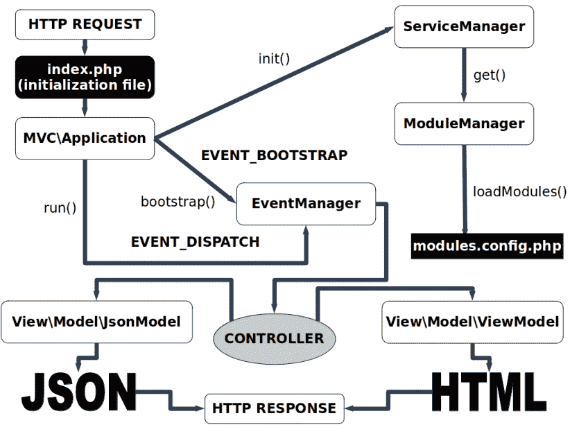
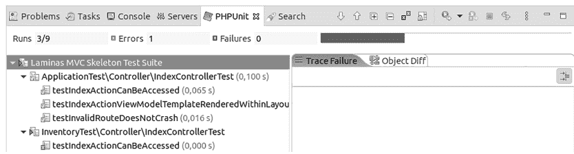
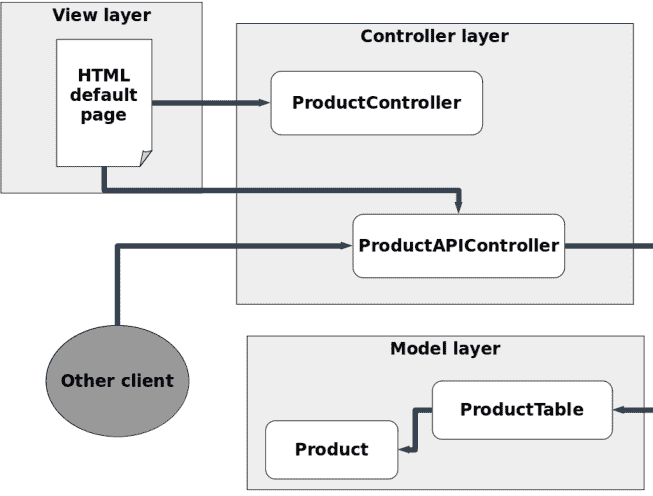
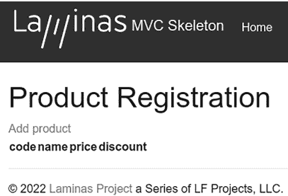
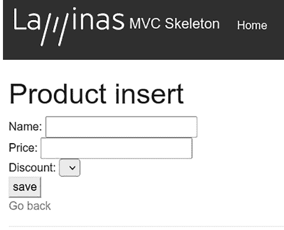
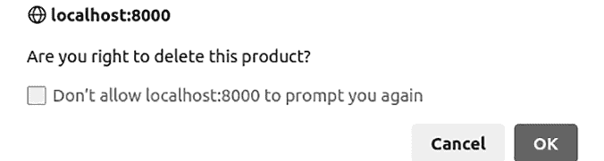
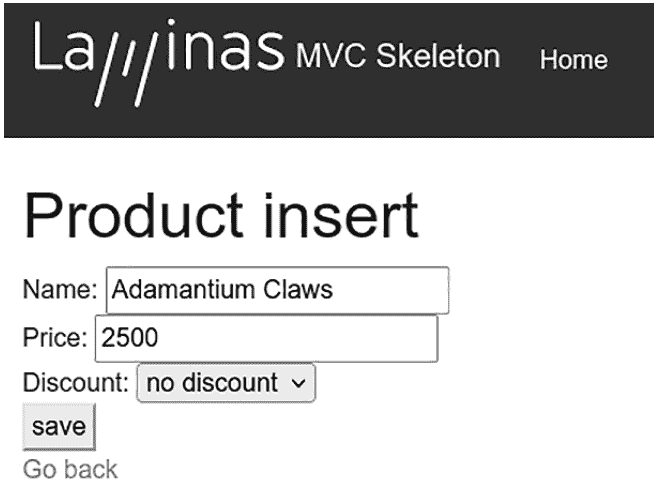

## 请求控制与数据视图

本章将演示如何在 MVC 应用程序中使用 Laminas 对控制器和视图层的实现。我们将先简要回顾 PHP 与 **超文本传输协议（HTTP）** 之间的关系。我们将了解 Laminas 如何处理 HTTP 请求和响应。之后，我们将实现 `Inventory` 模块的控制器和视图，即学习模块在 Laminas MVC 中如何工作。最后，我们将学习如何创建页面控制器和页面模板，并了解页面控制器的工作原理。

本章将涵盖以下主题：

- 了解 HTTP 与 PHP 之间的关系
- Laminas MVC 中的请求生命周期
- 使用控制器和视图页面实现 CRUD

本章结束时，您将能够使用 Laminas 模块和 MVC 模式实现注册功能，并了解 `laminas-mvc` 组件如何处理 HTTP 请求。此外，您将了解 Laminas 控制器页面类的工作原理，并能够使用 Laminas 模块管理 HTML 页面。

### 技术要求

本章所有相关代码均可在 `https://github.com/PacktPublishing/PHP-Web-Development-with-Laminas/tree/main/chapter07/whatstore` 中找到。

### 了解 HTTP 与 PHP 之间的关系

HTTP 的本质是这样的：一台名为客户端的计算机向另一台名为服务器的计算机发送一条文本消息（或请求）。服务器用一条文本消息（或响应）进行回复。自 2014 年起，HTTP 已由 RFC 7230 至 7237 定义。根据 RFC 7230，“客户端”和“服务器”是角色，因此同一台计算机既可以是客户端也可以是服务器。例如，在基于微服务的分布式系统中，每个微服务既可以充当另一个微服务的客户端，也可以充当另一个微服务的服务器。

有些编程语言被改编用于构建 Web 应用程序。然而，PHP 是一种最初为使用 HTTP 而创建的语言。Rasmus Lerdorf 开发 PHP 是因为他对用于创建动态页面（或者更准确地说，与数据库集成的 HTML 页面）的现有工具不满意。PHP 与用于 Web 应用程序开发的协议并行发展。使用 PHP 可以非常快速地提供动态页面。挑战在于不要使 PHP 应用程序变得复杂，并随着应用程序的增长保持应用程序可控。

Laminas 有一个将 HTTP 元素封装为对象的组件。这就是 `laminas-http` 组件。该组件由 `laminas-mvc` 使用。`laminas-http` 组件实现了由 `laminas-stdlib` 定义的接口。`laminas-stdlib` 组件代表了 Laminas 框架中最高级别的复用，包含大多数 Laminas 组件使用的接口和抽象类。

我们将看到 `laminas-mvc` 如何使用 `laminas-http` 中的类。在下一节中，我们将了解 Laminas MVC 应用程序中的请求生命周期。

### Laminas MVC 中的请求生命周期

此刻，您可以快速启动 `whatstore` 应用程序，并使用 PHP 的内嵌 Web 服务器查看主页。从 `whatstore` 目录中，您可以键入以下命令：

```
php -S localhost:8000 -t public/
```

当您在浏览器中打开 `localhost:8000` 时，将看到与第 2 章《为我们的电子商务应用程序设置环境》中看到的相同的欢迎页面。当然，我们尚未更改任何视图。

在第 5 章《创建虚拟商店项目》中，我们了解了 `public` 目录的一些知识。我们了解到，MVC Laminas 应用程序的结构就像一座中世纪城堡，唯一进入方式是通过吊桥。这里的吊桥就是 `public` 目录。所有 HTTP 请求都将传递给 `public` 目录内的 `index.php` 文件。那么，`index.php` 到底做什么？它会执行以下操作：

- 导入 `autoload.php` Composer 文件。
- 检查 Laminas Application 类是否存在。
- 检索配置。如果存在开发配置，则该配置将覆盖生产配置。
- 使用 `Application::init` 方法实例化 `Application` 类。该实例通过依赖注入接收来自 `laminas-http` 的对象。
- 从创建的实例中执行 `Application->run` 方法。

当 index.php 执行 Application->run 时，会发生控制反转。从这一点开始，Laminas 将接管控制权并会调用您的特定代码，换句话说，您的业务代码。

> 注：控制反转
> 您可以在 Martin Fowler 的以下文章中了解有关控制反转模式的更多信息：https://martinfowler.com/bliki/InversionOfControl.html。

图 7.1 展示了 Laminas MVC 应用程序中请求生命周期的总体情况：



图 7.1 – Laminas MVC 应用程序中的 HTTP 请求生命周期

Laminas 使用事件驱动编程来处理请求生命周期的步骤：引导、路由、分发控制器和呈现视图。我们可以将此生命周期划分为两个主要时刻：

- 执行 `Application::init` 方法时，`ServiceManager` 将获取 `ModuleManager` 的实例，该实例加载在 `modules.config.php` 文件中注册的模块。`Application::init` 方法还使用 `bootstrap` 方法触发 `EVENT_BOOTSTRAP` 事件。`EventManager` 类会通知该事件的侦听器以执行引导任务。

- 执行 `Application->run` 方法时，`Application` 会触发 `EVENT_DISPATCH` 事件。`EventManager` 类会通知该事件的侦听器，其中一个侦听器会实例化一个控制器类。该控制器类随即为 HTTP 响应呈现一个视图。此视图可以是 JSON 对象、HTML 页面，或者其他应用程序可消费的任何格式。

等一下。到底会调用哪个控制器？这取决于路由。如前所述，在 *第 4 章，从对象关系映射到 MVC 控制器* 中，Laminas 在其模块中定义路由。路由是 URL 模式与控制器类之间的关联。`Application->run` 方法还会触发一个名为 `EVENT_ROUTE` 的事件，`EventManager` 会通知与 `ModuleManager` 相关的某些侦听器（`ModuleRouteListener` 和 `RouteListener`）。这些侦听器会根据与 URL 匹配的路由定义要调用的控制器。

我们将在下一节中更好地理解此生命周期，届时我们将为产品注册实现控制器和视图页面。

### 使用控制器和视图页面实现 CRUD

我们将在 `Inventory` 模块中创建一个用于管理产品的控制器。遵循 TDD 的良好实践，我们将从测试开始创建此控制器。

在本节中，我们将首先测试当前的测试用例。然后，我们将创建用于插入、检索、更新和删除产品的测试。

### 测试当前的测试用例

第一步是按照以下步骤检查当前测试用例的状态：

- 1. 选择 `whatstore` 项目，右键单击 **运行方式/PHPUnit 测试**。您将在 **PHPUnit** 选项卡中看到 PHPUnit 的输出，如 *图 7.2* 所示：



图 7.2 – PHPUnit 输出

如您所见，`Inventory` 模块中的 `IndexControllerTest` 类失败了。失败是因为该类是从 `Application` 模块的 `IndexControllerTest` 复制而来的，而路由和页面不同。让我们修复此类。

- 2. 首先，将 `Inventory\\Controller\\IndexControllerTest` 的 `testIndexActionCanBeAccessed` 方法更改为以下代码：

```
public function testIndexActionCanBeAccessed(): void
{
    $this->dispatch('/inventory', 'GET');
    $this->assertResponseStatusCode(200);
    $this->assertModuleName('inventory');
    $this->assertControllerName(IndexController::class); // as specified in router's controller name alias
    $this->assertControllerClass('IndexController');
    $this->assertMatchedRouteName('inventory');
}
```

- 3. 然后，从 `InventoryTest\\Controller\\IndexControllerTest` 中删除 `testIndexActionViewModelTemplateRenderedWithinLayout` 方法。此方法仅适用于 *whatstore* 主页。

- 4. 还要删除 `testInvalidRouteDoesNotCrash` 方法。该方法已为 `Application` 模块定义。

如果您再次执行 **运行方式/PHPUnit 测试**，`IndexControllerTest` 将再次失败。现在，原因是 `inventory` 路由尚不存在。我们需要在 `Inventory` 模块的 `module.config.php` 文件中创建此路由。


- 5. 将以下代码添加到 module.config.php 文件中，使文件中的 routes 键如下所示：

```php
'routes' => [
    'inventory' => [
        'type' => Segment::class,
        'options' => [
            'route' => '/inventory[:/controller[/:action[/:key]]]',
            'defaults' => [
                'controller' => Controller\IndexController::class,
                'action' => 'index'
            ],
        ],
    ],
],
```

我们已创建一种 Segment 类型的路由，即接受参数的路由。我们在第 4 章“从对象关系映射到 MVC 容器”中已经学习过此路由。方括号之间的单词为可选项。冒号前的单词为变量。inventory 路由允许我们定义要实例化的控制器、要执行的动作以及用于选择要处理对象的 key 参数。如果未提供这些参数，则默认控制器为 IndexController，默认动作为 index。

- 6. 将 StoreTest\Controller\IndexControllerTest 类的 testIndexActionCanBeAccessed 方法更改为以下代码：

```php
public function testIndexActionCanBeAccessed() : void
{
    $this->dispatch('/store', 'GET');
    $this->assertResponseStatusCode(200);
    $this->assertModuleName('store');
    $this->assertControllerName(IndexController::class); // as specified in router's controller name alias
    $this->assertControllerClass('IndexController');
    $this->assertMatchedRouteName('store');
}
```

- 7. 然后，根据我们已完成的工作，从 StoreTest\Controller\IndexControllerTest 中移除 testIndexActionViewModelTemplateRenderedWithinLayout 方法。别忘了也移除 testInvalidRouteDoesNotCrash 方法。

正如我们应该学到的，我们需要在 Store 模块的 module.config.php 文件中创建此路由。该文件中的 routes 键必须如下所示：

```php
'routes' => [
    'store' => [
        'type' => Segment::class,
        'options' => [
            'route' => '/store[:/controller[/:action[/:key]]]',
            'defaults' => [
                'controller' => Controller\IndexController::class,
                'action' => 'index',
            ],
        ],
    ],
],
```

太好了——暂时，我们的测试运行成功。从现在开始，我们将使用测试来实现产品的控制器层和视图层。我们的产品控制器层将有两个控制器类，一个用于接收来自 HTML 默认页面（whatstore 应用程序的一部分）的请求，另一个用于接收来自任何客户端的请求。此架构允许其他客户端（如移动应用程序）使用 whatstore 的服务。图 7.3 描绘了该面向服务的架构：



### 图 7.3 – 产品控制器架构

我们将从 ProductAPIController 开始，任何客户端都可以使用它。正如我们已定义的，我们将实现一个测试类来构建控制器类。在这样做之前，请执行以下操作：

- 1. 在 Inventory 模块的 test/Controller 文件夹中，将 IndexControllerTest.php 文件复制到 ProductAPIControllerTest.php。
- 2. 将上述文件中的类名更改为 ProductAPIControllerTest 并移除 testIndexActionCanBeAccessed 方法。

现在，让我们为 ProductAPIController 类实现测试方法。

### 测试产品插入

要在 ProductAPIControllerTest 中创建的第一个测试方法将是 testProductInsert。代码如下：

```php
public function testProductInsert() : void
{
    $discount = new Discount();
    $data = [
        'name' => 'no discount',
        'operator' => '-',
        'factor' => 0
    ];
    $discount->exchangeArray($data);
    $discountTable = $this->getApplication()->getServiceManager()->get('DiscountTable');
    $discountTable->save($discount);
    $discount = $discountTable->getByField('name', 'no discount');

    $_POST = [
        'name' => 'Cosmic Cube',
        'price' => 5642,
        'code_discount' => $discount->code
    ];

    $this->dispatch('/inventoryapi/productapi', 'POST', $_POST);
    $this->assertResponseStatusCode(200);
    $this->assertModuleName('inventory');
    $this->assertControllerName('productapi'); // as specified in router's controller name alias
    $this->assertControllerClass('ProductAPIController');
    $this->assertMatchedRouteName('inventoryapi');
}
```

testProductInsert 方法执行以下操作：

- 创建并持久化一个 Discount 对象
- 向 /inventoryapi/productapi 端点发送 HTTP POST 请求
- 检查响应是否具有 200 状态（成功）
- 检查被调用的模块是否为 Inventory
- 检查被调用控制器名称的别名是否为 productapi
- 检查被调用的控制器名称是否为 ProductAPIController
- 检查路由名称是否为 inventoryapi

我们需要定义重定向到 ProductAPIController 的 inventoryapi 路由。我们还需要为 ProductController 定义另一个路由。因此，在 Inventory 模块的 module.config.php 文件中，我们将以下路由添加到 routes 键：

```php
'routes' => [
    'inventory' => [
        'type'     => Segment::class,
        'options'  => [
            'route'    => '/inventory[:/controller[/:action[/:key]]]',
            'defaults' => [
                'controller' => Controller\IndexController::class,
                'action'     => 'index'
            ],
        ],
    ],
    'inventoryapi' => [
        'type'     => Segment::class,
        'options'  => [
            'route'    => '/inventoryapi[:/controller[/:key]]'
        ],
    ],
],
```

> **重要提示：RESTful 控制器不得具有默认动作**
>
> 当我们使用 RESTful 控制器时，不得定义默认动作。原因是默认动作会覆盖 HTTP 方法的推断。

在实现产品插入的测试后，我们将接下来实现产品恢复的测试。

### 测试产品恢复

我们将在 ProductAPIControllerTest 类中实现 testProductRecover 方法，代码应如下所示：

```php
public function testProductRecover() : void
{
    $name = 'Cosmic Cube';
    $this->dispatch('/inventoryapi/productapi/' . $name, 'GET');
    $this->assertResponseStatusCode(200);
    $this->assertModuleName('inventory');
    $this->assertControllerName('productapi'); // as
    $this->assertControllerClass('ProductAPIController');
    $this->assertMatchedRouteName('inventoryapi');
    $body = $this->getResponse()->getBody();
    $this->assertStringContainsString($name, $body);
}
```

testProductRecover 方法执行以下操作：

- 向 /inventoryapi/productapi 端点发送 HTTP GET 请求（注意搜索参数为产品名称）
- 检查响应是否具有 200 状态（成功）
- 检查被调用的模块是否为 Inventory
- 检查被调用控制器名称的别名是否为 productapi
- 检查被调用的控制器名称是否为 ProductAPIController
- 检查路由名称是否为 inventoryapi
- 检查响应体是否包含产品名称

在实现产品恢复的测试后，我们将实现产品更新的测试。

### 测试产品更新

现在，我们将在 ProductAPIControllerTest 类中实现 testProductUpdate 方法，代码如下所示：

```php
public function testProductUpdate() : void
{
    $productTable = $this->getApplication()->getServiceManager()->get('ProductTable');
    $product = $productTable->getByField('name', 'Cosmic Cube');
    $product->name = 'Infinity Gauntlet';
    $product->price = 9654;
    $_POST = $product->toArray();
    $this->dispatch('/inventoryapi/productapi/' . $product->code, 'PUT', $_POST);
    $this->assertResponseStatusCode(200);
    $this->assertModuleName('inventory');
    $this->assertControllerName('productapi'); // as specified in router's controller name alias
    $this->assertControllerClass('ProductAPIController');
    $this->assertMatchedRouteName('inventoryapi');
}
```

testProductUpdate 方法执行以下操作：

- 获取 ProductTable 的实例
- 恢复之前插入的产品
- 将产品数据提取到 $_POST 变量中
- 向 /inventoryapi/productapi 端点发送 HTTP PUT 请求（注意搜索参数为产品代码）
- 检查响应是否具有 200 状态（成功）
- 检查被调用的模块是否为 Inventory
- 检查被调用控制器名称的别名是否为 productapi


- 检查调用的控制器名称是否为 `ProductAPIController`
- 检查路由名称是否为 `inventoryapi`

在实现产品更新测试后，我们将实现产品删除测试。

### 测试产品删除

最后，为了完成 API 测试，我们将在 `ProductAPIControllerTest` 类中实现 `testProductDelete` 方法。代码应如下所示：

```
public function testProductDelete() : void
{
    $productTable = $this->getApplication() ->
        getServiceManager()->get('ProductTable');
    $product = $productTable->getByField('name',
        'Infinity Gauntlet');
    $this->dispatch('/inventoryapi/productapi/' .
        $product->code, 'DELETE');
    $this->assertResponseStatusCode(200);
    $this->assertModuleName('inventory');
    $this->assertControllerName('productapi'); // as
        specified in router's controller name alias
    $this->assertControllerClass
        ('ProductAPIController');
    $this->assertMatchedRouteName('inventoryapi');
    $discountTable = $this->getApplication() ->
        getServiceManager()->get('DiscountTable');
    $discount = $discountTable->getByField('name', 'no
        discount');
    $discountTable->delete($discount->code);
}
```

testProductDelete 方法执行以下操作：

- 获取 `ProductTable` 的实例
- 恢复先前插入的产品
- 向 `/inventoryapi/productapi` 端点发送 HTTP DELETE 请求（请注意，删除的参数是产品代码）
- 检查响应是否具有 200 状态码（成功）
- 检查调用的模块是否为 Inventory
- 检查调用的控制器名称的别名是否为 productapi
- 检查调用的控制器名称是否为 ProductAPIController
- 检查路由名称是否为 inventoryapi
- 恢复由 testProductInsert 方法插入的 Discount 对象
- 使用 DiscountTable 实例删除折扣

如果您现在执行 Run As/PHPUnit 测试，ProductAPIControllerTest 将失败，因为我们没有 ProductAPIController 类。我们将在下一节中创建此类。

### 创建 ProductAPIController 类

在 Inventory 模块的 src/Controller 文件夹中创建 ProductAPIController.php 文件。让我们逐部分查看 ProductAPIController.php 文件的源代码。此文件以以下内容开始：

```
<?php
namespace Inventory\Controller;
use Laminas\Mvc\Controller\AbstractRestfulController;
use Laminas\View\Model\JsonModel;
use Inventory\Model\Product;
use Inventory\Model\ProductTable;
```

在 ProductAPIController 类的第一部分中，我们使用了四个依赖项。ProductAPIController 类扩展 AbstractRestfulController。此超类旨在将 HTTP 方法映射到特定方法：

```
class ProductAPIController extends
AbstractRestfulController
{
```

从 AbstractRestfulController 继承的 $identifierName 属性被重写为键值。$identifierName 的默认值为 id，但 inventoryapi 路由定义了键参数。

由于 ProductAPIController 处理产品，它需要有一个 ProductTable 实例的属性：

```
protected $identifierName = 'key';
private ProductTable $productTable;
```

构造方法接收 ProductTable 实例并将其分配给 productTable 属性：

```
public function __construct(ProductTable $productTable)
{
    $this->productTable = $productTable;
}
```

HTTP POST 映射到 create 方法：

```
public function create($data)
{
    $product = new Product();
    $product->exchangeArray($data);
    $inserted = $this->productTable->save($product);
    return new JsonModel(['inserted' => $inserted]);
}
```

create 方法接收的 $data 参数包含来自 $_POST 的数据。

HTTP GET（带参数）映射到 get 方法：

```
public function get($id)
{
    $field = (is_numeric($id) ? 'code' : 'name');
    $id = (is_numeric($id) ? (int) $id : $id);
    $product = $this->productTable->getByField($field, $id);
    return new JsonModel(['product' => $product->toArray()]);
}
```

HTTP PUT 映射到 update 方法：

```
public function update($id, $data)
{
    $product = $this->productTable->getByField('code', $id);
    $product->exchangeArray($data);
    $updated = $this->productTable->save($product);
    return new JsonModel(['updated' => $updated]);
}
```

HTTP DELETE 映射到 delete 方法：

```
public function delete($id)
{
    $deleted = $this->productTable->delete($id);
    return new JsonModel(['deleted' => $deleted]);
}
```

请注意，ProductAPIController 的方法返回 JsonModel 实例。

JsonModel 类将注入其构造函数的数据转换为 JSON 格式——这是 API 的适当行为。但是，要使用 JsonModel 将数据发送到视图层，我们需要设置一个策略。默认策略用于 HTML 页面渲染。要在响应中使用 JSON 格式，我们必须将以下项添加到 Inventory 模块的 modules.config.php 中的 view_manager 键：

```
'strategies' => [
    'ViewJsonStrategy',
],
```

要调用 ProductAPIController 类，我们需要将 Inventory 模块中 modules.config.php 的 controllers 键更改为以下内容：

```
'controllers' => [
    'aliases' => [
        'productapi' => Controller\ProductAPIController::class
    ],
    'factories' => [
        Controller\IndexController::class =>
            InvokableFactory::class,
        Controller\ProductAPIController::class =>
            Controller\ProductAPIControllerFactory::class
    ],
],
```

aliases 键（如我们在 *第 4 章，从对象关系映射到 MVC 容器* 中所见）用于将控制器别名映射到实际控制器类名。正如我们所知，factories 键定义了如何创建控制器类。我们需要在 Inventory 模块的 src/Controller 文件夹中创建 ProductAPIControllerFactory 类。源代码将如下所示：

### ProductAPIControllerFactory.php

```
<?php
namespace Inventory\Controller;
use Laminas\ServiceManager\Factory\FactoryInterface;
use Interop\Container\ContainerInterface;
class ProductAPIControllerFactory implements
FactoryInterface
{
    public function __invoke(ContainerInterface $container,
    $requestedName, array $options = null)
    {
    $productTable = $container->get('ProductTable');
    return new ProductAPIController($productTable);
    }
}
```

如果您现在执行 Run As/PHPUnit 测试，测试将成功运行。因此，产品 API 似乎已完成。在下一节中，我们将创建负责控制 whatstore 应用程序 HTML 页面的类。

### 实现 ProductController 类

我们现在将在 Inventory 模块中创建 ProductControllerTest 类。让我们逐部分进行，从以下源代码开始：

```
<?php
declare(strict_types=1);
namespace InventoryTest\Controller;
use Inventory\Controller\IndexController;
use Laminas\Stdlib\ArrayUtils;
use Laminas\Test\PHPUnit\Controller\AbstractHttpControllerTestCase;
use Inventory\Controller\ProductController;
```

在 ProductAPIController 类的第一部分中，我们使用了四个依赖项。

接下来，我们将使用 setUp 方法准备测试环境，恢复应用程序配置：

```
class ProductControllerTest extends
    AbstractHttpControllerTestCase
{
    public function setUp(): void
    {
        $configOverrides = [];
        $this->setApplicationConfig(ArrayUtils::merge(
            include __DIR__ . '/../../../../../config/application.config.php',
            $configOverrides
        ));

        parent::setUp();
    }
}
```

请注意，应用程序配置的内容与 $configOverrides 数组合并。此 $configOverrides 数组允许我们更改运行测试的配置值。

接下来，我们将使用 testIndexActionCanBeAccessed 方法测试 ProductController 索引页面的请求，该页面将列出产品：

```
public function testIndexActionCanBeAccessed(): void
{
    $this->dispatch('/inventory/product', 'GET');
    $this->assertResponseStatusCode(200);
    $this->assertModuleName('inventory');
    $this->assertControllerName('product'); // as
        specified in router's controller name alias
    $this->assertControllerClass('ProductController');
    $this->assertMatchedRouteName('inventory');
}
```


最后，我们将使用 testEditActionCanBeAccessed 方法来测试对编辑页面的请求，该请求需要允许我们插入和更新产品：

```php
public function testEditActionCanBeAccessed(): void
{
    $this->dispatch('/inventory/product/edit', 'GET');
    $this->assertResponseStatusCode(200);
    $this->assertModuleName('inventory');
    $this->assertControllerName('product'); // as specified in router's controller name alias
    $this->assertControllerClass('ProductController');
    $this->assertMatchedRouteName('inventory');
}
```

现在，让我们创建要测试的类。以下代码块显示了控制产品注册 HTML 界面的类：

### ProductController.php

```php
<?php
declare(strict_types=1);
namespace Inventory\Controller;
use Laminas\Mvc\Controller\AbstractActionController;
use Laminas\View\Model\ViewModel;
use Inventory\Model\ProductTable;
use Inventory\Model\DiscountTable;
class ProductController extends AbstractActionController
{
    private ?ProductTable $productTable = null;
    private ?DiscountTable $discountTable = null;
    public function __construct(ProductTable $productTable,
    DiscountTable $discountTable)
    {
    $this->productTable = $productTable;
    $this->discountTable = $discountTable;
    }
    public function indexAction()
{
    $products = $this->productTable->getAll();
    return new ViewModel(['products' => $products]);
}
public function editAction()
{
    $key = $this->params('key');
    $product = $this->productTable->
        getByField('code',$key);
    $discounts = $this->discountTable->getAll();
    return new ViewModel([
        'product' => $product,
        'discounts' => $discounts
    ]);
}
}
```

**用数组代替 ViewModel 对象**

你也可以返回一个数组来代替 ViewModel 对象。控制器类会将该数组注入到 ViewModel 对象中。

indexAction 方法检索一组产品并将其传递到视图层。editAction 方法尝试通过产品代码查找产品，并将产品对象和一组折扣传递到视图层。你可能已经发现，产品和折扣的检索依赖于表映射器对象。这些对象由构造函数注入。这种注入是由工厂类 ProductControllerFactory 完成的，其源代码如下所示：

### ProductControllerFactory.php

```php
<?php
namespace Inventory\Controller;
use Laminas\ServiceManager\Factory\FactoryInterface;
use Interop\Container\ContainerInterface;
class ProductControllerFactory implements FactoryInterface
{
    public function __invoke(ContainerInterface $container,
        $requestedName, array $options = null)
{
    $productTable = $container->get('ProductTable');
    $discountTable = $container->get('DiscountTable');
    return new ProductController($productTable,
        $discountTable);
    }
}
```

我们需要在 modules.config.php 中注册此工厂。此外，我们还需要为 ProductController 注册一个别名。Inventory 模块中 modules.config.php 的 controllers 键将如下所示：

```php
'controllers' => [
    'aliases' => [
        'productapi' => Controller\
            ProductAPIController::class,
        'product' => Controller\
            ProductController::class
    ],
    'factories' => [
        Controller\IndexController::class =>
            InvokableFactory::class,
        Controller\ProductAPIController::class =>
            Controller\ProductAPIControllerFactory::class,
        Controller\ProductController::class =>
            Controller\ProductControllerFactory::class,
    ],
],
```

如果你现在执行 Run As/PHPUnit 测试，测试将失败，并显示以下消息：

```
There were 2 failures:
1) InventoryTest\Controller\
ProductControllerTest::testIndexActionCanBeAccessed
Failed asserting response code "200", actual status code is
"500"
Exceptions raised:
Exception 'Laminas\View\Exception\RuntimeException' with
message 'Laminas\View\Renderer\PhpRenderer::render: Unable
to render template "inventory/product/index"; resolver could
not resolve to a file' in /opt/lampp/htdocs/whatstore/vendor/
laminas/laminas-view/src/Renderer/PhpRenderer.php:511
/opt/lampp/htdocs/whatstore/vendor/laminas/laminas-test/src/
PHPUnit/Controller/AbstractControllerTestCase.php:434
/opt/lampp/htdocs/whatstore/module/Inventory/test/Controller/
ProductControllerTest.php:33
2) InventoryTest\\Controller\\
ProductControllerTest::testEditActionCanBeAccessed
Failed asserting response code "200", actual status code is
"500"
Exceptions raised:
Exception 'Laminas\\View\\Exception\\RuntimeException' with
message 'Laminas\\View\\Renderer\\PhpRenderer::render: Unable
to render template "inventory/product/edit"; resolver could
not resolve to a file' in /opt/lampp/htdocs/whatstore/vendor/
laminas/laminas-view/src/Renderer/PhpRenderer.php:511
/opt/lampp/htdocs/whatstore/vendor/laminas/laminas-test/src/
PHPUnit/Controller/AbstractControllerTestCase.php:434
/opt/lampp/htdocs/whatstore/module/Inventory/test/Controller/
ProductControllerTest.php:43
```

请注意，错误消息涉及模板渲染。这些错误的原因是我们尚未为这些操作生成 HTTP 响应创建 HTML 页面。我们将在下一节中创建这些页面。

### 实现 ProductController 的页面

默认情况下，当控制器方法返回 ViewModel 对象时，视图管理器将搜索与方法名相同的页面（不包括 Action 后缀）。如果 indexAction 和 editAction 方法的先前测试失败，那么我们必须创建 index.phtml 和 edit.phtml 文件。这些文件必须在 Inventory/view/inventory/product 文件夹中创建，如图 7.4 所示。.phtml 文件是 PHP 文件：

```
module
  Application
  Generic
  Inventory
    config
    src
    test
    view
      error
      inventory
        index
    product
      edit.phtml
      index.phtml
  Store
```

### 图 7.4 – Inventory 模块中 ProductController 的视图页面

仅有 edit.phtml 和 index.phtml 文件的存在就足以让 ProductControllerTest 成功运行，但这并不意味着用户可以与网页进行交互。ProductControllerTests 测试旨在检查这些文件是否存在（结果是，你的内容将与布局合并以组成响应）。

首先，将以下代码添加到 index.phtml 文件中：

### index.phtml

```php
<h1>Product Registration</h1>
<a href="<?= $this->url('inventory', ['controller' =>
    'product', 'action' => 'edit']) ?>">Add product</a>
<table>
    <thead>
        <tr>
            <th>code</th>
            <th>name</th>
            <th>product</th>
            <th>discount</th>
        </tr>
    </thead>
    <tbody>
<?php
foreach ($this->products as $product) :
?>
	<tr>
		<td><button id="<?=$product->code?>"></button></td>
		<td><?=$product->name?></td>
		<td><?=$product->price?></td>
		<td><?=$product->discount->name?></td>
		<td><button id="<?=$product->discount->name?>">delete</button></td>
	</tr>
<?php
endforeach;
?>
    </tbody>
</table>
```

$this->products 属性是在 ProductController->indexAction 方法的 ViewModel 实例构造函数中传递的相同对象。.phtml 文件中的 $this 关键字引用 Laminas\View\Renderer\PhpRenderer 类。该类拥有用于生成视图元素的帮助程序，并包含控制器发送的数据。index.phtml 文件将呈现页面，如图 7.5 所示：



图 7.5 – 产品列表页面

“添加产品”将带你进入由 edit.phtml 呈现的页面。该文件的内容将如下所示：

### edit.phtml

```php
<h1>Product <?= (empty($this->product->code)) ? 'insert' :
'update' ?>?</h1>
<form id="product">
Name: <input type="text" name="name" autofocus=
"autofocus" value="<?=$this->product->name?>"><br />
Price: <input type="text" name="price" value="<?=$
this->product->price?>"><br />
Discount: <select name="code_discount" value="<?=$
this->product->discount->code?>">
<?php
foreach($this->discounts as $discount):
?>
<option value="<?=$discount->code?>" <?= ($discount->code ==
$this->product->discount->code ? 'selected' : '')?>
>$discount->name</option>
<?php
endforeach;
?>
</select><br />
<input type="hidden" name="code" value="<?=$this->product->code?>">
```


```
</form>
<button id="save">save</button>
<a href="<?= $this->url('inventory', ['controller' => 'product']) ?>">Go back</a>
```

edit.phtml 文件将呈现图 7.6 所示的页面：



图 7.6 – 产品插入表单

我们已定义页面的内容，但它们尚未可用。在下一节中，我们将实现 HTML 页面与产品 API 之间的交互。

### 实现 Web 界面与 API 之间的交互

我们将使用 jQuery 在 index.phtml 和 edit.phtml 页面中实现 REST 交互。Laminas 应用程序骨架已将 jQuery 带到 public/js 文件夹中。Application 模块的 layout.phtml 文件不仅导入 jQuery 文件，还导入 Bootstrap 文件。不过，这些文件是直接嵌入在 HTML 文档主体中的。我们将更改为在 HTML 文档头部导入这些文件：

- 打开 modules/Application/view/layout 中的 layout.phtml 文件，从文件底部删除以下部分：

```php
<?=$this->inlineScript()
->prependFile($this->basePath
('js/bootstrap.min.js'))
->prependFile($this->basePath
('js/jquery-3.5.1.min.js')) ?>
```

然后，我们将在 layout.phtml 的 <head> 节末尾添加以下部分：

```php
<?=$this->headScript()
->prependFile($this->basePath
('js/bootstrap.min.js'))
->prependFile($this->basePath
('js/jquery-3.5.1.min.js')) ?>
```

此更改是必要的，因为我们将向文档头部添加依赖于 jQuery 的 JavaScript 块。我们也引入 Bootstrap 以保持统一性。

- 让我们返回到 Inventory 模块，使用以下内容修改 view/inventory/product 中的 edit.phtml 文件：

### edit.phtml

```php
<?php
$this->headScript() ->appendScript
(file_get_contents(__DIR__ . '/edit.js'));
?>
<h1>Product <?= (empty($this->product->code)) ?
'insert' : 'update' ?></h1>
<form id="product">
Name: <input type="text" name="name"
autofocus="autofocus" value="<?=$this->product->name?>"><br/>
Price: <input type="text" name="price"
value="<?=$this->product->price?>"><br/>
Discount: <select name="code_discount">
<?php
foreach($this->discounts as $discount):
?>
<option value="<?=$discount->code?>" <?= 
($discount->code == $this->product->discount->code
? 'selected' : '')?>> <?=$discount->name?></option>
<?php
endforeach;
?>
</select><br/>
<input type="hidden" name="code" value="<?=$this->product->code?>" />
</form>
<button id="save">save</button>
<p>
<span id="api" url="<?= $this->url('inventoryapi', ['controller' => 'productapi']) ?>"></span>
<span id="target" url="<?= $this->url('inventory', ['controller' => 'product']) ?>"></span>
<a href="<?= $this->url('inventory', ['controller' => 'product']) ?>">Go back</a>
</p>
```

是的，span 标签没有 url 属性，但这样可以工作。我们这样做是因为易于理解。有更合适的方法将数据传递给 JavaScript，但 jQuery 在这里的作用仅是一个示例，并不是 Laminas 所要求的伙伴，因此我们将接受这种解决方案。

让我们看看自上一个版本以来 edit.phtml 文件有哪些更改：

- 在文件顶部，我们告诉视图层将名为 edit.js 的 JavaScript 文件添加到文档头部。edit.phtml 文件仅生成 HTML 主体的内容。完整的 HTML 文档是 layout.phtml（包含文档头部）与控制器的视图文件的组合。
- 在文件底部，我们定义了两个带有 <span> 标签的占位符，用于存储列表页面和产品 API 的 URL。

嗯，如果 edit.phtml 读取 edit.js 文件，那么这个文件就需要存在。让我们在 view/inventory/product 中创建这个文件，使用以下源代码：

### edit.js

```javascript
var save = function () {
 var api = $( "#api" ).attr("url");
 var target = $( "#target" ).attr("url");
 var formData = $( "#product" ).serialize();
 var code = parseInt($("input[name='code']")
   .val());
if (code == 0) {
  $.post( api, formData , function(data) {
  alert("product has been inserted");
  window.location.href = target;
  }).fail(function() {
  alert('error');
  });
} else {
  $.put( api, formData , function(data) {
  alert("product has been updated");
  window.location.href = target;
  }).fail(function() {
  alert('error');
  });
}
}
};
$(document).ready(function() {
  $("#save").click(save);
});
```

edit.js 文件将 #save 按钮的 OnClick 事件与 save 函数相关联。save 函数读取表单，如果没有 code 则使用 POST 方法发出 HTTP 请求，如果有 code 则使用 PUT 方法。如果插入成功，将打开确认窗口，并将用户重定向到列表页面。

让我们为列表页面准备编辑和删除产品的功能。将 view/inventory/product 中的 index.phtml 文件更改为以下内容：

### index.phtml

```php
<?php
$this->headScript()->appendScript(file_get_contents(__DIR__
  . '/index.js'));
?>
<h1>Product Registration</h1>
<a href="<?= $this->url('inventory', ['controller' =>
 'product', 'action' => 'edit']) ?>">Add product</a>
<table>
 <thead>
 <tr>
  <th>code</th>
  <th>name</th>
  <th>product</th>
  <th>discount</th>
 </tr>
 </thead>
 <tbody>
 <?php
 foreach ($this->products as $product) :
 ?>
 <tr>
  <td><button id="<?= $product->code?>" 
  class="edit"><?= $product->code?></button></td>
  <td><?= $product->name?></td>
  <td><?= $product->price?></td>
  <td><?= $product->discount->name?></td> <td><button id="<?= $product->code?>" 
  class="delete">delete</button></td>
 </tr>
 <?php
 endforeach;
 ?>
 </tbody>
</table>
<span id="api" url="<?= $this->url('inventoryapi',
 ['controller' => 'productapi']) ?>"></span>
<span id="target" url="<?= $this->url('inventory',
 ['controller' => 'product']) ?>"></span>
```

自上一个版本以来，此文件有以下更改：

- 在文件顶部，我们告诉视图层将名为 index.js 的 JavaScript 文件添加到文档头部。index.phtml 文件仅生成 HTML 主体的内容。正如我们之前所说，完整的 HTML 文档是 layout.phtml（包含文档头部）与控制器的视图文件的组合。
- 行的第一列是一个 class 属性等于 "edit" 的按钮。
- 行的最后一列是一个 class 属性等于 "delete" 的按钮。
- 在文件底部，我们定义了两个带有 <span> 标签的占位符，用于存储列表页面和产品 API 的 URL。

嗯，如果我们读取 index.js 文件，那么这个文件就需要存在。让我们在 view/inventory/product 中创建这个文件，使用以下源代码：

### index.js

```javascript
var edit = function() {
    var code = parseInt($(this).attr('id'));
    var target = $(
        "#target").attr("url") + '/edit/'
        + $(this).attr('id');
    if (code != 0) {
        document.location.href = target;
    }
};

var remove = function() {
    var api = $(
        "#api").attr("url") + '/' +
        $(this).attr('id');
    if (confirm("Are you right to delete this
    product?")) {
        $.ajax({url: api, type: 'DELETE'}).done
        (function(data) {
            alert("product has been
                deleted");
            document.location.reload();
        }).fail(function() {
            alert('error');
        });
    });
};
$(document).ready(function() {
	$("button[class='edit']").click(edit);
	$("button[class='delete']").click(remove);
});
```

index.js 文件将带有 edit 类的按钮的 OnClick 事件与 edit 函数相关联。index.js 文件还将带有 delete 类的按钮的 OnClick 事件与 remove 函数相关联。

edit 函数会将产品代码作为参数重定向到编辑页面。在 remove 函数中，如果用户确认操作，将发出 DELETE 方法的 HTTP 请求。如果删除成功，将打开确认窗口（参见图 7.7），并将用户重定向到列表页面：



图 7.7 – 删除产品的确认窗口

看来我们已为与页面交互以及插入、更新、删除和列出产品实现了必要的工具。实际上，我们需要对视图模型进行一些调整。我们将在下一节中完成这些调整。

### 测试 Web 界面与 API 之间的交互

为了测试产品网页，我们需要调整 Product 和 ProductTable 类。为什么？因为产品和折扣之间存在关系。要测试 API，产品模型只拥有折扣代码就足够了，但在产品列表页面上显示折扣名称时，我们需要恢复折扣名称。

让我们将 Product->exchangeArray 方法更改为以下内容：

```php
public function exchangeArray($data) : void
{
	$this->code = ($data['code'] ?? 0);
	$this->name = ($data['name'] ?? '');
}
```


```php
$this->price = ($data['price'] ?? 0.0);
$this->discount = new Discount();
$this->discount->code = ($data['code_discount'] ?? 0);
$this->discount->name = ($data['name_discount'] ?? '');
}
```

请注意，我们已添加 name_discount 键。

然后，让我们将 Product->toArray 方法更改为此内容：

```php
public function toArray()
{
    $attributes = get_object_vars($this);
    unset($attributes['discount']);
    unset($attributes['name_discount']);
    $attributes['code_discount'] = $this->discount->code;

    return $attributes;
}
```

请注意，我们删除了 name_discount 键，因为该字段未在 products 表中持久化。

这个 name_discount 键来自哪里？此键将由 ProductTable 类恢复，但我们必须通过制作 INNER JOIN SQL 语句来重写该类中的 getAll 方法。ProductTable->getAll 方法必须如下所示：

```php
public function getAll($where = null): iterable {
    $select = new Select($this->tableGateway->getTable());

    $select->join('discounts', 'products.code_Discount = discounts.code', ['name_discount' => 'name']);

    if (!is_null($where)) {
        $parsedWhere = [];
        foreach($where as $index => $value) {
            $parsedWhere['products.' . $index] = $value;
        }
    }

    $select->where($parsedWhere);
    return $this->tableGateway->selectWith($select);
}
```

做出这些更改后，我们可以测试我们的 Web 界面：

- 1. 首先，我们将手动添加折扣，因为产品依赖于折扣。打开您的终端并进入 c:\xampp 文件夹（在 Windows 中）或 /opt/lamp 文件夹（在 Linux 中）。键入以下命令之一以打开 MySQL/MariaDB 客户端：

对于 Windows，请参见以下命令：

```
mysql\bin\mysql -u root
```

对于 Linux，请参见以下命令：

```
bin/mysql -u root
```

- 2. 使用 use 命令选择 whatstore 数据库：

```
MariaDB [(none)]> use whatstore;
```

- 3. 我们已通过测试创建了许多代码。让我们使用 ALTER TABLE 命令测试产品自增索引。以下代码行显示命令和预期输出：

```
MariaDB [whatstore]> ALTER TABLE products AUTO_INCREMENT = 1;
Query OK, 0 rows affected (0.362 sec)
Records: 0 Duplicates: 0 Warnings: 0
```

- 4. 也重新启动折扣自增索引：

```
MariaDB [whatstore]> ALTER TABLE discounts AUTO_INCREMENT = 1;
Query OK, 0 rows affected (0.323 sec)
Records: 0 Duplicates: 0 Warnings: 0
```

- 5. 添加折扣：

```
MariaDB [whatstore]> INSERT INTO discounts(name, operator, factor) VALUES ("no discount","-",0);
Query OK, 1 row affected (0.152 sec)
```

有用的一点是 – 执行 SQL INSERT 后，您可以使用 LAST_INSERT_ID() 函数获取此值：

| LAST_INSERT_ID() |
|------------------|
| 1 |

1 row in set (0.000 sec)

- 6. 现在，访问 http://localhost:8000/inventory/product/edit 并用产品名称填写表单，如图 7.8 所示：



© 2022 Laminas Project 系列 LF Projects, LLC。

图 7.8 – 已填写的产品插入表单

- 7. 单击保存按钮。将打开一个窗口，显示产品已插入的消息（参见图 7.9）：

@@localhost:8000
产品已插入
OK

图 7.9 – 确认产品插入的消息窗口

接下来，用户将被重定向到产品列表页面（参见图 7.10）：

| 代码 | 名称 | 价格 | 折扣 | 删除 |
|------|------|-------|----------|--------|
| 1 | Adamantium Claws | 2500 | no discount | delete |

© 2022 Laminas Project 系列 LF Projects, LLC。

图 7.10 – 插入后的产品列表页面

- 8. 您可以尝试通过单击带有产品代码的按钮来编辑插入的产品。之后，您可以尝试通过单击删除按钮来删除产品。

最后，我们已使用 Laminas 控制器和视图层实现了 CRUD。Inventory 模块的所有实现均可在 https://github.com/PacktPublishing/PHP-Web-Development-with-Laminas/tree/main/chapter07/whatstore/module/Inventory 上找到。

### 摘要

在本章中，我们了解了 Laminas 如何处理 HTTP 请求和响应。我们还了解了模块如何在 Laminas 请求生命周期中工作。

通过练习，我们学习了如何使用控制器和视图页面实现 CRUD。首先，我们了解了 HTTP 与 PHP 之间的关系。此介绍对于我们理解下一个主题（即 Laminas MVC 中的请求生命周期）是必要的。

在建立基础后，我们开始使用 TDD 方法实现产品的 CRUD。因此，我们检查了现有测试的状态。接下来，我们为插入、恢复、更新和删除产品创建了新测试。

完成 CRUD 测试后，我们创建了一个控制器类来公开产品管理 API。接下来，我们创建了一个用于用户界面的控制器类，它与 API 控制器类协同工作。对于最后一个控制器，我们实现了两个页面，一个用于产品编辑，另一个用于产品列表。

最后，我们实现了 Web 界面与 API 之间的交互，按顺序手动测试了此交互。

在下一章中，我们将使用 `laminas-form` 组件以编程方式创建 Web 表单来发展我们的应用程序。此外，我们还将学习如何使用过滤器和验证器。
