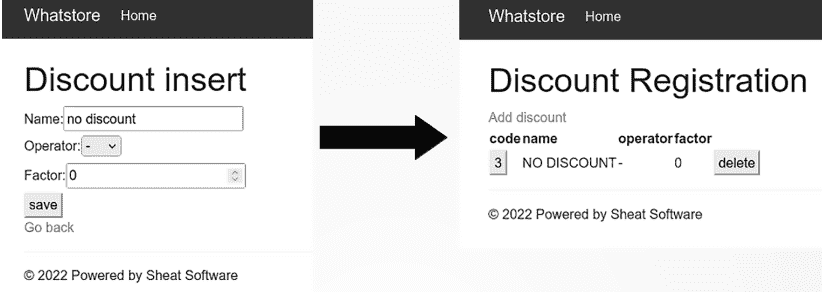
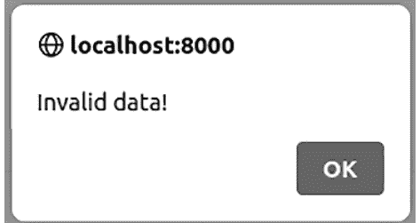

## 创建表单并实现过滤器和验证器

本章将介绍一些 Laminas 组件来处理数据输入。在本章中，您将学习如何在控制器中使用 `laminas-form` 将模型层与视图层连接，如何使用 `laminas-filter` 过滤输入数据，以及如何使用 `laminas-validator` 应用验证规则。

本章将涵盖以下主题：

- 使用 `laminas-form` 为折扣生成表单
- 过滤输入数据
- 验证输入数据

本章结束时，您将能够使用 `laminas-form` 组件以编程方式定义 HTML 表单。您还将了解如何使用 `laminas-filter` 组件转换输入数据并删除不需要的（且可能危险的）内容。最后，您还将了解如何在将数据保存到数据库之前使用 `laminas-validator` 组件验证输入数据。

### 技术要求

本章相关的所有代码均可在 `https://github.com/PacktPublishing/PHP-Web-Development-with-Laminas/tree/main/chapter08/whatstore` 上找到。

### 使用 laminas-form 为折扣生成表单

在本章中，我们将使用三个新的 Laminas 组件。第一个是 `laminas-form`，用于定义 HTML 表单。就像您使用 Composer 添加和安装 `laminas-db` 组件一样，对 `laminas-form` 组件也是如此：

- 1. 在 Eclipse 中打开 `composer.json` 文件。
- 2. 通过 **依赖项** 选项卡，搜索 `laminas/laminas-form` 包并添加它。
- 3. 保存文件并单击 **更新依赖项** 按钮。

如果您对如何在 Eclipse 中安装 Composer 依赖项有任何疑问，请阅读第 3 章，*使用 Laminas 作为库进行测试驱动开发*中的*创建我们的第一个自动化测试*部分。

> **重要提示：将组件注入配置**
>
> 使用 Composer 在 MVC Laminas 项目中安装 Laminas 组件时，系统会询问您关于将组件注入配置的问题。当 Composer 询问此问题时，您必须选择将注入到 `config/modules.config.php` 文件的选项。我们使用此文件是因为我们项目中的所有 Laminas 组件都必须在生产环境中可用。您可以设置 Composer 在询问时记住此选项。

自上一章以来，您可能迫切想要为 *Inventory* 模块的其他注册创建更多 API 和 Web 界面。但等到现在是值得的，因为在本节中，您将使用 `laminas-form` 创建另一个 **创建、读取、更新、删除 (CRUD)** 实现，以定义用于添加的 HTML 表单。在下一节中，我们将学习如何使用 `laminas-form` 实现产品折扣的 API 和 Web 界面。

### 使用 laminas-form 组件创建 CRUD 实现

假设您已经以类似于我们在第 7 章，*请求控制和数据视图*中为产品所做的方式，为产品折扣实现了 CRUD。想象这并不困难，因为其源代码实际上可在 *技术要求* 部分提到的仓库中找到。由于我们使用常见模式，CRUD 实现的结构是相同的。因此，我们假设 `module/Inventory/src/Controller` 文件夹中有以下类：

- `DiscountAPIController`
- `DiscountAPIControllerFactory`
- `DiscountController`
- `DiscountControllerFactory`


可以看到，我们有两对类：API 控制器及其工厂，以及 Web 界面控制器及其工厂。这与我们用于产品控制器层实现的结构完全相同。这些控制器类由 module/Inventory/test/Controller 文件夹中的以下类进行测试：

- DiscountAPIControllerTest
- DiscountControllerTest

我们还为折扣实现了一个视图层，它与我们为产品制作的非常相似。因此，我们假设以下视图脚本位于 module/Inventory/view/inventory/discount 文件夹中：

- edit.js
- edit.phtml
- index.js
- index.phtml

这里，我们有两对文件，生成两个网页：插入/更新页面和列表页面。.phtml 文件包含 HTML 和 PHP 代码的组合，而 .js 文件仅包含 JavaScript 代码。

> 重要提示：.phtml 内容
>
> 虽然可以在 .phtml 文件中使用 PHP 代码，但减少这种用途是良好的做法。模型类负责业务规则处理，因此视图脚本文件仅应显示由控制器从模型发送的值。

好的，假设折扣注册已正常工作，产品注册也是如此。生成用于插入/更新的 HTML 表单的 edit.phtml 文件内容如下：

### edit.phtml

```php
<?php
$this->headScript()->appendScript(file_get_contents
        (__DIR__ . '/edit.js'));
?>
<h1>Discount <?= (empty($this->discount->code) ?
        'insert' : 'update') ?>!</h1>
<form id="discount">
Name: <input type="text" name="name" autofocus="autofocus" value="<?= $this->discount->name ?>"><br/>
Operator: <select name="operator">
<option value="" <?= ($discount->operator == '-' ?
'selected' : '') ?> ></option>
<option value="*" <?= ($discount->operator == '*' ?
'selected' : '') ?>>*</option>
<option value="/" <?= ($discount->operator == '/' ?
'selected' : '') ?> /></option>
</select><br/>
Factor: <input type="number" name="factor" value="<?= $this->discount->factor ?>"><br/>
<input type="hidden" name="code" value="<?= $this->discount->code ?>">
</form>
<button id="save">save</button>
<p>
<span id="api" url="<?= $this->url
('inventoryapi', ['controller' => 'discountapi'])
?>"></span>
<span id="target" url="<?= $this->url ('inventory',
['controller' => 'discount']) ?>"></span>
<a href="<?= $this->url ('inventory', ['controller' =>
'discount']) ?>">Go back</a>
</p>
```

edit.phtml 文件的源代码与 layout.phtml 文件（来自 Application 模块）组合生成了图 8.1 所示的网页。请注意，edit.phtml 的内容是一个简单的 HTML 表单，其元素值由 PHP 代码动态定义。

### Laminas MVC 骨架主页

### 折扣插入

名称：
运算符：-
因子：0
保存
返回

© 2022 Laminas 项目，LF Projects, LLC 的一个系列

图 8.1：插入折扣的表单

我们将更改生成此 HTML 表单的方式。当然，你可能会争辩：“我们为什么要直接用 HTML 定义表单？有可生成丰富 Web 界面的 JavaScript 库。我们可以使用它们！”没错，你可以为用户界面使用任何 JavaScript 库或框架。Laminas 不强制要求你直接使用 HTML 来创建表单或使用 JavaScript 组件。你可以自由为前端应用程序选择所需的工具。请记住，我们的控制器层中有 API。

但是，如果你希望直接控制 Web 用户界面，了解如何从应用程序后台以编程方式生成 HTML 表单是件好事。此外，你始终会有一个默认的 Web 界面来操作系统。更重要的是，Laminas 用于生成表单的组件不仅用于生成用户界面，还用于数据验证。我们将很快看到这一点。

我们将把折扣表单的生成委托给 `laminas-form`。为此，我们需要创建一个类来定义表单。

### 定义 HTML 表单的类

按照以下步骤创建定义 HTML 表单的类：

- 首先，在 module/Inventory/src 文件夹中，创建一个名为 Form 的文件夹。
- 接下来，在 Form 文件夹内，创建一个 DiscountForm.php 文件。该文件必须包含 DiscountForm 类：

### DiscountForm.php

```php
<?php
namespace Inventory\Form;
use Laminas\Form\Form;
use Laminas\Form\Element\Text;
use Laminas\Form\Element\Select;
use Laminas\Form\Element\Number;
use Laminas\Form\Element\Hidden;
class DiscountForm extends Form {
    public function __construct($name = 'discount') {
        parent::__construct($name);
        $text = new Text('name');
        $text->setLabel('Name:');
        $text->setAttribute('autofocus', 'autofocus');
        $this->add($text);
        $select = new Select('operator');
        $select->setLabel('Operator:');
        $options = [
            '-=' => '-=',
            '*=' => '*=',
            '/=' => '/=',
        ];
        $select->setValueOptions($options);
        $this->add($select);
        $number = new Number('factor');
        $number->setLabel('Factor:');
        $this->add($number);
        $hidden = new Hidden('code');
        $this->add($hidden);
    }
}
```

从 DiscountForm 类可以观察到以下几点：

- DiscountForm 类继承自 Laminas\Form\Form 类的实现。
- 父类构造函数接收 HTML 表单的 name 属性值作为参数。
- 在继承的 Laminas\Form\Form 类构造函数内部，我们定义表单元素。
- 每个 HTML 表单元素都有一个名称合适的类。例如，对于 type 等于“text”的 HTML INPUT 元素，存在 Laminas\Form\Element\Text 类。
- Laminas\Form\Element 类系列对 HTML 表单元素进行分组。
- Laminas\Form\Element 构造函数将第一个参数作为值，该值将同时用于 id 属性和 name 属性。
- Laminas\Form\Form 和 Laminas\Form\Element 类构造函数都有第二个参数，但它是可选的。
- setLabel 方法允许为 HTML 表单元素定义标签。
- setAttribute 方法允许定义任何 HTML 元素属性的值。例如，我们为 name 输入字段的 autofocus 属性定义了一个值。
- Laminas\Form\Element 实例需要通过 Laminas\Form\Form->add 方法与 Laminas\Form\Form 实例关联。

好吧，但我们如何使用 DiscountForm 类呢？嗯，我们需要在 Web 界面控制器中创建 DiscountForm 实例，并将其传递给相应的视图脚本。因此，我们将把 DiscountController->editAction 方法更改为以下内容：

```php
public function editAction()
{
    $key = $this->params('key');
    $discount = $this->discountTable->getByField
    ('code',$key);
    $form = new DiscountForm();
    $form->bind($discount);
    return new ViewModel([
        'discount' => $discount,
        'form' => $form
    ] );
}
```

请注意，我们已创建 `DiscountForm` 的实例并调用了 `DiscountForm->bind` 方法。该方法继承自 `Laminas\Form\Form`。`bind` 方法将模型对象的属性值分配给表单的相关字段。我们与 `DiscountForm` 通信以获取 `Discount` 模型实例的属性值，并使用它们来填充 HTML 表单元素。

但是 `bind` 方法如何从模型对象中提取值呢？嗯，`bind` 方法会调用模型的 `getArrayCopy` 方法。等等！`Discount` 类没有这个方法。我们需要实现它！事实上，为所有模型实现 `getArrayCopy` 方法更好，这样它们都可以与 `Laminas\Form\Form` 一起工作。

出于此原因，我们将向 `AbstractModel` 类添加一个 `getArrayCopy` 方法。该类在 _第 4 章，从对象关系映射到 MVC 容器_ 中创建，属于 Generic 模块。`getArrayCopy` 方法的实现很简单：

```php
public function getArrayCopy()
{
    return get_object_vars($this);
}
```

好。现在我们可以修改折扣的 `edit.phtml` 文件了。新实现如下：

### edit.phtml

```php
<?php
$this->headScript()->appendScript(file_get_contents
    (__DIR__ . '/edit.js'));
?>
<h1>Discount <?= (empty($this->discount->code) ? 'insert' : 'update') ?></h1>
<?php
$form = $this->form;
echo $this->form()->openTag($form);
echo $this->formLabel($form->get('name'));
echo $this->formText($form->get('name')) . '<br/>';
echo $this->formLabel($form->get('operator'));
echo $this->formSelect($form->get('operator')) . '<br/>';
echo $this->formLabel($form->get('factor'));
```


```
echo $this->formNumber($form->get('factor')) . '<br/>'; echo $this->formHidden($form->get('code')); echo $this->form()->closeTag(); ?> <button id="save">save</button> <p> <span id="api" url="<?=$this->url('inventoryapi', ['controller' => 'discountapi']) ?>"></span> <span id="target" url="<?=$this->url('inventory', ['controller' => 'discount']) ?>"></span> <a href="<?=$this->url('inventory', ['controller' => 'discount']) ?>">Go back</a> </p>
```

请注意，我们已将 HTML 表单元素的内容替换为一系列带有 form 前缀的方法调用。我们需要从之前的源代码中了解以下内容：

- `$this->form` 属性是由 `DiscountController` 实例发送的 `DiscountForm` 实例。
- `$this->form` 方法（末尾带括号）是一个视图助手，用于呈现使用 Laminas\Form\Form 定义的 HTML 表单。
- `$this->formLabel` 方法仅呈现表单元素的标签。
- 每种元素类型都有相应的呈现助手类。例如，operator 字段是 HTML SELECT 元素，因此我们使用 `$this->formSelect` 来呈现它。
- `Laminas\Form\Form` 的 `get` 方法返回一个 `Laminas\Form\Element` 对象。参数是传递给对象构造函数的值。

要使用视图助手类，需要在 `modules.config.php` 文件中将 `Laminas\Form` 声明为模块。如果由 `modules.config.php` 返回的数组中没有值为 "`Laminas\Form`" 的元素，则在尝试呈现表单时，您会收到诸如 **在插件管理器 `Laminas\View\HelperPluginManager` 中未找到名为 ‘form’ 的插件** 之类的消息。

将 `Laminas\Form` 作为模块添加是启用表单呈现的简洁方式。还有一种更冗长的方法。我们将在这里逐一介绍，因为这将帮助您了解幕后发生了什么，即 `laminas-mvc` 为您所做的工作。

启用表单呈现的冗长方式是在 module.config.php 文件中为每个表单助手注册别名和工厂。此注册由配置数组第一级的键 view_helpers 完成，如以下源代码所示：

```php
'view_helpers' => [
    'aliases' => [
        'form' => Form::class,
        'formText' => FormText::class,
        'formSelect' => FormSelect::class,
        'formNumber' => FormNumber::class,
        'formHidden' => FormHidden::class,
        'formLabel' => FormLabel::class
    ],
    'factories' => [
        Form::class => InvokableFactory::class,
        FormText::class => InvokableFactory::class,
        FormSelect::class => InvokableFactory::class,
        FormNumber::class => InvokableFactory::class,
        FormHidden::class => InvokableFactory::class,
        FormLabel::class => InvokableFactory::class
    ]
]
```

在 aliases 子键中，我们定义了调用视图助手类所使用的名称。在 factories 子键中，我们定义了创建视图助手实例的方式。请注意，这种方法允许我们进行自定义。这通常是 Laminas 组件的一个特性。

您可能已经注意到，将 Laminas\Form 作为模块添加更好。这正是我们将在项目中做的事情。

> **重要说明：表单视图插件**
>
> 如果您未将 Laminas\Form 声明为模块，也未在 module.config.php 中注册表单视图插件，则在尝试呈现表单时，您会收到诸如 **在插件管理器 `Laminas\View\HelperPluginManager` 中未找到名为 ‘form’ 的插件** 之类的消息。

在尝试呈现表单之前，我们还需要安装 laminas-i18n 组件。该组件允许您根据应用程序配置从翻译文件中翻译文本。安装 laminas-i18n 的方式与安装 laminas-form 相同。

### i18n

i18n 是 internationalization 的缩写。简而言之，它是对多种语言的支持。I18n 软件组件有助于将内容从一种语言翻译成另一种语言。

### 重要说明：表单与翻译器之间的依赖关系

如果您未安装 `laminas-i18n` 组件并尝试呈现由 `laminas-form` 定义的表单，您将收到消息 Class 'Laminas\\I18n\\View\\Helper\\AbstractTranslatorHelper' not found。好吧，根据此消息，表单需要一个翻译器。这一要求可能看起来很奇怪，因为它假设任何表单都必须被翻译。考虑到 Laminas 组件架构等强耦合架构，表单组件与翻译器组件之间的关系应该是可选的。但是 `laminas-form` 与 `laminas-i18n` 之间强耦合的原因是，表单组件可以集成到过滤器和验证组件中，而其中一些组件依赖于 `laminas-i18n`。

### laminas-mvc-form

如果您使用 `laminas-mvc` 且不想分别安装 `laminas-form` 和 `laminas-i18n`，可以安装 `laminas-mvc-form` 元包。

目前，我们已通过呈现 `laminas-form` 成功用 HTML 替换了折扣表单的直接定义。折扣表单的呈现未发生变化，因此我们没有新界面。另一方面，我们现在可以在控制器层将模型与表单连接起来。

因此，我们已完成使用 `laminas-form` 生成添加和更新折扣表单的工作。为此，我们执行了以下操作：

- 为折扣创建了 CRUD 实现，包含 API 和 Web 界面
- 创建了一个类来定义折扣的 HTML 表单

在下一节中，我们将学习如何使用 `laminas-filter` 过滤输入值。

### 过滤输入数据

在本章中，您已使用 Composer 添加并安装了 `laminas-form` 组件，请对 `laminas-inputfilter` 组件执行相同操作：

- 1. 在 Eclipse 中打开 `composer.json` 文件。
- 2. 通过 **依赖项** 选项卡，搜索 `laminas/laminas-inputfilter` 包并将其添加。
- 3. 不要忘记保存文件并单击 **更新依赖项** 按钮。

laminas-inputfilter 组件结合了 laminas-filter 和 laminas-validator。您可以在 PHP 程序中分别使用 laminas-filter 和 laminas-validator，但对于 MVC Web 应用程序，使用 laminas-inputfilter 更加方便。

我们有一个用于插入/更新折扣的 HTML 表单。但这是处理折扣请求的方式之一。我们有一个 API，因此另一个应用程序可以向 whatstore 发出请求。我们的应用程序面向服务，因此对多个客户端开放。这很有用，但数据处理方面存在一个问题。如果用户填写 HTML 表单，JavaScript 代码可以在发送请求之前过滤表单数据。当在没有 HTML 页面的情况下发出请求时，没有 JavaScript 来过滤数据。因此，服务器必须确保输入数据的格式有效。

当然，应用程序数据的有效格式取决于应用程序要求。这里我们假设正在阅读需求文档，以实现处理数据的代码。

定义模型数据过滤规则的地方是模型类。因此，我们将根据以下源代码向 Discount 类添加 getInputFilter 方法：

```php
public function getInputFilter(): InputFilter
{
    $inputFilter = new InputFilter();
    $input = new Input('code');
    $filterChain = new FilterChain();
    $filterChain->attach(new ToInt());
    $input->setFilterChain($filterChain);
    $inputFilter->add($input);
    $input = new Input('name');
    $filterChain = new FilterChain();
    $filterChain->attach(new StringToUpper())
        ->attach(new Alnum(true));
    $input->setFilterChain($filterChain);
    $inputFilter->add($input);
    $input = new Input('operator');
    $filterChain = new FilterChain();
    $filterChain->attach(new AllowList(['list' =>
        ['-', '*', '/']]));
    $input->setFilterChain($filterChain);
    $inputFilter->add($input);
    $input = new Input('factor');
    $filterChain = new FilterChain();
    $filterChain->attach(new ToFloat());
}
```


```php
$input->setFilterChain($filterChain);
$inputFilter->add($input);
return $inputFilter;
}
```

InputFilter 类是 Input 实例的集合。Input 类允许你为输入属性链式调用过滤器和验证器。对于 Discount 类的每个属性，我们都创建了一个 Input 实例。

要将过滤器连接到输入属性，我们使用 FilterChain 类。FilterChain 连接一组过滤器，并允许你将所有这些过滤器应用到一个值上。按顺序，这些过滤器被附加到 FilterChain。

你可以在 https://docs.laminas.dev/laminas-filter/standard-filters 找到关于 Laminas 标准过滤器类的参考。对于 Discount 类，我们使用了以下过滤器类：

- ToInt 类用于确保折扣代码是整数。
- StringToUpper 类用于确保折扣名称为大写字母。此外，Alnum 确保只允许字母数字值。事实上，Alnum 构造函数中的参数 true 也允许空格。
- AllowList 类用于将运算符的可能值限制为三种可能性。
- ToFloat 类用于确保 factor 是浮点数。

> **重要说明：过滤器类**
>
> 除了标准过滤器之外，还有更多可用的过滤器。你可以在 https://docs.laminas.dev/laminas-filter 找到可用 Laminas 过滤器的完整列表。此外，你可以通过实现 Laminas\Filter\FilterInterface 来创建自己的过滤器类。我们将在第 13 章「技巧与窍门」中学习如何创建自定义过滤器。

既然我们已经定义了生成 InputFilter 实例的方法，我们将使用该实例来转换 Discount 模型的属性值。这是通过 Discount->toArray 方法完成的，如下所示：

```php
public function toArray()
{
    $inputFilter = $this->getInputFilter();
    $inputFilter->setData(get_object_vars($this));
    return $inputFilter->getValues();
}
```

这一更改足以确保应用过滤器。现在你可以插入或更新折扣，你会看到名称将以大写字母列出，如图 8.2 所示：



图 8.2: StringToUpper 过滤器的效果

在下一节中，我们将学习如何使用 laminas-validator 验证输入值。

### 验证输入数据

过滤器转换数据，但这不足以确保数据适合我们的系统。过滤器只是执行一个操作。要了解数据是否具有适当的值，我们需要一个能够回答数据是否符合业务规则的问题的组件。

Laminas 为此提供了一个组件：laminas-validator。正如我们之前所说，laminas-validator 是 laminas-inputfilter 的依赖项。因此，如果你已经安装了 laminas-inputfilter，就不需要安装 laminas-validator。

我们说过，验证取决于业务规则。想象一下，你的客户在被询问需求时告诉你，折扣名称必须至少有三个字符。我们有一个过滤器将字母字符更改为大写字母，以及另一个过滤器删除非字母、非数字或非空格的字符。但是，这些过滤器不能确保最终名称至少有三个字符。

我们需要为名称字段创建一个验证规则。让我们修改 Discount->getInputFilter 方法中处理名称字段的部分：

```php
$input = new Input('name');
$filterChain = new FilterChain();
$filterChain->attach(new StringToUpper())
    ->attach(new Alnum(true));
$input->setFilterChain($filterChain);
```

```php
$validatorChain = new ValidatorChain();
$validatorChain->attach(new StringLength(
    ['min' => 3]
));
$input->setValidatorChain($validatorChain);
$inputFilter->add($input);
```

请注意，我们创建了一个 `ValidatorChain` 实例。`ValidatorChain` 连接一组验证器，并允许你将所有这些验证器应用到一个值上。按顺序，这些验证器被附加到 `ValidatorChain`。

你可以在 https://docs.laminas.dev/laminas-validator/standard-validators 找到关于 Laminas 标准验证器类的参考。对于 `Discount` 类，我们使用了 `StringLength` 验证器。此验证器确保文本具有最小和/或最大长度。

我们将在 `DiscountAPIController` 的插入和更新方法中添加验证。`DiscountAPIController->create` 必须如下所示：

```php
public function create($data)
{
    $discount = new Discount();
    $inputFilter = $discount->getInputFilter();
    $inputFilter->setData($data);
    if (!$inputFilter->isValid()) {
        return new JsonModel(['inserted' => 'invalid']);
    }

    $discount->exchangeArray($data);
    $inserted = $this->discountTable->save($discount);
    return new JsonModel(['inserted' => $inserted]);
}
```

请注意，我们在尝试保存数据之前应用了折扣名称的验证规则。数据库也可能有业务规则，但应用程序中的验证可以避免数据库错误以及应用程序与数据库之间不必要的通信。我们使用 `Discount->getInputFilter` 方法获取 `InputFilter` 实例，这很合理。`InputFilter->setData` 方法分配要验证的值，而 `InputFilter->isValid` 方法根据验证器链回答所有值是否有效。

我们还将修改 DiscountAPIController->update：

```php
public function update($id, $data)
{
    $discount = $this->discountTable->getByField
        ('code', $id);
    $inputFilter = $discount->getInputFilter();
    $inputFilter->setData($data);
    if (!$inputFilter->isValid()) {
        return new JsonModel(['inserted' => 'invalid']);
    }

    $discount->exchangeArray($data);
    $updated = $this->discountTable->save($discount);
    return new JsonModel(['updated' => $updated]);
}
```

你可以观察到，如果数据无效，操作方法将返回一个值为字符串 invalid 的 inserted 键。我们将使用此值向用户显示适当的消息并避免不必要的重定向。在以下代码片段中，我们展示了折扣的 edit.js 文件的内容。首先，我们将声明一个 save 函数。该函数从变量声明开始，这些变量接收来自页面 edit.phtml 的值：

```javascript
var save = function() {
    var api = $("#api").attr("url");
    var target = $("#target").attr("url");
    var formData = $("#discount").serialize();
    var code = parseInt($("input[name='code']").val());
}
```

code 变量的值指示操作是插入还是更新。对于插入，我们通过 HTTP POST 请求发送表单数据：

```javascript
if (code == 0) {
    $.post(api, formData, function(data) {
        if (data.inserted == 'invalid') {
            alert('Invalid data!');
            return;
        }
        alert("discount has been inserted");
        window.location.href = target;
    }).fail(function() {
        alert('error');
    });
}
```

对于更新，我们通过 HTTP PUT 请求发送表单数据：

```javascript
} else {
    api = $("#api").attr("url") + '/' + $(this).
        attr('code');
    $.ajax({url: api, type: 'PUT', data: formData}).
    done(function(data) {
        if (data.inserted == 'invalid') {
            alert('Invalid data!');
            return;
        }
        alert("discount has been updated");
        window.location.href = target;
    }).fail(function() {
        alert('error');
    });
}
```

最后，save 函数与按钮点击事件相关联：

```javascript
$(document).ready(function() {
    $("#save").click(save);
});
```

此修改侧重于测试异步请求内容。如果返回时，inserted 键的值为 invalid，将显示一条消息，说明数据无效。因此，如果你尝试添加一个名称短于三个字符的折扣，你将看到类似图 8.3 的消息：




图 8.3: 插入或更新操作中无效数据的消息

> **重要说明：Validator 类**
>
> 可用的验证器比标准验证器更多。您可以在 https://docs.laminas.dev/laminas-validator 中找到可用 Laminas 验证器的完整列表。
> 此外，您可以创建自己的过滤器类，扩展 Laminas\Validator\AbstractValidator。我们将在 *第 13 章，技巧与窍门* 中学习如何创建自定义过滤器。

因此，在修改 HTML 表单的生成并为我们的折扣注册添加过滤器和验证器后，我们现在已经完成了本章。

### 摘要

在本章中，我们学习了一些与数据输入相关的 Laminas 组件。首先，我们学习了如何使用 laminas-form 以编程方式定义 HTML 表单，以及如何在 .phtml 文件中渲染此类表单。我们以 laminas-form 为例，定义了一个用于折扣注册的 HTML 表单。

接着，我们学习了如何使用 laminas-filter 从请求中过滤值。我们将过滤器应用于折扣字段，例如，将折扣名称限制为包含空格的字母数字字符。

最后，我们学习了如何使用 laminas-validator 验证请求中的值。我们将验证器应用于名称字段，避免保存短于三个字符的名称。

过滤和验证是与应用程序安全相关的方面。对数据输入缺乏控制可能会允许不需要且有时危险的内容。想象一下，输入的一部分被用作应用程序调用的命令的参数。如果允许任何内容，您将不知道您的应用程序可能会执行什么。

在下一章中，我们将讨论安全的其他方面，即身份验证和授权。
