## 事件驱动身份验证

本章涵盖了开发安全应用程序的基本主题之一——身份验证。身份验证是身份检查。物理世界中身份验证的一个例子是进入建筑物时要求出示身份证明文件。

在本章中，您将学习如何使用事件导向编程实现此检查过程。我们将首先为登录和注销操作创建测试，然后创建这些操作。之后，我们将为 Inventory 模块实现用户身份验证。为此，我们将创建员工注册。最后，我们将基于事件实现用户身份检查。

在本章中，我们将涵盖以下主题：

- 为 Inventory 模块创建登录和注销操作
- 为 Inventory 模块实现用户身份验证
- 创建员工注册
- 基于事件验证用户身份

在本章结束时，您将能够控制谁可以访问 Web 应用程序的受限区域。

让我们首先在 Inventory 模块中创建登录页面及其相关的控制器操作。

### 技术要求

与本章相关的所有代码都可以在 https://github.com/PacktPublishing/PHP-Web-Development-with-Laminas/tree/main/chapter09/whatstore 中找到。

### 为 Inventory 模块创建登录和注销操作

延续我们的测试驱动开发（TDD）方法，在本节中，我们将首先为登录和注销操作创建测试，然后创建要测试的表单和控制器类以及视图脚本。

### 为登录和注销操作创建测试

如我们所学，创建测试时，我们正在将要求写成源代码。测试说明了我们期望类执行什么操作。现在，我们将在 Inventory 模块的 IndexControllerTest 类中添加两个测试方法——一个用于测试登录操作的方法，另一个用于测试注销操作的方法。登录测试方法的源代码如下：

```php
public function testLoginActionCanBeAccessed() : void
{
    $_POST = [
        'nickname' => 'John Jonz',
        'password' => 'hronmeer'
    ];
    $this->dispatch('/inventory/index/login', 'POST',
        $_POST);
    $this->assertResponseStatusCode(302);
    $this->assertModuleName('inventory');
    $this->assertControllerName('index');
    // as specified in router's controller name alias
    $this->assertControllerClass('IndexController');
    $this->assertMatchedRouteName('inventory');
}
```

注销测试方法的源代码如下：

```php
public function testLogoutActionCanBeAccessed() : void
{
    $this->dispatch('/inventory/index/logout', 'GET');
    $this->assertResponseStatusCode(200);
    $this->assertModuleName('inventory');
    $this->assertControllerName('index');
    // as specified in router's controller name alias
    $this->assertControllerClass('IndexController');
    $this->assertMatchedRouteName('inventory');
}
```

现在，您可能会问：“但是 testLoginActionCanBeAccessed 方法如何确保用户能够登录，如果该用户不存在的话？”起初，它不能确保这一点。如果仔细观察，testLoginActionCanBeAccessed 方法检查 HTTP 响应是否具有 302 代码——换句话说，loginAction 方法——是否已重定向到其他 URL。如果用户存在，他们将被重定向到菜单页面。测试此时会失败，这在 TDD 的测试中经常发生。但是现在，在有了失败的测试后，我们可以构建我们的新操作。

### 创建登录和注销操作

如果您现在访问 `http://localhost:8000/inventory`，您将看到 Laminas 的欢迎页，因为 Inventory 主页是从 Application 模块复制的：

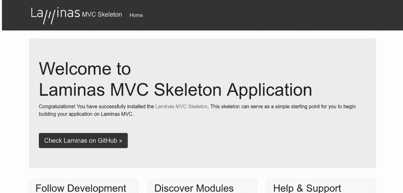

图 9.1 – Inventory 模块的主页

我们将修改此页面。首先，我们将修改页面布局。如我们在第 4 章“从对象关系映射到 MVC 容器”中所述，页面布局由 Application 模块定义。我们将更改 module/Application/view/layout 文件夹中 layout.phtml 文件的某些部分。

要修改的布局文件的第一部分是标题定义。我们直接使用 TITLE 标签定义标题，但 Laminas 为此提供了一个视图助手。您必须修改 `$this->headTitle` 的调用，使其如下所示：

```php
<?= $this->headTitle('Whatstore')->setSeparator(' - ')->
setAutoEscape(false) ?>
```

您可能会问：“为什么我需要使用一个方法只为编写不会更改的文本？”事实上，当您使用 $this->headTitle 方法生成 TITLE 标签而不是直接编写它时，您允许视图脚本轻松修改标题。

要修改的另一部分是 class 属性等于 navbar-brand 的 A 标签。这是显示 Laminas 标志和 MVC 骨架文本的标签。此标签的新内容如下：

```html
<a class="navbar-brand" href="<?= $this->url('home') ?>">
Whatstore
</a>
```

要修改的布局文件的最后部分是 FOOTER 标签。此标签的新内容如下：

```html
<footer>
<p>
&copy; <?= date('Y') ?>
Powered by Sheat Software
</p>
</footer>
```

简而言之，我们已修改了可见的页眉和页脚以及标题栏上的文本。

现在，我们将创建一个类来定义登录表单。在 module/Inventory/src/Form 文件夹中，创建一个名为 LoginForm.php 的文件，并添加以下代码：

### LoginForm.php

```php
<?php
namespace Inventory\Form;

use Laminas\Form\Form;
use Laminas\Form\Element\Text;
use Laminas\Form\Element\Password;

class LoginForm extends Form {
    public function __construct($name = 'user') {
        parent::__construct($name);
        $text = new Text('nickname');
        $text->setLabel('NickName: ');
        $text->setAttribute('autofocus', 'autofocus');
        $this->add($text);
        $password = new Password('password');
        $password->setLabel('Password: ');
        $this->add($password);
    }
}
```

如您所见，LoginForm 类是 Laminas\Form\Form 的扩展，并使用我们在第 8 章“创建表单并实现过滤器和验证器”中已用过的元素类。我们将在 Inventory 模块的 IndexController 类中使用 LoginForm。请按如下方式修改 IndexController->indexAction 方法：

```php
public function indexAction()
{
    $form = new LoginForm();
    return new ViewModel([
        'form' => $form
    ]);
}
```

$form 对象被传递到视图层，并将由 modules/Inventory/view/inventory/index 中的 index.phtml 文件处理。index.phtml 的内容如下：

### index.phtml

```php
<?php
/**
 * @var Laminas\View\Renderer\PhpRenderer $this
 */
$this->headScript()->appendScript(file_get_contents
    (__DIR__ . '/index.js'));

```


?>
<h1>Inventory Module</h1>
<?php
$form = $this->form;
echo $this->form() ->openTag($form);
echo $this->formLabel($form->get('nickname'));
echo $this->formText($form->get('nickname')) . '<br />';
echo $this->formLabel($form->get('password'));
echo $this->formPassword($form->get('password'));
echo $this->form() ->closeTag();
?>
<button id="login">login</button>
<p>
<span id="api" url="<?=$this->url('inventory',
['controller' => 'index', 'action' =>'login'])?>">
</span>
<span id="target" url="<?=$this->url('inventory',
['controller' => 'menu'])?>"></span>
<a href="<?=$this->url('inventory')?>">Go back</a>
</p>

请注意，index.phtml 导入了 index.js 文件。index.js 文件负责向登录 API 提交 HTTP 请求。让我们来看看 index.js 的源代码：

```
var login = function() {
	var api = $("#api").attr("url");
	var target = $("#target").attr("url");
	var formData = $("#user").serialize();
	$.post(api, formData, function(data) {
		if (!data.logged) {
			alert('Invalid data!');
			return;
		}

		alert("user has been logged successfully");
		window.location.href = target;
	}).fail(function() {
		alert('error');
	});
};

$(document).ready(function() {
  $("#login").click(login);
});
```

可以看出，index.js 将 login 函数与按钮点击事件关联起来。login 函数使用登录表单中的数据发送 HTTP POST 请求。

此时，测试仍然失败，因为 IndexController 类中不存在 loginAction 和 logoutAction 方法。因此，让我们创建它们：

```
public function loginAction()
{
  $nickname = $this->request->getPost('nickname');
  $password = $this->request->getPost('password');

  $logged = false;

  return new JsonModel([
    'logged' => $logged
  ]);
}

public function logoutAction()
{
  return $this->redirect()->toRoute('inventory');
}
```

此时，loginAction 方法尚未完成。因此，测试再次失败。对于 IndexController 类中的每个新方法，您都会收到 HTTP 404 错误。例如，对于 loginAction 方法的测试，PHPUnit 的输出必须如下：

> 断言响应代码为 "302" 失败，实际状态代码为
> "404"

如果在浏览器中请求 http://localhost:8000/inventory/index/login，您将看到如图 9.2 所示的页面：

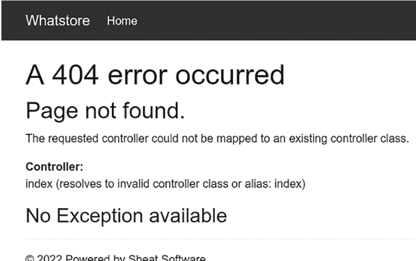

图 9.2 – 未找到控制器的错误页面

为什么会收到这个错误？因为在 Inventory 模块中没有 `IndexController` 类的别名。如果您观察检查控制器名称的测试部分，可以看到关于别名的以下注释：

```
$this->assertControllerName('index');
// as specified in router's controller name alias
```

让我们解决这个问题。在 `module.config.php` 文件中，添加一行将 index 别名与 `IndexController` 类关联，如下所示：

```
'controllers' => [
    'aliases' => [
        'index' => Controller\IndexController::class,
    ],
]
```

此更改将使失败仅剩一个，与 `IndexController` 类的 `loginAction` 方法相关。在下一节中，我们将实现用户身份验证来解决此失败。

### 为 Inventory 模块实现用户身份验证

为了对用户进行身份验证，我们将使用 `laminas-authentication` 组件。以与使用 laminas-db 组件相同的方式添加和安装 `laminas-authentication` 组件，使用 Composer。在 Eclipse 中打开 composer.json 文件，通过 Dependencies 选项卡，搜索 laminas/laminas-authentication 包并添加它。不要忘记保存文件并单击 Update dependencies 按钮。如果您对如何在 Eclipse 中安装 Composer 依赖项有任何疑问，请阅读第 3 章《将 Laminas 作为库与测试驱动开发相结合》中的“创建我们的第一个自动化测试”部分。

安装 laminas-authentication 后，我们可以使用此组件修改 IndexController->loginAction 方法。该方法将如下所示：

```
public function loginAction()
{
    $nickname = $this->request->getPost('nickname');
    $password = $this->request->getPost('password');
    $this->adapter->setIdentity($nickname);
    $this->adapter->setCredential($password);

    $logged = false;

    $auth = new AuthenticationService();
    $auth->setAdapter($this->adapter);

    $result = $auth->authenticate();

    if ($result->isValid()) {
        error_log('user '. $result->getIdentity() . ' is logged');
        $logged = true;
    } else {
        foreach ($result->getMessages() as $message) {
            error_log($message);
        }
    }

    return new JsonModel([
        'logged' => $logged
    ]);
}
```

我们对 `loginAction` 方法做了以下更改：

- 我们将 `$nickname` 变量传递给了 `$adapter` 属性的 `setIdentity` 方法。
- 我们将 `$password` 变量传递给了 `$this->adapter` 属性的 `setCredential` 方法。
- 我们实例化了 `Laminas\Authentication\AuthenticationService` 类。
- 我们将 `$this->adapter` 属性传递给了 `Laminas\Authentication\AuthenticationService` 实例的 `setAdapter` 方法。
- 我们调用了 `Laminas\Authentication\AuthenticationService` 实例的 `authenticate` 方法，并将返回值赋给了 `$result` 变量。
- 我们检查了 `$result` 对象的 `isValid` 方法是否为 true。如果为 true，我们将消息发送到日志，并将 `$logged` 的状态更改为 true。
- 如果 `$result` 为 false，我们将每个生成的错误消息发送到日志。

等等！`$this->adapter` 属性从哪里来？好问题。我们需要这样声明这个属性：

```
private ?AdapterInterface $adapter;
```

这个 `$adapter` 属性是 `Laminas\Authentication\Adapter\AdapterInterface`。

### 重要说明 – 命名空间

我们之前已经为数据库使用过 `AdapterInterface`，但它来自另一个命名空间。请记住，不同命名空间中可以有多个同名类。**适配器** 是一种设计模式，可以应用于多个类。因此，Laminas 中可用的不止一个 Adapter 类。

好的，我们需要将 `$adapter` 属性分配给实现 `Laminas\Authentication\Adapter\AdapterInterface` 的实例。我们将在构造方法中完成此操作：

```
public function __construct(AdapterInterface $adapter)
{
    $this->adapter = $adapter;
}
```

如果我们直接实例化控制器，一切都可能没问题，但在 Laminas 中我们不会直接实例化控制器。Laminas 通过工厂为我们实例化控制器，我们在 *第 1 章，介绍 PHP 应用程序的 Laminas* 中讨论过这一点。这就像好莱坞试镜失败的著名说法：*不要给我们打电话，我们会给你打电话*。因此，我们必须创建一个名为 `IndexControllerFactory` 的工厂类，其源代码如下：

```
<?php
namespace Inventory\Controller;

use Laminas\ServiceManager\Factory\FactoryInterface;
use Interop\Container\ContainerInterface;
use Laminas\Authentication\Adapter\DbTable\CredentialTreatmentAdapter;

class IndexControllerFactory implements FactoryInterface
{
    public function __invoke(ContainerInterface $container,
    $requestedName, array $options = null)
    {
    $employeeTable = $container->get('EmployeeTable');
    $adapter = new CredentialTreatmentAdapter
    ($container->get('DbAdapter'));
    $adapter->setTableName('employees');
    $adapter->setIdentityColumn('nickname');
    $adapter->setCredentialColumn('password');

    return new IndexController($adapter);
    }
}
```

这个工厂类实例化 `CredentialTreatmentAdapter` 类。`CredentialTreatmentAdapter` 类允许我们使用数据库表对用户进行身份验证。它需要注入数据库适配器，因为需要访问表。一旦配置了表名、身份列（用户名）和凭据列（用户密码），`IndexControllerFactory` 类就会将 `CredentialTreatmentAdapter` 实例注入到 `IndexController` 实例中。


好吧，现在可以进行身份验证了吗？让我们试一下。访问 http://localhost:8000/inventory，你将看到如图 9.3 所示的页面：

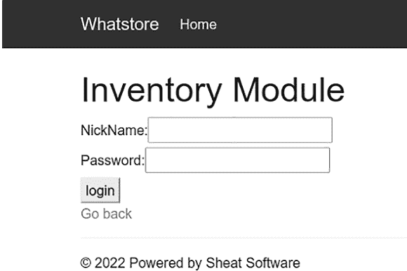

图 9.3 – 库存模块的登录页面

尝试用随机值填写字段并单击登录按钮。结果将是一个带有错误消息的窗口，如图 9.4 所示：

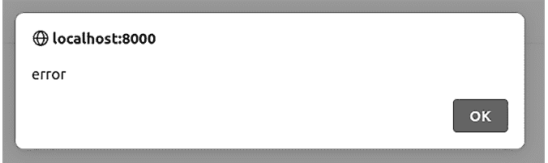

图 9.4 – 登录尝试后的错误消息

那么，问题出在哪里？如果你通过浏览器调试器检查 HTTP 响应，将看到以下错误消息：Class "Laminas\\Session\\Container" not found。如果你运行测试，也会看到这条消息：

```
1) InventoryTest\Controller\
IndexControllerTest::testLoginActionCanBeAccessed
Failed asserting response code "302", actual status code is
"500"

Exceptions raised:
Exception 'Error' with message 'Class "Laminas\\Session\
Container" not found' in /opt/lampp/htdocs/whatstore/vendor/
laminas/laminas-authentication/src/Storage/Session.php:62
```

此错误发生在 laminas-authentication 的一个类中。但是，等等！如果 laminas-authentication 需要这个 Container 类，为什么 Composer 没有安装它？这是因为 Laminas 组件试图在它们之间保持弱耦合。你不需要使用 Container 来存储身份验证数据。你可以在 AuthenticationService 构造函数中使用另一个类。可以将另一个存储类注入到 AuthenticationService 构造函数中。但是，由于我们不使用自定义存储类，laminas-authentication 需要一个，并默认要求在另一个组件 – laminas-session 中提供实现。

没问题。我们在下一章也将使用 laminas-session。添加并安装 laminas-session 组件，方法与本章使用 Composer 安装 laminas-authentication 组件类似。在 Eclipse 中打开 composer.json 文件，通过“依赖项”选项卡搜索 laminas/laminas-session 包并添加它。不要忘记保存文件并单击“更新依赖项”按钮。你是不是又忘记保存文件了，对吧？别担心，我们会重复必要的次数。

安装 laminas-session 后，你可以通过 Web 界面再次尝试登录。结果将是一个显示“Invalid data!”消息的窗口，如图 9.5 所示：

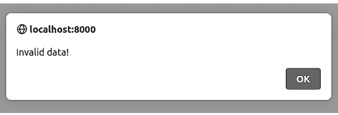

图 9.5 – 登录尝试后的警告消息

当然，此刻，无论你输入什么昵称和密码都是无效数据，因为没有注册的员工。为此，我们需要创建员工注册页面。这就是我们将在下一节中要做的事情。

### 创建员工注册

也许我们在上一节中做出了错误的承诺。事实上，想象你已经为员工实现了 CRUD 操作，类似于我们在第 7 章“请求控制和数据视图”中为产品所做的。还想象我们使用 laminas-form、laminas-filter 和 laminas-validation 实现了这个 CRUD 操作，类似于我们在第 8 章“创建表单并实现过滤器和验证器”中为产品折扣所做的。这并不难想象，因为其源代码实际上可在“技术要求”部分提到的仓库中找到。由于我们使用模式，CRUD 实现的结构是相同的。因此，我们假设 module/Inventory/src/Controller 文件夹中有以下类：

- EmployeeAPIController
- EmployeeAPIControllerFactory
- EmployeeController
- EmployeeControllerFactory

请注意，我们有两对类 – 一个 API 控制器及其工厂，以及一个 Web 界面控制器及其工厂。这与我们用于产品控制器层实现的结构完全相同。这些控制器类由 module/Inventory/test/Controller 文件夹中的以下类进行测试：

- EmployeeAPIControllerTest
- EmployeeControllerTest

我们还为折扣实现了一个视图层，这与我们为产品制作的非常相似。因此，我们假设 module/Inventory/view/inventory/employee 文件夹中有以下视图脚本：

- edit.js
- edit.phtml
- index.js
- index.phtml

在这里，我们有两对文件，生成两个网页 – 插入/更新页面和列表页面。.phtml 文件包含 HTML 和 PHP 代码的组合，而 .js 文件专用于 JavaScript 代码。

好，现在我们可以注册员工了。我们可以插入一个员工并检查他们是否可以登录和登出。我们将遵循以下步骤执行：

- 1. 首先，访问 http://localhost:8000/inventory/employee。此 URL 将带你到达如图 9.6 所示的页面：

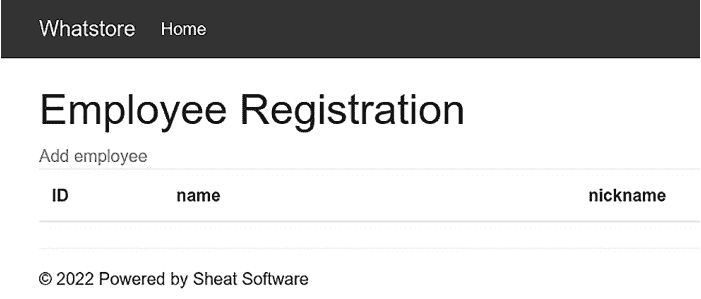

图 9.6 – 员工列表页面

- 2. 单击“添加员工”选项。此操作将带你到达如图 9.7 所示的页面。在此示例中，我们正在添加一名名为 Steven Grant 的员工，其昵称为 Mark Spektor，密码为“moonknight”。

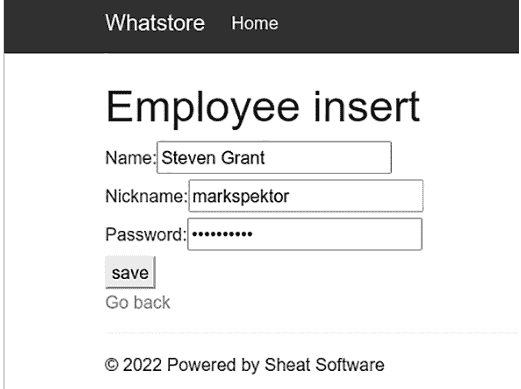

图 9.7 – 员工插入表单

- 3. 单击**保存**按钮后，你将看到一条确认插入的消息，如我们在*图 9.8*中看到的：

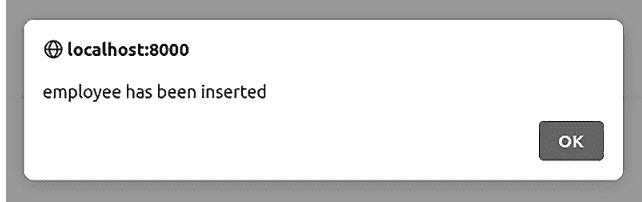

*图 9.8 – 员工插入的确认消息*

最后，你将在列表页面看到插入的员工。请注意，过滤器已将字母转换为大写，如*图 9.9*所示：

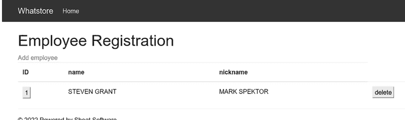

*图 9.9 – 包含插入员工的员工列表页面*

太棒了！现在我们有一个用于身份验证的用户了。让我们在下一节中使用此用户来测试我们的登录页面。

### 测试登录页面

根据示例，我们访问 http://localhost:8000/inventory 并使用插入员工的数据填写登录表单。

当你单击**登录**按钮后出现一条显示**“无效数据！”**的消息时，你可能会感到沮丧。“但哪里出了问题？”你可能会想。你一定正确输入了员工昵称和密码，对吧？我相信你。事实上，与密码有一个小细节 – 它在插入员工时会被加密。因此，我们必须将员工提供的加密密码与存储在 *employees* 表中的加密密码进行比较。

此比较需要对 Employee 类进行一些更改。你应该记得 Employee 类有一个私有 encrypt 方法。我们将把此方法修改为 public 和 static，如下所示：

```
public static function encrypt(String $text)
{
    $text = strrev(hash('sha256', $text));
    $subtext = substr($text,1,rand(0,strlen($text)-1));
    $text = substr($subtext . $text, 0, strlen($text));
    return hash('md5', $text);
}
```

由于 encrypt 方法被同一类的 exchangeArray 方法使用，我们还必须修改后者，将 $this 关键字更改为 self：

```
public function exchangeArray($data)
{
    $this->ID = ($data['ID'] ?? 0);
    $this->name = ($data['name'] ?? '');
    $this->nickname = ($data['nickname'] ?? '');
    $this->password = (isset($data['password']) ?
        self::encrypt($data['password']) : '');
}
```

好了，现在我们可以在 IndexController->loginAction 方法中使用 encrypt 方法。接下来，我们必须替换以下行：

```
$this->adapter->setCredential($password);
```

它需要替换为：

```
$this->adapter->setCredential(Employee::encrypt($password));
```

再次尝试登录。再次，你感到失望；你又看到了**无效数据**消息。哪里出了问题？嗯，如果你仔细查看 Employee::encrypt 方法，你会注意到它为相同的密码生成不同的哈希值，因为存在一个随机组件。随机组件非常适合向用户推荐密码，但当加密数据需要相同时，它们不适合用于比较。因此，当你尝试登录时，生成的哈希值与数据库中存储的哈希值不同。


由于这个原因，我们必须修改 Employee::encrypt 方法，使其对于相同的输入生成相同的输出。让我们用以下内容修改 Employee::encrypt 方法：

```
public static function encrypt(String $text)
{
    $text = strrev(hash('sha256', $text));
    return hash('md5', $text);
}
```

要重新生成密码哈希，您需要编辑 http://localhost:8000/inventory/employee 上的员工 Steven Grant。现在，输入相同的密码 moonknight。依次，返回 http://localhost:8000/inventory 的登录页面，填写登录表单，然后单击登录按钮。这次，结果将是图 9.10 所示的消息：

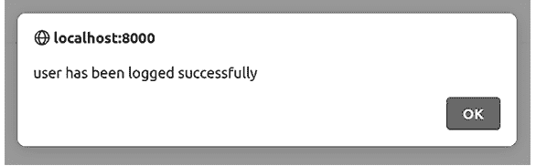

### 图 9.10 – 员工登录成功的消息

单击确定按钮后，您将看到一个错误页面，如图 9.11 所示：

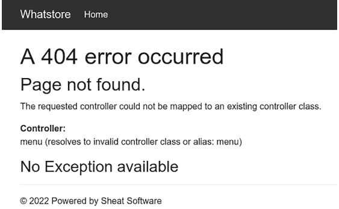

### 图 9.11 – 登录后显示的错误页面

这是预料之中的，因为我们没有创建 MenuController 类和 index 操作的视图文件。为了解决这个问题，我们需要按照以下步骤操作：

- 1. 在 module/Inventory/src/Controller 文件夹中创建 MenuController 类：

### MenuController.php

```php
<?php
namespace Inventory\Controller;
use Laminas\Mvc\Controller\AbstractActionController;
use Laminas\View\Model\ViewModel;
class MenuController extends AbstractActionController
{
    public function indexAction()
    {
        return new ViewModel();
    }
}
```

- 2. 将以下条目添加到 modules.config.php 文件的 controllers => aliases 键中：

```
'menu' => Controller\MenuController::class
```

- 3. 将以下条目添加到 modules.config.php 文件的 controllers => factories 键中：

```
Controller\MenuController::class => InvokableFactory::class
```

- 4. 将 router => routes => inventory => options => defaults => controller 键的值更改为 index，如下所示：

```
'controller' => 'index'
```

- 5. 在 module/Inventory/view/inventory/menu 文件夹中创建 index.phtml 文件（您需要创建 menu 文件夹）：

```
<h1>Inventory Module</h1>

<a href="<?= $this->url('inventory', ['action' =>
            'logout']) ?>">Logout</a>
```

- 6. 这些更改后，重新加载 `http://localhost:8000/inventory/menu` 页面，您将看到 **图 9.12** 所示的页面：

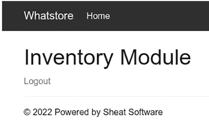

### 图 9.12 – 库存模块的菜单页面

现在，如果您单击 **注销** 选项，将返回登录表单页面。太棒了！看起来它正在工作。但是，如果您现在尝试访问 **库存** 模块的任何其他页面，例如 `http://localhost:8000/inventory/menu`，您会发现访问任何页面都不需要身份验证。那么，登录页面就没有用了。这是因为我们尚未验证用户身份。但请放心！我们将在下一节中完成此操作。

### 基于事件验证用户身份

为了验证用户身份并知道用户是否已登录，我们将使用一个 `listener` 类。正如我们在 *第 7 章，请求控制和数据视图* 中所见，Laminas 使用事件驱动编程来处理请求生命周期的步骤。有一些定义的事件，我们可以创建侦听器，以便在这些事件触发时执行操作。

由于此验证不需要存储数据，我们将使用一个 `static` 方法（类方法）。因此，我们不需要实例化类。我们将在 `modules/Inventory/src` 中创建一个名为 `Listener` 的新文件夹。在这个新文件夹中，我们将创建一个名为 `InventoryAuthenticationListener` 的类。该类将具有一个名为 `verifyIdentity` 的方法，如以下源代码所示依次：

### InventoryAuthenticationListener.php

```php
<?php
namespace Inventory\Listener;

use Laminas\Mvc\MvcEvent;

use Laminas\Authentication\AuthenticationService;

use Laminas\Http\PhpEnvironment\Request;

class InventoryAuthenticationListener
{
    public static function verifyIdentity(MvcEvent $event)
    {
        $routeName = $event->getRouteMatch()->getMatchedRouteName();
        if (! $routeName == 'inventory') {
            return;
        }

        $authenticationService = new AuthenticationService();
        if (! $authenticationService->hasIdentity()) {
            $params = $event->getRouteMatch()->getParams();
            $controller = $params['controller'];
            $action = $params['action'];
            if ($controller == 'index' && ($action == 'index' || $action == 'login')) {
                return;
            }

            $event->getRouteMatch()->setParam('controller', 'index');
            $event->getRouteMatch()->setParam('action', 'index');
        }
    }
}
```

- verifyIdentity 方法接收一个 MvcEvent 对象。MvcEvent 类是 Laminas\EventManager\Event 类的专用化，用于 Laminas MVC 实现。这意味着 MvcEvent 类具有适用于任何类型事件的 Event 类的通用实现以及针对 MVC 事件的特定实现。MvcEvent 对象可以访问 Application 实例以及 modules.config.php 文件中配置的每个对象。

- 我们使用 `MvcEvent` 的 `getRouteMatch` 方法来检索一个 `RouteMatch` 对象。该对象存储关于匹配路由的数据。`RouteMatch->getMatchedRouteName` 方法返回与请求的 URL 匹配的路由名称。

- 我们使用路由名称来确定请求的模块是否为 `Inventory`。由于 `InventoryAuthenticationListener` 仅用于 `Inventory` 模块，如果请求来自另一个模块，我们将中止 `verifyIdentity` 方法。

- 如果请求的模块是 `Inventory`，我们将实例化 `AuthenticationService` 类并调用 `hasIdentity` 方法。只有在用户已通过身份验证时，此方法才返回 `true`。

- 如果用户未通过身份验证，我们将通过 `RouteMatch` 实例的 `getParams` 方法从匹配的路由中检索控制器和操作名称。

- 员工（即库存用户）可以无需身份验证即可访问 `IndexController->indexAction` 和 `IndexController->loginAction` 方法，然后这两个方法将被身份验证侦听器类忽略。

- 对于 `Inventory` 模块的任何其他控制器和操作，如果用户未通过身份验证，我们将将其重定向到登录页面。

请注意，我们在实例化控制器之前拦截应用程序请求。我们不需要发出 HTTP 请求来将用户重定向到登录页面。目标更改是在同一 HTTP 请求中完成的。

但是，谁会调用 `InventoryAuthenticationListener`？侦听器类由事件调用。我们使用 `Laminas\EventManager\EventManager` 类来关联侦听器和事件。在 `index.php` 文件中创建的 `Laminas\Mvc\Application` 对象具有一个 `Laminas\EventManager\EventManager` 实例。我们将使用此实例将 `InventoryAuthenticationListener` 添加为 `EVENT_ROUTE` 事件的侦听器。`EVENT_ROUTE` 事件在路由匹配后分发，因此我们拥有关于用户所需资源和请求初始目标的所有必要数据。

`public` 文件夹中 `index.php` 文件的最后一行是：

```
Application::init($appConfig)->run();
```

让我们修改此前一行，将方法调用分为以下两步：

```
$app = Application::init($appConfig);
$app->run();
```

我们在这些行中所做的与前一行中所做的相同，但放在不同的行中。`Laminas\Mvc\Application` 的实例现在存储在 `$app` 变量中。让我们在它们之间引入一行新代码：

```php
$app = Application::init($appConfig);
$app->getEventManager()->attach(MvcEvent::EVENT_ROUTE,
    [InventoryAuthenticationListener::class, 'verifyIdentity']);
$app->run();
```

我们在这里做什么？EventManager 的 attach 方法将侦听器关联到一个事件。换句话说，当指定的事件被分发时，侦听器会收到通知。侦听器可以是静态方法、对象方法或函数。对于静态方法，我们需要传递一个包含两个元素的数组——类名和方法名。对于对象方法，我们需要将实例作为数组的第一个元素传递。对于函数，只需将函数名作为 attach 方法的第二个参数。

> **记住，记住命名空间！**
>
> 请记住，InventoryAuthenticationListener 是为 `Inventory\Listener` 命名空间定义的，因此您的 index.php 文件顶部必须有 `use Inventory\Listener\InventoryAuthenticationListener;`。缺少命名空间是错误的常见来源。

让我们修改菜单视图以显示用户身份。使用以下内容更改库存模块的 MenuController->indexAction 方法的内容：

```php
public function indexAction()
{
    $auth = new AuthenticationService();
    return new ViewModel(['user' => $auth->getIdentity()]);
}
```

AuthenticationService 类的 getIdentity 方法返回身份验证中的匹配身份。依次，使用以下内容更改 module/Inventory/view/inventory/menu 文件夹中 index.phtml 文件的内容：

```html
<h1>Inventory Module</h1>

<p>Hi, <?=$this->user?></p>
<a href="<?=$this->url('inventory', ['action' => 'logout'])?>">Logout</a>
```


现在，您可以再次登录。这一次，您将在菜单页面上看到用户的姓名，如图 9.13 所示：

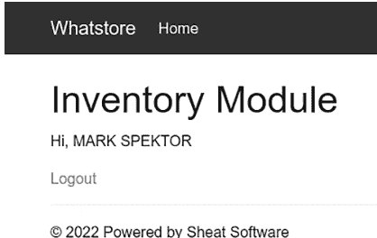

图 9.13 – 带有用户身份的菜单页面

点击 **注销** 选项，并尝试访问任何 `Inventory` 模块页面，例如位于 `http://localhost:8000/inventory/employee` 的员工注册页面或位于 `http://localhost:8000/inventory/product` 的产品注册页面。您将看到自己始终会被重定向到登录页面。这是因为您未经过身份验证。现在，访问 `Inventory` 模块仅限员工。

身份验证似乎已成功实现。但是，随后运行一些测试时，您会看到如下错误：

```
1) InventoryTest\Controller\IndexControllerTest::testIndexActionCanBeAccessed
Failed asserting controller name "inventory\\controller\\indexcontroller", actual controller name is "index"

/opt/lampp/htdocs/whatstore/vendor/laminas/laminas-test/src/PHPUnit/Controller/AbstractControllerTestCase.php:611
/opt/lampp/htdocs/whatstore/module/Inventory/test/Controller/IndexControllerTest.php:34

2) InventoryTest\Controller\IndexControllerTest::testLoginActionCanBeAccessed
Failed asserting response code "302", actual status code is "200"

/opt/lampp/htdocs/whatstore/vendor/laminas/laminas-test/src/PHPUnit/Controller/AbstractControllerTestCase.php:434
/opt/lampp/htdocs/whatstore/module/Inventory/test/Controller/IndexControllerTest.php:46

3) InventoryTest\Controller\IndexControllerTest::testLogoutActionCanBeAccessed
Failed asserting response code "200", actual status code is "302"

/opt/lampp/htdocs/whatstore/vendor/laminas/laminas-test/src/PHPUnit/Controller/AbstractControllerTestCase.php:434
/opt/lampp/htdocs/whatstore/module/Inventory/test/Controller/IndexControllerTest.php:56
```

让我们逐一修复这些问题：

IndexControllerTest::testIndexActionCanBeAccessed 方法中的错误是因为我们在 module.config.php 中更改了 inventory 路由的默认控制器值。

必须在 IndexControllerTest::testIndexActionCanBeAccessed 中替换以下行：

```
$this->assertControllerName(IndexController::class);
```

将其替换为以下内容：

```
$this->assertControllerName('index');
```

实际上，修复此错误的指示已在调用 assertControllerName 方法后出现的路由器控制器名称别名注释中说明。我们已将此行和此注释复制到第 7 章“请求控制和数据视图”的“使用控制器和视图页面实现 CRUD”部分中。

InventoryTest\Controller\IndexControllerTest::testLoginActionCanBeAccessed 方法中的错误是因为 IndexController->loginAction 返回 HTTP 200 状态码。是 JavaScript 将我们重定向到菜单页面，但我们在此不测试 JavaScript。

将 assertResponseStatusCode 参数改为 200，如以下代码行所示：

```
$this->assertResponseStatusCode(200);
```

- InventoryTest\Controller\IndexControllerTest::testLogoutActionCanBeAccessed 方法中的错误是因为 IndexController->logoutAction 将我们重定向到登录页面，返回 HTTP 302 状态码。

为解决此问题，将 assertResponseStatusCode 参数改为 302，如以下代码行所示：

```
$this->assertResponseStatusCode(302);
```

准备就绪。您现在可以成功运行测试了。恭喜！您现在已在 Inventory 模块中实现身份验证！您可能认为这更困难，但现在您可以看到它并不复杂。

好吧，我们可以在此停止，但在结束身份验证讨论之前，需要对 index.php 文件做一处适当的更改。在下一节中，我们将学习如何将侦听 EVENT_ROUTE 事件的责任从 index.php 转移到 Inventory 模块。

### 将身份验证侦听器委托给模块

在上一节中，您了解到除了 run 方法之外，还可以从 Application 实例调用其他方法。在将应用程序控制从您的代码反向转移到 Laminas 之前，可以通过 Application 类修改行为。

但是，实例化 Application 的 index.php 文件不是修改每个应用程序行为的合适位置。在面向对象的应用程序中，我们需要将每个操作委托给适当的类。当我们在 index.php 中附加事件侦听器时，我们正在将管理事件的责任委托给此文件。问题是 index.php 是否应该对此负责。

思考一下——谁负责确保 Inventory 模块具有身份验证控制？也许这个问题并非最佳。让我们再问一个——Inventory 模块是否始终需要身份验证控制？是的！访问将始终受到限制。因此，让 Inventory 模块负责其自身的所有身份验证控制似乎很合适。如果此模块在其他项目中重用，身份验证控制侦听将已经嵌入其中。

没错，我们如何将附加身份验证事件侦听器的责任从 index.php 转移到 Inventory 模块？第一步是在 index.php 中回滚更改。这意味着应替换以下行：

```
$app = Application::init($appConfig);
$app->getEventManager()->attach(MvcEvent::EVENT_ROUTE,
[InventoryAuthenticationListener::class, 'verifyIdentity']);
$app->run();
```

应将其替换为以下行：

```
$app = Application::init($appConfig)->run();
```

下一步是在 Inventory 模块的 Module 类中添加一个新方法。即 onBootstrap 方法。当触发 EVENT_BOOTSTRAP 事件时会调用此方法。这是一个合理的选择，因为 EVENT_ROUTE 事件是序列中的下一个：

```
/**
 * @param \Laminas\Mvc\MvcEvent $e The MvcEvent instance
 * @return void
 */
public function onBootstrap($e)
{
    $application = $e->getApplication();
    $application->getEventManager()->attach(MvcEvent::EVENT_ROUTE,
    [InventoryAuthenticationListener::class, 'verifyIdentity']);
}
```

请注意，onBootstrap 方法接收一个 MvcEvent 对象。该对象可以访问 Application 实例——即在 index.php 中创建的同一实例。onBootstrap 方法的第二行执行的正是从 index.php 移除的相同操作。这样一来，职责转移就完成了。Inventory 模块负责其自身的身份验证过程。它不依赖另一个组件来确保身份验证。

我们更改了身份验证实现，但未更改其行为。您现在可以再次运行测试以检查一切是否正常。不幸的是，运行测试时，PHPUnit 会显示一些失败。您会看到如下几条错误消息：

> Failed asserting controller name "discount", actual controller name is "index"

事实上，您会注意到所有错误消息都有相同的模式——匹配的控制器名称是 IndexController。为什么？

原因是现在在测试运行之前会附加 InventoryAuthenticationListener。测试不使用 index.php。因此，当由 index.php 执行附加时，没有进行身份验证检查，因为 PHPUnit 测试用例未调用 index.php。现在，由于由 Inventory 模块执行侦听器附加，因此每个请求都会执行身份验证检查。

这是否意味着我们需要提前进行身份验证才能测试？其实不然。我们想测试的是单元，而不是完整流程。目前，为测试上下文禁用身份验证检查就足够了。这可以通过向 Inventory 模块的 Module::onBootstrap 方法添加条件指令来实现。我们验证是否定义了 PHPUNIT_COMPOSER_INSTALL 常量。此常量由 PHPUnit 定义，作为 Composer 依赖项安装，在我们的情况中也是如此。

```
public function onBootstrap($e)
{
    if (defined('PHPUNIT_COMPOSER_INSTALL')) return;
    $application = $e->getApplication();
    $application->getEventManager()->attach(MvcEvent::EVENT_ROUTE,
    [InventoryAuthenticationListener::class, 'verifyIdentity']);
}
```

最后，您可以成功运行测试了！

### 摘要

在本章中，我们学习了如何使用面向事件的编程来实现用户身份验证检查流程。

首先，我们为 Inventory 模块创建了由 IndexController 类处理的登录页面。接着，我们安装了 laminas-authenticator 组件并使用它来对 Inventory 模块的用户（即员工）进行身份验证。然后，我们学习了如何通过回忆在第 7 章“请求控制和数据视图”和第 8 章“创建表单并实现过滤器和验证器”中所学的内容来实现员工注册页面。最后，我们学习了如何使用 laminas-eventmanager 验证经过身份验证的用户。

在下一章中，我们将学习如何使用事件驱动编程为用户实现授权。


