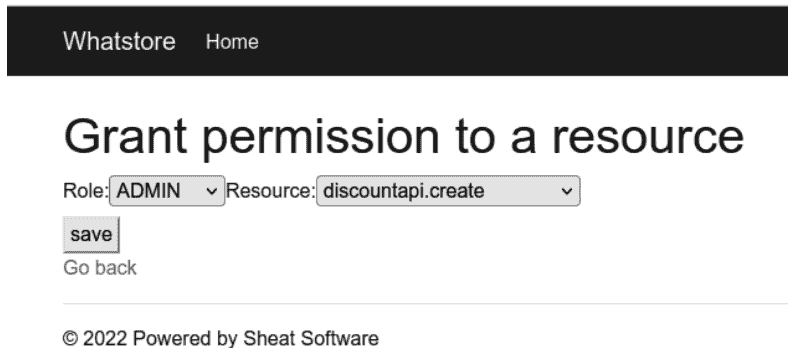
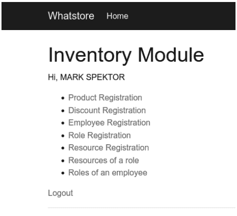
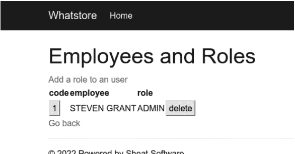
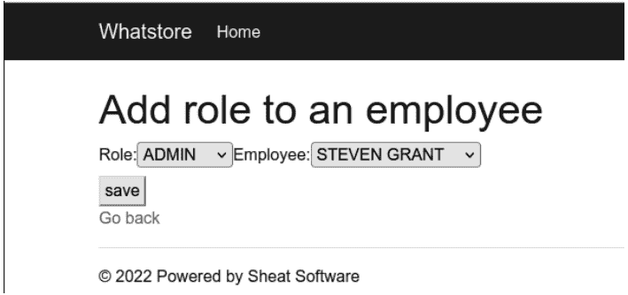

## 事件驱动授权

本章介绍了开发安全应用程序时的一个重要主题：授权。

授权是检查已识别人员允许执行的操作。物理世界中授权的一个例子是：一个人进入大楼后，可以访问哪些楼层和房间的控制。这可以由人员、钥匙或卡片来执行，甚至只有经过授权的楼层才能打开的电梯也是如此。简而言之，授权是某人可以对一组资源执行的操作的限制。

在本章中，你将学习如何使用面向事件的编程来实现授权控制。首先，我们将为角色和资源创建注册，这是基于角色的访问控制（RBAC）方法的主要概念。我们将资源与角色、角色与用户关联起来，以便按顺序为库存模块中的员工实现授权控制。最后，我们将创建一个监听器来验证每个请求的用户权限。

在本章中，我们将介绍以下主题：

- 创建角色注册
- 创建资源注册
- 将资源与角色关联
- 将角色与用户关联
- 实现访问控制
- 验证用户权限
- 修改测试引导程序
- 创建身份管理器

在本章结束时，你将能够控制应用程序中每个用户可以处理哪些资源。

让我们先从创建角色和资源的注册开始。

### 技术要求

本章相关的所有代码可以在 https://github.com/PacktPublishing/PHP-Web-Development-with-Laminas/tree/main/chapter10/whatstore 找到。

**重要提示：可能会出现会话崩溃**

在本章中，我们将更改应用程序在会话中存储的数据结构。如果你没有从 *第 9 章，事件驱动身份验证* 的应用程序中登出，然后尝试登录本章的应用程序，你会惊讶地发现会话错误。如果发生这种情况，在继续之前请清除会话。如果你不想通过浏览器清除会话，可以使用 https://github.com/PacktPublishing/PHP-Web-Development-with-Laminas/tree/main/util 中提供的脚本。

### 创建角色注册

员工是库存模块的用户。员工随时间在公司中担任不同的角色。员工可以完成休假同事的工作。员工在老板休假时也可能代替老板。在不同时间，员工根据需要完成的任务拥有不同的权限。因此，我们不应将员工和权限强耦合，因为权限与角色更相关。

事实上，假设你已经像在 *第 7 章，请求控制和数据视图* 中针对产品所做的那样，为角色实现了 CRUD。同样，假设你像在 *第 8 章，创建表单并实现过滤器和验证器* 中针对产品折扣所做的那样，使用 laminas-form、laminas-filter 和 laminas-validation 实现了此 CRUD。这并不难想象，因为源代码实际上可在 *技术要求* 节中提到的仓库中找到。由于我们使用模式，CRUD 实现的结构是相同的。是的，我们产生了既视感。

因此，我们假设 module/Inventory/src/Model 文件夹中有以下类：

- Role
- RoleTable
- RoleTableFactory

重要的是要记住，每个表网关类的工厂必须通过 modules.config.php 文件中的 service_manager 键进行配置。

我们还假设 module/Inventory/src/Controller 文件夹中有以下类：

- RoleAPIController
- RoleAPIControllerFactory
- RoleController
- RoleControllerFactory

你可以观察到，我们有两组类：一个 API 控制器及其工厂，以及一个 Web 界面控制器及其工厂。这与我们用于产品控制器层实现的结构完全相同。这些控制器类由 module/Inventory/test/Controller 文件夹中的以下类进行测试：

- RoleAPIControllerTest
- RoleControllerTest

重要的是要记住，每个控制器类的别名和工厂必须通过 modules.config.php 文件中的 controllers 键进行配置。

我们还为角色提供了一个视图层实现，它与我们对产品的实现非常相似。因此，我们假设 module/Inventory/view/inventory/employee 文件夹中有以下视图脚本：

- edit.js
- edit.phtml
- index.js
- index.phtml

这里，我们有两组文件生成两个网页：插入/更新页面和列表页面。.phtml 文件包含 HTML 和 PHP 代码的组合，而 .js 文件仅包含 JavaScript 代码。

好了，我们现在有了角色注册。这个注册比员工注册简单，因为只有两个属性：代码和名称。在下一节中，我们将创建资源注册。

### 创建资源注册

当我们处理权限时，我们谈论的是某人可以对某物执行某个操作。在我们正在使用的模型中，执行操作的是角色。角色操作影响的对象是资源。

角色可能更容易理解，因为你可以迅速在用户和角色之间建立联系。当我们谈论用户和角色时，你可以想象真实的人。

但是资源是什么？似乎我们在谈论经济学……不，对于访问控制系统，资源是角色可以处理的任何东西。资源可以是对象、URL、可视组件等。这取决于系统。或者更确切地说，取决于系统需求。资源是系统需求的一部分。必须有一个系统来确定谁可以做什么。这是业务的一部分。因此，系统的客户需要说明他们在访问控制方面的期望。

你还记得 Whatstore 的首席执行官 Mr. Heythere 吗？是的，有人雇佣了 Sheat Software 来构建一个很棒的电子商务网站。好吧，Sheat Software 的架构师 Mr. Worried 与 Mr. Heythere 谈论了员工权限。Mr. Heythere 对如何控制访问没有明确的想法，并向 Mr. Worried 请教建议。Mr. Worried 使用中世纪城堡比喻向 Mr. Heythere 解释了一下 Laminas 的结构。Mr. Heythere 喜欢控制器和操作的概念。他觉得它们很有趣。Mr. Heythere 决定，Whatstore 系统的资源每个都可以是库存模块的控制器和操作的组合。

想象一下，在定义资源定义后，你像在上一节为角色所做的那样，为资源实现 CRUD。你应该理解注册的 MVC 实现。因此，我们不会重复。让我们专注于如何填充资源表。

### 填充资源表

事实上，要授予权限，我们至少需要一个注册用户（员工），该用户与一个角色关联并注册了资源。我们可以使用脚本准备数据库并填充一些必要记录来提供这些条件。我们将在 whatstore 项目的 bin 文件夹中创建一个名为 loaddatabase.php 的脚本。如我们在 *第 5 章，创建虚拟商店项目* 中所见，bin 文件夹存储自动化脚本。

load_database.php 脚本文件以依赖项声明开始：

```
<?php
use Laminas\Db\Adapter\Adapter;
use Laminas\Stdlib\ArrayUtils;
use Inventory\Model\Employee;
use Laminas\Db\Adapter\AdapterInterface;

require __DIR__ . '/../vendor/autoload.php';
```

在前面的代码块中，我们使用 laminas-db 的 Adapter 类和 AdapterInterface 接口来创建一个抽象数据库连接的对象。ArrayUtils 类用于正确合并配置数组。由于密码加密，我们需要显式引用 Employee 类。为了找到所有这些类和接口，我们必须导入 Composer 自动加载文件 (autoload.php)。接下来，我们将声明一个函数 (getConfig) 来获取应用程序配置，如下所示：

```
function getConfig() : array
{
```


```php
$config = require __DIR__ . '../config/autoload/global.php';

if (file_exists(__DIR__ . '../config/autoload/local.php')) {
    $override = require __DIR__ . '../config/autoload/local.php';
    $config = ArrayUtils::merge($config, $override);
}

return $config;
}
```

此getConfig函数与public文件夹中index.php文件使用的代码行相同。该函数部分模拟了应用程序初始化。接下来，我们将声明另一个函数（recreateDatabase）来删除数据库并用一些基本数据重新创建它：

```php
function recreateDatabase(AdapterInterface $adapter) : void
{
    echo "Dropping database...\n";
    $adapter->query('DROP DATABASE IF EXISTS whatstore', Adapter::QUERY_MODE_EXECUTE);
    $sqlscript = file_get_contents(__DIR__ . '/whatstore.sql');
    echo "Creating database and tables...\n";
    $adapter->query($sqlscript, Adapter::QUERY_MODE_EXECUTE);
    echo "Whatstore database has been created.\n";
}
```

recreateDatabase函数使用AdapterInterface实现来删除数据库并按顺序使用SQL脚本（可在GitHub仓库中找到）重新创建它。接下来，我们声明一个函数（addUserAndRole）来在employee表中创建和记录，并在roles表中创建另一个：

```php
function addUserAndRole($adapter) : void
{
    $password = Employee::encrypt('moonknight');
    $sqlscript = <<<SQL
    INSERT INTO `employees`(`ID`, `name`, `nickname`, `password`) VALUES (NULL,'STEVEN GRANT','MARK SPEKTOR','$password');
SQL;
    $adapter->query($sqlscript, Adapter::QUERY_MODE_EXECUTE);
    $sqlscript = <<<SQL
    INSERT INTO `roles`(`code`, `name`) VALUES (NULL,'ADMIN');
SQL;
    $adapter->query($sqlscript, Adapter::QUERY_MODE_EXECUTE);
    $sqlscript = <<<SQL
    INSERT INTO `employee_roles`(`code`, `code_role`, `ID_employee`) VALUES (NULL,(SELECT code FROM `roles` WHERE name = 'ADMIN'),(SELECT ID FROM `employees` WHERE name = 'STEVEN GRANT'));
SQL;
    $adapter->query($sqlscript, Adapter::QUERY_MODE_EXECUTE);
    echo "A user and a role were created.\n";
}
```

addUserAndRole函数使用AdapterInterface实现来插入一个员工，插入一个角色，然后在此员工和该角色之间在employee_roles表中建立关联。接下来，我们将声明一个函数（addResource）来提取关于Inventory控制器及其方法的数据以注册资源：

```php
function addResources($adapter): void
{
    $dir = scandir(realpath(__DIR__ . './../module/Inventory/src/Controller'));

    $controllers = [];

    foreach ($dir as $file) {
        if (strpos($file, 'Controller.php') != false) {
            $controllers[] = 'Inventory\\Controller\\' . str_replace('.php', '', $file);
        }
    }

    $resources = getResources($controllers);

    $sqlscript = <<<SQL
    INSERT INTO `resources`(`code`, `name`, `method`) VALUES
    $resources;
SQL;

    $adapter->query($sqlscript, Adapter::QUERY_MODE_EXECUTE);

    echo "Resources were created.\n";
}
```

addResources函数有什么作用？让我们来了解一下：

- 首先，该函数扫描控制器目录，并创建一个包含所有Inventory控制器完全限定名称的列表。
- 然后，该函数调用getResources函数来获取资源列表。

getResources函数接收一个数组，即Inventory控制器列表。该函数的代码如下：

```php
function getResources(array $controllers): string
{
    $actionMethods = ['getMethodFromAction', 'notFoundAction'];
    $httpMethods = ['create', 'update', 'get', 'delete'];
    $restMethods = [
        'create' => 'POST',
        'update' => 'PUT',
        'get' => 'GET',
        'delete' => 'DELETE'
    ];

    $resources = '';

    foreach ($controllers as $controller) {
        $methods = get_class_methods($controller);
        foreach ($methods as $method) {
            $alias = str_replace('Inventory\\Controller\\', '', $controller);
            $alias = strtolower(str_replace('Controller', '', $alias));
            if (strpos($method, 'Action') != false && !in_array($method, $actionMethods)) {
                $method = str_replace('Action', '', $method);
                $resources .= "(NULL,'$alias.$method', 'GET'),";
                $resources .= "(NULL,'$alias.$method', 'POST'),";
            }
            if (in_array($method, $httpMethods)) {
                $resources .= "(NULL,'$alias.{$method}', '{$restMethods[$method]}'),";
            }
        }
    }
}
```

请注意，getResources函数生成一个列表，其中包含控制器别名和方法名称的连接。选定的方法是那些带有Action后缀的方法（除了从超类继承的一些方法外），或者具有与REST架构相关的特定名称的方法。

资源列表被连接到一个SQL INSERT语句中，该语句随后被执行。在addResources函数结束时，resources表被填充了Inventory资源，这些资源的访问必须受到控制。

grantPermissionsToRole函数使用AdapterInterface实现来授予admin角色访问所有由addResources函数注册的资源的权限。在以下代码块中，我们可以看到grantPermissionsToRole函数的源代码：

```php
function grantPermissionsToRole(AdapterInterface $adapter): void
{
    $statement = $adapter->query('SELECT code FROM `resources`');
    $results = $statement->execute();

    foreach ($results as $row) {
        $sqlscript = <<<SQL
        INSERT INTO `resources_role`(`code`, `code_role`, `code_resource`) VALUES (NULL, (SELECT code FROM `roles` WHERE name = 'ADMIN'),{$row['code']});
SQL;

        $adapter->query($sqlscript, Adapter::QUERY_MODE_EXECUTE);
    }

    echo "Permissions were granted.\n";
}
```

这些函数由以下脚本编排：

```php
// main program

$config = getConfig();
$db = $config['db'];
unset($db['database']); // remove database key because it causes error in connection when database does not exist
$adapter = new Adapter($db);

try {
    recreateDatabase($adapter);
    $db = $config['db'];
    $adapter = new Adapter($db);
    addUserAndRole($adapter);
    addResources($adapter);
    grantPermissionsToRole($adapter);
} catch (Exception $e) {
    echo 'Fail to recreate the database.' . $e->getMessage() . "\n";
}
```

我们为什么要创建这个脚本？因为我们需要有一个可以进行身份验证和授权的用户。现在，如果没有有效用户或没有权限的用户，我们如何在`Inventory`模块中导航？你可以在`bin`目录中运行以下脚本：

```
php load_database.php
```

执行结束时，你将拥有一个用户（员工）、一个角色、资源以及用户访问所有这些资源的权限。现在，你可以在本章后面启用授权控制后浏览`Inventory`模块。但在这样做之前，我们需要实现注册来将角色与资源关联，并将用户与角色关联。`load_database.php`脚本文件仅为一个用户Steven Grant完成了这些注册和关联，因此他是我们的超级用户或管理员用户。但是，管理员需要一个界面来将角色与用户关联，并授予用户权限。让我们看看如何按顺序在下一节中实现角色与资源之间的关联。

### 将资源与角色关联

我们不会重复已经完成的注册细节。角色资源的实现代码可在*技术要求*部分提到的本章源代码文件夹中找到。在这里，我们将仅关注与资源和角色关联相关的差异。角色资源的注册基于`resources_role`表。

我们有一个`RoleResourceController`类来处理两个页面：一个用于列出和删除资源与角色的对（`index.phtml`），另一个用于插入资源与角色的对（`edit.phtml`）。为了执行这些操作，`RoleResourceController`构造函数需要接收三个表网关类，如下面的代码片段所示：

```php
public function __construct(RoleResourceTable $roleResourceTable, ResourceTable $resourceTable, RoleTable $roleTable)
{
    $this->roleResourceTable = $roleResourceTable;
    $this->resourceTable = $resourceTable;
    $this->roleTable = $roleTable;
}
```

RoleResourceController类的indexAction方法与之前的控制器类似。该方法提供一个带有角色对资源权限的HTML页面，如图10.1所示。此页面是对http://localhost:8000/inventory/roleresource请求的输出：


### 角色和资源

授予权限

| 代码 | 角色 | 资源 |
|---|---|---|
| 8 | ADMIN | discount.edit |
| 7 | ADMIN | discount.edit |
| 6 | ADMIN | discount.index |
| 5 | ADMIN | discount.index |
| 1 | ADMIN | discountapi.create |
| 4 | ADMIN | discountapi.delete |
| 2 | ADMIN | discountapi.get |
| 3 | ADMIN | discountapi.update |
| 16 | ADMIN | employee.edit |
| 15 | ADMIN | employee.edit |
| 13 | ADMIN | employee.index |
| 14 | ADMIN | employee.index |
| 9 | ADMIN | employeeapi.create |
| 12 | ADMIN | employeeapi.delete |

图 10.1: 角色及其资源

图 10.1 所示页面允许您为角色移除权限。如您所见，列表按角色名称排序，而非按权限代码排序。该列表由 RoleResourceTable->getAll 方法生成。该方法构建并执行一条 SQL SELECT 语句，用于连接 resources_role、resources 和 roles 表。getAll 方法已在后文列出。事实上，您在第 7 章“请求控制和数据视图”的“测试 Web 界面与 API 之间的交互”一节中，已经见过与 Select 类一起使用 INNER JOIN 子句的示例。以下源代码中的新增内容是使用 order 方法，它会生成 SQL 的 ORDER BY 子句：

```php
public function getAll($where = null) : iterable
{
    $select = new Select($this->tableGateway->
        getTable());
    $select->join('resources','resources_role.code_resource=resources.code', ['resource' => 'name'])
->join('roles', 'resources_role.code_role=roles.code', ['role' => 'name'])
->order(['roles.name', 'resources.name']);
if (!is_null($where)) {
    $select->where($where);
}
return $this->tableGateway->selectWith($select);
}
```

您可以看到，图 10.1 所示页面有一个“授予权限”超链接。该超链接会调用 RoleResourceController->editAction 方法。该方法使用两个表网关对象来填充两个不同的下拉列表，如以下源代码所示：

```php
public function editAction()
{
    $form = new RoleResourceForm();
    $resources = [];
    $rows = $this->resourceTable->getAll();
    foreach($rows as $row) {
        $resources[$row->code] = $row->name;
    }

    $roles = [];
    $rows = $this->roleTable->getAll();
    foreach($rows as $row) {
        $roles[$row->code] = $row->name;
    }

    $form->get('code_resource')->setValueOptions
        ($resources);
    $form->get('code_role')->setValueOptions($roles);
    return new ViewModel([
        'form' => $form
    ]);
}
```

该方法提供一个包含图 10.2 所示表单的 HTML 页面：



图 10.2: 向角色授予权限的表单

图 10.2 所示表单允许您选择一个角色并授予其访问资源的权限。如果您单击保存按钮，该关联将被持久化（如果尚不存在）。持久化由 RoleResourceTable->save 方法完成，如以下源代码所示：

```php
public function save(AbstractModel $model): bool
{
    $set = $model->toArray();
    $resourcesRole = $this->getByFields([
        'code_resource' => $model->resource->code,
        'code_role' => $model->role->code,
    ]);
    try {
        if (empty($resourcesRole->code)) {
            $this->tableGateway->insert($set);
        }
    } catch (\Exception $e) {
        error_log($e->getMessage());
        return false;
    }
    return true;
}
```

请注意，此 save 方法会调用 getByFields 方法。getByFields 方法已添加到 Generic 模块的 AbstractTable 类中，以允许使用多个过滤条件进行查询。getByFields 方法接收一个数组作为参数，如以下源代码所示：

```php
public function getByFields(array $fields): AbstractModel
{
    $where = [];
    foreach($fields as $field => $value) {
        $where[$field] = $value;
    }
    $rowSet = $this->getAll($where);
    if ($rowSet->count() == 0) {
        $modelName = $this->modelName;
        return new $modelName();
    }
    return $rowSet->current();
}
```

现在，您可以将资源与角色关联，从而允许角色访问这些资源。

在下一节中，我们将了解如何实现角色与用户之间的关联。

### 将角色与用户关联

我不再重复我们已介绍过的注册细节。员工角色的实现代码可在本章的源代码文件夹中找到（在“技术要求”部分中提及）。在此，我们将仅关注与库存模块（即员工）中角色与用户之间关联相关的差异。员工角色的注册基于 employee_roles 表。

好了，既然我们已实现库存模块的最后一个注册，是时候为我们的注册向菜单页面添加超链接了。因此，我们需要修改 module/Inventory/view/inventory/menu 文件夹中的 index.phtml 文件，如下所示：

### index.phtml

```php
<h1>Inventory Module</h1>
<p>Hi, <?=$this->user?></p>
<ul>
<li><a href="<?=$this->url('inventory', ['controller' => 'product'])?>">Product Registration</a></li>
<li><a href="<?=$this->url('inventory', ['controller' => 'discount'])?>">Discount Registration</a></li>
<li><a href="<?=$this->url('inventory', ['controller' => 'employee'])?>">Employee Registration</a></li>
<li><a href="<?=$this->url('inventory', ['controller' => 'role'])?>">Role Registration</a></li>
<li><a href="<?=$this->url('inventory', ['controller' => 'resource'])?>">Resource Registration</a></li>
<li><a href="<?=$this->url('inventory', ['controller' => 'roleresource'])?>">Resources of a role</a></li>
<li><a href="<?=$this->url('inventory', ['controller' => 'employeerole'])?>">Roles of an employee</a></li>
</ul>

<a href="<?=$this->url('inventory', ['action' => 'logout'])?>">Logout</a>
```

此 index.phtml 文件将显示以下页面：



图 10.3: 库存模块的菜单页面

**角色的资源** 超链接将带您进入前一节中展示的注册列表页面。**员工的角色** 超链接将带您进入以下页面：



图 10.4: 员工角色列表页面

图 10.4 所示页面允许您为员工移除角色。该列表由 EmployeeResourceTable->getAll 方法生成。该方法构建并执行一条 SQL SELECT 语句，用于连接 resources_role、resources 和 roles 表。getAll 方法已在后文列出。这是 INNER JOIN 子句的另一个用法示例，如前一节所示。

在以下代码块中，我们可以看到 EmployeeResourceTable->getAll 方法的源代码：

```php
public function getAll($where = null): iterable
{
    $select = new Select($this->tableGateway->
    getTable());
    $select->join('roles','employee_roles.code_role=roles.code', ['role' => 'name'])
    ->join('employees','employee_roles.ID_employee=employees.ID', ['employee' => 'name'])
    ->order(['employees.name', 'roles.name']);
    if (!is_null($where)) {
    $select->where($where);
    }
    return $this->tableGateway->selectWith($select);
}
```

如您所见，图 10.4 所示页面具有一个“向用户添加角色”超链接。该超链接会调用 EmployeeRoleController->editAction 方法。该方法使用两个表网关对象来填充两个不同的下拉列表，如以下源代码所示：

```php
public function editAction()
{
    $form = new EmployeeRoleForm();
    $employees = [];
    $rows = $this->employeeTable->getAll();
    foreach($rows as $row) {
    $employees[$row->ID] = $row->name;
    }
    $roles = [];
    $rows = $this->roleTable->getAll();
    foreach($rows as $row) {
    $roles[$row->code] = $row->name;
    }
```


$form->get('ID_employee')->setValueOptions($employees);
$form->get('code_role')->setValueOptions($roles);
return new ViewModel([
    'form' => $form
]);
}

此方法提供一个带有图 10.5 中所示表单的 HTML 页面：



图 10.5: 将角色与员工关联的表单

图 10.5 中所示的表单允许您选择一个角色并授予其访问资源的权限。如果您单击保存按钮，关联将被持久化（如果尚不存在）。持久化由 EmployeeRoleTable->save 方法完成，如以下源代码所示：

```
public function save(AbstractModel $model): bool
{
    $set = $model->toArray();
    $employeeRole = $this->getByFields([
        'code_role' => $model->role->code,
        'ID_employee' => $model->employee->ID
    ]);
    try {
        if (empty($employeeRole->code)) {
            $this->tableGateway->insert($set);
        }
    } catch (\Exception $e) {
        error_log($e->getMessage());
        return false;
    }

    return true;
}
```

现在我们知道如何将资源与角色关联、将角色与员工关联。在下一节中，我们将了解如何使用这些注册记录实现访问控制。

### 实现访问控制

Laminas 有两个用于授权的组件：laminas-permissions-acl 和 laminas-permissions-rbac。第一个组件实现访问控制列表（ACL）方法，第二个组件实现 RBAC 方法。

我们将使用 laminas-permissions-rbac 组件在 whatstore 项目中实现授权控制。我们的系统在数据模型中强调角色，RBAC 似乎很方便。就像我们之前使用 Composer 添加和安装 laminas-db 组件一样，我们将对 laminas-permissions-rbac 组件执行相同操作。在 Eclipse 中打开 composer.json 文件，从“依赖项”选项卡中搜索 laminas/laminas-permissions-rbac 包并添加它。不要忘记保存文件并单击“更新依赖项”按钮。如果您不确定如何在 Eclipse 中安装 Composer 依赖项，请阅读第 3 章《将 Laminas 作为库使用并结合测试驱动开发》中的“创建我们的第一个自动化测试”部分。

安装 laminas-permissions-rbac 后，我们可以使用该组件修改 IndexController->loginAction 方法。该方法将如下所示：

```
public function loginAction()
{
    $nickname = $this->request->getPost('nickname');
    $password = $this->request->getPost('password');
    $this->adapter->setIdentity($nickname);
    $this->adapter->setCredential(
        Employee::encrypt($password)
    );

    $logged = false;

    $auth = new AuthenticationService();
    $auth->setAdapter($this->adapter);

    $result = $auth->authenticate();

    if ($result->isValid()) {
        error_log('user ' . $result->getIdentity() . ' is logged');
        $this->loadAuthorizationData($result->getIdentity());
        $logged = true;
    } else {
        foreach ($result->getMessages() as $message) {
            error_log($message);
        }
    }

    return new JsonModel([
        'logged' => $logged
    ]);
}
```

此处所示的实现与前一章的唯一区别在于，我们在成功身份验证后调用 loadAuthorizationData 方法。该方法的源代码如下：

```
private function loadAuthorizationData(string $identity): void
{
    $role = new Role($identity);

    $row = $this->adapter->getResultRowObject();
    $resources = $this->resourceTable->getResourcesFromAnEmployee($row->ID);
    foreach ($resources as $resource) {
        $role->addPermission($resource->name . ':' .
        $resource->method);
    }

    $rbac = new Rbac();
    $rbac->addRole($role);

    $container = new Container();
    $container->rbac = $rbac;
}
```

loadAuthorizationData 方法执行以下操作：

- 创建 Laminas\Permissions\Rbac\Role 类的实例，并将员工昵称用作角色名称。注意！员工可以有多个角色，但为了检查授权，我们将使用一个虚拟角色来统一与员工关联的所有实际角色。

- 使用 Laminas\Authentication\Adapter\DbTable\AbstractAdapter 类的 getResultRowObject 方法检索经过身份验证的员工记录。

- 使用经过身份验证的员工的 ID，通过 ResourceTable->getResourcesFromAnEmployee 方法检索与员工角色关联的资源，其源代码如下：

```
public function getResourcesFromAnEmployee($employeeID): ResultSet
{
    $subSelect = new Select('employee_roles');
    $subSelect->columns(['code_role'])
        ->where(['ID_employee' => $employeeID]);

    $where = new Where();
    $where->in('resources_role.code_role', $subSelect);

    $select = new Select($this->tableGateway->getTable());
    $select->columns(['name' => new Expression('DISTINCT name'), 'method'])
        ->join('resources_role', 'resources.code = resources_role.code_resource', [])
        ->where($where);
    return $this->tableGateway->selectWith($select);
}
```

请注意，ResourceTable->getResourcesFromAnEmployee 方法使用 Laminas\Db\Sql\Where 类的实例来定义带有 SQL IN 子句的过滤器。还请注意，该方法使用 Laminas\Db\Sql\Expression 类向资源表的 name 字段添加 DISTINCT 关键字。使用 DISTINCT 是为了避免当员工拥有多个角色且两个或多个角色有权访问相同资源时出现重复资源。

- 创建 Laminas\Permissions\Rbac\Rbac 类的实例，并将角色对象与该实例关联。

- 创建 Laminas\Session\Container 类的实例，并将 Rbac 实例存储在会话中。

因此，我们将经过身份验证的员工的权限存储在会话中，并可以随时检查。由于我们在用户登录系统时将访问数据存储在会话中，因此需要在用户退出系统时删除这些数据。我们将在 IndexController->logoutAction 方法中使用此功能：

```
public function logoutAction()
{
    $auth = new AuthenticationService();
    $auth->clearIdentity();
    $session = new SessionManager();
    try {
        $session->destroy();
    } catch (\Exception $e) {
        error_log($e->getMessage());
    }

    return $this->redirect()->toRoute('inventory');
}
```

在前面的代码块中，我们使用了 Laminas\Session\SessionManager 类来销毁会话。请注意，我们在 try/catch 结构中执行了此操作。为什么呢？因为该方法可能由测试运行，而测试不会创建会话。

那现在怎么办？将来会检查权限吗？暂时不会。我们需要创建一个监听器类，并将其与 EVENT_ROUTE 事件关联，就像我们在第 9 章《事件驱动的身份验证》中为身份验证所做的那样。开始吧！

### 验证用户权限

要开始，在 module/Inventory/src/Listener 文件夹内，我们将创建一个名为 InventoryAuthorizationListener 的类。该类将有一个名为 verifyPermission 的方法，如以下代码块所示：

```
public static function verifyPermission(MvcEvent $event)
{
    $routeName = $event->getRouteMatch()->getMatchedRouteName();
    if (!$routeName == 'inventory') {
        return;
    }
    $authenticationService = new AuthenticationService();
    if ($authenticationService->hasIdentity()) {
        $params = $event->getRouteMatch()->getParams();
        $controller = $params['controller'];
        $action = $params['action'];
        if ($controller == 'menu' || $action == 'logout') {
            return;
        }
    }
    $method = $event->getRequest()->getMethod();
    $permission = $controller . '.' . $action . ':' . $method;
    $container = new Container();
    $rbac = $container->rbac;
    $role = $authenticationService->getIdentity();
    if (!$rbac->isGranted($role, $permission)) {
```


让我们看看 InventoryAuthenticationListener::verifyIdentity 是如何工作的：

- verifyPermission 方法接收一个 MvcEvent 对象。我们在第 9 章“事件驱动身份验证”中讨论过这个类。
- 我们使用了 MvcEvent 的 getRouteMatch 方法来检索 RouteMatch 对象。我们也在第 9 章“事件驱动身份验证”中讨论过这个类。
- 我们使用路由名称来判断请求的模块是否为 Inventory，这与我们为身份验证监听器所做的操作相同。
- 如果请求的模块是 Inventory，我们会实例化 AuthenticationService 类并调用 hasIdentity 方法。您已经从第 9 章“事件驱动身份验证”了解此方法。
- 如果用户已通过身份验证，我们会通过 RouteMatch 实例的 getParams 方法从匹配的路由中检索控制器和操作名称。
- 如果员工（即库存用户）可以在未经授权的情况下访问 IndexController->menuAction 和 IndexController->logoutAction 方法，则我们不为这些方法执行任何操作。
- 对于 Inventory 模块中的任何其他控制器和操作，如果员工角色无权访问资源，我们会将用户重定向到 IndexController 的无权限页面。创建该页面的 no-permission.phtml 文件必须如下所示：

### no-permission.phtml

```
<h1>Inventory Module</h1>

<p>Hi, <?=$this->user?>. You don't have permission to
   requested resource.</p>
```

<a href="<?= $this->url('inventory', ['controller' =>
'menu']) ?>">Menu</a>

要将 InventoryAuthorizationListener 类启用为监听器，我们必须修改 Inventory 模块的 Module.php 文件。为此，我们需要修改 Module->onBootstrap 方法，其内容如下：

```
public function onBootstrap($e)
{
    if (defined('PHPUNIT_COMPOSER_INSTALL')) return;
    $application = $e->getApplication();
    $application->getEventManager()->attach(MvcEvent::
        EVENT_ROUTE, [InventoryAuthenticationListener ::
        class,'verifyIdentity']);
    $application->getEventManager()->attach(MvcEvent ::
        EVENT_ROUTE, [InventoryAuthorizationListener ::
        class,'verifyPermission']);
}
```

做出这些更改后，您将尝试删除用户（员工）的权限，并发现会被重定向到无权限页面。重要的是要理解，权限更改只有在用户注销并重新登录后才会生效，因为会话中的数据未发生变化。

哇，我们几乎完成了。授权流程已实现。在下一节中，我们将对测试进行调整。

### 修改测试引导文件

测试始终需要从相同的状态运行。但在开发过程中，我们可以多次更改测试所使用的数据。我们已创建一个脚本来加载启用身份验证和授权的系统所需的数据。现在，我们将创建一个脚本来准备运行测试的环境。该脚本将保留在 bin 文件夹中，并命名为 testbootstrap.php。该脚本将包含以下代码：

### testbootstrap.php

```
<?php
use Laminas\Db\Adapter\Adapter;
use Laminas\Stdlib\ArrayUtils;

require __DIR__ . '../vendor/autoload.php';

$config = require __DIR__ . '../config/autoload/global.php';

if (file_exists(__DIR__ . '../config/autoload/
local.php')) {
    $override = require __DIR__ . '../config/autoload/
local.php';
    $config = ArrayUtils::merge($config, $override);
}

$db = $config['db'];
unset($db['database']); // remove database key because it
causes error in connection when database does not exist
$adapter = new Adapter($db);

try {
    echo "Dropping database...\n";
    $adapter->query('DROP DATABASE IF EXISTS whatstore',
        Adapter::QUERY_MODE_EXECUTE);
    $sqlscript = file_get_contents(__DIR__ .
    '/whatstore.sql');
    echo "Creating database and tables...\n";
    $adapter->query($sqlscript, Adapter::
        QUERY_MODE_EXECUTE);
    echo "The whatstore database has been created.\n";
} catch (Exception $e) {
    echo 'Fail to recreate the database.' . $e->
        getMessage() . "\n";
}
```

该脚本会删除数据库，并使用 `bin` 文件夹中提供的 `whatstore.sql` SQL 脚本重新创建数据库。因此，测试将在空表上运行，并在运行后保持表为空。请记住，我们始终会删除添加到测试中的记录。

要将 `testbootstrap.php` 与我们的 PHPUnit 测试一起使用，请更改 `phpunit.xml` 文件中的 `phpunit` 标签并添加 `bootstrap` 属性，其内容如下：

```
<phpunit bootstrap="bin/testbootstrap.php" colors="true">
```

从现在起，当您运行 `vendor/bin/phpunit` 命令时，`testbootstrap.php` 脚本将在测试之前执行。最后，我们在项目中引入了“时间旅行”，因为现在我们可以随时回到过去来测试我们的应用程序。

我们现在在 `Inventory` 模块中拥有了正常工作的身份验证和授权功能。但是，在这里实现这些安全功能并不十分合适，因为这将一项业务责任留在了控制器（`Inventory` 模块的 `IndexController`）中。我们需要将此责任移至模型。我们将在下一节中完成此操作。

### 创建身份管理器

在本节中，我们将重构身份验证和授权的实现，以将这些责任从控制器层解耦。

第一步是在 `Inventory` 模块的 `Model` 文件夹中创建一个名为 `IdentityManager` 的模型类。该类将拥有四个私有属性：

```
```php
class IdentityManager
{
    private ?AdapterInterface $adapter;
    private ?ResourceTable $resourceTable;
    private ?array $encryptionMethod;
    private ?AuthenticationService $auth;
}
```
```

让我们了解前面的代码：

- `$adapter` 是身份验证适配器类的实例。
- `$resourceTable` 是 `ResourceTable` 类的实例，授权过程需要它。
- `$encryptionMethod` 是应用于用户凭据的方法。
- `$auth` 是 `AuthenticationService` 实例，身份验证过程需要它。此类的每个实例都提供相同的数据，因为身份存储在用户会话中。

最后一个属性可以在内部赋值。另一方面，前三个属性的值需要被注入：

```
```php
public function __construct(AdapterInterface $adapter,
    ResourceTable $resourceTable, array $encryptionMethod)
{
    $this->adapter = $adapter;
    $this->resourceTable = $resourceTable;
    $this->encryptionMethod = $encryptionMethod;
    $this->auth = new AuthenticationService ();
}
```
```

`IdentityManager` 类将拥有一个 login 方法，它将封装 `IndexController->loginAction` 方法中的大部分代码：

```
public function login(string $identity, string
$credential): bool
{
    $this->adapter->setIdentity($identity);
    $credential = call_user_func($this->
    encryptionMethod, $credential);
    $this->adapter->setCredential($credential);
    $this->auth->setAdapter($this->adapter);
    $result = $this->auth->authenticate ();
    if ($result->isValid()) {
        error_log('user ' . $result->getIdentity() . '
        is logged');
        $this->auth->getStorage ()->write($this->
        adapter->getResultRowObject(null,'password'));
        $this->loadAuthorizationData ();
        return true;
    } else {
        foreach ($result->getMessages() as $message) {
            error_log($message);
        }
    }
    return false;
}
```

请注意，IdentityManager->login 封装的身份验证过程中引入了一些差异。第一个差异是使用注入的方法来加密凭据。此更改使该类更加灵活，因为它与 Employee 类没有耦合。无需在 IdentityManager 类中编写代码即可更改加密方法。


第二个不同之处是以下行：

```
$this->auth->getStorage()->write($this->adapter->getResultRowObject(null,'password'));
```

这条指令将用户对象（不含密码）写入身份验证会话。这样做是必要的，因为我们打算稍后重新验证权限数据，因此需要存储用户的主键，而不仅仅是凭据。此更改将在使用身份的地方需要一些调整，但仅限少数几处。

与前一种方法类似，IdentityManager 类将拥有一个 logout 方法，该方法将封装 IndexController->logoutAction 中的大部分代码：

```
public function logout() : void
{
    $this->auth->clearIdentity();
    $session = new SessionManager();
    try {
        $session->destroy();
    } catch (\Exception $e) {
        error_log($e->getMessage());
    }
}
```

IdentityManager 类还将封装 IndexController->loadAuthorizationData 方法。在恢复员工的主键 employee 时，你可以看到一点细微差别：

```
public function loadAuthorizationData() : void
{
    $role = new Role($this->auth->getIdentity()->name);
    $row = $this->auth->getStorage()->read();
    $resources = $this->resourceTable->
        getResourcesFromAnEmployee($row->ID);
    foreach($resources as $resource) {
        $role->addPermission($resource->name . ':' .
            $resource->method);
    }
    $rbac = new Rbac();
    $rbac->addRole($role);

    $container = new Container();
    if (isset($container->rbac)) {
        unset($container->rbac);
    }

    $container->rbac = $rbac;
}
```

如你所记得，此方法在 `IndexController` 类中是私有的，但在 `IdentityManager` 中是公共的。此更改是为了防范不满员工可能发起的一种攻击。

设想如下场景：在寒冷的冬日，Mr. Heythere 发现他手下的一位经理 Mr. Barnaby 的表现未达标。Mr. Heythere 告知 Mr. Barnaby 对他的期望，但 Mr. Barnaby 回答他宁可不这么做。因此，Mr. Heythere 决定解雇 Mr. Barnaby 并寻找一位更好的经理（很可能是某个读 Packt Publishing 出版书籍的人！）。问题是，Mr. Barnaby 知道自己在被解雇后仍然可以访问系统，因为他对系统非常熟悉。

恐怖事件的经过如下：Mr. Heythere 解雇了 Mr. Barnaby。由于会话配置，Mr. Barnaby 仍然使用其经理权限登录在 Whatstore 系统中。即使另一位经理更改了他的权限，也只会影响他下一次的访问尝试。现在，Mr. Barnaby 非常愤怒，因为他和 Mr. Heythere 显然未能就解雇条款达成一致，且 Mr. Barnaby 想让 Mr. Heythere 付出代价。由于 Mr. Barnaby 仍能以其先前的权限级别访问系统，他就这样做了，并损坏了一些记录。

我们如何避免这个恐怖故事？一种可能性是在用户登录期间更新其权限。因此，我们更改了 `loadAuthorizationData` 方法的可见性，以便在登录流程之外使用它。

为完成 `IdentityManager` 的实现，我们将添加三个方法：

```
public function getIdentity(): string
{
    return $this->auth->getIdentity()->name;
}
public function hasIdentity(): bool
{
    return $this->auth->hasIdentity();
}
public function getRbac(): Rbac
{
    $this->loadAuthorizationData();
    $container = new Container();
    return $container->rbac;
}
```

getIdentity 和 hasIdentity 方法是 AuthenticationService 类中同名方法的包装器。getRbac 方法提供带有当前权限的 Rbac 实例。

太棒了。我们的 IdentityManager 类已准备就绪。但由于它有依赖项，我们需要为其创建一个工厂。因此，在 Inventory 模块的 Model 文件夹中创建 IdentityManagerFactory 类：

```
class IdentityManagerFactory implements FactoryInterface
{
    public function __invoke(ContainerInterface $container,
        $requestedName, ?array $options = null)
    {
        $employeeTable = $container->get('EmployeeTable');
        $adapter = new CredentialTreatmentAdapter
            ($container->get('DbAdapter'));
        $adapter->setTableName('employees');
        $adapter->setIdentityColumn('nickname');
        $adapter->setCredentialColumn('password');

        $resourceTable = $container->get('ResourceTable');

        $encryptionMethod = array(new Employee(),
            'encrypt');

        return new IdentityManager($adapter, $resourceTable
            , $encryptionMethod);
    }
}
```

在为模型创建了多个工厂之后，你知道有必要将此工厂的条目添加到 module.config.php 文件的 service_manager->factories 键中：

```
'IdentityManager' => Model\\IdentityManagerFactory::class
```

由于 IdentityManager 已承担 IndexController 的部分职责，我们需要重构该控制器类。让我们从 IndexController 的构造函数开始：

```
private ?IdentityManager $identityManager;

public function __construct(IdentityManager
        $identityManager)
{
    $this->identityManager = $identityManager;
}
```

如你所见，它不再接收两个依赖项，现在 IndexController 仅接收 IdentityManager 实例。

通过将身份验证委派给 IdentityManager，IndexController->loginAction 方法将更加简洁：

```
public function loginAction()
{
    $nickname = $this->request->getPost('nickname');
    $password = $this->request->getPost('password');

    $logged = $this->identityManager->login($nickname,
        $password);

    return new JsonModel([
        'logged' => $logged
    ]);
}
```

同样，IndexController->logoutAction 方法的代码行数将更少：

```
public function logoutAction()
{
    $this->identityManager->logout();

    return $this->redirect()->toRoute('inventory');
}
```

你应该将控制器类视为经理。经理不会事事亲力亲为，而是委派任务。控制器类应将责任委派给模型或视图类。

当然，由于 `IndexController` 的构造函数已更改，我们必须调整 `IndexControllerFactory` 类以注入 `IdentityManager` 实例：

```
class IndexControllerFactory implements FactoryInterface
{
    public function __invoke(ContainerInterface $container,
        $requestedName, array $options = null)
    {
        $identityManager = $container->get
            ('IdentityManager');
        return new IndexController($identityManager);
    }
}
```

我们还需要在 `MenuController` 类的 `indexAction` 和 `noPermissionAction` 方法中进行调整。这些方法的最后一条指令必须如下所示：

```
return new ViewModel(['user' => $auth->getIdentity()->name]);
```

之所以需要此操作，是因为现在 `getIdentity` 方法不返回字符串值，而是返回一个对象。

最后，我们需要修改 `InventoryAuthorizationListener::verifyPermission` 方法中的几行代码。我们必须添加一个 `IdentityManager` 实例来处理身份验证和授权数据：

```
public static function verifyPermission
    (MvcEvent $event)
{
    $routeName = $event->getRouteMatch() ->
        getMatchedRouteName();
    if (!$routeName == 'inventory') {
        return;
    }

    $identityManager = $event->getApplication()
        ->getServiceManager()->get('IdentityManager');
    if ($identityManager->hasIdentity()) {
        $params = $event->getRouteMatch()->getParams();
        $controller = $params['controller'];
        $action = $params['action'];

        if ($controller == 'menu' || $action ==
            'logout') {
            return;
        }

        $method = $event->getRequest()->getMethod();
        $permission = $controller . '.' . $action . ':' .
            $method;

        $rbac = $identityManager->getRbac();

        $role = $identityManager->getIdentity();
        if (!$rbac->isGranted($role, $permission)) {
            $event->getRouteMatch()->setParam
            ('controller', 'menu');
            $event->getRouteMatch()->setParam('action',
            'no-permission');
            error_log("$role has not permission to
            $permission");
        }
    }
}
```

这样一来，Mr. Barnaby 或其他被解雇的员工将无法对系统造成损害（因为经理在解雇之前已更改了他们的权限）。

至此，我们终于完成了本章的内容。


### 总结

在本章中，我们学习了如何以与之前章节相似的方式实现角色和资源注册。我们讨论了与项目相关的角色和资源概念。我们还学习了如何将资源与角色关联，以及如何将角色与 Inventory 模块用户（员工）关联。在介绍了这些注册之后，我们学习了如何使用 laminas-permissions 组件实现访问控制，以及如何借助 laminas-eventmanager 验证用户权限。最后，我们了解了如何将登录和退出逻辑从控制器层解耦，创建一个身份管理类。我们还了解了如何防止不满的被解雇员工发起的攻击。

在下一章中，我们将学习如何实现产品购物篮，这将允许 Store 模块用户（客户）选择产品并进行购买。

### 延伸阅读

如果您想了解更多关于授权方法的信息，以下是一些值得阅读的好文章：

- ACL 方法：Ravi S. Sandhu 和 Pierangela Samarati 撰写的文章，网址为 https://www.profsandhu.com/cs5323_s18/SS-1994.pdf
- RBAC 方法：Ravi S. Sandhu、Edward J. Coyne、Hal L. Feinstein 和 Charles E. Youman 撰写的文章，网址为 https://csrc.nist.gov/CSRC/media/Projects/Role-Based-Access-Control/documents/sandhu96.pdf
