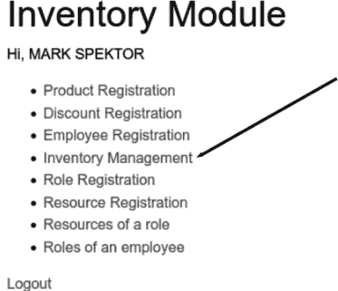
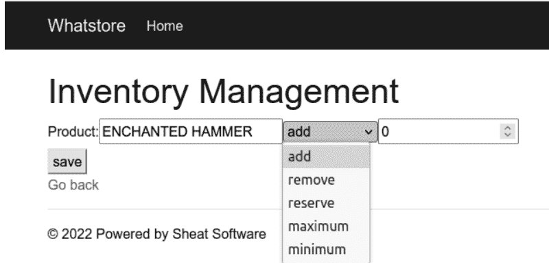
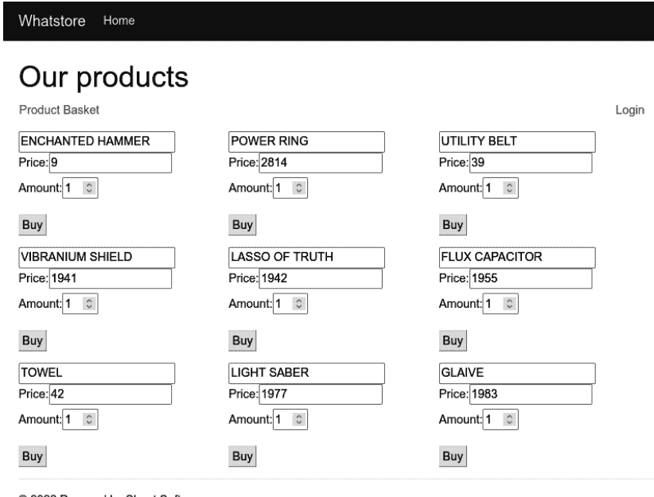
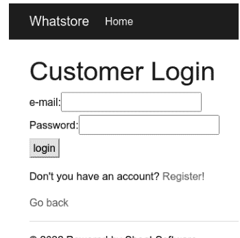
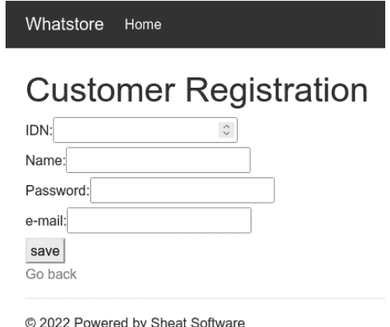
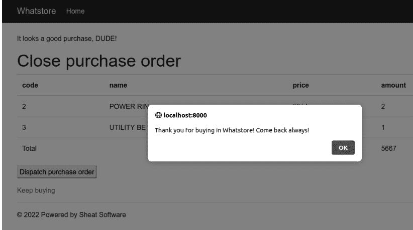

## 实现产品购物篮

本章介绍了产品购物篮的实现，它是虚拟商店的一个基本组件。在 *第 9 章，事件驱动的身份验证* 中，我们了解了 `laminas-session` 组件以及它如何用于管理会话并在 HTTP 请求之间持久化数据。在本章中，我们将使用 `laminas-session` 来实现产品购物篮。

我们将首先学习如何实现库存管理。接下来，我们将了解如何使用视图助手重构客户主页。之后，我们将实现产品购物篮。最后，我们将学习如何为已验证的客户创建采购订单。

在本章结束时，您将能够从列表页面选择产品，将这些产品添加到购物篮中，从购物篮中删除产品，并创建采购订单。此采购流程包括客户注册，这与我们在 *第 9 章，事件驱动的身份验证* 中实现的员工注册非常相似。

在本章中，我们将涵盖以下主题：

- 管理产品库存
- 重构客户主页
- 控制产品购物篮
- 控制客户
- 解耦身份验证的通用行为

### 技术要求

本章中所有相关代码均可在 `https://github.com/PacktPublishing/PHP-Web-Development-with-Laminas/tree/main/chapter11/whatstore` 找到。

### 管理产品库存

要在我们的电子商务系统中销售产品，我们需要在库存中拥有这些产品。正因为如此，我们需要能够管理库存以及产品数量的添加和移除。

事实上，想象您已经为库存实现了 RU。您可能会问，“RU？这是什么？”哦，抱歉，RU 代表 **恢复与更新**。“那不是 CRUD 吗？”不，因为库存取决于产品。当创建产品时，我们必须为此产品创建一个库存记录。当删除产品时，相关的库存记录也必须删除。因此，在涉及库存时，CRUD 没有意义，我们只需要为库存实现恢复和更新。好了，既然您已经理解了，让我们来解释库存管理的实现。

我们不会重复之前章节中介绍的注册详细信息。库存管理的实现可在本章的源代码文件夹中找到，如 *技术要求* 部分所述。因此，我们在这里将只关注与库存管理相关的差异。库存管理的专用数据基于库存表。

所以，让我们假设 `module/Inventory/src/Model` 文件夹中有以下类：

- Inventory
- InventoryTable
- InventoryTableFactory

重要的是要记住，每个表网关类的工厂必须通过 `modules.config.php` 文件中的 `service_manager` 键进行配置。

**重要说明 – 自动化测试**
您将在 *技术要求* 部分提到的 GitHub 仓库中找到本章中每个控制器类的测试类。然而，从现在开始，我们不会讨论这些测试类以避免不必要的重复。到现在为止，您应该意识到测试是必要的，并且在开发过程中进行测试很重要。从现在开始，我们将假设在创建新控制器类时，相应的测试类事先已创建。

我们还假设 `module/Inventory/src/Controller` 文件夹中有以下类：

- InventoryAPIController
- InventoryAPIControllerFactory
- InventoryController
- InventoryControllerFactory

请注意，我们有两对类：一个 API 控制器及其工厂，以及一个 Web 界面控制器及其工厂。这与我们在第 7 章“请求控制和数据视图”中用于产品控制器层实现的结构完全相同。这些控制器类由 module/Inventory/test/Controller 文件夹中的以下类进行测试：

- `InventoryAPIControllerTest`
- `InventoryControllerTest`

重要的是要记住，每个控制器类的别名和工厂必须通过 modules.config.php 文件中的 controllers 键进行配置。

我们还有一个用于角色的视图层实现，它与我们为产品所做的非常相似。因此，让我们假设以下视图脚本位于 module/Inventory/view/inventory/inventory 文件夹中：

- `edit.js`
- `edit.phtml`
- `index.js`
- `index.phtml`

这里，我们有两对文件，生成两个网页：更新页面和列表页面。.phtml 文件包含 HTML 和 PHP 代码的组合，而 .js 文件专门包含 JavaScript 代码。

我们还有一个 `src/Form` 文件夹中的 `InventoryForm` 类，用于呈现库存管理表单。

我们需要从库存模块菜单访问库存管理。然后，我们必须向由 `MenuController` 类管理的 `index.phtml` 的无序列表中添加一行。以下行位于员工注册链接和角色注册链接之间：

```
<li><a href="<?=$this->url('inventory', [
    'controller' => 'inventory'
]) ?>">Inventory Management</a></li>
```

此行将由浏览器呈现为图 11.1 所示的页面：



图 11.1：带有库存管理链接的库存模块菜单页面

当您单击“库存管理”链接时，将被带到以下页面：

| 代码 | 名称 | 数量 | 最大值 | 最小值 | 预留 |
|---|---|---|---|---|---|
| 1 | ENCHANTED HAMMER | 2 | 2 | 1 | 0 |
| 2 | POWER RING | 7200 | 7200 | 1 | 0 |
| 3 | UTILITY BELT | 1000 | 5000 | 1 | 0 |
| 4 | VIBRANIUM SHIELD | 1 | 1 | 1 | 0 |
| 5 | LASSO OF TRUTH | 3 | 3000 | 1 | 0 |
| 6 | FLUX CAPACITOR | 3 | 9999 | 1 | 0 |
| 7 | TOWEL | 42 | 1001 | 1 | 0 |
| 8 | LIGHT SABER | 500 | 10000 | 1 | 0 |
| 9 | GLAIVE | 1 | 1 | 1 | 0 |

图 11.2：产品库存列表


标题为 **产品库存** 的页面显示产品库存列表。在此示例中，我们有九种产品。例如，我们可以看到，有 **2** 个附魔锤，且此数量介于最大值（**2**）和最小值（**1**）之间。没有预留单位。如果你在最小值列中点击 **1**，将被带到以下页面：



图 11.3：产品的库存管理页面

标题为 **库存管理** 的页面显示一个表单，允许对所选产品的库存执行一些操作。在此页面，你可以添加或移除产品单位，可以设置最大或最小数量，还可以预留数量。当你点击 **保存** 按钮时，所选操作将被应用。

然而，这些库存记录从何而来？**产品库存** 页面上没有添加库存的链接。你忘记我们在本节开头告诉过你的内容了吗？产品的库存在产品创建时被创建。同样，当产品被删除时，产品的库存也会被删除。然后，这些库存记录出现在注册附魔锤和力量戒指时。为此，我们不得不实现 `ProductTable->save` 方法，覆盖从 `AbstractTable` 类（来自 `Generic` 模块）继承的方法。因此，`ProductTable->save` 方法如下所示：

```php
public function save(AbstractModel $model): bool
{
    $set = $model->toArray();
    $keyName = $this->keyName;
    try {
        if (empty($model->$keyName)) {
            unset($set[$keyName]);
            $this->tableGateway->insert($set);
            $lastCode = $this->tableGateway->getLastInsertValue();
            $inventory = new Inventory();
            $inventory->exchangeArray(['code_product' => $lastCode]);
            $this->inventoryTable->save($inventory);
        } else {
            $this->tableGateway->update($set, [
                $keyName => $set[$keyName]
            ]);
        }
    } catch (\Exception $e) {
        error_log($e->getMessage());
        return false;
    }
    return true;
}
```

请注意，在将产品包含到产品表后，我们使用 getLastInsertValue 方法来恢复生成的产品代码。然后，我们使用此产品代码向库存表插入一条记录。因此，对于每个插入的产品，都会创建一个库存。

如你所见，我们使用一个 InventoryTable 实例将数据持久化到库存表。为此，我们不得不为库存表网关添加一个属性，并修改 ProductTable 构造方法以接收一个 InventoryTable 实例：

```php
private ?InventoryTable $inventoryTable;
public function __construct(TableGatewayInterface $tableGateway, InventoryTable $inventoryTable)
{
    $this->tableGateway = $tableGateway;
    $this->inventoryTable = $inventoryTable;
}
```

接下来，我们展示 ProductTableFactory 的 __invoke 方法，该方法也需要修改以便注入一个 InventoryTable 实例：

```php
public function __invoke(ContainerInterface $container, $requestedName, ?array $options = null)
{
    $adapter = $container->get('DbAdapter');
    $resultSetPrototype = new ResultSet();
    $resultSetPrototype->setArrayObjectPrototype(new Product());
    $tableGateway = new TableGateway('products', $adapter, null, $resultSetPrototype);
    $inventoryTable = $container->get('InventoryTable');
    $productTable = new ProductTable($tableGateway, $inventoryTable);
    return $productTable;
}
```

如前所述，当我们从注册中移除产品时，需要删除相关的库存记录。因此，ProductTable->delete 方法必须如下所示：

```php
public function delete($value): bool
{
    try {
        $this->inventoryTable->delete([
            'code_product' => $value
        ]);
        $this->tableGateway->delete([
            $this->keyName => $value
        ]);
    } catch (\Exception $e) {
        error_log($e->getMessage());
        return false;
    }
    return true;
}
```

如你所见，我们先删除了依赖记录，因为没有产品就没有库存。

让我们回到标题为 **库存管理** 的页面（图 11.3）。当用户点击表单上的 **保存** 按钮时，请求由 **库存 API 控制器** 的 **更新** 方法处理。此方法根据所选操作调用 **库存表** 类的特定方法。**库存 API 控制器->update** 的源代码如下所示：

```php
public function update($id, $data)
{
    $inventory = $this->inventoryTable->getByField('code', $id);
    $operation = $data['operation'];
    $methods = [
        'add' => 'addItems',
        'remove' => 'subtractItems',
        'reserve' => 'reserveItems',
        'maximum' => 'setMaximum',
        'minimum' => 'setMinimum'
    ];
    $method = ($methods[$operation] ?? 'invalid');
    if ($method == 'invalid') {
        $updated = false;
    } else {
        $updated = $this->inventoryTable->$method($id, $data['amount']);
    }
    $updated = (bool) $updated;
    return new JsonModel(['updated' => $updated]);
}
```

### 变量函数

与使用 switch 结构不同，InventoryAPIController->update 方法使用了 PHP 的变量函数特性。变量函数是由变量定义的函数（或方法）。在 update 方法中，我们使用 $method 变量来调用 InventoryTable 实例的一个方法。将被调用的方法将在运行时定义。变量函数对于编写更整洁的代码非常有用。

这些是库存管理的具体实现。然后，库存管理即可使用。在下一节中，我们将重构客户主页并更改应用程序的默认路由。

### 重构客户主页

在本节中，我们将为 Store 模块创建主页，该模块是 whatstore 的客户模块。为此，我们将修改路由配置、Store 模块的 IndexController 类以及视图脚本文件。

whatstore 应用程序的通用主页将是 Store 模块主页。因此，我们将把主路由从 Application 模块转移到 Store 模块。为此，我们必须复制 Application 模块的 module.config.php 文件的以下部分：

```php
'home' => [
    'type' => Literal::class,
    'options' => [
        'route' => '/',
        'defaults' => [
            'controller' => Controller\IndexController::class,
            'action' => 'index',
        ],
    ],
],
```

此部分必须粘贴到 Store 模块的 module.config.php 文件中。因此，Store 模块的索引页成为客户主页。此新主页将向客户展示商店产品。一个应用程序只能有一个路由名称，因此你需要删除 Application 模块的 module.config.php 文件中的主路由块代码。

为了展示产品，IndexController 类必须拥有产品的表网关。此表网关已就绪；它是 ProductTable 类。我们只需要将 ProductTable 实例注入到 IndexController 实例中。你应该回忆如何做到这一点，因为我们在第 7 章“请求控制和数据视图”中做过类似的事情。让我们专注于 IndexController 的实现。接下来，我们可以看到此类的内容（除了命名空间声明）：

```php
class IndexController extends AbstractActionController
{
    private ProductTable $productTable;

    public function __construct(ProductTable $productTable)
    {
        $this->productTable = $productTable;
    }

    public function indexAction()
    {
        $products = $this->productTable->getAll();
        $form = new ProductForm();
        return new ViewModel([
            'form' => $form,
            'products' => $products
        ]);
    }
}
```

IndexController 构造方法接收 ProductTable 类的一个实例。ProductTable 实例由 IndexControllerFactory 类注入。正如我们在创建多个控制器后所知，此工厂类在 module.config.php 文件中定义。

IndexController->indexAction 方法从产品表中检索一组产品，并从 ProductForm 类创建一个对象。产品集和表单对象通过 ViewModel 类传递到视图层。如你现在所知，这意味着这两个对象（$form 和 $products）可以由 index.phtml 文件处理。让我们逐步查看并理解此视图文件的内容：

- 1. 首先，我们为 AuthenticationService 声明命名空间：
  ```php
  <?php
  use Laminas\Authentication\AuthenticationService;
  ```
  这是必要的，因为我们将控制客户身份验证，并根据客户状态启用相应的链接。

- 2. 我们添加一个文档块，为 $this 关键字声明类型：
  ```
  /**
   * @var Laminas\View\Renderer\PhpRenderer $this
   */
  ```
  这对 IDE 有好处，因为 IDE 无法在类之外推断 $this 是什么。在运行时，index.phtml 文件将在一个类内部处理，$this 对 PHP 解释器来说将有意义。


- 我们导入一个 JavaScript 文件，用于处理由 index.phtml 和 layout.phtml 生成的 HTML 页面的客户端事件：

```
$this->headScript()->appendScript
(file_get_contents(__DIR__ . '/index.js'));

```

- 在此视图文件中，我们使用一个名为 PartialLoop 的帮助器类。该类替换了 foreach 结构，并允许我们为重复的部分视图使用模板文件。PartialLoop 实例通过 $this->partialLoop 方法获取。PartialLoop 直接接收对象集合，但有时，我们需要使用额外变量。在控制器视图脚本和帮助器视图脚本之间共享变量的一种方法是将它们存储在 Placeholder 帮助器中。在此示例中，我们需要为每个产品存储一个表单，并存储一个索引以控制每行展示的产品数量：

```
$this->placeholder('products')->form = $this->form;
$this->placeholder('products')->index = 1;

```

- 当我们使用 foreach 结构时，会定义一个变量来接收每次迭代中集合的一个元素。PartialLoop 允许我们通过 setObjectKey 方法定义此元素变量：

```
$this->partialLoop()->setObjectKey('product');

```

- 我们使用 AuthenticationService 实例来检查当前客户是否已通过身份验证。如果客户已通过身份验证，将显示 **注销** 链接；否则，将显示 **登录** 链接：

```
$authenticationService = new AuthenticationService();
$link = ['action' => 'index', 'label' => 'Login'];
if ($authenticationService->hasIdentity()) {
    $link = ['action' => 'logout', 'label' =>
        'Logout'];
}
?>
<h1>Our products</h1>
<table style="width: 100%">
<tbody>
<tr>
<td><a href="<?=$this->url('store', ['controller' => 'customer','action' => $link['action']] ?>"><?= $link['label'] ?></a></td>
</tr>
</tbody>
</table>
```

- 最后，我们使用 PartialLoop 生成产品集的视图，并定义隐藏标签以存储用于供 JavaScript 函数使用的 URL：

```
<?=$this->partialLoop('products',$this->products) ?> <span id="api" url="<?=$this->url('storeapi', ['controller' => 'productbasketapi']) ?>"></span> <span id="target" url="<?=$this->url('store', ['controller' => 'productbasket']) ?>"></span>
```

请注意，PartialLoop 帮助器接收两个参数。第二个参数是由 ProductTable 检索并由 IndexController 发送的产品集。那么第一个参数是什么？第一个参数是视图模板文件的名称。与 PartialLoop 相关的模板必须位于视图文件夹的根目录下。因此，我们需要在 module/Store/view 文件夹中创建 products.phtml 文件。让我们逐部分查看 products.phtml 的源代码：

- 该文件以一个决策结构开头，用于控制 class 属性等于 "row" 的 div 的打开。这确保每行有三个产品。我们为 if 结构使用替代语法，因为当 HTML 代码与 PHP 代码交错时，此语法更清晰：

```
<?php $index = $this->placeholder('products')->index; if ((($index - 1) % 3) == 0): ?> <div class="row"> <?php endif; ?>
```

- 每个产品以 HTML 格式呈现，位于配置为三列行中一列的 div 标签内。每个产品请求的数量默认设置为 1：

```
<div class="col-md-3"> <p> <?php
$form = $this->placeholder('products')->form;
$form->setAttribute('id', 'product' . $this->product->code);
$form->bind($this->product);
$form->get('amount')->setValue(1);
echo $this->form()->openTag($form);
echo $this->formText($form->get('name')) .
    '<br />';
echo $this->formLabel($form->get('price'));
echo $this->formText($form->get('price')) .
    '<br />';
echo $this->formLabel($form->get('amount'));
echo $this->formNumber($form->get('amount')) .
    '<br />';
echo $this->formHidden($form->get('code'));
echo $this->form()->closeTag();
?>
</p>
<button class="buy" id="<?=$this->product->code?>">
Buy</button>
</div>
```

- 最后，我们检查 div 标签内是否有三个产品以关闭它。对于每个产品，我们递增 $index 变量：

```
<?php
    $index = $this->placeholder('products')->index;
    if ($index % 3 == 0):
?>
</div>
<?php
    endif;
    $this->placeholder('products')->index = ++$index;
?>
```

现在，当您在浏览器中请求 `localhost:8000` 时，生成的页面将如 *图 11.4* 所示：



图 11.4: 带有可用产品的客户主页

如您所见，客户主页上的每个产品都有一个 **购买** 按钮。当客户点击此按钮时，产品必须添加到产品购物篮中。此操作由位于 *view/store/index* 文件夹中的 *index.js* 文件控制：

### index.js

```
var addToBasket = function() {
    var api = $("#api").attr("url") + '/' + $(this).
        attr('id');
    var formData = $("#product" + $(this).attr('id')
        ).serialize();
$.post(api, formData).done(function(data) {
    var target = $("#target").attr("url");
    document.location = target;
}).fail(function() {
    alert('error to insert product into basket');
});
});

$(document).ready(function() {
    $("button[class='buy']").click(addToBasket);
});
```

购买按钮的点击事件触发 addToBasket 函数，该函数向 ProductBasketAPIController 类发送 HTTP POST 请求。

在下一节中，我们将实现此类及其他与产品购物篮相关的类。

### 控制产品购物篮

在本节中，我们将实现为客户提供产品购物篮控制的代码。

当客户点击客户主页上某个产品的购买按钮时，请求由 ProductBasketAPIController->create 方法处理：

```
public function create($data)
{
    $inserted = $this->productBasket->create($data);
    return new JsonModel(['inserted' => $inserted]);
}
```

如您所见，ProductBasketAPIController->create 方法调用 ProductBasket->create 方法。

ProductBasket->create 方法（其源代码如下所示）在第一次执行时将产品数据添加到容器对象中，之后每次执行时都会递增该产品的请求数量：

```
public function create(array $data): bool
{
    $inserted = false;
    if (isset($this->container->productBasket[$data['code']])) {
        $this->container->productBasket[$data['code']]['amount'] += $data['amount'];
        $inserted = true;
    } else {
        $this->container->productBasket[$data['code']] = $data;
        $inserted = true;
    }

    return $inserted;
}
```

容器对象存储一个数组。该数组在 ProductBasket 类构造函数中初始化：

```
public function __construct(Container $container)
{
    $this->container = $container;
    if (!isset($this->container->productBasket)) {
        $this->container->productBasket = [];
    }
}
```

容器对象是 Laminas\Session\Container 的实例。我们在第 9 章“事件驱动身份验证”中已使用过此类，用于在会话中存储员工身份。更准确地说，身份存储在 Laminas\Authentication\Storage\Session 对象中，该对象在会话管理器写入关闭的会话时，在内部使用 Laminas\Session\Container 对象进行存储和持久化。开发者无需做任何额外操作来存储此数据，只需调用 authenticate 方法即可。

将产品添加到产品购物篮后，index.js 会将客户重定向到 localhost:8000/store/productbasket 端点。该地址将呈现如下所示的页面：

### 产品购物篮

| 代码 | 名称 | 价格 | 数量 | 操作 |
|---|---|---|---|---|
| 1 | 附魔之锤 | 9 | 1 | + - 移除 |
| 合计 | | | 9 | |

继续购买

图 11.5: 产品购物篮的内容

产品购物篮页面由 `view/store/product-basket/index.phtml` 文件生成。该文件接收 `ProductBasket->getProducts` 方法的输出，该方法由 `ProductBasketController->indexAction` 方法调用。您可以单击 **操作** 列中的 + 或 - 按钮来增减产品数量。要从购物篮中移除产品，请单击 **移除** 按钮。

当您单击 + 或 - 按钮时，`ProductBasketAPIController->update` 方法会调用 `ProductBasket->update` 方法，其源代码如下：

```
public function update(int $id, array $data): bool
{
    $updated = false;
    if (!isset($this->container->productBasket[$id])) {
        return $updated;
    }

    $operation = ($data['operation'] ?? 'invalid');
    if ($operation == 'add') {
        $this->container->productBasket[$id]
            ['amount']++;
        $updated = true;
    }

    if ($operation == 'sub' && ($this->container->
```


```
productBasket[$id]['amount'] > 1)) {
    $this->container->productBasket[$id]
        ['amount']--;
        $updated = true;
    }
    return $updated;
}
```

ProductBasket->update 方法根据所选操作递增或递减数量。此方法确保最小数量为 1。

当您单击移除按钮时，ProductBasketAPIController->delete 方法会调用 ProductBasket->delete 方法，其源代码如下：

```
public function delete(int $id): bool
{
    if (!isset($this->container->productBasket[$id])) {
        return false;
    }
    unset($this->container->productBasket[$id]);
    return true;
}
```

将所有想要的产品添加到购物篮后，您可以通过单击关闭订单链接来完成购买。单击此链接后，您应该会看到类似这样的页面：



图 11.6: 客户登录页面

如您所见，图 11.6 显示了客户登录表单。之所以会出现这种情况，是因为客户需要经过身份验证才能完成购买。在下一节中，我们将讨论客户的注册和身份验证。

### 控制客户

如前一节所述，客户需要经过身份验证才能完成购买。当然，起初客户还没有账户。正因如此，登录页面上有一个注册链接。如果您单击此链接，将看到类似这样的页面：



图 11.7: 客户注册页面

我们不再重复之前关于注册的细节。我们假设 module/Store/src/Model 文件夹中有以下类：

- Customer
- CustomerTable
- CustomerTableFactory

切勿忘记，必须通过 modules.config.php 文件中的 service_manager 键配置每个表网关类的工厂。

我们还假设 module/Store/src/Controller 文件夹中有以下类：

- CustomerAPIController
- CustomerAPIControllerFactory
- CustomerController
- CustomerControllerFactory

与之前的注册相比，客户注册存在差异。API 仅允许创建客户。无法更新或删除客户。当然，这是为了避免客户删除另一客户或修改另一客户的个人数据。客户控制器类由 module/Store/test/Controller 文件夹中的以下类进行测试：

- CustomerAPIControllerTest
- CustomerControllerTest

切勿忘记，必须通过 modules.config.php 文件中的 controllers 键配置每个控制器类的别名和工厂。

### 控制器是否始终需要别名？

不需要，如果控制器不是路由路径的一部分，则不需要控制器别名。但是，由于在我们的示例应用程序中将控制器别名作为参数接收，我们需要定义这些别名。

要控制客户身份验证，我们使用 StoreAuthenticationListener 类，它与 InventoryAuthenticationListener 类非常相似。让我们来看看 StoreAuthenticationListener::verifyIdentity 方法：

```
public static function verifyIdentity(MvcEvent $event)
{
    $routeName = $event->getRouteMatch() ->
    getMatchedRouteName();
    if ($routeName !== 'store') {
    return;
    }
    $params = $event->getRouteMatch()->getParams();
    $controller = $params['controller'];
    if ($controller !== 'order') {
    return;
    }
    $authenticationService = new AuthenticationService();
    if (!$authenticationService->hasIdentity()) {
    $action = $params['action'];
    if ($controller == 'index' && ($action ==
        'index' || $action == 'login')) {
        return;
    }
}
$event->getRouteMatch()->setParam
    ('controller', 'customer');
$event->getRouteMatch()->setParam('action',
    'index');
}
}
```

请注意，此 StoreAuthenticationListener 类仅控制 Store 模块的请求，正如 InventoryAuthenticationListener 类仅控制 Inventory 模块的请求一样。当然，为了让 StoreAuthenticationListener 类监听路由事件，我们需要将其附加到 Store 模块的 Module.php 文件中的 ServiceManager，就像我们在 Inventory 模块中所做的那样。我们需要向 Module 类添加 onBootstrap 方法，如下一个代码片段所示：

```
public function onBootstrap($e)
{
    if (defined('PHPUNIT_COMPOSER_INSTALL')) return;
    $application = $e->getApplication();
    $application->getEventManager()->attach
    (MvcEvent::EVENT_ROUTE,[StoreAuthenticationListener
    ::class,'verifyIdentity']);
}
```

我们还为客户实现了一个视图层，这与我们为产品和其他模型所做的非常相似。因此，我们假设 module/Store/view/store/customer 文件夹中有以下视图脚本：

- index.js
- index.phtml
- register.js
- register.phtml

在此，我们有两组文件生成两个网页：登录页面 (index.phtml) 和注册页面 (register.phtml)。

注册后，客户可以登录。客户的身份验证与我们在 Inventory 模块中为员工所做的非常相似。一个显著的区别是，我们将 Customer 对象存储在会话中。在 CustomerController->loginAction 方法中，我们使用身份验证适配器恢复 Customer 对象：

```
Customer::setCustomer($this->adapter->getResultRowObject(null, 'password'));
```

AbstractAdapter->getResultRowObject 方法有两个互斥参数。第一个参数定义您要从表中恢复哪些字段。第二个参数定义您希望从恢复中省略表中的哪些字段。

Customer::setCustomer 静态方法将 Customer 实例存储在会话中：

```
public static function setCustomer(object $customer): void
{
    $container = new Container();
    $container->customer = $customer;
}
```

为什么我们需要将 Customer 对象存储在会话中？我们不就可以通过 AuthenticationService 获取身份数据吗？是的，AuthenticationService 存储用于身份验证的身份，对于客户来说，即电子邮件地址。但是，AuthenticationService 不会自动存储其他数据。如果我们想在任何页面上显示客户的姓名，就必须显式存储它。

登录后，客户将被重定向到关闭采购订单的页面，如图 11.8 所示：

Whatstore 主页

看起来是个不错的购买，老兄！

### 关闭采购订单

| 代码 | 名称 | 价格 | 数量 |
| --- | --- | --- | --- |
| 1 | ENCHANTED HAMMER | 9 | 1 |
| 合计 | | | 9 |

派发采购订单

继续购买

© 2022 由 Sheet Software 提供支持

图 11.8: 关闭采购订单页面

您可以看到顶部的消息中有客户的姓名。该值从会话中通过 `Customer::getCustomer` 恢复。在下一节中，我们将了解关闭采购订单页面背后的代码。

### 订单关闭

在上一节中，我们看到客户被重定向到 `localhost:8000/store/order` 端点。要结束购买，客户必须单击 **派发采购订单** 按钮。此操作会触发 `index.js` 文件中包含的 `closeOrder` 函数：

### index.js

```
var closeOrder = function() {
    var api = $("#api" ).attr("url") + '/0';
    var target = $("#target" ).attr("url");
    $.post(api).done(function(data) {
        if (!data.inserted)
        {
            alert('purchase order has been not inserted!!');
            return;
        }
    });
    alert('Thank you for buying in Whatstore!
    Come back always!')
    document.location = target;
}).fail(function() {
    alert('error to close the purchase order');
});
});
$(document).ready(function() {
    $("#close").click(closeOrder);
});
```

closeOrder 函数向 localhost:8000/store/orderapi 端点发送 HTTP POST 请求。这意味着执行 OrderAPIController->create 方法。让我们逐部分查看此方法的源代码：

- 1. 首先，我们恢复客户的身份证件号码 (IDN) 并定义采购订单的初始状态：

```
public function create($data)
{
    $idn = Customer::getCustomer()->IDN;

    $set = [
        'status' => PurchaseOrder::CREATED,
        'IDN' => $idn
    ];
};
```

- 2. 然后，我们向 purchase_orders 表插入一条记录。插入后，我们恢复 code 字段的生成值：

```
$inserted = false;
try {
    $purchaseOrder = new PurchaseOrder();
    $purchaseOrder->exchangeArray($set);
    $this->purchaseOrderTable->save
    ($purchaseOrder);
    $code = $this->purchaseOrderTable->
    getLastCreatedCode();
```


- 3. 依次遍历产品购物篮，为客户选择的每个产品在 order_items 表中插入一条记录：

```php
$products = $this->productBasket->getProducts();

foreach ($products as $product) {
    $set = [
        'code_order' => $code,
        'code_product' => $product['code'],
        'price' => $product['price'],
        'amount' => $product['amount']
    ];
    $orderItem = new OrderItem();
    $orderItem->exchangeArray($set);
    $this->orderItemTable->save($orderItem);
}

$this->productBasket->clear();
$inserted = true;
} catch (\Exception $e) {
    error_log($e->getMessage());
}

return new JsonModel(['inserted' => $inserted]);
}
```

由此可见，在插入采购订单及其条目后，OrderAPIController->create 方法会清空产品购物篮。在此方法结束时，响应会发送到 index.js 文件的 closeOrder 函数。如果一切正常，客户将看到以下消息：



### 图 11.9：成功购买的消息

单击“OK”按钮后，客户将被重定向到产品购物篮页面，该页面现在是空的，因为产品购物篮已被清空。

但是，等等！支付怎么办？产品交付的监控呢？是的，是的，这些是电子商务系统真实且必要的功能，但我们不会在这本书中实现这些功能。请记住，我们的重点是 Laminas 组件的功能。whatstore 项目是我们学习 Laminas 的工具。目前，我们有足够的实现来理解迄今为止使用的组件。

> **PHP 应用程序的支付组件**
> 您可以在仓库中找到 PHP 支付组件，例如 Packagist (https://packagist.org)，以及支付集成商的代码仓库，例如 PayPal (https://github.com/paypal)。

正如本章开头所提议的，我们已实现产品购物篮，包括从其中更新和删除产品，并读取它以创建采购订单。最后，我们将向您展示如何通过解耦模块之间的通用行为来改进 Inventory 和 Store 模块的身份管理。

### 解耦身份验证的通用行为

我们知道 Inventory 和 Store 模块都有身份验证，但它们针对不同的来源进行身份验证。然而，可以将两个模块共有的内容隔离到一个通用的身份管理类中。

我们将把通用代码从 `Inventory\Model\IdentityManager` 提取到复用模块 Generic 中的 `Generic\Model\IdentityManager`。让我们只讨论新类中会有所不同的内容。

首先，通用 IdentityManager 类将具有三个受保护属性。该类没有资源表网关属性，因为这是 Inventory 模块的特例：

```php
protected ?AdapterInterface $adapter;
protected ?array $encryptionMethod;
protected ?AuthenticationService $auth;

public function __construct(AdapterInterface $adapter,
    array $encryptionMethod)
{
    $this->adapter = $adapter;
    $this->encryptionMethod = $encryptionMethod;
    $this->auth = new AuthenticationService();
}
```

其次，如果身份验证结果有效，IdentityManager->login 方法会调用 doCustomTasks 方法。doCustomTasks 方法已声明（不是抽象方法），但为空。`Generic\Model\IdentityManager` 不是抽象类，因此可以直接实例化；仅需实现即可。此功能旨在避免不必要的继承。

创建 `Generic\Model\IdentityManager` 后，我们修改 `Inventory\Model\IdentityManager` 以继承自第一个类。因此，新的 `Inventory\Model\IdentityManager` 精简为四个方法。第一个方法是资源表网关的设置器：

```php
private ?ResourceTable $resourceTable;

public function setResourceTable(ResourceTable
    $resourceTable)
{
    $this->resourceTable = $resourceTable;
}
```

第二个方法是重写 `doCustomTasks` 方法，以将不带密码的 `Employee` 实例写入会话并加载访问控制数据：

```php
protected function doCustomTasks(): void
{
    $this->auth->getStorage()->write($this->adapter->getResultRowObject(null, 'password'));
    $this->loadAuthorizationData();
}
```

其他两个方法 `loadAuthorizationData` 和 `getRbac` 保持相同的实现，因此无需展示。但是，`Inventory\Model\IdentityManagerFactory` 的 `__invoke` 方法需要修改，因为现在依赖注入分两个阶段进行：先通过 `IdentityManager` 构造函数，再通过 `setResourceTable` 方法：

```php
public function __invoke(ContainerInterface $container,
    $requestedName, ?array $options = null)
{
    $adapter = new CredentialTreatmentAdapter($container->get('DbAdapter'));
    $adapter->setTableName('employees');
    $adapter->setIdentityColumn('nickname');
    $adapter->setCredentialColumn('password');

    $resourceTable = $container->get('ResourceTable');

    $encryptionMethod = array(new Employee(),
        'encrypt');

    $identityManager = new IdentityManager($adapter,
        $encryptionMethod);
    $identityManager->setResourceTable($resourceTable);
    return $identityManager;
}
```

在为 Inventory 模块扩展 `Generic\Model\IdentityManager` 之后，我们对 Store 模块也做同样的操作。`Store\Model\IdentityManager` 比 Inventory 模块中的对应类更简单。只有一个方法，doCustomTasks：

```php
<?php
namespace Store\Model;

use Generic\Model\IdentityManager as
    GenericIdentityManager;

class IdentityManager extends GenericIdentityManager
{
    protected function doCustomTasks(): void
    {
        Customer::setCustomer($this->adapter->getResultRowObject(null, 'password'));
    }
}
```

当然，由于此类有依赖项，因此需要一个工厂类。IdentityManagerFactory->__invoke 方法应包含以下内容：

```php
public function __invoke(ContainerInterface $container,
    $requestedName, ?array $options = null)
{
    $adapter = new CredentialTreatmentAdapter($container->get('DbAdapter'));
    $adapter->setTableName('customers');
    $adapter->setIdentityColumn('email');
    $adapter->setCredentialColumn('password');

    $encryptionMethod = array(new Customer(),
        'encrypt');

    return new IdentityManager($adapter,
        $encryptionMethod);
}
```

众所周知，工厂类需要在模块的 `module.config.php` 文件中定义。然后，我们将以下项添加到 `service_manager.factories` 键中：

```php
IdentityManager::class => Model\IdentityManagerFactory::class
```

您可能会问：“为什么不直接使用 `IdentityManager` 作为键呢？”答案是 Inventory 模块已经有一个 `IdentityManager` 键。因此，我们在这里发现了使用基于短别名的工厂键的问题：名称冲突。直到现在，我们还没有遇到这个问题，但如果出现这种情况，使用完全限定类名（FQCN）作为键以避免名称冲突是一种良好的做法。在 PHP 中，FQCN 由类的 `class` 静态属性提供。

现在，我们可以真正结束本章了。

### 摘要

在本章中，我们学习了如何实现库存管理，利用了上一章关于注册创建所获得的知识。接着，我们学习了如何使用 `Placeholder` 和 `PartialLoop` 视图助手重构客户主页。我们更改了 whatstore 应用程序针对 `Store` 模块的主页路由，因为默认用户必须是客户。

然后，我们学习了如何实现产品购物篮，使用 `Laminas\Session\Container` 将产品存储在会话中。最后，我们学习了如何为经过身份验证的客户创建采购订单。

最后，我们了解了如何为每个模块解耦身份验证的通用行为，以便它仅实现特定行为。

在下一章中，我们将回顾已实现的功能，并在适当时重构代码。我们还将创建产品搜索框，生成 API 文档，并封装身份管理。


