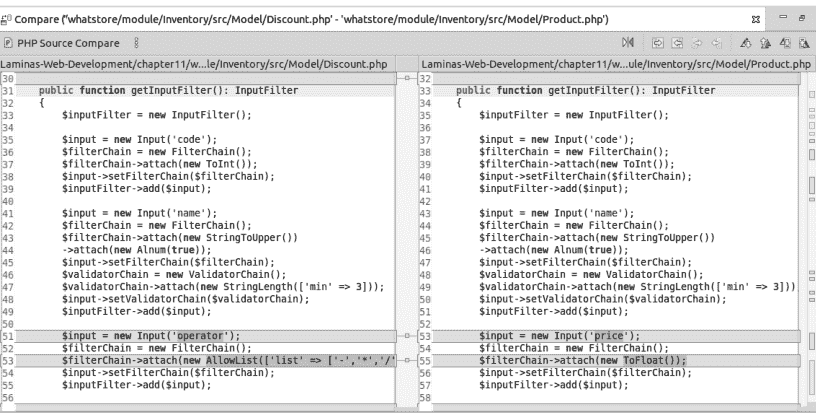
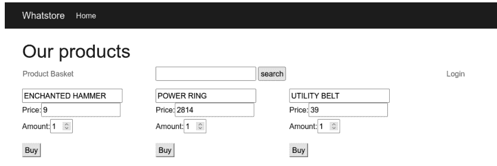
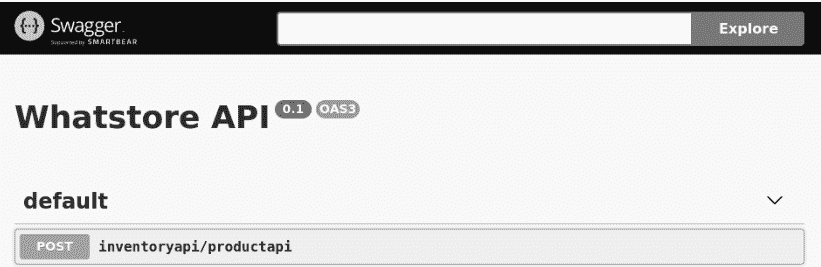
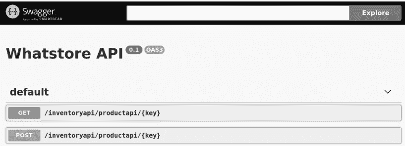
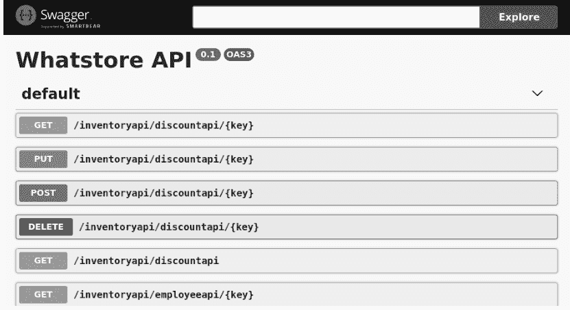

## 审查和改进我们的应用

本章致力于审查和改进我们的 whatstore 应用程序。在上一章中，我们交付了应用程序第一版的需求。然而，没有哪个软件版本能永久存在。新软件始终在构建中。不断变化的软件很可能是死软件。

由于我们认为软件维护意识非常重要，本章将先讨论敏捷开发的基本原则。敏捷方法认识到软件需求在项目执行过程中可能会发生变化。

作为软件开发人员，我们需要确保对代码的任何更改都能尽可能轻松地进行。为此，我们的代码需要尽可能简单。正因如此，在本章中，我们将讨论干净代码的概念，并展示如何消除重复代码，重复代码会使我们的代码变得非常复杂。

在本章中，我们还将对 whatstore 应用程序进行一些小更改，作为在交付版本时才发现的所需功能添加示例。这不是问题，因为我们始终可以发布新版本。问题是我们能多快完成。正因如此，我们正在使用一个框架以及多种工具和技术。

软件可以非常强大，但如果没有人知道如何使用它，它就毫无用处，或者最多也只是为其创建者制作的软件。软件需要文档，其中一部分是 API 文档。在本章中，我们将学习如何使用 OpenAPI 规范生成 API 文档。

最后，我们将展示软件需要持续的深入分析，因为虽然它可能正在工作，但如果不进行详尽测试，我们可能会为它创建意外行为。对于每个软件，始终预料到意外。在本章中，我们将展示应用程序身份管理中意外行为的示例，在仅实现普通用例时无法察觉。

简而言之，本章将涵盖以下主题：

- 学习敏捷开发原则
- 消除重复代码
- 删除不必要的配置
- 创建产品搜索框
- 生成 API 文档
- 为每个模块隔离身份管理

### 技术要求

本章相关代码可在 https://github.com/PacktPublishing/PHP-Web-Development-with-Laminas/tree/main/chapter12/whatstore 找到。

### 敏捷开发原则

本章包含一个敏捷开发过程的练习，采用测试驱动开发 (TDD)。敏捷宣言的原则之一指出，我们应持续关注技术卓越并践行良好设计，因为这能提高敏捷性。您可以在 https://agilemanifesto.org 上了解更多关于敏捷宣言的信息。

TDD 循环的第三个任务是重构。在肯特·贝克所著的 *通过示例的测试驱动开发* 中，他将重构定义为“消除仅为了让测试通过而创建的所有重复”。因此，重构似乎只是一个简单的清理任务，但马丁·福勒警告说，重构是确保代码易于维护的基础。他说：

> 设计不良的系统难以更改——因为很难弄清楚
> 要更改什么，以及这些更改将如何与现有代码交互以获得我
> 想要的行为。
>
> 马丁·福勒，《重构：改善既有代码的设计》

敏捷宣言的另一条原则是，可工作的软件是衡量进度的主要标准。本质上，这就是您的客户想要的——一个可工作的东西。但是，还有另一个宣言，即软件工艺宣言，它指出我们不仅应重视可工作的软件，也应重视精心打造的软件。您可以在 https://manifesto.softwarecraftsmanship.org 上了解更多关于软件工艺宣言的信息。

从第 6 章“使用行为驱动开发的模型和对象关系映射器”到第 11 章“实现产品购物篮”，我们实现了第 5 章“创建虚拟商店项目”中描述的用例。现在我们有一个功能齐全的 Web 应用程序，使用了多个 Laminas 组件。在本章中，我们将审查和改进我们的电子商务应用程序的实现，以生成更干净、更易于维护的代码。

请记住这一点：你只能改进已经存在的东西。可工作的代码可以改进。可工作的代码也通常需要更改以允许新功能或修复错误。在进行所需更改后，代码通常需要审查，以避免未来的维护问题。软件改进是一个无止境的过程。虽然它有用，但它是一个持续改进过程中的产品。

### 消除重复代码

计算机程序是一组指令。计算机的奇妙之处在于，如果指令已经存储，我们不需要为它们重复该指令。我们只需要说明指令在哪里，就像指引阅读手册的人查看特定页面一样。事实上，如果你把手册给某人，他们就不需要再问你里面写了什么。

当我们创建软件时，我们会创建多个手册。这些手册可以是过程、函数、类或特征。所有这些代码结构都是可重用的代码单元。我们有多种方法来避免重复的代码行，方法是将它们集中在这些结构之一中。

重复的代码行会产生更多工作，因为您将不得不修改多行代码，可能在多个文件中，以实现新功能或修复错误。因此，我们必须避免重复的代码行。

有一个有用的工具可以检测 PHP 程序中的重复行 – **PHP 复制/粘贴检测器 (PHPCPD)**。您可以从 `https://phar.phpunit.de/phpcpd.phar` 下载最新版本的 PHPCPD。下载的文件是 `phpcpd.phar`。将此文件重命名为 `phpcpd` 并允许其执行。将 `phpcpd` 移动到系统路径的一个目录中（可见于各处）。

`phpcpd` 程序会比较文件夹中的 PHP 代码并显示重复代码块的成对情况。让我们运行 `phpcpd`。但是，在这样做之前，我们需要删除 `whatstore` 目录内的 `vendor` 子目录。为什么？是因为我们只分析自己的代码，而不是依赖项代码。

因此，让我们运行以下命令：

```
$ phpcpd whatstore/
```

输出将如下所示：

```
phpcpd 6.0.3 by Sebastian Bergmann.

Found 1 clones with 21 duplicated lines in 2 files:

 - /opt/lamp/htdocs/whatstore/module/Inventory/src/Model/
Discount.php:31-52 (21 lines)
/opt/lamp/htdocs/whatstore/module/Inventory/src/Model/Product.php:33-54

0.33% duplicated lines out of 6422 total lines of code.
Average size of duplication is 21 lines, largest clone has 21 lines

Time: 00:00.021, Memory: 4.00 MB
```

正如您所见，我们的 whatstore 项目中有一些重复的 PHP 行。既然您已检测到包含重复行的文件，可以使用 Eclipse 之类的 IDE 来检查是否真的需要重构源代码。您可以在 Eclipse 中选择两个文件，右键单击其中一个，然后选择 **与其他文件比较** 选项，Eclipse 将打开一个类似这样的窗口：



图 12.1：Eclipse 中的文件比较

根据 phpcpd 输出，我们已比较了 `Discount.php` 和 `Product.php` 文件。如我们所见，`getInputFilter` 方法中存在一些重复代码块。这些代码块与将输入字段及其过滤器和验证器添加到 `InputFilter` 实例有关。

现在是重构这些代码块并将其转化为干净代码的时候了。罗伯特·C·马丁在其书籍 *干净代码* 中指出，**干净代码**就是可读代码。您可能会问，如何知道代码是否可读？嗯，斯科特·安布勒在其书籍 *对象入门* 中建议遵循 **30 秒规则**：如果其他人在 30 秒内无法理解您的代码，那么你


需要重写它。我有一个额外的建议：尝试编写能够适应文本编辑器窗口的代码块。如果您需要滚动才能看到函数或方法的完整代码，那么这个子例程非常适合精简。

> **源代码、草和兔子**
> 
> 源代码、草和兔子之间有一个共同点：它们都能非常快速地繁殖。但是，失去对源代码的控制比失去对草或兔子的控制更容易。

让我们以 phpcpd 的输出为例，来看看如何减少重复代码。如果你观察图 12.1 中 getInputFilter 方法的实现，每个输入都有重复的步骤：输入创建、过滤器添加和验证器添加。我们可以创建 Laminas\InputFilter\InputFilter 类的一个扩展，其中包含封装这些步骤的方法。那么，让我们在 Generic 模块中创建 InputFilter 类，位于 Generic\Model 命名空间下，如下所示：

### InputFilter.php

```php
<?php
declare(strict_types=1);

namespace Generic\Model;

use Laminas\InputFilter\InputFilter as LaminasInputFilter;
use Laminas\InputFilter\Input;
use Laminas\Filter\FilterChain;
use Laminas\Validator\ValidatorChain;

class InputFilter extends LaminasInputFilter
{
    public function addInput(string $name, array $filters = [],
    array $validators = []): self
    {
        $input = new Input($name);
        $filterChain = new FilterChain();
        foreach($filters as $filter) {
            $filterChain->attach($filter);
        }

        $input->setFilterChain($filterChain);
        $validatorChain = new ValidatorChain();
        foreach($validators as $validator) {
            $validatorChain->attach($validator);
        }
        $input->setValidatorChain($validatorChain);
        $this->add($input);
        return $this;
    }
}
```

addInput 方法接收输入名称、过滤器集和验证器集作为参数。addInput 方法返回 InputFilter 实例的引用。因此，我们可以在一条指令中从 InputFilter 实例调用多个方法——例如，在一条指令中添加两个字段：

```php
$inputFilter = new InputFilter();
$inputFilter->addInput("code") ->addInput("name");
```

您不需要重复 InputFilter 实例的变量名来调用另一个方法，或多次调用相同的方法。对于那些本来不会返回任何内容的方法，返回 $this 是一个优势。

接下来，我们将在 Discount 和 Product 类中用 Generic\Model\InputFilter 替换 Laminas\InputFilter\InputFilter。这种替换将在几行代码中减少 getInputFilter 的实现。例如，Discount 类的 getInputFilter 方法将如下所示：

```php
public function getInputFilter() : InputFilter
{
    $inputFilter = new InputFilter();

    $inputFilter->addInput('code', [new ToInt()])
    ->addInput('name',
    [
        new StringToUpper(),
        new Alnum(true)
    ],
    [new StringLength(['min' => 3])]
    )
    ->addInput('operator', [
        new AllowList(['list' => ['-','*','/']])
    ])
    ->addInput('factor', [new ToFloat()]);

    return $inputFilter;
}
```

请注意，我们多次调用 addInput 方法，但只需使用一次 $inputFilter 变量。这是因为 addInput 方法返回 InputFilter 实例的引用。

好了，我们缩短了 Discount->getInputFilter 方法几行代码。同样，我们也可以缩短 Product->getInputFilter 方法几行代码。重构源代码后，我们需要运行测试来检查一切是否仍然正常工作。在运行测试之前，我们需要通过运行 composer install 命令重新创建 vendor 目录。

在检查所有代码都能通过测试，并且再次删除 vendor 目录后，我们可以再次运行 phpcpd。重构后，这次我们将看到如下输出：

```
$ phpcpd whatstore/
phpcpd 6.0.3 by Sebastian Bergmann.

No clones found.

Time: 00:00.563, Memory: 4.00 MB
```

如您所见，重构已消除了 whatstore 项目中的重复代码。phpcpd 工具非常有用，可以帮助我们结合 TDD 查找重复代码。

> **PHP 混乱检测器**
> 
> 还有一个名为 **PHP 混乱检测器 (PHPMD)** 的有趣的 PHP 命令行工具。该工具用于查找 PHP 源代码中的多种潜在问题，例如可能的错误、次优代码、过于复杂的表达式以及未使用的参数、方法和属性。建议您将 PHPMD 与 IDE 配合使用。您可以从 https://phpmd.org 下载 PHPMD。

在下一节中，我们将进行更多重构，这次是为了删除不必要的配置。

### 删除不必要的配置

在上一节中，我们学习了如何查找和删除源代码的克隆。克隆是原件的精确副本，如《星球大战》中的贡戈·费特克隆人。克隆不是长得相似但并不完全相同的孪生兄弟，如电影《双胞胎》中的阿诺德·施瓦辛格和丹尼·德维托。因此，phpcpd 可能找不到相似的源代码片段，因为它们之间有一些小的差异。在我们的情况中，有关视图和布局的一些源代码片段是相似的。

正如我们在第 5 章“创建虚拟商店项目”的“为我们的项目准备模块”部分所决定的，Application 模块将定义应用程序布局。我们还说，modules.config.php 数组中的最后一个模块是定义应用程序布局的模块。但是为什么以及如何实现呢？

您已经观察到，在 Laminas MVC 应用程序中存在多个配置文件。根 config 文件夹中有文件，每个模块也有一个配置文件。当应用程序初始化时，所有这些文件会被合并到一个配置数组中，或者更准确地说，合并到一个数据映射中。每个映射键都是唯一的，因此，如果相同的映射键存在于不同的配置文件中，那么合并过程中其中一个值会丢失。最后合并的文件会覆盖之前的文件，因此模块列表中的最后一个模块会覆盖其他模块的布局配置。

但是，如果相同的配置键对每个模块都不是必需的，就没有必要覆盖值。module.config.php 文件中 view_manager 键的大多数子键就是这种情况。只有应用程序模块需要所有子键，因为它定义布局和错误模板。

因此，Application 模块的 module.config.php 文件中 view_manager 键应如下所示：

```php
'view_manager' => [
    'display_not_found_reason' => true,
    'display_exceptions'       => true,
    'doctype'                  => 'HTML5',
    'not_found_template'       => 'error/404',
    'exception_template'       => 'error/index',
    'template_map' => [
        'layout/layout'           => __DIR__ . '/../view/layout/layout.phtml',
        'error/404'               => __DIR__ . '/../view/error/404.phtml',
        'error/index'             => __DIR__ . '/../view/error/index.phtml',
    ],
    'template_path_stack' => [
        __DIR__ . '/../view',
    ],
],
```

请注意，我们已从 template_map 中删除了 application/index 项。这是因为该项也不是必需的。事实上，我们不需要为 Application/ IndexController->indexAction 方法创建页面。我们可以删除 view/application/ index 文件夹，并使用重定向来重构上述方法：

```php
public function indexAction()
{
    return $this->redirect()->toRoute('home');
}
```

因此，如果有人输入 /application 路径，此人将被重定向到主页，即 Store 模块的主页。

好了，让我们为其他模块（Inventory 和 Store；Generic 没有视图）丢弃不必要的视图配置。对于 Inventory 模块，view_manager 键应如下所示：

```php
'view_manager' => [
    'template_path_stack' => [
        __DIR__ . '/../view',
    ],
    'strategies' => [
        'ViewJsonStrategy',
    ],
],
```

正如我们在构建 API 时所学到的，strategies 中的 ViewJsonStrategy 值使控制器能够以 JSON 进行响应。

对于 Store 模块，view_manager 键应如下所示：

```php
'view_manager' => [
    'template_path_stack' => [
        __DIR__ . '/../view',
    ],
],
```

template_path_stack 子键是必需的，因为每个模块都有自己的视图文件夹。


因此，我们移除了 phpcpd 未检测到的不必要的代码行，因为它们并非完美克隆。应用程序仍像之前一样运行，但现在不再合并无用的配置数据。

在下一节中，我们将进行更多重构，这次是为了实现一个新功能。

### 创建产品搜索框

当前 whatstore 主页列出了所有已注册的产品，但访问此页面的客户可能在搜索特定产品。因此，页面上需要有一个搜索引擎。我们本可以实现这个功能，因为我们认为这是一个好功能，但事实上，我们将实现它是因为这是客户的一个需求。这是在第 5 章“创建虚拟商店项目”中提到的第二个需求——客户区域的主页必须允许他们按名称（完全或部分）搜索产品。

让我们在 module/Store/view/store/index 文件夹中的 index.phtml 文件里插入一个 HTML 表单。这个 HTML 表单将位于显示产品购物篮和登录链接的 HTML 表格内，如下面的代码片段所示：

```
<h1>Our products</h1>
<table style="width: 100%">
<tbody>
<tr>
<td><a href="<?=$this->url('store', ['controller' =>
'productbasket']) ?>">Product Basket</a></td>
<td>
<form method="post" action="<?=$this->url('store') ?>">
<input type="text" name="name"/>
<input type="submit" value="search"/>
</form>
</td>
<td><a href="<?=$this->url('store', ['controller' =>
'customer', 'action' => $link['action']]) ?>"
<?=$link['label'] ?></a></td>
</tr>
</tbody>
</table>
```

前面的代码片段将呈现一个搜索框，如图 12.2 所示：



Figure 12.2: whatstore 主页上的搜索框

搜索表单将向 Store 模块的 IndexController 默认操作发送一个 HTTP POST 请求。然后，我们需要用以下实现修改默认操作，即 indexAction 方法：

```
public function indexAction()
{
    $name = $this->getRequest()->getPost('name');
    $where = null;
    if (!empty($name)) {
        $where = new Where();
        $name = strtoupper($name);
        $where->like('products.name', "%$name%");
    }
    $products = $this->productTable->getAll($where);
    $form = new ProductForm();
    return new ViewModel([
        'form' => $form,
        'products' => $products
    ]);
}
```

你可以看到，在 IndexController->indexAction 方法中，我们添加了对 HTTP POST 请求提供的数据的检查。如果发送了 name 字段，产品的数据表网关（ProductTable 类）将接收一个 Where 对象，该对象配置了 SQL LIKE 运算符。Laminas 的 Where 类封装了所有 SQL SELECT 运算符以过滤查询。我们使用了 strtoupper 函数，因为产品名称以大写形式存储。

当然，为了让 ProductTable->getAll 方法能够执行 SQL SELECT 语句，我们必须修改该方法，因为当前实现仅期望等量过滤条件。为了支持使用 LIKE 和任何其他 SQL SELECT 运算符，ProductTable->getAll 方法必须更改为以下代码片段：

```
public function getAll($where = null): iterable {
    $select = new Select($this->
        tableGateway->getTable());
    $select->join('discounts', 'products.code_discount
        =discounts.code', ['name_discount' => 'name']);
    if (!is_null($where)) {
        if (is_array($where)) {
            $parsedWhere = [];
            foreach($where as $index => $value) {
                $parsedWhere['products.' . $index] =
                $value;
            }
            $select->where($parsedWhere);
        } else {
            $select->where($where);
        }
    }
    return $this->tableGateway->selectWith($select);
}
```

请记住，ProductTable->getAll 方法已经支持多个由 AND 运算符连接的等量过滤条件。现在，该方法可以通过 Laminas Where 类使用任何 SQL SELECT 运算符。

通过对三个文件进行这些外科手术式的修改，客户现在可以在主页上按名称搜索产品。

在下一节中，我们将学习如何生成 API 文档。

### 生成 API 文档

如果没人知道，拥有成千上万个功能也没有任何用处。开发者需要文档。
开发者可能会忘记自己上周做了什么，更不用说有新开发者在项目中期加入的情况。这是一个重要的一点。

另一个重要的一点是其他客户端对我们应用程序 API 的消费。我们在第 7 章“请求控制和数据视图”中讨论过这一点。客户端的创建者和维护者需要良好的文档来了解如何消费 whatstore 服务。

在本节中，我们将基于 OpenAPI 规范（即 Swagger 规范）创建 API 文档。有一个很棒的组件可以从 PHP 注释生成 Swagger 文档——swagger-php。但是 swagger-php 要求你编写一些 PHP 代码来生成 Swagger 文档。我们将使用另一个组件 swagger-docs，它扩展了 swagger-php 且只需要在要记录的类中使用注释。

> Swagger
> 你可以在 https://swagger.io/resources/open-api 上阅读更多关于 Swagger 的内容。

我们将使用 Composer 安装 swagger-docs，如下所示：

```
composer require fgsl/swagger-docs
```

你也可以使用 Eclipse Composer 界面，正如我们在第 3 章“将 Laminas 用作带有测试驱动开发的库”中学到的那样。

我们需要在一个文件中添加一个 @OA\Info 注解，以定义 API 文档的标题和版本。我们将在 Application 模块的一个新控制器类 APIController 中包含此注解。注解块将紧跟在类声明之前，如下面的完整源代码所示：

### APIController.php

```
<?php
declare(strict_types=1);
namespace Application\Controller;
use Laminas\Mvc\Controller\AbstractActionController;
use Laminas\View\Model\ViewModel;
/**
* @OA\Info(title="Whatstore API", version="0.1")
*/
class APIController extends AbstractActionController
{
    public function indexAction()
    {
        $view = new ViewModel();
        $view->setTerminal(true);
        return $view;
    }
}
```

你可能在想 setTerminal 方法是做什么用的。这个方法禁用此操作使用的布局。我们这样做是因为 API 页面不会使用布局。

APIController->indexAction 方法需要一个 index.phtml 文件。我们这里没有显示此文件的内容，但可以在“技术要求”部分提到的 URL 中找到。这个 API 页面的模型基于 https://github.com/fgsl/swagger-docs#model-for-api-page 提供的模板。该模板有一个占位符 [WEB ROOT ROUTE]，应该替换为 <?=$this->url('home') ?>。反过来，这条指令将生成指向 Web 根端点的超链接。

接下来，我们将为 API 文档创建一个特定路由。在 Application 模块的 module.config.php 文件中，我们将添加以下路由配置作为 routes 键的一个新元素：

```
'api' => [
    'type' => Literal::class,
    'options' => [
        'route' => '/api',
        'defaults' => [
            'controller' => Controller\APIController::class,
            'action' => 'index',
        ],
    ],
],
```

在创建 API 路由、控制器和无布局页面后，我们可以在类中编写注解。我将以 `Inventory` 模块的 `ProductAPIController` 类为例，展示注解块代码。该块的样子如下：

```
/**
 * @OA\Post(
 *     path="/inventoryapi/productapi/{key}",
 *     @OA\Parameter(
 *         name="key",
 *         in="path",
 *         description="product code",
 *         required=false
 *     ),
 *     @OA\RequestBody(
 *         @OA\MediaType(mediaType="multipart/form-data",
 *             @OA\Schema(
 *                 @OA\Property(property="code",type="integer"),
 *                 @OA\Property(property="name",type="string"),
 *                 @OA\Property(property="price",type="float"),
 *                 @OA\Property(property="code_discount",type="integer"),
 *                 required={"name", "price", "code_discount"}
 *             )
 *         )
 *     ),
 *     @OA\Response(response="200", description="insert a product"),
 *     @OA\MediaType(mediaType="application/json")
 * )
 */
```

让我们来理解每个注解：

- @OA\Post 告诉我们，注解块之后的方法会发出 HTTP POST 请求。path 参数是 Web 服务的 URL。花括号中的名称（key）是由 @OA\Parameter 注解定义的变量参数。
- @OA\Parameter 告诉我们需要随请求发送的参数。in 参数取 path 值表示参数必须放在 URL 中。


- @OA\RequestBody 包含 HTML 表单字段的定义。
- @OA\MediaType 在 @OA\RequestBody 内告知我们 HTML 表单 enctype 属性的值。
- @OA\Schema 包含一组表单字段。每个字段由 @OA\Property 注解定义。
- @OA\Response 告诉我们预期的 HTTP 代码和响应的描述。
- 末尾的 @OA\MediaType 告诉我们 HTTP 响应的 Content-Type 标头。

编写完注解代码块后，我们可以像这样运行 swagger-docs 命令：

```
vendor/bin/fsd module
```

我们将 module 作为参数传递，因为 module 是存放类的目录。如果需要，您可以使用在第 2 章“为我们的电子商务应用程序设置环境”中学到的知识，将 fsd 命令集成到 Eclipse 工具栏中。

运行 fsd 命令后，我们访问 http://localhost:8000/api，将看到类似图 12.3 的页面：



图 12.3: 带有插入产品端点的 API 页面

请注意，页面显示一行，包含插入产品操作的路径，前面是 HTTP 方法。如果单击路径，该项将展开，显示类似图 12.4 的视图。

POST /inventoryapi/productapi/{key}

**参数**
| 名称 | 描述 |
|------|-------------|
| key (path) | 产品代码 |

**请求体**
multipart/form-data
- code (integer)
- name * 必需 (string)
- price * 必需 (float)
- code_discount * 必需 (integer)

**响应**
| 代码 | 描述 | 链接 |
|------|-------------|-------|
| 200 | 插入一个产品 | 无链接 |

图 12.4: 插入产品 API 的展开视图

我们可以从 Swagger 视图向 whatstore 应用程序发送请求。您可以看到右上角有一个“试用”按钮。单击此按钮后，表单字段将变为可编辑，并出现“执行”按钮。让我们看看 Swagger 页面上获取产品的请求示例。

我们将在 ProductAPIController->get 方法的声明之前添加一个注解代码块。该块将如下所示：

```
/**
 * @OA\Get (
 *     path="/inventoryapi/productapi/{key}",
 *     @OA\Parameter (
 *         name="key",
 *         in="path",
 *         description="product code",
 *         required=false
 *     ),
 *     @OA\Response(response="200", description="get a product"),
 *     @OA\MediaType(mediaType="application/json")
 *     )
 */
```

再次运行 fsd 命令后，我们将拥有类似这样的 API 页面：



图 12.5: 带有 GET 和 POST 方法端点的 API 页面

如果单击产品 HTTP GET 请求的项，页面将展开该项，显示一个表单，如图 12.4 所示。当单击**试用**按钮时，会出现两个按钮，**执行**和**清除**，如图 12.6 所示。

Whatstore API

default

| 名称 | 描述 |
|---|---|
| key (path) | 产品代码 |

图 12.6: 用于发出 HTTP GET 请求的表单

使用有效值填写产品代码字段并单击**执行**按钮后，页面将显示一个带有请求响应的部分，如图 12.7 所示。

响应

```
curl -X GET "http://localhost:8000/inventoryapi/productapi/1" -H "accept: */*"
```

```
http://localhost:8000/inventoryapi/productapi/1
```

| 代码 | 详情 |
|---|---|
| 200 | 响应正文 |

```
{
 "product": {
 "code": 1,
 "name": "ENCHANTED HAMMER",
 "price": 9,
 "code_discount": 1
 }
}
```

```
connection: close
content-type: application/json; charset=utf-8
Date: Sat, 14 May 2022 20:15:53 GMT host: localhost:8000
X-powered-by: PHP/8.0.5
```

| 代码 | 描述 | 链接 |
|---|---|---|
| 200 | 获取一个产品 | 无链接 |

图 12.7: Swagger 页面上的输出响应部分

目前，请注意我们有一个获取单个产品的方法；但是，我们没有获取产品列表的方法。没关系。我们可以向 `ProductAPIController` 类添加一个用于此目的的方法。`AbstractRestfulController` 父类通过键参数区分针对单个元素和列表的 HTTP `GET` 请求。如果 HTTP `GET` 请求没有键参数，`AbstractRestfulController` 父类将执行 `getList` 方法。然后，我们实现此方法，它将如下所示：

```
/**
 * @OA\Get(
 *     path="/inventoryapi/productapi",
 *     @OA\Response(response="200", description="get list of products"),
 *     @OA\MediaType(mediaType="application/json")
 * )
*/
public function getList()
{
    $resultSet = $this->productTable->getAll();
    $products = [];
    foreach($resultSet as $result){
        $products[] = $result->toArray();
    }
    return new JsonModel(['products' => $products]);
}
```

现在，我们只需为每个公共控制器方法编写注解代码块并运行 `fsd` 命令，即可获得一个完整的 API 文档页面（图 12.8），该页面还允许我们测试 whatstore 应用程序的请求。



图 12.8: 使用 Swagger 生成的完整 API 文档页面顶部

在下一节也是最后一节中，我们将审查 whatstore 的身份验证实现并重构它们以避免安全问题。

### 为每个模块隔离身份管理

在第 9 章“事件驱动身份验证”中，我们学习了如何为库存模块中的员工实现身份验证控制。在第 11 章“实现产品购物篮”中，我们学习了如何为商店模块中的客户实现身份验证控制。因此，whatstore 应用程序有两个身份验证控制，两者都使用 laminas-authentication 组件。

身份验证控制基于事件。具体来说，它基于 Laminas EVENT_ROUTE 事件。身份检查通过监听器类完成，具体来说是库存模块中的 InventoryAuthenticationListener 和商店模块中的 StoreAuthenticationListener。这两个类使用相同的代码行检查身份：

```php
$authenticationService = new AuthenticationService();
if (!$authenticationService->hasIdentity()) {
}
```

事实上，InventoryAuthenticationListener 没有这些行，而是调用 IdentityManager->hasIdentity 方法，该方法包含这些行。然而，归根结底，这两个监听器类都使用相同的代码行来检查身份验证状态。

查看此代码，我们可以看到 `AuthenticationService->hasIdentity` 方法返回一个布尔值。也许您以前不需要担心这个问题，但现在请考虑一下——`AuthenticationService` 如何知道是否存在经过身份验证的身份？

在这里，我们有自由开源软件的一个优势示例——我们可以看到事物的工作原理。如果找到 `AuthenticationService->hasIdentity` 方法的源代码，我们将看到以下行：

```php
public function hasIdentity()
{
    return ! $this->getStorage()->isEmpty();
}
```

请注意，如果其存储不为空，`AuthenticationService` 会回答存在经过身份验证的身份。但是，未测试存储内容。如果只有一个身份验证控制，这不是问题，但对于拥有多个身份验证控制的系统（例如 whatstore），可能会导致意外行为。

这种意外行为是什么？想象一下，一位客户在商店模块中经过身份验证。具体来说，这位客户 Mr. Bad Guy 是个怀有不良动机的人。他尝试调用一些端点以发现一些有趣的 URL，直到他发现有一个 `/inventory` 路由。预期的行为是 `/inventory` 路由显示登录页面。但是，已经在 `Store` 模块中经过身份验证的 Mr. Bad Guy 会直接进入 `Inventory` 模块的菜单页面。这并不意味着 Mr. Bad Guy 将能够访问 `Inventory` 注册，因为还有授权控制，但这种直接访问菜单页面显然是安全漏洞。

问题的原因是什么？是在同一应用程序中为两个身份验证控制使用 `AuthenticationService->hasIdentity` 方法。`laminas-authentication` 文档仅针对一个身份验证控制提供示例。这表明 `AuthenticationService->hasIdentity` 方法通常仅用于一个身份验证控制。事实上，您可以根据需要使用 `laminas-authentication` 组件实现任意数量的身份验证控制。只需隔离每个身份验证上下文。这意味着要避免直接使用 `AuthenticationService->hasIdentity` 方法来检查身份验证是否成功。我们将在下一节这样做。

### 修改身份管理类

我们已经创建了一个通用身份管理类（`IdentityManager`，位于 `Generic` 模块中）并为每个模块对其进行了扩展。现在，我们将根据上下文修改此类来管理身份——更具体地说，是身份管理器类的命名空间，每个模块的命名空间都不同。让我们分三步修改 `Generic\Model\IdentityManager` 类。


首先，让我们向类中添加一个 getNamespace 方法：

```
protected function getNamespace() : string
{
    $fqcn = explode('\\',static::class);
    return $fqcn[0];
}
```

此方法将返回被调用类的命名空间。这意味着它并不完全是一个 Generic 命名空间。如果该方法由子类调用，则考虑的命名空间将是子类的命名空间。例如，如果由 Inventory\\Model\\IdentityManager 调用 getNamespace 方法，它将返回 Inventory。

第二步是修改 Generic\\Model\\IdentityManager->__construct 方法：

```
public function __construct(AdapterInterface $adapter,
array $encryptionMethod)
{
    $this->adapter = $adapter;
    $this->encryptionMethod = $encryptionMethod;
    $this->auth = new AuthenticationService();
    $storage = new Session($this->getNamespace());
    $this->auth->setStorage($storage);
}
```

请注意，我们向构造方法中添加了两行新代码。我们实例化了 Laminas\\Authentication\\Storage\\Session 类，并将 getNamespace 方法返回的命名空间值定义为命名空间。因此，我们将在会话中拥有一个命名空间，从而避免不同 IdentityManager 实例之间可能出现的会话键覆盖问题。

第三步是修改 Generic\\Model\\IdentityManager->hasIdentity 方法：

```
public function hasIdentity() : bool
{
    if ($this->auth->hasIdentity()) {
        $storage = $this->auth->getStorage();
        error_log('namespace: ' . $storage->getNamespace());
        return ($storage->getNamespace() == $this->getNamespace());
    }
    return false;
}
```

现在，我们不仅检查是否存在经过身份验证的会话，还检查存储会话命名空间是否与 IdentityManager 实例的命名空间相同。在下一节中，我们将使用这个新的 IdentityManager 类来重构 Store 模块的 StoreAuthenticationListener 和 IndexController 类。

### 重构侦听器和控制器类

在本节中，我们将重构 Store\\Listener\\StoreAuthenticationListener 和 Store\\Controller\\IndexController 类中的一些行。在 StoreAuthenticationListener 类中，我们首先定位这些行：

```
$authenticationService = new AuthenticationService();
if (!$authenticationService->hasIdentity()) {
```

将它们替换为以下行：

```
$identityManager = $event->getApplication()->getServiceManager()->get(IdentityManager::class);
if (!$identityManager->hasIdentity()) {
```

请记住，在这种情况下，IdentityManager 特指 Store\\Model\\IdentityManager。

在 Store\\Controller\\IndexController 中，我们将添加一个新属性并修改构造方法以使用该属性：

```
private IdentityManager $identityManager;
public function __construct(ProductTable $productTable,
IdentityManager $identityManager) {
$this->productTable = $productTable;
$this->identityManager = $identityManager;
}
```

在 Store\\Controller\\IndexController->indexAction 方法中，我们将向注入到 ViewModel 实例的数组中添加一个键：

```
return new ViewModel([
"form" => $form,
"products" => $products,
"authenticated" => $this->identityManager->hasIdentity()
]);
```

当然，如果我们修改了控制器构造方法，就需要调整其在 Store\\Controller\\IndexControllerFactory 中的工厂方法：

```
public function __invoke(ContainerInterface $container,
$requestedName, array $Options = null) {
$identityManager = $container->get(IdentityManager::class);
return new CustomerController($identityManager);
}
```

现在，我们将定位 view\\store\\index\\index.phtml 文件中的这些行：

```
$authenticationService = new AuthenticationService();
$link = ["action" => "index", "label" => "Login"];
if ($authenticationService->hasIdentity()) {
```

将它们替换为以下行：

```
$link = ["action" => "index", "label" => "Login"];
if ($this->authenticated) {
```

这样，我们避免了视图脚本与身份验证类的耦合，将视图脚本限制为仅使用变量，这更为合适。视图脚本的良好做法是仅使用控制器类发送的变量。

因此，我们已完成隔离 whatstore 应用程序中两个身份验证控件所需的更改。我们不再需要担心“坏家伙”了。

在本节中，我们已隔离身份管理，以避免一个模块的用户对另一个模块拥有特权和非允许的访问。为实现此目的，我们修改了用于身份管理的通用类 Generic\\Model\\IdentityManager。最后，我们重构了 StoreAuthenticationListener 和 CustomerController 类，以使用继承的 Store\\Model\\IdentityManager 类。

### 总结

在本章中，我们首先讨论了一些敏捷开发概念，这些概念对软件维护非常重要。在这些概念之后，我们学习了如何使用免费开源的 phpcpd 工具轻松检测 PHP 程序中的重复代码。在检测模型类中需过滤和验证的重复代码块后，我们展示了如何在 Laminas\\InputFilter\\InputFilter 类的扩展中统一这些代码块。

接下来，我们学习了如何创建产品搜索框。为此，我们必须修改 ProductTable 类以执行带有 LIKE 运算符的 SQL SELECT 查询。

然后，我们学习了如何使用免费开源的 swagger-docs 工具生成 API 文档。在演示如何使用 OpenAPI Specification 生成带有 REST 端点的丰富 HTML 页面时，我们还学习了如何实现 REST 请求以列出集合。

最后，我们学习了如何隔离身份管理，以避免在存在多个身份验证控件时出现安全问题。

在下一章中，我们将介绍一些技巧和窍门，帮助开发人员解决在构建面向对象的 PHP Web 应用程序时可能最终出现的一些问题。
