## 技巧和窍门

本章提供了一些技巧和窍门，将帮助你作为开发人员解决在构建 Web 应用程序时可能最终出现的一些问题。

我们将首先学习创建映射模型（即连接到数据库表的类）所需的方法是什么。

之后，我们将学习如何自定义过滤器和验证器，以在模型层中实现特定业务规则。

然后，我们将更好地了解 Laminas 视图层，学习如何生成 JSON 响应、管理文件上传以及更改应用程序布局。

最后，我们将掌握 Laminas 控制器层，学习如何检测 AJAX 请求、如何在控制器层和视图层之间交换消息，以及结束控制器操作的不同方式。

到本章结束时，你将能够使用 Laminas 框架满足 Web 应用程序的最终需求。

本章将涵盖以下主题：

- 创建映射模型
- 自定义过滤器和验证器
- 了解 Laminas 视图层
- 掌握控制器层

### 技术要求

本章相关的所有代码均可在两个仓库中找到：

- https://github.com/PacktPublishing/PHP-Web-Development-with-Laminas/tree/main/chapter13/tipsandtricks
- https://github.com/PacktPublishing/PHP-Web-Development-with-Laminas/tree/main/chapter13/whatstore

第一个 URL 包含一个名为 `tipsandtricks` 的 Laminas 应用程序。本章中的所有代码示例均可在 `tipsandtricks` 中找到。你可以使用 PHP 作为 Web 服务器运行此应用程序，就像我们在 _第 2 章，为我们的电子商务应用程序设置环境_ 中使用 `myfirstlaminas` 应用程序一样。

第二个 URL 是用于我们的电子商务应用程序 `whatstore`，其中与使用过滤器相关有一些小修改。这将在 _创建自定义过滤器_ 部分中解释。

### 创建映射模型

这是一个有用的技巧，可在使用 `laminas-db` 创建映射到表的模型时避免麻烦。这些模型需要实现两个方法，即 `exchangeArray` 和 `getArrayCopy`：

```
public function exchangeArray($data)
```

`exchangeArray` 方法由 `Laminas\Db\ResultSet` 类用于使用表记录中的数据填充模型。

```
public function getArrayCopy()
```

`getArrayCopy` 方法由 `Laminas\Db\ResultSet` 类用于从模型获取数据。它还被 `Laminas\Form\Form` 用于将模型属性值绑定到表单字段值。

实际上，`Laminas\Db\ResultSet` 类也接受 `toArray` 方法，用于替换 `getArrayCopy` 方法。我建议在模型中实现 `toArray` 方法，以提取要使用 `TableGateway` 类持久化的数据。有时，要发送到表单对象的模型数据与要发送到数据映射器的模型数据不同。你可以在 HTML 表单中显示不会保存到数据库表的数据，因为 HTML 表单可以显示来自两个关联表的数据，而其中一个表是只读的，不可写入。

这是一个简短的技巧。这是个不错的开始。在下一节中，我们仍将讨论模型层，学习如何自定义过滤器和验证器。它不会那么简短，但会更加精彩。


### 自定义过滤器和验证器

在本节中，我们将学习如何自定义过滤器和验证器，以及映射模型所需的方法。

在 tipsandtricks 应用程序的主页上，你将在左侧看到一个框，类似于图 13.1 所示的框，其中包含模型层的过滤器和验证器自定义示例：

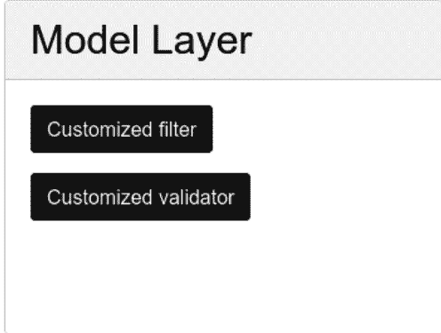

图 13.1 – 访问自定义过滤器和验证器示例

我们将学习该框中按钮的工作原理，并了解如何使用 Laminas 框架创建过滤器和验证器。

在第 8 章「创建表单并实现过滤器和验证器」中，我们学习了如何使用 laminas-filter 和 laminas-validator 组件中提供的一些过滤器和验证器。但是，我们并不仅限于已实现的 Laminas 过滤器和验证器。这两个组件都有接口，允许我们实现自定义过滤器和验证器。

让我们先测试自定义过滤器。

### 创建自定义过滤器

单击「自定义过滤器」按钮（如图 13.1 所示），你将被带到以下页面：

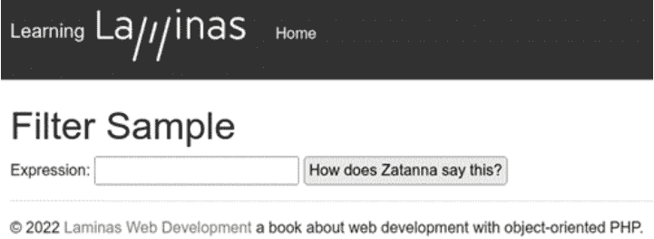

图 13.2 – 测试自定义过滤器的表单

图 13.2 所示的表单用于应用一个反转输入表达式的过滤器。例如，你可以在文本框中输入 open sesame，然后单击「扎坦娜是怎么说这个的？」按钮。除了发现 Zatanna 的发音有些问题外，你还会看到页面重新加载并显示以下内容：

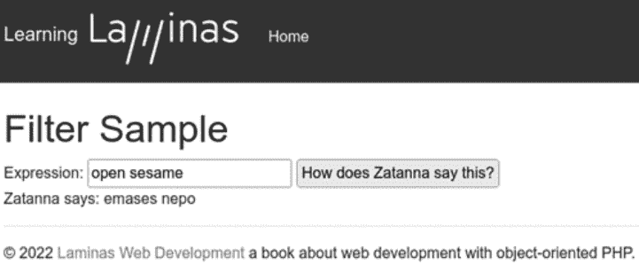

图 13.3 – 应用过滤器后的表单页面

图 13.3 中的表单调用 IndexController->filterAction 方法，其实现如下：

```
public function filterAction()
{
    $expression = $this->getRequest()->getPost
        ('expression');
    if (empty($expression)) {
        $response = '';
    } else {
        $filter = new Zatanna();
        $response = 'Zatanna says: ' . $filter->filter
            ($expression);
    }

    return new ViewModel([
        'expression' => $expression,
        'response' => $response
    ]);
}
```

请注意，如果表单发送了值，filterAction 方法会创建 Zatanna 类的一个实例。Zatanna 类有一个 filter 方法，用于反转给定的值。Zatanna 类实现了每个 Laminas 过滤器类共有的 Laminas\Filter\FilterInterface 接口：

### Zatanna.php

```
<?php
namespace Application\Filter;

use Laminas\Filter\FilterInterface;

class Zatanna implements FilterInterface
{
    public function filter($value)
    {
        return strtolower(strrev($value));
    }
}
```

如你所见，过滤器类是一个必须实现 filter 方法的类，该方法接收一个无类型值并返回某个内容。因此，你可以根据需要创建自己的过滤器类，并轻松使用它们。

### 用于加密密码的过滤器

如你所记得，我们在 Customer 和 Employee 类中创建了加密密码的方法。这两个模型类的加密实现是相同的。在本章的 whatsstore 版本中，你将找到一个应用于提取重复加密实现到单个类的自定义过滤器示例。在 Generic 模块中搜索 Encrypt 类。

在下一节中，我们将学习如何自定义验证器。

### 创建自定义验证器

返回 tipsandtricks 主页并单击「自定义验证器」按钮；你将被带到以下页面：

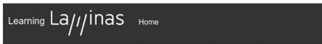

图 13.4 – 测试自定义验证器的表单

图 13.4 所示的表单用于应用一个验证器，以检查输入的单词或短语是否为回文。例如，你可以在文本框中输入 Namor sees Roman，然后单击「是回文吗？」按钮。然后，你会看到页面重新加载并显示以下内容：

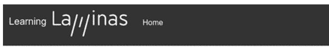

图 13.5 – 应用验证器后的表单页面

图 13.5 所示的表单调用 IndexController->validatorAction 方法，其实现如下：

```
public function validatorAction()
{
    $expression = $this->getRequest()->getPost
            ('expression');
    if (empty($expression)) {
        $response = '';
    } else {
        $validator = new Palindrome();
        $response = 'It is not a palindrome!';
        if ($validator->isValid($expression)) {
            $response = 'It is a palindrome!';
        }
    }
    return new ViewModel([
        'expression' => $expression,
        'response' => $response
    ]);
}
```

请注意，如果表单发送了值，validatorAction 方法会创建 Palindrome 类的一个实例。Palindrome 类具有一个 isValid 方法，如果给定的值是回文，则返回 true。Palindrome 类实现了每个 Laminas 验证器类共有的 Laminas\Validator\ValidatorInterface 接口：

### Palindrome.php

```
<?php
namespace Application\Validator;
use Laminas\Validator\ValidatorInterface;
class Palindrome implements ValidatorInterface
{
    private array $messages = [];
    public function isValid($value)
    {
        $value = strtolower($value);
        $value = str_replace(' ', '', $value);
        $valueLength = strlen($value);
        $repeated = (int) ($valueLength/2);
        $n = $valueLength-1;
        for($i=0;$i<$repeated;$i++) {
            $palindrome = ($value[$i] == $value[$n]);
            if (!$palindrome) {
                $this->messages[] = "{$value[$i]} is
                different of {$value[$n]}";
                return false;
            }
            $n--;
        }
        return true;
    }
    public function getMessages()
    {
        return $this->messages;
    }
}
```

如你所见，验证器类是一个实现 isValid 方法的类，该方法接收一个无类型值并返回 true 或 false，以及一个 getMessages 方法，返回错误消息数组。因此，你可以根据需要创建自己的验证器类，并轻松使用它们。

接下来，我们将更好地了解 Laminas 视图层。

### 了解 Laminas 视图层

在本节中，我们将学习如何在控制器操作中生成 JSON 响应，以及如何使用 laminas-form 上传文件。

在 tipsandtricks 主页的中心，你可以看到一个类似于图 13.6 的框，其中包含前一节中提到的视图层功能示例：

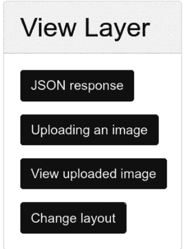

图 13.6 – 访问视图示例

我们将在以下小节中使用与该框相关的操作。

### 使用 laminas-view 生成 JSON 响应

要创建包含 JSON 格式数据的 HTTP 响应，你需要做两件事：

- 将 Laminas\View\Model\Json 类用作控制器操作方法的返回类型。
- 将以下元素添加到 module.config.php 文件的 view_manager 数组键中：

```
'strategies' => [
    'ViewJsonStrategy',
],
```

让我们看一个 JSON 响应示例。单击中心框中的「JSON 响应」按钮。你将看到以下输出：

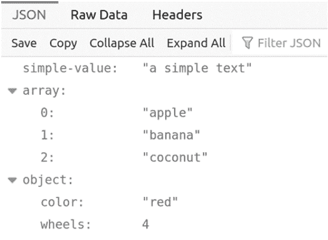

图 13.7 – 由 JsonModel 生成的 JSON 响应

此响应由 IndexController->showJsonAction 方法生成，如下所示：

```
public function showJsonAction()
{
    $simpleValue = 'a simple text';
    $list = ['apple', 'banana', 'coconut'];
    $car = new \stdClass();
    $car->color = 'red';
    $car->wheels = 4;

    return new JsonModel([
        'simple-value' => $simpleValue,
        'array' => $list,
        'object' => $car
    ]);
}
```

由于 ViewJsonStrategy 已启用，注入到 JsonModel 构造函数中的值将转换为 JSON 格式，并且 HTTP 响应的内容类型将配置为 JSON。

你有既视感吗？是的！这是因为我们在第 7 章「请求控制和数据视图」中已经使用过 ViewJsonStrategy。但我们担心你可能已经忘记了这一点。在以 API 为导向的世界中，了解如何生成 JSON 响应是件好事。

接下来，让我们学习如何处理文件上传。


### 使用 laminas-form 上传文件

你可能已经意识到，你的 whatstore 应用程序的产品注册中缺少了一些东西：产品图片。图片可以存储在数据库表中，使用文本或图像专用字段。图片也可以存储在文件系统中，这样数据库只需保留图片文件的路径。但是，无论图片如何存储，或者与产品关联多少张图片，文件上传过程都是相同的。

如果单击**上传图片**按钮，你将被带到以下页面：

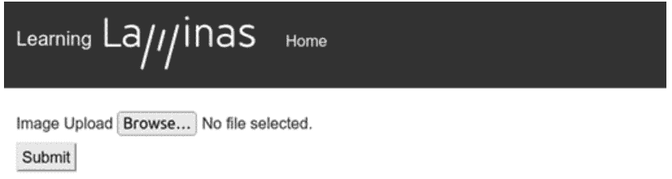

© 2022 Laminas Web Development 一本关于使用面向对象 PHP 进行 Web 开发的书。

图 13.8 – 上传图片表单

用于上传的表单由 UploadForm 类创建，该类扩展了 Laminas\Form\Form：

### UploadForm.php

```php
<?php
namespace Application\Form;
use Laminas\Form\Element;
use Laminas\Form\Form;
class UploadForm extends Form
{
    public function __construct($name = null, $options = [])
    {
        parent::__construct($name, $options);
        $this->addElements();
    }

    public function addElements()
    {
        // File Input
        $file = new Element\File('image-file');
        $file->setLabel('Image Upload');
        $file->setAttribute('id', 'image-file');
        $this->add($file);
    }
}
```

**浏览...** 按钮由 Laminas\Form\Element\File 类呈现。当你单击**浏览...**按钮时，浏览器将打开文件管理器窗口，你可以选择文件。tipsandtricks 应用程序在 data 文件夹中有一个名为 pets.jpg 的示例免版税图片文件。选择图片文件并单击**提交**按钮后，页面将重新加载，并添加上传的数据：

```
Array
(
    [image-file] => Array
        (
            [name] => pets.jpg
            [type] => image/jpeg
            [tmp_name] => /opt/lampp/temp/phpQb1F1p
            [error] => 0
            [size] => 226510
        )
)
```

请注意，主要数据包括上传文件的原始名称、文件类型以及服务器上存储文件的临时目录。此数据由 IndexController->uploadFormAction 方法发送，如下所示：

```php
public function uploadFormAction()
{
    $form = new UploadForm('upload-form');
    $form->setAttribute('action', $this->url()->fromRoute('application', ['action' => 'upload-form']));
    $data = [];
    $request = $this->getRequest();
    if ($request->isPost()) {
        // Make certain to merge the $_FILES info!
        $post = array_merge_recursive(
            $request->getPost()->toArray(),
            $request->getFiles()->toArray()
        );
        $form->setData($post);
        if ($form->isValid()) {
            $data = $form->getData();
            $content = file_get_contents($data['image-file']['tmp_name']);
            file_put_contents(self::TARGET_DIR . 'image.jpg', $content);
        }
    }
    return new ViewModel([
        'form' => $form,
        'data' => $data
    ]);
}
```

如果数据表单有效，我们将图片文件从临时目录复制到应用程序的 public/img 目录中。

重新加载的页面还有一个**查看已上传的图片**链接。单击此链接，你将被带到以下页面：

### 已上传的图片


MEGAPIXEL。从 megapixl.com/72544067 下载 © 2022 Laminas Web Development 一本关于使用面向对象 PHP 进行 Web 开发的书。

图 13.9 – 已上传的图片

如你所见，使用 Laminas\Form\Element\File 上传文件非常简单。

> 安全建议
> 使用 Laminas\Filter\File\RenameUpload 组件更改上传文件的目标目录。这样可以防止攻击者尝试调用文件，因为默认上传目录是已知的。使用 Laminas\Validator\File\MimeType 组件检查上传的文件是否真的是预期的类型，这也是个好主意。

在下一节中，我们将看到更改应用程序布局也很容易。

### 更改应用程序布局

在图 13.6 底部，你可以看到一个更改布局按钮。如果单击此按钮，你将被带到以下页面：

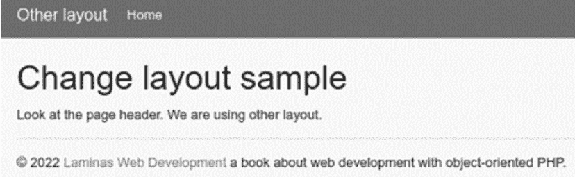

图 13.10 – 替代布局

如你所观察到的，标题颜色和内容不同，正文背景颜色也不同。此布局更改由 `IndexController->changeLayoutAction` 方法完成，该方法调用布局控制器插件的 `setTemplate` 方法：

```php
public function changeLayoutAction()
{
    $this->layout()->setTemplate('/layout/otherlayout');
    return new ViewModel();
}
```

`setTemplate` 方法仅更改当前操作的布局。如果单击主页链接并导航到其他页面，你将看到仍在使用默认布局。

`setTemplate` 方法从 `view` 文件夹中查找布局文件。文件扩展名为 `.phtml`，但调用该方法时不需要添加扩展名。

你也可以为控制器操作禁用布局。我们在 _第 12 章，回顾和改进我们的应用_ 中看到过如何做到这一点，当时我们创建了 API 页面。布局通过 `ViewModel` 类禁用，将 `true` 传递给 `setTerminal` 方法，如下所示：

```php
$view = new ViewModel();
$view->setTerminal(true);
```

因此，你可以完全控制应用程序布局。

在下一节中，我们将了解一些关于控制器层 Laminas 的有用知识。

### 掌握控制器层

在本节中，我们将学习控制器类如何检测 AJAX 请求、如何在控制器层和视图层之间交换消息，以及如何完成控制器操作。

在 tipsandtricks 应用程序的主页上，你将看到图 13.11 所示的框架，右侧“控制器层”标题下展示了上述功能的示例：

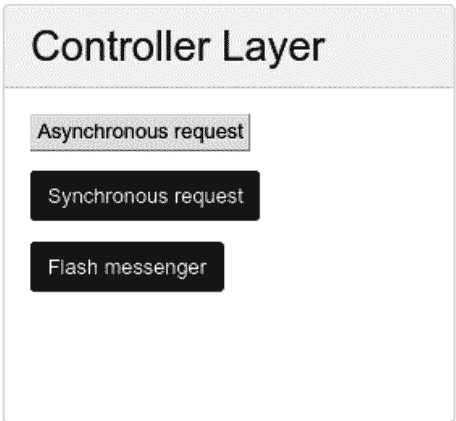

图 13.11 – 访问控制器层示例

我们将在下一个小节中使用与此框架相关的操作。

### 检测 AJAX 请求

异步请求和同步请求按钮向同一控制器操作（即 IndexController->ajaxAction 方法）发出 HTTP 请求：

```php
public function ajaxAction()
{
    if ($this->getRequest()->isXmlHttpRequest()) {
        return new JsonModel();
    }
    return new ViewModel();
}
```

如果请求是使用 XMLHttpRequest 发出的，`Request->isXmlHttpRequest` 方法将返回 `true`。此对象发出异步请求。

由于 XMLHttpRequest 在客户端由 JavaScript 处理，并且 XML 曾被广泛用于在客户端和服务器端之间交换数据，因此 XMLHttpRequest 的使用获得了一个特殊名称：**异步 JavaScript 和 XML**（AJAX）。尽管如今由于 JSON 的轻量级特性，XML 的使用越来越少，但 AJAX 这个缩写词仍在使用。

XMLHttpRequest 规范
XMLHttpRequest 是一个开放的 Web 标准，详见 https://xhr.spec.whatwg.org。

如果单击**异步请求**按钮，你将看到一个警报窗口，如图 13.12 所示。它显示页面未重新加载：

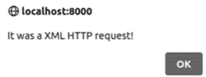

图 13.12 – 对异步请求的响应

如果单击**同步请求**按钮，你将被带到以下页面：

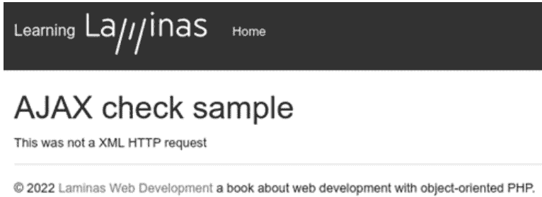

图 13.13 – 对同步请求的响应

你可以看到页面已重新加载。请注意，同一控制器操作可以处理同步请求和异步请求，并根据情况生成不同的响应。

在下一个小节中，我们将看到一种在不使用 ViewModel 类的情况下在控制器和视图脚本之间交换消息的方法。


### 控制器与视图层之间交换消息

如果单击 Flash 信使按钮，您将被带到以下页面：

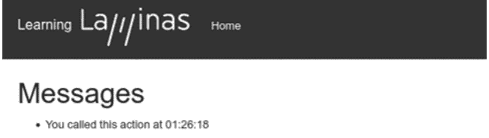

图 13.14 – FlashMessenger 插件存储的消息

Flash 信使按钮以如下方式调用 IndexController->flashMessengerAction 方法：

```php
public function flashMessengerAction()
{
    $this->flashMessenger()->addMessage('You called
        this action at ' . date('H:i:s'));
    $messages = $this->flashMessenger()->getMessages();
    return new ViewModel(['messages' => $messages]);
}
```

控制器中使用的 FlashMessenger 类将消息存储在会话容器中。消息存储在消息堆栈中，可以通过 getMessages 方法访问。简而言之，FlashMessenger 类是一个消息管理器。将 FlashMessenger 实例中存储的消息发送到视图脚本的常规方法是在 ViewModel 构造函数中注入 getMessages 方法的输出，正如我们在前面的代码片段中所看到的。但是，正如我们在下面的代码片段中所看到的，这并非必要：

### flash-messenger.phtml

```php
<h1>Messages</h1>
<?=$this->flashMessenger()->render() ?>
```

请注意，与 `flashMessengerAction` 方法相关的视图脚本不使用在 `ViewModel` 中注入的 `$messages` 变量。相反，视图脚本使用 `FlashMessenger` 的视图助手，该助手带有一个 `render` 方法。`render` 方法避免遍历消息数组，将内容作为纯文本输出。

`FlashMessenger` 是一个控制器插件，它不是 `laminas-mvc` 的一部分。您需要通过 Composer 分别安装它。

使用非内置控制器插件有两种方法。最简单的方法是将插件作为模块添加到 `modules.config.php` 文件中。您必须添加 **完全限定类名 (FQCN)**：

```php
'Laminas\\Mvc\\Plugin\\FlashMessenger'
```

另一种更详细的方法是在将要使用的模块的 `module.config.php` 文件中配置插件。您需要创建一个 `controller_plugins` 键，包含 `factories` 和 `aliases` 子键。以下代码片段展示了如何在 `tripsandtricks` 应用程序中配置 `FlashMessenger` 插件：

```php
'controller_plugins' => [
    'factories' => [
        FlashMessenger::class => InvokableFactory::class
    ],
    'aliases' => [
        'flashMessenger' => FlashMessenger::class
    ]
],
```

虽然 `factories` 键定义了如何创建 `FlashMessenger` 实例，但 `aliases` 键定义了您将在控制器操作中用来调用该插件的名称。

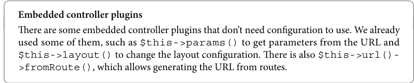

这是控制器插件的配置。要使用 FlashMessenger 视图助手，如果您未将组件配置为模块，则需要向 modules.config.php 文件添加一个 view_helpers 键，如下所示：

```php
'view_helpers' => [
    'invokables' => [
        'flashMessenger' => \Laminas\Mvc\Plugin\FlashMessenger\View\Helper\FlashMessenger::class
    ]
]
```

控制器插件配置对您来说应该是新的，但视图助手配置则不然。事实上，您在第 8 章「创建表单并实现过滤器和验证器」中已编写过此配置，以启用表单视图助手。

接下来，我们将了解结束控制器操作的不同方式。

### 结束控制器操作

在大多数情况下，返回以下对象之一时，控制器操作可以终止：

- 一个 ViewModel 实例，如果它是对期望 HTML 页面的同步请求的响应。
- 一个 JSONModel 实例，如果它是对期望 JSON 数据的异步请求的响应。
- 对 `$this->redirect()->toRoute()` 方法的调用。该方法需要两个参数；第一个是路由名称，第二个是包含路由参数的数组。该方法会导致 HTTP 重定向请求（HTTP 状态码 302）。

还有其他 Laminas\View\Model 类：ConsoleModel，用于为终端生成输出；以及 FeedModel，用于为 RSS 消费者生成输出。您也可以扩展 Laminas\View\Model ModelInterface 并创建特定输出。

### 总结

在本章中，我们学习了一些与 MVC 应用程序三层相关的 Laminas 实用技巧和窍门。

我们首先学习了如何使用 Laminas 接口为模型层自定义过滤器和验证器。我们了解了使用映射模型或与表单集成的模型所需的方法。

随后，我们学习了，或者更确切地说，回忆了如何为视图层生成 JSON 响应。我们还学习了如何使用 laminas-form 上传文件以及如何更改布局配置。

在本章末尾，我们学习了如何在控制器中检测 AJAX 请求以及如何使用 laminas-mvc-plugin-flashmessenger 管理消息。最后，我们了解了结束控制器操作的可能方式。

在下一章中，我们将介绍最后几件事。是的，很遗憾，但本书即将结束...
