## 分析工具包

目前有多个平台用于大规模数据分析。在广义上，这些平台分为主要用于数据挖掘的平台，例如使用 NoSQL 平台分析大型数据集，以及用于数据科学的平台——即机器学习和预测分析。经常情况下，解决方案可能同时具有这两种特征——用于存储和管理数据的稳健底层平台，以及在其之上构建的提供数据科学额外能力的解决方案。

在本章中，我们将向您展示如何安装和配置您的分析工具包，这是一套我们将在后续章节中使用的软件：

- 分析工具包的组件
- 系统建议
  - 在笔记本电脑或工作站上安装
  - 在云上安装
- 安装 Hadoop
  - Hadoop 发行版
  - Cloudera Hadoop 发行版 (CDH)
- 安装 Spark
- 安装 R 和 Python

## 分析工具包的组件

本书将使用几种用于大数据挖掘以及更广泛数据科学的关键技术。我们的分析工具包包括 Hadoop 和 Spark，可以在用户本地机器以及云上安装；以及 R 和 Python，两者也可以在用户机器或云平台上安装。您的分析工具包将包括：

| 软件/平台 | 用于数据挖掘 | 用于机器学习 |
|---|---|---|
| Hadoop | X | |
| Spark | X | X |
| Redis | X | |
| MongoDB | X | |
| 开源 R | X | X |
| Python (Anaconda) | X | X |
| Vowpal Wabbit | | X |
| LIBSVM, LIBLINEAR | | X |
| H2O | | X |

## 系统建议

如果您在本地机器上安装 Hadoop，建议您的系统至少具有 4-8 GB 的 RAM（内存）以及至少 50 GB 的足够空闲磁盘空间。理想情况下，8 GB 或更多内存足以满足大多数应用需求。在此之下，性能会降低，但不会阻止用户完成练习。请注意，这些数字是适用于本书中概述练习的估计值。生产环境自然会有更高的要求，这将在后续阶段讨论。

安装分析软件，尤其是 Hadoop 等平台，在技术复杂性方面可能相当具有挑战性，用户遇到需要 painstakingly 解决的错误的情况非常常见。用户花费的时间试图解决错误和修复安装问题往往超过理想情况。这种额外的开销可以通过使用 **虚拟机 (VM)**，或更近期的容器如 Docker 来轻松缓解。对于 R 和 Python 等更简单的平台，我们将使用预装了各种库的开源版本。

### 在笔记本电脑或工作站上安装

本书中的练习可以在任何 Windows、macOS 或 Linux 机器上执行。用户需要 Oracle VirtualBox（可从 https://www.virtualbox.org/wiki/Downloads 安装）来开始安装分析工具包所需软件的过程。

### 在云上安装

在物理硬件上安装软件的替代方案是使用基于云的服务。AWS（亚马逊网络服务）和微软的 Azure 等云服务提供了极其灵活多变的按需配置服务器的环境，成本为每小时几美分到几美元。虽然云安装超出了本书的范围，但创建免费的 AWS 账户并使用其安装本书中讨论的各种分析软件非常简单。请注意，如果您使用 AWS/Azure 或其他云服务，您需要使用 Cloudera Hadoop 发行版的 Docker 版本。

## 安装 Hadoop

有几种安装 Hadoop 的方法。最常见的是：

1. 从 https://hadoop.apache.org 的源文件安装 Hadoop
2. 使用 Cloudera 和 Hortonworks 等商业厂商的开源发行版安装

5. 这将打开 CDH Quickstart 下载页面。在“选择平台”菜单中，选择 **VirtualBox**。填写出现的表单并点击继续。下载的文件将具有 .zip 扩展名。解压文件以提取 .ova 或 .ovf 文件：

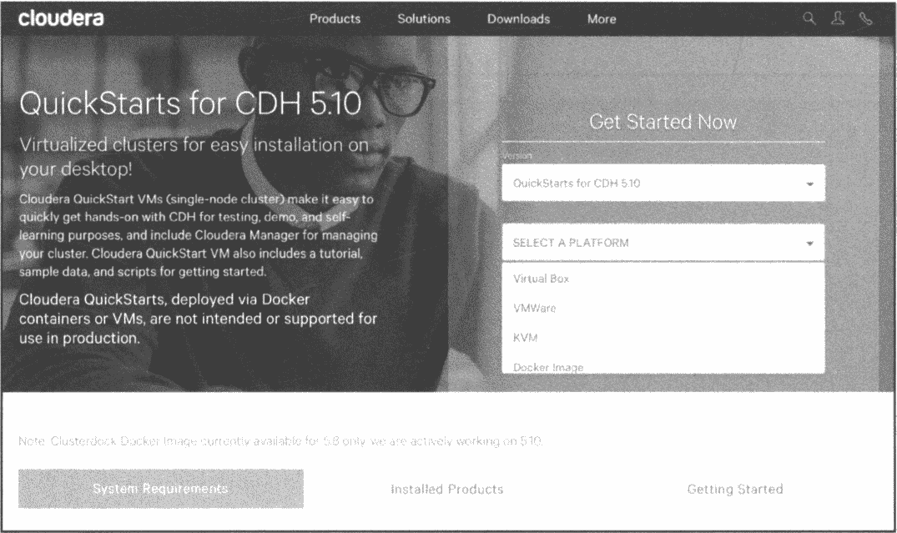

在 Cloudera Quickstart 下载选项中选择 Virtualbox


我们得到以下屏幕上的提示：

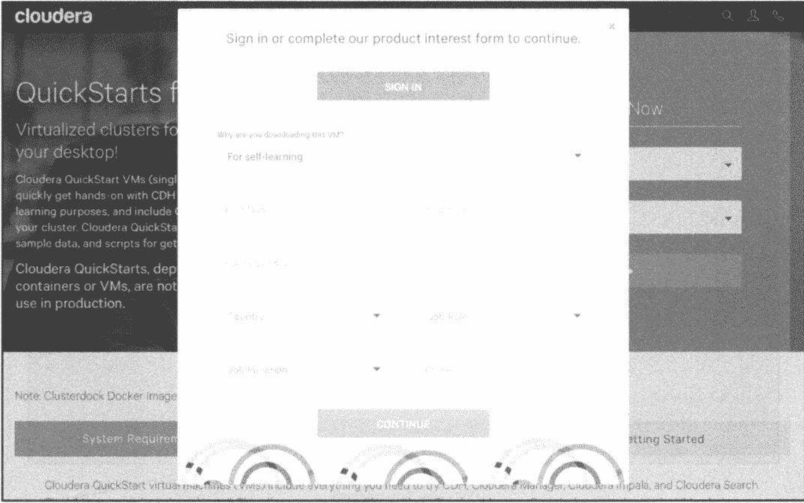

CDH 注册屏幕

条款和条件首先列出：

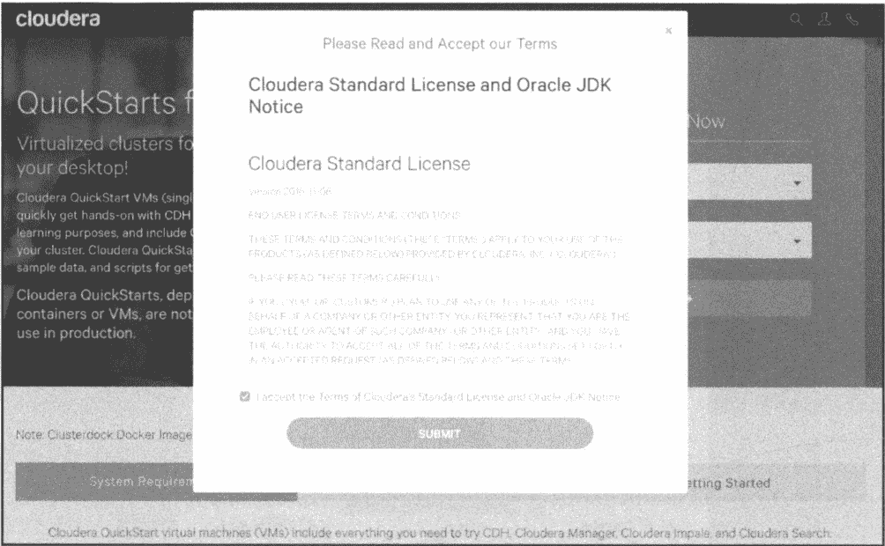

CDH 的 VM 下载开始：

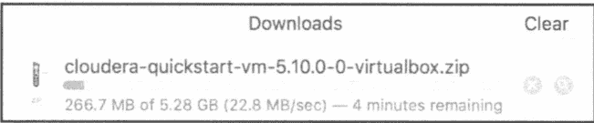

CDH VM 大小超过 5 GB，下载可能需要一段时间。

解压文件。文件夹将包含以下图像中显示的文件：

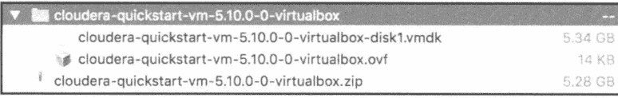

如果下载文件为 Zip 格式，请解压。

下载文件超过 5 GB，具体所需时间取决于您的互联网连接速度。

6. 下载完成后，双击 .ova 或 .ovf 文件，它将在 Oracle VirtualBox 中打开：

    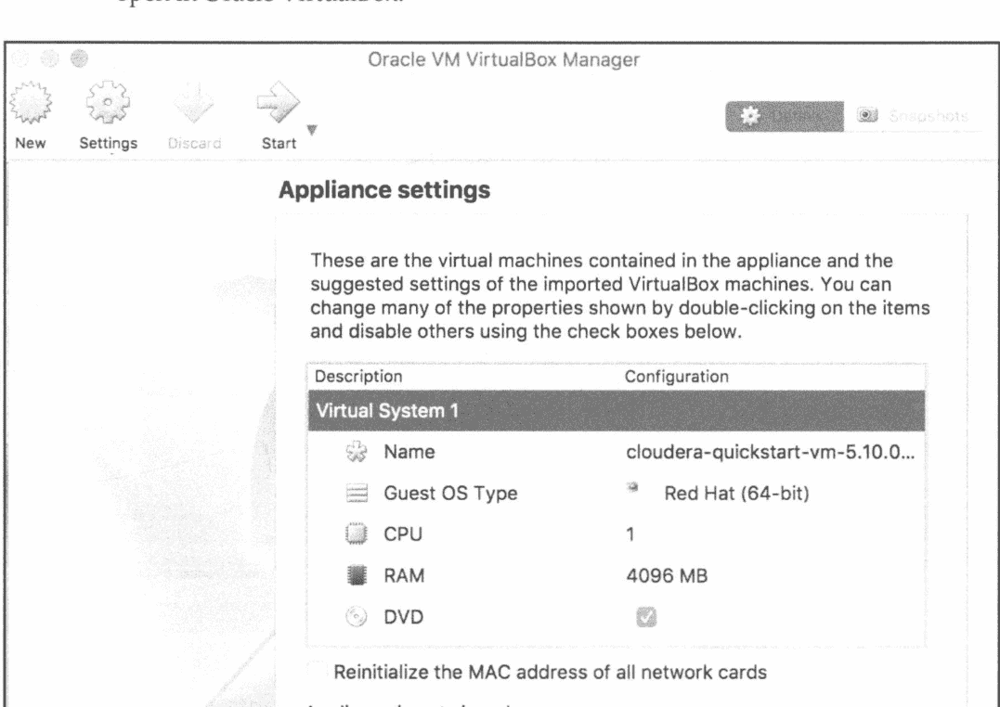

我们得到以下屏幕作为安装的最后一步：

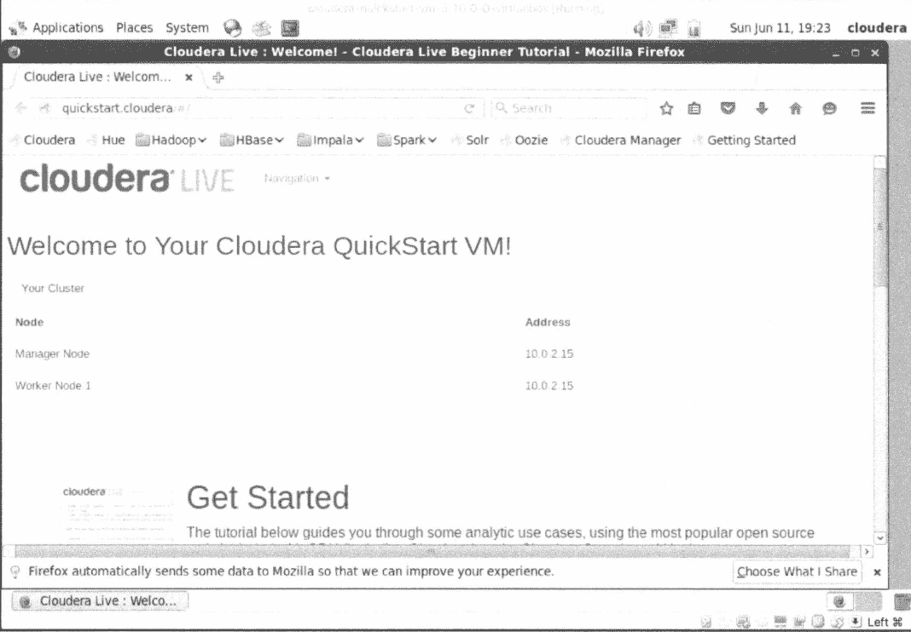

至此，使用 Hortonworks Data Platform 安装 Hadoop 环境完成。

## 在其他环境中安装 CDH

CDH Quickstart VM 也可使用 VMware、Docker 和云平台进行安装。相关说明可在以下页面提供的链接中找到。

## 安装 Packt Data Science Box

我们还为本书中的一些练习创建了一个单独的虚拟机。

从以下位置下载 Packt Data Science 虚拟机 Vagrant 文件

`https://gitlab.com/packt_public/vm.`

要加载 VM，首先从以下位置下载 **Vagrant**

`https://www.vagrantup.com/downloads.html.`

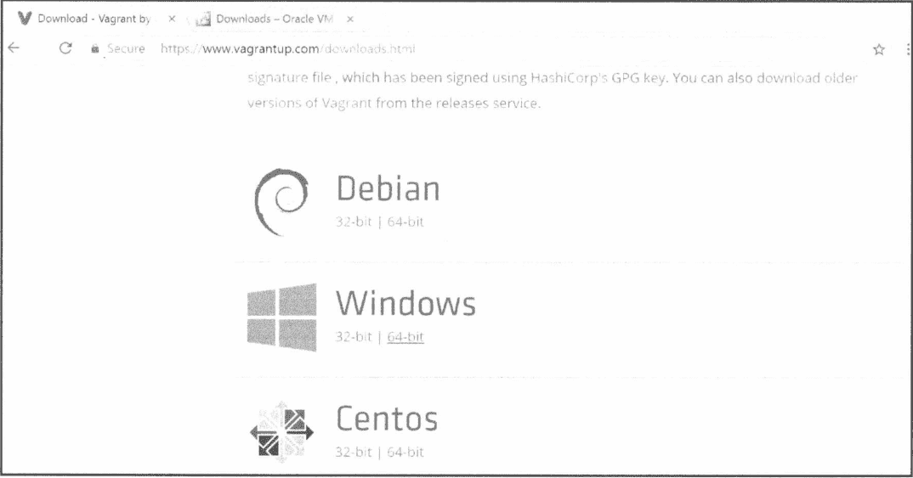

下载完成后，通过运行下载的 Vagrant 安装文件来安装 **Vagrant**。安装完成后，您会收到重启机器的提示。重启系统，然后继续下一步加载 vagrant 文件：

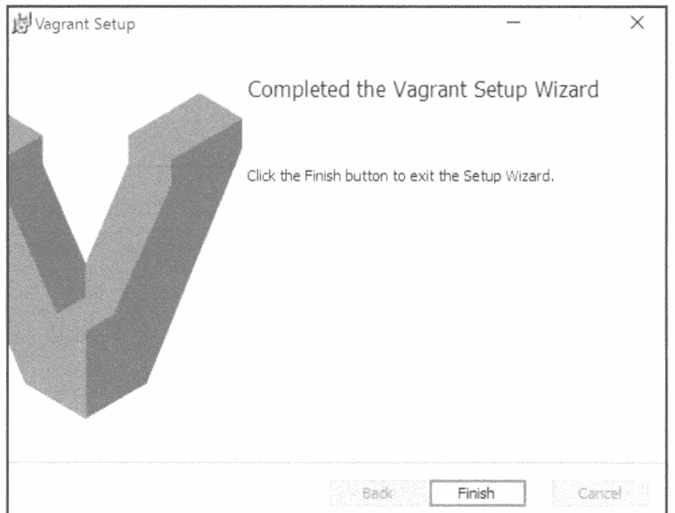

完成 Vagrant 安装

在最后一步点击确认以重启：


重启系统

在终端或命令提示符中，进入您已下载 Packt Data Science Vagrant 文件的目录并运行以下命令（以 Windows 为例）：

```
$ vagrant box add packtdatascience packtdatascience.box

==> box: Box file was not detected as metadata. Adding it directly...

==> box: Adding box 'packtdatascience' (v0) for provider:

box: Unpacking necessary files from:
file://C:/Users/packt/Downloads/packt_public_vm/packtdatascience.box

box: Progress: 100% (Rate: 435M/s, Estimated time remaining: --:--:--)

==> box: Successfully added box 'packtdatascience' (v0) for 'virtualbox'!

$ vagrant box list

packtdatascience (virtualbox, 0)

C:\Users\Nataraj Dasgupta\Downloads\packt_public_vm>vagrant up

Bringing machine 'default' up with 'virtualbox' provider...

==> default: Importing base box 'packtdatascience'...

==> default: Matching MAC address for NAT networking...

==> default: Setting the name of the VM:
packt_public_vm_default_1513453154192_57570

==> default: Clearing any previously set network interfaces...

==> default: Preparing network interfaces based on configuration...
    default: Adapter 1: nat

==> default: Forwarding ports...
    default: 22 (guest) => 2222 (host) (adapter 1)

==> default: Booting VM...
...
```

如果一切顺利，您应该在 Oracle VirtualBox 中看到一个新条目：

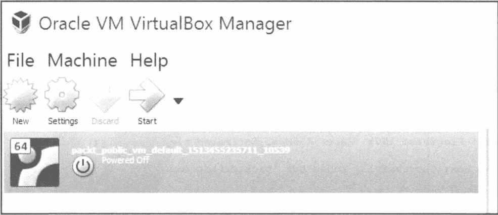

双击该框的名称以启动（并测试）它。使用 `packt/packt` 作为 id/密码登录：

```
Ubuntu 16.04.2 LTS vagrant tty1

vagrant login:

Ubuntu 16.04.2 LTS vagrant tty1

vagrant login: packt
Password:
Last login: Mon Aug 21 16:02:59 UTC 2017 on tty1
Welcome to Ubuntu 16.04.2 LTS (GNU/Linux 4.4.0-83-generic x86_64)

 * Documentation:  https://help.ubuntu.com
 * Management:     https://landscape.canonical.com
 * Support:        https://ubuntu.com/advantage

38 packages can be updated.
6 updates are security updates.

packt@vagrant:~$
```

## 安装 Spark

CDH Quickstart VM 已包含 Spark 作为其组件之一，因此无需单独安装 Spark。我们将在专门章节中讨论更多关于 Spark 的内容。

此外，我们的 Spark 教程将使用 Databricks Community Edition，可通过 `https://community.cloud.databricks.com/` 访问。创建账户和执行必要步骤的说明已在第 6 章 *Spark for Big Data Analytics* 中提供。

## 安装 R

R 是一种统计语言，在过去 3-5 年中变得极其流行，尤其作为可用于多种用例的平台，范围从简单的数据挖掘到复杂的机器学习算法。根据 2016 年中 IEEE Spectrum 发布的一篇文章，R 在全球十大语言中排名第 5。

开源 R 可从 `https://www.r-project.org` 通过位于 `https://cran.r-project.org/mirrors.html` 的 CRAN 站点下载。

或者，您也可以从 Microsoft R Open 页面 `https://mran.microsoft.com/rro/` 下载。这此前被称为 Revolution R Open，是 Revolution Analytics 发布的一个增强版开源 R。微软在 2015 年收购 Revolution Analytics 后，将其重新命名。

Microsoft R Open 包含 R 的所有功能，还包括以下内容：

- 默认安装了大量 R 包以及微软公司发布的一套专用包，可补充开源 R 的现有功能
- 用于 R 中多线程计算的多线程数学库
- 一个固定的 CRAN 仓库，称为 MRAN。CRAN，即 Comprehensive R Archive Network，是一个包含 R 二进制文件、包和相关内容的站点集合。CRAN 上的包可以持续更新。MRAN 对 CRAN 进行固定快照，直到下一次发布，保持不变，从而实现可重复性和一致性。

### 下载和安装 Microsoft R Open 的步骤

我们按如下方式进行：

1. 转到 `https://mran.microsoft.com` 并点击 **Download Now** 按钮：

    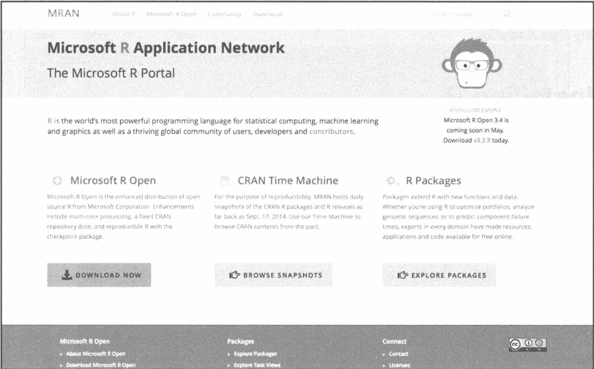

    Microsoft Open R 主页

2. 选择适合您系统的发行版（Windows、macOS 或 Linux）：

    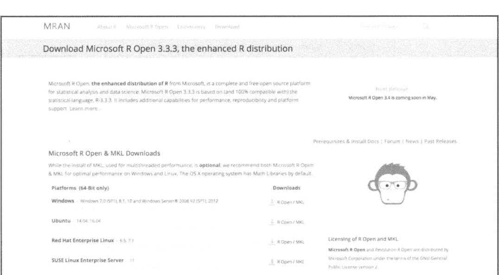

    Microsoft Open R 版本

3. 下载完成后，双击下载的文件以安装 Microsoft R Open。

4. 请注意，在 macOS 上，您可能会收到如下错误消息：

    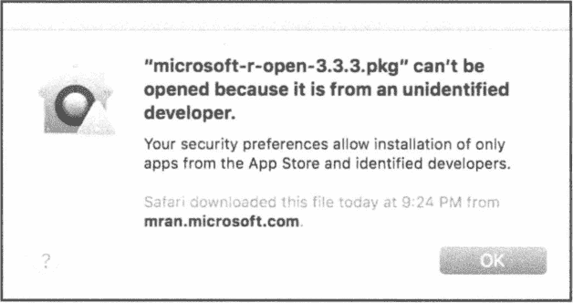

5. 如果出现这种情况，请右键单击下载的文件并从弹出的菜单中选择 **Open**。这将让您手动打开文件并安装：

    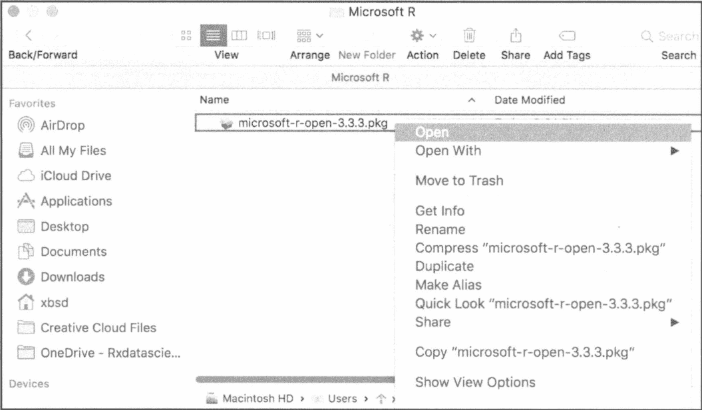

6. 安装完成后，双击 **Microsoft R Open** 以启动应用程序：

    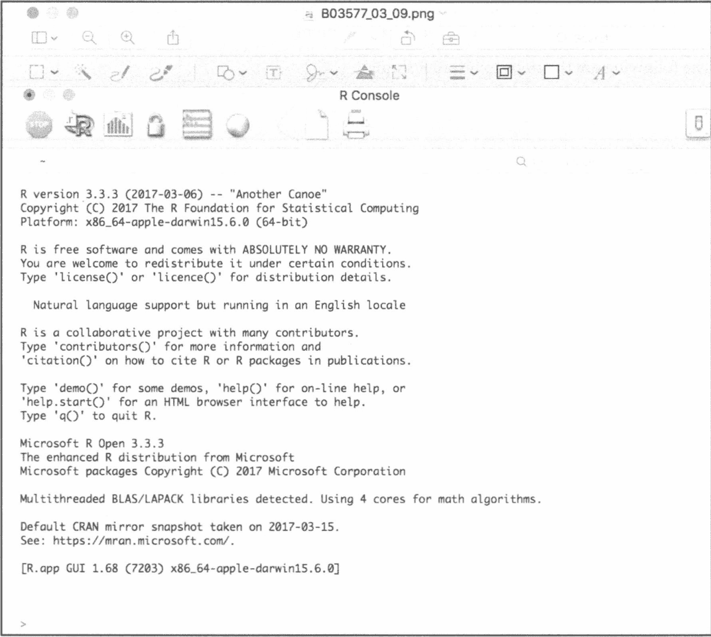

### 安装 RStudio

RStudio 是 `rstudio.org` 发布的一个应用程序，提供功能强大的功能丰富的图形 IDE（**集成开发环境**）。

安装 RStudio 的步骤如下：

1. 转到 `https://www.rstudio.com/products/rstudio/download`。

    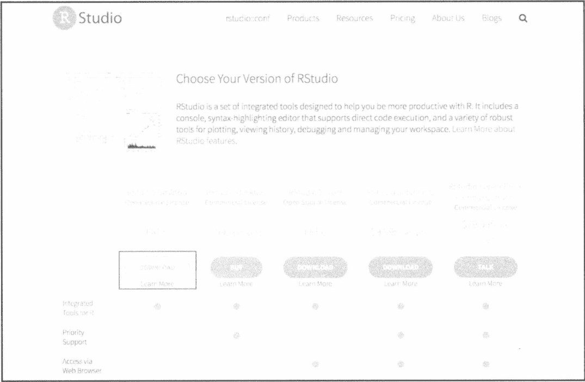

2. 点击适用于您操作系统的链接，下载并安装相应的文件：

    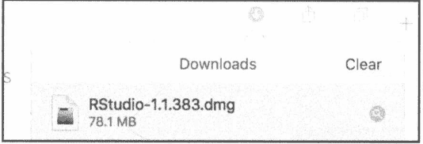

    下载 RStudio

3. 请注意，在 macOS 上，您只需将下载的文件移动到应用程序文件夹。在 Windows 和 Linux 操作系统上，双击下载的文件以完成安装步骤：

    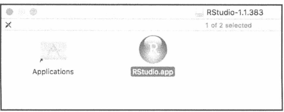

    Mac 上的 RStudio（复制到应用程序文件夹）

## 安装 Python

我们按如下方式进行安装：

1. 与 R 类似，Python 因其多功能和多样化的包而变得流行。Python 通常作为大多数现代基于 Linux 的操作系统的组成部分提供。对于我们的练习，我们将使用 Continuum Analytics® 的 Anaconda，它通过许多原生安装的数据挖掘和机器学习相关包增强了基础开源 Python 供应。这消除了从业者手动下载和安装包的需求。在这种意义上，它在概念上与 Microsoft R Open 相似。正如 Microsoft R 通过额外功能增强了基础开源 R，Anaconda 也改进了基础开源 Python 的供应以提供新功能。


2. 安装 Anaconda Python 的步骤
3. 前往 https://www.continuum.io/downloads：


Python Anaconda 首页

4. 下载适合您系统的发行版。请注意，我们将下载 Python v2.7（而不是 3.x 版本）：

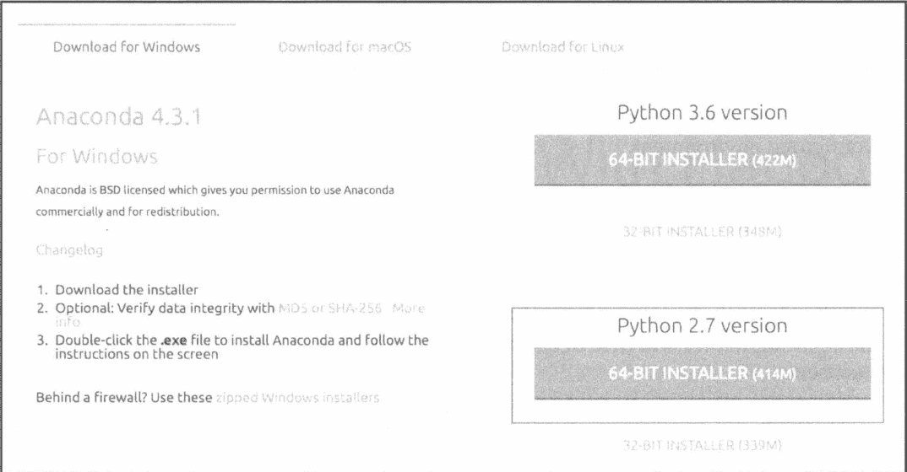

5. 安装完成后，您应该能够打开终端窗口（或 Windows 中的命令窗口）并输入 Python，这将启动 Anaconda：

```
```text
MacBook-Pro-3:~ xbsd$ python
Python 2.7.13 |Anaconda 4.3.0 (x86_64)| (default, Dec 20 2016, 23:05:08)
[GCC 4.2.1 Compatible Apple LLVM 6.0 (clang-600.0.57)] on darwin
Type "help", "copyright", "credits" or "license" for more information.
Anaconda is brought to you by Continuum Analytics.
Please check out: http://continuum.io/thanks and https://anaconda.org
>>>
```
```

至此，Hadoop（CDH）、Spark、R 和 Python 的安装过程结束。在后续章节中，我们将更深入地研究这些平台。

## 摘要

本章介绍了数据科学中使用的主要工具。特别是，它演示了如何下载和安装用于 Cloudera Hadoop 分发版（CDH）、Spark、R、RStudio 和 Python 的虚拟机。虽然用户可以下载 Hadoop 的源代码并在例如 Unix 系统上安装它，但这通常会遇到问题并且需要相当多的调试。使用 VM 代替可以让用户以最少的努力开始使用和学习 Hadoop，因为它是一个完整的预配置环境。

此外，R 和 Python 是机器学习和一般分析中最常用的两种语言。它们适用于所有流行的操作系统。虽然它们可以在 VM 中安装，但建议用户如果可行的话尝试在本地机器（笔记本电脑/工作站）上安装它们，因为这样性能相对更高。

在下一章中，我们将更深入地探讨 Hadoop 的细节及其核心组件和概念。

# 4
使用 Hadoop 处理大数据

Hadoop 已成为大数据世界的事实标准，尤其是在过去三到四年里。Hadoop 于 2006 年作为 Apache Nutch 的子项目启动，并引入了与分布式文件系统和分布式计算相关的两个关键特性，也称为 MapReduce，这些特性在开源社区中迅速流行起来。如今，已有数千种新产品利用 Hadoop 的核心功能开发出来，它已发展成为一个庞大的生态系统，由超过 150 种相关主要产品组成。可以说，Hadoop 是启动大数据和分析行业的首要催化剂之一。

在本章中，我们将讨论 Hadoop 的背景和核心概念、Hadoop 平台的组件，并深入探讨 Hadoop 生态系统中的主要产品。我们将学习分布式文件系统和分布式处理的核心理念以及提高 Hadoop 部署性能的优化措施。我们将以使用 Cloudera Hadoop 分发版（CDH）的实际动手练习作为结尾。我们将涵盖的主题有：

- Hadoop 的基础知识
- Hadoop 的核心组件
- Hadoop 1 和 Hadoop 2
- Hadoop 分布式文件系统
- 使用 MapReduce 的分布式计算原理
- Hadoop 生态系统
- Hadoop 生态系统概述

- Hive、HBase 等
- Hadoop 企业部署
- 内部部署
- 云部署
- 使用 Cloudera Hadoop 动手实践
- 使用 HDFS
- 使用 Hive
- 使用 WordCount 进行 MapReduce

## Hadoop 的基础

2006 年，Hadoop 的创建者 Doug Cutting 在 Yahoo! 工作。他积极参与了一个名为 Nutch 的开源项目，该项目涉及大规模网络爬虫的开发。网络爬虫在高层次上本质上是能够以自动方式在互联网上浏览和索引网页的软件。直观地说，这涉及对大量数据进行高效管理和计算。2006 年 1 月下旬，Doug 正式宣布启动 Hadoop。请求的第一行，仍可在互联网上的 `https://issues.apache.org/jira/browse/INFRA-700` 获取，为 *The Lucene PMC has voted to split part of Nutch into a new subproject named Hadoop.* 而 Hadoop 就此诞生。

起初，Hadoop 有两个核心组件：**Hadoop 分布式文件系统（HDFS）** 和 MapReduce。这是 Hadoop 的第一个迭代，也现在被称为 Hadoop 1。后来，在 2012 年，添加了第三个组件，称为 **YARN（Yet Another Resource Negotiator）**，它解耦了资源管理和作业调度的过程。在深入探讨核心组件之前，了解 Hadoop 的基本前提会有帮助：

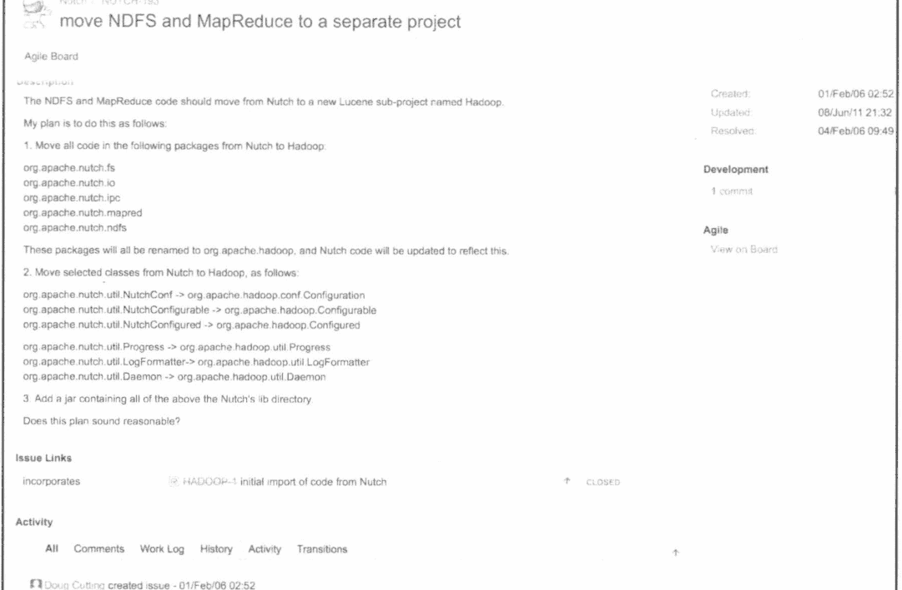

Doug Cutting 在 https://issues.apache.org/jira/browse/NUTCH-193 的帖子宣布了他将 Nutch 分布式 FS（NDFS）和 MapReduce 分离到名为 Hadoop 的新子项目中的意图。

## Hadoop 的基本前提

Hadoop 的基本前提是，与其尝试在一台大型机器上执行任务，不如将任务细分为较小的段，然后将这些段委托给多台较小的机器。这些所谓的较小的机器随后将在其各自的数据部分上执行任务。一旦较小的机器完成分配给它们的任务并产生结果，各个结果单元将被汇总以产生最终结果。

虽然从理论上看这似乎相对简单，但仍有各种技术考虑需要牢记。例如：

- 网络是否足够快以收集每个服务器的结果？
- 每个服务器是否能足够快地从磁盘读取数据？
- 如果一台或多台服务器失败，我们是否必须从头开始？
- 如果有多个大型任务，应如何优先处理？

在使用这种分布式架构时，还必须考虑许多其他因素。

## Hadoop 的核心模块

Hadoop 的核心模块包括：

- **Hadoop Common**：Hadoop 所需的库和其他通用辅助工具
- **HDFS**：一种分布式、高可用性、容错的文件系统，用于存储数据
- **Hadoop MapReduce**：一种涉及在商品服务器（或节点）上进行分布式计算的编程范式
- **Hadoop YARN**：一种用于作业调度和资源管理的框架

在这些核心组件中，YARN 于 2012 年引入，以解决 Hadoop 首次发布的一些不足。Hadoop 的第一个版本（或等价地，Hadoop 的第一个模型）使用 HDFS 和 MapReduce 作为其主要组件。随着 Hadoop 人气飙升，使用超出 MapReduce 所提供设施的需求变得越来越重要。这，加上一些其他技术考虑，导致了 YARN 的开发。

现在让我们来看一下之前列出的 Hadoop 的主要特征。

## Hadoop 分布式文件系统 - HDFS

HDFS 构成了所有 Hadoop 安装的基础。文件，或更一般地数据，存储在 HDFS 中并由 Hadoop 的节点访问。

HDFS 执行两个主要功能：

- **命名空间**：提供保存集群元数据的命名空间，即 Hadoop 集群中数据的位置
- **数据存储**：充当 Hadoop 集群中数据使用的存储

文件系统被称为分布式，因为数据以块的形式存储在多个服务器上。通过一个简单的示例可以直观地理解 HDFS，如下所示。考虑一本由 A-Z 章节组成的大书。在普通文件系统中，整本书将作为单个文件存储在磁盘上。在 HDFS 中，这本书将被拆分为较小的块，例如 A-H 章节的一个块、I-P 的另一个块、Q-Z 的第三个块。这些块随后存储在单独的机架中（或用此类比来说是书架）。此外，章节被复制三次，使得每个章节都有三份副本。

假设，进一步，整本书的大小为 1 GB，每个章节大约为 350 MB：

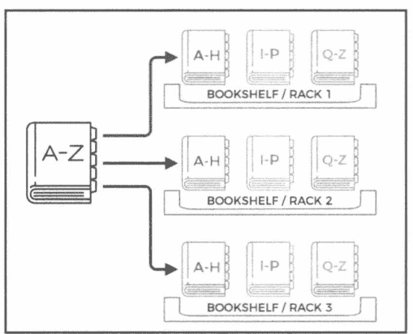

以这种方式存储书籍实现了几个重要目标：

- 由于书籍已被按章节组拆分为三部分，并且每部分被复制了三次，这意味着我们的进程可以通过从不同服务器查询各部分并行读取书籍。这减少了 I/O 竞争，是并行化正确使用的一个非常合适的例子。


- 如果某个机架不可用，我们可以从任何其他机架检索章节，因为每个章节在不同的机架上都有多个副本。
- 如果分配给我的任务只需要访问单个章节，例如章节B，我只需访问对应章节A-H的文件。由于对应章节A-H的文件大小只有整本书的三分之一，访问和读取该文件所需的时间会大大减少。
- 这种模型还可以带来其他好处，例如对不同章节组的选择性访问权限等。

这可能是对实际HDFS功能的一个过度简化的类比，但它传达了该技术的基本原理——大文件被细分为块（chunk），并以高可用性冗余配置分布在多台服务器上。现在，我们将更详细地了解实际的HDFS架构：

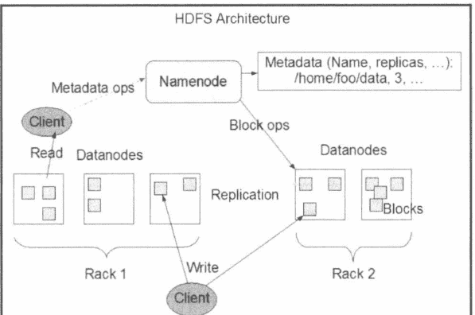

Hadoop的HDFS后端由以下组件组成：

- **NameNode**：可将其视为主节点。NameNode包含集群元数据，并且知道哪些数据存储在哪个位置——简而言之，它持有命名空间。它将整个命名空间存储在RAM中，当请求到达时，提供有关哪些服务器保存任务所需数据的信息。在Hadoop 2中，可以有多个NameNode。可以创建一个辅助NameNode，作为主NameNode的辅助节点。因此，它不是备份NameNode，而是帮助保持集群元数据最新的节点。
- **DataNode**：DataNode是负责存储数据块并在收到新请求时执行计算操作的独立服务器。它们主要是商用服务器，在资源和容量方面不如存储集群元数据的NameNode强大。

## HDFS中的数据存储过程

以下几点应该能让你很好地了解数据存储过程：

HDFS中的所有数据都以块写入，通常为128 MB。因此，一个大小为512 MB的文件会被分成四个块（4 * 128 MB）。这些块随后被写入DataNode。为了保持冗余和高可用性，每个块都会被复制以创建副本。通常，Hadoop安装的复制因子为3，这意味着每个数据块都会被复制三次。

这保证了冗余，如果某台服务器发生故障或停止响应，总会有第二个甚至第三个副本可用。为了确保这一过程无缝运行，DataNode会将副本放置在不同的独立服务器上，并且还可以确保这些块放置在数据中心不同机架的服务器上。这是因为即使所有副本都位于独立服务器上，但如果所有服务器都在同一个机架上，一旦机架断电，就没有副本可用。

将数据写入HDFS的一般过程如下：

1. NameNode收到将新文件写入HDFS的请求。
2. 由于数据必须以块（block或chunk）写入，HDFS客户端（发出请求的实体）开始将数据缓存到本地缓冲区，一旦缓冲区达到分配的块大小（例如128 MB），它就会通知NameNode已准备好写入第一个数据块（chunk）。
3. NameNode根据其所掌握的HDFS集群状态信息，响应目标DataNode的信息，该DataNode是需要存储块的位置。
4. HDFS客户端将数据写入目标DataNode，并在块写入过程完成后通知NameNode。
5. 随后，目标DataNode开始将其数据块副本复制到第二个DataNode，该DataNode将作为当前块的副本。
6. 第二个DataNode完成写入过程后，会将数据块发送给第三个DataNode。
7. 这一过程会重复进行，直到与数据（即文件）对应的所有块都复制到不同节点上。

请注意，块的数量取决于文件大小。下图展示了数据在5个DataNode上的分布情况。

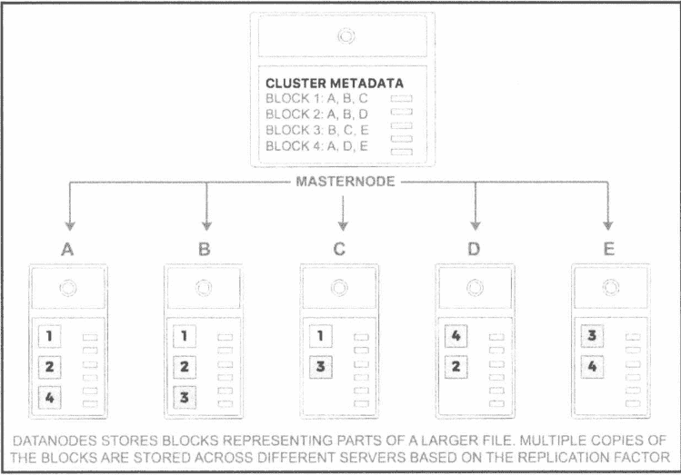

Hadoop第一个发布版本（也称为Hadoop 1）中的HDFS架构具有以下特点：

- 单一NameNode：只有一个NameNode可用，因此它也成为单点故障，因为它存储了所有集群元数据。
- 多个DataNode：负责存储数据块、处理客户端请求以及对块执行I/O操作（创建、读取、删除等）。
- Hadoop第二个发布版本（也称为Hadoop 2）中的HDFS架构提供了原始HDFS设计的所有优点，并增加了一些新功能，最显著的是能够拥有多个可充当主NameNode和辅助NameNode的NameNode。其他功能还包括支持多个命名空间以及HDFS联邦（HDFS Federation）。

## MapReduce直观介绍

我们以一个假设的组织为例，该组织由CEO、总监和经理组成。CEO想知道公司新入职了多少员工。CEO向其总监发送请求，要求汇报各自部门的新入职人数。总监继而向其各个部门的经理发送请求，要求提供新入职人数。经理将数字提供给总监，总监再将最终数值汇报给CEO。

这可以被视为MapReduce的一个现实世界示例。在这个类比中，任务是找出新入职员工的数量。CEO没有亲自收集所有数据，而是将其委托给总监和经理，他们提供各自部门的数字，如下图所示：


在这个相当简化的场景中，将一个大任务（查找整个公司的新入职员工）拆分成较小的任务（每个团队的新入职员工），然后最终将各个数字重新汇总的过程，与MapReduce的工作方式类似。

## 从技术角度理解MapReduce

顾名思义，MapReduce具有map阶段和reduce阶段。map阶段通常是一个应用于输入中每个元素的函数，从而修改其原始值。

MapReduce生成键值对作为输出。


**键值对：** 键值对建立了一种关系。例如，如果John今年20岁，一个简单的键值对可以是(John, 20)。在MapReduce中，map操作会生成这样的键值对，其中包含一个实体以及分配给该实体的值。

在实践中，map函数可能很复杂，并涉及高级功能。

reduce阶段接收来自map函数的键值输入，并执行汇总操作。例如，考虑一个map操作的输出，其中包含学校不同年级学生的年龄：

| 学生姓名 | 班级 | 年龄 |
|---|---|---|
| John | 一年级 | 7 |
| Mary | 二年级 | 8 |
| Jill | 一年级 | 6 |
| Tom | 三年级 | 10 |
| Mark | 三年级 | 9 |

我们可以创建一个简单的键值对，例如取班级和年龄的值（可以是任何值，但我只是拿这些来举例）。在这种情况下，我们的键值对将是(一年级, 7)、(二年级, 8)、(一年级, 6)、(三年级, 10)和(三年级, 9)。

计算每个年级学生年龄平均值的操作就可以定义为reduce操作。

更具体地说，我们可以对输出进行排序，然后将每个年级对应的元组发送到不同的服务器。

例如，服务器A将接收元组(一年级, 7)和(一年级, 6)，服务器B将接收元组(二年级, 8)，服务器C将接收元组(三年级, 10)和(三年级, 9)。然后，服务器A、B和C将分别计算元组的平均值，并汇报(一年级, 6.5)、(二年级, 8)和(三年级, 9.5)。

注意，在此过程中有一个中间步骤，涉及将输出发送到特定服务器，并对输出进行排序以决定应将其发送到哪个服务器。确实，MapReduce需要一个混洗（shuffle）和排序（sort）阶段，通过该阶段对键值对进行排序，使每个reducer接收一组固定的唯一键。


在这个例子中，假设只有两台服务器而不是三台，那么可以将服务器 A 分配给计算对应等级 1 和等级 2 的键的平均值，而将服务器 B 分配给计算等级 3 的平均值。

在 Hadoop 中，MapReduce 过程中会发生以下流程：

1. 客户端发送任务请求。
2. NameNode 会分配执行 map 操作的 DataNode（独立服务器）和执行 reduce 操作的 DataNode。请注意，DataNode 服务器的选择取决于操作所需的数据是否位于该服务器的*本地*。数据所在的服务器只能执行 map 操作。
3. DataNode 执行 map 阶段并生成键值 (k, v) 对。

当 mapper 生成 (k, v) 对时，会根据节点被分配去计算的*键*将其发送到相应的 reduce 节点。键到服务器的分配取决于分区函数，该函数可以简单到使用键的哈希值（这是 Hadoop 中的默认设置）。

一旦 reduce 节点收到与其负责计算的键对应的数据集，它就会应用 reduce 函数并生成最终输出。


> Hadoop 最大限度地利用了数据本地化的优势。map 操作由在本地（即磁盘上）保存数据的服务器执行。更准确地说，map 阶段将仅由保存该文件对应数据块的服务器执行。通过委托多个独立节点分别执行计算，Hadoop 架构可以有效地处理超大规模数据。

## 块大小以及 mapper 和 reducer 的数量

在 MapReduce 过程中，一个重要考虑因素是理解 HDFS 块大小，即文件被分割成的块的大小。需要访问某个文件的 MapReduce 任务必须对该文件对应的每个块执行 map 操作。例如，对于一个 512 MB 的文件，如果块大小为 128 MB，则需要四个块来存储整个文件。因此，一个 MapReduce 操作至少需要四个 map 任务，每个 map 操作将应用于数据的每个子集（即四个块中的每一个）。

然而，如果文件非常大，比如说需要 10,000 个块来存储，这意味着我们需要 10,000 个 map 操作。但是，如果我们只有 10 台服务器，那么我们就必须向每台服务器发送 1,000 个 map 操作。这可能是次优的，因为它可能导致磁盘 I/O 操作和按每个 map 进行的资源分配设置带来很高的代价。

关于所需 reducer 数量的总结在 Hadoop Wiki (https://wiki.apache.org/hadoop/HowManyMapsAndReduces) 上阐述得非常简洁。

> 理想的 reducer 数量应该是能让它们最接近以下条件的最优值：
> - 块大小的倍数
> - 任务时间在 5 到 15 分钟之间
> - 创建尽可能少的文件
>
> 除此之外的任何值都意味着你的 reducer 很可能不太理想。
> 用户往往倾向于使用一个非常大的值（“更多并行意味着更快！”）或一个非常小的值（“我不想耗尽我的命名空间配额！”）。
> 这两种做法同样危险，会导致以下一种或多种情况：
> - 工作流下一阶段的性能非常糟糕
> - 由于 shuffle 导致性能非常糟糕
> - 因为用最终无用的对象使 NameNode 过载，导致整体性能非常糟糕
> - 在没有真正合理理由的情况下破坏磁盘 I/O
> - 由于处理大量 CFIF/MFIF 工作而导致大量网络传输

## Hadoop YARN

YARN 是 Hadoop 2 中引入的一个模块。在 Hadoop 1 中，管理作业和监控作业的过程由称为 JobTracker 和 TaskTracker 的进程执行。运行 JobTracker 守护进程（进程）的 NameNode 会将作业提交给运行 TaskTracker 守护进程（进程）的 DataNode。

在 MapReduce 中，所有数据都必须从磁盘读取，这对于大型数据集的操作来说是可行的，但对于较小数据集的操作来说并不是最优的。事实上，任何需要极快处理（低延迟）、本质上具有交互性、或具有多次迭代（因此需要多次从磁盘读取同一数据）的任务都会极其缓慢。

通过移除这些依赖，Hadoop 2 允许开发者实现新的编程框架，以支持具有多样化性能要求的作业，例如低延迟和交互式实时查询、机器学习所需的迭代处理、不同的拓扑（如流数据的处理）、以及内存数据缓存/处理等优化。

几个新术语变得重要：

- **ApplicationMaster**：负责管理应用程序所需的资源。例如，如果某个作业需要更多内存，ApplicationMaster 将负责获取所需资源。这里的应用程序指的是 MapReduce、Spark 等应用程序执行框架。
- **Container**：资源分配的单位（例如 1 GB 内存和四个 CPU）。一个应用程序可能需要多个这样的容器来执行。ResourceManager 分配容器来执行任务。分配完成后，ApplicationMaster 请求 DataNode 启动已分配的容器，并接管这些容器的管理。
- **ResourceManager**：YARN 的一个组件，主要作用是为应用程序分配资源，并取代了 JobTracker。ResourceManager 进程像 JobTracker 一样运行在 NameNode 上。
- **NodeManager**：取代了 TaskTracker，NodeManager 负责向 ResourceManager (RM) 报告作业状态，并监控容器的资源利用率。

下图展示了 Hadoop 2.0 中 ResourceManager 和 NodeManager 的高层视图：

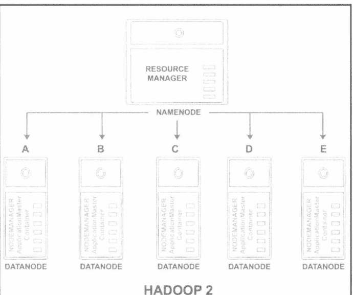

Hadoop 2.0

Hadoop 2 固有的主要概念已在下图中说明：

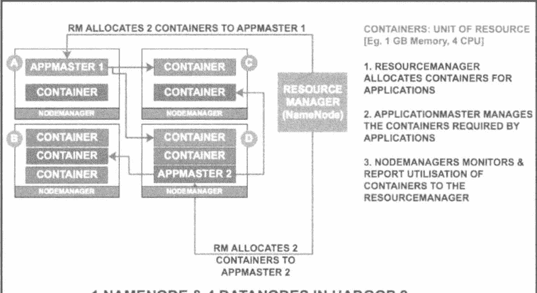

Hadoop 2.0 概念

## YARN 中的作业调度

大型 Hadoop 集群中同时运行多个作业并不罕见。当多个部门提交多个作业时，资源的分配就成为一个重要且确实有趣的话题。例如，如果部门 A 和 B 同时提交作业，但每个请求都要求获得最大可用资源，那么哪个请求应该获得优先权？通常，Hadoop 使用先进先出（FIFO）策略。也就是说，谁先提交作业，谁就先使用资源。但假如 A 先提交作业，但完成 A 的作业需要五个小时，而 B 的作业只需五分钟就能完成，那该怎么办？

为了处理作业调度中的这些细微差别和变量，已经实现了多种调度方法。其中较常用的三种是：

- **FIFO**：如上所述，FIFO 调度使用队列来确定作业的优先级。作业按照提交的顺序执行。
- **CapacityScheduler**：CapacityScheduler 按部门（部门可以表示一个逻辑用户组）对可提交的作业数量设定一个值。这是为了确保每个部门或组都能访问 Hadoop 集群，并且能够利用最少量的资源。如果服务器上有未使用的资源，该调度器还允许部门在为其设定的最大值范围内，超出其分配容量进行扩展。因此，CapacityScheduler 模型保证了每个部门都能以确定性的方式访问集群。
- **公平调度器（Fair Schedulers）**：这类调度器尝试在不同应用程序之间均匀平衡资源利用率。虽然在某个特定时间点可能无法实现完全均匀的平衡，但使用 Fair Scheduler 可以实现随时间推移的分配平衡，从而使平均值大致相似。

这些调度器以及其他调度器提供了细粒度的访问控制（例如按用户或按组），并且主要利用队列来对资源进行优先级排序和分配。

## Hadoop 中的其他主题

Hadoop 还有其他一些值得特别提及的方面。由于我们已经详细讨论了最重要的主题，本节将概述其他一些值得关注的主题。


## Encryption

数据加密是各种类型数据的官方法规所强制要求的。在美国，识别患者信息的數據必須符合 HIPAA 規定的規則，該規則規定了此类记录的存储方式。HDFS 中的数据可以在静态（磁盘上）和/或传输中进行加密。用于解密数据的密钥通常由 **密钥管理系统 (KMSs)** 管理。

## User authentication

Hadoop 可以使用服务器的原生用户身份验证方法。例如，在基于 Linux 的机器上，用户可以根据系统中 `/etc/passwd` 文件中定义的 ID 进行身份验证。换句话说，Hadoop 继承了服务器端设置的用户身份验证。

通过 Kerberos 进行用户身份验证在 Hadoop 集群中也很常见，Kerberos 是一种跨平台身份验证协议。Kerberos 基于票证的概念，该票证根据需要临时授予用户特权。票证可以使用 Kerberos 命令使无效，从而根据需要限制用户访问集群资源的权利。

请注意，即使用户被允许访问数据（用户身份验证），他或她仍可能因另一个称为授权的功能而受到限制，即可以访问哪些数据。该术语意味着即使用户可以进行身份验证并登录系统，用户也可能仅限于有权访问的数据。这种级别的授权通常使用原生 HDFS 命令来更改目录和文件的所有权，以指定用户。

## Hadoop data storage formats

由于 Hadoop 涉及存储超大规模数据，因此选择适合您用例的存储类型至关重要。数据可以在 Hadoop 中以几种格式存储，最佳存储格式的选择取决于您对读写 I/O 速度的要求、文件能否按需压缩和解压缩，以及文件是否易于拆分，因为数据最终将作为块存储。

一些流行且常用的存储格式如下：

- **Text/CSV**：这些是纯文本 CSV 文件，类似于 Excel 文件，但以纯文本格式保存。由于 CSV 文件按行包含记录，因此自然很容易将文件拆分为数据块。
- **Avro**：Avro 的开发是为了提高在异构系统之间高效共享数据的能力。它使用数据序列化将模式和实际数据都存储在一个紧凑的二进制文件中。Avro 使用 JSON 存储模式并使用二进制格式存储数据，并将它们序列化为单个 Avro 对象容器文件。Python、Scala、C/C++ 等多种语言都有可读取 Avro 文件的原生 API，因此它非常便携，非常适合跨平台数据交换。
- **Parquet**：Parquet 是一种列式数据存储格式。这有助于提高性能，有时可显著提高性能，因为它允许按列存储和访问数据。直观地说，如果您正在处理一个 1 GB、100 列、100 万行的文件，并且只想查询 100 列中的一列，能够仅访问单个列会比必须访问整个文件更高效。
- **ORCFiles**：ORC 代表 Optimized Row-Columnar。从某种意义上说，它是对纯列式格式（如 Parquet）的进一步优化层。ORCFiles 不仅按列存储数据，还按行存储，也称为条带。具有表格格式数据的<|message|> 可以拆分为多个较小的条带，每个条带包含原始文件的行子集。通过以这种方式拆分数据，如果用户任务只需要访问数据的一小部分，进程可以查询保存数据的特定条带。
- **SequenceFiles**：在 SequenceFiles 中，数据表示为键值对并以二进制序列化格式存储。由于序列化，数据可以以紧凑的二进制格式表示，这不仅减少了数据大小，而且也提高了 I/O。Hadoop，尤其是 HDFS，在存在多个小文件（如音频文件）时效率不高。SequenceFiles 通过允许将多个小文件存储为单个单元或 SequenceFile 来解决此问题。它们也非常适合可拆分的并行操作，并且总体上对 MapReduce 作业高效。
- **HDFS Snapshots**：HDFS 快照允许用户以只读模式在给定时间点保留数据。用户可以在 HDFS 中创建快照——本质上是该时间点数据的副本——以便在需要时稍后检索。这确保了在文件损坏或影响数据可用性的任何其他故障发生时可以恢复数据。在这方面，它也可以被视为备份。快照位于创建它们的 .snapshot 目录中。

- **Handling of node failures:** 大型 Hadoop 集群可能包含数万个节点。因此，在任何一天都可能出现服务器故障。为了使 NameNode 了解集群中所有节点的状态，DataNodes 会定期向 NameNode 发送心跳。如果 NameNode 检测到服务器已失败，即停止接收心跳，它会将服务器标记为失败，并将该服务器本地的所有数据复制到新实例。

## New features expected in Hadoop 3

在撰写本书时，Hadoop 3 处于 Alpha 阶段。有关 Hadoop 3 中新更改的详细信息可以在互联网上找到。例如，`http://hadoop.apache.org/docs/current/` 提供了有关架构新更改的最最新信息。

## The Hadoop ecosystem

本章应标题为 Apache 生态系统。Hadoop 与本节中将讨论的所有其他项目一样，是一个 Apache 项目。Apache 被宽松地用作 Apache 软件基金会支持的开源项目的简称。它最初源于 90 年代初 Apache HTTP 服务器的开发，今天是一个由志愿者组成的全球协作计划，他们参与向全球技术社区发布开源软件。

Hadoop 起初是，也是 Apache 生态系统中的一个项目之一。由于其受欢迎程度，许多也是 Apache 的其他项目已直接或间接地与 Hadoop 关联，因为它们支持 Hadoop 环境中的关键功能。也就是说，必须牢记的是，这些项目在大多数情况下可以作为独立产品存在，而无需 Hadoop 环境。它是否能提供最佳功能是另一个话题。

在本节中，我们将介绍一些对 Hadoop 作为标准 IT 企业解决方案的增长和可用性产生很大影响的 Apache 项目，如下图所示：

| Product | Functionality |
|---|---|
| Apache Pig | Apache Pig，也称为 Pig Latin，是一种专门设计用于通过简洁语句表示 MapReduce 程序的语言，从而定义工作流。使用传统方法（如 Java）编码 MapReduce 程序可能相当复杂，而 Pig 提供了通过使用简单语义表达 MapReduce 工作流和复杂的 **Extract-Transform-Load (ETL)** 的简易抽象。Pig 程序通过 Grunt shell 执行。 |
| Apache HBase | Apache HBase 是建立在 HDFS 之上的分布式列式数据库。它以 Google 的 BigTable 为模型，其中数据以列式格式表示。HBase 支持跨包含数十亿条记录的表的低延迟读写，并且非常适合需要直接随机访问数据的任务。更具体地说，HBase 以三个维度索引数据 - 行、列和时间戳。它还提供了一种表示具有任意数量列的数据的方法，因为列值可以在 HBase 表的单元格内表示为键值对。 |
| Apache Hive | Apache Hive 提供了一种类 SQL 方言来查询存储在 HDFS 中的数据。Hive 将数据存储为 HDFS 中以文件夹式结构存储的序列化二进制文件。类似于传统数据库管理系统中的表，Hive 以表格格式在 HDFS 中存储数据，并根据用户选择的属性进行分区。分区因此是更高级别目录或表的子文件夹。桶的概念提供了第三层抽象，它引用 Hive 表分区中的文件。 |
| Apache Sqoop | Sqoop 用于从传统数据库中提取数据到 HDFS。拥有数据存储在关系数据库管理系统中的大型企业因此可以使用 Sqoop 将数据从其数据仓库传输到 Hadoop 实现。 |
| Apache Flume | Flume 用于管理、聚合和分析大规模日志数据。 |
| Apache Kafka | Kafka 是一种基于发布/订阅的中间件系统，可用于实时分析和随后持久化（在 HDFS 中）流数据。 |


|   |   |
| --- | --- |
| Apache Oozie | Oozie 是一个工作流管理系统，旨在调度 Hadoop 作业。它实现了一个被称为 **有向无环图 (DAG)** 的关键概念，该概念将在我们关于 Spark 的部分中讨论。 |
| Apache Spark | Spark 是 Apache 中最具影响力的项目之一，其设计目的是解决 HDFS-MapReduce 模型的一些不足。它最初是在 UC Berkeley 的一个相对较小的项目，迅速发展成为用于分析任务的 Hadoop 替代方案中最突出的选择之一。Spark 已在行业中得到广泛采用，并包含各种其他子项目，提供机器学习、流式分析等附加功能。 |

## Hands-on with CDH

在本节中，我们将利用 CDH QuickStart VM 来完成本章中讨论的一些主题。练习不一定需要按时间顺序执行，也不依赖于其他练习的完成。

我们将在本节中完成以下练习：

- WordCount using Hadoop MapReduce
- Working with the HDFS
- Downloading and querying data with Apache Hive

## WordCount using Hadoop MapReduce

在本练习中，我们将尝试统计有史以来最长的长篇小说之一中每个单词出现的次数。练习中，我们选择了 Georges 和/或 Madeleine de Scudéry 在 1649-1653 年间撰写的书籍 *Artamène ou le Grand Cyrus*。根据 Wikipedia 上的相关列表（https://en.wikipedia.org/wiki/List_of_longest_novels），该书被认为是第二长的小说。该小说共有 10 卷，13,905 页，接近两百万个单词。

首先，我们需要在 VirtualBox 中启动 Cloudera Distribution of Hadoop Quickstart VM 并双击 Cloudera Quickstart VM 实例：

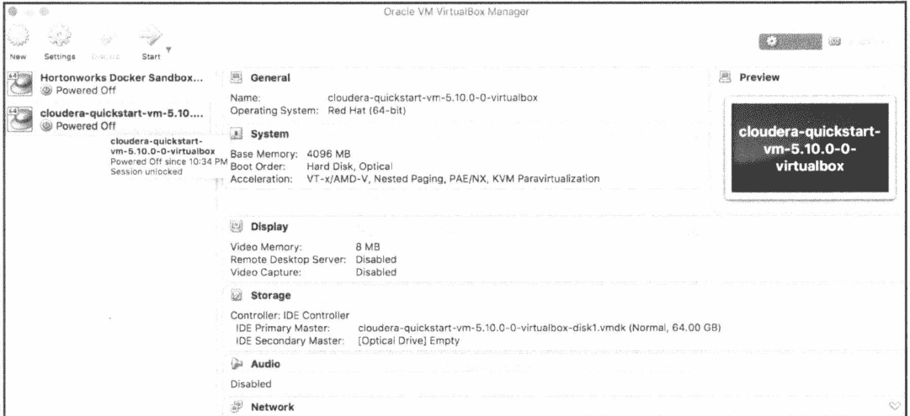

启动需要一些时间，因为它会初始化所有 CDH 相关进程，例如 DataNode、NameNode 等：

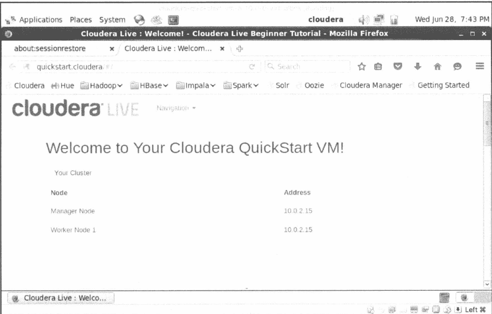

进程启动后，它将启动一个默认的着陆页，其中包含与 Hadoop 相关的众多教程的引用。我们将在本节中在 Unix 终端中编写 MapReduce 代码。从顶部左侧菜单启动终端，如以下屏幕截图所示：

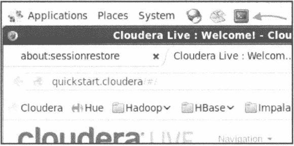

现在，我们必须按照以下步骤操作：

- 1. 创建一个名为 `cyrus` 的目录。这里我们将存储包含书籍文本的所有文件。
- 2. 运行 `getCyrusFiles.sh`，如步骤 4 所示。这将把书籍下载到 cyrus 目录。
- 3. 运行 `processCyrusFiles.sh`，如图所示。该书包含各种 Unicode 和不可打印字符。此外，我们希望将所有单词更改为小写，以便忽略因大小写不同而导致的重复计数。
- 4. 这将生成一个名为 `cyrusprint.txt` 的文件。该文档包含书籍的全部文本。我们将在此文本文件上运行我们的 MapReduce 代码。
- 5. 准备 `mapper.py` 和 `reducer.py`。顾名思义，`mapper.py` 运行 MapReduce 过程的 map 部分。同样，`reducer.py` 运行 MapReduce 过程的 reduce 部分。文件 `mapper.py` 将把文档拆分为单词并为文档中的每个单词分配一个值为一的值。文件 `reducer.py` 将读取 `mapper.py` 的排序输出并汇总相同单词的出现次数（首先将单词的计数初始化为一，并为每个新出现的单词递增）。最终输出是一个包含文档中每个单词计数的<|message|>文件。

步骤如下：

- 1. 创建 `getCyrusFiles.sh` - 此脚本将用于从网络检索数据：

  ```
  [cloudera@quickstart ~]$ mkdir cyrus
  [cloudera@quickstart ~]$ vi getCyrusFiles.sh
  [cloudera@quickstart ~]$ cat getCyrusFiles.sh
  for i in `seq 10`
  do
  curl www.artamene.org/documents/cyrus$i.txt -o cyrus$i.txt
  done
  ```

- 2. 创建 `processCyrusFiles.sh` - 此脚本将用于连接和清理上一步下载的文件：

  ```
  [cloudera@quickstart ~]$ vi processCyrusFiles.sh
  [cloudera@quickstart ~]$ cat processCyrusFiles.sh
  cd ~/cyrus;
  for i in `ls cyrus*.txt`; do cat $i >> cyrusorig.txt; done
  cat cyrusorig.txt | tr -dc '[:print:]' | tr A-Z a-z > cyrusprint.txt
  ```

- 3. 将权限更改为 755 以使 `.sh` 文件在命令行提示符下可执行：

  ```
  [cloudera@quickstart ~]$ chmod 755 getCyrusFiles.sh
  [cloudera@quickstart ~]$ chmod 755 processCyrusFiles.sh
  ```

- 4. 执行 `getCyrusFiles.sh`：

  ```
  [cloudera@quickstart cyrus]$ ./getCyrusFiles.sh
    % Total    % Received % Xferd  Average Speed   Time    Time
  Time  Current
                           Dload  Upload   Total   Spent
  Left  Speed
  100  908k  100  908k    0     0   372k      0 0:00:02 0:00:02 --
  :--:--  421k
    % Total    % Received % Xferd  Average Speed   Time    Time
  Time  Current
                           Dload  Upload   Total   Spent
  Left  Speed
  100 1125k  100 1125k    0     0   414k      0 0:00:02 0:00:02 --
  :--:--  471k
    % Total    % Received % Xferd  Average Speed   Time    Time
  Time  Current
              Dload  Upload  Total  Spent
  Left  Speed
  100 1084k  100 1084k    0    0   186k      0  0:00:05  0:00:05 --:--:--  236k
       % Total    % Received  % Xferd  Average Speed   Time    Time
  Time  Current
              Dload  Upload  Total  Spent
  Left  Speed
  100 1048k  100 1048k    0    0   267k      0  0:00:03  0:00:03 --:--:--  291k
       % Total    % Received  % Xferd  Average Speed   Time    Time
  Time  Current
              Dload  Upload  Total  Spent
  Left  Speed
  100 1116k  100 1116k    0    0   351k      0  0:00:03  0:00:03 --:--:--  489k
       % Total    % Received  % Xferd  Average Speed   Time    Time
  Time  Current
              Dload  Upload  Total  Spent
  Left  Speed
  100 1213k  100 1213k    0    0   440k      0  0:00:02  0:00:02 --:--:--  488k
       % Total    % Received  % Xferd  Average Speed   Time    Time
  Time  Current
              Dload  Upload  Total  Spent
  Left  Speed
  100 1119k  100 1119k    0    0   370k      0  0:00:03  0:00:03 --:--:--  407k
       % Total    % Received  % Xferd  Average Speed   Time    Time
  Time  Current
              Dload  Upload  Total  Spent
  Left  Speed
  100 1132k  100 1132k    0    0   190k      0  0:00:05  0:00:05 --:--:--  249k
       % Total    % Received  % Xferd  Average Speed   Time    Time
  Time  Current
              Dload  Upload  Total  Spent
  Left  Speed
  100 1084k  100 1084k    0    0   325k      0  0:00:03  0:00:03 --:--:--  365k
       % Total    % Received  % Xferd  Average Speed   Time    Time
  Time  Current
              Dload  Upload  Total  Spent
  Left  Speed
  100 1259k  100 1259k    0    0   445k      0  0:00:02  0:00:02 --:--:--  486k
  [cloudera@quickstart cyrus]$ ls
  cyrus10.txt  cyrus3.txt  cyrus6.txt  cyrus9.txt
  cyrus1.txt  cyrus4.txt  cyrus7.txt  getCyrusFiles.sh
  cyrus2.txt  cyrus5.txt  cyrus8.txt  processCyrusFiles.sh
  ```

- 5. 执行 `processCyrusFiles.sh`：

  ```
  [cloudera@quickstart cyrus]$ ./processCyrusFiles.sh

  [cloudera@quickstart cyrus]$ ls
  cyrus10.txt  cyrus3.txt  cyrus6.txt  cyrus9.txt
  getCyrusFiles.sh
  cyrus1.txt  cyrus4.txt  cyrus7.txt  cyrusorig.txt
  processCyrusFiles.sh
  cyrus2.txt  cyrus5.txt  cyrus8.txt  cyrusprint.txt

  [cloudera@quickstart cyrus]$ ls -altrh cyrusprint.txt
  -rw-rw-r-- 1 cloudera cloudera 11M Jun 28 20:02 cyrusprint.txt

  [cloudera@quickstart cyrus]$ wc -w cyrusprint.txt
  1953931 cyrusprint.txt
  ```

- 6. 执行以下步骤将最终文件 cyrusprint.txt 复制到 HDFS，创建 mapper.py 和 reducer.py 脚本。

文件 `mapper.py` 和 `reducer.py` 在 Glenn Klockwood 的网站上有所引用（http://www.glennklockwood.com/data-intensive/hadoop/streaming.html），该网站提供了有关 MapReduce 及相关主题的丰富信息。

以下代码显示了 `mapper.py` 的内容：

```
[cloudera@quickstart cyrus]$ hdfs dfs -ls /user/cloudera

[cloudera@quickstart cyrus]$ hdfs dfs -mkdir /user/cloudera/input

[cloudera@quickstart cyrus]$ hdfs dfs -put cyrusprint.txt /user/cloudera/input/
[cloudera@quickstart cyrus]$ vi mapper.py

[cloudera@quickstart cyrus]$ cat mapper.py
#!/usr/bin/env python
#the above just indicates to use python to interpret this file
#This mapper code will input a line of text and output <word, 1> #
```


## 使用 Hadoop 进行大数据

```python
import sys
sys.path.append('.')

for line in sys.stdin:
    line = line.strip()
    keys = line.split()
    for key in keys:
        value = 1
        print("%s\t%d" % (key,value))
```

```shell
[cloudera@quickstart cyrus]$ vi reducer.py # Copy-Paste the content of reducer.py as shown below using the vi or nano Unix editor.

[cloudera@quickstart cyrus]$ cat reducer.py
```

```python
#!/usr/bin/env python

import sys
sys.path.append('.')

last_key = None
running_total = 0

for input_line in sys.stdin:
    input_line = input_line.strip()
    this_key, value = input_line.split("\t", 1)
    value = int(value)

    if last_key == this_key:
        running_total += value
    else:
        if last_key:
            print("%s\t%d" % (last_key, running_total))
        running_total = value
        last_key = this_key

if last_key == this_key:
    print("%s\t%d" % (last_key, running_total))
```

```shell
[cloudera@quickstart cyrus]$ chmod 755 *.py
```

7. 执行 mapper 和 reducer 脚本以按顺序执行 MapReduce 操作来生成词频统计。你可能会看到如下所示的错误消息，但就本练习而言（以及生成结果而言），你可以忽略它们：

```text
[cloudera@quickstart cyrus]$ hadoop jar /usr/lib/hadoop-mapreduce/hadoop-streaming.jar -input /user/cloudera/input -output /user/cloudera/output -mapper /home/cloudera/cyrus/mapper.py -reducer /home/cloudera/cyrus/reducer.py

packageJobJar: [ ] [/usr/lib/hadoop-mapreduce/hadoop-streaming-2.6.0-cdh5.10.0.jar] /tmp/streamjob178653270976133464.jar tmpDir=null
17/06/28 20:11:21 INFO client.RMProxy: Connecting to ResourceManager at /0.0.0.0:8032
17/06/28 20:11:21 INFO client.RMProxy: Connecting to ResourceManager at /0.0.0.0:8032
17/06/28 20:11:22 INFO mapred.FileInputFormat: Total input paths to process : 1
17/06/28 20:11:22 INFO mapreduce.JobSubmitter: number of splits:2
17/06/28 20:11:23 INFO mapreduce.JobSubmitter: Submitting tokens for job: job_1498704103152_0002
17/06/28 20:11:23 INFO impl.YarnClientImpl: Submitted application application_1498704103152_0002
17/06/28 20:11:23 INFO mapreduce.Job: The url to track the job: http://quickstart.cloudera:8088/proxy/application_1498704103152_0002/
17/06/28 20:11:23 INFO mapreduce.Job: Running job: job_1498704103152_0002
17/06/28 20:11:30 INFO mapreduce.Job: Job job_1498704103152_0002 running in uber mode : false
17/06/28 20:11:30 INFO mapreduce.Job:  map 0% reduce 0%
17/06/28 20:11:41 INFO mapreduce.Job:  map 50% reduce 0%
17/06/28 20:11:54 INFO mapreduce.Job:  map 83% reduce 0%
17/06/28 20:11:57 INFO mapreduce.Job:  map 100% reduce 0%
17/06/28 20:12:04 INFO mapreduce.Job:  map 100% reduce 100%
17/06/28 20:12:04 INFO mapreduce.Job: Job job_1498704103152_0002 completed successfully
17/06/28 20:12:04 INFO mapreduce.Job: Counters: 50
    File System Counters
        FILE: Number of bytes read=18869506
        FILE: Number of bytes written=38108830
        FILE: Number of read operations=0
        FILE: Number of large read operations=0
        FILE: Number of write operations=0
        HDFS: Number of bytes read=16633042
        HDFS: Number of bytes written=547815
        HDFS: Number of read operations=9
        HDFS: Number of large read operations=0
        HDFS: Number of write operations=2
    Job Counters
        Killed map tasks=1
        Launched map tasks=3
        Launched reduce tasks=1
        Data-local map tasks=3
        Total time spent by all maps in occupied slots (ms)=39591
        Total time spent by all reduces in occupied slots (ms)=18844
        Total time spent by all map tasks (ms)=39591
        Total time spent by all reduce tasks (ms)=18844
        Total vcore-seconds taken by all map tasks=39591
        Total vcore-seconds taken by all reduce tasks=18844
        Total megabyte-seconds taken by all map tasks=40541184
        Total megabyte-seconds taken by all reduce tasks=19296256
    Map-Reduce Framework
        Map input records=1
        Map output records=1953931
        Map output bytes=14961638
        Map output materialized bytes=18869512
        Input split bytes=236
        Combine input records=0
        Combine output records=0
        Reduce input groups=45962
        Reduce shuffle bytes=18869512
        Reduce input records=1953931
        Reduce output records=45962
        Spilled Records=3907862
        Shuffled Maps =2
        Failed Shuffles=0
        Merged Map outputs=2
        GC time elapsed (ms)=352
        CPU time spent (ms)=8400
        Physical memory (bytes) snapshot=602038272
        Virtual memory (bytes) snapshot=4512694272
        Total committed heap usage (bytes)=391979008
    Shuffle Errors
        BAD_ID=0
        CONNECTION=0
        IO_ERROR=0
        WRONG_LENGTH=0
        WRONG_MAP=0
        WRONG_REDUCE=0
    File Input Format Counters
        Bytes Read=16632806
    File Output Format Counters
        Bytes Written=547815
17/06/28 20:12:04 INFO streaming.StreamJob: Output directory:
/user/cloudera/output
```

8. 结果存储在 HDFS 的 /user/cloudera/output 目录下，以 part- 为前缀的文件中：

```text
[cloudera@quickstart cyrus]$ hdfs dfs -ls /user/cloudera/output
Found 2 items
-rw-r--r--   1 cloudera cloudera              0 2017-06-28 20:12
/user/cloudera/output/_SUCCESS
-rw-r--r--   1 cloudera cloudera         547815 2017-06-28 20:12
/user/cloudera/output/part-00000
```

9. 要查看文件内容，请使用 hdfs dfs -cat 并提供文件名。在此例中，我们查看输出的前 10 行：

```text
[cloudera@quickstart cyrus]$ hdfs dfs -cat /user/cloudera/output/part-00000 | head -10
!  1206
!) 1
!quoy,     1
'   3
'' 1
'. 1
'a 32
'appelloit 1
'auoit     1
'auroit   10
```

## 使用 Hive 分析石油进口价格

在本节中，我们将使用 Hive 分析 1980-2016 年间世界各国石油进口价格。数据可从经济合作与发展组织 OECD 的网站获取，网址显示在以下截图中：

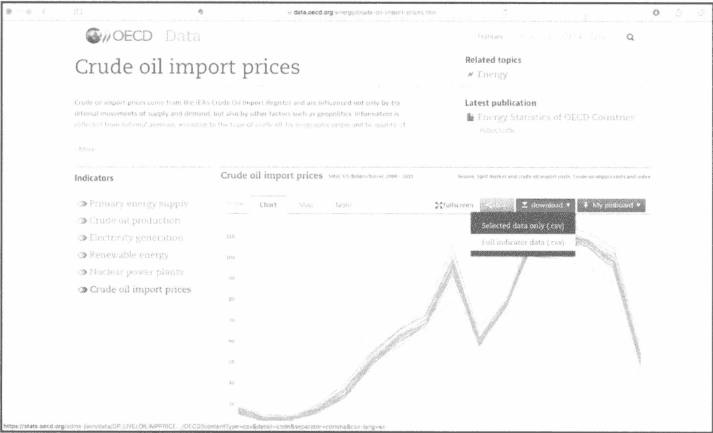

实际的 CSV 文件可在 `https://stats.oecd.org/sdmx-json/data/DP_LIVE/.OILIMPPRICE.../OECD?contentType=csv&detail=code&separator=comma&csv-lang=en` 获取。

由于我们将在 Hive 中加载数据，因此最好通过 Cloudera Quickstart CDH 环境中的终端将文件下载到主目录。我们将执行的步骤如下：

1. 将 CSV 文件下载到 CDH 环境中：

```text
[cloudera@quickstart ~]$ cd /home/cloudera;
[cloudera@quickstart ~]$
[cloudera@quickstart ~]$ wget -O oil.csv "https://stats.oecd.org/sdmx-json/data/DP_LIVE/.OILIMPPRICE.../OECD?contentType=csv&detail=code&separator=comma&csv-lang=en"
--2017-07-22 13:10:40-- https://stats.oecd.org/sdmx-json/data/DP_LIVE/.OILIMPPRICE.../OECD?contentType=csv&detail=code&separator=comma&csv-lang=en
Resolving stats.oecd.org... 78.41.128.136
Connecting to stats.oecd.org|78.41.128.136|:443... connected.
HTTP request sent, awaiting response... 200 OK
Length: unspecified [text/csv]
Saving to: "oil.csv"

[ <=> ] 988,528 329K/s in 2.9s

2017-07-22 13:10:44 (329 KB/s) - "oil.csv" saved [988528]
```

```text
# Download the csv file
cd /home/cloudera;
wget -O oil.csv "https://stats.oecd.org/sdmx-json/data/DP_LIVE/.OILIMPPRICE.../OECD?contentType=csv&detail=code&separator=comma&csv-lang=en"
```

2. 清理 CSV 文件。数据清洗是数据科学中核心重要的一环。实践中，接收到需要一定程度清洗的文件是很常见的。这是因为列中可能存在无效字符或值、缺失数据、缺失或额外的分隔符等。我们注意到各种值都被双引号 " 括起来。在 Hive 中，我们可以通过在创建表时指定 quoteChar 属性来忽略引号。由于 Linux 也提供了简单易用的方式来删除此类字符，我们使用 sed 删除了引号：

```shell
[cloudera@quickstart ~]$ sed -i 's/"//g' oil.csv
```

此外，在我们下载的文件 oil.csv 中，我们观察到存在可能导致问题的不可打印字符。我们通过执行以下命令将其删除：

```shell
[cloudera@quickstart ~]$ tr -cd '\11\12\15\40-\176' oil.csv > oil_clean.csv
```


(Source:
http://alvinalexander.com/blog/post/linux-unix/how-remove-non-prin
table-ascii-characters-file-unix)

最后，我们将新文件 (`oil_clean.csv`) 复制到 `oil.csv`。由于 `oil.csv` 文件已存在于同一文件夹中，我们被提示覆盖消息并输入 yes：

```
[cloudera@quickstart ~]$ mv oil_clean.csv oil.csv
mv: overwrite `oil.csv'? yes
```

## 3. 登录 Cloudera Hue：

在浏览器书签栏中点击 Hue。这将打开 Cloudera 登录屏幕。使用 ID `cloudera` 和密码 `cloudera` 登录：

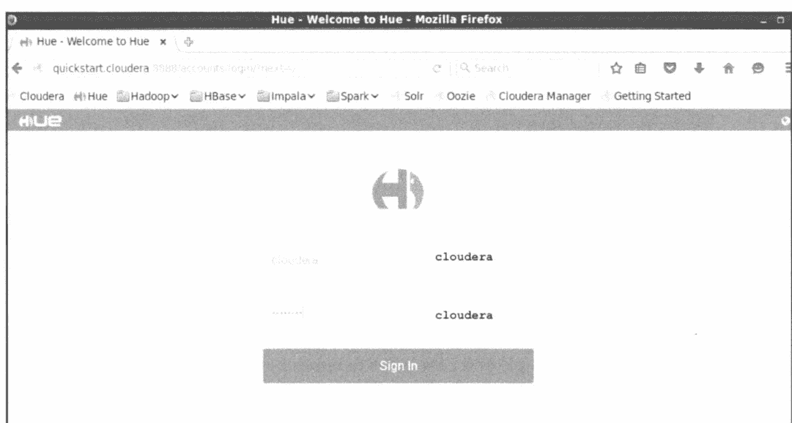

4. 在 Hue 登录窗口顶部 Quick Start 的下拉菜单中点击 Hue：

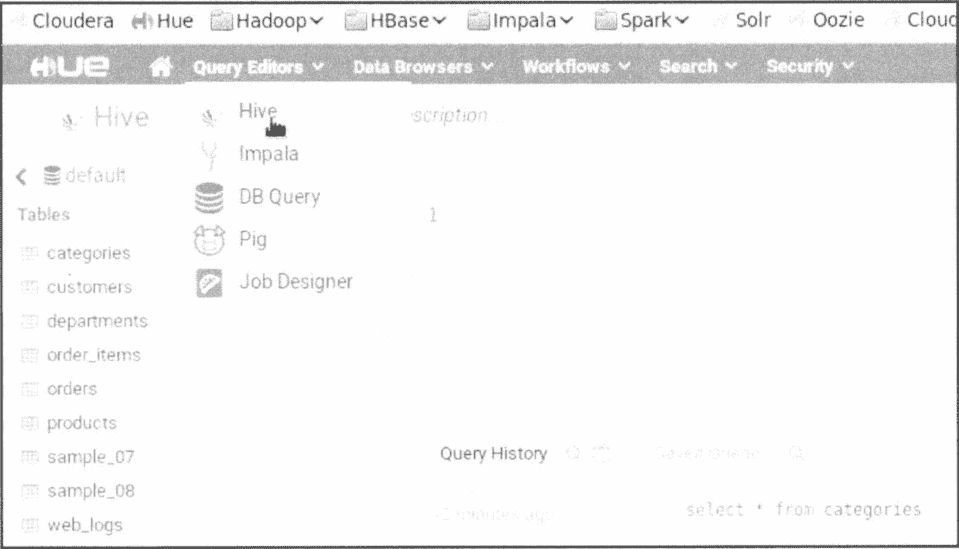

5. 创建表架构，加载 CSV 文件，`oil.csv`，并查看记录：

```
```sql
CREATE TABLE IF NOT EXISTS OIL
    (location String, indicator String, subject String, measure
String,
    frequency String, time String, value Float, flagCode String)
ROW FORMAT DELIMITED
FIELDS TERMINATED BY ','
LINES TERMINATED BY '\n'
STORED AS TEXTFILE
tblproperties("skip.header.line.count"="1");

LOAD DATA LOCAL INPATH '/home/cloudera/oil.csv' INTO TABLE OIL;
SELECT * FROM OIL;
```
```

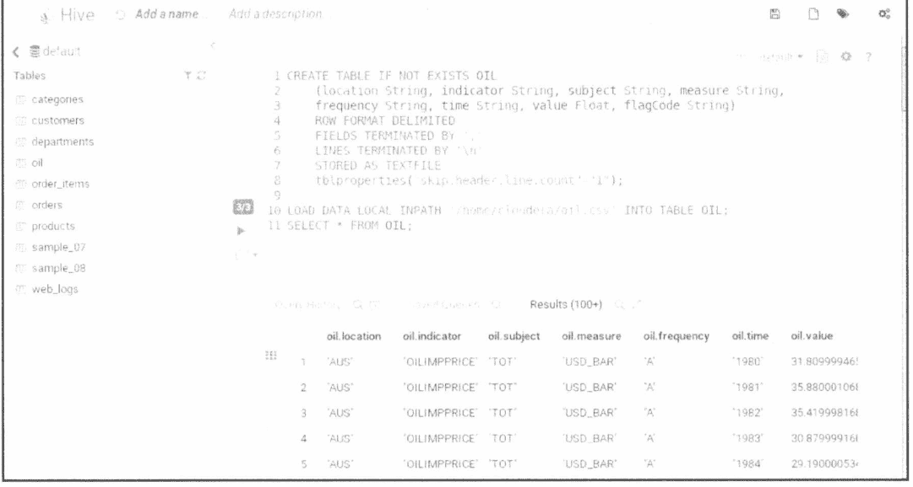

6. 加载油文件。

7. 现在表已加载到 Hive 中，你可以使用 HiveQL 运行各种 Hive 命令。完整的命令集可在 https://cwiki.apache.org/confluence/display/Hive/LanguageManual 获取。

例如，要查找 1980-2015 年（数据集的日期范围）每个国家石油价格的最大值、最小值和平均值，我们可以使用熟悉的 SQL 操作符。查询如下：

```
SELECT LOCATION, MIN(value) as MINPRICE, AVG(value) as AVGPRICE,
MAX(value) as MAXPRICE
FROM OIL
WHERE FREQUENCY LIKE "A"
GROUP BY LOCATION;
```

以下是同一内容的截图：

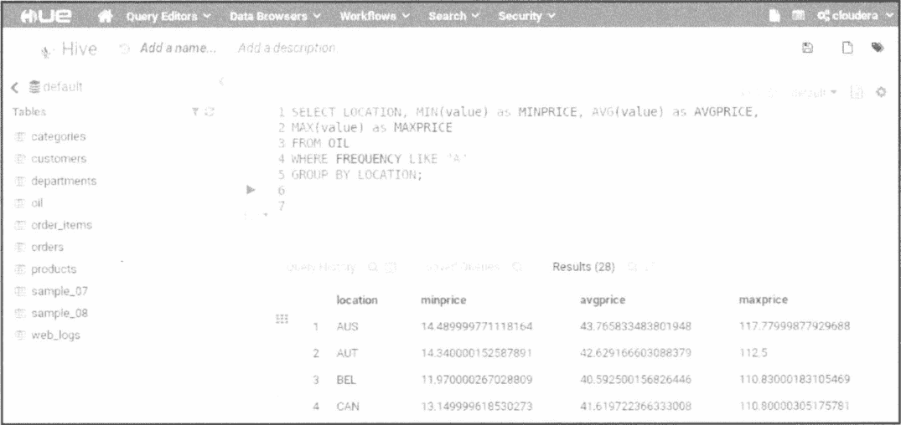

以类似的方式，我们可以使用一系列其他 SQL 命令。Hive 手册提供了对这些命令的深入介绍以及数据可以被保存、查询和检索的各种方式。

Hue 包含一组有用的功能，例如数据可视化、数据下载等，允许用户对数据进行临时分析。

要访问可视化功能，请点击结果部分网格图标下方的可视化图标，如以下截图所示：

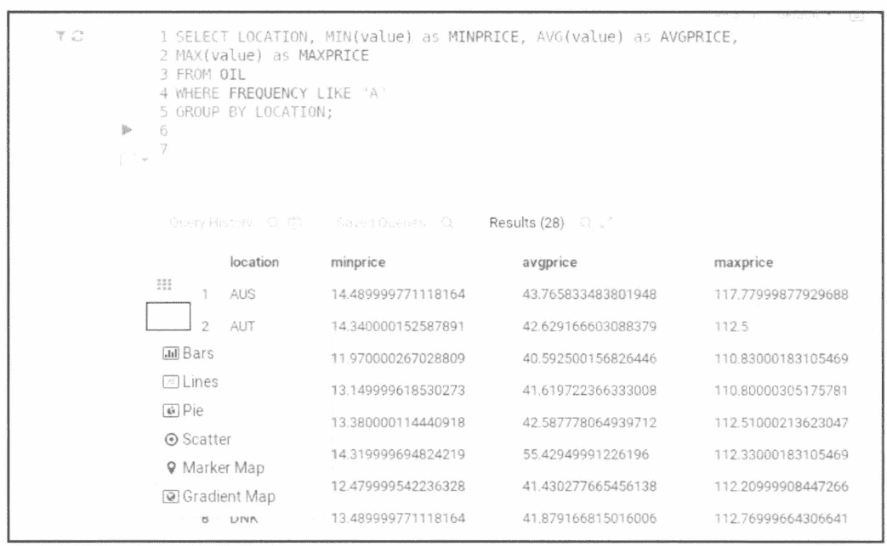

选择 Scatter。在 Hue 中，这种图表也更广义地称为散点图，允许用户非常轻松地创建多变量图表。可以选择 x 轴和 y 轴的不同值，以及散点大小和分组，如以下截图所示：

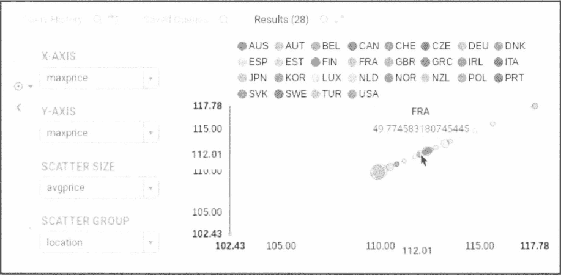

以下是一个简单的饼图，可以通过在下拉菜单中选择 Pie 构造而成：

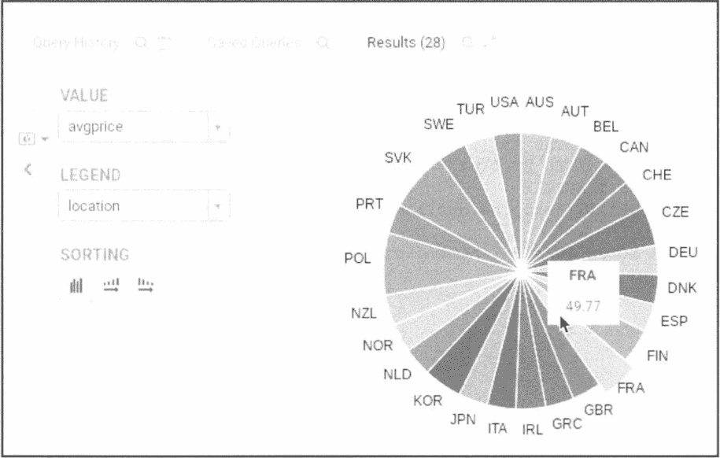

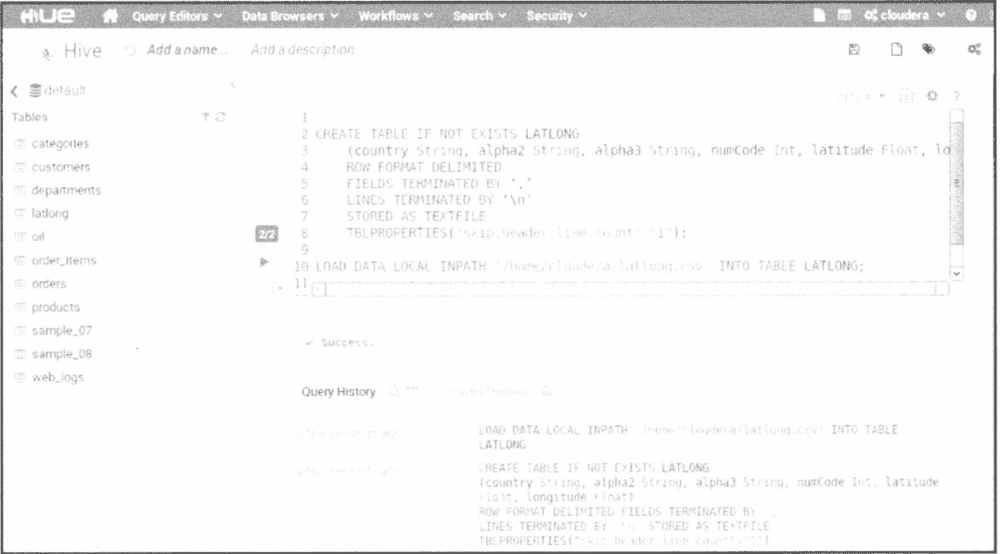

将油数据与经纬度数据连接：

```
```sql
SELECT DISTINCT * FROM
(SELECT location, avg(value) as AVGPRICE from oil GROUP BY location) x
LEFT JOIN
(SELECT TRIM(ALPHA3) AS alpha3, latitude, longitude from LATLONG) y
ON (x.location = y.alpha3);
```
```

从下拉菜单中选择 Gradient Map 并输入适当的值以创建图表，如下图所示：

```
SELECT DISTINCT x FROM
(SELECT location, avg(value) as AVGPRICE from oil GROUP BY location) x
LEFT JOIN
(SELECT TRIM(ALPHA3) AS alpha3, latitude, longitude from LATLONG) y
ON
(x.location = y.alpha3);
```

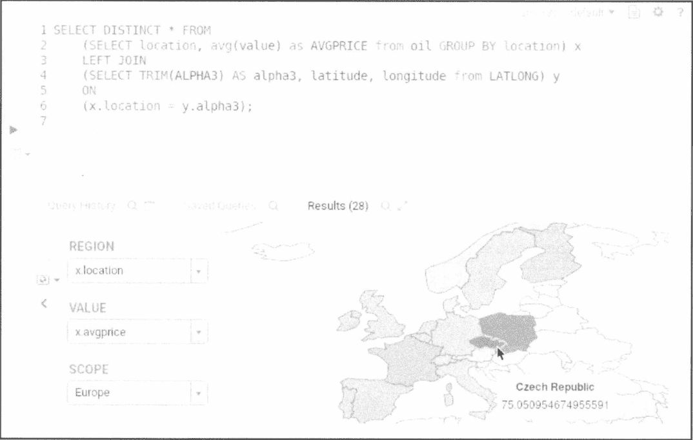

下一个图表是使用下拉菜单中的 Marker Map 选项开发的。它使用三字符国家代码，以便在相应区域放置标记和相关值，如下图所示：

```
1 SELECT DISTINCT * FROM
2   (SELECT location, avg(value) as AVGPRICE from oil GROUP BY location) x
3 LEFT JOIN
4   (SELECT TRIM(ALPHA3) AS alpha3, latitude, longitude from LATLONG) y
5 ON
6   (x.location = y.alpha3);
```

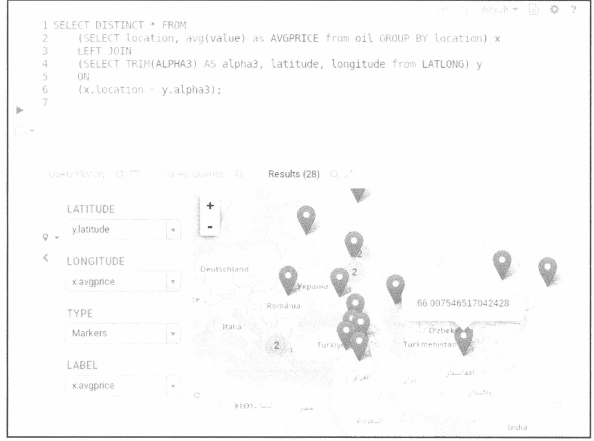

# Summary

本章提供了 Hadoop 的技术概述。我们讨论了 Hadoop 的核心组件和核心概念，例如 MapReduce 和 HDFS。我们还研究了使用 Hadoop 的技术挑战和注意事项。虽然在概念上看起来很简单，但 Hadoop 架构的内部工作原理和正式管理可能相当复杂。本章我们强调了其中一些内容。

我们以使用 Cloudera Distribution 在 Hadoop 上进行动手练习作为结尾。对于本教程，我们使用了之前从 Cloudera 网站下载的 CDH 虚拟机。

在下一章中，我们将研究 NoSQL，这是一种替代方案或取决于个人和/或组织需求的 Hadoop 的补充解决方案。虽然 Hadoop 提供了更丰富的特性集，但如果你的预期用例可以用简单的 NoSQL 解决方案完成，后者可能在所需工作量方面更容易选择。

# 5

# 使用 NoSQL 进行大数据挖掘

NoSQL 一词最早由 Carlo Strozzi 使用，他在 1998 年发布了 Strozzi NoSQL 开源关系数据库。在 2000 年代后期，数据库架构中出现了新的范式，其中许多都不遵守关系数据库系统所需的严格约束。这些数据库由于不符合 ACID 合规性等标准数据库惯例，很快被归为一个广义类别，称为 NoSQL。

每个 NoSQL 数据库都声称对某些用例最优。虽然很少有数据库符合通用数据库管理系统的要求，但它们在 NoSQL 系统的整个范围内都利用了一些共同主题。

在本章中，我们将介绍 NoSQL 数据库管理系统的一些广泛类别。我们将讨论引发迁移到 NoSQL 数据库系统的主要驱动因素，以及此类数据库如何解决特定的业务需求从而导致其广泛采用，并以几个动手 NoSQL 练习作为结尾。

本章涵盖的主题包括：

- 为什么是 NoSQL？
- NoSQL 数据库
- 内存数据库
- 列式数据库
- 文档型数据库
- 键值数据库
- 图数据库
- 其他 NoSQL 类型和总结
- NoSQL 系统动手练习

## 为什么是 NoSQL？

NoSQL 一词通常意味着 *Not Only SQL*：即底层数据库具有不同于常见和传统数据库系统的属性。因此，除了它们不提供 ACID 合规性的特性之外，没有明确的区分标准可以将数据库归类为 NoSQL。因此，有助于了解 ACID 属性的性质，这些属性多年来一直是数据库系统的支柱，以及简要讨论 BASE 和 CAP，这两个术语也是当今数据库的核心。

## ACID、BASE 和 CAP 属性

让我们先从 ACID 和 SQL 开始。

## ACID 和 SQL

ACID 代表原子性、一致性、隔离性和持久性：

- **Atomicity**：这表明数据库事务要么完全执行，要么根本不执行。换句话说，所有事务都应提交，即完整持久化，或者根本不提交。事务的部分执行没有余地。
- **Consistency**：数据上的约束，即确定数据库内数据管理的规则，将在整个数据库中保持一致。不同实例不会遵守与数据库其他实例不同的规则。
- **Isolation**：此属性定义并发操作（事务）如何读取和写入数据的规则。例如，如果某个记录正在更新而另一个进程读取同一记录，数据库系统的隔离级别将决定返回给用户的哪个版本的数据。
- **Durability**：数据库系统的持久性通常表示已提交的事务即使在系统故障的情况下也会保持持久。这通常通过数据库在恢复期间可以引用的事务日志来管理。


读者可能会注意到，这里定义的所有属性主要都与数据库事务相关。**事务**是遵循上述规则的操作单元，并对数据库进行更改。例如，从 ATM 取款的典型流程可能具有以下逻辑路径：

- 1. 用户从 ATM 取款
- 2. 银行检查用户的当前余额
- 3. 数据库系统从用户账户中扣除相应金额
- 4. 数据库系统更新用户账户中的金额以反映更改

因此，在 1990 年代中期之前广泛使用的大多数数据库，如 Oracle、Sybase、DB2 等，都针对记录和管理事务数据进行了优化。在此之前，大多数数据库负责管理事务数据。互联网在 90 年代中期迅速增长，导致出现不需要严格 ACID 合规要求的新类型数据。YouTube 上的视频、Pandora 上的音乐以及企业电子邮件记录都是使用案例的例子，在这些用例中，事务数据库除了作为存储数据的技术层之外并无额外价值。

## NoSQL 的 BASE 属性

到 2000 年代末，数据量激增，很明显需要一种新的替代模型来管理数据。这种新模型称为 BASE，取代 ACID 成为数据库管理系统首选模型的基础主题。

**BASE** 代表 **Basically Available Soft-state Eventually consistency**。这意味着数据库在大多数时间里*基本*可用；也就是说，可能存在服务不可用的时段，因此应实施额外的冗余措施。*Soft-state* 意味着系统状态无法得到保证——同一数据的不同实例可能具有不同的内容，因为它可能尚未捕获集群另一部分中的最新更新。最后，*eventually* 一致意味着尽管数据库可能并非始终处于相同状态，但最终会达到相同状态；即变得*一致*。

## 对 NoSQL 技术的需要

虽然大多数数据库系统最初设计用于管理事务，但与互联网相关技术的增长以及不需要事务系统严格纯粹性质的新类型数据的出现，促使开发替代框架变得必要。

例如，存储以下类型的数据不一定需要复杂的事务数据库：

- 电子邮件
- 媒体，如音视频文件
- 社交网络消息
- 网站 HTML 页面
- 其他许多

此外，用户数量的增加，以及由此导致的数据量增加，表明需要开发具有以下特征的更强大的架构：

- 可扩展以管理不断增加的数据量
- 利用商品硬件以减少对昂贵硬件的依赖
- 提供跨多个节点的分布式处理能力以处理大规模数据集
- 容错/提供高可用性以处理节点和站点故障

可扩展意味着系统可以通过增加节点数量，即通过水平扩展来适应数据量的增加。此外，增加节点数量对系统性能的影响应最小。

容错意味着系统应能够处理节点故障，这在拥有数百甚至数千个节点的大型分布式系统中并不罕见。

这导致了各种开创性和有影响力的系统的开发，其中最值得注意的是 Google Bigtable 和 Amazon Dynamo。

## Google Bigtable

Bigtable 是在 2004 年启动的一个项目，用于管理 Google 各类项目所使用数据的可扩展性和性能。描述该系统特征的开创性论文于 2006 年发布（https://static.googleusercontent.com/media/research.google.com/en//archive/bigtable-osdi06.pdf），标题为 *Bigtable: A Distributed Storage System for Structured Data*。本质上，Bigtable 是一个*列存储*，每个值都可以使用行键、列键和时间戳唯一标识。它是第一个体现以列格式存储数据而非更常见的基于行的布局优势的主流数据库之一。尽管 kdb+ 和 Sybase IQ 等列式数据库在 Bigtable 之前就已存在，但行业领导者使用该方法管理 PB 级信息使这一概念进入了聚光灯下。

Bigtable 的官方网站总结了其关键价值主张：

> *Bigtable is designed to handle massive workloads at consistent low latency and high throughput, so it’s a great choice for both operational and analytical applications, including IoT, user analytics, and financial data analysis.*

自 Bigtable 推出以来，几种其他 NoSQL 数据库采用了列式数据布局的惯例；最值得注意的是 HBase 和 Accumulo，它们都是 Apache 项目。

Bigtable 解决方案今天可在 https://cloud.google.com/bigtable/ 上使用，可按订阅方式购买。小量数据的费用相当低廉且合理，而大型安装则需要更广泛的实现。

## Amazon Dynamo

在 Google 宣布 Bigtable 后不久，亚马逊在 2007 年 10 月举行的第 21 届 ACM 操作系统原理研讨会上宣布了其内部 Dynamo 数据库（http://www.sosp2007.org）。

在该论文中，现在可在 Werner Vogels 的网站 http://www.allthingsdistributed.com/files/amazon-dynamo-sosp2007.pdf 上获得，亚马逊描述了一种名为 Dynamo 的键值存储，用于为亚马逊的一些最关键的内部服务提供支持，例如 AWS 上的 S3。该论文提出了一些关键概念，如键值存储、一致性哈希和向量时钟等，这些概念已在 Dynamo 中实现。

因此，Dynamo 通过引入一种根本不同的方法，利用键值关联，为 Bigtable 的列式存储提供了大规模数据集的替代方案。

在接下来的几节中，我们将讨论各种类型的 NoSQL 技术以及它们各自的特性如何使它们最适合某些用例。NoSQL 引发了我们对待数据库的范式转变，并为以前不可行的规模下的数据管理提供了一种非常需要的替代观点。

## NoSQL 数据库

在我们讨论 NoSQL 类型和数据库时，我们将主要关注 NoSQL 数据库的以下特征：

- 内存数据库
- 列式数据库
- 文档型数据库
- 键值数据库
- 图数据库
- 其他 NoSQL 类型和总结

今天行业中使用的大多数 NoSQL 类型都属于这些类别之一或多个。接下来的几节将讨论这些 NoSQL 产品的每个的高级属性、其主要优势以及属于相应类别的市场产品。

## 内存数据库

内存数据库顾名思义，利用计算机内存；即 RAM 来存储数据集。在我们研究内存数据库的工作原理之前，回顾一下典型计算机中数据传输的方式会很有价值：

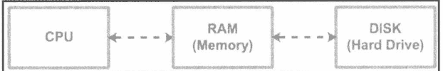

因此，像 Redis 这样的内存数据库开始取代 memcached 作为驱动网站的快速缓存存储。在 Redis 的情况下，尽管数据以键值对的形式保存在内存中，但有将数据持久化到磁盘的选项。这使其与仅为内存缓存的解决方案如 memcached 区分开来。

转向内存数据库的主要驱动因素可总结如下：

- 传统方式，例如 MySQL + memcached 组合管理不断增加的数据量（如网络流量）的复杂性
- RAM 成本降低，使得购买更大容量更经济实惠
- 整个行业对 NoSQL 技术的推动，导致社区参与度提高，更加关注新颖创新数据库平台的开发
- 内存中更快的数据操作提供了一种手段，在需要超快、低延迟数据处理的情况下减少 I/O 开销

今天，行业中提供内存功能的领先数据库选项包括：

| 开源 | 商用 |
|---|---|
| Redis | Kdb+ |
| memcacheDB | Oracle TimesTen |
| Aerospike | SAP HANA |
| VoltDB | HP Vertica |
| Apache Ignite | Altibase |
| Apache Geode | Oracle Exalytics |
| MonetDB | MemSQL |

> 请注意，其中一些支持混合架构，其中数据可以驻留在内存中也可以驻留在磁盘上。通常，数据会从内存传输到磁盘以实现持久化。此外，请注意一些商用内存数据库提供可下载并在各自解决方案许可条款允许范围内免费使用的社区版。在这些情况下，它们既是开源的也是商用的。


# 列式数据库

列式数据库自90年代就已存在，但如前所述，直到谷歌Bigtable发布后才崭露头角。本质上，它是一种数据存储方法，与基于行/元组的存储相比，能够快速高效地查询海量数据。

列式数据库的优势，更具体地说，将每一列数据独立存储的优势，可以通过一个简单的例子来说明。

假设有一张包含1亿户家庭地址和电话号码的表。再假设一个简单查询：用户需要找出纽约州奥尔巴尼市1990年后建造的家庭数量。我们将创建一个假设的表，以说明逐行查询与逐列查询数据的差异。

## 硬件特性：

平均磁盘读取速度：每秒200 MB

## 数据库特性：

表名：housedb

- 总行数 = 1亿
- 州为NY的总行数 = 200万
- 州为NY且城市为Albany的总行数 = 10,000
- 州为NY、城市为Albany且YearBuilt > 1990的总行数 = 500

## 数据大小：

假设每行各数据的大小如下：

- PlotNumber、YearBuilt 各 = 8字节，共16字节
- Owner、Address、State和City 各 = 12字节，共48字节
- 每行净大小（字节）= 16 + 48 = 64字节

请注意，实际大小会更高，因为还有其他因素，如索引、其他表优化及相关开销，为简化起见，这里不予考虑。

我们还将假设列式数据库维护一个隐式行索引，允许在每个列向量的特定索引处查询数据。

下表显示了前4条记录：

| PlotNumber | Owner | Address | State | City | YearBuilt |
|------------|-------|---------|-------|------|-----------|
| 1 | John | 1 Main St. | WA | Seattle | 1995 |
| 2 | Mary | 20 J. Ave. | NY | Albany | 1980 |
| 3 | Jane | 5 45th St. | NY | Rye Brook | 2001 |
| 4 | John | 10 A. Blvd. | CT | Stamford | 2010 |

该表总共有1亿条记录。最后几条记录如下所示：

| PlotNumber | Owner | Address | State | City | YearBuilt |
|------------|-------|---------|-------|------|-----------|
| 99999997 | Jim | 23 B. Lane | NC | Cary | 1995 |
| 99999998 | Mike | 5 L. Street | NY | Syracuse | 1993 |
| 99999999 | Tim | 10 A. Blvd. | NY | Albany | 2001 |
| 100000000 | Jack | 10 A. Blvd. | CT | Stamford | 2010 |

我们将针对此数据集运行的查询如下：

```
select * from housedb where State like 'NY' and City like 'Albany' and YearBuilt > 1990
```

## 场景A：逐行搜索

在第一种场景中，如果我们进行简单的逐行搜索，由于每列的数据并非单独存储，而是逐行扫描数据，我们需要查询的数据量为：

1亿 * 64字节（每行大小）= 64亿字节 ≈ 6000 MB数据

假设磁盘读取速度为200 MBps，这意味着读取所有记录以查找匹配条目大约需要6000 / 200 = 30秒。

## 场景B：逐列搜索

假设每列数据分别存放在各自对应的文件中，我们将逐个查看每个where子句：

```
select * from housedb where State like 'NY' and City like 'Albany' and YearBuilt > 1990
```

1. Where子句第1部分：where State like 'NY'

如前所述，State列有1亿个条目，每个条目大小为12字节。

在这种情况下，我们只需搜索：

1亿 * 12字节 = 12亿字节 = 1000 MB数据。

以200 MBps的数据读取速率计算，读取该列数据需要1000 / 200 = 5秒。

这将返回200万条记录（如前文数据库特性所述）。

2. Where子句第2部分：City like 'Albany'

在上一步中，我们已将搜索范围缩小到满足州为NY条件的200万条记录。在第二个where子句步骤中，我们无需再查询全部1亿条记录。相反，我们只需查看满足条件的200万条记录，以确定哪些属于Albany市。

在这种情况下，我们只需搜索：

200万 * 12字节 = 2400万字节 ≈ 20 MB数据。

以200 MBps的数据读取速率计算，这需要0.1秒。

这将返回10,000条记录（如前文数据库特性所述）。

### 3. Where子句第3部分：YearBuilt > 1990

在上一步中，我们进一步将搜索范围缩小到同时满足州为NY和城市为Albany条件的10,000条记录。在这一步中，我们将查询YearBuilt列中的10,000条记录，以找出满足YearBuilt > 1990条件的记录。

在这种情况下，我们只需搜索：

10,000 * 16字节 = 160,000字节 ≈ 150 KB数据。

以200 MBps的数据读取速率计算，这需要0.00075秒，可以近似为零秒。

因此，查询数据所花费的净时间为：

- Where子句第1部分：where State like 'NY' - 5秒
- Where子句第2部分：City like 'Albany' - 0.1秒
- Where子句第3部分：YearBuilt > 1990 - 0秒

读取数据的净时间 = 5.1秒。


重要提示：请注意，实际读取（更具体地说是扫描）性能取决于各种其他因素。元组（行）的大小、重建元组所需的时间（元组重建）、内存带宽（数据从主内存读入CPU的速度等）、缓存行大小等因素都会产生影响。在实践中，由于存在各种抽象层次，实际性能可能会更慢。此外，还有其他考虑因素，如硬件架构和并行操作，它们可能对整体性能产生积极或消极的影响。这些主题更为高级，需要专门阅读。这里的分析仅聚焦于磁盘I/O，这是高层级整体性能的关键方面之一。

前面的示例从数据大小的角度展示了查询按列存储的数据在查询性能或效率方面的优势。列式数据还提供了另一个好处，即允许存储可能具有任意模式（schema）的表。

考虑前面表的前四行。例如，如果某些行缺少信息，就会导致稀疏列：

| PlotNumber | Owner | Address | State | City | YearBuilt |
|---|---|---|---|---|---|
| 1 | John | 1 Main St. | NULL | Seattle | 1995 |
| 2 | Mary | 20 J. Ave. | NY | NULL | NULL |
| 3 | Jane | NULL | NY | Rye Brook | NULL |
| 4 | John | 10 A. Blvd. | CT | NULL | NULL |

与其填充NULL值，我们可以创建一个名为`Complete_Address`的`列族`，它可以包含任意数量的键值对，仅对应那些有数据的字段：

| PlotNumber | Owner | Complete_Address |  | YearBuilt |
|---|---|---|---|---|
| 1 | John | Address: 1 Main St. | City: Seattle | 1995 |
| 2 | Mary | Address: 20 J. Ave. | State: NY | NULL |
| 3 | Jane | State: NY | City: Rye Brook | NULL |
| 4 | John | Address: 10 A. Blvd. | State: CT | NULL |

列式数据库提供的第三个且非常重要的好处是能够基于三个键检索数据：行键、列键和时间戳，它们唯一标识每条记录，从而允许非常快速地访问相关数据。

例如，由于房产（PlotNumber）出售时Owner字段可能会更改，我们可以添加另一个字段来表示记录的日期；即该记录对应的日期。这将使我们能够区分所有权发生变更而其他所有数据保持不变的房产：

| PlotNumber | Owner | Address | State | City | YearBuilt | RecordDate |
|---|---|---|---|---|---|---|
| 1 | John | 1 Main St. | WA | Seattle | 1995 | 2001.04.02 |
| 2 | Mary | 20 J. Ave. | NY | Albany | 1980 | 2007.05.30 |
| 3 | Jane | 5 45th St. | NY | Rye Brook | 2001 | 2001.10.24 |
| 4 | John | 10 A. Blvd. | CT | Stamford | 2010 | 2003.07.20 |


由于每个 PlotNumber 可能有多个记录以适应所有权的变更，我们现在可以定义三个键，它们可以唯一标识每条记录中的每个数据单元格，如下所示：

- 行键：`PlotNumber`
- 列键：列名
- 时间戳键：`RecordDate`

因此，表中每条记录中的每个单元格都会有一个唯一的三值组合，使其与其他单元格区分开来。

诸如 Bigtable、Cassandra 等数据库采用这种方法，以快速高效地执行大规模数据分析。

下面列出了一些流行的列式数据库。请注意，由于数据库可能具有多种 NoSQL 属性（例如同时具有内存和列式属性），因此可能会出现重复：

| 开源 | 商业 |
|---|---|
| Apache Parquet | Kdb+ |
| MonetDB | Teradata |
| MariaDB | SAP HANA |
| Druid | HP Vertica |
| HBase | Oracle Exadata |
| Apache Kudu | ParAccel |
| Apache Arrow | Actian Vector |

## 文档型数据库

**基于文档或面向文档的**数据库作为存储可变结构数据的一种手段而变得突出；也就是说，不存在每条记录始终适合的固定模式。此外，文档可能同时具有结构化部分和*非结构化*部分。

结构化数据本质上是可以以表格格式存储的数据，例如电子表格。存储在 Excel 电子表格或 MySQL 表中的数据都属于结构化数据集。无法以严格的表格格式表示的数据，如书籍、音频文件、视频文件或社交网络消息，被视为非结构化数据。因此，在文档型数据库中，我们主要处理结构化和非结构化的文本数据。

关于既包含结构化文本又包含非结构化文本的数据，可以通过**电话日记**的例子得到直观的解释。尽管随着数字数据存储的发展，这类日记已越来越少见，但许多人都会记得那个把电话号码写在口袋本里的时代。下图展示了我们如何在电话日记中存储数据：


在上述示例中，以下字段可以被视为结构化字段：

- 姓名
- 地址
- 电话和传真

在地址字段下方有一行，用户可以在其中输入任意信息，例如**2015 年开会时认识，在 abc 公司工作**。这基本上是日记记录者在录入具体信息时写下的备注。由于这种自由格式字段没有明确的特征，它也可能包含第二个电话号码、替代地址等信息。这属于非结构化文本。

此外，由于其他字段不是相互依赖的，用户可能只写地址而不写电话号码，或者只写姓名和电话号码而不写地址。

文档型数据库凭借其存储无模式数据的能力，即数据不遵循任何固定模式（例如具有固定数据类型的固定列），因此是存储此类信息的合适平台。

由于电话日记的数据量要小得多，在实践中，我们可以用其他格式存储它，但当处理包含结构化和非结构化信息的大规模数据时，文档型数据集的重要性就变得明显了。

以电话日记为例，数据可以 JSON 格式存储在文档型数据集中，如下所示：

```
(
  {
    "name": "John",
    "address": "1 Main St.",
    "notes": "Met at conference in 2015",
    "tel": 2013249978,
  },
  {
    "name": "Jack",
    "address": "20 J. Blvd",
    "notes": "Gym Instructor",
    "tel": 2054584538,
    "fax": 3482274573
  }
)
```

JSON，全称是 JavaScript Object Notation（JavaScript 对象表示法），提供了一种以可移植的、基于文本的键值对格式来表示数据的方法。如今，JSON 数据在行业中无处不在，并已成为存储不具固定模式数据的标准。它也是交换结构化数据的绝佳媒介，因此经常用于此类数据集。

前面的示例提供了一个基本例子来说明文档型数据库的工作原理。因此，这是一个非常简单且希望直观的示例。在实践中，MongoDB 和 CouchDB 等文档型数据库被用于存储 GB 和 TB 级别的信息。

例如，考虑一个存储用户及其电影偏好数据的网站。每个用户可能有多部电影，他们观看过、评分过、推荐过，添加到心愿单中的电影，以及其他类似的项目。在这种情况下，数据集中存在各种任意元素，其中许多是可选的，许多可能包含多个值（例如，用户推荐的多部电影），采用 JSON 格式来捕获信息就变得最为理想。这正是文档型数据库提供卓越且最优平台来存储和交换数据的地方。

更具体地说，MongoDB 等数据库以 BSON 格式存储信息——BSON 是 JSON 文档的二进制版本，经过额外优化以适应数据类型、Unicode 字符以及其他特性，从而提升基础 JSON 文档的性能。

一个存储在 MongoDB 中的更全面的 JSON 文档示例可能是关于航空公司乘客的数据，其中包含针对每位乘客的众多属性信息，例如：

```
{
  "_id" : ObjectId("597cdbb193acc5c362e7ae96"),
  "firstName" : "Rick",
  "age" : 66,
  "frequentFlyer" : (
    "Delta"
  ),
  "milesEarned" : (
    88154
  )
}
{
  "_id" : ObjectId("597cdbb193acc5c362e7ae97"),
  "firstName" : "Nina",
  "age" : 53,
  "frequentFlyer" : (
    "Delta",
    "JetBlue",
    "Delta"
  ),
  "milesEarned" : (
    59226,
    62025,
    27493
  )
}
```

每个条目都由 _id 字段唯一标识，这使我们能够直接查询与特定用户相关的信息，而无需在数百万条记录中进行查询。

如今，文档型数据库被用于存储各种各样的数据集。例如包括以下用途：

- 日志文件及与日志文件相关的信息
- 文章和其他基于文本的已发布材料
- 地理位置数据
- 用户/用户账户相关信息
- 更多适合基于文档/JSON 存储的用例

知名的文档型数据库包括以下这些：

| 开源 | 商业 |
|---|---|
| MongoDB | Azure Cosmos DB |
| CouchDB | OrientDB |
| Couchbase Server | Marklogic |

## 键值数据库

键值数据库的工作原理是将数据组织为与键相对应的值对。为了突出键值数据库的优点，有必要重新审视哈希映射的重要性。哈希映射是计算机科学中普遍使用的一个术语，指的是一种独特的数据结构，能够为键对提供恒定时间的查找。

哈希表的一个直观示例如下：

考虑一个有 500 本书和五个书柜的集合。每个书柜有五层书架。书可以任意顺序放置，但这会使得找到特定书籍变得极其困难，你可能需要翻阅数百本书才能找到所需的那一本。一种对书籍进行分类的方法是为每个书架分配字母范围，例如 A-E、F-J、K-O、P-T、U-Z，并使用书名首字母将其分配到特定书架。然而，假设以 A-E 开头的书籍数量不成比例地多。这意味着分配给 A-E 的书柜相对于其他书柜将拥有多得多的书籍。

一种更优雅的替代方案是为每本书分配一个值，并使用相应的值来确定该书属于哪个书柜或书架。为了给每本书分配一个数字（即一个特定值），我们可以使用 1-26 分别对应 A-Z，将书名的每个字母所对应的数字相加：

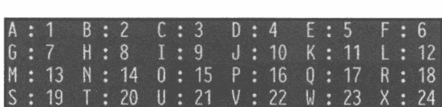


既然我们有五个书柜，每个书柜有五层书架，那么总共就有25层书架。一种将书分配到特定书架的方法，是取书名中所有字母数值之和，再将该值除以26。任何数字除以25，余数都在0到25之间；也就是说，有26种不同的值。我们可以利用这个值将书分配到特定的书架上。这便成了我们自己创建的哈希函数。

在这25层书架中，每一层现在都被赋予一个与0到25分别对应的数值，最后一层书架则对应24和25两个值。例如，0号书架用于存放其数值除以26余数为0的书籍，1号书架用于存放其数值除以26余数为1的书籍，而25号书架用于存放其数值除以26余数为24或25的书籍。

用一个例子可以更具体地说明这一概念。

书名：**哈姆雷特（HAMLET）**

书名的数值：

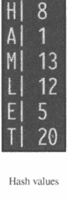

数值总和 = 8 + 1 + 13 + 12 + 5 + 20 = 59

将该数除以26 = 商2，余数7

因此，这本书被分配到7号书架。

我们实质上找到了一种有条理地为每本书分配书架的方法，而且由于我们有了固定的规则，当新的取书请求到来时，我们几乎可以立即找到这本书，因为我们知道该书对应的书架。

上述方法展示了哈希的概念。在实际应用中，我们会使用一个能为每本书找到唯一值的哈希函数，并且假设我们能够拥有任意数量的书架和可放置书籍的槽位，那么我们只需使用书籍的纯数值来确定它属于哪个书架。

在某些情况下，两本书会有相同的数值，这时我们可以将书叠放在该数值对应的槽位中。在计算机科学中，多个值对应同一个键的现象被称为冲突（碰撞），在这种情况下，我们会通过列表或类似的数据类型来分配多个条目。

在真实应用场景中，我们要处理的对象远比简单的书籍示例复杂。通常，我们会使用更复杂的哈希函数来降低冲突概率，并据此分配键值对。数据会以连续数组的形式存储在内存中，因此，当某个键的请求到达时，我们可以通过哈希函数立即找到数据所在的内存位置，从而瞬间获取对应的值。

因此，使用键值对存储数据可以非常强大，因为检索与键对应的信息的速度非常快，无需遍历长长的列表来查找匹配的键。

键值数据库采用相同的原理，为每条记录分配唯一键，每个键对应的数据存储在相应位置。在我们讨论MongoDB时，我们看到记录会被分配一个由每条记录中的`_id`值标识的特定键。在实践中，我们可以使用这个值在常数时间内检索到相应的数据。

如前所述，对于需要极快访问常用数据的Web服务，memcached曾是首选的键值对数据存储方法。本质上，它充当了存储临时信息的内存缓存。随着NoSQL数据库的出现，那些扩展了memcached有限应用场景的新平台逐渐崛起。像Redis这样的解决方案不仅能够在内存中以键值对形式存储数据，还支持将数据持久化到磁盘。此外，这些键值存储支持水平扩展，允许将键值对分布到数百个节点上。

键值存储的缺点在于，其数据查询灵活性不如支持多级索引和更丰富SQL命令集的标准数据库。尽管如此，常数时间查找的优势意味着，在需要键值结构的应用场景中，很少有其他解决方案能在性能和效率上与之匹敌。例如，一个拥有数千用户的购物网站可以将用户画像信息存储在键值数据库中，只需应用一个对应于用户ID的哈希函数，就能快速查找个人资料。

如今，键值数据库使用多种方法来存储数据：

- **SSTable**：一种以字符串形式表示的排序键值对文件（直接映射到**谷歌文件系统（GFS）**）。
- **B树**：一种平衡树，通过遍历叶子/节点来识别值。
- **布隆过滤器**：一种在键数量较多时更优的键值方法。它使用多个哈希函数将数组中对应键的位值设为1。
- **分片**：一种将数据分区到多个节点的过程。

知名的键值数据库包括：

| 开源 | 商业 |
|---|---|
| Redis | Amazon DynamoDB |
| Cassandra | Riak |
| Aerospike | Oracle NoSQL |
| Apache Ignite | Azure Cosmos DB |
| Apache Accumulo | Oracle Berkeley DB |

## 图数据库

**图数据库**能够高效地表示记录之间具有相互关联的数据。典型的例子包括你的社交网络好友列表、LinkedIn联系人、Netflix影片订阅者。通过利用针对树状/图状数据结构优化的搜索算法，图数据库能够以相对于其他NoSQL解决方案新颖的方式定位信息。在这种结构中，离散的信息和属性被表示为叶子、边和节点。

下图展示了一种典型的网络表示形式，可以使用图数据库进行查询，以发现或找到复杂的相互关系。在实际应用中，生产级图数据库包含数百万个节点：

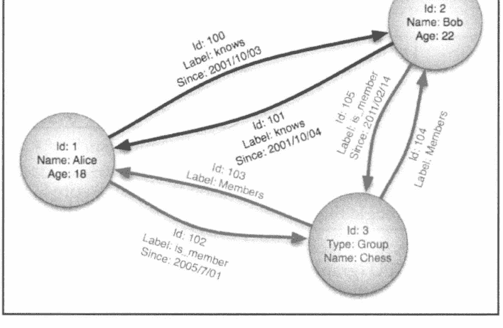

图数据库

虽然图数据库不如其他类型的NoSQL数据库普及，但基于图的平台已被用于关键业务领域。例如，信用卡公司通过图数据库查询数百万个数据点，评估具有相似消费模式的其他持卡人的购买行为，从而发现某个持卡人可能感兴趣的新产品。社交网站则使用图数据库计算相似度得分、提供好友推荐以及其他相关指标。

知名的图数据库包括：

| 开源 | 商业 |
|---|---|
| Apache Giraph | Datastax Enterprise Graph |
| Neo4j | Teradata Aster |
| JanusGraph | Oracle Spatial and Graph |
| Apache Ignite | |

## 其他NoSQL类型及其他数据库类型总结

本节介绍了一些当今常用的NoSQL范式。还有其他一些新兴平台，各有其优势和独特特征。下面简要介绍其中几种：

| 类型 | 特征 |
|---|---|
| 面向对象数据库 | 利用面向对象编程中的概念，将数据表示为对象进行存储的数据库。 |
| 云数据库 | 由亚马逊、微软和谷歌等云厂商提供的数据库，仅在其各自的云平台上可用，如Amazon Redshift、Azure SQL Database和Google BigQuery。 |
| GPU数据库 | 数据库领域较新的参与者，利用GPU（图形处理单元）显卡来处理数据。例如MapD、Kinetica等。 |
| FPGA加速数据库 | 随着英特尔即将发布嵌入FPGA的新芯片，百度等公司已开始开发FPGA加速系统，利用FPGA处理能力来提升SQL查询性能。 |
| 流处理/物联网数据库 | 针对处理流式数据（如来自医疗设备和传感器的数据）进行优化的数据库，或更一般地说是平台。这类系统最著名的例子之一是Apache Storm。 |

人们经常问的一个问题是，是否存在一种对所有应用场景都最优的NoSQL数据库。虽然数据库可能具备支持NoSQL系统多种要素的多种功能（通常称为多模式数据库），但在实践中，能够在一系列广泛的应用场景中普遍表现优异的单一解决方案是很少见的。在真实的用例中，公司通常会部署多种解决方案来满足数据挖掘需求。在下一节中，我们将使用本章讨论的NoSQL解决方案，对真实世界的数据集完成一些动手练习。


## 使用 MongoDB 分析诺贝尔奖得主数据

在第一个练习中，我们将使用 MongoDB（领先的面向文档的数据库之一）来分析 1902 年至今的诺贝尔奖得主。MongoDB 提供了一种简单直观的界面来处理 JSON 文件。如前所述，JSON 是一种灵活的格式，允许使用结构化方法来表示数据。

### JSON 格式

考虑以下表格：

| 名字 | 年龄 | 信息 |
|-----------|-----|-------------|
| John      | 15  | 科目：历史，等级 B |
| Jack      | 18  | 科目：物理，等级 A |
| Jill      | 17  | 科目：物理，等级 A+ |

“信息”字段包含一列在“科目”和“等级”下分类的多个值。包含多个数据的此类列也称为嵌套数据列。

可移植性一直是数据从一个系统传输到另一个系统的重要方面。通常，ODBC 连接器用于在数据库系统之间传输数据。另一种常见的格式是 CSV 文件，其中数据以逗号分隔值表示。CSV 文件适用于不包含嵌套值等更复杂数据结构的结构化数据。在这种情况下，JSON 提供了一种使用键值对语法捕获和保存信息的最优且结构化方式。

在 JSON 表示中，该表可以定义如下：

```json
[
  {
    "Firstname":"John",
    "Age":15,
    "Information":{
      "Subject":"History",
      "Grade":"B"
    }
  },
  {
    "Firstname":"Jack",
    "Age":18,
    "Information":{
      "Subject":"Physics",
      "Grade":"A"
    }
  },
  {
    "Firstname":"Jill",
    "Age":17,
    "Information":{
      "Subject":"Physics",
      "Grade":"A+"
    }
  }
]
```

请注意，`Information` 键包含两个键：`Subject` 和 `Grade`，每个键都有对应的值。

如今，大多数产品开发人员和供应商都支持接收 JSON 格式的数据。此外，由于复杂关系可以以文本格式简单表达并进行交换，JSON 在全球开发者社区中变得非常流行。

MongoDB 以 JSON 格式捕获数据。它在内部以 BSON（JSON 数据的优化二进制表示）存储这些数据。

### 安装和使用 MongoDB

MongoDB 支持所有主要平台，如 Windows、Linux 和 OS X 平台。


MongoDB 的安装详细信息可在其官方网站 `https://docs.mongodb.com/manual/installation/` 上找到。请注意，我们将使用 MongoDB Community Edition。

对于我们的练习，我们将复用 Cloudera Hadoop 分发版虚拟机中的 Linux CentOS 环境。但该练习并不依赖于你安装 MongoDB 的平台。安装完成后，你可以在任何其他受支持的平台上执行本章中的命令。如果你可以访问单独的 Linux 机器，你也可以使用它。

我们将了解 MongoDB 的一些常见语义，并下载两个数据集来计算按大洲分组的最高诺贝尔奖数量。诺贝奖得主的完整数据转储可从 nobelprize.org 获取。数据包含获奖者的所有主要属性。我们希望将这些数据与相应国家的人口统计信息相结合，以提取更多有趣的分析信息：

- 1. **下载 MongoDB**：MongoDB 可从 https://www.mongodb.com/download-center#community 下载。

为了确定适用版本，我们检查了 CDH 虚拟机上安装的 Linux 版本：

```text
(cloudera@quickstart ~)$ lsb_release -a
LSB Version:     :base-4.0-amd64:base-4.0-noarch:core-4.0-amd64:core-4.0-noarch
Distributor ID:  CentOS
Description:     CentOS release 6.7 (Final)
Release:  6.7
Codename: Final
```

- 2. 根据该信息，我们必须使用 CentOS 版本的 MongoDB，并按照 https://docs.mongodb.com/manual/tutorial/install-mongodb-on-red-hat/ 上的说明安装软件，如下所示：

第一步是添加仓库，如下所示。在命令行中输入 `sudo nano /etc/yum.repos.d/mongodb-org-3.4.repo` 并输入所示的文本。

```text
(root@quickstart cloudera)# sudo nano /etc/yum.repos.d/mongodb-org-3.4.repo
```

输入如下信息并按 CTRL-X。当提示保存缓冲区时，输入 yes。

```text
(mongodb-org-3.4)
name=MongoDB Repository
baseurl=https://repo.mongodb.org/yum/redhat/$releasever/mongodb-org/3.4/x86_64/
gpgcheck=1
enabled=1
gpgkey=https://www.mongodb.org/static/pgp/server-3.4.asc
```

以下截图显示了文件的内容：

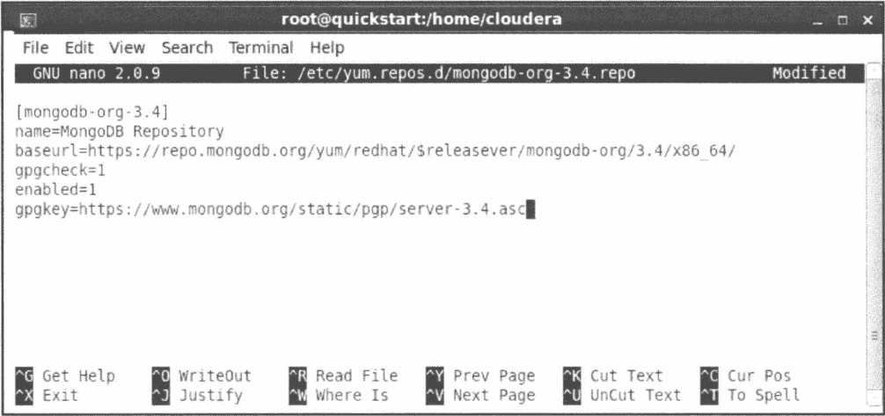

如下截图所示，输入 Y 表示是：


按如下图像所示保存文件。现在这将允许我们安装 MongoDB：


```shell
# 回到终端，输入以下内容

(cloudera@quickstart ~)$ sudo yum install -y mongodb-org
```

```text
(...)

正在安装:
  mongodb-org              x86_64      3.4.6-1.el6
  mongodb-org-3.4          5.8 k
正在为依赖安装:
  mongodb-org-mongos       x86_64      3.4.6-1.el6
  mongodb-org-3.4          12 M
  mongodb-org-server       x86_64      3.4.6-1.el6
  mongodb-org-3.4          20 M
  mongodb-org-shell        x86_64      3.4.6-1.el6
  mongodb-org-3.4          11 M
  mongodb-org-tools        x86_64      3.4.6-1.el6
  mongodb-org-3.4          49 M

事务概要
================================================================================
安装  5 个软件包

总下载大小：91 M
安装后大小：258 M
正在下载软件包：
(1/5): mongodb-org-3.4.6-1.el6.x86_64.rpm
| 5.8 kB    00:00
(...)

已安装:
  mongodb-org.x86_64 0:3.4.6-1.el6

已安装依赖:
  mongodb-org-mongos.x86_64 0:3.4.6-1.el6        mongodb-org-server.x86_64 0:3.4.6-1.el6
  mongodb-org-shell.x86_64 0:3.4.6-1.el6          mongodb-org-tools.x86_64 0:3.4.6-1.el6

完成！
```

在未先启动守护进程的情况下尝试启动 mongo 会产生错误消息。你需要先启动 mongo 守护进程才能使用它。

```text
(cloudera@quickstart ~)$ mongo
MongoDB shell version v3.4.6
connecting to: mongodb://127.0.0.1:27017
2017-07-30T10:50:58.708-0700 W NETWORK  (thread1) Failed to connect to 127.0.0.1:27017, in(checking socket for error after poll),
reason: Connection refused
2017-07-30T10:50:58.708-0700 E QUERY      (thread1) Error: couldn't connect to server 127.0.0.1:27017, connection attempt failed : connect@src/mongo/shell/mongo.js:237:13
@(connect):1:6
exception: connect failed
```

第一步是创建 MongoDB 的 dbpath——这是 MongoDB 将存储所有数据的地方。创建一个名为 mongodata 的文件夹，这将作为 mongo 的 dbpath。

```text
(cloudera@quickstart ~)$ mkdir mongodata
```

启动 mongod。

```text
(cloudera@quickstart ~)$ mongod --dbpath mongodata
2017-07-30T10:52:17.200-0700 I CONTROL   (initandlisten) MongoDB starting : pid=16093 port=27017 dbpath=mongodata 64-bit host=quickstart.cloudera
(...)
2017-07-30T10:52:17.321-0700 I INDEX     (initandlisten) build index done.  scanned 0 total records. 0 secs
2017-07-30T10:52:17.321-0700 I COMMAND   (initandlisten) setting featureCompatibilityVersion to 3.4
2017-07-30T10:52:17.321-0700 I NETWORK   (thread1) waiting for connections on port 27017
```

打开一个新终端并按以下截图所示下载 JSON 数据文件：

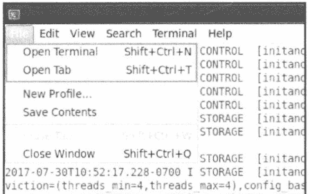

在 Mac OS X 的终端应用程序中选择“打开终端”

```text
# 下载文件
# laureates.json 和 country.json

# 更改目录到之前创建的 mongodata 文件夹
(cloudera@quickstart ~)$ cd mongodata

(cloudera@quickstart mongodata)$ curl -o laureates.json "http://api.nobelprize.org/v1/laureate.json"
% Total    % Received % Xferd  Average Speed   Time     Time     Time
Current                                 Dload  Upload   Total   Spent    Left
Speed
100 428k    0 428k    0     0  292k      0 --:--:--  0:00:01 --:--:--
354k
```

清理 laureates.json 文件。删除文件第一行中第一个 `{` 之前的内容。删除文件中的最后一个 `}` 字符。将清理后的数据集存储在一个名为 laureates.json 的文件中。

请注意，该文件需要稍微修改。代码如下图所示：

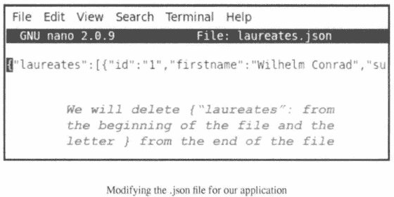

```text
(cloudera@quickstart mongodata)$ cat laureates.json | sed 's/^{"laureates"://g' | sed 's/}$//g' > mongofile.json
```

将 laureates.json 文件导入 MongoDB。mongoimport 是一个用于将数据导入 MongoDB 的实用程序。下面的命令将把 mongofile.json 文件中的数据导入到名为 nobel 的数据库中的一个名为 laureates 的集合（即表）中。

```text
(cloudera@quickstart mongodata)$ mongoimport --jsonArray --db nobel --collection laureates --file mongofile.json
2017-07-30T11:06:35.228-0700    connected to: localhost
2017-07-30T11:06:35.295-0700    imported 910 documents
```


为了将 laureate.json 中的数据与国家特定信息结合，我们需要从 geonames.org 下载 countryInfo.txt 我们现在将下载练习所需的第二个文件 country.json。我们将在练习中使用 laureates.json 和 country.json。

### country.json: 从 http://www.geonames.org 下载（许可：https://creativecommons.org/licenses/by/3.0/）。修改 JSON 字符串的开始和结束以导入 MongoDB，如下所示：

```
# The file country.json contains descriptive information about all countries
# We will use this file for our tutorial
```

### 下载 country.json

```
(cloudera@quickstart mongodata)$ curl -o country.json "https://raw.githubusercontent.com/xbsd/packtbigdata/master/country.json"
% Total    % Received % Xferd  Average Speed   Time    Time     Time
Current
                           Dload  Upload   Total   Spent    Left
Speed
100 113k 100 113k    0     0  360k      0 --:--:-- --:--:-- --:--:--
885k
```

### 文件 country.json 已清理完毕，可直接导入 MongoDB

```
(cloudera@quickstart mongodata)$ mongoimport --jsonArray --db nobel --collection country --file country.json
2017-07-30T12:10:35.554-0700    connected to: localhost
2017-07-30T12:10:35.580-0700    imported 250 documents
```

### MONGO SHELL ###

```
(cloudera@quickstart mongodata)$ mongo
MongoDB shell version v3.4.6
connecting to: mongodb://127.0.0.1:27017
MongoDB server version: 3.4.6
Server has startup warnings:
(...)

2017-07-30T10:52:17.298-0700 I CONTROL  (initandlisten)
```

### 使用 'use <databasename>' 命令切换到数据库 nobel

```
> use nobel
switched to db nobel
```

### 显示所有集合（即表）

```
"born" : "1845-03-27",
"died" : "1923-02-10",
"bornCountry" : "Prussia (now Germany)",
"bornCountryCode" : "DE",
"bornCity" : "Lennep (now Remscheid)",
"diedCountry" : "Germany",
"diedCountryCode" : "DE",
"diedCity" : "Munich",
"gender" : "male",
"prizes" : (
    {
        "year" : "1901",
        "category" : "physics",
        "share" : "1",
        "motivation" : "\"in recognition of the extraordinary services he has rendered by the discovery of the remarkable rays subsequently named after him\"",
        "affiliations" : (
            {
                "name" : "Munich University",
                "city" : "Munich",
                "country" : "Germany"
            }
        )
    }
)
}

### 查看 laureates 的所有记录
> db.laureates.find()

{ "_id" : ObjectId("597e202bcd8724f48de485d4"), "id" : "1", "firstname" : "Wilhelm Conrad", "surname" : "Röntgen", "born" : "1845-03-27", "died" : "1923-02-10", "bornCountry" : "Prussia (now Germany)", "bornCountryCode" : "DE", "bornCity" : "Lennep (now Remscheid)" 
(...)
...

### MongoDB 函数接受 JSON 格式的字符串作为选项参数
### 下面显示了一些示例供参考
### 查询字段 - 查找所有为男性的诺贝尔奖获得者
> db.laureates.find({"gender":"male"})

(...)
{ "_id" : ObjectId("597e202bcd8724f48de485d5"), "id" : "2", "firstname" : "Hendrik Antoon", "surname" : "Lorentz", "born" : "1853-07-18", "died" :

```
"1928-02-04", "bornCountry" : "the Netherlands", "bornCountryCode" : "NL", "bornCity" : "Arnhem", "diedCountry" : "the Netherlands", "diedCountryCode" : "NL", "gender" : "male", "prizes" : ( { "year" : "1902", "category" : "physics", "share" : "2", "motivation" : "\"in recognition of the extraordinary service they rendered by their researches into the influence of magnetism upon radiation phenomena\"", "affiliations" : ( { "name" : "Leiden University", "city" : "Leiden", "country" : "the Netherlands" } ) } ) }
(... )
```

查询字段 - 查找所有出生于美国并获得诺贝尔物理学奖的诺贝尔奖获得者。注意这里我们有一个嵌套字段（category 在 prizes 下显示）。因此，我们将使用点表示法，如下图所示。

说明 category 的图像，该 category 是嵌套字段之一：

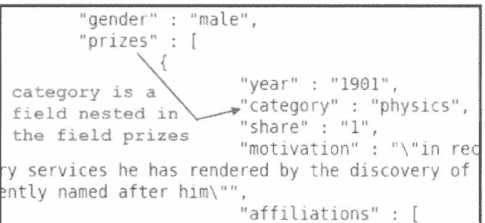

嵌套 JSON 字段

```
> db.laureates.find({"bornCountryCode":"US", "prizes.category":"physics", "bornCity": /Chicago/})
```

```
{ "_id" : ObjectId("597e202bcd8724f48de48638"), "id" : "103", "firstname" : "Ben Roy", "surname" : "Mottelson", "born" : "1926-07-09", "died" : "0000-00-00", "bornCountry" : "USA", "bornCountryCode" : "US", "bornCity" : "Chicago, IL", ...
```

```
### 使用 distinct 检查不同奖项类别的数量
> db.laureates.distinct("prizes.category")
```

+   "physics",
+   "chemistry",
+   "peace",
+   "medicine",
+   "literature",
+   "economics"

### https://docs.mongodb.com/manual/aggregation/

# ### 聚合示例

# ### 按年份统计并汇总诺贝尔奖获得者总数并按降序排序

### 步骤 1：使用 `$group` 操作符指示 prize.year 将为分组变量
### 步骤 2：使用 `$sum` 操作符（累加器）对名为 totalPrizes 的变量下的每个条目求和
### 步骤 3：使用 `$sort` 操作符对 totalPrizes 进行排序

```
```javascript
> db.laureates.aggregate(
  {$group: {_id: '$prizes.year', totalPrizes: {$sum: 1}}},
  {$sort: {totalPrizes: -1}}
);

{ "_id" : ( "2001" ), "totalPrizes" : 15 }
{ "_id" : ( "2014" ), "totalPrizes" : 13 }
{ "_id" : ( "2002" ), "totalPrizes" : 13 }
{ "_id" : ( "2000" ), "totalPrizes" : 13 }

(...)
```
```

# ### 按出生国家统计并汇总总奖项数

```
```javascript
> db.laureates.aggregate(
  {$group: {_id: '$bornCountry', totalPrizes: {$sum: 1}}},
  {$sort: {totalPrizes: -1}}
);

{ "_id" : "USA", "totalPrizes" : 257 }
{ "_id" : "United Kingdom", "totalPrizes" : 84 }
{ "_id" : "Germany", "totalPrizes" : 61 }
{ "_id" : "France", "totalPrizes" : 51 }
...
```
```

### MongoDB 还支持 PCRE（Perl 兼容）正则表达式
### 有关更多信息，请参阅
https://docs.mongodb.com/manual/reference/operator/query/regex

# ### 使用正则表达式：按出生国家查找诺贝尔奖获得者数量，其奖项与 'radiation' 相关（在 prizes 下的 motivation 字段中表示）

```
```javascript
> db.laureates.aggregate(
  {$match : { "prizes.motivation" : /radiation/ }},
  {$group: {_id: '$bornCountry', totalPrizes: {$sum: 1}}},
  {$sort: {totalPrizes: -1}}
```
```

```
);

{ "_id" : "USA", "totalPrizes" : 4 }
{ "_id" : "Germany", "totalPrizes" : 2 }
{ "_id" : "the Netherlands", "totalPrizes" : 2 }
{ "_id" : "United Kingdom", "totalPrizes" : 2 }
{ "_id" : "France", "totalPrizes" : 1 }
{ "_id" : "Prussia (now Russia)", "totalPrizes" : 1 }
```

#### 结果：我们看到提及 radiation 作为关键词的奖项中，数量最多的国家是美国

### 有趣的是，我们还可以执行连接和其他类似操作，从而将数据与其他数据源结合

### 在这种情况下，我们希望将 laureates 中的数据与之前获得的国家信息数据连接

### collection country 包含许多有趣的字段，但对于本练习，我们将展示如何按大洲查找诺贝尔奖获得者总数

### 左连接

### 步骤 1：使用 $lookup 操作符定义 from/to 字段、集合名称并将数据分配给名为 countryInfo 的字段

### 我们可以将 laureates 中的 bornCountryCode 字段与 collection country 中的 countryCode 字段连接

```
> db.laureates.aggregate(
  {$lookup: { from: "country", localField: "bornCountryCode", foreignField: "countryCode", as: "countryInfo" }})
```

```
{ "_id" : ObjectId("597e202bcd8724f48de485d4"), "id" : "1", "firstname" : "Wilhelm Conrad", "surname" : "Röntgen", "born" : "1845-03-27", "died" : "1923-02-10", "bornCountry" : "Prussia (now Germany)", "bornCountryCode" : "DE", "bornCity" : "Lennep ( (..) "country" : "Germany" } ) } ),
"countryInfo" : ( { "_id" : ObjectId("597e2f2bcd8724f48de489aa"),
"continent" : "EU", "capital" : "Berlin", "languages" : "de", "geonameId" : 2921044, "south" : 47.2701236047002, ...
```

### 数据连接后，我们现在可以执行组合聚合

### 按大洲查找诺贝尔奖获得者数量

```
> db.laureates.aggregate(
  {$lookup: { from: "country", localField: "bornCountryCode", foreignField: "countryCode", as: "countryInfo" }},
  {$group: {_id: '$countryInfo.continent', totalPrizes: {$sum: 1}}},
  {$sort: {totalPrizes: -1}}
```


);

... );
{ "_id" : ( "EU" ), "totalPrizes" : 478 }
{ "_id" : ( "NA" ), "totalPrizes" : 285 }
{ "_id" : ( "AS" ), "totalPrizes" : 67 }
...
这表明欧洲拥有最多的诺贝尔奖获得者。

还可以执行许多其他操作，但前一节的目的是以一个简单的用例为示例，在高层次上介绍 MongoDB。本章中提供的 URL 包含有关使用 MongoDB 的更深入信息。

行业中还有几种可视化工具，可用于通过点按界面与存储在 MongoDB 集合中的数据进行交互并可视化数据。名为 MongoDB Compass 的简单而强大的工具可在 https://www.mongodb.com/download-center?filter=enterprise?jmp=nav#compass 获取。

导航到前面提到的 URL 并下载适合您环境的 Compass 版本：

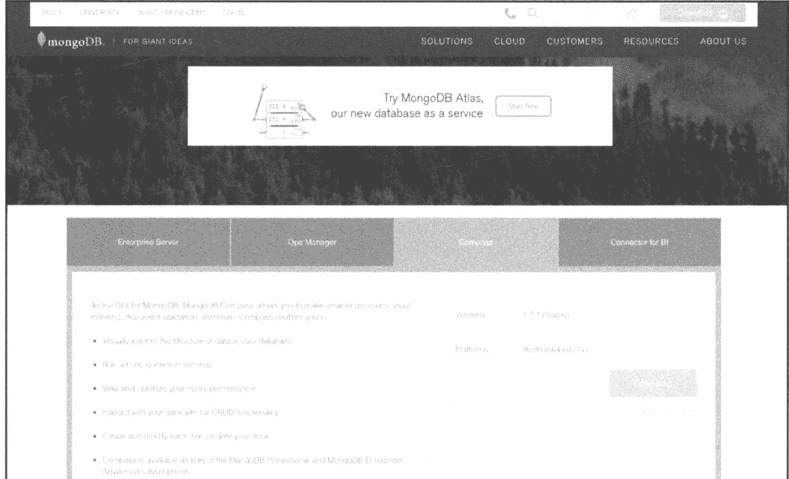

下载 MongoDB Compass

安装后，您会看到欢迎屏幕。单击 **Next** 直到看到主仪表板：

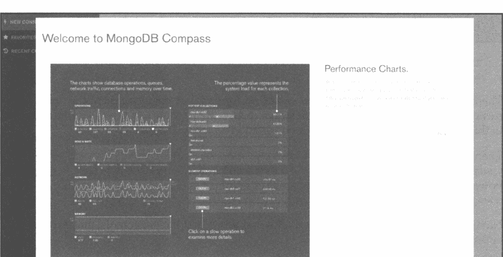

MongoDB Compass 截图

单击 **Performance** 查看 MongoDB 的当前状态：

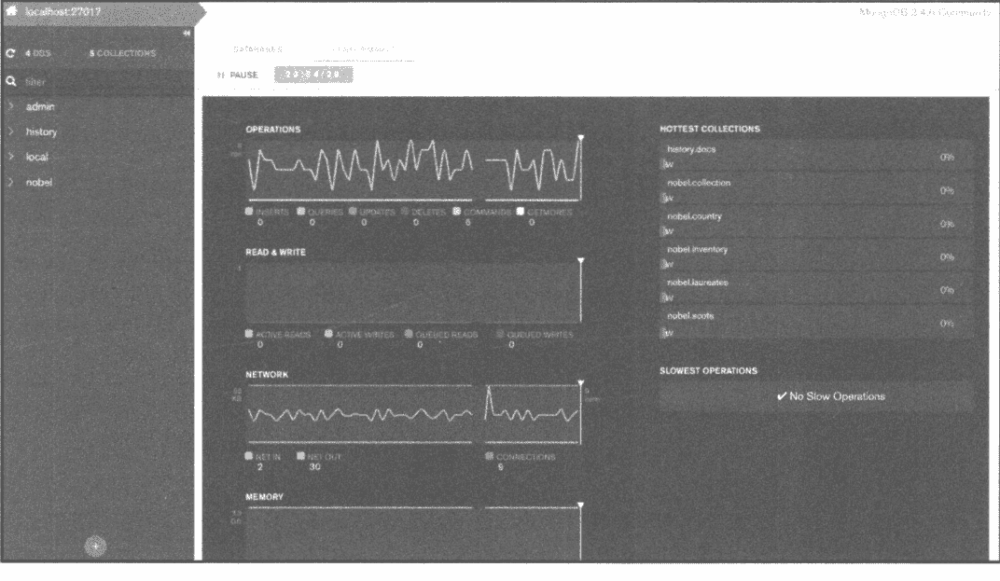

MongoDB 性能屏幕

通过单击左侧边栏中单词旁边的箭头展开 nobel 数据库。您可以单击并拖动条形图的各个部分并运行临时查询。如果您想在不必手动运行所有查询的情况下对数据集有一个整体的了解，这非常有用，如以下屏幕截图所示：


在 MongoDB Compass 中查看我们的文件

## 使用真实世界数据追踪医生付款

医生和医院一样，会从各种外部组织获得付款，例如制药公司，他们聘请销售代表不仅向从业者介绍其产品，还提供礼物或实物付款或其他形式的付款。理论上，给予医生的礼物或付款并不 intended to 影响其处方行为，制药公司会采取谨慎措施来保持对向医疗服务提供者付款的监督和制衡。

## 安装 kdb+

**kdb+** 是一种时序、内存型、列式数据库，已在金融行业使用了近 20 年。它是用于执行大规模数据挖掘的最快的数据库平台之一，但由于其在大部分存在时间内几乎完全被对冲基金和投资银行使用，因此不如其他 NoSQL 工具知名。特别是由于其处理海量数据的速度快且开销低，它被用于从事高频交易的算法交易台。

使用 kdb+，在笔记本电脑上分析数千万甚至数亿条记录相当简单。主要限制在于硬件层面，例如可用于处理数据的内存、磁盘空间和 CPU 量。在本教程中，我们将安装可供非商业用途使用的免费 32 位版 kdb+。

kdb+ 不是开源的，但学术机构可以通过写信至 academic@kx.com 免费使用 64 位许可证。

kdb+ 具有某些关键特性，使其非常适合大规模数据分析：

- **低级实现：** 数据库用 C 编写，从而减少了大多数当代 NoSQL 数据库常见的性能问题原因，这些数据库严重依赖 Java，而 Java 实现了多层抽象以提供处理能力
- **架构简洁：** kdb+ 数据库的整个二进制文件约为 500–600 KB。这是 MP3 歌曲大小的一小部分，即使在拨号连接上也可以轻松下载
- **MapReduce：** 数据库实现了内部 MapReduce 过程，允许查询同时在多个核心上执行
- **无需安装：** 数据库不需要系统级权限，用户可以在大多数系统上使用其用户帐户开始使用 kdb+
- **企业就绪：** 该数据库已使用近 20 年，是一款非常成熟的产品，已在全球企业环境中用于高频交易数据分析等应用
- **接口广泛可用：** 数据库为 C、C++、C#、Java、R、Python、MATLAB 等语言提供广泛的接口，以便与现有软件轻松集成

安装 kdb+ 的步骤如下。请注意，如果您使用的是 Packt Data Science VM，则无需额外安装。这些说明主要为希望重新安装软件的用户提供。

尽管说明针对 Linux，但 Windows 和 Mac 的安装过程也相当简单。此处的说明面向 Packt Data Science VM。下载 Packt Data Science VM 的说明已在第 3 章《The Analytics Toolkit》中提供

- 1. 访问 www.kx.com 并单击 Connect with us 菜单项中的 Download 下拉选项。您也可以直接前往位于 https://kx.com/download/ 的下载页面：


Kx Systems 首页

下载页面如下图所示：


下载 KDB+

- 2. 在下一页单击 Download。
- 3. 您将被带到 https://kx.com/download/，在同意条款后您可以选择相应的下载。如果您使用的是 VM，请下载 Linux-86 版本。
- 4. 选择 Save File 将下载的 ZIP 文件保存在您的 Downloads 文件夹中：

## DOWNLOAD KDB+

kx it's about time

No Fee, Non-Commercial Use, 32 Bit Kdb+ Software License Agreement (rev. 13 Sep 2015) CAREFULLY READ THE FOLLOWING TERMS AND CONDITIONS. BY DOWNLOADING THE 32 BIT KDB+ SOFTWARE, YOU ARE AGREEING TO BE BOUND BY THESE TERMS AND CONDITIONS. IF YOU DO NOT AGREE TO THESE TERMS AND CONDITIONS, DO NOT DOWNLOAD THE SOFTWARE. This No Fee, Non-Commercial Use, 32 Bit Kdb+ Software License Agreement ("Agreement") is made between Kx

Email Address

(Enter your email address here)

I agree to the terms of the license agreement for the free version of kdb+ (which is 32-bit vs. 64-bit for the commercial version)

I would like to receive the Quarterly Kx Newsletter

Windows Linux-x86 Linux-ARM OSX

No, thanks. Take me to the Kx Systems Homepage

KDB+ 32-bit license terms

转到文件下载的文件夹并将 ZIP 文件复制到您的主目录下：


KDB+ Zip 文件下载

## 安装 R

应用程序的前端将使用 R 开发。完成本教程有三种安装 R 的选项：

- 1. 如果您已在第 3 章《The Analytics Toolkit》中安装了 Microsoft R，并且将使用本地机器进行本教程，则无需进一步安装。
- 2. 或者，如果您将使用 Packt Data Science Virtualbox VM，则无需进一步安装。
- 3. 如果您计划从官方 R 网站安装 R，二进制文件可以从 https://cran.r-project.org/mirrors.html 列出的任何下载站点（镜像）下载：

> The Comprehensive R Archive Network
> 
> Download and Install R
> 
> Precompiled binary distributions of the base system and contributed packages, Windows and Mac users most likely want one of these versions of R:
> 
> - Download R for Linux
> - Download R for (Mac) OS X
> - Download R for Windows
> 
> R is part of many Linux distributions, you should check with your Linux package management system in addition to the link above.

安装开源 R

## 安装 RStudio

我们将使用 RStudio 来构建我们的基于 Web 的应用程序。您可以从网站下载 RStudio 的二进制文件或从终端安装它。RStudio 有两个版本 - RStudio Desktop 和 RStudio Server。两个版本都可用于构建应用程序。Server 版本提供可供多用户使用的界面，而 Desktop 版本通常在用户本地机器上使用。


说明也出现在第 3 章《The Analytics Toolkit》中。这里提供以供参考。


完成 R 教程的安装有两种方法：

- 1. 如果您将使用 Packt 数据科学虚拟机，则无需进行任何进一步的安装。
- 2. 如果您将使用本地机器进行教程，您可以从 https://www.rstudio.com/products/rstudio/download/#download 下载 RStudio Desktop 或从 https://www.rstudio.com/products/rstudio/download-server/ 下载 RStudio Server（仅限 Linux 用户）。

以下说明是为希望从厂商网站下载 RStudio 并进行全新安装的用户提供的：

访问 https://www.rstudio.com 网站并点击 Products | RStudio：


在 RStudio 页面上，点击 **Download RStudio Desktop**：


选择 RStudio Desktop

选择 RStudio Desktop 的免费版本：


选择开源 R Studio Desktop

RStudio 可用于 Windows、Mac 和 Linux。

下载适用于您系统的适当可执行文件并继续进行安装：


## CMS Open Payments 门户

在本节中，我们将开始为 CMS Open Payments 开发我们的应用程序。

Packt 数据科学虚拟机包含本教程所需的所有软件。要下载虚拟机，请参阅 *第 3 章，分析工具包*。

### 下载 CMS Open Payments 数据

CMS Open Payments 数据可直接从 CMS 网站作为基于网络的下载获得。我们将使用 Unix wget 实用程序下载数据，但在首先，我们必须在 CMS 网站上注册以获取自己的 API 密钥：

- 1. 访问 https://openpaymentsdata.cms.gov 并点击页面右上角的 Sign In 链接：


CMS OpenPayments 首页

点击 **Sign Up**：

Sign-Up Page on CMS OpenPayments

输入您的信息并点击 **Create My Account** 按钮：

Search Tool  
Summary Data  
Data Explorer  
Download Data  
Open Payments Home  

We're glad you want to join OpenPaymentsData.CMS.gov

### Create a new Socrata ID.

Use your Email and Password to sign in to all Socrata powered sites.

Email Address *  
Please enter a valid email address.  

ENTER YOUR EMAIL ADDRESS HERE  

Display Name *  

Packt Developer  

Password * Restrictions apply  

********  

Confirm Password *  

********  

I'm not a robot  

By clicking on 'Create My Account' below, you are agreeing to our Terms of Service and Privacy Policy.  

Create My Account  

Sign-Up Form for CMS OpenPayments

### Sign In to your account:


Signing into CMS OpenPayments

点击 **Packt Developer's Applications** 下的 **Manage**。注意，此处的 Applications 指的是您可能创建的将查询 CMS 网站上可用数据的应用程序：


Creating 'Applications'

为应用程序分配一个名称（以下图像中显示了示例）：


Defining an application

您将收到一个通知，表明 Application Token 已创建：


Creating the Application Token

系统将生成一个 App Token。复制 App Token：


The Application Token

- 2. 现在，以用户 packt 登录 Packt 数据科学虚拟机并执行以下 shell 命令，将术语 YOURAPPTOKEN 替换为您分配的令牌（它将是一长串字符/数字）。请注意，对于本教程，我们将只下载其中的几列数据，并将数据限制为仅医生（另一个选项是医院）。

您可以通过将命令末尾指定的 limit 值降低到更低的数字来减少下载的数据量。在命令中，我们使用了 12000000（1200 万），这将使我们能够下载整个 2016 年数据集，表示医生付款。即使例如您只下载一百万条记录而不是大约 1100-1200 万条记录，应用程序仍然可以工作。

注意：下面显示了两种方法。一种使用令牌，另一种不使用令牌。应用程序令牌允许用户具有更高的节流限制。更多信息可在 https://dev.socrata.com/docs/app-tokens.html 找到

```
# Replace YOURAPPTOKEN and 12000000 with your API Key and desired record limit respectively

cd /home/packt;

time wget -O cms2016.csv 'https://openpaymentsdata.cms.gov/resource/vq63-hu5i.csv?$app_token=YOURAPPTOKEN&$query=select Physician_First_Name as firstName,Physician_Last_Name as lastName,Recipient_City as city,Recipient_State as state,Submitting_Applicable_Manufacturer_or_Applicable_GPO_Name as company,Total_Amount_of_Payment_USDollars as payment,Date_of_Payment as date,Nature_of_Payment_or_Transfer_of_Value as paymentNature,Product_Category_or_Therapeutic_Area_1 as category,Name_of_Drug_or_Biological_or_Device_or_Medical_Supply_1 as product where covered_recipient_type like "Covered Recipient Physician" limit 12000000'
```

重要提示：也可以不使用应用令牌下载文件。但是，该方法应谨慎使用。不使用应用程序令牌下载文件的 URL 如下所示：

```
# Downloading without using APP TOKEN

wget -O cms2016.csv 'https://openpaymentsdata.cms.gov/resource/vq63-hu5i.csv?$query=select Physician_First_Name as firstName,Physician_Last_Name as lastName,Recipient_City as city,Recipient_State as state,Submitting_Applicable_Manufacturer_or_Applicable_GPO_Name as company,Total_Amount_of_Payment_USDollars as payment,Date_of_Payment as date,Nature_of_Payment_or_Transfer_of_Value as paymentNature,Product_Category_or_Therapeutic_Area_1 as category,Name_of_Drug_or_Biological_or_Device_or_Medical_Supply_1 as product where covered_recipient_type like "Covered Recipient Physician" limit 12000000'
```

### 在 Q 控制台中输入以下内容。

每个命令的解释已在注释中提供（使用 /）：

```q
/change to the home directory for user packt
\cd /home/packt/
```

```q
/Define the schema of the cms table
d:(`category`city`company`date`firstName`lastName`payment`paymentNature`product`state)!"SSSZSSFSSS";
```

```q
/Read the headers from the cms csv file. These will be our table column names.

columns:system "head -1 cms2016.csv";
columns:`$"," vs ssr(raze columns;"\\";"");
```

```q
/Run Garbage Collection
.Q.gc();
```

```q
/Load the cms csv file
\ts cms2016:(d columns; enlist ",")0:`:cms2016.csv;
```

```q
/Add a month column to the data
\ts cms2016: `month`date xasc update month: `month$`date, date:`date$`date from cms2016

.Q.gc();
```

```q
/Modify character columns to be lower case. The data contains uppercase
\ts update lower firstName from `cms2016
\ts update lower lastName from `cms2016
\ts update lower city from `cms2016
\ts update lower state from `cms2016
\ts update lower product from `cms2016
\ts update lower category from `cms2016
\ts update lower paymentNature from `cms2016
\ts update lower company from `cms2016
.Q.gc()
```

```q
cms2016:`month`date`firstName`lastName`company`state`city`product`category`payment`paymentNature xcols cms2016

count cms2016 /11 million
```

```q
/Function to save the data that was read from the CMS csv file
```

```q
savedata:{show (string .z.T)," Writing: ",string x;cms::delete month from select from cms2016 where month=x; .Q.dpft(`:cms;x,`date,`cms)}
```

/Save the data in monthly partitions in the current folder

```q
savedata each 2016.01m +til 12
```

### 后端代码

脚本完成后，通过输入 `\\` 并按 Enter 键退出 Q 提示符。

将以下文本复制到名为 cms.q 的文件中：

```
system "p 5001"

system "l /home/packt/cms"

/firstCap: Takes a string (sym) input and capitalizes the first letter of each word separated by a blank space
firstCap:{" " sv {@(x;0;upper)} each (" " vs string x) except enlist ""}
/VARIABLES AND HELPER TABLES

/alldata: Aggregates data from the primary cms database
alldata: distinct `company`product xasc update showCompany:`$firstCap each company, showProduct:`$firstCap each product from ungroup select distinct product by company from cms where not null product

/minDate: First month
minDate:exec date from select min date from cms where month=min month

/maxDate: Last month
maxDate:exec date from select max date from cms where month=max month

/companyStateCity: Cleans and normalises the company names (capitalisations, etc)
companyStateCity:select asc upper distinct state, asc `$firstCap each distinct city by company from cms

/FUNCTIONS
/getShowProduct: Function to get product list from company name
getShowProduct:{$((`$"Select All") in x;raze exec showProduct from alldata;exec showProduct from alldata where showCompany in x)}
/getShowState: Function to get state list from company name
getShowState:{$((`$"Select All") in x;raze exec state from
```


```q
companyStateCity;exec state from companyStateCity where company = exec first company from alldata where showCompany in x)}
/getShowCity: Function to get city list from company name
getShowCity:{$[('`$"Select All"') in x;raze exec city from companyStateCity;exec city from companyStateCity where company = exec first company from alldata where showCompany in x]}
/getShowInfo: Generic Function for Product, State and City
getShowInfo:{y:`$"|" vs y;:asc distinct raze raze $[x~`product;getShowProduct each y;x~`state;getShowState each y;x~`city;getShowCity each y;""]}

/Example: Run this after loading the entire script after removing the comment mark (//) from the beginning
/getShowInfo(`state;"Abb Con-cise Optical Group Llc|Select All|Abbott Laboratories")

/Convert encoded URL into a Q dictionary
decodeJSON:{.j.k .h.uh x}

/Convert atoms to list
ensym:{$[0>type x;enlist x;x]}

/Date functions

withinDates:{enlist (within;`date;"D"$x(`date))}
withinMonths:{enlist (within;`month;`month$"D"$x(`date))}
/Helper function to remove null keys
delNullDict:{kx!x kx:where {not x~0n} each x}
/If showdata=enlist 1,

/Function to process the data for displaying results only

getData:{"x is the dictionary from web";d:`$dx:lower delNullDict x; enz:`$delete showData,date,columns from dx; ?[`cms;(withinMonths x),(withinDates x),{(in;x 0;enlist 1_x)} each ((key enz),'value enz);0b;(dc)!dc:ensym `$x`columns]}

/Aggregation Function

aggDict:(`$("Total Payment";"Number of Payments";"Minimum Payment";"Maximum Payment";"Average Payment"))!((sum;`payment);(#:;`i);(min;`payment);(max;`payment);(avg;`payment))
/Function to aggregate the data
getDataGroups:{(aggDict;x) "x is the dictionary from web";d:`$dx:lower delNullDict x; enz:`$delete showData,date,columns,aggVars,aggData from dx; ?[`cms;(withinMonths x),(withinDates x),{(in;x 0;enlist 1_x)} each ((key enz),'value enz);xv!xv:ensym `$x`aggVars;xa!aggDict xa:ensym `$x`aggData]} (aggDict;)

/Generic Function to create error messages
errtable:{tab:([]Time: enlist `$string .z.Z;Alert:enlist x);(tab;"Missing Fields")}

/Validation for input
initialValidation:{$[0n~x(`company);:errtable `$"Company must be selected";(`aggVars in key x) and ((0=count x(`aggVars)) or 0n~x(`aggData));:errtable `$"Both Metric and Aggregate Data field should be selected when using Aggregate Data option";x]}
/Special Handling for some variables, in this case month
specialHandling:{0N!x;$[`month in cols x; update `$string month from x;x]}

/Normalise Columns
columnFix:{(`$firstCap each cols x) xcol x}

/Use comma separator for numeric values
commaFmt:{((x<0){"-"},{reverse "," sv 3 cut reverse string floor a),1_string(a:abs x)mod 1)}

/Wrapper for show data and aggregate data options
getRes:{0N!x;.Q.gc();st:.z.t;x:decodeJSON x; if[not x ~ ix:initialValidation x;ix]; res:$[`aggData in key x;getDataGroups x;getData x];res:specialHandling res; res:columnFix res;ccms:count cms;cres:count res; en:.z.t;.Q.gc();; (res; $(string en),": Processed ",(commaFmt ccms)," records in ",(string en-st)," seconds. Returned result with ",(commaFmt cres)," rows.\n")}
```

## 创建前端 Web 门户

**R Shiny** 是一个旨在简化 Web 应用开发的 R 包，自 2012-2013 年左右推出以来逐渐受到关注。一般来说，R 开发者往往不太擅长前端开发，因为他们的主要工作领域通常与统计学或类似学科相关。

随着数据科学这一职业和主流活动日益流行，创建复杂的 Web 应用已成为在动态环境中向最终用户交付结果的必要手段。JavaScript 曾几乎失去其最初的吸引力，却在 2010-2011 年后意外回归，随着 D3、Angular、Ember 等众多领先的 JavaScript 开发与可视化包的发布，Web 世界迅速热闹起来。

但这些工具大多由经验丰富的 JavaScript 开发者使用，其中精通 R 的人寥寥无几。对于 R 开发者而言，开发一种能够弥合 JavaScript Web 应用开发与 R 编程之间差距的解决方案，成为他们向更广泛受众展示和分享工作成果的必要之举。

## 面向开发者的 R Shiny 平台

R Shiny 为 R 开发者提供了一个平台，让他们无需接触甚至精通 JavaScript，也能创建基于 JavaScript 的 Web 应用。

为了构建我们的应用，我们将利用 R Shiny 创建一个界面，用于连接我们在前一节中设置的 CMS Open Payments 数据。

如果你使用自己的 R 安装（本地），则需要安装一些 R 包。请注意，如果你使用的是 Linux 工作站，可能需要安装一些额外的 Linux 包。例如，在 Ubuntu Linux 中，你需要安装以下包。你或许已经安装了其中一些包，这种情况下你会收到一条消息，提示相应包无需进一步更改：

```
sudo apt-get install software-properties-common libssl-dev libcurl4-openssl-dev gdebi-core rlwrap
```


如果你使用的是 Packt Data Science VM，可以直接开始开发应用，因为这些 Linux 包已经为你安装好了。

Shiny 应用需要一些额外的 R 包来提供其全部功能。请注意，R 包与前面描述的 Linux 包不同。R 包数以千计，为特定学科领域提供专门功能。对于这个 Web 应用，我们将安装一些 R 包，以便利用 Web 应用中的部分功能。

以下步骤概述了创建 Web 门户的过程：

- 1. 登录 RStudio。如果你使用的是 Packt Data Science VM，请访问 http://localhost:8787/auth-sign-in。使用用户 ID **packt** 和密码 **packt**（与用户 ID 相同）登录。

请注意，如果你在本地安装了 RStudio，则不会有单独的登录界面。此说明仅适用于 Packt Data Science VM：


登录 RStudio Server（仅适用于 Packt VM）

如果你收到无法加载站点的错误消息，可能是因为尚未设置端口转发。要解决此问题，请进行以下更改：

- 2. 在 VirtualBox 中，右键单击 **VM**，然后选择**设置**。
- 3. 在**设置**下点击**网络**，然后展开**高级**旁边的箭头：


- 4. 点击端口转发，添加一条规则，将端口 8787 从 VM 转发到主机。必须添加标记为 Packt 规则的规则，如下所示：


- 5. 登录后，你将看到以下界面。这是 RStudio 的界面，你将使用它来完成本练习。我们将在后续章节中更详细地讨论 R 和 RStudio，本节主要演示创建基础 Web 应用的过程：


RStudio 控制台

- 6. 安装必要的 R 包。点击文件 | R 脚本，复制并粘贴下面的代码。

- 7. 然后，点击源（Source）执行以下行：

```
install.packages(c("shiny","shinydashboard","data.table",
    "DT","rjson","jsonlite","shinyjs","devtools"))

library(devtools)
devtools::install_github('kxsytems/rkdb', quiet=TRUE)
```

通过 RStudio 在 R 中安装所需包

- 8. 点击文件 | 新建文件 | Shiny Web 应用：

```
install.packages(c("shiny", "shinydashboard", "data.table",
"DT", "rjson", "jsonlite", "shinyjs", "devtools"))
library(devtools)
devtools::install_github('kxsytems/rkdb', quiet=TRUE)
```

创建新的 RShiny 应用


- 9. 在应用程序名称下输入`cmspackt`，然后点击创建：


为RShiny应用程序分配名称

这将在主目录中创建一个`cmspackt`文件夹，如下所示：


R Shiny应用程序的app.R文件

- 10. 将以下代码复制并粘贴到app.R部分：

```r
#
# This is a Shiny web application. You can run the application by clicking
# the 'Run App' button above.
#
# Find out more about building applications with Shiny here:
#
# http://shiny.rstudio.com/
#

library(shiny)
library(shinydashboard)
library(data.table)
library(DT)
library(rjson)
library(jsonlite)
library(shinyjs)
library(rkdb)

ui <- dashboardPage(
  skin = "purple",
  dashboardHeader(title = "CMS Open Payments 2016"),
  dashboardSidebar(
    useShinyjs(),
    sidebarMenu(
      uiOutput("month"),
      uiOutput("company"),
      uiOutput("product"),
      uiOutput("state"),
      uiOutput("city"),
      uiOutput("showData"),
      uiOutput("displayColumns"),
      uiOutput("aggregationColumns"),
      actionButton("queryButton", "View Results")
    )
  ),
  dashboardBody(
    tags$head(tags$link(rel = "stylesheet", type = "text/css", href = "packt.css")),
    textOutput("stats"),
    dataTableOutput("tableData")
  ),
  title = "CMS Open Payments Data Mining"
)

# Define server logic required to draw a histogram
server <- function(input, output, session) {
  h <- open_connection("localhost", "5001")
  minDate <- execute(h, "minDate")
  maxDate <- execute(h, "maxDate")
  startDate <- minDate
  endDate <- startDate + 31
  cmsdata <- data.table(
    dbColumns = c("month", "date", "firstName", "lastName", "City", "State", "Company", "Product", "Category", "Payment", "PaymentNature"),
    webColumns = c("Month", "Date", "First Name", "Last Name", "City", "State", "Company", "Product", "Category", "Payment", "Payment Nature")
  )
  companyData <- execute(h, "exec distinct showCompany from alldata")
  gbyVars <- c("Company", "Product", "State", "City", "Category", "Payment Nature")

  PLACEHOLDERLIST <- list(
    placeholder = 'Please select an option below',
    onInitialize = I('function() { this.setValue(""); }')
  )

  PLACEHOLDERLIST2 <- list(
    placeholder = 'Select All',
    onInitialize = I('function() { this.setValue(""); }')
  )

  output$month <- renderUI({
    dateRangeInput("date", label = 'PAYMENT DATE', start = startDate, end = endDate, min = minDate, max = maxDate)
  })

  output$company <- renderUI({
    selectizeInput("company", "COMPANY", companyData, multiple = TRUE, options = PLACEHOLDERLIST)
  })

  output$product <- renderUI({
    productQuery <- paste0("getShowInfo(`product;\\\"", paste(input$company, collapse = "|"), "\\\")")
    productVals <- execute(h, productQuery)
    selectizeInput("product", "DRUG/PRODUCT", productVals, multiple = TRUE, options = PLACEHOLDERLIST2)
  })

  output$state <- renderUI({
    stateQuery <- paste0("getShowInfo(`state;\\\"", paste(input$company, collapse = "|"), "\\\")")
    stateVals <- execute(h, stateQuery)
    selectizeInput("state", "STATE", stateVals, multiple = TRUE, options = PLACEHOLDERLIST2)
  })

  output$city <- renderUI({
    cityQuery <- paste0("getShowInfo(`city;\\\"", paste(input$company, collapse = "|"), "\\\")")
    cityVals <- execute(h, cityQuery)
    selectizeInput("city", "CITY", cityVals, multiple = TRUE, options = PLACEHOLDERLIST2)
  })

  output$showData <- renderUI({
    selectInput("showData", label = "DISPLAY TYPE", choices = list("Show Data" = 1, "Aggregate Data" = 2), selected = 1)
  })

  output$displayColumns <- renderUI({
    if (is.null(input$showData)) {
      selectInput("columns", "SHOW DATA", cmsdata$webColumns, selectize = FALSE, multiple = TRUE, size = 11)
    } else if (input$showData == 1) {
      selectInput("columns", "SHOW DATA", cmsdata$webColumns, selectize = FALSE, multiple = TRUE, size = 11)
    } else if (input$showData == 2) {
      selectInput("aggVars", "AGGREGATE DATA", gbyVars, selectize = FALSE, multiple = TRUE, size = 6)
    }
  })

  output$aggregationColumns <- renderUI({
    conditionalPanel(
      condition = "input.showData != 1",
      selectInput("aggData", "CALCULATE METRICS", c("Total Payment", "Number of Payments", "Minimum Payment", "Maximum Payment", "Average Payment"),
        selectize = TRUE, multiple = TRUE
      )
    )
  })

  getTableData <- eventReactive(input$queryButton, {
    disable("queryButton")
    queryInfo <- list(
      date = as.character(input$date),
      company = input$company,
      product = input$product,
      state = input$state,
      city = input$city,
      columns = cmsdata$dbColumns[cmsdata$webColumns %in% input$columns],
      showData = input$showData
    )
    if (input$showData != 1) {
      queryInfo <- c(queryInfo, list(
        aggVars = cmsdata$dbColumns[cmsdata$webColumns %in% input$aggVars],
        aggData = input$aggData
      ))
    } else {
      queryInfo <- c(queryInfo)
    }
    JSON <- rjson::toJSON(queryInfo)
    getQuery <- paste0("getRes \\\"", URLencode(JSON), "\\\"")
    finalResults <- execute(h, getQuery)
    enable("queryButton")
    print(finalResults)
    fres <- finalResults
    print(class(finalResults[[1]]))
    print(finalResults)
    finalResults
  })

  output$tableData <- renderDataTable({
    datatable(getTableData()[[1]])
  })
  output$stats <- renderText({
    getTableData()[[2]]
  })
}

# Run the application
shinyApp(ui = ui, server = server)
```

- 11. 点击右下角框中的新建文件夹：


为CSS文件创建文件夹

- 12. 将新文件夹重命名为`cmspackt/www`，如下所示：


为文件夹分配名称

- 13. 点击文件 | 新建文件 | 文本文件：


创建CSS文件

## 综合运用——CMS Open Payments应用程序

在前面的章节中，我们学习了如何：

- 下载数据集
- 创建后端数据库
- 为后端数据库编写代码
- 设置RStudio
- 创建R Shiny应用程序

要启动应用程序，请完成以下步骤：

- 1. 启动Q应用程序，确保你在主目录中。输入`pwd`并回车。这将显示当前工作目录为`/home/packt`，如下图所示。
- 2. 接下来，输入`q`并点击**回车**。
- 3. 在q提示符下，输入`\l cms.q`。

请注意，`cms.q`是我们之前在开发Q应用程序时创建的文件。

脚本将加载数据库并返回到q)提示符：


- 4. 启动CMS Open Payments应用程序
- 5. 在RStudio中，打开app.R文件（其中包含R代码），然后点击右上角的运行App，如下所示：


运行RShiny应用程序

这将启动Web应用程序，如下所示：


RShiny应用程序

我们现在已经完成了一个完整的CMS Open Payments应用程序的开发，该应用程序允许最终用户筛选、聚合和分析数据。现在，您可以通过在屏幕上选择不同的选项来运行查询。该应用程序有两个功能：

- 筛选数据（默认视图）
- 聚合数据（您可以通过从显示类型菜单中选择聚合数据来切换到该选项）

## 应用

一个筛选示例：查看某公司在纽约州为某药品支付的款项：


使用RShiny应用程序

请注意，系统在21毫秒内处理了1100万条记录，如标题消息所示。为保护隐私，截图中的公司名称和产品名称已被遮蔽，但您可以自由尝试这两个字段的不同选项。


请注意，在默认虚拟机中，我们仅使用一个核心且内存非常有限，而即使是在资源非常有限的笔记本电脑上，使用kdb+处理数据的速度也轻松超过了许多成熟的商业解决方案。


一个聚合示例：要查看按州、付款类别和付款性质分组的总付款额（针对特定公司和产品），请为 Aggregate Data 和 Calculate Metrics 字段选择相应选项。请注意，出于隐私原因，屏幕截图中隐藏了公司和产品的名称。

注意顶部显示的消息：

16:52:46.354: Processed 11,258,311 records in 00:00:00.022 seconds. Returned result with 116 rows.

指示查询和应用程序性能的日志消息

这反映了底层 kdb+ 数据库处理数据的速度。在本例中，它针对给定选项在 22 毫秒内过滤并聚合了 1100 万条记录。


CMS OpenPayments 应用程序截图
