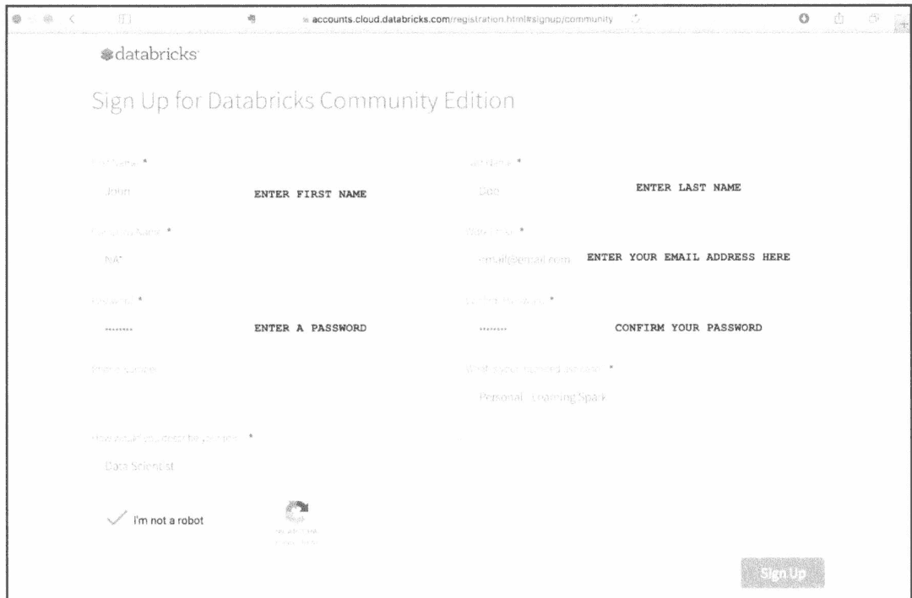
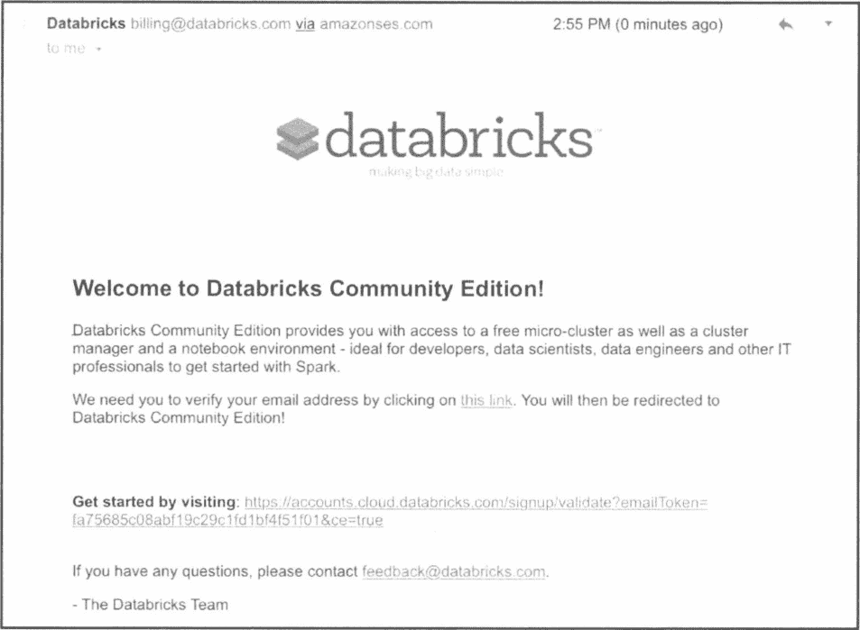
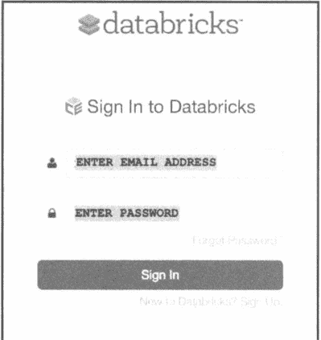
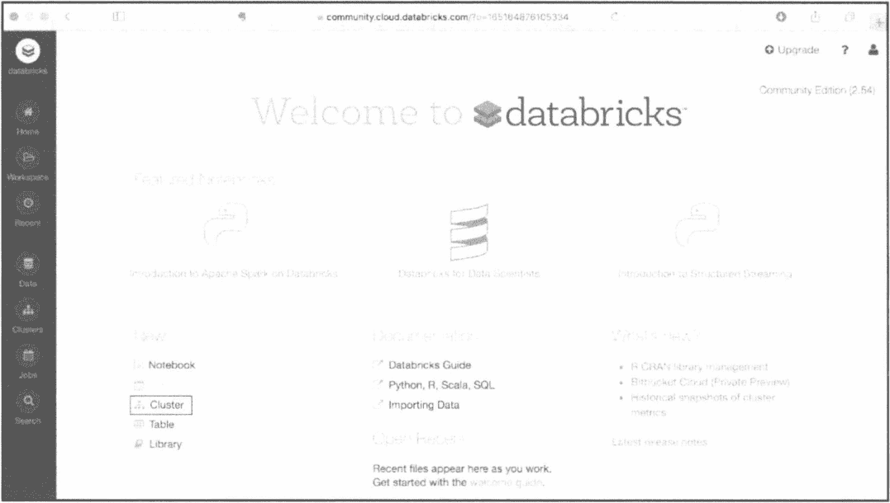
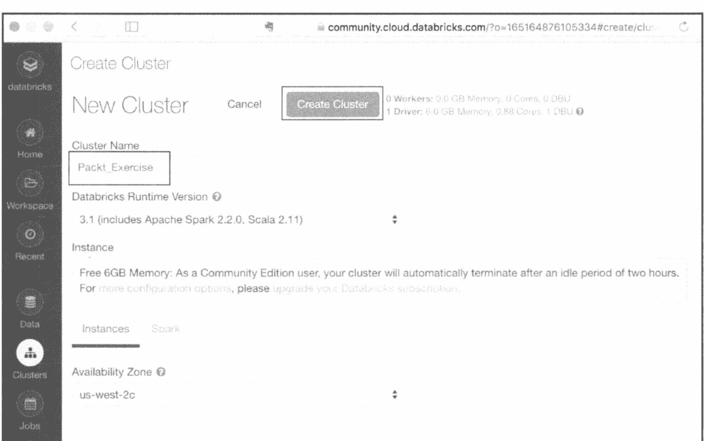
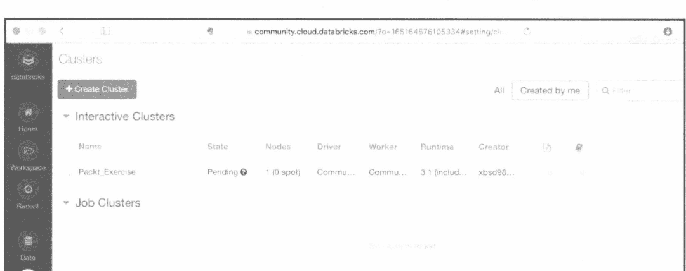
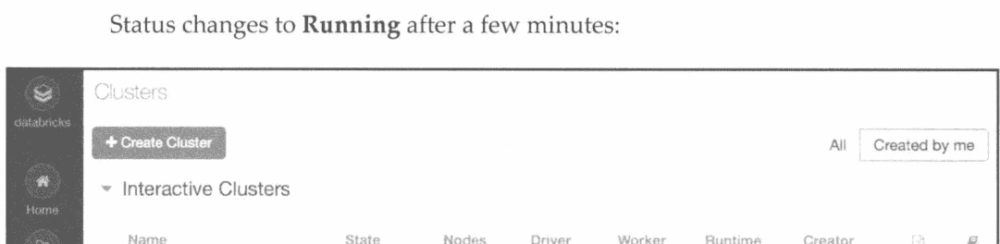
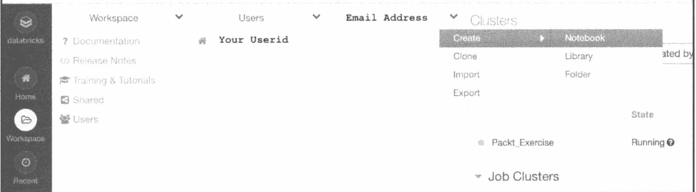
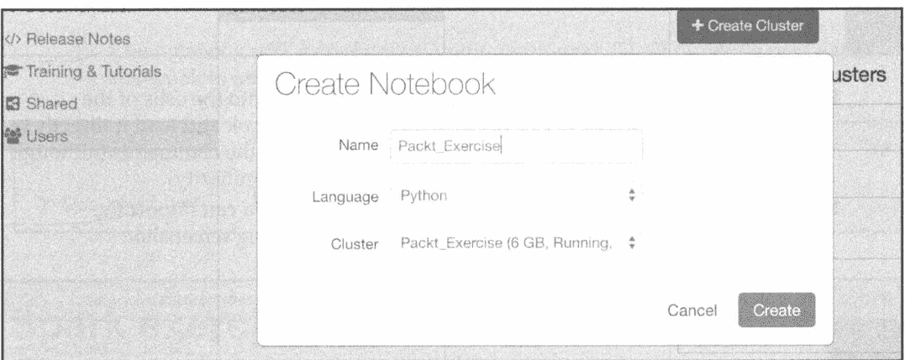
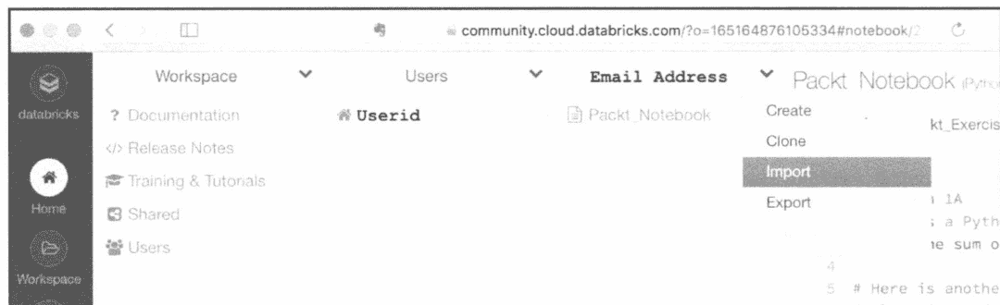

## 用于大数据分析的 Spark

随着 Hadoop 及相关技术在各自生态系统中的使用日益普及，Hadoop 操作模型的几个明显且突出的缺陷逐渐显现。尤其是对 MapReduce 范式的根深蒂固的依赖，以及与 MapReduce 相关的其他方面，使得只有深度投资于相关技术的大型企业才能真正有效地使用 Hadoop 生态系统。

在 2011 年加州大学伯克利分校电气工程与计算机科学系（EECS）年度研究研讨会上，Ian Stoica 教授在演讲中宣布了在该校组建一个新研究小组的愿景（https://amplab.cs.berkeley.edu/about/）。这一愿景为后来成为深刻改变大数据格局的关键团队奠定了基础。AMPLab 于 2011 年 2 月启动，旨在通过整合算法、机器和人，提供一个可扩展且统一的解决方案，以满足未来需求，而无需进行重大的重新工程工作。

从 AMPLab 计划中发展出来的最著名、使用最广泛的项目是 Spark，它可以说是 Hadoop 生态系统的更优替代方案——或者更准确地说，是 Hadoop 生态系统的扩展。

在本章中，我们将探讨 Spark 的一些显著特性，并以一个关于如何使用 Spark 的真实教程作为结尾。我们将涵盖以下主题：

- Spark 的出现
- Spark 中的理论概念
- Spark 的核心组件
- Spark 架构
- Spark 解决方案
- Spark 教程

### Spark 的出现

当 Spark 于 2014 年首次发布时，Hadoop 自 2009 年以来已经在商业领域发展了数年。尽管 Hadoop 利用广泛可用的分布式计算方法，解决了高效分析 TB 级大型数据集的一大障碍，但它仍存在阻碍其更广泛接受的缺陷。

### Hadoop 的局限性

Hadoop 的一些常见局限性如下：

- **I/O 受限操作**：由于依赖本地磁盘存储来保存和检索数据，Hadoop 中执行的任何操作都会产生 I/O 开销。对于涉及数百台服务器上数千个数据块的较大数据集，问题变得更加严重。公平地说，协调并发 I/O 操作（通过 HDFS）的能力构成了 Hadoop 世界中分布式计算的基础。然而，在不同的用例和数据集之间有效利用该能力并*调优* Hadoop 集群，需要巨大且可能不成比例的专门知识。因此，工作负载的 I/O 受限特性成为使用 Hadoop 处理超大数据集的一个阻碍因素。例如，需要数百次迭代操作的机器学习用例意味着系统每次迭代都会产生 I/O 开销。
- **MapReduce 编程（MR）模型**：如本书前面部分所述，Hadoop 中的所有操作都需要用 MapReduce 编程模型来表达问题——也就是说，用户必须以键值对的形式表达问题，其中每个键值对都可以独立计算。在 Hadoop 中，编写高效的 MapReduce 程序（主要使用 Java）并非易事，尤其是对于刚接触 Java 或 Hadoop（或两者）的人来说。
- **非 MR 用例**：由于对 MapReduce 的依赖，其他更常见和更简单的概念（如过滤、连接等）也必须用 MapReduce 程序来表达。因此，跨主键连接两个文件必须采用键值对方法。这意味着，无论是简单还是复杂的操作，如果没有大量的编程工作，都很难实现。
- **编程 API**：在整个 Hadoop 中使用 Java 作为核心编程语言意味着，要正确管理和使用 Hadoop，开发人员必须具备扎实的 Java 知识以及 JVM 调优、垃圾收集等相关主题的深入知识。这也意味着，使用 R、Python 和 Scala 等其他流行语言的开发人员，几乎没有办法用他们最熟悉的语言重用或至少实现他们的解决方案。
- 总的来说，尽管 Hadoop 领域引领了大数据革命，但它未能在大范围内普及大数据技术的使用。

AMPLab 团队很早就意识到了这些缺陷，并着手创建 Spark 来解决这些问题，并在此过程中希望开发出一种新的、更优的替代方案。

### 克服 Hadoop 的局限性

现在，我们将回顾上一节中讨论的一些局限性，并了解 Spark 如何解决这些问题，从而提供优于 Hadoop 生态系统的替代方案。

一开始需要记住的一个关键区别是，Spark 运行并不需要 Hadoop。事实上，Spark 访问数据的底层后端可以是 HBase、Hive、Cassandra 等技术，以及 HDFS。

这意味着，希望利用独立 Spark 系统的组织可以在没有现成 Hadoop 基础设施的情况下，无需构建单独的 Hadoop 基础设施即可实现。

Spark 的解决方案如下：

- **I/O 受限操作**：与 Hadoop 不同，Spark 可以存储和访问*内存*中存储的数据，即 RAM——如前所述，这比从磁盘读取数据快 1000 倍以上。随着固态硬盘（SSD）的出现（如今企业系统的标配），这一差距已显著缩小。最新的 NVMe 驱动器每秒可提供高达 3-5 GB 的带宽。然而，RAM 的平均读取速度约为每秒 25-30 GB，仍然比读取更新的存储技术快 5-10 倍。因此，能够将数据存储在 RAM 中，可以使 Spark 操作的读取时间提升 5 倍或更多。这相对于所有操作都依赖磁盘读取的 Hadoop 操作模型来说是一个重大改进。特别是涉及迭代操作（如机器学习）的任务，可以从 Spark 在内存中存储和读取数据的能力中受益匪浅。
- **MapReduce 编程（MR）模型**：虽然 MapReduce 是用户从 Hadoop 平台获益的主要编程模型，但 Spark 没有同样的要求。这对于更复杂的用例尤其有用，例如涉及难以轻松*并行化*的计算的定量分析，如机器学习算法。通过将编程模型与平台解耦，Spark 允许用户用各种语言编写和执行代码，而无需强制任何特定的编程模型作为先决条件。
- **非 MR 用例**：Spark SQL、Spark Streaming 以及 Spark 生态系统的其他组件提供了丰富的功能，使用户能够执行常见任务，如 SQL 连接、聚合以及相关的类数据库操作，而无需借助其他外部解决方案。Spark SQL 查询通常针对存储在 Hive 中的数据执行（JSON 是另一种选择），该功能也可在 R 和 Python 等其他 Spark API 中使用。
- **编程 API**：Spark 中最常用的 API 是 Python、Scala 和 Java。对于 R 程序员，有一个名为 `SparkR` 的独立包，允许从 R 直接访问 Spark 数据。这是 Hadoop 和 Spark 之间的一个主要区别因素，通过提供这些语言的 API，Spark 可以立即被更广泛的开发人员社区使用。在数据科学和分析领域，Python 和 R 是最主流的选择语言，因此，与 Hadoop 相比，任何 Python 或 R 程序员都可以通过更简单的学习曲线来利用 Spark。此外，Spark 还包含一个用于即席分析的交互式 shell。

### Spark 中的理论概念

以下是 Spark 中的核心概念：

- 弹性分布式数据集
- 有向无环图
- SparkContext
- Spark DataFrames
- 动作与转换
- Spark 部署选项


## 弹性分布式数据集

弹性分布式数据集，通常称为RDD，是Spark中使用的主要数据结构。RDD本质上是以分布式方式存储在Spark集群中的记录集合。RDD是不可变的，也就是说，一旦创建就不能更改。存储在节点间的RDD可以并行访问，因此原生支持并行操作。

用户无需编写单独的代码即可获得并行化的好处，只需运行Spark平台原生的特定命令，即可获得数据行动（actions）和转换（transformations）的好处。由于RDD也可以存储在内存中，另一个好处是并行操作可以直接在内存中处理数据，而无需付出昂贵的I/O访问开销。

## 有向无环图

在计算机科学和数学术语中，有向无环图表示由单向边（或线）连接的节点对（也称为顶点）。也就是说，给定节点A和节点B，边可以连接A → B或B → A，但不能同时连接两者。换句话说，任意一对节点之间不存在循环关系。

Spark利用DAG的概念构建内部工作流，描述Spark作业中不同处理阶段。从概念上讲，这类似于为获得特定输出所需的一系列步骤创建虚拟流程图。例如，如果所需输出涉及统计文档中的单词数，中间步骤map-shuffle-reduce可以表示为一系列导致最终结果的操作。通过维护这样的映射，Spark能够跟踪操作中涉及的依赖关系。更具体地说，RDD是节点，而转换（本节稍后讨论）是DAG的边。

## SparkContext

SparkContext是所有Spark操作的入口点，也是应用程序连接到Spark集群资源的方式。它初始化Spark实例，之后可用于创建RDD、对RDD执行行动和转换、提取数据以及使用其他Spark功能。SparkContext还初始化进程的各种属性，如应用程序名称、核心数、内存使用参数和其他特征。总的来说，这些属性包含在SparkConf对象中，该对象作为参数传递给SparkContext。

另一方面，**行动（Actions）**会返回结果。也就是说，它们执行用户可能在相应RDD上指定的一系列转换（如果有），并产生输出。换句话说，行动触发DAG中步骤的执行。常见的行动包括：`reduce`、`collect`、`take`、`aggregate`、`foreach`等等。

> 请注意，RDD是不可变的。它们无法被更改；转换和行动总是会产生新的RDD，但绝不会修改现有的RDD。

## Spark部署选项

Spark可以以多种模式部署。最重要的模式包括：

- **独立模式（Standalone mode）：** 作为独立集群，不依赖任何外部集群管理器
- **Amazon EC2：** 在Amazon Web Services的EC2实例上运行，可从S3访问数据
- **Apache YARN：** Hadoop资源管理器

其他选项包括**Apache Mesos**和**Kubernetes**。

> 更多细节可参阅Spark文档网站，  
> `https://spark.apache.org/docs/latest/index.html`。

## Spark API

Spark平台可通过Python、Scala、R和Java中的Spark API轻松访问。它们共同使在Spark中处理数据变得简单且广泛可及。在Spark项目初始阶段，它仅支持Scala/Java作为主要API。然而，由于Spark的首要目标之一是为不同的开发者提供简单接口，Scala API之后又推出了Python和R API。

在Python中，PySpark包已成为Python开发者社区编写Spark应用程序的广泛使用标准。在R中，用户通过SparkR包与Spark交互。这对于可能也对处理存储在Spark生态系统中的数据感兴趣的R开发者很有用。这两种语言在数据科学社区中都非常流行，因此，Python和R API的引入为在Spark上进行面向分析用例的大数据分析民主化奠定了基础。

## Spark核心组件

以下是Spark中非常重要的组件：

- Spark Core
- Spark SQL
- Spark Streaming
- GraphX
- MLlib

## Spark Core

Spark Core提供Spark中的基本功能，例如使用RDD、执行行动和转换，以及存储、高可用性等更多管理任务。

## Spark SQL

Spark SQL使用户能够使用标准SQL命令查询存储在Apache Hive中的数据。这通过为开发者提供一种使用常见SQL术语通过Spark SQL接口与数据集交互的方式，增加了额外的可访问性。承载底层数据的平台不仅限于Apache Hive，还可以包括JSON、Parquet等。

## Spark Streaming

Spark的流处理组件允许用户与流数据（如Web相关内容等）交互。它还包括高可用性等企业特性。Spark可以从各种中间件和数据流服务中读取数据，例如Apache Kafka、Apache Flume，以及来自Amazon Web Services等供应商的基于云的解决方案。

## GraphX

Spark的GraphX组件支持基于图的操作，类似于支持专用数据结构的图数据库等技术。这些技术使得互连数据点（如社交网络）易于使用、访问和表示。除了分析之外，Spark GraphX平台还支持图算法，这些算法对于需要大规模表示关系的业务用例非常有用。例如，信用卡公司使用与Spark的GraphX组件类似的基于图的数据库来构建推荐引擎，以检测具有相似特征的用户。这些特征可能包括购买习惯、位置、人口统计以及其他定性和定量因素。在这些情况下使用图系统，公司可以构建以节点表示个体、以边表示关系度量的网络，从而发现他们之间的共同特征。

## MLlib

MLlib是Spark生态系统的旗舰组件之一。它提供了可扩展、高性能的接口，用于在Spark中执行资源密集型的机器学习任务。此外，MLlib可以原生连接到HDFS、HBase以及Spark支持的其他底层存储系统。由于这种多功能性，用户无需依赖预先存在的Hadoop环境即可开始使用MLlib内置的算法。MLlib支持的一些算法包括：

- **分类：** 逻辑回归
- **回归：** 广义线性回归、生存回归等
- 决策树、随机森林和梯度提升树
- **推荐：** 交替最小二乘法
- **聚类：** K均值、高斯混合等
- **主题建模：** 潜在狄利克雷分配
- **Apriori：** 频繁项集、关联规则

ML工作流工具包括：

- **特征转换：** 标准化、归一化等
- ML管道构建
- 模型评估和超参数调优
- **ML持久化：** 保存和加载模型及管道

## Spark的架构

Spark由3个主要架构组件组成：

- SparkSession / SparkContext
- 集群管理器
- 工作节点（托管执行器进程）

**SparkSession/SparkContext**，或更一般地称为Spark Driver，是所有Spark应用程序的入口点，如前所述。SparkContext将用于创建RDD并针对RDD执行操作。SparkDriver向工作节点发送指令以调度任务。

**集群管理器（Cluster manager）**在概念上类似于Hadoop中的资源管理器，实际上，支持的解决方案之一就是YARN。其他集群管理器包括Mesos。Spark也可以以独立模式运行，在这种情况下不需要YARN/Mesos。集群管理器协调工作节点之间的通信，管理节点（如启动、停止等），并执行其他管理任务。

**工作节点（Worker nodes）**是托管Spark应用程序的服务器。每个应用程序都有自己独特的**执行器进程（executor process）**，即执行实际行动和转换任务的进程。通过分配专用的执行器进程，Spark确保任何一个特定应用程序中的问题不会影响其他应用程序。工作节点由Executor、JVM以及Spark应用程序所需的Python/R/其他应用程序进程组成。请注意，在Hadoop的情况下，工作节点和数据节点是同一个：


## Spark 解决方案

Spark 可直接从 `spark.apache.org` 作为开源解决方案获得。**Databricks** 是 Spark 商业解决方案的领先提供商。对于熟悉 Python、R、Java 或 Scala 编程的人员来说，由于高效的接口，例如允许用户仅使用 Python 在 Spark 中工作的 PySpark API，开始使用 Spark 所需的时间极少。

基于云的 Spark 平台，例如 Databricks Community Edition，提供了一种简单易用的方式来使用 Spark，而无需额外的工作来安装和配置 Spark。因此，希望使用 Spark 进行编程和相关任务的用户可以更快地开始，而无需花费时间在管理任务上。

## Spark 实践

在本节中，我们将在 Databricks 的 Community Edition 上创建账户并完成一个动手练习，该练习将引导读者了解操作、转换和 RDD 概念的基础知识。

- 2. 点击 START TODAY 按钮并输入您的信息：



- 3. 确认您已阅读并同意弹出菜单中的条款（滚动到底部找到 **Agree** 按钮）：

### 服务条款

Databricks Community Edition
服务条款

欢迎使用 Databricks Community Edition！我们很高兴能够免费向有兴趣学习和探索 Databricks 云数据分析平台使用情况的人员提供 Databricks Community Edition“Community Edition”，该平台使数据分析师和其他人员能够轻松利用 Apache Spark™ 和 Databricks 的其他专有功能的力量。您使用 Community Edition，无论是持续使用还是临时使用，用于培训 Databricks 的付费平台服务，或您对除 Community Edition 之外的我们付费平台服务的临时免费试用（“Free Trial”），以及与 Community Edition 的任何使用一起，“服务”均受这些服务条款（“条款”）的约束。通过使用服务，您同意受这些条款的约束。如果您代表组织使用服务，您同意代表该组织受这些条款的约束，并且您确认您有权约束该组织，在这种情况下，“您”或“您的”指的是该组织而不是您个人。您访问服务的资格取决于您仔细阅读这些条款，如果您同意，则点击每个两个条款集底部处的框以表明您理解、接受并将持续遵守这些条款。如果将来 Databricks 同意向您的 Community Edition 或 Free Trial 账户销售任何付费升级或其他付费服务，这些条款将继续完全适用，除非您和 Databricks 共同同意受取代的管辖条款和条件约束。

### 您的数据和使用 Community Edition – 限制适用

- 4. 检查您的电子邮件，查找来自 Databricks 的确认邮件并点击链接确认您的账户：



- 5. 一旦您点击链接确认您的账户，您将被带到登录屏幕，您可以使用用于注册账户的电子邮件地址和密码登录：



- 6. 登录后，点击 Cluster 以设置 Spark 集群，如下图所示：



- 7. 输入 `Pack_Exercise` 作为集群名称并点击页面顶部的 Create Cluster 按钮：



- 8. 这将启动启动 Spark 集群的过程，我们将在其中使用 iPython notebook 执行 Spark 命令。iPython Notebook 是指一种常用的 IDE - 用于编写和测试 Python 代码的基于 Web 的开发应用程序。笔记本还可以通过使用内核来支持其他语言，但就本练习而言，我们将专注于 Python 内核。

过了一会儿，状态将从 Pending 更改为 Running：



状态在几分钟后更改为 Running：



- 9. 点击 Workspace（左侧栏）并选择选项，Users |（您的用户 ID）并点击您电子邮件地址旁边的下拉箭头。选择 Create | Notebook：



- 10. 在弹出屏幕中，输入 Packt_Exercise 作为笔记本名称并点击 Create 按钮：



- 11. 一旦您点击 **Create** 按钮，您将被直接带到如下所示的 Notebook。这是 Spark **Notebook**，您可以在其中执行接下来几节中给出的其余代码。代码应输入到笔记本的 **cells** 中，如图所示。输入代码后，按 *Shift + Enter* 执行相应的单元格：


- 12. 对于接下来的几个练习，您可以将文本复制粘贴到 Notebook 的单元格中。或者，您也可以导入笔记本并直接在工作区中加载。如果这样做，您将不需要输入命令（尽管输入命令将提供更多动手熟悉度）。

- 13. 复制粘贴命令的另一种方法：您可以通过点击如下所示的 Import 来导入笔记本：



Spark 的 Python API 文档可以在 https://spark.apache.org/docs/latest/api/python/pyspark.html#pyspark.sql 找到。

本书的数据已导入 Databricks' Spark 平台。有关导入数据的更多信息，请访问 Importing Data - Databricks（https://docs.databricks.com/user-guide/importing-data.html）。

```python
# COMMAND ----------
# The SparkContext/SparkSession is the entry point for all Spark operations
# sc = the SparkContext = the execution environment of Spark, only 1 per JVM
# Note that SparkSession is now the entry point (from Spark v2.0)
# This tutorial uses SparkContext (was used prior to Spark 2.0)

from pyspark import SparkContext
# sc = SparkContext(appName = "some_application_name") # You'd normally run this, but in this case, it has already been created in the Databricks' environment

# COMMAND ----------

quote = "To be, or not to be, that is the question: Whether 'tis nobler in the mind to suffer The slings and arrows of outrageous fortune, Or to take Arms against a Sea of troubles, And by opposing end them: to die, to sleep No more; and by a sleep, to say we end the heart-ache, and the thousand natural shocks that Flesh is heir to? 'Tis a consummation devoutly to be wished. To die, to sleep, To sleep, perchance to Dream; aye, there's the rub, for in that sleep of death, what dreams may come, when we have shuffled off this mortal coil, must give us pause."

# COMMAND ----------
sparkdata = sc.parallelize(quote.split(' '))

# COMMAND ----------
print "sparkdata = ", sparkdata
print "sparkdata.collect = ", sparkdata.collect
print "sparkdata.collect() = ", sparkdata.collect()[1:10]

# COMMAND ----------
# A simple transformation - map
def mapword(word):
    return (word,1)

print sparkdata.map(mapword) # Nothing has happened here
print sparkdata.map(mapword).collect()[1:10] # collect causes the DAG to execute

# COMMAND ----------
# Another Transformation

def charsmorethan2(tuple1):
    if len(tuple1[0])>2:
        return tuple1
    pass

rdd3 = sparkdata.map(mapword).filter(lambda x: charsmorethan2(x))
# Multiple Transformations in 1 statement, nothing is happening yet
rdd3.collect()[1:10]
# The DAG gets executed. Note that since we didn't remove punctuation marks
# ... 'be,', etc are also included

# COMMAND ----------
# With Tables, a general example
cms = sc.parallelize([[1,"Dr. A",12.50,"Yale"],[2,"Dr. B",5.10,"Duke"],[3,"Dr. C",200.34,"Mt. Sinai"],[4,"Dr. D",5.67,"Duke"],[1,"Dr. E",52.50,"Yale"]])

# COMMAND ----------
def findPayment(data):
    return data[2]

print "Payments = ", cms.map(findPayment).collect()
print "Mean = ", cms.map(findPayment).mean() # Mean is an action

# COMMAND ----------
# Creating a DataFrame (familiar to Python programmers)

cms_df = sqlContext.createDataFrame(cms, ["ID","Name","Payment","Hosp"])
print cms_df.show()
print cms_df.groupby('Hosp').agg(func.avg('Payment'), func.max('Payment'),func.min('Payment'))
print cms_df.groupby('Hosp').agg(func.avg('Payment'), func.max('Payment'),func.min('Payment')).collect()
print
print "Converting to a Pandas DataFrame"
print "-------------------------------"
pd_df = cms_df.groupby('Hosp').agg(func.avg('Payment'),func.max('Payment'),func.min('Payment')).toPandas()
print type(pd_df)
print
print pd_df

# COMMAND ----------
wordsList = ['to','be','or','not','to','be']
wordsRDD = sc.parallelize(wordsList, 3) # Splits into 3 groups
```

```python
# Print out the type of wordsRDD
print type(wordsRDD)

# COMMAND ----------
# Glom coalesces all elements within each partition into a list
print wordsRDD.glom().take(2) # Take is an action, here we are 'take'-ing
the first 2 elements of the wordsRDD
print wordsRDD.glom().collect() # Collect

# COMMAND ----------
# An example with changing the case of words
# One way of completing the function
def makeUpperCase(word):
    return word.upper()

print makeUpperCase('cat')

# COMMAND ----------
upperRDD = wordsRDD.map(makeUpperCase)
print upperRDD.collect()

# COMMAND ----------
upperLambdaRDD = wordsRDD.map(lambda word: word.upper())
print upperLambdaRDD.collect()

# COMMAND ----------
# Pair RDDs
wordPairs = wordsRDD.map(lambda word: (word, 1))
print wordPairs.collect()

# COMMAND ----------

# #### Part 2: Counting with pair RDDs
# There are multiple ways of performing group-by operations in Spark
# One such method is groupByKey()
#
# ** Using groupByKey() **
#
# This method creates a key-value pair whereby each key (in this case word)
# is assigned a value of 1 for our wordcount operation. It then combines all
# keys into a single list. This can be quite memory intensive, especially if
# the dataset is large.

# COMMAND ----------
# Using groupByKey
wordsGrouped = wordPairs.groupByKey()
for key, value in wordsGrouped.collect():
print '{0}: {1}'.format(key, list(value))

# COMMAND ----------
# Summation of the key values (to get the word count)
wordCountsGrouped = wordsGrouped.map(lambda (k,v): (k, sum(v)))
print wordCountsGrouped.collect()

# COMMAND ----------

# ** (2C) Counting using reduceByKey **
#
# reduceByKey creates a new pair RDD. It then iteratively applies a
# function first to each key (i.e., within the key values) and then across
# all the keys, i.e., in other words it applies the given function
# iteratively.

# COMMAND ----------

wordCounts = wordPairs.reduceByKey(lambda a,b: a+b)
print wordCounts.collect()

# COMMAND ----------
# %md
# ** Combining all of the above into a single statement **

# COMMAND ----------

wordCountsCollected = (wordsRDD
  .map(lambda word: (word, 1))
  .reduceByKey(lambda a,b: a+b)
  .collect())
print wordCountsCollected

# COMMAND ----------

# %md
#
# This tutorial has provided a basic overview of Spark and introduced the
# Databricks community edition where users can upload and execute their own
# Spark notebooks. There are various in-depth tutorials on the web and also
# at Databricks on Spark and users are encouraged to peruse them if
# interested in learning further about Spark.

## Summary

In this chapter, we read about some of the core features of Spark, one of the most prominent technologies in the Big Data landscape today. Spark has matured rapidly since its inception in 2014, when it was released as a Big Data solution that alleviated many of the shortcomings of Hadoop, such as I/O contention and others.

Today, Spark has several components, including dedicated ones for streaming analytics and machine learning, and is being actively developed. Databricks is the leading provider of the commercially supported version of Spark and also hosts a very convenient cloud-based Spark environment with limited resources that any user can access at no charge. This has dramatically lowered the barrier to entry as users do not need to install a complete Spark environment to learn and use the platform.

In the next chapter, we will begin our discussion on machine learning. Most of the text, until this section, has focused on the management of large scale data. Making use of the data effectively and gaining *insights* from the data is always the final aim. In order to do so, we need to employ the advanced algorithmic techniques that have become commonplace today. The next chapter will discuss the basic tenets of machine learning, and thereafter we will delve deeper into the subject area in the subsequent chapter.
