## An Introduction to Machine Learning Concepts

Machine learning has become a commonplace topic in our day-to-day lives. The advancement in the field has been so dramatic that today, even cell phones incorporate advanced machine learning and artificial intelligence-related facilities, capable of responding and taking actions based on human instructions.

A subject that was once limited to university classrooms has transformed into a full-fledged industry, pervading our daily lives in ways we could not have envisioned even just a few years ago.

The aim of this chapter is to introduce the reader to the underpinnings of machine learning and explain the concepts in simple, lucid terms that will help readers become familiar with the core ideas in the subject. We'll start off with a high-level overview of machine learning, and explain the different categories and how to distinguish them. We'll explain some of the salient concepts in machine learning, such as data pre-processing, feature engineering, and variable importance. The next chapter will go into more detail regarding individual algorithms and theoretical machine learning.

We'll conclude with exercises that leverage real-world datasets to perform machine learning operations using R.

We will cover the following topics in this chapter:
- What is machine learning?
- The popular emergence
- Machine learning, statistics, and artificial intelligence (AI)
- Categories of machine learning
- Core concepts in machine learning
- Machine learning tutorial

## What is machine learning?

**Machine learning** is not a new subject; it has existed in academia for well over 70 years as a formal discipline, but known by different names: statistics, and more generally mathematics, then **artificial intelligence (AI)**, and today as machine learning. While the other related subject areas of statistics and AI are just as prevalent, machine learning has carved out a separate niche and become an independent discipline in and of itself.

In simple terms, machine learning involves predicting future events based on historical data. We see it manifested in our day-to-day lives and indeed we employ, knowingly or otherwise, principles of machine learning on a daily basis.

When we casually comment on whether a movie will succeed at the box office using our understanding of the popularity of the individuals in the lead roles, we are applying machine learning, albeit subconsciously. Our understanding of the characters in the lead roles has been shaped over years of watching movies where they appeared. And, when we make a determination of the success of a future movie featuring the same person, we are using historical information to make an assessment.

As another example, if we had data on temperature, humidity, and precipitation (rain) over a period of say, 12 months, can we use that information to predict whether it will rain today, given information on temperature and humidity?

This is akin to common regression problems found in statistics. But, machine learning involves applying a much higher level of rigor to the exercise to reach a conclusive decision based not only on theoretical calculations, but verification of the calculations hundreds or thousands of times using iterative methods before reaching a conclusion.

It should be noted and clarified here that the term *machine learning* relates to algorithms or programs that are executed typically on a computing device whose objective it is to predict outcomes. The algorithms build mathematical models that can then be used to make predictions. It is a common misconception that machine learning quite literally refers to a *machine* that is *learning*. The actual implication, as just explained, is much less dramatic.

## The evolution of machine learning

The timeline of machine learning, as available on Wikipedia (https://en.wikipedia.org/wiki/Timeline_of_machine_learning), provides a succinct and insightful overview of the evolution of the field. The roots can be traced back to as early as the mid-1700s, when Thomas Bayes presented his paper on *inverse probability* at the Royal Society of London. Inverse probability, more commonly known today as probability distribution, deals with the problem of determining the state of a system given a prior set of events. For example, if a box contained milk chocolate and white chocolate, you took out a few at random, and received two milk and three white chocolates, can we infer how many of each chocolate there are in the box?

In other words, what can we infer about the unknown given a few points of data with which we can postulate a formal theory? Bayes' work was developed further into Bayes' Theorem by Pierre-Simon Laplace in his text, *Théorie Analytique des Probabilités.*

In the early 1900s, Andrey Markov's analysis of Pushkin's Poem, Eugeny Onegin, to determine the alliteration of consonants and vowels in Russian literature, led to the development of a technique known as Markov Chains, used today to model complex situations involving random events. Google's PageRank algorithm implements a form of Markov Chains.

The first formal application of machine learning, or more generally, AI, and its eventual emergence as a discipline, should be attributed to Alan Turing. He developed the Turing Test - a way to determine whether a machine is intelligent enough to mimic human behavior. Turing presented this in his paper, *Computing Machinery and Intelligence*, which starts out with the following:

> I propose to consider the question, "Can machines think?" This should begin with definitions of the meaning of the terms "machine" and "think." The definitions might be framed so as to reflect so far as possible the normal use of the words, but this attitude is dangerous, If the meaning of the words "machine" and "think" are to be found by examining how they are commonly used it is difficult to escape the conclusion that the meaning and the answer to the question, "Can machines think?" is to be sought in a statistical survey such as a Gallup poll. But this is absurd. Instead of attempting such a definition I shall replace the question by another, which is closely related to it and is expressed in relatively unambiguous words.[...]


图灵在论文后面写道：

> “机器能思考吗？”这个问题，我认为其原始表述太过无意义，不值得讨论。尽管如此，我仍相信，到本世纪末，人们的用词和普遍教育观点将发生足够大的变化，以至于人们可以谈论机器思考而不会预期遭到反驳。我还进一步相信，隐瞒这些信念不会带来任何有益的目的。

图灵在AI方面的工作之后，机器学习与AI领域迎来了一系列开创性事件。1951年，马文·明斯基开发了第一个神经网络；1952年，亚瑟·塞缪尔开始了他的第一个机器学习程序（下棋程序）的研究；1957年，罗森布拉特发明了感知机，这是神经网络的基本单元。利奥·布雷曼、杰罗姆·弗里德曼、弗拉基米尔·瓦普尼克、阿列克谢·切尔沃年基斯、杰夫·辛顿和杨立昆等先驱在20世纪90年代末期做出了重大贡献，使机器学习进入公众视野。我们非常感谢他们的工作和贡献，正是这些使得机器学习如今成为一个独特的研究领域。

1997年，IBM的“深蓝”击败了卡斯帕罗夫，立刻成为全球轰动的事件。机器击败世界顶级国际象棋冠军的能力绝非普通成就。这一事件为机器学习赢得了亟需的可信度，使其成为图灵所设想的智能机器的有力竞争者。

## 机器学习成功背后的因素

鉴于机器学习作为一门学科已经存在了几十年，人们不禁要问：为什么它没有更早地像今天这样流行？事实上，神经网络等复杂机器学习算法的理论在20世纪90年代末就已广为人知，而理论基础在此之前也已建立。

有几个因素可以归功于机器学习的成功：

- **互联网**：网络在信息民主化和以空前方式连接人们方面发挥了关键作用。它以印刷媒体传播等既有方式无法实现的方式，使信息交换变得简单。网络不仅转变并彻底革新了信息传播方式，还开辟了新的机遇。如前所述，谷歌的PageRank是统计模型应用于打造高度成功的网络企业这一领域最早的大规模、高可见性成功案例之一。

- **社交媒体**：虽然网络提供了通信平台，但它缺乏一种类似人们在现实世界中相互互动方式的灵活性。有一个明显但常被低估、且可以说是尚未被充分探索的缺口。IRC和Usenet等工具是Myspace等社交网站的前身，而Myspace是最早的基于网络的个人社交平台之一。到2000年初至中期，Facebook已成为社交网络的领导者。这些平台提供了独特的机会，将互联网用于在个体层面收集数据。每个用户都留下了一条条消息记录，很适合使用自然语言处理和其他技术进行收集与分析。

- **计算硬件**：计算机硬件以指数级速度发展。机器学习算法本质上对计算和资源要求极高，也就是说，根据数据规模，它们需要强大的CPU、快速的磁盘和高内存。将数据存储在新的**固态硬盘（SSD）**上，是从以往的旋转硬盘存储方式的一大飞跃。更快的访问意味着数据可以更快地传送给CPU，并减少I/O瓶颈，这一瓶颈历来是计算中的薄弱环节。更快的CPU使得及时执行机器学习算法所需的成百上千次迭代成为可能。最终，需求导致了计算资源价格的下降，使更多人能够负担得起原本价格高昂的计算硬件。算法早已存在，但资源终于能够在合理的时间和成本下执行它们。

- **编程语言与软件包**：R和Python开发者等社区抓住了这一机遇，个人开始发布软件包，将自己的工作成果展示给更广泛的程序员社群。尤其是提供机器学习算法的软件包迅速流行起来，并激励其他从业者发布自己的个人代码库，使R这样的平台真正成为全球性的协作成果。如今R中已有超过1万个软件包，而2010年时只有2000个。

## 机器学习、统计学与AI

机器学习这个术语有许多同义词——这些名称要么是企业营销活动的产物，要么只是被交替使用的术语。尽管有些人可能认为它们含义有所不同，但最终都指向机器学习这门利用历史信息预测未来事件的学科。

机器学习常见的术语包括预测分析、预测建模等。因此，除非某个实体发布了材料来专门解释其对这些术语的理解以及它们之间的区别，否则一般可以放心地认为它们指的就是机器学习。这往往让接触该学科的新手感到困惑，很大程度上是由于技术词汇的滥用和过度使用。

而统计学是一门独立的学科，已为人熟知超过200年。该词源于新拉丁语 *statisticum collegium*（英语意为“国务院”）以及意大利语单词 *statista*，意为政治家或政客。你可以访问 https://en.wikipedia.org/wiki/History_of_statistics#Etymology 了解该话题的更多细节。机器学习实现了各种统计模型，但由于其中涉及严格的计算，它与经典统计学分支有所不同。

AI与机器学习紧密相关，但其范畴要广泛得多。它可以粗略地定义为系统（软件/硬件）在存在不确定性的情况下，通常以负责任且具有社会意识的方式做出具体决策，以实现最终目标。换句话说，AI旨在通过系统性地处理涉及已知和未知（潜在）因素的情境来产生行动。

AI让人联想到科幻电影中聪明甚至叛逆的机器人，也让我们想起像IBM Watson这样的智能系统，它们能够解析复杂问题并处理模糊陈述，以找到具体答案。

机器学习也具有一些相同特征——使用训练数据逐步构建模型，并使用测试数据衡量准确性。然而，AI已存在数十年，并已成为家喻户晓的术语。卡内基梅隆大学等美国机构在建立AI的关键原则和指导方针方面走在前列。

网上关于AI与机器学习区别的文章似乎没有提供结论性的答案。然而，大学AI课程的 syllabus（教学大纲）使差异非常明显。你可以在 https://cs.brown.edu/courses/csci1410/lectures.html 了解更多关于AI的内容。

一个简单的解释有助于说明这一概念。到目前为止，我们大多数人都熟悉电子邮件中的垃圾邮件概念。大多数电子邮件账户还包含一个独立的文件夹，名为“垃圾邮件”（Junk、Spam）或类似名称。粗略查看这些文件夹通常会发现其中有多封电子邮件，其中许多是未经请求的，并且包含无意义的信息。

仅仅是将邮件分类为垃圾邮件并移至文件夹这一任务就涉及机器学习的应用。吴恩达在他广受欢迎的机器学习MOOC课程中巧妙地阐述了这一点。

用Mitchell的术语来说，垃圾邮件分类过程涉及：

- **任务T**：将电子邮件分类为垃圾/非垃圾邮件
- **性能P**：被准确识别为垃圾邮件的数量
- **经验E**：模型被提供已标记为垃圾/非垃圾的邮件，并利用这些信息判断新邮件是否为垃圾邮件

从广义上讲，机器学习有两种不同类型的类型：

- 有监督机器学习
- 无监督机器学习

我们在这里分别讨论。

## 有监督与无监督机器学习

我们先从有监督机器学习开始。

## 有监督机器学习

**有监督机器学习**是指使用带标签的数据预测结果的机器学习任务。带标签数据仅意味着我们用于预测的数据集（以及我们将预测的结果）具有确定的值（无论其具体是什么）。例如，将邮件分类为垃圾或非垃圾邮件、预测温度以及从图像中识别人脸，都属于有监督机器学习的例子。


## 车辆里程、数字识别及其他示例

给定一个数据集，其中包含各类汽车的每加仑英里数、气缸数等信息，如果我们只有其他变量的值，能否预测每加仑英里数的取值？

在这个例子中，我们的目标变量是 `mpg`，我们使用其他变量，如 `cyl`（气缸数）、`hp`（马力）、`gear`（档位数）等来构建模型，然后将该模型应用于 `mpg` 值被标记为 `MISSING` 的数据集。模型读取数据前五行中这些列的信息，并据此预测其他行中 `mpg` 的值，如下图所示：

| cyl | hp | wt | gear | mpg |
| --- | --- | --- | --- | --- |
| 6 | 110 | 2.620 | 4 | 21 |
| 6 | 110 | 2.875 | 4 | 21 |
| 4 | 93 | 2.320 | 4 | 22.8 |
| 6 | 110 | 3.215 | 3 | 21.4 |
| 8 | 175 | 3.440 | 3 | 18.7 |
| 6 | 105 | 3.460 | 3 | MISSING |
| 8 | 245 | 3.570 | 3 | MISSING |
| 4 | 62 | 3.190 | 4 | MISSING |
| 4 | 95 | 3.150 | 4 | MISSING |
| 6 | 123 | 3.440 | 4 | MISSING |

之所以认为这是有监督学习，是因为在构建机器学习模型的过程中，我们向模型提供了关于目标结果的信息。其他示例包括：

- **识别字母和数字**：在这种情况下，模型的输入是图像，例如字母和数字的图片，输出是图像上显示的字母数字值。模型构建完成后，就可以用于图片识别，预测图片中显示的数字。这是一个简单但功能强大的例子。想象一下，如果给你 10 万张带有门牌号的房屋图片，手动识别门牌号需要逐张查看图片并记录数字。而机器学习模型可以让整个过程完全自动化，你无需手动逐张处理图片，只需对图片运行模型，就能在很短时间内获得结果。
- **自动驾驶汽车**：算法的输入是已识别出图像中物体的图片，例如人、路标、汽车、树木、商店等元素。在展示了足够多的图像后，算法会*学会*识别并区分不同元素；之后，给定一张未标记的图像（即其中物体尚未被识别的图像），算法就能逐个识别出这些物体。公平地说，这是对一个非常复杂主题的高度简化解释，但总体原理是相同的。

用于数字识别的 MNIST 数据集：

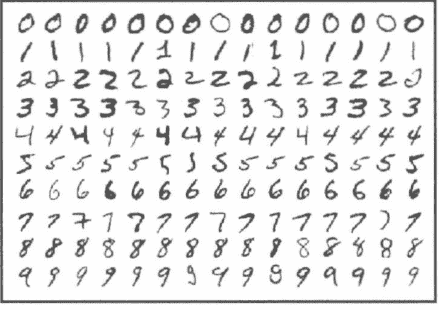

### 无监督机器学习

**无监督机器学习**涉及的目标结果没有标签的数据集。以预测汽车 `mpg` 值为例，在无监督练习中，我们的数据集如下所示：

| cyl | hp | wt | gear | mpg |
| --- | --- | --- | --- | --- |
| 6 | 110 | 2.620 | 4 | MISSING |
| 6 | 110 | 2.875 | 4 | MISSING |
| 4 | 93 | 2.320 | 4 | MISSING |
| 6 | 110 | 3.215 | 3 | MISSING |
| 8 | 175 | 3.440 | 3 | MISSING |
| 6 | 105 | 3.460 | 3 | MISSING |
| 8 | 245 | 3.570 | 3 | MISSING |
| 4 | 62 | 3.190 | 4 | MISSING |
| 4 | 95 | 3.150 | 4 | MISSING |
| 6 | 123 | 3.440 | 4 | MISSING |

如果所有目标结果都是*缺失*的，就无法知道这些值可能是什么。请记住，机器学习的基本前提是利用历史信息对结果未知的数据集进行预测。但是，如果历史信息本身没有任何已标记的结果，那么就不可能构建模型。在不知道任何其他信息的情况下，表中 `mpg` 的值可能全为 0，也可能全为 100；我们无法判断，因为我们没有任何有助于推导出该值的数据点。

这正是*无监督*机器学习的应用之处。在这种机器学习类型中，我们并不试图预测结果，而是试图确定哪些条目彼此最为相似。

这类练习的常见名称是*聚类*，也就是说，我们试图找到彼此最为相似的*簇*或记录组。这些信息可以在哪里使用？无监督学习有哪些示例？

网络上有各种新闻聚合器——这些网站本身不发布信息，而是从其他新闻来源收集信息。其中一个聚合器是 Google News。例如，如果我们要搜索卡西尼号卫星拍摄的最后一批土星图像，可以在 Google News 上简单搜索该短语：`https://news.google.com/news/?q1=US&ned=us&hl=en`。下面是一个示例：


注意，新闻文章底部有一个 **查看全部** 链接。点击该链接将进入一个包含所有其他相关新闻文章的页面。当然，Google 并没有手动将这些文章分类到特定搜索词下。事实上，Google 事先并不知道用户会搜索什么。搜索词完全可能是*从太空拍摄的土星环图像*。

那么，Google 如何知道哪些文章属于某个特定搜索词呢？答案在于聚类或无监督学习原理的应用。无监督学习检查特定数据集的属性，以确定哪些文章彼此最为相似。要做到这一点，算法甚至不需要了解上下文背景。

假设给你两套没有封面的书，一套是园艺书籍，另一套是计算机编程书籍。虽然你可能不知道书名，但区分计算机书籍和园艺书籍相当容易。其中一套书会出现大量与计算相关的术语，而另一套则会出现大量与植物相关的术语。仅仅根据书中的图像，即使假设读者既不了解计算机也不了解园艺，也不难区分出这两类书。

无监督机器学习的其他示例包括恶性肿瘤和良性肿瘤的检测，以及基因测序。

### 有监督机器学习的细分

有监督机器学习可以进一步细分为以下两类任务：

- 分类
- 回归

这两个概念相当简单。

分类涉及的目标结果是离散值——也就是**类别型**结果的机器学习任务。所有**名词**都是类别型变量，例如水果、树木、颜色和真/假。

分类任务中的目标变量也被称为**离散变量**或**类别变量**。

一些示例包括：

- 根据大小、重量和形状识别水果
- 根据一组数字图像识别数字（如前一章所示）
- 识别街道上的物体
- 将扑克牌识别为方块、黑桃、红心和梅花
- 根据学生的成绩确定学生的班级排名

最后一个示例可能不太明显，但排名（即第 1 名、第 2 名、第 3 名）表示一个固定的类别。学生可以排名第 1 或第 2，但不可能排名第 1.5！

下面展示了一些非典型分类示例的图片：

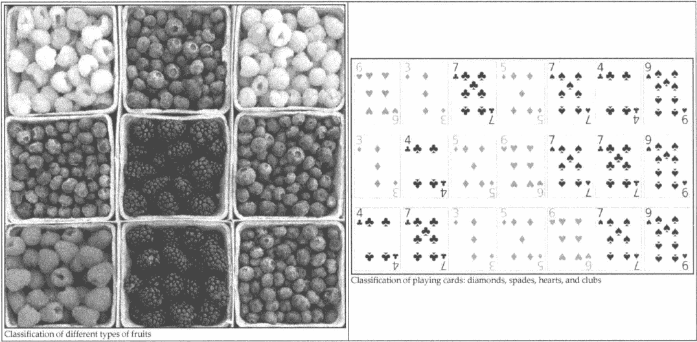

另一方面，**回归**涉及计算数值型结果。任何能够执行加、减、乘、除等数值运算的目标结果，都属于回归问题。

回归的示例包括：

- 预测每日气温
- 计算股票价格
- 预测住宅房产的销售价格等


## 机器学习中的核心概念

机器学习中有许多重要的概念；我们将介绍其中一些更常见的主题。机器学习涉及一个多步骤的过程，从数据获取、数据挖掘开始，最终导致构建预测模型。

模型构建过程的关键方面包括：

- **数据预处理：** 预处理和特征选择（例如，均值中心化和缩放、类别不平衡、变量重要性）
- **训练、测试划分和交叉验证：**
  - 创建训练集（例如，数据量的 80%）
  - 创建测试集（约数据量的 20%）
  - 执行交叉验证
- **创建模型，获取预测：**
  - 你应该尝试哪些算法？
  - 你试图优化哪些准确性指标？
  - 你应该使用哪些调参参数？

## 机器学习中的数据管理步骤

预处理，或更一般地处理数据，是大多数机器学习练习中不可或缺的一部分。你开始时拥有的一个数据集很少会以精确的格式存在，而你将用该格式构建机器学习模型；它在大多数情况下不可避免地需要大量清理。事实上，数据清理通常是整个过程中最耗时的部分。在本节中，我们将简要介绍你在实践中可能遇到的一些顶级数据处理步骤。

## 预处理和特征选择技术

**数据预处理**，顾名思义，涉及整理数据以使其适合机器学习练习。预处理有各种方法，其中一些更常见的方法已在此处说明。

请注意，数据预处理应作为交叉验证步骤的一部分进行，即预处理不应在模型构建过程之前进行，而应在模型构建过程中进行。这将在后面更详细地解释。

## 均值中心化和缩放

对数值列应用中心化和缩放函数通常是为了标准化数据并消除数值大小或差异的巨大变化带来的影响。你可能在大学课程中遇到过这种情况，学生会被标准化地评分，或按曲线评分。

例如，假设一份考试试卷异常困难，在一个 10 名学生的班级中，有一半学生的成绩低于 60 分——该课程设定的及格率。教授可以 a) 判定 50% 的学生应重修课程，或 b) 对成绩进行标准化，以了解学生之间的相对表现。

假设班级成绩为：

45,66,66,55,55,52,61,64,65,49

及格分数设为 60，这意味着成绩为 45、55、55、52 和 49 的学生将无法成功完成课程。

然而，这可能并不是他们相对优劣的真正准确体现。教授也可以选择改用中心化和缩放方法， commonly known as standardization，即标准化，这涉及：

- 找到所有成绩的均值
- 从成绩中减去均值
- 将结果除以所有成绩的标准差

下面为参考而说明了该操作。

成绩的均值为 57.8。因此，从每个数字中减去 57.8 得到第二行所示的数字。但，我们还没有完成。我们需要将数字除以成绩的标准差以获得最终的标准化值：

| Scores | 45 | 66 | 66 | 55 | 55 | 52 | 61 | 64 | 65 | 49 |
| Scores - Mean | -12.8 | 8.2 | 8.2 | -2.8 | -2.8 | -5.8 | 3.2 | 6.2 | 7.2 | -8.8 |
| Divide by SD | -1.67 | 1.07 | 1.07 | -0.4 | -0.4 | -0.8 | 0.42 | 0.81 | 0.94 | -1.2 |

除以 SD（标准差）显示，只有两名学生的成绩低于所有测试成绩范围内的一个标准差。因此，与基于原始数字的五名学生无法成功完成课程相比，我们可以将其缩小到仅两名学生。

尽管这是一个非常简单的操作，但很容易看出它在平滑数据中的巨大变化方面非常有效。

均值中心化和缩放可以在 R 中使用 scale 命令非常容易地执行，如下所示：

```
> scores <- c(45,66,66,55,55,52,61,64,65,68)
> scale(scores)
          [,1]
[1,]  -1.9412062
[2,]   0.8319455
[3,]   0.8319455
[4,]  -0.6206578
[5,]  -0.6206578
[6,]  -1.0168223
[7,]   0.1716713
[8,]   0.5678358
[9,]   0.6998907
[10,]  1.0960552
attr(","scaled:center")
[1] 59.7
attr(","scaled:scale")
[1] 7.572611
```

## 近零方差函数

近零方差，可在 R 包 caret 中的 nearZeroVar 函数中使用，用于识别方差很小或几乎没有方差的变量。考虑一个仅有三个不同值的 10,000 个数字的集合。这样的变量可能对算法的价值非常小。为了使用 nearZeroVar 函数，首先在 RStudio 中安装 R 包 caret（我们在第 3 章《分析工具包》中设置了它）。复制 nearZeroVar 效果的确切代码如下所示：

```
> library(caret)
Loading required package: lattice
Loading required package: ggplot2
Need help getting started? Try the cookbook for R:
http://www.cookbook-r.com/Graphs/

> repeated <- c(rep(100,9999),10) # 9999 个值是 100，最后一个值是 10

>random<- sample(100,10000,T) # 1 - 100 之间的 10,000 个随机值

>data<- data.frame(random = random, repeated = repeated)
```

我们也可以使用以下等函数直接找到相关变量，而无需绘制相关图：

```
correlated_columns<- findCorrelation(cor(diab[,-ncol(diab)]), cutoff = 0.5)
correlated_columns
```

## 其他常见数据转换

还有几种其他数据转换可用并适用于不同的情况。这些转换的摘要可以在 caret 包的文档站点下的 Pre-Processing 中找到，网址为 https://topepo.github.io/caret/pre-processing.html。

caret 的 pre-process 函数中可用的选项可以从其帮助部分找到，通过在 RStudio 中运行命令 ?preProcess。它的代码如下所示：

```
Method

a character vector specifying the type of processing.

Possible values are "BoxCox", "YeoJohnson", "expoTrans", "center", "scale", "range", "knnImpute", "bagImpute", "medianImpute", "pca", "ica", "spatialSign", "corr", "zv", "nzv", and "conditionalX" (see Details below)
```

## 数据采样

你可能会遇到结果类别不平衡程度很高的数据集。例如，如果你正在处理一种罕见疾病的数据集，其结果变量为真或假，由于该疾病发生的罕见性，你可能会发现标记为假的观测值数量（即该人没有罕见疾病）远高于标记为真的观测值数量（即该人患有罕见疾病）。

机器学习算法试图最大化性能，在许多情况下，这可能是预测的准确性。假设在 1000 条记录的样本中，只有 10 条标记为真，其余 990 条观测值为假。

如果有人将所有观测值随机指定为假，则准确率将为：

```
(990/1000) * 100 = 99%
```

但，本次练习的目标是找到*患有罕见疾病的个体*。我们已经很清楚，由于疾病的性质，大多数个体不会属于该类别。

数据采样，本质上是*最大化机器学习指标，如特异性、敏感性、精确度、召回率和 kappa* 的过程。这些将在后面讨论，但就本节而言，我们将展示一些方法，通过这些方法你可以*采样*数据以产生更均衡的数据集。

R 包 `caret` 包含多个有用的函数，可从不平衡的数据集中创建类别的平衡分布。

在这些情况下，我们需要重新采样数据以获得类别的更好分布，以便构建更有效的模型。

一些通用方法包括：

- **上采样**：增加示例较少的类别的实例
- **下采样**：减少示例较多的类别的实例
- **创建合成示例**（例如，**SMOTE（合成少数类过采样技术）**）
- 随机过采样（例如，**（ROSE）随机过采样示例**）

我们将使用与先前示例相同的数据创建一个模拟数据集，其中 95% 的行将被标记为负：

```
library(mlbench)
library(caret)
diab <- PimaIndiansDiabetes

diabsim <- diab
diabrows <- nrow(diabsim)
negrows <- floor(.95 * diabrows)
posrows <- (diabrows - negrows)

negrows
[1] 729

posrows
[1] 39

diabsim$diabetes[1:729] <- as.factor("neg")
diabsim$diabetes[-c(1:729)] <- as.factor("pos")
```


SMOTE (Chawla et al., 2002) 是一种众所周知的用于解决此问题的算法。该方法的总体思路是利用这些案例的最近邻来人为生成少数类的新示例。此外，多数类示例也会被欠采样，从而得到更平衡的数据集：

```r
# Method 3: SMOTE
# The function SMOTE is available in the R Package DMwR
# In order to use it, we first need to install DMwR as follows

install.packages("DMwR")

# Once the package has been installed, we will create a synthetic
# dataset in which we will increase the number of 'neg' records
# Let us check once again the distribution of neg/pos in the dataset

table(diabsim$diabetes)
```

```
neg pos
729  39
```

```r
# Using SMOTE we can create synthetic cases of 'pos' as follows

diabsyn <- SMOTE(diabetes ~ ., diabsim, perc.over = 500, perc.under = 150)

# perc.over = 500 means, increase the occurrence of the minority
# class by 500%, i.e., 39 + 5*39 = 39 + 195 = 234

# perc.under = 150 means, that for each new record generated for the
# Minority class, we will generate 1.5 cases of the majority class
# In this case, we created 195 new records (500% of 39) and hence
# we will generate 150% of 195 records = 195 * 150% = 195 * 1.5
# = 292.5, or 292 (rounded down) new records

# We can verify this by running the table command against the newly
# Created synthetic dataset, diabsyn

table(diabsyn$diabetes)
```

```
neg pos
292 234
```

- **ROSE (Randomly OverSampling Examples)**，本节的最后一种方法，可通过 R 中的 ROSE 包获得。与 SMOTE 类似，它是一种生成合成样本的方法。ROSE 的帮助文件对该函数的总体用途描述如下：

> *Generation of synthetic data by Randomly Over Sampling Examples creates a sample of synthetic data by enlarging the features space of minority and majority class examples. Operationally, the new examples are drawn from a conditional kernel density estimate of the two classes, as described in Menardi and Torelli (2013).*

```r
install.packages("ROSE")
library(ROSE)

# Loaded ROSE 0.0-3
set.seed(1)

diabsyn2 <- ROSE(diabetes ~ ., data=diabsim)

table(diabsyn2$data$diabetes)

# neg pos
# 395 373
```

## 数据插补

有时，你的数据中可能存在缺失值。这可能是由于数据收集过程中的错误、数据本身确实缺失，或其他任何原因，其净结果是信息不可用。缺失数据的现实世界示例可在调查中找到，其中受访者未回答调查中的特定问题。

你可能有一个包含 1,000 条记录和 20 列的数据集，其中某一列有 100 个缺失值。你可能会选择完全丢弃这一列，但这也意味着丢弃了 90% 的信息。你仍然有另外 19 列数据是完整的。另一个选择是简单地排除该列，但这意味着你无法利用该列中可用数据所带来的好处。

存在多种数据插补方法，即填补缺失数据的过程。我们不知道确切的值是什么，但通过查看表中的其他条目，我们可能能够对这些值做出有根据且系统的评估。

数据插补中一些常见的方法包括：

- **均值、中位数、众数插补：** 使用列的均值、中位数或众数值替换缺失值。然而，这会增加插补变量之间的相关性，这对于多元分析可能是不期望的。
- **K 近邻插补：** kNN 插补是一种使用机器学习方法（最近邻）来插补缺失值的过程。它通过找到与存在缺失值的记录最相似的 k 条记录，并根据相对于 k 条记录的欧几里得距离计算加权平均值。
- **使用回归模型的插补：** 回归方法使用 R 中的标准回归方法来预测缺失变量的值。然而，正如维基百科上关于回归插补的相应章节所述 https://en.wikipedia.org/wiki/Imputation_(statistics)#Regression，问题在于（回归插补）插补的数据在估计中不包含误差项。因此，估计值完全沿回归线拟合，没有任何残差方差。这会导致关系被过度识别，并暗示插补值具有超出合理范围的精确度。
- **热卡插补：** 另一种用数据集本身的观测值填补缺失值的方法。这种方法虽然非常普遍，但也存在局限性，即通过将单个值分配给大量缺失值，可能会在观测中引入显著偏差并产生误导性结果。

这里提供了一个简短的示例来演示如何使用 kNN 插补进行插补。我们通过在 `PimaIndiansDiabetes` 数据集中将大量值更改为 NA 来模拟缺失数据。

我们为该过程使用了以下因素：

- 我们使用均值填补 NA 值。
- 我们使用 kNN 插补填补缺失值。然后我们比较这两种方法的表现：

```r
library(DMwR)
library(caret)

diab <- PimaIndiansDiabetes
```

```r
# In the dataset, the column mass represents the body mass index
# of the individuals represented in the corresponding row

# mass: Body mass index (weight in kg/(height in m)^2)

# Creating a backup of the diabetes dataframe
diabmiss_orig <- diab

# Creating a separate dataframe which we will modify
diabmiss <- diabmiss_orig

# Saving the original values for body mass
actual <- diabmiss_orig$mass

# Change 91 values of mass to NA in the dataset
diabmiss$mass[10:100] <- NA

# Number of missing values in mass
sum(is.na(diabmiss$mass))

# 91

# View the missing values
diabmiss[5:15,]
```

我们得到输出如下：

|   | pregnant | glucose | pressure | triceps | insulin | mass | pedigree | age | diabetes |
|---:|---:|---:|---:|---:|---:|---:|---:|---:|---|
| 5 | 0 | 137 | 40 | 35 | 168 | 43.1 | 2.288 | 33 | pos |
| 6 | 5 | 116 | 74 | 0 | 0 | 25.6 | 0.201 | 30 | neg |
| 7 | 3 | 78 | 50 | 32 | 88 | 31.0 | 0.248 | 26 | pos |
| 8 | 10 | 115 | 0 | 0 | 0 | 35.3 | 0.134 | 29 | neg |
| 9 | 2 | 197 | 70 | 45 | 543 | 30.5 | 0.158 | 53 | pos |
| 10 | 8 | 125 | 96 | 0 | 0 | NA | 0.232 | 54 | pos |
| 11 | 4 | 110 | 92 | 0 | 0 | NA | 0.191 | 30 | neg |
| 12 | 10 | 168 | 74 | 0 | 0 | NA | 0.537 | 34 | pos |
| 13 | 10 | 139 | 80 | 0 | 0 | NA | 1.441 | 57 | neg |
| 14 | 1 | 189 | 60 | 23 | 846 | NA | 0.398 | 59 | pos |
| 15 | 5 | 166 | 72 | 19 | 175 | NA | 0.587 | 51 | pos |

```r
# Test with using the mean, we will set all the missing values
# to the mean value for the column

diabmiss$mass[is.na(diabmiss$mass)] <- mean(diabmiss$mass, na.rm = TRUE)

# Check the values that have been imputed
data.frame(actual = actual[10:100], impute_with_mean = diabmiss$mass[10:100])
```

虽然可能不代表显著变化，但它仍然比使用简单的均值或常数值等朴素方法更好。

R 中有多个用于数据插补的包。一些突出的包如下：

- **Amelia II**：时间序列数据中的缺失信息

  `https://gking.harvard.edu/amelia`

- **R 包的热卡插补**：HotDeckImputation 和 hot.deck

  `https://cran.r-project.org/web/packages/HotDeckImputation/`

  `https://cran.r-project.org/web/packages/hot.deck/`

- **多元插补（通过链式方程）**

  `https://cran.r-project.org/web/packages/mice/index.html`

- **在贝叶斯框架下使用 R 包插补值**：mi

  `https://cran.r-project.org/web/packages/mi/index.html`

## 变量的重要性

在建模练习中，数据集可能包含数十个变量。并非所有变量都会为预测模型增加价值。减少数据集以仅包含变量子集并让机器学习程序员将更多时间用于微调所选变量和建模过程的情况并不少见。减少数据集中变量数量也有技术上的理由。对非常大，即高维数据集进行机器学习建模可能非常计算密集，即可能需要大量的时间、CPU 和 RAM 来执行数值运算。这不仅使某些算法的应用变得不切实际，而且还会导致不必要的延迟。因此，有条理的变量选择有助于分析时间以及算法分析的计算需求。

**变量选择**也称为特征选择/属性选择。随机森林和 Lasso 回归等算法在其算法操作中实现了变量选择。但变量选择也可以作为单独的练习进行。


age        39.230
pedigree   24.885
pressure   12.619
pregnant    6.919
insulin     2.294
triceps     0.000

## 这表明葡萄糖水平、体重指数和年龄是糖尿病预测的前三大指标。

## caret 还包含了一些有用的绘图函数。我们可以使用以下命令可视化变量重要性：

```
plot(varImp(rf_model))
```

前述代码的输出如下所示。它表明葡萄糖、体重和年龄是为模型（用于预测糖尿病）创建过程中贡献最大的变量

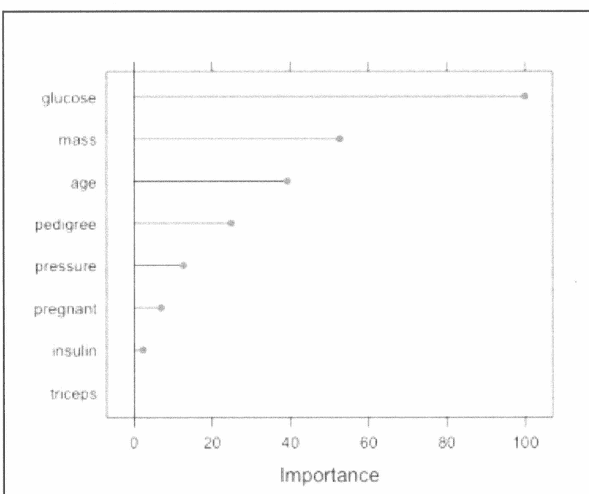

performance of our model
 diab_test<- diab[-training_index, ]

我们不一定非得使用 createDataPartition 函数，而是可以使用简单的 R 命令创建的随机样本，如下所示即可：

```
# Create a set of random indices representing 80% of the data
training_index2 <- sample(nrow(diab),floor(0.80*nrow(diab)))
```

```
# Check the size of the indices just created
length(training_index2)
[1] 614
```

```
# Create the training set
diab_train2 <- diab[training_index2, ]
```

```
# Create the test set
diab_test2 <- diab[-training_index2]
```

## 交叉验证参数

交叉验证将训练-测试拆分的概念推进到下一步。机器学习练习的本质目标是找到能提供最佳性能的模型参数集。模型参数表示函数（模型）所接受的参数。例如，对于决策树模型，参数可能包括模型应构建的深度层数、拆分次数等。如果说有 n 个不同的参数，每个参数有 k 个不同的值，则总参数数量为 k^n。我们通常为每个参数选择一组固定的组合，很容易得到 100-1000+ 种组合。我们将测试模型（例如，正确预测结果的准确率）的性能，针对每种参数。

使用简单的训练-测试拆分，假设我们选择了 500 种参数组合，我们只需将它们在训练数据集上运行并确定哪一个显示出最佳性能即可。

使用交叉验证，我们进一步将训练集拆分为更小的子集，例如，通常使用三折或五折。如果有三折，即我们将训练集拆分为三个子集，我们保留其中一折，例如 Fold 2，并使用一组参数利用 Fold 1 和 Fold 3 创建模型。然后我们对其在 Fold 2 上的准确性进行测试。此步骤重复多次，每次迭代代表训练-测试过程正在执行的唯一折组合，并收集准确度度量。最终，我们将通过选择整体性能最佳的参数来得出最佳组合。

标准方法可概括如下：

- 1. 创建 80-20 训练-测试拆分
- 2. 使用不同组合的模型参数执行你的模型
- 3. 选择整体性能最佳的模型参数并创建最终模型
- 4. 将最终模型应用于测试集以查看结果

交叉验证方法要求我们进一步将训练数据集拆分为更小的子集。这些子集通常称为 **folds**，合在一起称为 **k-folds**，其中 *k* 表示拆分的次数：

- 1. 创建 80-20 训练-测试拆分
- 2. 将训练集拆分为 k 折，例如三折
- 3. 保留 Fold 1 并使用 Fold 2 和 Fold 3 构建模型
- 4. 在 Fold 1 上测试你的模型性能（例如，准确结果的百分比）
- 5. 保留 Fold 2 并使用 Fold 1 和 Fold 3 构建模型
- 6. 在 Fold 2 上测试你的模型性能
- 7. 保留 Fold 3 并使用 Fold 1 和 Fold 2 构建模型
- 8. 在 Fold 3 上测试你的模型性能
- 9. 计算模型在所有三折上的平均性能
- 10. 对 *每组模型参数* 重复步骤 1
- 11. 选择整体性能最佳的模型参数并创建最终模型

## 12. 将最终模型应用于测试集以查看结果

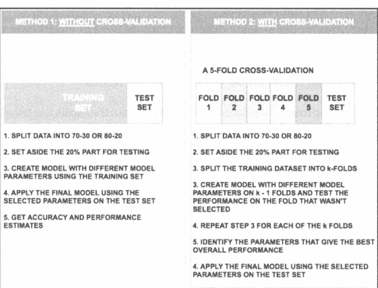

这张图片说明了使用不带交叉验证的方法和使用交叉验证的方法之间的差异。交叉验证方法无疑更稳健，并涉及对模型的严格评估。话虽如此，最初在不使用交叉验证的情况下尝试创建模型通常很有用，以便了解可能期望的性能类型。例如，如果使用 2-3 次训练-测试拆分构建的模型显示出例如 30% 的准确率，那么不太可能任何其他方法，包括交叉验证，会将其提高到 90%。换句话说，标准方法有助于了解可能期望的性能类型。由于交叉验证可能非常计算密集且耗时，因此在初步分析整体流程时，获得初步性能反馈很有帮助。

R 中的 caret 包为使用交叉验证构建模型提供了一种非常用户友好的方法。回想一下，数据预处理必须传递或作为交叉验证过程的组成部分。因此，假设我们必须对数据集进行中心化和缩放并执行五折交叉验证，我们只需在 caret 的 trainControl 函数中定义我们想要使用的采样类型即可。

Caret 关于 trainControl 的网页提供了有关函数及其配套示例的详细概述，网址为 https://topepo.github.io/caret/model-training-and-tuning.html#basic-parameter-tuning。

我们已在之前的练习中使用过这种方法，在该练习中我们使用 PimaIndiansDiabetes 数据集使用 RandomForest 构建了模型。这里再次展示以指示使用该技术的位置：

```
# Create the trainControl parameters for the model
# The parameters indicate that a 3-Fold CV would be created
# and that the process would be repeated 2 times (repeats)
# The class probabilities in each run will be stored
# And we'll use the twoClassSummary* function to measure the model
# Performance
diab_control<- trainControl("repeatedcv", number = 3, repeats = 2, classProbs = TRUE, summaryFunction = twoClassSummary)
```

```
# Build the model
# We used the train function of caret to build the model
# As part of the training process, we specified a tuneLength** of 5
# This parameter lets caret select a set of default model parameters
# trControl = diab_control indicates that the model will be built
# Using the cross-validation method specified in diab_control
# Finally preProc = c("center", "scale") indicate that the data
# Would be centered and scaled at each pass of the model iteration

rf_model<- train(diabetes ~ ., data = diab_train, method = "rf", preProc = c("center", "scale"), tuneLength = 5, trControl = diab_control, metric = "ROC")
```

你可以在 https://cran.r-project.org/web/packages/caret/vignettes/caret.pdf 获取有关 summaryFunction 的更详细解释。

summaryFunction 参数用于传入一个函数，该函数接受观察值和预测值并估计某种性能度量。包中已包含两个这样的函数：defaultSummary 和 twoClassSummary。后者将计算特定于两类问题的度量，例如 ROC 曲线下面积、敏感性和特异性。由于 ROC 曲线基于预测的类别概率（默认情况下不会自动计算），因此需要另一个选项。classProbs = TRUE 选项用于包含这些计算。

以下是来自 caret train 函数帮助文件对 tuneLength 的解释。

`tuneLength` 是表示调优参数网格粒度程度的整数。默认情况下，此参数是 `train` 应为每个调优参数生成的级别数。如果 `trainControl` 具有选项 `search = random`，则这是随机搜索将生成的调优参数组合的最大数量。

> 请注意，如果给出此参数，则必须命名。

## 创建模型

创建模型后的最后一步是使用模型对测试数据集进行预测。这通常使用 R 中的 `predict` 函数完成，第一个参数为创建的模型，第二个参数为你希望获取预测结果的数据集。

以我们的 `PimaIndiansDiabetes` 数据集为例，模型构建后，我们可以按如下方式在测试数据集上获取预测结果：

```
```r
# Install the R Package e1071, if you haven't already
# By running install.packages("e1071")

# Use the predict function and the rf_model that was previously built
# To get the predictions on the test dataset
# Note that we are not including the column diabetes in the test
# dataset by using diab_test[,-ncol(diab_test)]

predictions<- predict(rf_model, diab_test[,-ncol(diab_test)])

# First few records predicted
head(predictions)
[1] negnegpospospospos
Levels: negpos

# The confusion matrix allows us to see the number of true positives
# False positives, True negatives and False negatives

cf<- confusionMatrix(predictions, diab_test$diabetes)
cf

# Confusion Matrix and Statistics
#
#           Reference
```


# Prediction negpos
#       neg  89  21
#       pos  11  32
#
# Accuracy : 0.7908
# 95% CI : (0.7178, 0.8523)
# No Information Rate : 0.6536
# P-Value [Acc > NIR] : 0.0001499
#
# Kappa : 0.5167
# Mcnemar's Test P-Value : 0.1116118
#
# Sensitivity : 0.8900
# Specificity : 0.6038
# PosPredValue : 0.8091
# NegPredValue : 0.7442
# Prevalence : 0.6536
# Detection Rate : 0.5817
# Detection Prevalence : 0.7190
# Balanced Accuracy : 0.7469
#
# 'Positive' Class : neg

让我们看看混淆矩阵告诉我们什么：

# 这表明在被标记为负例（neg）的记录中
# 我们预测其中 89 条为负例，11 条为正例（即，
# 它们为负例但我们错误地将其分类为正例

# 我们正确识别了 32 个正例，但错误地将
# 21 个正例分类为负例

| Prediction | neg | pos |
|---|---|---:|---:|
| neg | 89 | 21 |
| pos | 11 | 32 |

总体准确率为 79%
这可以通过使用更多的方式得到（显著）改善
Accuracy : 0.7908

```
plot(rf_model)
```

图表如下：

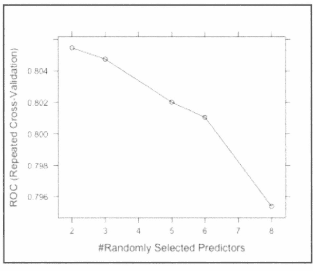

# 最后我们还可以使用 R 中内置的 fourfoldplot 函数来
# 可视化我们的混淆矩阵

```
fourfoldplot(cf$table)
```

我们得到的图表如下：

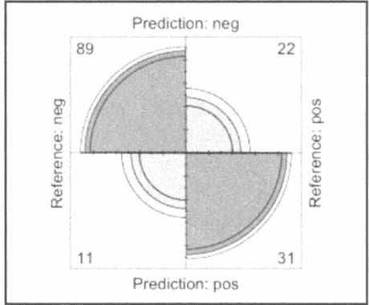

```
diab<- knnImputation(diab)

# Create the train-test set split
training_index<- createDataPartition(diab$diabetes, p = .8, list = FALSE, times = 1)

# Create the training and test dataset
diab_train<- diab[training_index,]
diab_test<- diab[-training_index,]

# We will use 10-Fold Cross Validations
diab_control<- trainControl("repeatedcv", number = 10, repeats = 3, search = "random", classProbs = TRUE)

# Create the model using methodnnet (a Neural Network package in R)
# Note that we have changed the metric here to "Accuracy" instead of # ROC
nn_model<- train(diabetes ~ ., data = diab_train, method = "nnet", preProc = c("center", "scale"), trControl = diab_control, tuneLength = 10, metric = "Accuracy")

predictions<- predict(nn_model, diab_test[,-ncol(diab_test)])
cf<- confusionMatrix(predictions, diab_test$diabetes)
cf

# >cf
# Confusion Matrix and Statistics
# #
# Reference
# Prediction neg pos
# neg 89 19
# pos 11 34
#
# Accuracy : 0.8039
# 95% CI : (0.7321, 0.8636)
# No Information Rate : 0.6536
# P-Value [Acc> NIR] : 3.3e-05
#

即使有 650+ 缺失值，我们的模型仍能达到 80%+ 的准确率。

当然可以进一步改进，但作为基准，它展示了机器学习模型可以期望的性能类型。

在二分结果变量的情况下，随机猜测的准确率只有 50%。80% 的准确率明显高于仅靠猜测所能达到的准确率：

```
plot(nn_model)
```

生成的图表如下：

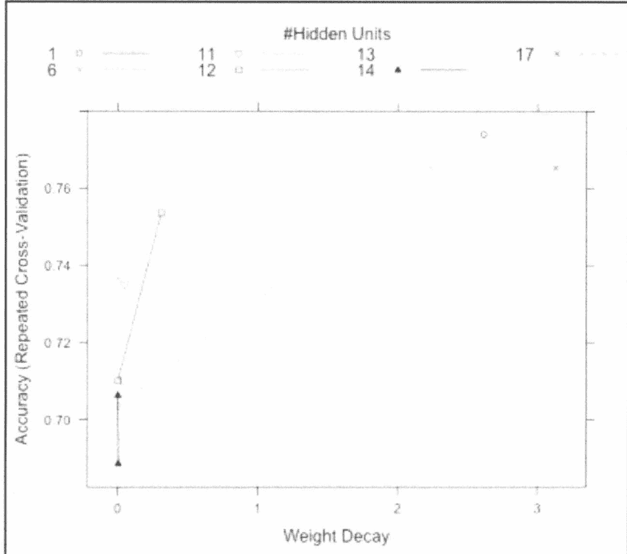

```
fourfoldplot(cf$table)
```

结果在以下图表中显示：

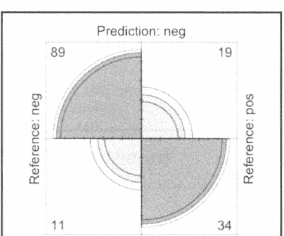

## Summary

在本章中，我们学习了机器学习的基本基础，不同的类型如监督学习和无监督学习，以及数据预处理、数据插补、管理不平衡类别等主要概念。

我们还学习了今天被互换使用的术语之间的关键区别，特别是人工智能和机器学习这两个术语。我们了解到人工智能涉及广泛的主题，如博弈论、社会学、约束优化和机器学习；人工智能相对于机器学习而言范围更广。

机器学习促进了人工智能；也就是说，机器学习算法用于创建人工智能系统，但它们的范围不同。回归问题（给定一组点找到最佳拟合线）可以被视为机器学习算法，但它不太可能被视为人工智能算法（概念上，尽管技术上可以）。

在下一章中，我们将研究机器学习中的一些其他概念，如偏差、方差和正则化。我们还将阅读一些重要算法并学习如何使用 R 中的机器学习包应用它们。

## 8

## Machine Learning Deep Dive

上一章关于机器学习的介绍提供了该主题的初步概述，包括该领域的不同类别和核心概念。本章将更深入地探讨机器学习的理论方面，例如算法的局限性以及不同算法的工作原理。

**机器学习** 是一个庞大而复杂的主题，为此，本章侧重于不同主题的广度，而非深度。概念以高层次的方式介绍，读者可以参考其他资料以进一步理解这些主题。

我们将首先讨论机器学习中的几个基本理论，如梯度下降和 VC 维。接下来，我们将研究偏差和方差，这是任何建模过程中最重要的两个因素，以及偏差-方差权衡的概念。

我们随后将讨论各种机器学习算法、它们的优势和应用领域。

我们将以利用真实世界数据集使用 R 执行机器学习操作的练习作为结尾。

本章将涵盖以下主题：

- 偏差、方差和正则化特性
- 梯度下降和 VC 维理论
- 机器学习算法
- 教程：使用 R 进行机器学习

|  |  |
|---|---|
|1757|275,921|
|1630|274,713|
|1236|201,428|
|1002|193,128|
|1118|187,073|
|1339|202,422|
|1753|283,989|
|1239|228,170|
|1364|230,662|
|995|169,369|
|1000|157,305|

如果我们使用线性趋势线绘制最佳拟合线，图表看起来会是这样：

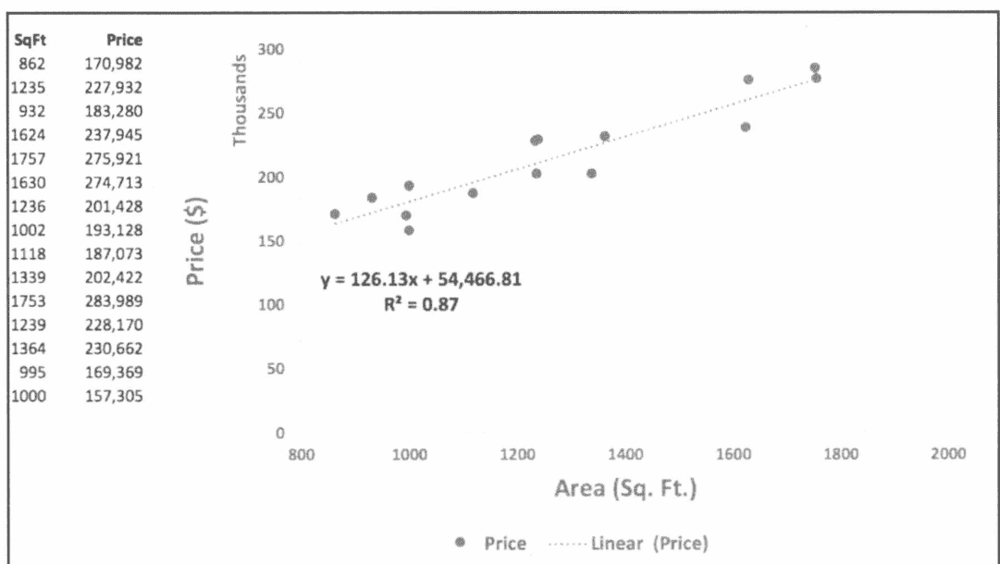

Excel 提供了一个有用的附加功能，允许用户绘制趋势线的延伸，这可以提供未知变量的估计，或 *预测*。在这种情况下，延伸趋势线将根据函数显示 1,800-2,000 平方英尺范围内的房屋价格可能为多少。

描述数据的线性函数如下：

```
$y=126.13x + 54,466.81$
```

以下带有延伸趋势线的图表显示价格很可能在 275,000 美元到 300,000 美元之间：

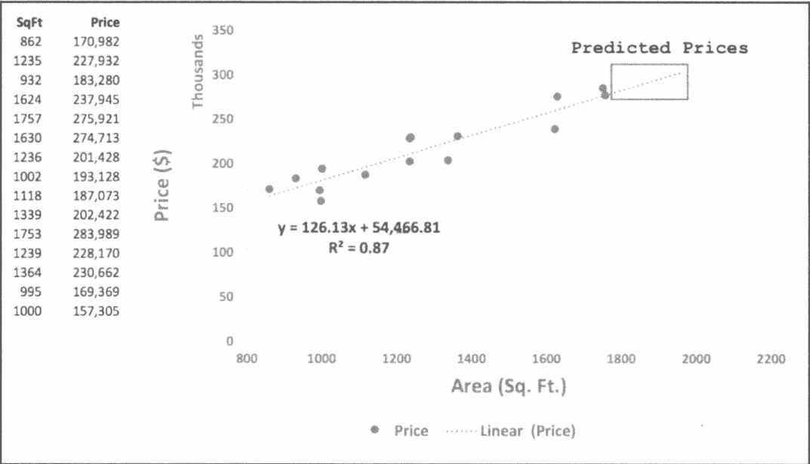

然而，有人可能会认为该线并不是最佳近似，并且可能可以提高 R2 的值，在本例中为 0.87。一般来说，R^2 越高，描述数据的模型越好。R² 有各种不同的类型，但为本节目的，我们假设 R² 越高，模型越好。

在下一节中，我们将绘制一条新的趋势线，其 R^2 明显更高，但使用多项式函数。该函数具有更高的 R^2（0.91 对比 0.87），并且在视觉上平均更接近点。

本例中的函数是 6 阶多项式：

```
y = -0.00x^6 + 0.00x^5 - 0.00x^4 + 2.50x^3 - 2,313.40x^2 + 1,125,401.77x - 224,923,813.17
```

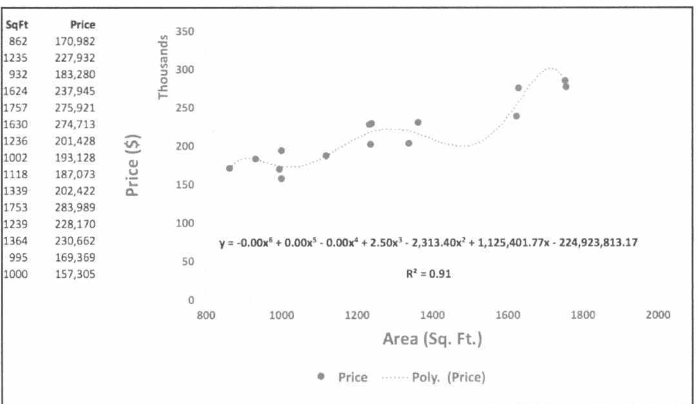

但是，即使该线的 R^2 更高，如果我们延伸趋势线，试图找出 1,800-2,000 平方英尺范围内的房屋价格可能为多少，我们会得到以下结果。

1,800-2,000 平方英尺范围内的房屋价格从约 280,000 美元到 2,000 平方英尺时负的 200 万美元不等。换句话说，预计购买 1800 平方英尺房屋的人将花费 280,000 美元，而根据此函数，具有“更高 R^2”的函数，预计购买 2,000 平方英尺房屋的人应获得 200 万美元！这当然不准确，但我们刚刚见证的就是所谓的过拟合。下面的图像说明了这一现象。

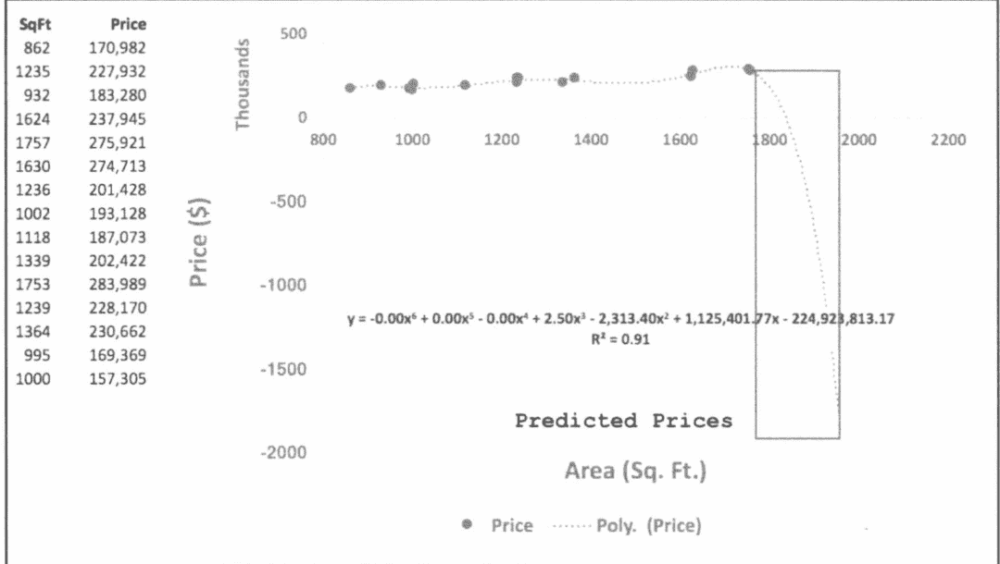

在另一端是欠拟合。当构建的模型不能描述数据时就会发生这种情况。在下面的图表中，函数 y = 0.25x - 200 就是一个这样的例子：


假设我们要确定一堆水果是橙子还是苹果，并已得知它们在水果篮中的位置（左侧或右侧）、大小和重量：

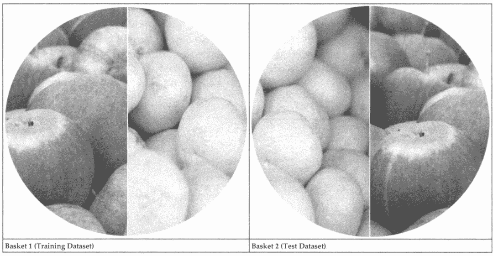

过拟合的一个例子可以是：基于训练数据集，对于篮子1，我们可以得出结论：只有位于篮子右侧的水果是橙子，而左侧的水果全是苹果。

欠拟合的一个例子可以是：我得出结论，篮子里只有橙子。

**模型1：** 在第一种情况（过拟合）中，我实质上记住了位置。

**模型2：** 在第二种情况（欠拟合）中，我什么都没能精确记住。

现在，给定第二个篮子——即测试数据集，其中苹果和橙子的位置发生了交换——如果我使用模型1，我会错误地得出所有右侧水果是橙子、左侧水果是苹果的结论（因为我记住了训练数据）。

如果我使用模型2，我同样会错误地得出所有水果都是橙子的结论。

然而，有一些方法可以管理欠拟合和过拟合之间的平衡——换句话说，也就是高偏差和高方差之间的平衡。

用于偏差-方差权衡的常用方法之一称为**正则化**。这是指对模型进行惩罚（例如，回归中模型的系数）的过程，以便产生能够在各种数据点上良好泛化的输出。

下表说明了偏差和方差的一些关键概念，并展示了当模型具有高方差或高偏差时可供选择的补救措施：

| 要解决的问题 | 问题 | 补救措施 |
|---|---|---|
| **高方差**（*无法“泛化”*） | 信息不足 | 获取更多训练样本 |
| | 考虑的特征（变量）太多 | 减少特征数量 |
| | 惩罚过少 | 增大正则化参数（lambda） |
| **高偏差**（*我们过度泛化了*） | 没有足够特征来构建更完善的模型 | 增加更多特征 |
| | 模型过于简单 | 添加更复杂的特征（例如，多项式特征） |
| | 惩罚过多 | 减小正则化参数（lambda） |

就建模过程而言，高偏差通常表现为训练集误差和测试集误差都持续偏高。对于高方差（过拟合），训练集误差迅速下降，但测试集误差保持不变。

## 梯度下降与VC维理论

梯度下降和VC维是机器学习中两个基础理论。一般来说，**梯度下降**提供了一种结构化方法来寻找函数的最优系数。函数的假设空间可能很大，而借助梯度下降，算法会尝试找到代价函数（例如误差平方和）最低的最小值*（极小值）*。

**VC维**为系统中可以被分类的最大点数提供了一个上界。它本质上是对函数丰富程度的度量，并以结构化方式评估假设的极限。能够被函数或假设精确分类的点数被称为该假设的VC维。例如，线性边界可以精确分类2个或3个点，但无法分类4个点。因此，这个二维空间的VC维为3。

VC维与计算学习理论中的许多其他主题一样，既复杂又有趣。它是一个较少人知晓（和讨论）的主题，但对试图回答“学习的极限是什么”这类问题有着深远的影响。

## 流行的机器学习算法

机器学习算法有各种不同的类别。由于算法在概念层面上可能同时属于多个“类别”，因此很难明确指出某个算法只属于某一个类别。在本节中，我们将简要讨论一些最常用和广为人知的算法。

这些算法包括：

- 回归模型
- 关联规则
- 决策树
- 随机森林
- 提升算法
- 支持向量机
- K均值
- 神经网络

请注意，在示例中，我们展示了使用整个数据集的R函数的基本用法。在实践中，我们会将数据划分为训练集和测试集，一旦构建出满意的模型，就将其应用于测试数据集以评估模型性能。

### 回归模型

回归模型的范围从统计学中常用的线性、逻辑和多元回归算法，到岭回归和套索回归，后者通过惩罚系数来提高模型性能。

在之前的示例中，我们看到了创建趋势线时线性回归的应用。多元线性回归指的是建模过程需要多个自变量。

例如：

总广告费用 = x * 印刷广告，这属于简单线性回归；而

总广告费用 = X + 印刷广告 + 电台广告 + 电视广告，由于存在多个自变量（印刷、电台和电视），这属于多元线性回归。

逻辑回归是另一种常用的统计回归建模技术，它预测离散类别值的结果，主要用于结果变量为二分（例如，0或1、是或否等）的情况。然而，也可能存在超过2个离散结果（例如，纽约州、新泽西州、康涅狄格州），这种类型的逻辑回归被称为多项逻辑回归。

**岭回归和套索回归**在线性回归的其他方面之外，还包含一个正则化项（λ）。岭回归中的正则化项会起到减小β系数（即“惩罚”系数）的作用。在套索中，正则化项倾向于将一些系数缩减为0，从而消除该变量对最终模型的影响：

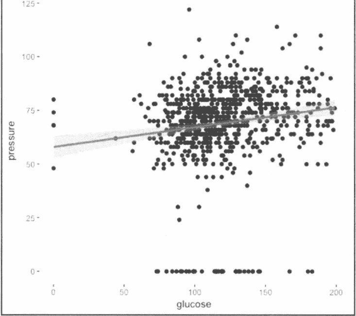

```
# 加载 mlbench，并以 glucose（结果/因变量）为因变量，pressure、triceps 和 insulin 为自变量，创建一个回归模型。

> library("mlbench")
> lm_model <- lm(glucose ~ pressure + triceps + insulin,
                 data=PimaIndiansDiabetes[1:100,])
> plot(lm_model)
```

### 关联规则

关联规则挖掘，或称**apriori**，试图在数据集中的变量之间寻找关系。关联规则经常被用于各种实际应用场景。给定一组变量，apriori 可以指示事务数据集中固有的模式。我们的一个教程将基于用 R Shiny 应用实现 apriori，因此本节对其进行了更多强调。

例如，假设一家连锁超市决定商品上架的顺序。对包含销售事务的数据库运行 apriori 算法，可以识别出例如最常被一起购买的商品。这使超市能够确定哪些商品在彼此靠近地战略摆放时能够产生最多销量。这通常也被称为*购物篮分析*。

一个简单的例子如下所示：

```
# 在下面的关系中，LHS（左侧）导致 RHS（右侧）。

# 例如，{牛奶，面包} --> {黄油} 表示购买牛奶和面包的人也很可能购买黄油。

{牛奶，面包} --> {黄油}
{黄油，鸡蛋} --> {烤盘}
{烤盘，黄油} --> {糖}
...
```

在上述所有情况下，购买表达式左侧的商品往往导致了右侧商品的购买。

也可以从不一定包含*事务*的数据库中派生关联规则，而是使用滑动窗口沿着时间属性遍历事件，例如 WINEPI 算法。


Apriori 中有 3 个主要度量。为了说明它们，让我们使用一个包含 4 笔交易中购买的商品的示例数据集：

| 交易 | 商品 1 | 商品 2 | 商品 3 |
| --- | --- | --- | --- |
| 1 | 牛奶 | 面包 | 黄油 |
| 2 | 牛奶 | 鸡蛋 | 黄油 |
| 3 | 面包 | 鸡蛋 | 奶酪 |
| 4 | 黄油 | 面包 | 鸡蛋 |

## 置信度

置信度指的是当 Apriori 表达式的左侧成立时，右侧成立的频率。例如，给定一个表达式：

```
{Milk} → {Bread}
```

我们想知道在购买了牛奶时，有多频繁也会购买面包。

在这种情况下：

- 交易 1：牛奶和面包都存在
- 交易 2：存在牛奶，但没有面包
- 交易 3 和 4：不存在牛奶

因此，根据我们看到的情况，牛奶出现的交易有 2 笔，其中面包在 1 笔交易中出现。因此，规则 {Milk} → {Bread} 的置信度为 1/2 = 50%。

再看另一个表达式：

```
{Bread} → {Butter}
```

我们想知道，当购买了面包时，有多频繁也会购买黄油？

- 交易 1：面包和黄油都存在
- 交易 2：没有面包（黄油存在，但我们的参考点是面包，因此不计入）
- 交易 3：面包存在但没有黄油
- 交易 4：面包和黄油都存在

因此，我们有 3 笔交易包含面包，其中 2 笔交易同时包含面包和黄油。因此，在这种情况下，规则 {Bread} → {Butter} 的置信度为 2/3 = 66.7%。

## 支持度

支持度指的是规则被满足的次数相对于数据集中交易总数的比例。

例如：

{Milk} → {Bread} 在 4 笔交易中出现 1 次（在交易 1 中）。因此，该规则的支持度为 1/4 = 0.25（或 25%）。

{Bread} → {Butter} 在 4 笔交易中出现 2 次（在交易 1 和 4 中）。因此，该规则的支持度为 1/2 = 0.50（或 50%）。

## 提升度

提升度 arguably 是 3 个度量中最重要的；它衡量规则的支持度相对于表达式两侧各自支持度的比例；换句话说，它衡量规则相对于 LHS 和 RHS 表达式随机出现的强度。它正式定义为：

Lift = Support(Rule) / (Support(LHS) * Support(RHS))

提升值较低（例如，小于或等于 1）表明 LHS 和 RHS 的出现相互独立，而较高的提升度量表明共同出现具有显著性。

在我们之前的示例中，

{Bread} → {Butter} 的提升度为：

Support({Bread} → {Butter}) / (Support({Bread}) * Support({Butter}))

= 0.50 / ((3/4) * (3/4)) = 0.50 / (0.75 * 0.75) = 0.89。

这表明尽管该规则的置信度很高，但该规则本身相对于可能高于 1 的其他规则而言并不显著。

提升度高于 1 的规则示例为：

{Item 1: Bread} → {Item 3: Cheese}

其提升度为：

Support({Item 1: Bread} → {Item 3: Cheese}) / (Support({Item 1: Bread}) * Support({Item 3: Cheese}))

= (1/4) / ((1/4) * (1/4)) = 4。

## 决策树

决策树是一种预测建模技术，它生成规则来基于先前结果的可能性推导出特定结果的可能性。一般来说，决策树通常类似于流程图构建，包含一系列表示父子关系的节点和叶节点。不链接到其他节点的节点称为叶节点。

决策树属于通常被称为 CART（分类与回归树）的一类算法。如果感兴趣的结果是分类变量，则属于分类练习，而如果结果是数值，则称为回归树。

一个例子有助于使这一概念更清晰。请看图表：

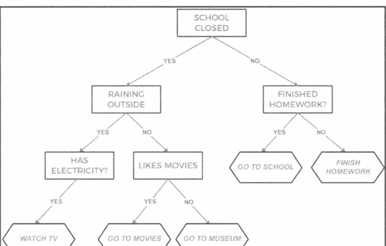

图表显示了一个假设场景：学校是否关闭/未关闭。矩形框（蓝色）代表节点。第一个矩形（学校关闭）代表 *根* 节点，而内部矩形代表 *内部节点*。带斜边的矩形框（绿色且斜体字母）代表 *叶节点*（或 *终端节点*）。

决策树易于理解，并且是少数不是“黑箱”的算法之一。用于创建神经网络的算法通常被认为是黑箱，因为由于模型复杂，很难——如果不是不可能——直观地确定最终结果是如何得出的。

在 R 中，有多种用于创建决策树的设施。用于在 R 中创建它们的常用库是 `rpart`。我们将重新审视我们的 `PimaIndiansDiabetes` 数据集，以了解如何使用该包创建决策树。

我们希望创建一个模型来确定葡萄糖、胰岛素、（身体）体重指数和年龄与糖尿病的关系。请注意，在数据集中，糖尿病是一个分类变量，响应为是/否。

为了可视化决策树，我们将使用 `rpart.plot` 包。代码如下所示：

```
install.packages("rpart")
install.packages("rpart.plot")

library(rpart)
library(rpart.plot)

rpart_model <- rpart(diabetes ~ glucose + insulin + mass + age, data = PimaIndiansDiabetes)

> rpart_model
n= 768

node), split, n, loss, yval, (yprob)
    * denotes terminal node

 1) root 768 268 neg (0.6510417 0.3489583)
   2) glucose< 127.5 485 94 neg (0.8061856 0.1938144) *
   3) glucose>=127.5 283 109 pos (0.385159 0.6148410)
     6) mass< 29.95 76 24 neg (0.6842105 0.3157895)
       12) glucose< 145.5 41 6 neg (0.8536585 0.1463415) *
       13) glucose>=145.5 35 17 pos (0.4857143 0.5142857)
         26) insulin< 14.5 21 8 neg (0.6190476 0.3809524) *
         27) insulin>=14.5 14 4 pos (0.2857143 0.7142857) *
     7) mass>=29.95 207 57 pos (0.2753623 0.7246377)
       14) glucose< 157.5 115 45 pos (0.3913043 0.6086957)
         28) age< 30.5 50 23 neg (0.5400000 0.4600000)
           56) insulin>=199 14 3 neg (0.7857143 0.2142857) *
           57) insulin< 199 36 16 pos (0.4444444 0.5555556)
             114) age>=27.5 10 3 neg (0.7000000 0.3000000) *
             115) age< 27.5 26 9 pos (0.3461538 0.6538462) *
         29) age>=30.5 65 18 pos (0.2769231 0.7230769) *
       15) glucose>=157.5 92 12 pos (0.1304348 0.8695652) *
```

```
> rpart.plot(rpart_model, extra=102, nn=TRUE)
```

下图说明了模型 `rpart_model` 所代表的决策树。

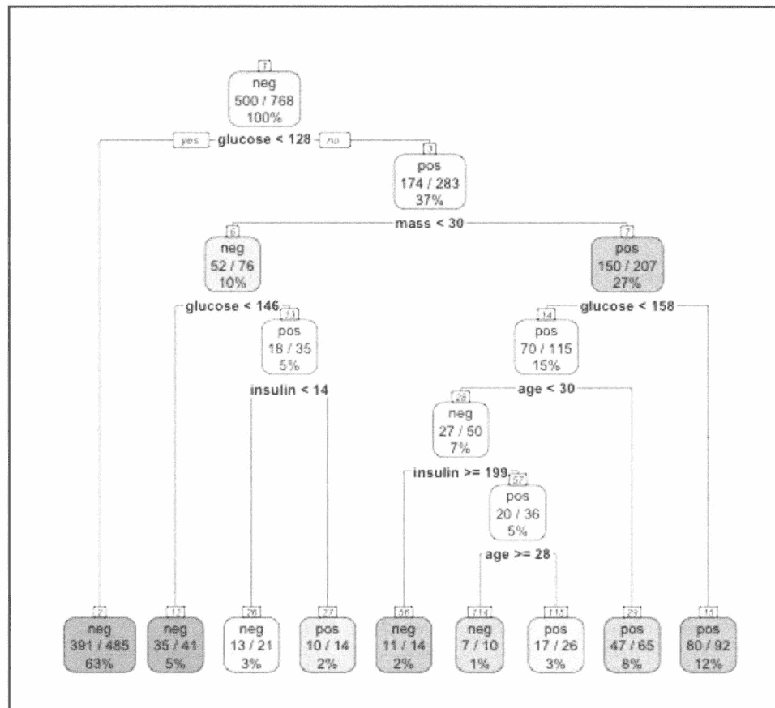

从顶部读起，图表显示数据集中有 500 例 diabetes=neg（总共 768 条记录）。

在数据集中葡萄糖 < 128 的总记录数（768）中，有 485 条记录标记为负。模型正确预测了其中 391 例为负（节点编号 2，底部左侧第一个）。

对于葡萄糖读数 > 128 的记录，有 283 条记录标记为阳性（节点编号 3，位于最顶部/根节点正下方）。模型正确分类了其中 174 例。

另一个用于直观决策树且具有全面可视化信息的较新包是 FFTrees（快速简约决策树）。以下示例仅用于信息目的提供：

```
install.packages("FFTrees")
library(caret)
library(mlbench)
library(FFTrees)
set.seed(123)

data("PimaIndiansDiabetes")
diab <- PimaIndiansDiabetes
diab$diabetes <- 1 * (diab$diabetes == "pos")

train_ind <- createDataPartition(diab$diabetes, p = 0.8, list = FALSE, times = 1)

training_diab <- diab[train_ind, ]
test_diab <- diab[-train_ind, ]

diabetes.fft <- FFTrees(diabetes ~ ., data = training_diab, data.test = test_diab)
plot(diabetes.fft)
```

下图说明了使用 FFTrees 包表示 `diabetes.fft` 的决策树。


## 数据
N = 615
False True
398 217

# p(False)
65%

# p(True)
35%

# FFT #1 (of 8)

# 判定为 False
正确拒绝 ○   △ 漏报
263 53

# 判定为 True
误报 ○   △ 命中

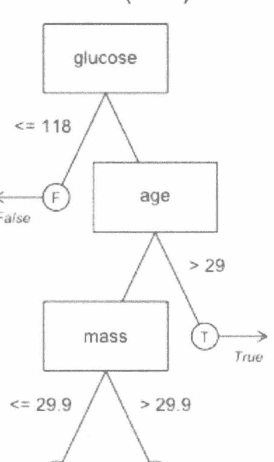

# 性能 (训练)

真实
True False
决策
True 158 111
命中 误报 Al
False 59 287
△ 漏报 ○ 正确拒绝

# mcu pci sens spec acc wacc
1.7 81 73 72 72 72
BL

# ROC
灵敏度 (HR)
1 - 特异度 (FAR)
# FFT
© CART
① LR
® RF
S SVM

决策树通过递归地对数据进行分割来工作，直到达到停止准则，例如达到某个深度，或案例数量低于指定值。每次分割都是基于会导致“更纯的子集”的变量。

原则上，我们可以从给定的变量集中生长出无限数量的树，这使得它成为一个特别困难且难以处理的难题。存在许多算法可提供高效的分割和创建决策树的方法。其中一种方法就是 Hunt 算法。

有关该算法的更多详细信息，可在以下位置找到：
https://www-users.cs.umn.edu/~kumar/dmbook/ch4.pdf.

## 随机森林扩展

随机森林是我们在前面讨论的决策树模型的扩展。在实践中，决策树易于理解，易于解释，使用可用算法快速创建，并且总体上直观。然而，决策树对数据中的微小变化敏感，只能沿轴进行分割（线性分割），并且可能导致过拟合。为了减轻决策树的某些缺点，同时仍然获得其优雅性的好处，随机森林等算法会创建多个决策树并对随机特征进行采样，以利用这些特征并构建聚合模型。

随机森林的工作原理基于 **自助聚合** 或 **装袋**。自助法是一个统计术语，表示有放回的随机抽样。对一组记录进行自助抽样意味着随机抽取一定数量的记录，并且可能在样本中多次包含同一记录。此后，用户将在样本上衡量其感兴趣的指标，然后重复该过程。以这种方式，多次从随机样本计算的指标值的分布预计代表总体以及整个数据集的分布。

对一组 3 个数字进行装袋的示例，例如 (1,2,3,4)，将是：

(1,2,3), (1,1,3), (1,3,3), (2,2,1)，以及其他。

自助聚合，或 *装袋*，意味着利用投票方法同时使用 *多个自助样本*，在每个单独的样本（n 条记录的集合）上构建模型，然后最终聚合结果。

随机森林还实现了比简单装袋更进一步的操作。它还在每次分割时随机选择用于模型构建过程的变量。例如，如果我们使用 `PimaIndiansDiabetes` 数据集使用变量 pregnant、glucose、pressure、triceps、insulin、mass、pedigree、age 和 diabetes 创建随机森林模型，在每个自助样本（n 条记录的抽取）中，我们将选择一个随机特征子集来构建模型——例如，glucose、pressure 和 insulin；insulin、age 和 pedigree；triceps、mass 和 insulin；以及其他。

在 R 中，常用的 RandomForest 包以其名称命名，即 RandomForest。我们可以通过包本身或通过 caret 使用它。两种方法如下所示：

+   1. 使用 RandomForest 包使用随机森林：

```
> rf_model1 <- randomForest(diabetes ~ ., data=PimaIndiansDiabetes) >
rf_model1 Call: randomForest(formula = diabetes ~ ., data = PimaIndiansDiabetes)
Type of random forest: classification Number of trees: 500 No. of variables tried at each split: 2 OOB estimate of error rate: 23.44% Confusion matrix: negposclass.error neg430 70 0.1400000 pos 110 158 0.4104478
```

+   2. 使用 caret 通过 method="rf" 函数使用随机森林：

```
> library(caret)
> library(doMC)

# THE NEXT STEP IS VERY CRITICAL - YOU DO 'NOT' NEED TO USE MULTICORE
# NOTE THAT THIS WILL USE ALL THE CORES ON THE MACHINE THAT YOU ARE
# USING TO RUN THE EXERCISE

# REMOVE THE # MARK FROM THE FRONT OF registerDoMC BEFORE RUNNING
# THE COMMAND

># registerDoMC(cores = 8) # CHANGE NUMBER OF CORES TO MATCH THE NUMBER OF CORES ON YOUR MACHINE

>rf_model<- train(diabetes ~ ., data=PimaIndiansDiabetes, method="rf")
>rf_model
Random Forest

768 samples
  8 predictor
  2 classes: 'neg', 'pos'

No pre-processing
Resampling: Bootstrapped (25 reps)
Summary of sample sizes: 768, 768, 768, 768, 768, 768, ...
Resampling results across tuning parameters:
```

| mtry | Accuracy | Kappa |
|------|----------|-------|
| 2 | 0.7555341 | 0.4451835 |
| 5 | 0.7556464 | 0.4523084 |
| 8 | 0.7500721 | 0.4404318 |

Accuracy was used to select the optimal model using the largest value.

```
The final value used for the model was mtry = 5.

>getTrainPerf(rf_model)

TrainAccuracy TrainKappa method
1 0.7583831 0.4524728 rf
```

也可以查看原始随机森林模型（未使用 caret）中每棵树的分割和其他相关信息。这可以使用 getTree 函数完成，如下所示：

```
>getTree(rf_model1,1,labelVar = TRUE)
      left daughter right daughter split var split point status prediction
1 2 3 mass 27.8500 1 <NA>
2 4 5 age 28.5000 1 <NA>
3 6 7 glucose 155.0000 1 <NA>
4 8 9 age 27.5000 1 <NA>
5 10 11 mass 9.6500 1 <NA>
6 12 13 pregnant 7.5000 1 <NA>
7 14 15 insulin 80.0000 1 <NA>
8 0 0 <NA> 0.0000 -1 neg
9 16 17 pressure 68.0000 1 <NA>
10 0 0 <NA> 0.0000 -1 pos
11 18 19 insulin 131.0000 1 <NA>
12 20 21 insulin 87.5000 1 <NA>

[...]
```

## 提升算法

提升是一种使用权重和一组弱学习器，例如决策树，以提高模型性能的技术。提升根据模型误分类为数据分配权重，并且未来的学习器（在提升机器学习过程中创建）会关注被误分类的示例。正确分类的示例将被重新分配新的权重，通常低于未正确分类的示例。权重可以基于成本函数，例如多数投票，使用数据子集。

在简单且非技术性的术语中，提升使用一系列弱学习器，每个学习器“学习”之前学习器的错误。

与装袋相比，提升通常更受欢迎，因为它根据模型性能分配相对权重，而不是像装袋那样为所有数据点分配相等权重。这在概念上类似于加权平均值与没有加权标准的平均函数之间的差异。

R 中有多个提升算法的包，其中一些常用的如下：

+   - Adaboost
+   - GBM (Stochastic Gradient Boosting)
+   - XGBoost

其中，XGBoost 是一个广受欢迎的机器学习包，已在 Kaggle 等竞争性机器学习平台上非常成功地使用。XGBoost 具有创建集成模型非常优雅且计算高效的方式。由于它既准确又极快，用户经常使用 XGBoost 进行计算密集型 ML 挑战。您可以在 http://www.kaggle.com 上了解有关 Kaggle 的更多信息。

```
# Creating an XGBoost model in R

library(caret)
library(xgboost)

set.seed(123)
train_ind<-
sample(nrow(PimaIndiansDiabetes),as.integer(nrow(PimaIndiansDiabetes)*.80))

training_diab<- PimaIndiansDiabetes[train_ind,]
test_diab<- PimaIndiansDiabetes[-train_ind,]

diab_train<- sparse.model.matrix(~.-1, data=training_diab[,-ncol(training_diab)])
diab_train_dmatrix<- xgb.DMatrix(data = diab_train,
label=training_diab$diabetes=="pos")

diab_test<- sparse.model.matrix(~.-1, data=test_diab[,-ncol(test_diab)])
diab_test_dmatrix<- xgb.DMatrix(data = diab_test,
label=test_diab$diabetes=="pos")

param_diab<- list(objective = "binary:logistic",
eval_metric = "error",
                booster = "gbtree",
max_depth = 5,
```


```
eta = 0.1)

xgb_model <- xgb.train(data = diab_train_dmatrix,
param_diab, nrounds = 1000,
watchlist = list(train = diab_train_dmatrix, test = diab_test_dmatrix),
print_every_n = 10)

predicted <- predict(xgb_model, diab_test_dmatrix)
predicted <- predicted > 0.5

actual <- test_diab$diabetes == "pos"
confusionMatrix(actual,predicted)
```

## RESULT

混淆矩阵和统计量

| Prediction | FALSE | TRUE |
|---|---:|---:|
| FALSE | 80 | 17 |
| TRUE | 21 | 36 |

Accuracy : 0.7532
95% CI : (0.6774, 0.8191)
No Information Rate : 0.6558
P-Value [Acc > NIR] : 0.005956

Kappa : 0.463
Mcnemar's Test P-Value : 0.626496

Sensitivity : 0.7921
Specificity : 0.6792
PosPredValue : 0.8247
NegPredValue : 0.6316
Prevalence : 0.6558
Detection Rate : 0.5195
Detection Prevalence : 0.6299
Balanced Accuracy : 0.7357

'Positive' Class : FALSE

## Support vector machines

支持向量机

支持向量机，通常称为 **SVMs**，是另一类机器学习算法，用于使用称为 **hyperplane** 的概念将数据分类到一个或另一个类别，该概念用于在点之间划定线性边界。

例如，给定 x-y 轴上的黑白点集，我们可以找到多条线来将它们分开。在这种情况下，线代表了界定每个点所属类别的函数。在下面的图像中，线 H1 和 H2 都能准确地分离点。在这种情况下，我们如何确定 H1 和 H2 中哪一个是最佳线？：

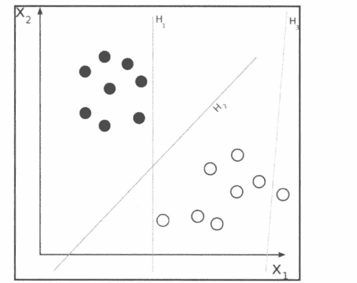

直观地说，我们可以说离点最近的线——例如垂直线 H1——可能*不是*分离点的最佳线。由于线离点太近，并且对给定数据集上的点过于具体，如果新点稍微偏离线的右侧或左侧，就可能被错误分类。换句话说，该线对数据的微小变化过于敏感，而这些变化可能是由于随机/确定性噪声引起的，例如数据中的不完美。

另一方面，线 H2 在分离数据的同时保持了与离线最近的点最大可能的距离。数据中的轻微不完美不太可能影响点的分类程度，就像线 H1 可能发生的那样。这本质上描述了图像下所示的最大间隔分离原理。

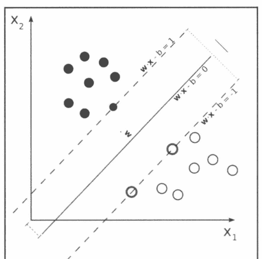

靠近线的点，也称为超平面，被称为“支持向量”（因此得名）。在图像中，位于虚线上的点因此是支持向量。

然而，在现实世界中，并非所有点都可能是“线性可分”的。SVM 利用了称为“核技巧”的概念。本质上，可能无法线性分离的点可以投影或映射到更高维的表面。例如，给定 2D x-y 空间中一组无法线性分离的点，如果我们将点投影到三维空间中，如下图所示，则可能将它们分开。红色着色的点无法通过 2D 线分离，但在映射到三维表面后，可以通过如下图所示的超平面分离：

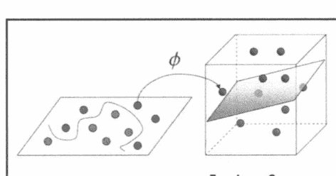

R 中有多个包可让用户利用 SVM，例如 kernlab、e1071、klaR 等。在这里，我们说明了使用 e1071 包中的 SVM 的用法，如下所示：

```
library(mlbench)
library(caret)
library(e1071)
set.seed(123)

data("PimaIndiansDiabetes")
diab<- PimaIndiansDiabetes

train_ind<- createDataPartition(diab$diabetes,p=0.8,list=FALSE,times=1)

training_diab<- diab[train_ind,]
test_diab<- diab[-train_ind,]

svm_model<- svm(diabetes ~ ., data=training_diab)
plot(svm_model,training_diab, glucose ~ mass)

# The plot below illustrates the areas that are classified 'positive' and 'negative'
```

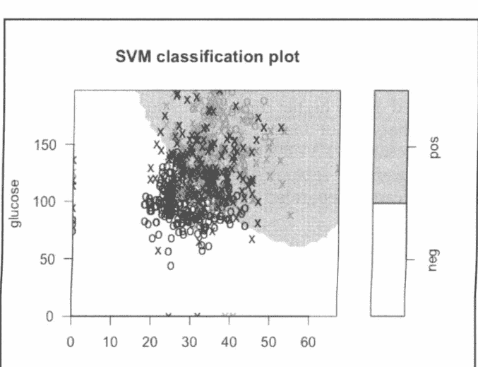

```
# Creating and evaluating the Confusion Matrix for the SVM model

svm_predicted<- predict(svm_model,test_diab[,-ncol(test_diab)])
confusionMatrix(svm_predicted,test_diab$diabetes)
```

混淆矩阵和统计量

Reference

| Prediction | neg | pos |
|---|---:|---:|
| neg | 93 | 26 |
| pos | 7 | 27 |

Accuracy : 0.7843
95% CI : (0.7106, 0.8466)
No Information Rate : 0.6536
P-Value [Acc > NIR] : 0.0003018

Kappa : 0.4799
McNemar's Test P-Value : 0.0017280

Sensitivity : 0.9300
Specificity : 0.5094
PosPredValue : 0.7815
NegPredValue : 0.7941
Prevalence : 0.6536
Detection Rate : 0.6078
Detection Prevalence : 0.7778
Balanced Accuracy : 0.7197
'Positive' Class : neg

## The K-Means machine learning technique

K-Means 机器学习技术

K-Means 是最受欢迎的无监督机器学习技术之一，用于创建聚类，从而对数据进行分类。

一个直观的例子可以如下提出：

假设一所大学正在开设美国历史和亚洲历史的新课程。大学保持 15:1 的师生比例，因此每 15 名学生有 1 名教师。它进行了一项调查，其中包含每个学生对学习美国历史或亚洲历史的偏好所分配的 10 分制数值评分。

我们可以使用 R 内置的 K-Means 算法创建 2 个聚类，并且根据每个聚类中的点数，可能可以估计可能报名参加每门课程的学生人数。代码如下所示：

```
library(data.table)
library(ggplot2)
library()

historyData<- fread("~/Desktop/history.csv")
ggplot(historyData,aes(american_history,asian_history)) + geom_point() + geom_jitter()

historyCluster<- kmeans(historyData,2) # Create 2 clusters
historyData[,cluster:=as.factor(historyCluster$cluster)]
ggplot(historyData, aes(american_history,asian_history,color=cluster)) + geom_point() + geom_jitter()

# The image below shows the output of the ggplot command. Note that the effect of geom_jitter can be seen in the image below (the points are nudged so that overlapping points can be easily visible)
```

下面的图像可以直观地估计可能报名参加每门课程的学生人数（从而确定可能需要的教师人数）：

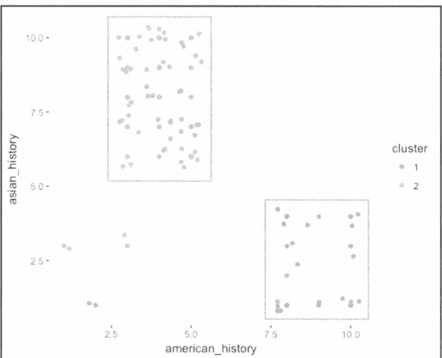

K-Means 算法有几种变体，但标准且最常用的方法是 Lloyd 算法。算法步骤如下：

- 1. 从数据集中随机选择 k 个点作为 k 个聚类的中点（即 *初始质心*）。
- 2. 测量其他每个点到所选 k 个点（代表 k 个聚类）的距离，并将其分配给与该点距离最小的聚类。
- 3. 聚类中心重新计算为聚类中点的平均值。
- 4. 再次按步骤 2 计算质心与所有其他点之间的距离，并按步骤 3 计算新的质心。以这种方式，重复步骤 2 和 3，直到没有新的数据被重新分配。

存在多种用于聚类的 *距离和相似性度量*，例如 **Euclidean Distance**（直线距离）、**Cosine Similarity**（向量之间角度的余弦）、**Hamming Distance**（通常用于分类变量）、**Mahalanobis Distance**（以 P.C. Mahalanobis 命名；该度量点与分布均值之间的距离），等等。

尽管最优聚类数并不总是可以明确识别，但有各种方法试图找到估计值。一般来说，聚类可以通过聚类内点的接近程度来衡量（聚类内方差，如平方和之和--WSS）和聚类之间的距离（因此聚类之间的距离越大，聚类就越容易区分）。确定最优数量的一种方法称为 **elbow method**。下图说明了该概念：

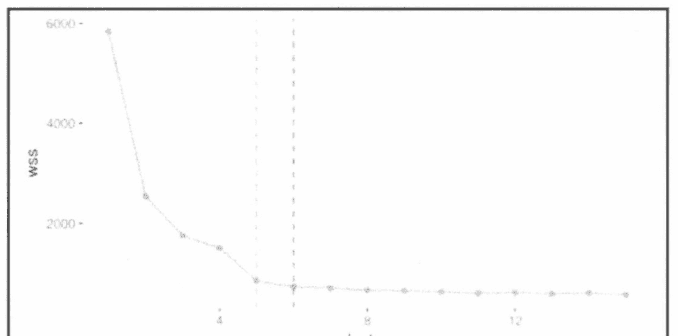


图表显示了 WSS（我们寻求最小化的簇内平方和）与聚类数量之间的关系图。如图所示，将聚类数量从 1 增加到 2 时，WSS 值大幅下降。WSS 值迅速下降直到第 4 个或第 5 个聚类，之后再增加聚类数量并不会对 WSS 产生显著改善。通过视觉评估，机器学习从业者可以得出结论，基于该图像，可以创建的理想聚类数量在 3-5 之间。

> 请注意，较低的 WSS 分数不足以确定最佳聚类数量。必须通过检查指标的改善情况来确定。当每个点成为一个独立聚类时，WSS 最终会降至 0。

## 神经网络相关算法

神经网络相关算法已经存在数十年之久。第一个计算模型由 Warren McCulloch 和 Walter Pitts 于 1943 年在《数学生物物理学公报》上描述。

> 你可以在 `https://pdfs.semanticscholar.org/5272/8a99829792c3272043842455f3a110e841b1.pdf` 和 `https://en.wikipedia.org/wiki/Artificial_neural_network` 上了解更多关于这些概念的信息。

物理世界中各种人造物体，例如飞机，都从自然界中汲取灵感。神经网络本质上是对 *人类神经系统* 中神经元轴突和树突（也称为树突）之间数据交换现象的表示。就像数据在神经元之间传递以做出复杂决策一样，人工神经网络以类似的方式创建了一个神经元网络，该网络从其他神经元接收输入。

在高层次上，人工神经网络由 4 个主要组件组成：

- Input Layer
- Hidden Layer(s)
- Output Layer
- Nodes and Weights

这在以下图像中有所体现：

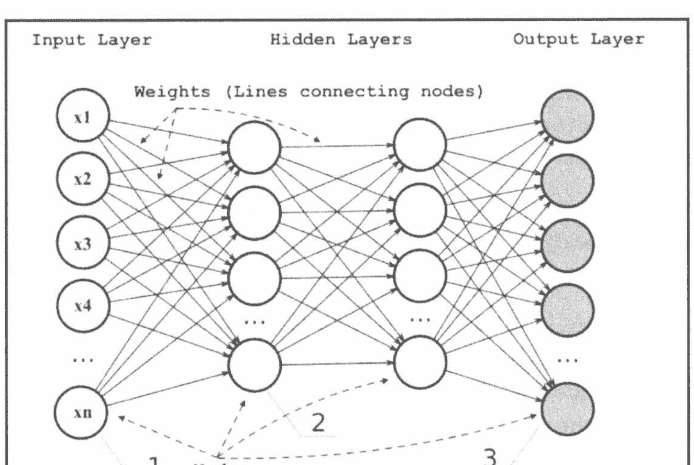

图中每个节点根据前一层的输入产生输出。输出是使用激活函数产生的。激活函数有各种类型，产生的输出取决于所使用的函数类型。示例包括二元阶跃（0 或 1）、tanh（介于 -1 和 +1 之间）、sigmoid 等。

以下图表说明了该概念：


值 x1 和 x2 是输入，w1 和 w2 表示权重，节点表示输入及其权重被评估的点，并由激活函数产生特定输出。输出 f 因此可以表示为：

f(∑ᵢ (wᵢ * xᵢ) + b)

这里，f 表示激活函数，b 表示偏置项。偏置项独立于权重和输入值，允许用户移动输出以实现更好的模型性能。

具有多个隐藏层（通常为 2 个或更多）的神经网络计算密集度高，近年来，具有多个隐藏层的神经网络，也称为深度神经网络或更一般地称为深度学习，已变得极为流行。

行业中许多由机器学习和人工智能推动的发展，都是此类多层神经网络实施的直接结果。

在 R 中，nnet 包提供了神经网络的现成可用接口。虽然在实践中，神经网络通常需要复杂的硬件、GPU 卡等用于说明目的，我们已利用 nnet 包在 PimaIndiansDiabetes 数据集上运行了之前的分类练习。在示例中，我们将利用 caret 来执行 nnet 模型：

```
library(mlbench)
library(caret)
set.seed(123)

data("PimaIndiansDiabetes")
diab<- PimaIndiansDiabetes

train_ind<- createDataPartition(diab$diabetes,p=0.8,list=FALSE,times=1)

training_diab<- diab[train_ind,]
test_diab<- diab[-train_ind,]

nnet_grid<- expand.grid(.decay = c(0.5,0.1), .size = c(3,5,7))

nnet_model<- train(diabetes ~ ., data = training_diab, method = "nnet",
metric = "Accuracy", maxit = 500, tuneGrid = nnet_grid)

# Generating predictions using the neural network model
nnet_predicted <- predict(nnet_model, test_diab)

> plot (nnet_model)
```

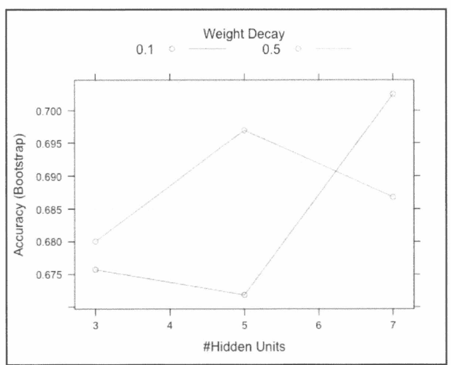

```
# Confusion Matrix for the Neural Network model

confusionMatrix(nnet_predicted,test_diab$diabetes)
```

Confusion Matrix and Statistics

Reference
Prediction | neg | pos
---|---|---
neg | 86 | 22
pos | 14 | 31

Accuracy : 0.7647
95% CI : (0.6894, 0.8294)
No Information Rate : 0.6536
P-Value [Acc> NIR] : 0.001988

Kappa : 0.4613
McNemar's Test P-Value : 0.243345

Sensitivity : 0.8600
Specificity : 0.5849
PosPredValue : 0.7963
NegPredValue : 0.6889
Prevalence : 0.6536
Detection Rate : 0.5621

Detection Prevalence : 0.7059
Balanced Accuracy : 0.7225

'Positive' Class :neg

## 教程 - 使用 CMS 数据进行关联规则挖掘

本教程将实现一个用于访问使用 R 中 Apriori 包创建的规则的接口。

我们将从 CMS OpenPayments 网站下载数据。该网站托管了公司向医生和医院支付的款项数据：


### 下载数据

数据集可以通过 Unix 终端（在虚拟机中）下载，也可以通过浏览器直接访问该网站进行下载。如果你在虚拟机中下载数据集，请在终端窗口中运行以下命令：

```
time wget -O cms2016_2.csv
'https://openpaymentsdata.cms.gov/resource/vq63-hu5i.csv?$query=select Physician_First_Name as firstName,Physician_Last_Name as lastName,Recipient_City as city,Recipient_State as state,Submitting_Applicable_Manufacturer_or_Applicable_GPO_Name as company,Total_Amount_of_Payment_USDollars as payment,Nature_of_Payment_or_Transfer_of_Value as paymentNature,Product_Category_or_Therapeutic_Area_1 as category,Name_of_Drug_or_Biological_or_Device_or_Medical_Supply_1 as product where covered_recipient_type like "Covered Recipient Physician" and Recipient_State like "NY" limit 1200000'
```

或者，如果你从浏览器下载数据，请在浏览器窗口中输入以下 URL 并按 Enter：

```
https://openpaymentsdata.cms.gov/resource/vq63-hu5i.csv?$query=select Physician_First_Name as firstName,Physician_Last_Name as lastName,Recipient_City as city,Recipient_State as state,Submitting_Applicable_Manufacturer_or_Applicable_GPO_Name as company,Total_Amount_of_Payment_USDollars as payment,Nature_of_Payment_or_Transfer_of_Value as paymentNature,Product_Category_or_Therapeutic_Area_1 as category,Name_of_Drug_or_Biological_or_Device_or_Medical_Supply_1 as product where covered_recipient_type like "Covered Recipient Physician" and Recipient_State like "NY"
```


如以下图像所示：

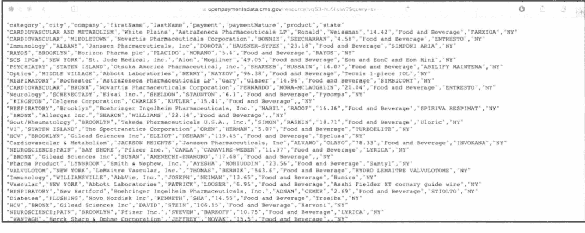

### 为 Apriori 编写 R 代码

Apriori 算法，如前所述，允许用户找到数据集中固有的关系或模式。为此，我们将在 R/RStudio 中使用 arules 包。代码将读取下载的数据集（示例中称为 cms2016_2.csv）并运行 apriori 算法以找到关联规则。

在 RStudio 中创建一个新的 R 文件并输入以下代码。确保将下载的 csv 文件的位置更改为文件已存储的适当目录：

```
library(data.table)
library(arules)

cms<- fread("~/cms2016_2.csv") # CHANGE THIS TO YOUR LOCATION OF THE DATA

cols <- 
c("category","city","company","firstName","lastName","paymentNature","product")

cms[ , (cols) := lapply(.SD, toupper), .SDcols = cols]

cms[,payment:=as.numeric(payment)]

quantile_values<- quantile(cms$payment,seq(0,1,.25))
interval_values<-
```


```
findInterval(cms$payment, quantile_values, rightmost.closed=TRUE)

cms[, quantileVal:=factor(interval_values,
labels=c("0-25", "25-50", "50-75", "75-100"))]

rules_cols<-
c("category", "city", "company", "paymentNature", "product", "quantileVal")

cms[, (rules_cols) := lapply(.SD, factor), .SDcols = rules_cols]

cms_factor<-
cms[, .(category, city, company, paymentNature, product, quantileVal)]

rhsVal<- paste0("quantileVal", "=", c("0-25", "25-50", "50-75", "75-100"))

cms_rules<-
apriori(cms_factor, parameter=list(supp=0.001, conf=0.25, target="rules", minlen=3))

cms_rules_dt<- data.table(as(cms_rules, "data.frame"))
cms_rules_dt[, c("LHS", "RHS") := tstrsplit(rules, "=>", fixed=TRUE)]
num_cols<- c("support", "confidence", "lift")
cms_rules_dt[, (num_cols) := lapply(.SD, function(x){round(x,2)}), .SDcols = num_cols]

saveRDS(cms_rules_dt, "cms_rules_dt.rds")
saveRDS(cms_factor, "cms_factor_dt.rds")
```

## Shiny (R Code)

在 RStudio 中，选择 File | New File | Shiny Web App：

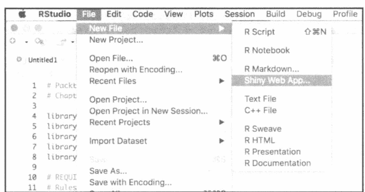

```
fluidRow(
  dataTableOutput("result")
)
),
  title = "Aprior Algorithm"
)

# Define server logic required to draw a histogram
server <- function(input, output, session) {

  PLACEHOLDERLIST2 <- list(
    placeholder = 'Select All',
    onInitialize = I('function() { this.setValue(""); }')
  )

  output$company<- renderUI({
    datasetList<- c("Select
All",as.character(unique(sort(cms_factor_dt$company))))
    selectizeInput("company", "Select Company",
    datasetList, multiple = FALSE,options = PLACEHOLDERLIST2,selected="Select
All")
  })

  output$searchlhs<- renderUI({
    textInput("searchlhs", "Search LHS", placeholder = "Search")
  })

  output$searchrhs<- renderUI({
    textInput("searchrhs", "Search RHS", placeholder = "Search")
  })

  output$support2 <- renderUI({
    sliderInput("support2", label =
    'Support',min=0,max=0.04,value=0.01,step=0.005)
  })

  output$confidence<- renderUI({
    sliderInput("confidence", label = 'Confidence',min=0,max=1,value=0.5)
  })

  output$lift<- renderUI({
    sliderInput("lift", label = 'Lift',min=0,max=10,value=0.8)
  })

  dataInput<- reactive({
    print(input$support2)
    print(input$company)
    print(identical(input$company,""))
  })
```

```
temp <- cms_rules_dt[support > input$support2 & confidence >input$confidence& lift >input$lift]

if(!identical(input$searchlhs,"")){
searchTerm<- paste0("*",input$searchlhs,"*")
    temp <- temp[LHS %like% searchTerm]
}

if(!identical(input$searchrhs,"")){
searchTerm<- paste0("*",input$searchrhs,"*")
    temp <- temp[RHS %like% searchTerm]
}

if(!identical(input$company,"Select All")){
    # print("HERE")
    temp <- temp[grepl(input$company,rules)]
}
    temp[, .(LHS,RHS,support,confidence,lift)]
})

output$downloadMatchingRules<- downloadHandler(
    filename = "Rules.csv",
    content = function(file) {
        write.csv(dataInput(), file, row.names=FALSE)
    }
)

output$result<- renderDataTable({
    z = dataInput()
    if (nrow(z) == 0) {
        z <- data.table("LHS" = '', "RHS"='', "Support"='', "Confidence"='', "Lift" = '')
    }
    setnames(z, c("LHS", "RHS", "Support", "Confidence", "Lift"))
    datatable(z,options = list(scrollX = TRUE))
})

} shinyApp(ui = ui, server = server)
```

以下图像显示代码被复制并保存到名为 `app.R` 的文件中。

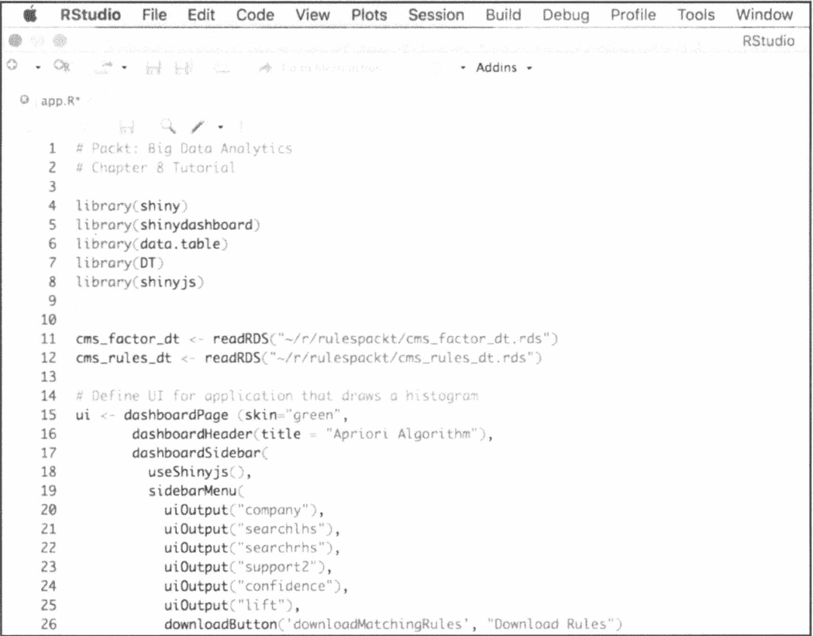

## Using custom CSS and fonts for the application

对于我们的应用程序，我们将使用自定义 CSS 文件。我们还将使用自定义字体以便为应用程序提供美观的外观和感觉。

您可以从本书的软件仓库下载自定义 CSS 文件。

CSS、字体和其他相关文件应存储在名为 `www` 的文件夹中，该文件夹位于您创建 R Shiny 应用程序的目录中：

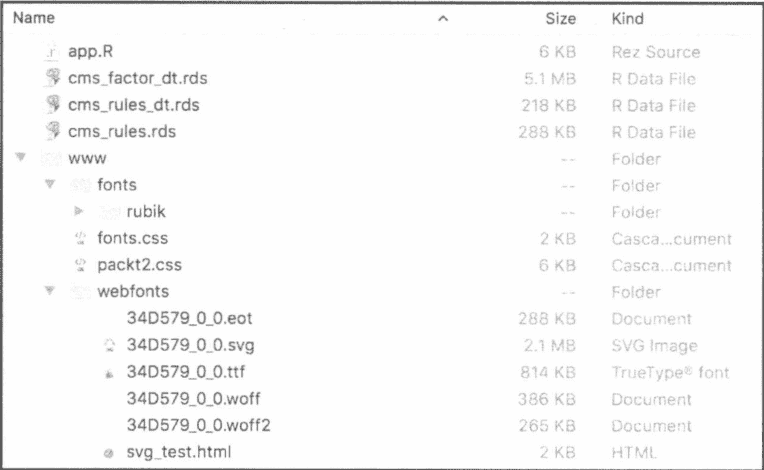

## Running the application

如果一切顺利，您现在应该能够通过点击页面顶部的 **Run App** 选项来运行应用程序，如以下图像所示：

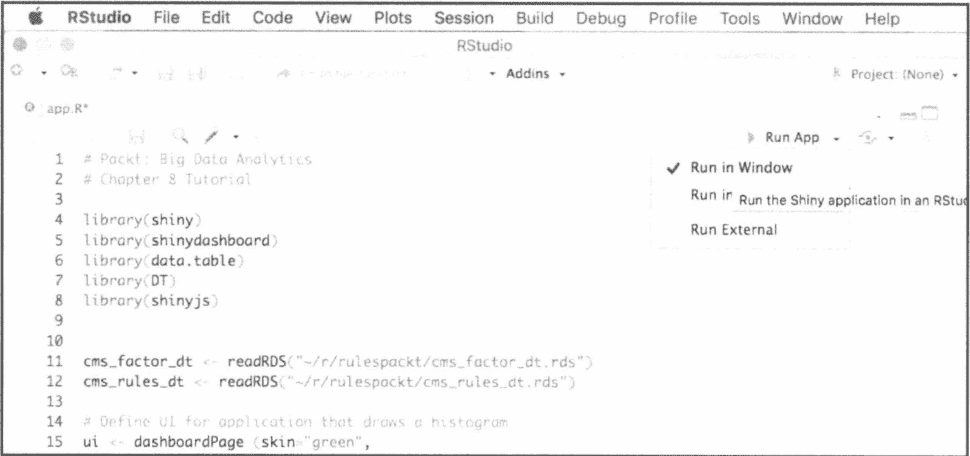

点击“Run”按钮后，用户将看到与下面所示类似的弹出窗口。请注意，必须在浏览器中启用弹出窗口才能使其正常运行。

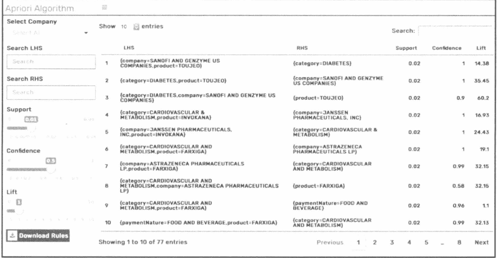

该应用程序具有多个控件，例如：

- **Search LHS/RHS**: 在规则的左侧或右侧输入您想要过滤的任何测试。
- **Support**: 表示该规则在数据集中的普遍程度。
- **Confidence**: 在规则中，有多少是完全匹配。
- **Lift**: 定义规则重要性的变量。大于 1 的数字被认为是有意义的。

只要它们以与 R 脚本部分之前概述的方式类似的方式处理，您就可以将此应用程序用于任何其他规则文件。

## Summary

机器学习从业者通常认为创建模型很容易，但创建好的模型则困难得多。事实上，不仅创建好的模型很重要，而且更重要的是，知道如何识别好的模型是区分成功与不太成功的机器学习工作的关键。

在本章中，我们阅读了一些机器学习中更深层次的理论概念。偏差、方差、正则化以及其他常见概念都用示例进行了解释。借助配套的 R 代码，我们还了解了一些常见的机器学习算法，如随机森林、支持向量机等。我们以关于如何为 CMS OpenPayments 数据创建用于关联规则挖掘的基于网络的完整应用程序的教程作为结尾。

在下一章中，我们将阅读企业中用于大数据和机器学习的某些技术。我们还将讨论云计算的优点以及它们如何影响企业软件和硬件堆栈的选择。

我们将在本章中涵盖以下主题：

- Enterprise data science overview
- Enterprise data mining
- Enterprise AI and machine learning
- Enterprise infrastructure
- Other considerations, such as data strategy, governance, and tool selection
- Amazon Web Services tutorial

## Enterprise data science overview

数据科学在企业 IT 和分析方面是一个相对较新的主题。传统上，研究人员和分析师大致属于以下两类：

- 使用复杂计算语言和/或硬件进行专业任务的高技术研究人员
- 可以使用 Excel 和 BI 平台等工具来执行简单和复杂数据分析的分析师

组织开始在 2000 年代后期关注 **Big Data** 以及更广泛的数据科学平台。到 2013 年，它获得了巨大的势头，当时 Hadoop 和 NoSQL 平台等解决方案发布。以下表格显示了数据科学的发展：

| Year | Developments |
|---|---|
| 1970s to late 1990s | 关系数据库管理系统得到广泛使用。实体关系模型、结构化查询语言 SQL 以及其他发展最终导致数据库在 90 年代末迅速扩张。 |
| Early 2000s | 令人失望却昂贵的 Y2K 非事件，加上 dot-com 泡沫的破裂，导致了停滞期。就数据库或更广泛的数据挖掘平台而言，这意味着公司更关注保持业务运行，而不是关注新创新。 |

| 2005-2010 | 行业缓慢复苏，但直到 2005 年才开始出现新的发展。一些值得注意的事件包括：
- 2006: Google BigTable 论文发表
- 2006: Amazon Web Services 云平台推出
- 2007: Amazon Dynamo 论文发表
- 2008: Facebook 将 Cassandra 开源
- 2009: MongoDB 发布
- 2009: Redis 发布 |
| 2010-2012 | 2010: NoSQL 大会和相关活动开始流行，NoSQL 成为一个被广泛接受的技术术语。与此同时，Hadoop 变得非常流行，几乎所有主要公司都开始实施 Hadoop 相关技术。
2011: 市场领导者开始采用大数据并形成大数据战略。众多文章和研究论文声称大数据具有巨大的潜力，使其变得非常流行。麦肯锡发布了一篇关于大数据的论文，称其为创新、竞争和生产力的下一个前沿。2012 年 10 月的《哈佛商业评论》对数据科学家的前景持非常积极的态度，并立即变得流行。 |
| 2013-2015 | 大数据技术的发展导致了数据科学概念的发展，该概念将重点从仅仅数据转移到数据的价值。结合机器学习的发展以及 R、Python 等数据科学导向平台的流行，行业将注意力转向从数据中获取洞察，而不是仅仅管理数据。机器学习是新的流行语。 |
| 2016- | 智能设备、可穿戴设备、AI 启用手机、自动驾驶汽车等创新解决方案的演变为大数据和机器学习趋势增加了人工智能的新组件。制造商开始广泛宣传技术解决方案的智能能力，而不仅仅是机器学习能力。 |

实施大数据平台或更广泛的大数据计划的责任通常委托给公司的 IT 或分析部门，如果存在此类部门的话。


大多数组织还报告称拥有 **Advanced Analytics** 的企业授权。这有助于确保所需的预算，以在组织内部实施并推进分析的状态。

此外，数据科学收入潜力的预测性预测极大地帮助向高级管理层证明，对大数据进行适当投资对公司的未来增长至关重要。

随着当前的大数据和商业分析收入呈指数级增长，超过 1500 亿美元，企业实施此类能力（至少在初步层面）的压力巨大。

组织对大数据作为企业授权的认知和接受度的另一个方面是此类工具效用的文化认知。在针对大型公司 C 级管理层的调查中，大多数受访者表示，各部门的管理人员正在使用分析，但各部门的参与程度并不统一，如下图所示：

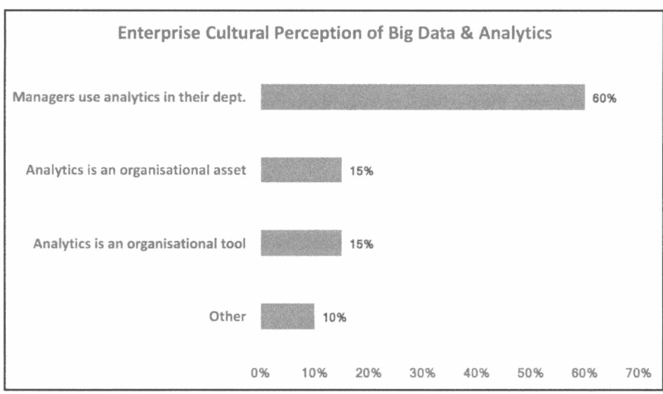

此外，似乎整个组织的大数据合作伙伴关系策略也未得到充分构建，无法实现商业成功。调查受访者表示，合作伙伴关系，即分析计划的跨职能协作，定义较为宽松：

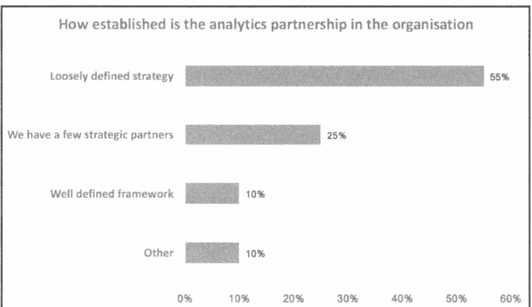

虽然对某些问题的回答存在偏差，其中一个类别占压倒性多数，但关于大数据和总体分析的组织挑战的反馈却获得了广泛一致的共识。下图显示了调查中每位参与者对分析挑战的反馈：

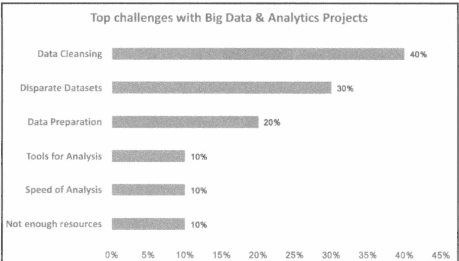

所有这些都导致了企业中一个有趣但矛盾的分析困境。虽然大数据的价值和可分析性被广泛理解和接受，但关于适当方法仍存在模糊感，如下图所示：

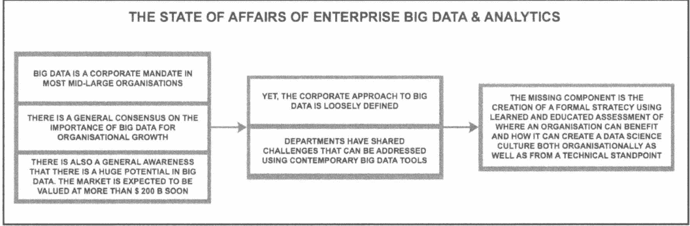

## 企业分析成功的路线图

根据我们的经验，分析是一个相对较新的术语，与数据仓库等已建立的术语相比，需要谨慎的方法，以确保即时成功和后续举措的持久性。

过早尝试以大规模、高预算的方式完成初始分析项目的项目，如果项目未按预期进行，则有危及整个举措的风险。

此外，在此类项目中，结果衡量标准未明确定义。换句话说，衡量结果价值是模糊的。有时甚至无法量化。这是因为分析举措的成功带来的好处不仅仅是直接的货币或技术能力。成功的分析项目通常有助于培养高管对部门开展此类项目能力的信心，这反过来可能导致更大的项目。

与大数据分析相关的一般挑战如下：

- 几乎每家公司都在投资大数据、机器学习和人工智能
- 通常，公司拥有企业授权
- 找到合适的用例可能具有挑战性
- 即使你*找到*了它们，结果也可能不确定（是否会产生共鸣，需要多长时间等等）
- 即使你*实现了*它们，是否已识别出最佳目标也可能难以捉摸（例如，使用 HDFS 仅用于存储数据时）

现在，让我们来看一些数据科学和分析举措的 **general guidelines**：

- **与组织内的业务合作伙伴进行会议和一对一评审**，以审查其工作流程并获取反馈，了解分析 和/或数据挖掘 在何处能提供最大价值
- **确定业务运营的具体方面**，这些方面很重要且与公司的 *revenue stream* 相关；用例完成后将产生可衡量的影响
- 用例不必*复杂*；可以是简单的任务，例如 ML 或数据挖掘
- 直观、易于理解，你可以向朋友和家人解释
- 理想情况下，使用传统方式完成该用例今天需要付出努力。该解决方案不仅应使 **range of users**受益，而且应具有 **executive visibility**
- 识别 **Low Difficulty - High Value (Short)** 与 **High Difficulty - High Value (Long)** 用例
- 教育业务赞助商，分享想法，表现出 **enthusiasm**（就像一次漫长的求职面试）
- 为 **Low Difficulty - High Value** 取得 **early wins**，创建 **Minimum Viable Solutions**，并在进一步增强所开发的解决方案之前获得管理层的认可。（需要时间）

早期胜利充当 **catalyst**，a) 培养高管信心，b) 也更容易证明预算合理，这使得转向高难度-高价值任务变得更容易。

最后两点很重要，因为识别低难度-高价值项目至关重要。这可能是一项对经验丰富的从业者来说似乎 *basic* 的任务，但对最终用户来说非常有价值。

一家大型企业组织分析团队的高管曾评论说，当年最成功的项目是 *电子邮件报告发送时间的更改*。报告不再在早上发送，而是改为下午晚些时候发送。看起来报告的参与度在时间更改后变得更加活跃。早上的日程往往非常繁忙，而下午的报告则为收件人提供了在更轻松的节奏下审阅报告的时间。

一些 *低难度* 但 *潜在高价值* 项目的例子可能包括：

- 自动化业务部门频繁进行的手动任务；例如，使用 Excel 创建的报告可能通过开源工具和数据库的组合轻松自动化。
- 将手动库存分析转换为使用编程脚本的自动化版本。这可能涉及创建常规表格、数据透视表和图表等任务，这些任务在 Excel 中创建，但可以转换为自动化流程。
- 使用 R Shiny 为业务应用创建 Web 界面并实现预测分析功能。
- 将 IT 基础设施的某些部分迁移到云平台。这可能看起来违反直觉，尤其是如果组织不习惯在云环境中工作。然而，管理云部署的简易性和简单性可能意味着总体拥有成本和运营开销的整体降低。

最终用例的选择将取决于各种因素，前述内容旨在提供可能尝试的项目类型和可能产生积极结果的工作流程的大致概念。在下一节中，我们将研究数据科学行业中使用的一些特定软件和硬件解决方案。

## 企业中的数据科学解决方案

如前所述，通常我们可以将数据科学大致分为两个主要部分：

- 企业数据仓库和数据挖掘
- 企业数据科学：机器学习、人工智能

在本节中，我们将分别研究这些内容，并讨论行业中用于提供这些能力的软件和硬件解决方案。

## 企业数据仓库和数据挖掘

如今，行业中有大量数据库被宣传为能够运行复杂分析查询的 NoSQL 系统。它们大多数具有典型的 NoSQL 系统的一个或多个功能，例如列式、内存中、键值、文档导向、基于图等。下一节重点介绍当今使用的一些关键企业 NoSQL 系统。

### 传统数据仓库系统

传统数据仓库可能是一个误称，因为大多数传统系统也已纳入 NoSQL 的核心概念。然而，在这种情况下，该术语旨在表示在 NoSQL 系统出现之前就已存在的数据库，并且还添加了使其与企业数据科学要求保持一致的功能。

### Oracle Exadata、Exalytics 和 TimesTen

Oracle Exadata、Exalytics 和 Exalogic 属于 Oracle 的 Exa 产品系列。**Exadata** 是 Oracle 的高性能 *Engineered Database Platform*，专为资源密集型查询而设计。通常，预计其查询性能将显著优于非 Exadata 系统，并支持高级软件功能，例如内存计算、独立的行和列过滤，以及其他硬件功能，例如支持最新的存储设备，包括 NVMe、内存容错等。

**Exalytics** 是一种补充解决方案，主要用于 **BI** 工作负载。Exa 产品系列被视为 *engineered systems* 而非 *appliances*。后者可能表示预设和预装的软件硬件堆栈，而 engineered system 预计在已安装组件的选择方面提供更高水平的灵活性，这些组件根据客户需求有选择地安装。Exalytics 在企业安装中常见的关键组件之一是 **OBIEE (Oracle Business Intelligence Enterprise Edition)**。这是一个完整的 BI 套件，并受益于底层内存数据库 **Times Ten**，它也是 Exalytics 生态系统的一部分。

**业务用例：** Oracle Exadata 用于 OLTP 事务工作负载，在这些工作负载中速度和性能至关重要。


## Teradata

传统上，Teradata 以一体机方案提供，数据库和硬件作为一个集成单元。如今，也可以使用 Teradata Everywhere 在云中使用 Teradata。该软件可以部署在混合架构（本地和云）以及 AWS 和 Microsoft Azure 等公有云环境中。提供捆绑服务、订阅服务和按需服务选项。Teradata IntelliCloud 是 Teradata 提供的基于订阅的云产品，在托管环境中包含 Teradata 生态系统的多个产品。

**业务用例：** Teradata 几十年来一直是流行的企业数据库，在大型组织中拥有很高的信誉。近年来，Teradata 主动与 R、Jupyter 等开源系统集成，使其更具吸引力，并有助于提高其知名度。Teradata 一体机可能相对昂贵，与其他商业选项一样，需要进行适当的 POC 来评估是否适合组织的特定用例。

## IBM 数据仓库系统（原 Netezza 一体机）

IBM Netezza 过去作为独立的数据仓库一体机出售，在某些方面类似于 Teradata 的营销方式。最近，Netezza 被归入更广泛的 IBM 数据仓库系统类别，这与管理超大数据量的当代大数据需求更加一致。IBM PureSystems、PureSystems for Analytics 和 IBM Integrated Analytics System 是一些较新的解决方案，它们在集成生态系统中提供与 Netezza 基本相同的功能。

Integrated Analytics 环境包括用于机器学习的嵌入式 Apache Spark、用于数据科学工作负载的 Jupyter Notebooks、可连接到其他 NoSQL 和 Hadoop 实现的通用 SQL 引擎，并支持在高性能架构上部署，并提供托管、基于云的环境选项。

**业务用例：** Netezza 一直受到传统上依赖 IBM 相关技术（如 DB2、AIX 和 IBM 其他产品）的公司的青睐。新的集成产品环境为继续使用 Netezza 提供了机会，同时为组织现有的 IBM 投资增加了数据科学能力。

## PostgreSQL

PostgreSQL 在本节中是一个有趣的选择，因为严格来说，PostgreSQL 没有单独的 NoSQL 版本，而是在最近的版本中添加了各种功能，为现有的 Postgres 实现增加了 NoSQL 功能。

PostgreSQL 的支持者正确地指出，它是一种更古老且经过更多测试的技术，于 1990 年代中期首次发布。Postgres 现在支持分层文档数据存储、JSON、键值存储（称为 HStore）和分片，并包含各种编程语言的接口以及多样化的数据源。换句话说，PostgreSQL 已扩展到支持类似 NoSQL 的功能，同时保持其作为传统 RDBMS 的现有能力。

PostgreSQL 作为功能完备的开源产品提供。

**业务用例：** 本节中的大多数技术都以商业许可形式提供（以获得其全部功能），而 PostgreSQL 作为开源产品，是一种非常经济高效的方式，无需大量初始投资即可试用成熟数据库。它还可以作为测试平台，在做出最终决定之前尝试 NoSQL 功能，例如处理 JSON 数据。无论哪种情况，PostgreSQL 都是一个强大的平台，可以支持企业需求。PostgreSQL 也有商业衍生品——基于 PostgreSQL 构建的数据库，例如 Greenplum，它也是开源产品。

## Greenplum

**Greenplum Database®** 构建于 PostgreSQL 之上，并添加了许多重要的分析功能。其中包括创新的基于成本的查询优化器、与 Apache MADlib 的集成，以及行存储或列存储的选择。它为 R、Python 和 Java 等流行编程语言提供原生接口，并支持大规模并行架构。Greenplum 可从 http://greenplum.org/download/ 免费下载。

**业务用例：** **Pivotal** 提供带有全面支持的商业发行版。Greenplum 非常成功，尤其因为其在大规模企业工作负载方面的成熟性能。商业支持的可用性对需要专门支持和服务级别协议（SLA）以保障关键业务运营的组织非常有益。

## MongoDB

**业务用例：** 考虑使用数据库存储非结构化或半结构化数据的公司可能会发现 MongoDB 的功能非常适合查询此类数据集。该数据库无需在开始时定义固定模式，从而可以灵活扩展，以支持添加到现有数据中的新属性。MongoDB 可从 https://www.mongodb.com/download-center 免费开源下载，也可以通过 MongoDB Atlas 作为托管和托管的云解决方案实施。还提供支持内存和加密存储等功能的企业版，可按订阅方式获取。

## Cassandra

**Cassandra** 是最成功、最广泛使用的企业级 NoSQL 系统之一。它结合了列式和键值概念，并将数据存储在基于行的分区中。每个分区又是一个主键。行可以有多个列，并且列数可能因行而异。

Cassandra 数据库可以通过 CQL 查询，CQL 使用类似 SQL 的语法，使数据查询、保存和其他常见任务变得容易得多。Cassandra 还使用去中心化架构；它没有任何单点故障，并支持多节点架构。

除了 Cassandra DBMS 的标准水平可扩展性外，该平台还支持弹性可扩展性，并能够根据需要透明地分配和取消分配节点。总的来说，Cassandra 是企业级 NoSQL 系统最强大的选择之一，在全球多家大型公司的生产环境中使用。

**业务用例：** Cassandra 是完全开源的解决方案，实现了 NoSQL 系统的多个关键功能。它用于全球生产工作负载，并已成熟为稳定、企业级的开源平台。换句话说，Cassandra 非常适合管理大型组织需求，且不会产生额外的许可成本。DataStax 还提供商业许可的付费版本：https://www.datastax.com/products/datastax-enterprise。它被称为 **DSE（DataStax Enterprise）**。DSE 集成了安全、搜索等各种企业功能，也可以通过 DataStax Managed Cloud 环境使用 AWS 等流行云提供商访问。

## Neo4j

Neo4j 是一种基于图的数据库，用于建模不同实体之间的关系。该数据库使用图论中熟悉的概念来创建互连主题的基于树的表示（带有节点和关系）。它最常与推荐引擎结合使用。从概念上讲，Neo4j 图数据库可以将个体表示为节点，这些节点通过例如分离度相互连接。这可以假设地允许最终用户跟踪任意节点或一个个体到另一个个体的分离度。

Neo4j 平台提供了各种基于图的表示形式，如加权、有向、单向和带标签。

**业务用例：** 需要深度客户级或用户级分析的公司，例如社交网络或推荐系统（如 Netflix），可以从部署基于图的数据库（如 Neo4j）中获得巨大收益。如今，该平台支持 AI 和机器学习、物联网、实时推荐以及企业中使用的许多其他有用特性。


虽然 Neo4j 可从 https://neo4j.com/download/?ref=hro 作为开源软件获得，但也有商业许可版本，即 Neo4j Enterprise Edition。

## 云数据库

顾名思义，云数据库是指来自 Amazon、Google 和 Microsoft 等云供应商的数据仓库或数据库系统。

### Amazon Redshift、Redshift Spectrum 和 Athena 数据库

Amazon Redshift 是最常用的基于云的数据仓库平台之一。它是基于云生态系统中最重要的数据管理平台。它基于 PostgreSQL，主要用于分析工作负载。Redshift 具有高度可扩展性，与具有类似特性的本地数据库相比，需要的工作量要少得多。它可以直接从 AWS 控制台部署（在注册 AWS 账户后）。可以通过 AWS 控制台无缝添加或删除节点，以分别增加和/或减少容量。


较新的 Redshift 版本称为 **Redshift Spectrum**，允许查询存储在 Amazon S3 中的数据，Amazon S3 是 AWS 中的标准存储层。这意味着用户可以直接查询磁盘上存储的数据，而无需将其加载到 Redshift 专用的实例中。总体而言，Redshift 相对于较快、价格便宜，更重要的是易于使用和部署。Redshift Spectrum 使用按查询付费模式——用户只需为执行的查询付费，每扫描一 TB 数据收取名义费用。

**Amazon Athena** 在许多方面与 Amazon Redshift Spectrum 相似，因为它也用于查询存储在 S3 上的数据。然而，虽然 Amazon Redshift Spectrum 的功能不能在不先购买 Amazon Redshift 的情况下使用，但用户可以按需使用 Amazon Athena，并且无需预留任何额外硬件。另一方面，由于 Amazon Redshift Spectrum 与 Redshift 生态系统紧密集成，用户可以将工作负载分布在这两种解决方案上。需要更快处理的数据可以保留在 Amazon Redshift 上，而使用频率较低/不太关键的数据可以存储在 S3 上并使用 Redshift Spectrum 进行查询：

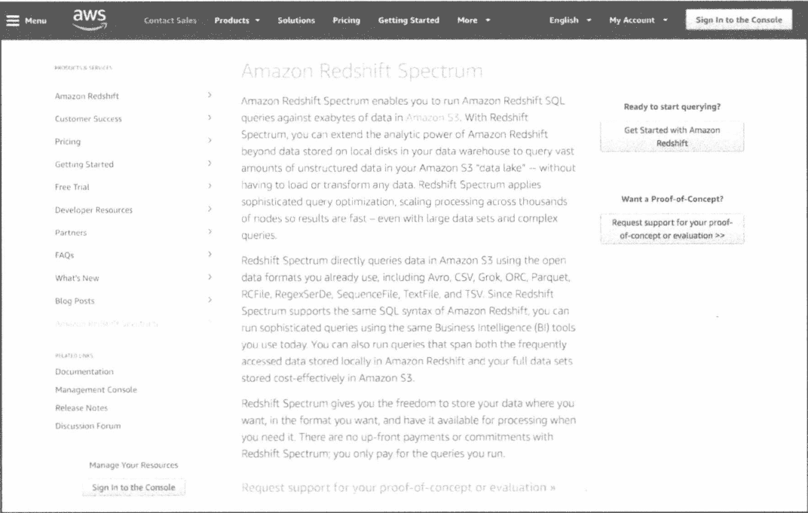

Google 在其云平台上还拥有其他 NoSQL 产品，包括 Google Cloud Datastore，一种基于文档的 NoSQL 数据库；Google BigTable；Google Spanner；以及其他几种产品。以下图表显示了 Google BigQuery 数据库：

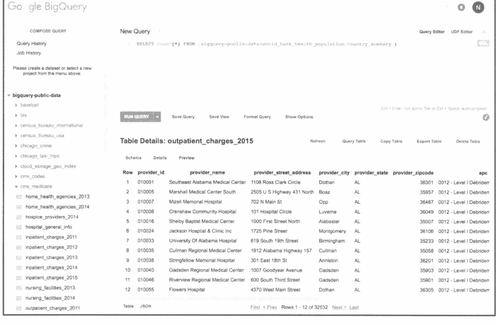

## Azure CosmosDB

Azure CosmosDB 是微软的 NoSQL 云数据库之一。Azure 中的其他 NoSQL 系统包括 Table Storage、Azure Redis Cache 等。CosmosDB 被认为是一种多模型数据库；它可以支持键值对、基于文档的查询、基于图的模型以及关系数据库查询。

## Brytlyt

**Brytlyt** 是 GPU 数据库领域的近期进入者。它由一个名为 **Spotlyt** 的可视化产品补充。早期测试显示 Brytlyt 超越了几个具有挑战性的基准。然而，它在其他用例中的泛化程度如何还有待观察。

Brytlyt 可在 Amazon AWS Marketplace (https://aws.amazon.com/marketplace/pp/B074JZNSWZ?qid=1513342415797sr=0-1&ref_=srh_res_product_title) 中获得，供希望尝试的用户使用。

## MapD

MapD 是商业 GPU 数据库平台的早期开发商之一。与 Brytlyt 类似，它也显示了令人印象深刻的早期成果。尽管如此，由于基于 GPU 的数据库仍处于早期阶段，普及使用和采用最终将决定它们是否会在企业中变得普遍。

基于 GPU 的数据库的主要挑战之一是需要正确配置基于 GPU 的系统。这可能需要专业技能，因为将 GPU 卡用于计算与将 GPU 卡用于渲染图像等常见任务大不相同。因此，希望在采用正式版本之前尝试基于 GPU 的数据库的用户会发现利用 AWS 中的预配置镜像（AMI Image）更容易，这将需要最少的系统配置。

## 其他常见数据库

还有各种其他类型的数据库，例如用于分析流数据的数据库（Amazon Kinesis），以及使用百度 FPGA 的专用加速卡处理数据的数据库。

## 企业数据科学 – 机器学习和 AI

**数据科学解决方案** 在过去 4-5 年中迅速成熟，与数据科学其他领域如 NoSQL、Hadoop 和其他数据挖掘解决方案的趋势相似。虽然许多先前的数据库系统也包含了 *数据科学* 的关键功能，例如机器学习等，但本节重点介绍了一些主要用于机器学习和/或 AI 的解决方案，而非数据管理。

事实上，*大数据* 产品与 *数据科学* 产品之间的区别变得模糊，因为最初用于大数据处理的产品已融入了数据科学的关键功能，反之亦然。

### R 编程语言

**R**，正如我们在前几章中所见，是最初为统计编程而设计的环境。它源于新西兰大学的一个项目，*Ross Ihaka* 和 *Robert Gentleman* 在该项目中将 R 开发为约翰·钱伯斯在贝尔实验室开发的 S 编程语言的变体。虽然 R 最初 intended 用于 *统计编程*，但在过去 7 到 8 年中，它已发展成为一种成熟的多功能语言，对机器学习、高性能计算、可视化、计量经济学、时间序列分析等多种相关学科提供了增强支持。有关这些领域的更多信息可在 https://cran.r-project.org/web/views/ 上找到。

R 的商业版本并提供企业支持由 Revolution Analytics 提供。2015 年，它被重新命名为 **Microsoft R Open**（开源版本）和 **Microsoft R Server**（商业版本）。

尽管以微软品牌营销，但请注意 Microsoft R 也可用于 Linux 和 Mac OS。

R 中流行的机器学习包包括 `e1071`、`randomForest`、`gbm`、`kernlab`、`arules` 等。它们列在 https://cran.r-project.org/web/views/MachineLearning.html 上。另一个流行的包，称为 caret，作为各种算法包的包装器，提供了一个有用的统一接口来运行算法，而无需遵循各个包的细微差别。

R 还通过 `multicore`、`doMC` 等包支持多核编程。它们列在 https://cran.r-project.org/web/views/HighPerformanceComputing.html 上。

### Python

Python 中的 `scikit-learn` 包可以说是所有平台中最全面的机器学习包之一，其中包含广泛的机器学习算法列表。它也被认为比 R 更快，是各种企业组织的首选工具。以下屏幕截图显示了我们可以下载 `scikit-learn` 包的网页：

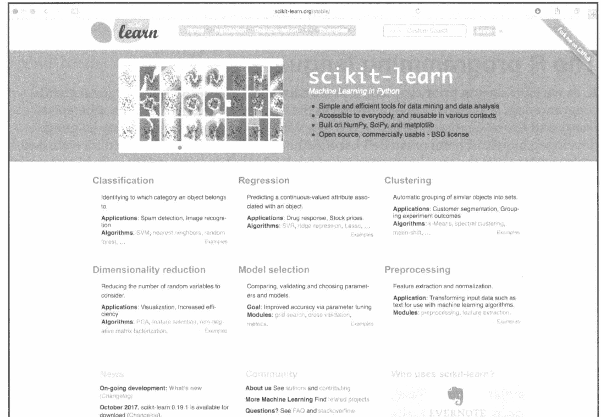

一个商业支持的企业版 Python，预先配置了有用的机器学习和数据挖掘包，是来自 Continuum Analytics 的 Anaconda。名为 Anaconda Cloud 的 Anaconda 云版本允许新用户在无需单独下载和安装的情况下开始利用 Anaconda Python 的功能。

### OpenCV、Caffe 等

图像识别是机器学习中较为成功的领域之一。虽然大多数机器学习任务需要在较长的时间段内才能衡量和量化其真正的好处，但图像识别是一个熟悉的主题领域，可以很容易理解。其本质是识别对象并正确对其进行分类。它有多种应用，从识别车牌号码到人脸识别，并在移动设备和机器人中使用。

OpenCV 为各种图像识别任务提供标准接口，并且还可以利用硬件加速功能来优化性能。

其他知名图像处理机器学习软件包括 Caffe、cuDNN、TensorFlow 等。请注意，这些包不仅限于简单的图像识别，还可用于其他深度学习用例。

### Spark

Spark 中的 MLlib 库提供了可在 Spark 平台中使用的各种机器学习算法的正式实现。pySpark 的可用性使得具有 Python 编程知识的人更容易使用该功能。如果组织已有现有的 Spark 平台，那么探索 MLlib 中的机器学习功能是值得的。


以下截图简要概述了MLlib：

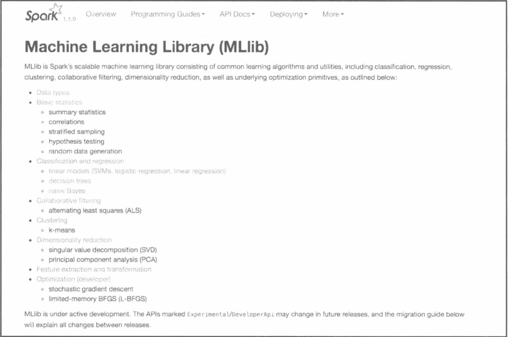

## 深度学习

具有多个隐藏层（通常超过两个）和/或多个节点的神经网络通常被归类为**深度学习**。机器学习领域的若干当代进展，如自动驾驶汽车，正是深度学习应用于日常实际任务的直接成果。

有各种各样的深度学习框架/包，其中一些值得注意的包括：

- TensorFlow
- cuDNN
- Theano
- Torch
- 来自百度的PaddlePaddle

## H2O与Driverless AI

作为Kaggle竞赛的热门平台，H2O提供了一个大规模可扩展的实时机器学习接口，原生集成了R、Python、Spark等更多内容。它可从 https://www.h2o.ai/h2o/ 免费下载。

Driverless AI是H2O产品线中的新成员。它旨在通过自动化接口让机器学习对从业者更加容易，该接口尝试以自动化方式构建和评估多个模型，从而创建模型并优化准确度。以下截图展示了H2O平台的主页：

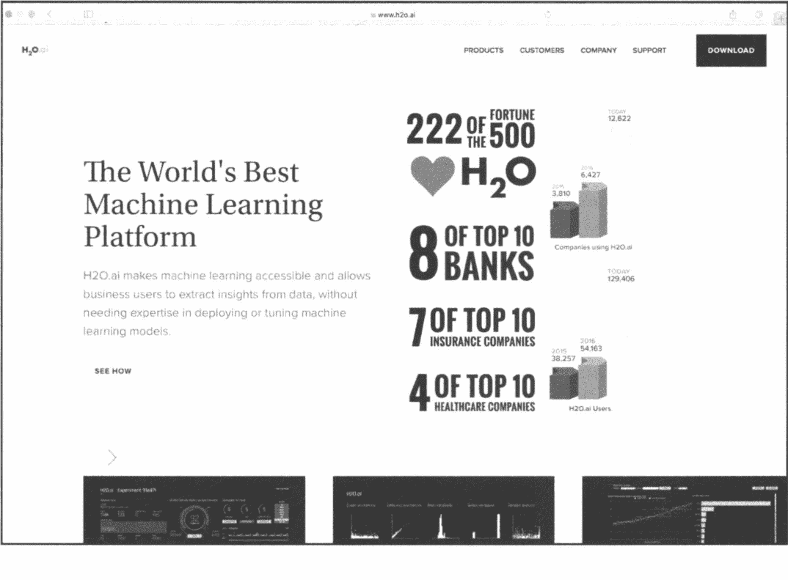

下面的截图来自IBM Watson，这是机器学习和人工智能领域最知名的平台之一。该平台在2011年赢得《危险边缘》（Jeopardy）冠军后声名鹊起[来源：https://www.techrepublic.com/article/ibm-watson-the-inside-story-of-how-the-jeopardy-winning-supercomputer-was-born-and-what-it-wants-to-do-next/]。当时，机器学习趋势尚处于萌芽阶段，而Watson是最早令世界惊叹的AI技术之一。它证明了AI可以是一种强大且能干的资产。如今，用户可以通过在网站 https://www.ibm.com/watson/ 上注册账户，利用与IBM Watson相同的部分计算能力。


## 企业基础设施解决方案

基础设施的恰当选择对于决定组织数据科学平台的效率也起着关键作用。基础设施过少，算法执行时间会过长；过多，则可能会有大量资源未被利用。因此，资源过多比过少更可取，因为过少会阻碍进展，并妨碍机器学习研究者高效执行其任务的能力。

## 云计算

在过去5至7年中，各类组织逐渐将资源转移到云端平台，如Amazon Web Services、Microsoft Azure和Google Compute Engine。如今，这些平台都拥有极其复杂和广泛的架构，支持机器学习、数据挖掘，以及总体上企业级的*数据科学*，以满足各种规模组织的需求。

此外，*镜像*的概念（例如Amazon AWS中的AMI镜像）允许用户启动一个预构建的操作系统快照，其中带有预安装的组件。因此，用户在尝试新平台之前几乎可以完全避免设置开销。

Hadoop和map-reduce操作在AWS中也得到广泛支持。AWS中的**EMR**（即**Elastic Map Reduce**）和Azure中的HDInsight是两大知名且非常流行的大数据框架。

本章末尾的教程将演示如何设置AWS账户并开始使用示例AMI镜像。

## 虚拟化

**虚拟化**——在更大的主机内创建隔离、自包含环境的过程——使组织能够整合服务器并大幅减少数据中心占地面积。比如说，一个组织为其网站使用了六台服务器，其中两台使用频繁，而其余几台在大多数时候负载相对较低，那么有可能将所有服务器整合到至多一两台服务器上。在这方面，Dell EMC的VxBLOCK等技术是物理数据中心中知名的企业级虚拟化硬件。这也使得公司能够创建自己的私有云基础设施。然而，它可能相当昂贵，需要正确评估成本效益比。

OpenStack是一种用于创建公有云和私有云的开源软件。它是一个企业级生态系统，包含多个产品，可在OpenStack平台内无缝运行。有关OpenStack的更多详细信息，请访问`https://www.openstack.org`。

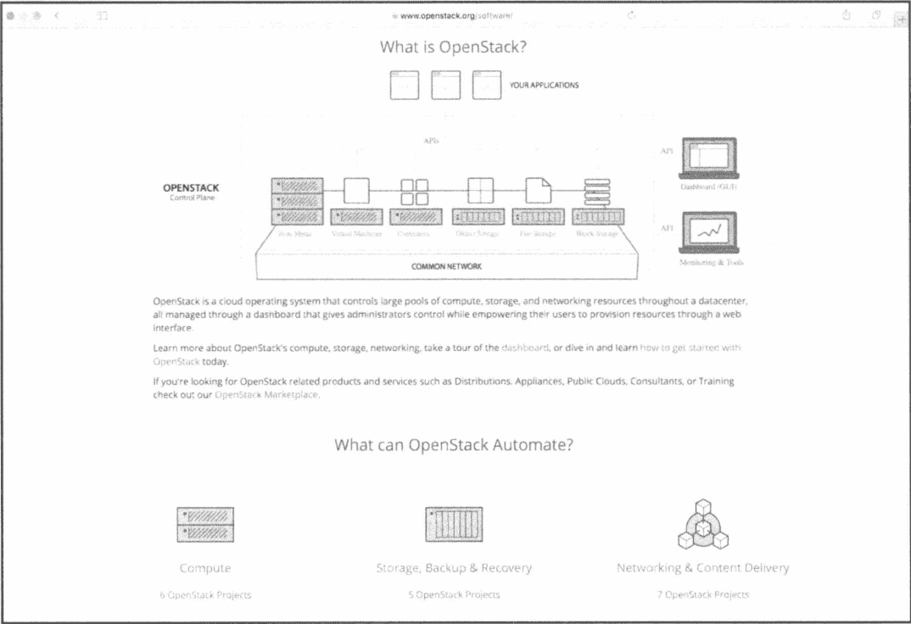

用户可能熟悉Oracle VirtualBox，本质上它也是一种允许用户创建隔离环境的虚拟化软件。它允许用户在Windows中运行Linux，反之亦然。

称为虚拟机监视器（hypervisor）的专用软件或硬件用于管理和运维虚拟机。

## 容器——Docker、Kubernetes和Mesos

容器与虚拟化一样，会创建隔离的客户系统，但是虚拟机创建的是完全独立的环境，而容器与主机系统共享同一内核，因此被认为更接近硬件。虚拟化和容器都会因多层抽象——主机与客户操作系统之间的功能转换——而产生性能损耗。然而，容器通常具有更高的性能水平，因为它们依赖并直接使用客户操作系统的特性，而不是创建单独的操作系统生态系统。

流行的容器包括Docker、CoreOS等。如今，容器主要用于大规模管理以Web为主的服务。相比虚拟机，容器可以更便捷地按需启动和关闭，并且主流云提供商已经添加了对容器的专门支持，只需几行代码即可轻松启动数千个容器来服务Web请求。Kubernetes等编排软件提供了企业级容器管理能力。此外，Mesos等平台不仅提供容器管理支持，还增加了管理其他传统硬件的能力，以实现应用感知调度和其他服务：


## 本地部署硬件

最后，本地部署硬件（如传统数据中心）在当今计算领域仍占有一席之地。使用物理数据中心，用户无需为基于云的服务支付经常性费用。对于没有大量管理开销的中小型组织，或者对于不需要高性能/专业化计算能力的组织，本地部署系统完全能够提供成本效益高且永久性的解决方案。

ScaleMP等公司提供用于高性能计算的专业硬件。此类硬件的用户通常有云服务提供商无法提供的特定需求：


下表总结了本地部署系统与基于云的系统之间的一些差异：

| 本地部署 | 云 |
|---|---|
| 你拥有硬件 | 你租用硬件 |
| 需要全面维护 | 维护由云托管提供商管理 |
| 需要IT资源来管理计算硬件资源 | 在管理计算硬件资源方面开销小得多，因为它们可以在云端按需添加 |
| 对于数据中心运营成本低或没有运营成本的中小型环境而言成本效益高 | 对于希望简化数据中心运营成本的大型组织而言成本效益高 |
| 除管理硬件所需的资源外，使用硬件没有经常性成本 | 使用硬件会产生经常性成本；采用订阅模式定价 |
| 主要采用静态架构；对Hadoop的新需求将需要一整套新采购 | 极其灵活；公司可以按需在多操作系统中配置数千台服务器 |
| 容易被组织、法务及相关业务部门接受 | 由于将管理委托给第三方/云托管提供商，会面临障碍，尤其是来自法务部门的障碍 |

## 企业大数据

大型组织实施大数据的总体策略取决于组织的具体需求。如今，在大数据、数据科学、机器学习以及近来出现的AI提供商之间，有数百种选择。

因此，在大型组织实施大数据时，有两个主要考虑因素：

- **技术**：选择合适的软件和硬件栈
- **运营**：管理组织数据、制定正式的数据治理策略，以及建立充分的数据管理框架

除此之外，招聘合适的人才，并可能为公司的大数据/数据科学实施创建明确的角色，是额外但同样重要的任务。

制定此类战略时的一些关键问题包括：

- 软件/硬件的许可是基于数据量还是核心数？如果是基于数据量，而我的数据量增长，那么3年/5年的成本是多少？
- 该解决方案是否有企业级支持？
- 我们是否需要聘请外部资源？
- 新功能将回答哪些业务问题？
- 我们是否进行了短期和长期的成本效益分析？
- 新解决方案能够满足组织目前哪些未满足的需求？
- 该解决方案是否具有足够的可扩展性以满足我未来的潜在需求？


在技术需求方面，尽管市场上有许多解决方案，但在实践中，使用该解决方案将要处理的真实/实际数据进行测试或概念验证是极其重要的。经常可以发现一些解决方案声称功能强大，却无法达到预期。**换句话说，关键是要收集全面的实证结果，而不是仅仅基于营销宣传就进行购买。**

最后，由于大数据/数据科学在不断发展，需要正确评估解决方案的长期可扩展性和适应性。应考虑基于云的选项，因为它提供了一种高效的方式，可以轻松且负担得起地访问和使用新兴解决方案。

## 教程 – 在云端使用RStudio

以下教程将演示如何在**AWS**（Amazon Web Services）上创建账户，加载RStudio的AMI镜像，然后使用RStudio，而且全部*免费*。有云平台使用经验的读者可能会觉得这些说明相当基础。对于其他用户，本教程应提供有关使用AWS的有用初步指导。

在继续之前，请阅读下面的**警告**信息。

**警告：** 请注意，AWS注册需要信用卡。用户必须小心，只选择免费套餐（FREE TIER）选项。AWS协议允许亚马逊向用户收取产生的费用。因此，用户应明智地使用该平台，以避免因服务器或服务持续运行而产生可能昂贵的意外费用。


目前，Azure和Google Cloud提供用户注册，并设有避免意外收费的条款。然而，AWS在所有云供应商中拥有最高的市场份额，用户在大多数工作场合都可能遇到AWS。因此，本教程重点介绍AWS而非其他替代方案。

如果你希望停止使用AWS（从而也避免任何费用），本教程末尾还提供了如何关闭账户的说明：

1. 前往 `https://aws.amazon.com/` 并点击右上角的**创建AWS账户**按钮：


3. 选择你的**账户类型**（例如**个人**）并输入联系信息：


4. 输入支付信息。AWS注册需要信用卡。请注意，用户必须非常小心和明智地使用AWS资源，以确保不会产生意外费用：

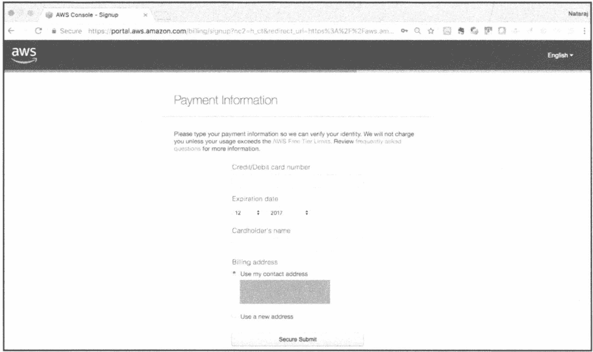

5. 支付信息验证通过后，你将收到确认：

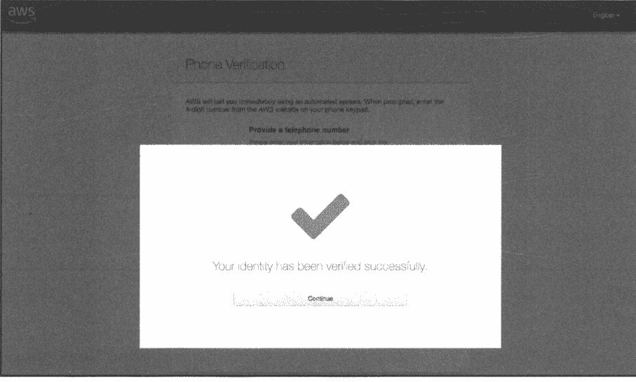

6. 选择基本计划（免费）：


选择基本计划后的确认页面如下：


7. 使用你的凭据登录AWS：


12. 点击左侧菜单栏中的**社区AMI**并搜索RStudio。选择第一个选项，然后点击“选择”按钮：

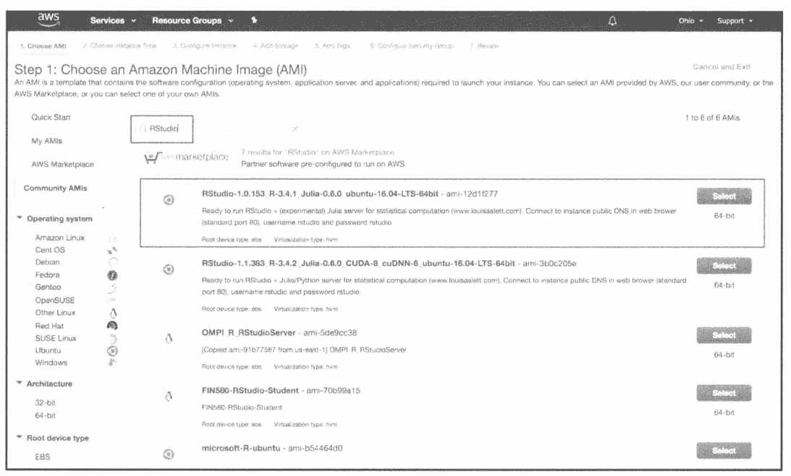

14. 在下一页选择默认选项，然后点击**下一步：添加存储**：

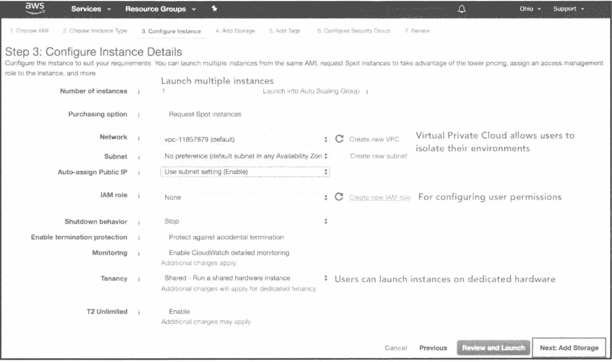

### 16. 点击下一步：配置安全组：

### 第5步：添加标签

标签由区分大小写的键值对组成。例如，你可以定义一个键为Name、值为Webserver的标签。

标签副本可以应用于卷、实例或两者。

标签将应用于所有实例和卷。了解有关标记Amazon EC2资源的更多信息。

键（最多127个字符） 值（最多255个字符） 实例 卷

此资源当前没有标签

选择“添加标签”按钮或单击以添加Name标签。

确保你的IAM策略包含创建标签的权限。

添加标签（最多50个标签）

取消 上一步 审核和启动 下一步：配置安全组

18. 点击**启动**：

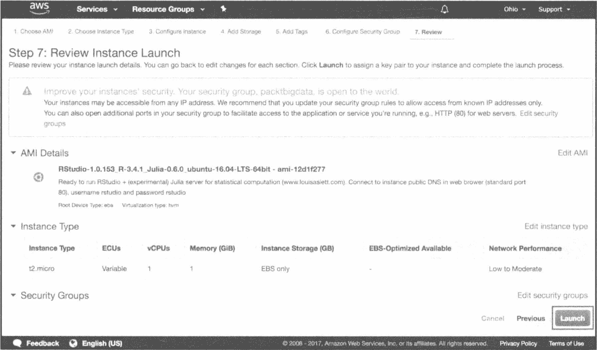

21. 当实例ID的状态显示为“运行中”时，复制服务器的名称，该名称可以在底部面板中查看：

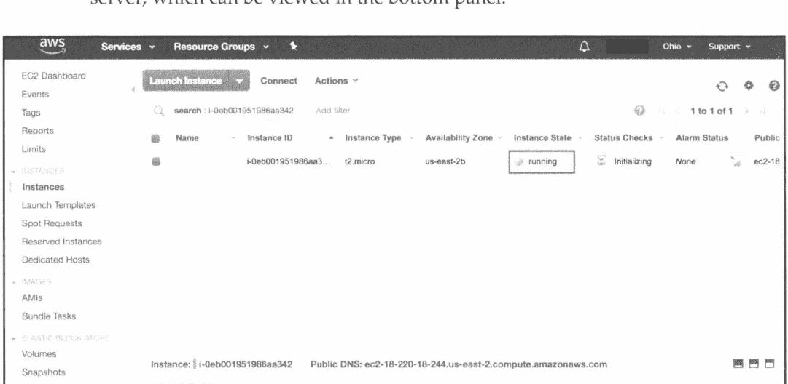

22. 打开新浏览器，在URL中输入服务器名称，然后按回车。这将打开RStudio。使用ID **rstudio** 和密码 **rstudio** 登录：

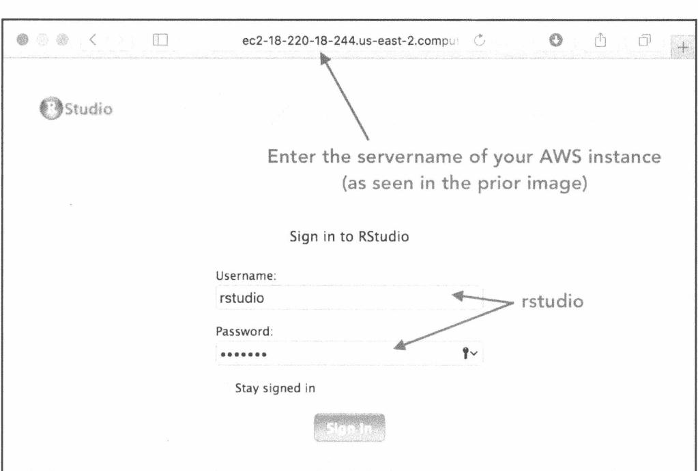

23. 这将打开RStudio控制台。这是一个完整的R环境，你可以像在本地安装的R和RStudio中一样执行R代码：

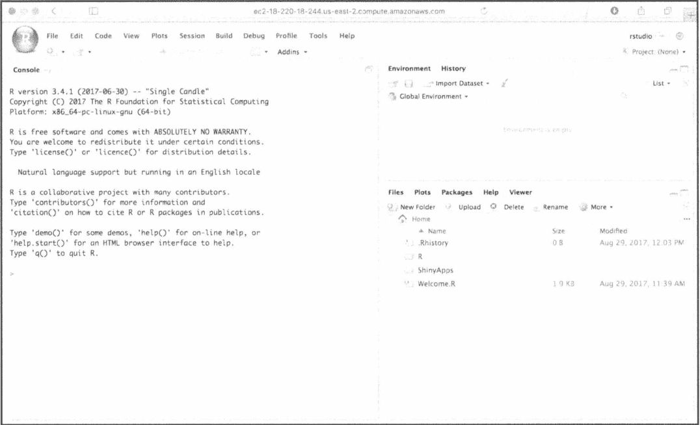

24. 使用完RStudio后，请确保终止实例。终止会停止计费过程。即使我们使用的是免费套餐账户，在工作完成后停止或终止实例也是一种良好的做法：

25. 点击“退出”以注销AWS控制台：

右键单击以弹出菜单

重要
确保在工作完成后终止实例

完成后从控制台注销

Azure也在 https://azure.microsoft.com/en-us/free/ 提供免费账户注册，如下图所示：


Google的免费云注册表单可在 https://cloud.google.com/free/ 获取，如下图所示：

## 总结

在本章中，我们讨论了部署企业级数据科学基础设施的需求，包括软件和硬件层面。我们分享了管理层围绕此类举措的关键常见问题。随后，我们用大量篇幅介绍了大型组织中用于数据挖掘和机器学习的关键企业解决方案。

本教程涉及在Amazon Web Services（一个基于云的系统）上启动RStudio Server。AWS已成为当今世界领先的云服务提供商，该练习展示了在几秒钟内启动整个机器是多么简单。我们还提到了关于明智和谨慎使用AWS以防止产生非常昂贵费用的适当利弊。

下一章也是最后一章将包括一些结束语、后续步骤，以及你可以用来了解更多关于本书所讨论主题的有用资源链接。

本章将涵盖以下主题：

- 企业大数据和数据科学战略
- 伦理考量
- 硅谷与数据科学
- 人的因素
- 延伸阅读链接

## 企业大数据和数据科学战略

你在报纸上读到过它，你在晚间新闻中看到过它，你从朋友那里听说过它——大数据和数据科学无处不在，而且它们会一直存在。

硅谷的成功故事使这种影响更加显著。谁能想到，一个拼车和叫车手机应用Uber能成为世界上最受欢迎的公司之一，估值接近700亿美元。Airbnb等网站和应用将公寓共享变成了一项蓬勃发展的业务，以300亿美元的估值成为第二大最有价值的公司。

这些以及其他类似的事件将大数据和数据科学从纯粹的理论和技术主题转变为人们已将其与无限投资成功联系在一起的常用术语。

由于几乎所有主要技术供应商都已开始添加归类为*大数据*的功能，如今几乎所有投资于技术的公司都在有意或无意地使用大数据的某些方面。

然而，实施过程定义得非常松散。因此，除了Hadoop之外，没有明确的框架，Hadoop一直是大多数公司采用的事实标准框架。高层管理人员通常了解大局，即大数据可以为其组织带来的价值。然而，实现这一愿景的道路充满挑战，因此没有能够保证成功的明确解决方案。


自下而上的方法涉及从 IT 层面开始构建决策。自上而下的方法则从管理层开始做决策，这种方法可以说更为常见。两者通常都不是最优的。理想的方法是存在一个持续的反馈循环，根据发现的过程调整需求：

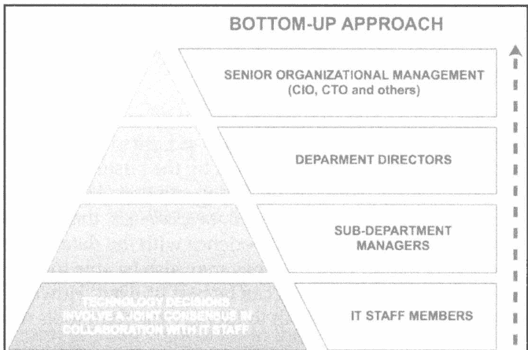

相比之下，自上而下的方法如下：


无论是自下而上还是自上而下的方法，对于成功的 big data 计划来说都不是最优的。更好的选择是一种协作流程，考虑到不同部门在实施 big data 平台后会受益的不断变化的需求和多样化要求：


## 道德考量

大数据通常涉及收集大量可能包含用户个人信息的數據。Facebook 和 Google 等公司正是通过分析个人信息的广告投放和其他类型的营销而蓬勃发展。这显然引发了道德困境。个人数据应在多大程度上被收集？多少才算 *太多*？当然，这些问题没有正确答案。黑客攻击导致数亿用户账户信息被泄露的情况在今天如此普遍，以至于我们几乎对后果变得麻木不仁。

2017 年 10 月，雅虎！披露 30 亿个账户，事实上雅虎！上的每一个账户都遭受了数据泄露。美国最大的信用报告公司之一 **Equifax** 发生数据泄露，暴露了超过 1.4 亿消费者的个人详细信息。还有大量类似的事件，而在所有这些事件中，共同点是所有公司都收集了某种程度的用户个人信息，无论是直接还是通过第三方。

本质上，每当涉及用户相关信息时，就需要实施合适的 IT 安全措施，以确保数据不会被泄露。其后果不仅限于数据丢失，还包括对声誉和 goodwill 的连带损害，此外最主要的是，真正的人的數據已被泄露。

因此，只要大数据涉及敏感信息和/或任何个人信息，其安全性就变得至关重要。AWS 和 Azure 等云提供商之所以获得发展，部分原因在于他们拥有非常严格的安全标准以及认证，使组织能够将责任转移给值得信赖且强大的实体。

欧盟 **GDPR（通用数据隐私条例）** 于 2018 年 5 月生效，是保护其公民个人数据的重要一步。简而言之，GDPR 规范了任何个人数据的使用。在此背景下，术语 any 极其宽泛，甚至包括个人的姓名。违反规则者将被罚款最高 2000 万欧元，或违约组织全球营业额的 4%。

虽然这显然会减少 *大数据* 数据集的可用性，尤其是与个人数据相关的，但它也可能引发辩论，并可能在如何在约束条件下最好地利用数据方面带来创新，即在不使用个人信息的情况下从数据中获取价值。

另一方面，美国等国家一直在放松个人数据收集方面的法律。2017 年初，美国取消了互联网服务提供商收集个人信息方面的隐私保护，事实上还使 AT&T 等 ISP 不仅可以收集用户浏览和应用数据，而且可以合法出售这些数据。

## 硅谷与数据科学

我们今天在大数据中看到的许多关键创新都源自硅谷。该地区几十年来一直是科技中心，催生了一些最成功的公司，如 Apple、Google、Facebook 和 eBay。加州大学伯克利分校等大学的存在使得获取人才相对容易。

话虽如此，该地区的生活成本已经飙升，尤其是在大数据和数据科学行业增长的推动下。今天，一居室公寓的平均租金已超过每月 3,500 美元，比纽约市还要昂贵。

硅谷然而与成功同义，许多新企业家被该地区吸引。初创公司如雨后春笋般涌现，其中许多公司获得了数千万美元的风险投资。然而，企业家应注意统计警告，因为初创企业的失败率很高。有一个伟大的想法并具有潜在的高商业价值是一回事。把想法变成商业成功需要不同类型的能力和商业头脑。

对于感兴趣的人来说，Crunchbase 网站提供了对初创领域活动的非常全面的视图。以下图像显示了在任何给定 7 天周期内发生的投资的平均数据，这可能达到数百亿美元：


## 人为因素

尽管大数据和数据科学具有显著优势和突破性增长，但仍需牢记，人类思维的元素在所有事业中都是必不可少的。

大数据技术将使我们更高效地分析数据。但我们仍需要运用正确的判断来决定理想的使用案例。这并非易事。大公司发现举措同样具有挑战性（尽管规模更大），就像经验丰富的大数据专业人士一样。

同样，数据科学和机器学习可以借助复杂的算法和代码赋予我们预测和洞察力。然而，用户仍有责任评估结果，并不能仅基于预测输出做出决策。用户在做出此类评估时应运用常识和经验。如果 GPS 在雪夜指示司机走某条路，而司机知道该路不会被除雪车清理，那么盲目遵循 GPS 指示就不明智。

一个最近的例子说明了这一概念，即在 2016 年大选期间人与机器之间的脱节。利用非常复杂的算法估计克林顿获胜概率很高的广泛模型都被证明是错误的。著名的数据科学家和领先的统计组织估计克林顿当选总统的几率为 80-90%。我们所有人错过的是人类决策的元素。我们过于专注于模型的复杂性，而没有尝试理解人们真正感受以及他们在非正式调查中的主张是否会与他们最终的候选人选择和对他们的真实感受一致。

## 成功项目的特征

数据科学项目本质上需要很长时间才能实现投资回报。特别是，衡量涉及长期预测的项目的成功是困难的。如前一章所述，为了推进数据科学事业，各部门必须展示早期成功。一般来说，项目 a) 短期；b) 有可衡量的结果；c) 可以惠及并将被广泛用户使用，是建立信誉和确保数据科学相关项目成功的关键因素之一。

一个这样的项目例子是 Arterys，这是一家基于云的公司，于 2016 年底开发了一种深度学习算法，可以在比传统扫描仪快得多的时间内评估血液流向心脏的情况。它符合所有成功的关键标准。好处几乎立即显现，该算法提供了可直接衡量的结果，因为你可以将结果与扫描仪的结果进行比较，并且对广泛的用户，即患者有用。此外，该主题非常直观。


任何做过血液检测的人都能直观地理解测量血流。这样的产品的好处也显而易见。能够在很短的时间内获得结果可能会挽救生命。2016年11月，FDA批准了该算法。这是里程碑式的成就。

# 摘要

总体而言，虽然通往大数据和数据科学成功的道路似乎艰巨，但希望前面的章节已全面概述了大数据领域的各个主题。我们讨论了数据挖掘和机器学习，了解了各自学科中的各种工具和技术，并在真实数据上开发了应用程序，并就组织大数据和数据科学计划的细微差别提出了告别性思考。

接下来的几页列出了一些资源链接，读者可能对进一步了解各自主题有所帮助。

# 外部数据科学资源

本书涵盖了非常广泛的材料，从 Hadoop 到 NoSQL，再到机器学习和企业数据科学。信息非常详尽，但由于篇幅限制，我们没有深入探讨任何一个特定领域。

在接下来的几个部分中，我们提供了外部材料的链接，供进一步阅读，如果你想了解更多关于各自主题的内容，这些资源可能对你有用。


这里的许多解决方案要么是开源的，要么是企业软件的社区版本。后者如果考虑为大数据和/或数据科学采用企业解决方案时尤其有用。

# 大数据资源

Apache Hadoop:
https://hadoop.apache.org

Apache Spark:
https://spark.apache.org

Databricks Spark: Community access to Spark clusters:
https://community.cloud.databricks.com/

# NoSQL 产品

Redis: In-Memory Key-Value NoSQL Database:

`https://redis.io`

Cassandra: One of the most powerful production NoSQL systems:

`http://cassandra.apache.org`

MongoDB: Document-based NoSQL database:

`https://www.mongodb.com`

Vertica: Community Edition:

`https://www.vertica.com/try/`

Teradata: Aster Community Edition:

`https://aster-community.teradata.com/community/download`

# 语言和工具

Open Source R:

`https://www.r-project.org`

Microsoft Open R (with additional features for enterprise):

`https://mran.microsoft.com/open`

RStudio: Development Interface for R:

`https://www.rstudio.com`

Open Source Python:

`https://www.python.org`

Anaconda Python: Python preinstalled with data science and other important packages:

`https://anaconda.org`

# 创建仪表板

R Shiny: Dashboards in R:

`https://www.rstudio.com/products/shiny/`

Dash: Dashboards in Python:

`https://plot.ly/products/dash/`

# 笔记本

Jupyter: Notebook interface for R, Python and various other languages:
http://jupyter.org

Beaker Notebook: Similar to Jupyter but not as widely used:
http://beakernotebook.com

# 可视化库

Bokeh: An excellent plotting library for Python:
https://bokeh.pydata.org/en/latest/

Plotly: Dashboard and Reporting: Enterprise and Open-Source:
https://plot.ly

RCharts: A widely used plotting package in R:
https://ramnathv.github.io/rCharts/

HTMLWidgets: Interactive dashboards in R using JavaScript:
http://www.htmlwidgets.org

ggplot2: The ultimate R graphics library:
http://ggplot2.tidyverse.org

# R 课程

edX Courses on R:
https://www.edx.org/course?search_query=R+programming

A concise R tutorial:
http://www.cyclismo.org/tutorial/R/

Coursera: Big Data and R courses:
https://www.coursera.org/specializations/big-data
https://www.coursera.org/courses?languages=enquery=r+programming

## 机器学习课程

Harvard CS109: THE MOST Comprehensive Machine Learning Course using Python (per author):

`http://cs109.github.io/2015/pages/videos.html`

Caltech Learning from Data: THE MOST Comprehensive MOOC on Machine Learning Theory:

`https://work.caltech.edu/telecourse.html`

Coursera: Various courses on Machine Learning:

`https://www.coursera.org/learn/machine-learning`

Stanford: Statistical Learning by Trevor Hastie and Rob Tibshirani:

`https://lagunita.stanford.edu/courses/HumanitiesSciences/StatLearning/Winter2016/about`

Machine Learning by Andrew Ng: One of THE MOST widely known MOOC on Machine Learning:

`https://www.coursera.org/learn/machine-learning`

## 机器学习和深度学习链接

Scikit-Learn: The most comprehensive Machine Learning package in Python:

`http://scikit-learn.org/stable/`

Tensorflow: A well-known solution for Deep Learning from Google:

`https://www.tensorflow.org`

MLPACK: Machine Learning using C++ and Unix Command Line:

`http://www.mlpack.org`

Word2Vec: One of the well-known packages for Natural Language Processing:

`https://deeplearning4j.org/word2vec`

Vowpal Wabbit: Excellent Machine Learning software used in many Kaggle competitions:

`https://github.com/JohnLangford/vowpal_wabbit/wiki/Tutorial`

LIBSVM & LIBLINEAR: Highly regarded command line machine learning tools:

`https://www.csie.ntu.edu.tw/~cjlin/libsvm/`
`https://www.csie.ntu.edu.tw/~cjlin/liblinear/`

LIBFM: Matrix Factorization:
http://www.libfm.org

PaddlePaddle: Deep Learning from Baidu:
https://github.com/PaddlePaddle/Paddle

CuDNN: Deep Learning/Neural Network solution from NVIDIA:
https://developer.nvidia.com/cudnn

Caffe: Deep Learning framework from Berkeley:
http://caffe.berkeleyvision.org

Theano: GPU Enabled Machine Learning in Python:
http://deeplearning.net/software/theano/

Torch: High performance Machine Learning in Lua:
http://torch.ch

Keras: Open-Source Neural Network Applications:
https://keras.io

# 基于 Web 的机器学习服务

AzureML: Machine Learning in Microsoft Azure Cloud:
https://azure.microsoft.com/en-us/services/machine-learning/

H2O: High Performance Machine Learning Platform: Works with R, Python and much more:
https://www.h2o.ai

BigML: Visually appealing Web-based machine learning platform:
https://bigml.com

# 电影

The Imitation Game: Movie on Alan Turing:
http://www.imdb.com/title/tt2084970/

A Beautiful Mind: Movie on John Nash:
http://www.imdb.com/title/tt0268978/

2001: A Space Odyssey:
http://www.imdb.com/title/tt0062622/

Moneyball: Movie on sabermetrics:
http://www.imdb.com/title/tt1210166/

Ex Machina: Movie on Artificial Intelligence:
http://www.imdb.com/title/tt0470752/

Terminator 2: A movie that has achieved cult status:
http://www.imdb.com/title/tt0103064/

# Packt 出版的机器学习书籍

Getting Started with Tensorflow by Giancarlo Zaccone:
https://www.packtpub.com/big-data-and-business-intelligence/getting-started-tensorflow

Machine Learning and Deep Learning by Sebastian Raschka:
https://www.amazon.com/Python-Machine-Learning-scikit-learn-TensorFlow/dp/1787125939

Machine Learning with R by Brett Lantz:
https://www.amazon.com/Machine-Learning-techniques-predictive-modeling/dp/1784393908

# 休闲阅读书籍

A classic on logic and mathematics:
https://www.amazon.com/Gödel-Escher-Bach-Eternal-Golden/dp/0465026567

A simple explanation of Gödel's Incompleteness Theorem:
https://www.amazon.com/Gödels-Proof-Ernest-Nagel/dp/0814758371/

Roger Penrose on Artificial Intelligence and much more:
https://www.amazon.com/Emperors-New-Mind-Concerning-Computers/dp/0198784929/

# 你可能喜欢的其他书籍

如果你喜欢这本书，你可能对 Packt 出版的这些其他书籍感兴趣：


# Big Data Analytics with SAS

David Pope

ISBN: 978-1-78829-090-6

- Configure a free version of SAS in order do hands-on exercises dealing with data management, analysis, and reporting.
- Understand the basic concepts of the SAS language which consists of the data step (for data preparation) and procedures (or PROCs) for analysis.
- Make use of the web browser based SAS Studio and iPython Jupyter Notebook interfaces for coding in the SAS, DS2, and FedSQL programming languages.
- Understand how the DS2 programming language plays an important role in Big Data preparation and analysis using SAS.
- Integrate and work efficiently with Big Data platforms like Hadoop, SAP HANA, and cloud foundry based systems.


# 使用 TensorFlow 进行预测分析

Md. Rezaul Karim

ISBN: 978-1-78839-892-3

+   - 深入且理论性地理解线性代数、统计学和概率论以进行预测建模
+   - 使用分类、回归和聚类算法开发预测模型
+   - 开发 NLP 的预测模型
+   - 学习如何使用强化学习进行预测分析
+   - 用于高级推荐系统的因子分解机
+   - 获得对用于高级预测分析的深度学习架构的实践理解
+   - 学习如何使用深度神经网络进行预测分析
+   - 查看如何使用循环神经网络进行预测分析
+   - 用于情绪识别、图像分类和情感分析的卷积神经网络

# 留下评论 - 让其他读者知道你的想法

请在您购买该书的网站上分享您对本书的想法，留下评论。如果您是从 Amazon 购买的书，请在此书的 Amazon 页面上留下诚实的评论。这至关重要，这样其他潜在读者才能看到和使用您的公正意见来做出购买决定，我们可以了解客户对我们产品的看法，以及我们的作者可以看到您对他们与 Packt 合作创作的标题的反馈。只需花费您几分钟的时间，但对其他潜在客户、我们的作者和 Packt 来说都很有价值。谢谢！

# 目录

# A

ACID compliant 320
actions 197
activation function 293
active 371
Advanced Analytics 311
Amazon Athena 324
Amazon Redshift 323
Amazon Web Services (AWS) 317, 342
Anaconda Cloud 331
Analytics Toolkit
 components 36
Apache MADLib 334
application programming interfaces (APIs) 31
application
 about 187
 executing 304, 305
apriori 273
artificial intelligence (AI)
 about 218, 221, 222
 constrained optimization 223
 game theory 223
 machine learning 223
 planning 223
 sociology 223
 uncertainty/Bayes' rule 223
association rules
 about 273, 274
 confidence 274
 lift 275, 276
 support 275
associative rules mining
 application, executing 305
 custom CSS, used 303
 custom CSS, used for application 304
 data, downloading 297, 298

executing 304
 fonts, used for application 303, 304
 R code, writing for Apriori 298
 Shiny (R Code) 299, 300, 303
 with CMS data 296, 297
Aster Analytics
 reference link 317
Atomicity 108
atomicity, consistency, isolation, and durability (ACID) 108, 109
Azure CosmosDB
 about 326
 reference link 327

# B

bagging 281
BASE property
 of NoSQL 109
Basically Available Soft-state Eventually (BASE) 109
BI workloads 316
bias 262, 264, 265, 266, 268, 269
big data analytics
 about 14, 198
 building blocks 14
 challenges 313
 data management 15
 end user 15
 hardware 14
 software 15
big data mining
 about 24
 in enterprise 24
 life cycle, implementing 26
 solution, implementing 27, 28
stakeholders 27

Apache MADlib 334
Caffe 331
command-line tools 334
Datarobot 334
deep learning 332
H2O 333
machine learning, as service 335
OpenCV 331
overview 308, 311, 312
Python 330
R programming language 329
Spark 331
enterprise data warehouse 316
enterprise infrastructure solutions
 about 336
 big data, enterprise 341
 cloud computing 337
 containers 339
 on-premises hardware 340
 virtualization 337
enterprise-grade NoSQL databases 320
Equifax 373
Ethical considerations 373, 374
Euclidean Distance 291
Exadata 316
Exalytics 316
executor process 200
Extract-Transform-Load (ETL) 81
F
Fast and Frugal Decision Trees (FFTrees) 279
feature selection techniques 233
First-In-First-Out (FIFO) 77
flowchart 276
fonts
 used, for application 303, 304
frontend web portal
 creating 170
G
General Data Privacy Regulation (GDPR) 374
General Purpose License (GPL) 27
Google BigQuery 325
Google File System (GFS) 128
GPU databases
 about 327
 Brytlyt 328
 MapD 328
gradient descent 270
graph databases 128
Greenplum Database span class= 319
Greenplum
 URL, for downloading 319
H
H2O
 about 333
 URL, for downloading 333
Hadoop 3
 features 80
Hadoop Common 31, 64
Hadoop Distributed File System (HDFS)
 about 31, 62, 64, 65, 66
 data storage 65
 data storage process 67, 68, 69
 DataNode 67
 NameNode 66
 namespaces 65
Hadoop ecosystem 80, 81
Hadoop MapReduce
 about 31, 64, 69, 70, 71, 72
 block size 72, 73
 mappers 72, 73
 reducers 72, 73
 used, for WordCount 82, 83, 84, 85, 89, 91
Hadoop YARN
 about 31, 64, 73, 74, 75, 76
 ApplicationMaster 75
 Avro 79
 CapacityScheduler 77
 Containers 75
 data encryption 78
 data storage formats 78, 79
 Fair Schedulers 77
 FIFO 77
 HDFS Snapshots 79
 job scheduling 77
 node failures, handling 80
 NodeManagers 75

ORCFiles 79
other aspects 77
Parquet 79
ResourceManager 75
SequenceFiles 79
user authentication 78
Hadoop
 core modules 64
 fundamental premise 63, 64
 fundamentals 62
 I/O Bound operations 192
 installing 38
 limitations 192, 193
 limitations, overcoming 193
 MapReduce programming (MR) model 192
 Non-MR Use Cases 192
 programming APIs 193
Hamming Distance 291
hardware stack
 cloud-based architecture 30
 multinode architecture 29
 selection 29
 single-node architecture 30
Hive
 tables, joining 100, 103, 104
 used, for analyzing oil import prices 92, 93, 94, 95, 97, 98, 99
HP Vertica 317
HStore 319
human factor
 about 375, 376
 data science projects, characteristics 376, 377
hyperplane 286
I
IBM data warehouse systems 318
Importing Data 212
in-memory databases 33, 113
integrated development environment (IDE) 56
isolation 108
J
JavaScript Object Notation (JSON) 123
JSON format 131
K
K-Means machine learning technique 289, 290, 291
kdb+
 about 150, 320
 architectural simplicity 150
 enterprise-ready 150
 installing 149, 150
 low-level implementation 150
 MapReduce 150
 no installation 150
 reference link 321
 wide availability, of interfaces 150
Key Management Systems (KMSs) 78
key-value databases
 about 32, 125
 B-trees 128
 Bloom filters 128
 Shards 128
 SSTables 128
L
languages and tools 380
left hand side (LHS) 232
linear regression 271
lines 195
logistic regression 271
M
machine learning algorithms
 about 270, 271
 association rules 273, 274
 boosting algorithms 283, 284
 decision trees 276, 277, 279, 281
 K-Means machine learning technique 289, 290, 291
 neural networks related algorithms 292, 293, 294
 random forest extension 281, 283
 regression models 271
 support vector machines (SVMs) 286, 288
machine learning packages, in R
 reference link 329
machine learning
 about 218, 220, 221, 222, 224, 382, 383, 384
 as service 335
 categories 224
 common terminologies 231, 232
 computing hardware 221
 core concepts 233
 courses 382
 cross-validation concepts 249
 data management steps 233
 data pre-processing 233
 evolution 219
 factors 220
 feature selection techniques 233
 internet 220
 packages 221
 programming languages 221
 references 382, 383
 social media 221
 test splits 249
 train 249
Mahalanobis Distance 291
map 195
MapD 328
Microsoft R Open
 about 329
 downloading 52
 installing 53
Microsoft R Server 329
model-building process
 creating 233
 cross-validation 233
 data pre-processing 233
 test splits 233
 training 233
MongoDB
 about 321
 installing 132, 136, 138, 141, 145, 148
 Nobel Laureates data, analyzing 131
 URL, for downloading 133
 using 132, 136, 138, 141, 145, 148
multicore processing
 leveraging, in model 257, 260
multicore programming, in R
 reference link 330
multinomial logistic regression 271
multiple linear regression 271
N
near-zero variance function 235
Neo4J
 about 323
 reference link 323
neural networks related algorithms 292, 293, 294
Nobel Laureates data
 analyzing, with MongoDB 131
 JSON format 131
nodes 195
NoSQL products 380
NoSQL
 about 108
 ACID properties 108
 Amazon Dynamo 112, 113
 BASE properties 108
 CAP properties 108
 columnar databases 116, 117, 119, 121
 databases 113
 document-oriented databases 121
 Google Bigtable 112
 graph databases 128
 in-memory databases 113
 key-value databases 125
 technologies, need for 111
 types 130
 types of databases 130
notebook interface 381
Nutch Distributed FS (NDFS) 63
O
open source NoSQL databases
 about 320
 Cassandra 322
 kdb+ 320
 MongoDB 321
 Neo4J 323
Openstack
 URL 338
Oracle Business Intelligence Enterprise Edition (OBIEE) 316
Oracle Exadata 316


Oracle VirtualBox
  安装 38, 40, 43, 44, 46
Oracle VM VirtualBox Extension Pack
  URL，用于安装 38
经济合作与发展组织（OECD） 92
过拟合 266
P
Packt Data Science Box
  安装 47, 50
被动 371
电话日记 122
医生付款
  kdb+，安装 149
  R，安装 149
  RStudio，安装 149
  跟踪，使用真实世界数据 148
Pivotal 319
Postgres 319
PostgreSQL 319
预处理 238
Python
  关于 330
  安装 57, 59
Q
Q 应用程序
  后端代码 168
  创建 166
  数据，加载 166
定量 231
R
R代码
  编写，用于 Apriori 298
R编程语言 329
R Shiny平台
  应用程序 187
  CMS Open Payments 应用程序 184
  面向开发者 171
R
  课程 381
  安装 51, 149, 155
下载URL 51
随机森林扩展 281, 283
随机过采样示例（ROSE） 239
行排序 25
Redshift Spectrum 324
回归模型 271, 272
正则化特性 262, 264, 265, 266, 268, 269
弹性分布式数据集（RDD） 32, 195
岭回归和Lasso回归 272
RStudio
  安装 56, 149, 155, 157
  URL，用于安装 56
  在云中使用 342, 346, 348, 350, 352, 356, 360, 363, 365, 366
S
SAP Hana 320
缩放函数 234, 235
服务级别协议（SLA） 319
Shiny（R代码） 299, 300, 303
硅谷 374, 375
小型实验机（SSEM）
  关于 11
  参考链接 11
软件栈
  Apache Spark 31
  基于云的解决方案 33
  Hadoop生态系统 31
  NoSQL数据库 32
  选择 31
  传统数据库 32
软件，大数据分析
  数据挖掘 15
  统计分析 15
固态硬盘（SSDs） 221
固态硬盘（SSD） 12
Spark Core 198
Spark DataFrames 196
Spark 部署选项
  关于 197
  Amazon EC2 197
  Apache Mesos 197
  Apache YARN 197
  Kubernetes 197
  独立模式 197
Spark 实践
  关于 201
  Databricks社区版，注册 202, 203, 204, 206, 207, 208, 209, 210, 211
Spark 解决方案
  关于 201
  I/O绑定操作 193
  MapReduce编程（MR）模型 194
  非MR用例 194
  编程API 194
Spark SQL 198
Spark streaming 198
Spark
  关于 192, 211, 212, 331
  操作 196
  API 197, 198
  架构 200
  核心组件 198
  有向无环图 195
  GraphX 199
  安装 51
  MLlib 199
  弹性分布式数据集（RDDs） 195
  Spark DataFrames 196
  Spark 部署选项 197
  SparkContext 195, 196
  理论概念 194
  转换 196
SparkContext 195, 196, 200
SparkSession 200
Spotlyt 328
SQL 108, 109
统计 221, 222
随机梯度提升（GBM） 284
监督机器学习
  关于 224
  示例 225, 226
  细分 229, 230, 231
支持向量机（SVMs） 286, 288
合成少数类过采样技术（SMOTE） 239
系统建议
  关于 36
  云，安装 37
  笔记本电脑，安装 37
  工作站，安装 37
T
Times Ten 316
传统数据仓库系统
  关于 316
  Exalytics 316
  Greenplum 319
  HP Vertica 317
  IBM数据仓库系统 318
  Oracle Exadata 316
  PostgreSQL 319
  SAP Hana 320
  Teradata 317
  TimesTen 316
事务 109
转换 196
U
欠拟合 266
非结构化数据 12
无监督机器学习 224, 227, 228, 229
V
Vagrant
  下载URL 47
变量选择 246
方差 262, 264, 265, 266, 268, 269
VC维 270
顶点 195
虚拟机（VMs） 37
虚拟化 337
可视化库 381
W
基于Web的机器学习服务 383
工作节点 200
Y
另一种资源协商器（YARN） 62

本文件由Anna's Archive于2023-2024年期间生成，属于读秀（DuXiu）收藏集的一部分（https://annas-blog.org/duxiu-exclusive.html）。

图像已无损嵌入。原始文件的相关信息可在PDF附件中找到。一些统计数据（更多信息请见PDF附件）：

```json
{
  "filename": "NDA5NTE5OTguemlw",
  "filename_decoded": "40951998.zip",
  "filesize": 116774546,
  "md5": "6b034880f9e965244c365a978d44d6fb",
  "header_md5": "51e3cb488d869b804186fd63ef06017d",
  "sha1": "309e0d02b1b9f8348d7f51ddc9889d39a831e07be7",
  "sha256": "8d600e13ba057e75cc867594589df820d2b7da3d7d5a988a3ef0e66b05906a31",
  "crc32": 631726621,
  "zip_password": "",
  "uncompressed_size": 137459605,
  "pdg_dir_name": "PracticalBigDataAnalyticsHands_ontechniquestoimplemententerpriseanalyticsandmachinelearningsingHadoopSparkNoSQLandR_40951998",
  "pdg_main_pages_found": 396,
  "pdg_main_pages_max": 396,
  "total_pages": 413,
  "total_pixels": 2311653120,
  "pdf_generation_missing_pages": false
}
```

