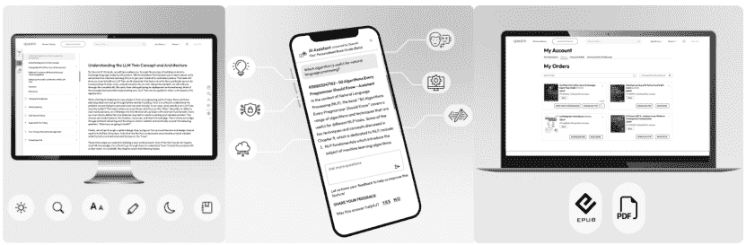
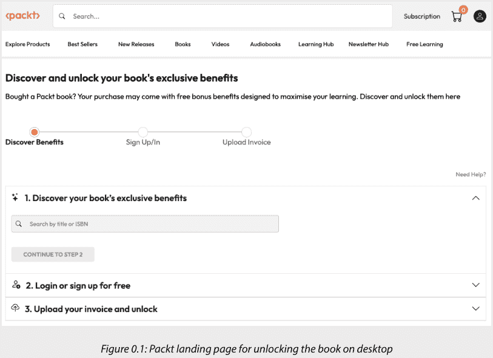

## 前言

在由不懈的速度和数字复杂性定义的商业环境中，建模和分析流程的能力不是可选的；它是必不可少的。*Practical Business Process Modeling and Analysis* 浓缩了每位有志成为变革推动者的人所需的基础知识，帮助您自信而清晰地应对转型。作者们借鉴了数十年咨询财富 500 强公司的全球经验，提供实用见解，帮助您避免代价高昂的错误，增强赞助商的可信度，同时保护您的职业轨迹。

随着 2025 年商业变革的步伐加速，超出了大多数组织的应对能力，领导者面临着战略雄心与执行准备之间日益扩大的差距。经济压力要求敏捷性，人类动态使转型复杂化，而人工智能驱动的低代码工具的兴起引入了可能重塑整个业务单元的机遇和风险。首席财务官和首席技术官正在竞相数字化，但成功取决于不仅仅是技术。它需要了解如何实时分析、建模和演进业务流程的人员。

然而，虽然企业可以轻松找到开发人员、六西格玛专家和项目经理，但很少有专业人士具备孵化和支持长期数字化计划所需的混合技能。为什么？因为流程分析工具的生态系统在孤岛中发展，未被主流媒体充分认可，并且在商学院中教授不足，值得注意的例外包括 Widener 大学（美国宾夕法尼亚州切斯特）、华沙经济大学（波兰华沙）和 UNIR（西班牙拉里奥哈）。即使是埃因霍温理工大学（荷兰埃因霍温）和 QUT（澳大利亚布里斯班）等严谨的课程也提供深度，但很少能让专业人士在第一天就作为敏捷变革推动者做出贡献。

本书正是为了填补这一空白而编写。

我们面向商业专业人士——不是作为理论家，而是作为理解转型存在于细微差别、速度和系统思维中的从业者。无论您成为软件供应商、加入咨询公司、报读学术课程、在线自学，还是说服老板投资培训，您都将面临权衡：供应商偏见、理论过载或实践浅尝辄止。事实是，进入这个领域没有完美的路径——但有一条务实的路径。

我们提供一种混合方法，将战略洞察与实践经验相结合。您将学习如何将流程艺术品解构为可执行逻辑，揭秘诸如 **业务流程建模和符号（BPMN）** 等建模符号，并在不使用企业术语的情况下传达可视化的好处。您将听取全球专家的意见，包括数字商业领域的领军人物 Jim Sinur，并了解影子业务架构师如何推动真正的变革，通常没有正式资质。

读完本书后，您将了解业务和流程架构的实际价值，学会如何建立转型可信度，并解锁为公司未来做出有意义贡献的方式。无论您是在波士顿、伦敦、海得拉巴或华沙的研讨会上花费三天，还是阅读这些章节，您都将准备好采取行动。

## 本书适用人群

本书适用于商业专业人士、决策者以及参与导致公司关键业务流程数字化的数字化变革计划的人员。需要具备 Microsoft Office 套件的基本技能。

## 本书涵盖内容

_第 1 章，通过流程建模赢得数字化转型_，深入探讨了流程建模作为 **数字化转型（DTX）** 基石的战略问题。它探讨了建模不仅如何提高流程效率，还如何作为与新兴业务需求同步发展的规划和审计工具。借助 **业务流程管理（BPM）** 先驱 Jim Sinur 的见解，它引导读者了解流程建模的类型、好处和未来轨迹，尤其是其与 AI、分析和自适应技术日益增长的协同作用。总体而言，本章为理解可视化建模如何支持智能、目标驱动且具有弹性的企业系统奠定了基础。

_第 2 章，成功数字化转型的支柱_，揭示了 DTX 的战略基础，强调成功不仅取决于技术，还取决于可适应的流程、赋权的团队和清晰的愿景。通过坦诚的反思和实用框架，它介绍了七个转型支柱，从可扩展的卓越中心到变革管理，使技术与业务目标保持一致。通过探索变革的多种触发因素和常见陷阱，它指导决策者制定具有弹性、目标驱动的策略，以产生长期影响。

_第 3 章，BPM 驱动您的竞争优势之轮_，介绍了“BPM 轮”作为启动和维持 BPM 转型的战略框架。它探讨了 BPM 如何通过赋权内部团队、与战略目标保持一致以及培养持续改进文化来推动企业范围的数字化变革。通过考察拐点、治理模型和现实世界案例研究，它为读者提供可操作的指导，以构建具有弹性、可扩展且以人为本的转型计划——这些计划不仅基于软件，更基于深思熟虑的规划、跨职能协作和长期愿景。

_第 4 章，长期趋势及其对您工作的影响_，探讨了长期 DTX 趋势对职业、工作场所动态和学习策略的深远影响。随着技术呈指数级发展，专业人士必须通过持续学习和技能演进来适应。作者强调 BPM 是构建具有弹性组织的基石，鼓励采用供应商独立的方法，优先考虑敏捷性和战略一致性。这种转型的核心是学习心态。本章介绍了一个由好奇心、探索、反馈和反思组成的实用框架。通过将战略洞察、技术基础和可及的学习路径相结合，本章为更具包容性、适应性和智能自动化的工作场所定下了基调。

第 5 章，业务流程 101，将 BPM 介绍为组织价值创造的关键驱动力。它倡导一种全面的、基于生态系统的流程视角，超越简单的任务序列，涵盖治理、依赖关系和战略对齐。读者将了解流程建模的基础知识：其场景、工具和受众。从 SIPOC 和 IGOE 等基本框架到建模状态（现状与未来状态）和用例（改进、自动化和文档），本章使专业人士能够设计有效、可读且有目的的模型。它还探讨了建模角色、流程知识来源以及从绘图应用程序到企业级套件的建模工具。最终，本章为流程思维奠定了基础，提供了一条实用且可适应的路线图，以在现代组织中可视化、沟通和改进流程。

第 6 章，建立流程架构，介绍了流程架构的概念，作为理解、管理和改进组织流程的战略蓝图。它解释了互连的流程如何形成价值链，以及为什么简单的列表或一组图表是不够的。通过对流程进行分类（管理流程、核心流程和支持流程）并建立层次模型，组织能够清楚工作流程如何运行、谁负责什么以及变更如何影响更广泛的系统。它展示了标准化方法（例如 APQC 的 PCF）和自定义架构，强调利益相关者对齐、战略集成和可视化导航。本章还强调了丰富的流程属性——目标、KPI、IT 系统和风险——如何为优化、自动化和转型的更明智决策提供支持。最终，流程架构成为实现 BPM 成熟度并实现企业范围内敏捷、跨职能协作的关键基础。

第 7 章，流程建模符号，追溯了流程建模符号的演变，强调了各种方法的优势和局限性：从早期的 ASME 流程图到 IDEF、LOVEM、UML 和 EPC 等复杂框架。它将 BPMN 定位为数十年建模创新的汇聚，为不同利益相关者提供标准化的可视化语言。读者将了解 BPMN 如何在简洁性与表达能力之间取得平衡，通过基于 XML 的数据交换支持自动化，并整合任务、事件、网关、泳道和数据对象等关键元素。通过解构 BPMN 的根源及其设计哲学，本章使读者能够自信地解读模型、跨学科沟通，并为数字时代的智能流程管理奠定基础。

第 8 章，BPMN – 你需要知道的，揭开了 BPMN 的神秘面纱，使其对寻求流程设计和沟通清晰度的专业人士来说既易于理解又实用。它介绍了 BPMN 图表的关键组件，包括事件、活动、网关、泳道、工件和数据对象。通过投诉处理流程等现实世界示例，读者学习如何解读和构建 BPMN 可视化内容，区分建模风格，并通过最佳实践和反模式避免常见陷阱。本章强调了 BPMN 的力量不仅仅在于作为建模工具，更在于作为协作、自动化和深思熟虑的流程改进的媒介。无论你是绘制简单的序列还是复杂的条件流程，本章都为智能、可读且有影响力的流程图表奠定了基础。

第 9 章，高级 BPMN，概述了对技术建模有帮助的更高级 BPMN 概念。它介绍了使用事件处理各种情况的概念，并展示了在实践中如何以及何时使用其他类型的事件、任务、子流程和网关。最后，它还展示了如何通过其他标准或支持常见业务场景的属性来扩展 BPMN。它还简要介绍了决策模型和符号 (DMN) 和案例管理模型和符号 (CMMN) 等标准，例如，这些标准可能对流程自动化有用。

第 10 章，衡量流程转型的业务价值，提供了衡量流程转型中业务价值的全面指南。它强调，只有当价值得到清晰展示时，数字化举措才能成功——通过提高效率、降低成本、赋能团队和实现切实的投资回报率。读者将学习如何使用结构化框架（如业务价值评估 (BVA)、平衡计分卡、精益、六西格玛）以及分析师驱动的方法（如 Forrester TEI）来构建商业案例。本章包含大量现实世界案例和示例，从诺德斯特龙的公民开发者胜利到人工智能驱动的物流，使专业人士能够在财务、运营、客户和员工维度上量化收益。它介绍了用于早期预测价值、管理风险以及将转型工作与战略目标对齐的工具。

第 11 章，最后的一些想法，将本书的见解提炼成一份推动 BPM 价值的连贯指南。它回顾了核心原则，例如为清晰度建模、实现协作和支持 DTX，并将其扩展为面向未来的实践。读者被鼓励构建流程架构，采用 BPMN 等标准，并通过战略 KPI 衡量结果。这不仅仅是一个回顾，本章还规划了你的下一步：提升 BPM 技能；探索相邻领域，如精益、六西格玛和 AI 自动化；以及参与专业社区。它强调了在人工智能驱动的工作场所中流程中心思维日益重要的地位，并为维持 BPM 计划提供了实用建议——从治理和手册到工具和人才策略。

## 从本书中获得最大收益

本书相关资源将在本书专用的 GitHub 仓库中更新：https://github.com/PacktPublishing/Practical-Business-Process-Modeling-and-Analysis。

要熟悉与本主题相关的常用术语及其定义，请参阅本书 GitHub 仓库中的术语表。

## 本书使用的约定

提示或重要说明会以此形式呈现。

## 联系我们

我们始终欢迎读者的反馈。

**一般反馈：** 如果您对本书的任何方面有疑问，请发送电子邮件至 customercare@packtpub.com，并在邮件主题中注明书名。

**勘误：** 虽然我们已尽一切努力确保内容的准确性，但错误难免会发生。如果您发现本书中有错误，我们将不胜感激如果您能向我们报告。请访问 www.packtpub.com/support/errata 并填写表格。

**盗版：** 如果您在互联网上以任何形式发现我们作品的非法副本，我们将不胜感激如果您能向我们提供位置地址或网站名称。请联系 copyright@packt.com 并附上材料链接。

**如果您有兴趣成为作者：** 如果您在某个主题上有专长，并有兴趣撰写或参与编写书籍，请访问 authors.packtpub.com。

## 分享您的想法

读完《Practical Business Process Modeling and Analysis》后，我们很乐意听取您的想法！请点击此处直接前往本书的 Amazon 评论页面并分享您的反馈。

您的评论对我们和技术社区非常重要，将帮助我们确保提供优质内容。

## 您的书附带独家福利 – 以下是如何解锁它们

立即解锁本书的独家福利

扫描此二维码或访问 packtpub.com/unlock，然后按书名搜索此书。请确保是正确的版本。

注意：开始之前，请准备好您的购买发票。

使用我们的下一代阅读器获得增强的阅读体验：

- **多设备进度同步**：从任何设备学习，实现无缝进度同步。
- **高亮和做笔记**：将您的阅读转化为持久的知识。
- **书签**：随时重温您最重要的学习内容。
- **深色模式**：通过切换到深色或棕褐色模式，以最小的眼睛疲劳专注。

使用我们的 AI 助手（Beta）更智能地学习：

- **总结它**：总结关键章节或整章内容。
- **AI 代码解释器**：在下一代 Packt Reader 中，单击每个代码块上方的 **Explain** 按钮，获取 AI 驱动的代码解释。

> **注意：**
> *AI 助手是下一代 Packt Reader 的一部分，目前仍处于 Beta 阶段。*

随时随地学习：
使用无 DRM 限制的 PDF 和 ePub 版本离线访问您的内容——兼容您喜欢的电子阅读器。

## 解锁您书籍的专属权益

您购买的本书附带以下专属权益：
新一代 Packet Reader
AI 助手（测试版）
无 DRM 限制的 PDF/ePub 下载

如果您尚未解锁，请使用以下指南进行操作。该过程只需几分钟，且只需完成一次。

## 三步轻松解锁这些权益

### 步骤 1

准备好本书的购买发票，因为您将在步骤 3 中用到它。如果您收到的是纸质发票，请在手机上扫描，并将其准备为 PDF、JPG 或 PNG 格式。
有关查找发票的更多帮助，请访问 https://www.packtpub.com/unlock-benefits/help。

> **注意**
> 您是否直接从 Packt 购买了本书？您不需要发票。完成步骤 2 后，您可以直接跳转到专属内容。

### 步骤 2

扫描此二维码或访问 packtpub.com/unlock。

在打开的页面上（如果您使用的是桌面端，页面将类似于图 0.1），按名称搜索本书。请确保选择正确的版本。

### 步骤 3

登录您的 Packet 账户或免费创建一个新账户。登录后，上传您的发票。
发票可以是 PDF、PNG 或 JPG 格式，且大小不得超过 10 MB。按照屏幕上的其余说明完成流程。

| 需要帮助？ |
| --- |
| 如果您遇到困难并需要帮助，请访问 https://www.packtpub.com/unlock-benefits/help 查看关于如何查找发票的详细常见问题解答及更多内容。以下二维码将直接带您前往帮助页面： |
|  |

> **注意**
> 如果您仍然遇到问题，请联系 customercare@packt.com。
