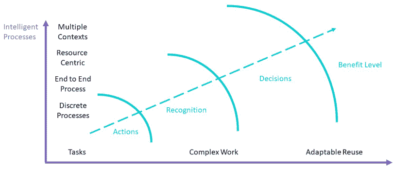
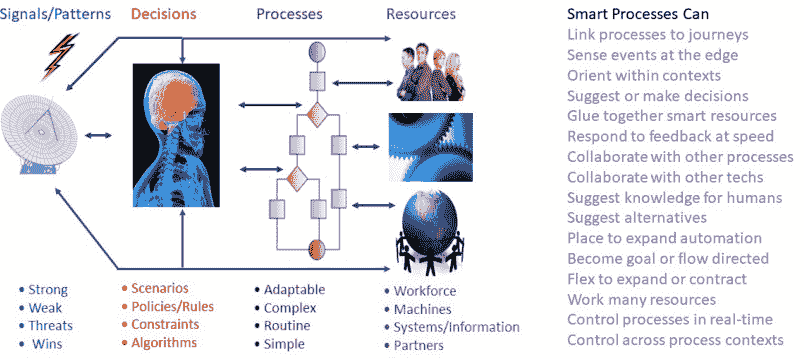
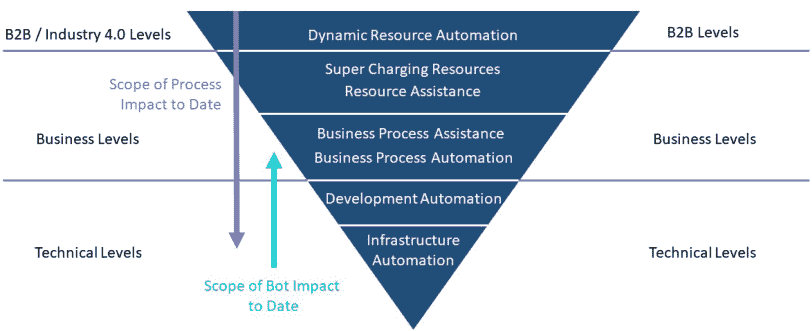

## 通过流程建模实现数字化转型的成功

流程建模不仅仅是在创建满足当前业务需求的自动化标准操作流程之前规划流程步骤。流程建模贯穿于标准流程和新兴流程的整个生命周期，这些流程旨在以新兴/蓬勃发展的方式响应变化。标准流程的示例是承保风险流程，它可以适应不断变化的业务条件和利益相关者的需求或要求。

在本章中，您将了解不同流程的名称、当今不同类型的活跃流程，以及流程在适应不断变化的条件时的未来。这一点在 AI 的影响及其对流程智能的贡献方面尤其真实。流程行为的转变将把重点放在流程建模作为流程审计能力以及流程规划工具上。读者将能够比以往更好地理解和利用流程建模。

本章涵盖以下主题：

- 流程建模是实现真正数字化转型的关键吗？
- 流程建模如何促进数字化转型？
- 当今的流程建模类型及使用指南
- 在其他建模学科的背景下，流程建模的未来是什么？
- 在 AI 辅助的背景下，流程建模的未来是什么？

## 流程建模是实现真正数字化转型的关键吗？

数字化转型涉及组织的许多方面，包括客户互动、内部运营、管理策略以及适应不断变化的业务条件的能力。组织可以采取许多途径来实现数字化方向和速度；然而，流程通常是组织开始或扩展其数字化努力的主要场所。流程与客户互动的效率和效果以及运营卓越性和效果密切相关。理解非凡流程的有效性并不困难，因为有许多成功企业利用流程的示例。

Amazon 是一个出色的组织示例，它提供令客户满意的非凡流程，同时借助大量自动化优化内部运营。这些流程充满了数字技术，为客户和员工提供出色的透明度和明显的无摩擦体验，同时增强人际互动。凭借内置的反馈循环以及审计客户、员工/承包商和管理层货物进展的能力，Amazon 继续利用其流程来实现盈利和满意度。这并非偶然，而是将流程作为主要竞争优势的计划性利用。

在每个行业中，有许多已知的案例研究，其中敏捷流程由结合业务分析和流程建模驱动。尽管正在迅速转向在这些努力中引入 AI，但已经有许多不依赖 AI 的成功流程。本章后面，我们将讨论 AI 对流程的影响。通常，流程模型代表流程以及为完成一组流程目标而采取的序列和分支。这些模型是流程进展到一组目标或结果的静态或动态可视化。流程通常由人类设计师在构建之前，直观地规划出流程进展的常见快乐路径和异常路径来创建、制作和改进。流程模型所代表的可视化通常是业务专业人士设计其新流程或修改流程的关键内容。每个决策和操作步骤都被规划出来，利用高度可视化的流程模型。

业务专业人士通常使用业务分析来支持流程模型构建工作。一旦制作完成，业务专业人士可能会将模型化流程的组合或构建委托给其他技术专业人员，他们可以使用现有组件、新制作的组件或为旧系统/组件制作的新包装器，来解决模型中每个决策或步骤/子步骤所需的技术支持。流程模型随后作为跨技能各异的工作岗位的沟通工具增加了更多价值。流程模型通过传达流程和流程步骤的意图和上下文，成为跨职能的“罗塞塔石碑”。流程模型的价值在于在创建满足当前和未来业务需求的自动化运营流程之前规划步骤。巧妙的流程有针对预期变化的选项，使其更加有价值。

流程模型在流程构建并投入运行后也很有帮助，即使它是旧系统。流程模型可以与数据和流程挖掘技术结合，以表示过去业务事件/交易执行期间发生的情况。它为业务专业人士提供了一种可视化手段，以了解选定期间内发生了什么。在某些情况下，可以添加动画来帮助可视化趋势和明显的流程瓶颈。业务和流程改进的真正力量通常通过在流程实例数据上结合业务分析来释放，以突出调整流程以实现更高吞吐量、更好的流程实例/案例平均时序以及无望解决的陷阱异常的机会。可视化与描述性、规范性或预测性分析相结合，对于长期实现更好的业务成果非常强大。在某些情况下，可以通过模拟或数字孪生等有用方法，在实际更改完成之前预先测试更改，以观察结果的变化。

总而言之，如果流程涉及您组织的互动或运营，它们将对数字化转型工作至关重要。如果存在流程，则用于向人类可视化的流程模型是传达其意图和通往业务成果的可能路径的必需品。

## 流程建模如何促进数字化转型？

流程在组织中无处不在；因此，流程模型对于数字化转型的进展至关重要。尽管组织中只有 20–30% 的最高频流程以某种方式实现了自动化，但数字化转型的机会仍然很多。简单的步骤是查看这些流程，但有时最关键且成本最高的流程位于正常高频流程之外，正在寻找自动化机会。为了让组织完美执行，所有流程都是数字化关注的候选对象。组织还可以通过寻找可以防止风险、更有效地争夺技能并在不断变化的业务环境中保持合规的程序性流程而受益。找到这些金块需要一些挖掘。请参见图 1.1，了解组织中通常发现的流程的常见名称。行业群体和竞争基准可以指出超越典型高频流程的应转型流程类型。

## 流程的常见名称

- Actor, Step, Action
- Precedence
- Process Flows
- Workflows
- Activity Sets or Steps
- Case Collaboration
- Customer Journeys
- Best Practices
- Straight Through Processes
- Business Process Management (BPM)

图 1.1 – 流程的常见名称

通常，组织通过改善客户体验来改进典型的高容量核心流程，并开始将高度自动化且以内部为中心的流程纳入客户目标，使这些流程随着时间的推移变得更加以外部为导向，即以客户为中心。大多数时候，系统专注于仅以效率为目标的内部组织目标。许多组织流程的主要目标围绕着以合规方式完成交易的成本和速度，但不一定有利于客户目标。数字化转型是平衡客户目标与主要关注利润的内部组织目标的机会。有关缩小客户体验与业务流程之间差距的想法，请参见图 1.2。许多组织认为，在与其核心流程交互时，他们不会给客户带来痛苦。这些组织需要分类他们造成的痛苦以及导致客户痛苦的特征。有关客户痛苦指数示例，请参见图 1.3。

## 缩小客户旅程与业务流程之间的差距

图 1.2 – 缩小客户旅程与业务流程之间的差距

许多组织认为，在与其核心流程交互时，他们不会给客户带来痛苦。这些组织需要分类他们造成的痛苦以及导致客户痛苦的特征。有关客户痛苦指数示例，请参见图 1.3：

## 大多数组织中客户旅程和流程都会带来痛苦

图 1.3 – 客户痛苦指数

很可能，在这些核心流程中存在更多自动化的机会。*新兴数字技术*与以新方式或在不同情境下使用的传统技术相结合，为组织及其组成部分带来潜在优势。在现代网络安全的严密保护伞下，示例包括以下内容：

- AI / generative / decisioning / learning
- Analytics / poly analytics / mining
- **Business Process Management (BPM)** / development / automation
- Collaboration / content
- Business application / models / templates / components
- Cloud / integration / data fabrics / blockchain data
- IoT / edge hardware / digital twins

使现有流程更友好、更智能是一个极好的第一步。考虑为流程完成中涉及的参与者（AKA 资源）添加更强大的协助/智能。*典型流程资源*在位置和状态的上下文中包括以下内容：

- Managers
- Knowledge workers
- Skilled workers
- APIs, data meshes, and data and knowledge sources
- System components, bots, and algorithms
- Sensors, chips, controllers, and edge firmware
- Robots, drones, cameras, and so on

无论组织选择哪种流程，流程模型都会指明数字化转型工作的改进机会，尤其是当它与 AI、业务分析、流程/数据挖掘以及对客户、员工、合作伙伴、承包商和社区的非自我服务调查相结合时。

## 当今的流程建模类型及使用指南

关于应该建模还是直接跳入编码或组合并快速失败，可能存在争论。我们建议，建模是规划更关键或更复杂流程的绝佳方式。当今开发流程和应用程序有许多选择。关于建模表现形式甚至是否需要建模，存在巨大争论。在深入表现形式问题之前，让我们思考一下建模的原因。我们知道，存在巨大压力，要求快速进入代码以展示结果。有更好的方法来组合代码、链接 API 并利用低代码方法，这些方法可能会让人远离模型。毕竟，模型通常不会直接执行，或者它们会吗？虽然模型可能看起来不能像代码那样快速产生结果，但它们有助于编码正确的解决方案以满足需求。创建可视模型有三个绝佳的*原因*，如下所示。

## 可视化流程与资源之间的连接

管理层、客户、合作伙伴和员工常常认为他们了解完成工作所需的运营工作，但实际上并非如此。事实上，集体参与者所持有的所有情境和视角中，并不存在对运营流程和应用程序的共同理解。创建一个经过认可的可视化表示，为向所有管理层和参与者进行解释提供了坚实的结构。将不同的观点和视角整合到一个完整的模型中，可以形成对可能结果的共同理解。该模型识别了所有参与者的角色、决策、操作和结果。

## 对当前情况达成共同理解

通常，应用程序或流程中属于每个参与者的流程、数据、事件和模式可能是由其组织职位、角色或专长创建的。通过更好地了解移动部件及其如何促进业务成果，现有流程和应用程序可以更好地工作，而无需更改基础流程或应用程序。如果正在考虑更改，当前状态模型可以实现更好的方法，或提醒开发人员或参与者关键约束。

## 对未来解决方案达成共识

在所有转型中，尤其是在数字化转型中，对一组目标流程和应用程序达成共识至关重要。创建一个参与者群体来定义新的前进方向，并通过模型赋予他们能力，可以加快进度。模型可以用于从核心设计小组之外的几个角度验证新解决方案是否正确。此外，它还能让管理层了解重大变革中的卡点，并在变革过程中尽早吸引参与者。

通常，组织会选择其中一种方法来启动建模工作，并意识到他们需要另外两种方法来制定转型工作，包括范围、技能、可用资源、合作伙伴、技术和合理的进度。确定负责数字化工作的组织文化允许转型工作在多大程度上进行开拓和承担风险至关重要。

三种不同的*流程样式*需要不同的流程建模方法，每种方法都专注于表示工作如何朝着业务、流程或技术结果进行管理。在交付高价值结果的更复杂情况下，可能会使用多种样式。有关每种样式的可视化表示，请参见*图 1.4*中的流程样式。

## 流程样式

图 1.4 – 流程样式

每种样式的说明如下。

### 结构化流程

虽然此类别中存在多种流程子样式，但它们都始于规划流程并识别几乎所有路径和异常。然后，实施一个相对静态且脆弱的流程。这些可以是完整的流程或流程片段，即特定结果的绑定步骤的部分连贯流程片段。结构化流程最适合标准且简单的结果。不过，它们可以扩展以利用 BPM 和规则敏捷性，使其不那么静态，并更能适应新的业务需求和异常。一些组织构建广泛且全面的结构化流程，这些流程变得难以测试和维护。机器人与这些流程之间的关系更多是机器人服务于流程，而非反之。广泛的流程大脑控制一切。

### 案例协作

更动态的流程开始出现在案例管理中，其中目标和里程碑是静态的，但通往这些目标的路径可能各不相同。这对于知识密集型工作很准确，其中一个人不了解如何解决或完成单个案例。当目标和里程碑可以改变时，案例协作可以变得更加敏捷和动态。这需要自适应

## IoT bot collaboration

想象一个由协作机器人和物联网设备组成的网络，它们共同工作以决定下一步该做什么，并触发另一个结构化流程、一个案例或一组机器人，以满足管理代理设定的动态目标。当然，这些代理协作和动作必须受到约束，以避免违反治理政策或规则。这是一种非常动态的方法，运营的大脑不再是负责的中央控制流程或案例。在这种情况下，带有上下文的目标和约束现在引领方向。现实世界中的例子每天都在涌现。其中一个用例是自动为农田供水和施肥，以获得更大的产量。请参阅 https://jimsinur.blogspot.com/2013/07/smart-farm-operations-processes.html 了解案例研究。

建模流程有三个重要原因。最常见的是理解当前流程，这可能包括流程/数据挖掘技术和技术，因为它以更科学的方式自动化了对当前流程的部分理解。下一个最常见的原因是创建未来流程模型，这很可能会使用可视化建模工具，并在进展阶段变得更加详细。在协调许多资源的复杂或范围广泛的流程中，流程所跨越的连接和边界的模型也是必不可少的。通常，重大努力会同时采用所有三种原因。还采用了三种流程风格来实现独特的业务成果。理解所有三种风格至关重要，但流程所需的控制点将指向特定的风格或组合。

## 在其他建模学科的背景下，流程建模的未来是什么？

流程模型并非真空存在；它们在人工和自动化数字解决方案中与其他基本因素相互作用。虽然许多组织中流程流、决策、案例、数据和结果可视化通常建模良好，但随着更多智能动态应用于数字解决方案，需要更多模型。流程模型迄今为止很好地服务于流程和业务成果，但组织需要建模更多内容。流程组件的符号表示的重要性无论如何强调都不为过。然而，数字解决方案随时间推移需要更多建模类型。到目前为止，我们已识别出另外六个迄今未被处理的服务不足领域，如图 1.5 中所示，作为其他必要模型。

## 其他模型背景下的流程模型

图 1.5 – 其他必要模型

在以下部分中，我们列举了随着更大范围和更多复杂性引入流程世界，流程必须处理的领域。

## 协作

关于协作模式方法的公认表示很少，尽管我们看到一些尝试来表示在社交挖掘和分析中捕获的社交互动。这个领域可能需要一段时间才能产生一些常见的表示模式，并且需要更长时间才能有一个跨供应商的标准表示，以支持完成业务成果或管理改进或变革工作所需的人际互动。

## 目标

虽然有几个勇敢的供应商提供了一些出色的目标模型和目标交互示例，但今天没有普遍接受的建模方法。少数组织已经感知到从面向流程的流程向目标驱动流程的转变。在可以自行确定方向和下一步最佳操作的流程中，目标的需求是必不可少的。

## 约束

随着流程变得不那么结构化和涌现，约束将在流程治理和控制领域变得更加关键。我没有看到任何显著的边界约束表示，显示一个被这些保护机制包围的流程。约束和目标是允许在实现业务成果时包含无监督 AI 的必要条件。

## 数学模型

虽然有一些针对单一分析方法的模型（例如用于预测分析的 PMML），但对于当今智能流程中存在的多个交互分析，没有已知的建模方法，更不用说包含各种类型的 AI 行为了。

## 上下文

随着流程在感知活跃模式和场景方面变得更加主动，将需要表示流程参与的以及有兴趣参与以实现其结果或目标的上下文。这些上下文将被检查以寻找优势、威胁和学习经验。超出内部和外部组织、行业或地理边界的流程必须对不同上下文中的含义保持敏感。

## 模式

今天，组织似乎更感兴趣于要响应的事件，而不是感兴趣的模式。这将随时间改变，但今天没有公认的方式来表示模式。感兴趣的模式最终将需要符号表示，以及分类方案。

虽然我们可能都同意建模流程、决策、目标或数据有显著好处，但对于建模方法、标准以及最重要的建模对象存在分歧。让我们来审视建模中及周围的摩擦领域。我们已识别出五个摩擦领域，但我可以想象表面下潜伏着更多问题，就像只有数据或规则一样。

## 流程建模权衡

即使在流程建模领域本身，不考虑其他伴随建模辅助，流程建模也有一些需要解决的困难平衡，如以下各节所述。

## 建模逻辑还是物理

一个常见的争论通常围绕建模目标逻辑模型而不是物理实现模型，因为它代表了纯粹的需求，并将包括实施者跳过的操作手册等内容。实施人员通常认为逻辑未来模型本质上不反映现实，并且同步两者是不可能的。一些组织将逻辑模型用作规范，并在物理模型出现后立即丢弃逻辑模型。那些相信快速创新的人倾向于快速创建实施并快速失败。我们更喜欢一个包含操作手册并迭代到完成的粗略逻辑模型。

## 是否按标准建模

许多人相信建模标准，并说标准建模使培训、沟通和吸引组织外部的即时贡献者变得更容易。在组织内部已经使用的平台之间，甚至是新平台之间移动模型而无需不愉快的转换也有好处。有些人说标准难以使用，并且会错过至关重要的细微差别，这些细微差别会产生影响。当标准只是拖慢速度时，为什么要使用笨拙的标准？虽然我们更喜欢开发的便利性而不是标准，但我们倾向于迭代而不是建模到完美。这里需要找到一个平衡。

## 建模案例而非流程

有一个正在酝酿的争论，即案例管理模型和符号（CMMN）与业务流程模型和符号（BPMN）非常接近，并且可以轻松扩展以支持案例。如果 BPMN 包含目标建模，我们会同意，因为案例致力于里程碑目标，而流程可以居次要地位。

## 建模决策而非流程

也有越来越多的争论，即流程是否嵌入决策，或者决策是否在顶部，因为它们决定要执行的任务。我们认为对于非常复杂的流程，你需要两者，并且它们应该协同工作，但决策模型和符号（DMN）是新来的，没有得到它应得的尊重。

## 建模目标而非流程

格格不入的是目标建模，因为流程和决策过去是僵化和不变的。随着决策和规则变得更加流动，目标建模变得更有意义。目标保持不变，目标目标可能会改变，但决策和流程任务的路径可能会大不相同。目标和约束建模应该比现在得到更多关注。

建模非常出色，但当供应商试图将其方法和符号作为流程世界的中心时，可能会引发“宗教战争”。无论你采用哪种模型，都应在项目开始时做出决定，并坚持你的选择，除非需要进行重大调整。这种情况不太可能发生，因为流动的流程/案例通常在事先就已知晓，并且可以选择方法来支持它们。我们强烈建议选择能够代表任何现实世界活动的流程模型，以用于流程挖掘，这将有助于改进当前/现有流程，因为流程可视化对于业务和技术专业人员在上下文中理解活动非常有帮助。流程模型对于描述稳定和静态流程或流程片段的未来状态也很有用。只有当问题变得更加突发或变化波动性变得过大时，情况才会不同。

## 在 AI 辅助的背景下，流程建模的未来是什么？

AI 为流程建模带来的价值将取决于 AI 如何影响实际建模的流程，以及流程模型是代表未来设计，还是在结合流程/数据挖掘时，对实际执行（无论是正在进行中还是事后）的表征。我们已确定 AI 对流程影响的三个重叠阶段：

- 第一阶段将是增强参与流程完成/执行的现有资源
- 第二阶段将在流程的背景下，用 AI 密集型流程片段、IoT 设备或机器人（又称代理）来替换特定资源或步骤
- 第三阶段是 AI 成为流程的控制管理者，从流程组件的动态组装和流程执行，到监控流程结果以进行实时调整

通往更智能、更具智慧的流程之旅，很可能是一个演进过程，始于在变化的上下文中考虑更智能的操作。随着智能流程在处理变化方面变得更加高效，它们需要通过识别威胁和机会的模式来保持这种状态。一旦智能流程看到潜在的变化，它们很可能会在组织提供的指导方针内，以非监督的方式做出决策。

AI 和分析产生的最终杠杆效应创造了智能流程。AI 不会立即被包含，而是将在一个由构建用于支持各种业务成果的流程的需求所引导的旅程中逐步采用。我们在图 1.6 中说明了通往更智能流程的旅程，其中流程不仅服务于操作，还能感知/识别突发模式，以支持动态和明智的业务决策，从而获得优化的业务收益。

## 通往更智能流程的旅程

图 1.6 – 通往更智能流程的旅程

智能/智慧流程通过其包含的工作类型和所支持的影响范围来展示其 IQ。标准流程/流程片段主要支持离散任务的操作步骤，通常带有简单的分支决策以支持静态目标。这些在图 1.6 的左下角有所描绘。下一级智能通常是通过包含端到端流程及其操作，或识别可能影响流程的模式或事件来实现的。随着工作复杂性的增加，资源的数量以及资源的智能水平也随之增加。当流程的范围跨越组织和行业界限时，对智能的需求就会激增，这通常需要更复杂的决策来平衡各方利益相关者的冲突目标。通常，由动态变化引起的需要即时优化的突发复杂决策集，要求下一级智能能力。这意味着可适应地重复使用流程片段和机器人，这些可能由智能的 AI 加载机器人控制。在演进的某个阶段，流程会将控制点从流程导向改为目标导向。

## 流程导向与目标导向

有些人认为流程中不应该有任何步骤序列。另一些人则认为，如果没有序列，流程中就会出现混乱，人们会感到困惑。这就提出了一个问题：“流程应该是流程导向还是目标导向？”目标导向流程的吸引力在于，流程会在任何时刻寻求其目标集时自动出现。随着目标的变化，流程会自动调整以满足新的目标集及其权重。这非常适合新兴流程，其中流程或流程的一部分会随着时间和目标的推移而出现。

我们在 **自适应案例管理** 和后期绑定流程中看到了目标导向流程的大部分内容。这种方法的问题是，有时直到事后可视化后才理解操作。流程导向流程的吸引力在于，可以根据已知条件选择和遵循更好的实践。人们喜欢流程导向流程，因为他们可以通过添加新路径和异常来直观地研究、理解和改进流程，同时保持控制。问题是，要在追求快速上市的方式下完成所有这些工作需要时间，而且控制是集中行使的，而由于变化速度加快和复杂性增加，世界正在远离这种模式。

我们认为，大规模、集中控制的流程导向流程的时代正在接近尾声，但这并不消除对序列的需求。我们认为整体流程应该是目标导向且有些分散的（权力下放到边缘，由智能资源如人、代理、机器人和事物来行使）。然而，仍将有一些序列片段被使用。最终，所有资源都将竞标工作，基于序列的流程将显著减少，但我们并不确信序列会完全消失。大型且僵化的流程正在变得有点像“恐龙”。世界正在从流程导向流程转向目标导向流程和分布式智能，我们必须学习新技能和习惯来管理新兴工作。最低要求是让流程在约束边界内自由流动，并在事后审计结果，以检查是否需要新的约束。

## 智能流程中 AI 的阶段

组织必须考虑三个不同的阶段，但它们在任何流程中的应用可能会重叠。这些阶段如下。

### AI 与流程阶段 1

流程通常会协调、利用和消耗资源。这些资源包括人类、系统/组件、数据源和机器。人类可以从低级工人到罕见且高薪的高技能专业人员不等。系统范围从简单的单功能组件到以工作为中心的流程片段，再到复杂且功能强大的旧系统。数据范围从详细的单源基础数据到可从云端数据网格中获得的高度精炼的信息源，利用各种内容/格式。机器范围从单功能芯片到由流程引导的复杂设备。

所有这些资源都可以通过添加智能能力被提升到更高水平。资源可以通过 AI/机器学习和模式识别的帮助进行学习。资源可以通过 **智能操作** 进行增强，以创造更好、更快的成果。生成式 AI 资源也可以通过认知建议来辅助决策。所有这些资源都使用受监督的 AI 来使自己变得更智能、更快。过去，人类是创造力所必需的，但现在生成式 AI 至少可以生成一个很好的起点，最好可以生成完成的交付成果。请参见 **图 1.7**，了解资源与流程结合如何帮助实现超出组织流程日常操作的业务成果的示例。通常，随着工作流转到由 AI 增强的低技能资源，更高技能且更昂贵的资源可以被释放出来。

## 智能流程超越操作

图 1.7 – 智能流程

### AI 与流程阶段 2

第二阶段更多的是用始终在线的资源和一致的机器人及片段来取代高薪且时间受限的资源。这可能会减少流程/工作完成所需的人类数量。在解决方案中存在危险和及时性的地方，AI 自动化取代工人的可能性就越大。此外，在需要一致精度的地方，AI 机器人很难被超越。在需要判断和共情的地方，人类的触感是必不可少的。这需要一种半监督的 AI，其中流程和人类交互以检查当前流程或事后 AI 的结果。流程控制仍然由流程掌握，人类由流程模型和动态实时仪表板等可视化支持辅助。

### AI 与流程阶段 3

这是 AI 成为流程的决策者和控制者，取代流程管理功能的阶段。除了存在目标和护栏（约束）之外，这几乎完全是非监督的。目标是为了确保追求理想的业务结果。约束是为了确保 AI 遵守任何时候生效的全球和本地法律框架。管理将专注于创建伟大的目标和安全的指导方针。在这里，AI 正在实时做出大量决策，不仅是为了速度和成本，而且是为了在新兴问题领域中保持正确方向。AI 将动态创建流程路径，控制竞标完成任务的机器人，并授予权限给

## 协作流程与机器人

随着 AI 机器人变得更加智能，它们将取代流程中的某些决策和操作，但仍会进行协作。流程将专注于顺序操作，并可能变成过去整体流程中更小的片段。随着时间的推移，这种决策和工作的协作与共享将变得更加流畅。

AI 将成为链接和协助企业获取更高变革敏捷性、提升业务盈利能力并满足利益相关者目标的关键。请参见图 1.8，了解企业希望通过流程实现的目标。我们可以看到，由 AI 创建、组装和管理的更智能流程的作用。

## 流程与机器人可将智能应用于结果

图 1.8 – 期望的流程目标

作为工作进展关键表现形式的流程模型仍然需要，但其作用很可能在事后发生变化，至少是为了 AI 决策和操作的透明度。AI 难以审计，采用 AI 的流程同样难以审计。流程模型、决策模型和其他审计轨迹将帮助企业在可追踪性、偏见和隐私问题上取得进展。随着 AI 推动我们进入新的法律和法律互动，可以肯定的是，事后模型将发挥作用。可以假设，流程建模技能将是必不可少的。

## 这对我的雇主有什么好处？

企业需要商业模式来保持其运营在变化的世界中盈利且优化。流程模型是用于设计模式还是审计模式并不重要；通过分析流程实例，可以辨别关键行为和改进机会。利益相关者由非凡的流程及其代表模型所服务。只需询问客户或员工关于良好或不良流程的影响。

## 这对我和我的职业有什么好处？

理解流程模型及其对业务各个方面的影响是一项基本技能，并且在创建和管理所有运营、战术和战略流程过程中，其重要性将日益增长。

## 创建行动旅程的可视/概念表现

可视化比大多数内容传达得更好，并且非常适合跨技能集和组织边界进行协作。

## 提升客户体验

非凡的流程创造忠诚客户，而有缺陷的流程会赶走客户。在当今变化不断且对糟糕交互缺乏容忍度的世界中，出色且友好的流程有助于所有利益相关者展现可重复的业务和忠诚度。

## 交付一套平衡的结果

由流程模型代表的非凡流程不仅能实现盈利的组织目标，还能在包含客户目标和结果的同时取得平衡，并让员工感到满意，员工可以转向拥有更好流程的组织。

## 摘要

正如你刚才阅读的，流程的本质将随时间而变化。它们将在治理准则和约束内支持不断变化的目标的动态舞蹈中发挥作用。流程建模将是未来智能流程中可解释的部分。在此之前，流程模型将用于审计和优化流程。无论流程是结构化的还是动态的，流程模型都是流程规划和流程审计的常见沟通载体；因此，它们对组织非常有价值。随着可视化沟通成为未来数字进步的关键驱动力，个人将不得不掌握建模技能。

## 立即解锁本书的独家优势

扫描此二维码或访问 packtpub.com/unlock，然后按书名搜索此书。
注意：在开始之前，请准备好您的购买发票。

