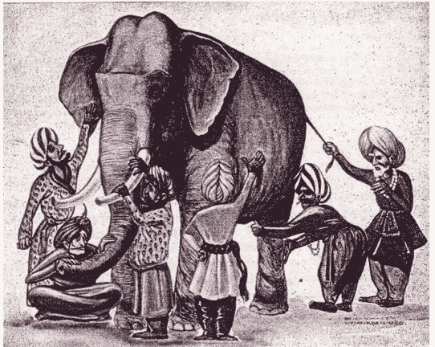
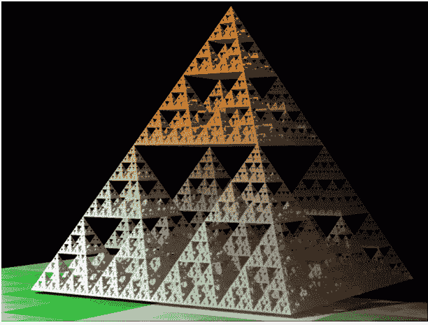

## 成功数字化转型的支柱

在本书的第一章中，Jim Sinur 论证了在考虑不同工作方式的融合如何历史上推动企业优化时，流程和流程建模的持续重要性。这些包括结构化流程、基于案例的协作以及 IoT/机器人协作——所有这些都在推动从集中式运营向更分布式、基于边缘的范式转变。Jim 认为 AI 的快速进步正在改变业务流程的作用，使公司从由“大脑”工作组织优化和集中控制，转向自适应、以目标为导向且完全分布式的架构。

我们可以预期，随着普适 AI 接管决策、控制以及在机器人和人类之间如何最好地完成业务目标和完成工作的谈判，公司的技术格局将发生重大转变。随着一波又一波的技术进步通过原型、新项目发布、变更管理计划以及历史上由我们专业人士执行的工作中智能流程的持续进步对运营造成冲击，人们可能会想知道如何避免在流程中失去人类。在没有正确基础/框架的情况下参与数字化计划，可能会给所有行业和地理区域的劳动力带来不愉快且非预期的后果。人类大脑在常规环境中运作最佳，但来自多个方向的变化频率导致混乱、优先级冲突以及难以适应由 **数字化转型 (DTX)** 议程带来的快速变化的现实。更糟糕的是，公司内的 DTX 可能对不同受众意味着不同的事情，这取决于人们在组织中的角色，这使得跨团队沟通变得更加困难。

本章讨论了如何围绕支持公司 DTX 主要支柱的工作流来组织工作。无论 DTX 努力如何以及何时开始，大多数工作流最终都将围绕这些支柱展开，为变化的汹涌海洋带来备受期待的秩序。

在本章中，我们将涵盖以下主题：

- DTX 简介和概述
- 支持数字化转型的关键支柱是什么？
- 数字化转型如何开始？
  - 自上而下
  - 草根式
  - 旧系统现代化
  - 由收购或合并触发
- 如何为您的业务群体制定数字化变革愿景
- 如何为未来做计划

> 注意
> 本章由 BJ Biernatowski 撰写。

## DTX 简介和概述

少数备受认可的分析师、软件架构师、CEO 和顾问撰写了关于 DTX 的几本书。在过去 15 年里，随着我一直在研究流程驱动的数字化转型主题，我意识到该主题非常广阔，变化极快，并且充斥着渴望拥有 DTX 并最终将自己封为您所有 DTX 相关事项首选来源的公司的商业议程。这些议程通过电子书、播客以及各种 _marchitecture_（营销和架构）材料表现出来，这些材料印在光滑的幻灯片上，并由营销预算资助。

从软件供应商处了解 DTX 的挑战在于对“供应商锁定”的担忧。这指的是公司被迫采用与软件供应商的观点更一致的 DTX 愿景，而不是追求与他们自己为数字化和优化运营流程的战略目标相一致的路径的看法。

这并不是说你不能通过浏览这些市场架构白皮书或书籍来了解 DTX。此类材料的挑战在于它们缺乏客观性，以及由最终寻求通过销售他们对转型应该是什么样子的观点（针对您的业务、部门或您独自维护的那个流程）来达到领先市场地位的公司所定义的 DTX 观点。另一个挑战是，要从愿望或半真半假中筛选出真相，可能需要花费大量时间，这些真相甚至可能来自过度投资或多次重做的项目。

当 Packt 找到我，让我为本书构思愿景时，我思考了很多，如何让本书与我过去读过的所有书籍有所不同。以下原则定义了我们对本项目的方法：

- 本书中总结的最佳实践和主题，是通过亲身参与利用不同供应商技术和平台的流程转型项目而获得的，这些供应商在该领域已深耕多年。虽然本书介绍了几款软件产品，但我们有意将创造性思维和批判性思维与工具集及任何技术分开。这样做的原因是，工具和技术不断扩大 DTX 的定义，没有明确的边界。在测试最先进的工具之前，理解和掌握一些关键概念至关重要。一位转型顾问在项目中分享过一句格言：“即使有最好的工具，傻瓜依然是傻瓜。”这句话对于低代码、人工智能以及 **Intelligent Business Process Management Systems (iBPMS)** 等 DTX 平台依然适用。这句格言的更新版本是：“而且，多亏了人工智能和低代码，你现在可以更快地做出愚蠢的决定。”

- 本书涵盖了各种主题，这些主题可以应用于由不同技术背景的团队主导的 **Digital Change (DtC)** 计划。当我们提到 DtC 计划时，是指有助于整体 DTX 旅程的运营、战术和渐进式改进。对我们来说，DTX 代表一种演进，而通往这颗北极星的路径涉及实施渐进式 DtC 举措。

- 虽然你的结果可能与书中描述的不同，但并没有硬性要求你必须尝试和使用书中提到的软件产品。虽然我们可能会提出许多理由，说明我们推荐的工具能以最佳可能的结果为你提供最物超所值的选择，但你也欢迎使用你喜欢的流程工具来应用这些概念，我们不会因此责怪你。不过，实际效果可能会有所不同。

- 本书由实践者为实践者编写。每位作者都通过多年与中型到大型财富 500 强公司的挑剔客户合作，积累了书中提到主题的经验。这项工作涉及大量的航空旅行、漫长的通勤、过多的餐厅用餐、每天工作 14 小时、个人和家庭的牺牲，有时甚至通宵工作以修复阻碍项目的那个棘手问题。说到 DTX，风险通常非常高，因为这些计划往往回应着企业面临的生存威胁。押注技术往往等同于押注你的声誉。

- 本书涉及的许多主题，原本以独立的帖子、文档和模板形式存在于项目团队中，或者作为公司严守秘密的咨询知识和框架，因为公司倾向于保护推动收入的知识产权。我们旨在为你揭秘并简化其中的一些主题，理解你为这本书花费的辛苦钱的价值。我喜欢在书店和图书馆闲逛，回顾与 DTX 相关的不同立场。你会惊讶地发现，实际的立场并不多，许多人实际上是通过实验或观看网络研讨会来了解这些主题的。有一些希望的迹象，因为一些商学院开始看到对涵盖这些主题的大学水平课程的需求；然而，这些课程通常伴随着高昂的价格标签和完成学位所需的长期承诺。当你被安排或被要求领导一个转型项目时，你没有时间去读两年的 MBA 学位，即使是在线版本。

- 为渴望或正在通过分析和流程建模转型业务的全球受众撰写一本关于 DTX 的书，需要在多种类型的项目中积累的经验。作者们的集体专业知识涉及与全球美国和欧洲公司合作。我们了解到拉丁美洲、中东、非洲和亚洲正在进行许多创新项目。虽然这些地区的工作文化方面可能略有不同，但将我们的策略应用于实践多样性和同理心的团队，应该能取得类似的结果。

- 每位作者都为本出版物带来了独特的专业知识。我们经验的融合，有时还有相互冲突的观点，应该为你提供该主题的客观视角，突出那些可能不存在统一真理的主题角度。我们希望你在开拓公司转型之路时，能够借鉴我们的经验。我们为你提供地图和仪器，希望你能自己定航向。

- 我们决定不使用人工示例和简化，例如披萨或咖啡制作业务流程。休假审批流程也不在涵盖范围内。虽然在某些情况下，此类示例有其用途，但企业中的工作往往要复杂得多，我们不想浪费你的时间来分享关于简单示例的知识。我们的示例汇编直接取自我们参与的项目。

- 业务分析和流程建模技能是在具有不同业务目标的项目中获得的。我认识到这个连续体的广阔性，以及许多优秀的人正在做大量非常创新的工作这一事实。我们不声称无所不知——我们打算与你分享我们在整个旅程中学到的知识，这些知识来自塑造我们思维的思想领袖和导师。在我们的职业生涯中，我们很幸运与许多顶尖团队和软件供应商合作，他们正在真正推动 DTX 的边界。

- 业务和流程分析的实践本身正在经历一场转型，这场转型是由公司内部对快速适应性的需求驱动的。就像软件开发世界通过公民开发者推动低代码解决方案而发生革命一样，业务和流程架构的世界也是如此。如今，没有哪个业务所有者有足够的时间等待架构师的分配来帮助定义他们的业务流程图景。架构师的工作正在变成导师的角色，因为业务和流程分析的需求每天都在各处出现。我们建议认识到这波技能民主化浪潮，它与软件开发世界中被称为 _shadow IT_ 的现象并行并滞后于此。我们欢迎其他人帮助我们为这些公民架构师定义合适的名称——他们是变革推动者，在没有集中式企业架构或专门销售实施合同的管理顾问团队参与的情况下，领导着业务流程的重新设计和重新架构。

- 本出版物的全球影响力促使我们将 5% 的图书预付款和版税指定给美国红十字会。我们生活在三个不同地理区域的分离大陆上，这些地区的气候各不相同。尽管相隔约 5,880 英里（或 9,464 公里），我们已经经历并担心全球气温上升及其对日常生活的影响。通过捐赠者、志愿者和员工的网络，美国红十字会共享一个全球使命，即预防和减轻气候变化影响地区的苦难。我们可以教你如何在客厅的舒适环境中为你的雇主加速 DTX。红十字会的工作基于无数志愿者的时间，他们帮助其他人摆脱他们从未想过可能发生的绝境。参与进来，了解他们的工作，捐款，做志愿者。红十字会所处理的问题没有快速和简单的修复方法，我们觉得提升他们工作的重要性和志愿者的牺牲是很重要的。总有一天，我们都可能发现自己处于野火的路径上，希望红十字会能在那里提供帮助。

- 我们要感谢多位技术审稿人对本书的投入。你的深厚经验和指导深受赞赏。

- 如果你启动、规划和执行 DtC 计划的能力得到显著提升，我们就会认为本书取得了成功。我们投入了大量心血。

简要介绍了本项目的缘由后，让我们稍微关注一下本书的主题，以突出我们计划在后续章节中涵盖的内容。

你正在阅读的这本书面向更广泛的 DTX 一部分的业务变革项目的决策者、利益相关者或参与者。

## 对 DTX 的多种看法

在开始讨论流程驱动的 **Digital Change (DtC)** 计划的不同触发因素之前，让我们花点时间讨论一下 DTX 是什么和不是什么。这应该有助于我们在更广泛的 DTX 背景下界定 DtC。

截至 2025 年，有几个值得注意的 DTX 定义。我们将从 **McKinsey & Company** 的定义开始：

> "数字化转型是对组织的重新连接，其目标是通过大规模持续部署技术来创造价值。"

**Capgemini** 将 DTX 定义为“利用技术从根本上提高企业的绩效或覆盖范围。将技术采用和整合到业务的所有方面的行为，创造了一个基础性转变，使组织能够实现可持续创新和创造性增长。”

**Cognizant** 将 DTX 视为“将技术采用和整合到业务的所有方面的行为，创造了一个基础性转变，使组织能够实现可持续创新和创造性增长。它包括文化变革、内部资源考虑以及支持改进的、技术驱动的用户体验的产品开发。”

## 成功数字化转型的支柱

根据 **Forrester**：“数字化转型是利用数字资产改善客户成果和运营敏捷性的过程。它不仅仅是将技术应用于现有流程或体验，而是重新构想一种将技术置于核心的不同商业模式。数字化转型对于企业在不断变化的行业格局中生存和发展至关重要，它需要数字化成熟度、敏捷性、精益和快速执行。”

根据 **Gartner**，“数字化转型是一个用来描述使用数字技术从根本上改变组织商业模式的术语。它涉及将数字技术集成到企业的所有领域，从而导致企业运营方式以及向客户交付价值的根本性变化。”

**IDC** 将 DTX 视为“云、移动、大数据和社交等第三代平台技术的应用，结合组织、运营和商业模式创新，以创造运营和发展企业的新方式。”

**对于 MIT**，“数字化转型是利用技术从根本上提升企业绩效或覆盖范围。它涉及将数字技术和解决方案集成到公司的所有领域，其性质不仅是技术性的，也是文化性的。DTX 改变了开展业务的条件，改变了客户、合作伙伴和员工的期望的方式。数字化能力使组织能够增强现有流程和产品，并改进甚至创造新的商业模式。”

**《哈佛商业评论》** 将 DTX 视为“一个涉及使用数字技术创建新的或修改现有业务流程、文化和客户体验的过程。它可以涉及 IT 现代化、数字化优化，或发明新的数字化商业模式。”

**BPMInstitute.org** 将 DTX 定义为“在整个组织内部及跨组织集成技术的过程，从根本上改变其内部运营方式以及向外部展示其产品或服务的方式。”

**Microsoft** 将 DTX 定义为“将人员、数据和流程结合起来，转变您的公司并为您的业务需求创造价值。它是由云、AI 和物联网 (IoT) 的爆发所推动的商业创新，为组织提供了理解、管理和转变其业务的新方式。它也是使用新技术和业务工作流程来优化、自动化和以其他方式现代化组织业务运营的过程。以这种方式更新技术工具和方法，有助于组织改进内部流程、提高效率，并以更高的灵活性和敏捷性运作。”

如果您好奇到读完了前面多个定义，就不难注意到应用于 DTX 的“橡皮筋”范围非常广泛。该术语的含义也因定义它的组织类型而异。咨询和分析公司试图保持通用；凭借其全球影响力提供服务和框架，一些软件供应商则很快将所有技术组件纳入其中。

然而，即使是最突出和最专注的技术供应商，也会随着时间的推移而扩展其对 DTX 的定义，因为其提供给市场的技术能力在不断演变。就我个人而言，我最喜欢 HBR、BPM Institute 和 Microsoft 的定义，尽管我仍觉得每个定义中都缺少“战略适应性”这一术语。我过去学到的是，许多公司追求 DTX 是为了加快内部变革的步伐，这些变革会通过内部运营级联，以应对快速变化的市场条件、新立法或外部市场压力。这种快速演变的能力在市场上可能极其有价值，引用达尔文的话：“生存下来的不是最强壮的，也不是最聪明的，而是最能适应变化的。”

因此，DTX 可能是一个庞大的话题，甚至与公司里任何人讨论它都可能相当具有挑战性，因为组织中不同的人可能对 DTX 有不同的看法。有趣的是，他们都可能是对的。约翰·G·萨克斯的经典寓言（源自印度）解释了感知局限性的概念。

图 2.1 – 约翰·戈弗雷·萨克斯（1816-1887）的寓言《盲人摸象》

以下是寓言/诗歌的摘录：

> 印度有六个盲人
> 热衷于学问，
> 去看大象
> （虽然他们全都失明），
> 各自通过观察
> 满足自己的心。
> “天哪！大象
> 很像一堵墙！”
> “这头大象
> 很像一支长矛！”
> “我看，”他说，“大象
> 很像一条蛇！”
> “很明显，大象
> 很像一棵树！”
> 这头大象
> 很像一把扇子！”
> “我看，”他说，“大象
> 很像一根绳子！”
> 就这样，印度的这些人
> 争论不休，吵得不可开交，
> 各人坚持己见，
> 固执己见，
> 虽然每个人都部分正确，
> 但所有人都错了！

## DTX 是演进而非革命

更准确地说，DTX 是那些不断演变的概念之一，随着软件行业引入新的技术能力而不断变化，使您能够数字化和自动化历史上可能无法触及的额外类型的工作。因此，约翰·戈弗雷·萨克斯寓言中那个比喻性的大象，随着时间的推移，可能会转变为猛犸象，甚至是泰坦巨龙（地球上曾经漫步过的最大的恐龙）。随着 DTX 范围在未来 2-3 年内不断扩大，需要多少个盲人来描述什么是泰坦巨龙？我想你会明白这一点——讨论 DtC 比解决整个 DTX 话题要容易得多。

图 2.2 – DTX 的范围在不断扩大

除了其巨大的规模之外，必须观察到的关键是，DTX 也是描述我们公司数字化运营的隐喻。很难找到一个代表多维概念的单一定义，该概念最终代表了我们的业务叠加到数字领域。假设 DTX 是一幅画；它很可能会被描绘为分形图像或多个分形图像，以 3D 方式不断演变，有些平面变化如此之快，以至于人眼无法观察到变化，而有些地方变化非常缓慢。以下图表代表了业务、流程和数据架构的横截面，这些架构在我们公司内部支持价值链的多个客户旅程：

图 2.3 – 数字化转型公司 A 的可视化表示

图 2.4 – 数字化转型公司 B 的可视化表示

图 2.5 – 数字化转型公司 C 的可视化表示

想想看：随着技术进步的推进，我们的隐喻也在进步；而不变且保持不变的是业务流程的定义。许多架构师使用乐高结构的类比来代表业务架构。我对这个隐喻有意见，因为该模型假设互连流程网络不会改变或不会灵活。如果乐高积木是由扭曲、改变形状或像黏液一样拉伸的材料制成的，我们就会为我们的业务表示增加另一个维度。我看到的另一个挑战是，乐高积木一旦被塑造成“房子”，就是一栋房子。一家企业可以有一天在线处理订单，而第二天，其基础设施可能被用来向一个国家的人口运送药物，从而完全改变商业模式及其目的（以及所有设计假设）。亚马逊在 COVID 大流行期间在美国分发疫苗的做法，是大规模战略适应性的最佳例子。

DTX 的巨大规模以及架构和技术复杂性，是我们将本书重点放在管理 DtC 上的原因，重点关注流程驱动的转型，这是整个 DTX 大饼中一小块但重要的部分。小并不意味着不重要或无足轻重。

多年来，我看到许多小规模项目发展成了旨在彻底改变整个公司运营的项目。我也参与过一些目标宏大、拥有顾问大军的大型项目，但这些项目从未超出一个业务部门。我对这种现象有一些理论，我们将在本书后面讨论 **业务价值评估 (BVAs)** 和衡量 ROI 时再详细讨论。

DTX 定义中另一个立即引起我注意的问题是使用“业务流程”这一术语。请注意以下短语：

- 将“流程”结合起来以进行转型
- 使用业务工作流程来优化、自动化和现代化
- 使用数字技术创建新的或修改现有业务流程
- 数字化能力使组织不仅能够增强现有流程和产品，还能改进甚至创造新的商业模式
- 将技术应用于现有流程
- 还有一个...
- 组织的重塑

在与参与 DTX 工作的团队合作并学习这些定义时，我怀疑撰写这些定义的作者是否经历过至少一个项目或计划。使用数字技术创建新业务流程、增强现有流程以及将技术应用于现有流程——当然，这很有道理。那组织的重塑呢？有人在项目中试图重塑整个公司吗？是的，这些口号在与 CTO 或 CFO 进行快速走廊讨论时听起来很棒。在阅读了大量所谓的定义后，我得出结论，许多时候，作者的意图不是定义；他们的意图是销售——销售数字技术或支持服务，将业务运营现代化为您公司的重塑版本。

organization that would magically appear from the abyss of your company’s legacy IT infrastructures like a phoenix. Throw more technology at your business problems, and your business problems will magically go away by “deploying tech at scale.” Another challenge with these definitions is that they don’t align with existing concepts from the business, process, and enterprise architecture domains used and practiced by influential professionals shaping DTX in many enterprises. To quote Jay Olvey, strategic business and process director and architect: “The challenge in today’s companies is not the lack of tech; it’s the lack of know-how of how to implement tech platforms in support of strategic company goals. It’s also the lack of a shared vision and performance metric alignment, along with communication and collaboration as well.”

From the technical point of view, Microsoft’s definitions are most accurate, although I have an issue with the term workflow used in this context. It feels that the author of Microsoft 365’s explanation meant to say use business workstreams, not workflows. Workflows are instances of automated business processes executing activities and tasks within workflow orchestration engines, whether low-code, iBPMS platforms, or CRM systems. I reserve the right to be wrong in this case, given that I worked for Microsoft.

Learning about advanced concepts from a variety of definitions can be challenging because universal truths don’t exist in the world of business. To say it differently, going after universal truths requires a lot of critical thinking and questioning of both authors’ intentions and the analysis of the timing of when such definitions were introduced to the market.

As far as the “rewiring” of existing business processes goes, one of the most common challenges in the modern medium to large-sized enterprise is that many business processes are not well defined or undergo a cycle of continuous change that happens very quickly. These process-based operations are executed by teams utilizing a multitude of platforms and IT systems, but to risk repeating myself, many of these business processes are poorly designed, may not even be defined, or they exist as multiple variants, duplicated in various systems of records and Excel spreadsheets serving as workarounds. Poor process design leads to suboptimal execution, which is where this book should come to the rescue.

Another elephant in the room worth mentioning: the majority of businesspeople in the modern enterprise, when asked about the definition of a business process, will stumble a little but most of the time will be able to explain in somewhat logical terms that a business process is a repeatable collection of steps a company uses to accomplish a goal with event-driven, end-to-end, and customer-oriented characteristics. Some will also add that a process is a standardized method the company or team uses to perform routine activities, and that they are critical to keeping your business on track and organized. BPM Institute’s definition is logical and easy to grasp. In subsequent chapters, we will dive deep into these definitions and build upon them to understand more advanced process concepts.

The same person, when asked, may also bring an example of a business process they interact with daily, such as procure to pay, new employee onboarding, order processing, or customer onboarding. Things get tricky when you ask someone to capture the definition of their work. Sometimes it’s the notation; sometimes it’s the tooling; and sometimes it’s the fact that the knowledge about our work expressed through swim lanes is spread out across many teams, people, and time zones. Sometimes, different people have different definitions of the work they are performing, and at times, policies and procedures are not adequately documented. Many times, we are only operating in the realm of the happy path, sweeping alternate scenarios and exceptions under the rug. Things get pretty complicated when we talk about business processes driving knowledge work, either emerging, ad hoc, or decision-intensive.

So why should you care about all of this? If the answer is not yet apparent, let’s blame our definitions of DTX for this lack of clarity. Undertaking an effort to transform the operations of our business units digitally without the necessary clarity will only cause unnecessary “execution drag” on the project team driving the digitization agenda. When you start getting into technical topics related to the implementation of your vision and mission statement, bringing in tools such as AI, IoT, cloud, Digital Process Automation (DPA), low-code platforms, engineering teams, and project managers while lacking clarity on the business and process architecture layers of the DTX, things are going to get complicated very quickly.

## Avoiding common pitfalls

During my career, I’ve been asked a few times to drive evangelism of process-led DtC programs, and such assignments taught me the following lessons:

- DtC efforts usually span multiple business and tech areas, with numerous stakeholders owning the outcome, which may be defined differently based on the business group.
- The topic of DTX can get very big very quickly, and people will challenge your authority to discuss programs so large in scale. Leaders don’t like to discuss initiatives that span the whole enterprise; such problems are simply too big to tackle.
- Many times, people involved in digitization projects have been exposed to failed implementations in the past, facing leadership skepticism about any new work or technology that reattempts to drive the same type of change. Remember the statistic cited by Boston Consulting Group of 60-70% of large transformation projects failing (*Flipping the Odds of Digital Transformation Success | BCG (https://www.bcg.com/publications/2020/increasing-odds-of-success-in-digital-transformation)*). No one likes to fail more than once, and no one wants to risk a career betting on another shiny vision of reality. The rule of thumb is that organizational memory retains information about failures for ~2 years, and if you attempt to relaunch process transformation projects that failed too early, you will struggle. Engaging in multiple root cause analyses to probe possible causes of failed digital change initiatives makes a lot of sense. Many times, prior failures are not attributed to technology and can be corrected if adequately diagnosed. The first instinct of any organization that failed DTX is to blame the software vendor providing the platform and tools; however, except for a few scenarios where DPA vendors were indeed to blame, most issues leading to failures were internal. This is not to say that software vendors don’t cut corners or overpromise on tech capabilities. Some do, and cleaning up after such projects is usually not much fun. Such projects can be great lessons learned, but tend to be very stressful and technically challenging.
- In many organizations, IT units hold bigger budgets than businesses and feel that this funding provides them with a stronger voice to drive DtC. Companies yield the best results with DTX or DtC in a business-led, technology-facilitated mode of operation. Try to address this dynamic before launching any major initiatives.
- When organizations jump on the automation bandwagon, excited about the high potential, they often approach knowledge-intensive work in the same way as repeatable tasks and activities. Due to a lack of experience, it’s easy to treat case-based scenarios like structured workflows. These mistakes can paralyze complex industries, such as law and healthcare. Designing end-to-end flows for work that inherently variable leads to rigidity, workarounds, and user pushbacks. This pitfall occurs when work predictability levels are not considered, and the Fit Assessment service is skipped during the opportunity evaluation phase of the project. What’s needed for the automation of knowledge work is a stateful, context-aware model that gives users control while guiding work toward the right outcome. Some leaders and execs will drink the software vendor Kool-Aid, which comes with much vendor-infused flavor, at times overpowering the true objectives of the transformation. It’s only through the adoption of technology platforms and interactions with consulting teams that we learn about the authentic culture of the company brought in to help out or the true transformational power of their technology. Unfortunately, at the point of adoption, such discoveries come late.

For example, if, as an employee of a company responsible for driving the vision of the DtC for your organization, you find yourself at odds with vendors courting or competing with you for access to decision-makers, even your best strategies will fail regardless of whether your strategies are superior to visions offered by external vendors. The situation can be even more complex if your company works with multiple “strategic” advisors, vendors, or IT service companies. Some vendors will pursue their business agendas aggressively, and sifting through the track record of projects to back up claims made by these companies can be impossible and impractical.

To help you avoid all the challenges mentioned, I’d like to propose a model of a process-led DTX that, when applied correctly, guarantees success regardless of politics, technical complexities, or vendors brought in to help. Following this conceptual model to harness forces in the enterprise will ground most agendas on a shared view of DtC, ultimately leading to DTX.

Figure 2.6 – DTX 的七大支柱

到目前为止，我们了解到，即使是讨论和推动对 DtC 需求的认识，也可能是一个政治雷区，需要谨慎导航。为了确保我们的努力能产生预期且持久的影响，DTX 的七大支柱（一个概念框架）将帮助为多个工作流设定边界，平息往往反复无常的议程，并为我们的转型创造合适的环境。

## DTX 如何启动？

在本节中，我将重点介绍可能导致启动 DtC 计划的五种场景。有些努力最终可能导致涉及并行工作流的 DTX 计划，而有些则从未获得足够的支持以实现企业范围的采用。所有五种场景均基于大型公司开展数字化项目的真实案例。

## 自上而下的转型

自上而下的转型已被软件供应商掌握，他们通常追求通过销售软件许可证来实现机会的货币化。这种转型风格涉及高管领导者站出来宣布在组织内大规模重新设计业务流程的巨大努力。许多时候，计划背后的愿景和专业知识来自软件供应商，他们通过引入数字化平台积极推进自己的议程。虽然从表面上看，由于集中控制，这种风格似乎风险最低，但这种转型风格对员工来说最不令人愉快，并且无法覆盖贵公司运营的所有角落。

推动供应商软件采用所需的愿景、专业知识和任何专业知识直接来自供应商，这使员工处于巨大的劣势，当他们开始意识到需要与外部交付提供商或顾问完成工作时，这些提供商或顾问很快就确立自己为业务知识的首选人选。组织的政治也往往变得更加混乱，供应商开始与贵公司高管有大量面对面的交流，他们谈得头头是道，但并不真正理解贵公司业务的所有复杂细节。

贵公司领导人的传播往往坚定且一致，但供应商承诺的结果并不总是与项目开始时看到的销售 PowerPoint 演示文稿的现实相符。高层高管往往相信此类挑战只是暂时的，而他们的业务决策和领导声誉正处于危险之中。这种转型风格的另一个挑战与来自单一领导者的赞助有关。如果最高领导者离开组织或公司被收购，转型工作将停滞或完全停止。

| Pros | Cons |
| --- | --- |
| • 来自公司高层的清晰愿景和传播 • 内部计划优先级排序往往更容易 • 转型投资具有长期视野 | • 往往成本更高，更难以实现承诺的 ROI • 将交付软件的工具置于驾驶座 • 协作性较差 • 员工面临更高的失业风险 |

Table 2.1 – 自上而下转型的优缺点

虽然自上而下的转型强调集中控制和战略愿景，但草根转型依赖于赋予组织内个人权力，从内部推动变革。

## 草根转型

这种转型风格最常与公民开发者风格的数字化变革计划相关联。公司赞助公民开发者，将他们的想法带到 DPA 卓越中心（COEs）。DPA COEs 通过一系列专家服务，包括构思和项目管道创建、赋能、流程景观评估、解决方案咨询、风险管理、ROI 分析、标准定义和治理，支持这些分布式计划的推出，一直到上线。DPA COE 或多个 COE 的角色是成为支持其他团队提供快速和及时服务的团队，消除 **公民开发者（cit-devs）** 在其旅程中的障碍。虽然 COE 最终对整体 DTC 负责，其资金取决于策略和年复一年提供的服务质量，但实际的分析和交付工作由公民开发者和公民架构师执行。如果您的转型计划由 IT 部门领导，您的公司可能会建立 **赋能中心（C4E）**，与 **卓越中心（COE）** 相比，它提供一组有限的服务。C4Es 专注于促进协作、可重用性和可重用模式的共享。COEs 和 C4Es 之间的主要区别在于其功能：COEs 提供专家驱动的治理以确保质量和合规性，而 C4Es 旨在赋予团队权力，实现更快的创新和协作。在某些情况下，COEs 可能会将其使命扩展到包括通常与 C4Es 相关的功能。但是，C4Es 扩展其角色以涵盖 COE 的完整使命的情况很少。

在草根 DTC 的早期阶段，公民开发者的工作如果得不到公司领导的足够认可，可能会被描述为影子 IT。不要气馁，这只是公司 DTC 策略缺乏成熟度的迹象。许多公司成功地将他们的影子 IT 计划转变为 VP 认可的公民开发者采用数字流程自动化技术，将小的改进机会转化为大型且成功的项目。如果您的计划没有得到足够的领导关注，不要放弃。本书为您提供了几种旨在帮助您成功的技术。虽然这类计划可能是最难启动的，但它们提供了 DPA 技术最深入的渗透，并解决了贵组织面临的最具挑战性的问题。经常，cit devs 发现的痛点甚至不会被优先考虑其计划的最高层级的公司领导认可，永远不会深入细节。由每天亲身经历问题的人来识别和解决问题的力量是巨大的。

| Pros | Cons |
| --- | --- |
| • 更强且更容易证明采用 ROI • 转型深入公司的所有角落 • 自下而上的优先级排序揭示真实的业务痛点 | • 需要在自我赋能和培训方面进行大量投资 • 需要熟悉 COE 运营模式，如果没有先前的经验，可能更难以运营 • 成本进入门槛较低，技能进入门槛较高 • 为构建获取资金和资源可能是一个具有挑战性且繁琐的过程 |

Table 2-2 – 草根转型的优缺点

虽然草根转型深入探讨组织参与和文化转变，但遗留系统现代化工作关注关键系统的结构支柱，呈现出推动变革的对比方法。

## 遗留系统现代化工作

这种不太常见但仍然流行的 DTX 触发因素，源于决定要么替换，要么与主要记录系统（如 EPR、CRM、索赔处理引擎或 SAP）集成。这些系统由于其业务关键性以及所支持的业务流程的数量和复杂性，往往更难替换。完全系统替换，在技术上可行，假设资源无限，往往既有风险又非常昂贵。

| Pros | Cons |
| --- | --- |
| • 对转型目标有更清晰的认识 • 有可能重用已实施的业务流程和既定做法 • 高 ROI | • 更多地被视为一个项目，而不是真正的业务转型计划 • 对转型文化的影响较小 • 由于这些系统的关键性，计划承担较高的业务风险 |

Table 2.3 – 遗留系统现代化转型的优缺点

虽然遗留系统现代化专注于 revitalizing 现有关键系统，但收购或合并引入了集成挑战和机遇的动态相互作用。

## 由收购或合并触发

这种类型的 DTX 通常涉及两家公司：一家收购，另一家是收购目标。在这种情况下，通常会留出一些时间来准备执行，因为业务方面的规划和谈判确实需要充足的时间，在很久以前就创造了足够的即将发生的迹象。收购公司的业务和技术团队可以专注于获取其业务流程的完整清单，并彻底了解现有平台的技术能力。

承担新的业务模式和支持新客户群的额外工作量，很可能会对您的技术造成巨大压力，迫使领导者重新考虑，或者在某些情况下，甚至加速任何已搁置数月的流程重新设计计划。为了成功并实现推动收购的战略业务目标，公司需要启动几个非常关键的项目，推动两家公司业务流程的紧密集成。大多数时候，收购公司将在如何进行此类流程集成方面拥有决定性发言权。在这个阶段可能犯下的错误之一是

## 偶然发生

尽管接受这种情景作为一种可能性可能具有挑战性，但确实存在 DTX 工作是偶然开始并以不受控制的方式继续向前推进的情况。你可能会问，这是怎么可能的呢？嗯，我有时也会思考偶然性对 DTX 的影响，但我可以肯定地从我的专业经验中证明，我本人也曾参与过这样的项目，这种情景确实会发生，并且在某些情况下，可能会带来惊人的成果。通常需要几个因素来扭转局势，或者可以说，引诱所谓的命运。尽管如此，一切通常都始于一个用例，一组针对组织中某些非常严重痛点的需求，一种偏好实验的工作文化，健康且支持性的团队动态，以及一两个不懈挑战现状的变革推动者。虽然商业中的英雄文化通常带有一些耻辱，但挑战者文化，即所谓的革命者，可以支持 DTX 的偶然触发。

2005 年，作为 Prescription Solutions（一家药房福利管理公司）电子商务团队的一员，我被分配到一个项目中，实施旨在优化高容量呼叫中心运营的实验技术。该团队由两家供应商公司和两名 .NET 开发人员组成，其中一名就是我。在职业生涯的那个阶段，我一直在关注新技术，希望用一套新的技能扩展我的 Microsoft Web 和开发技能。与 Pegasystems 和 Cognizant 顾问一起在团队中工作，让我开启了数字流程自动化的全新世界，这既让我兴奋，也让我的职业生涯走向了意想不到的方向。

时隔六年，我们在南加州的六个月项目掀起了一股小浪潮，这股浪潮又引发了另一股浪潮，最终导致了联合健康集团（UnitedHealth Group）在整个企业范围内利用 BPMS 平台及相关知识进行转型。这是世界上最大规模的流程驱动型数字化转型之一，在公司内部创造了多个新的工作机会、出色的学习项目、大量的兴奋点，以及一些非常创新的项目，这些项目引起了公司外部的关注。与此同时，这种转型的规模也带来了几个逆风，与总体成本、技术和运营可扩展性以及参与这些工作的内部人员的挑战性晋升路径有关。你看，尽管帮助释放了一种数字化了组织许多部分的力量，最终带来了数百万美元的投资回报，但许多项目参与者在职业生涯上并未获益。随着成功转型的消息在企业内部传播，将其他业务单元和细分市场拉入业务流程管理的浪潮中，组织政治开始发挥更突出的作用，掩盖了真正的成果。

“成功有许多父亲，失败是孤儿”这句话在拥有更传统企业文化的公司中依然适用。许多新领导人，受我们非常具有挑战性的转型成功的鼓舞，受到我的 IT 总监和业务赞助人报告的出色结果的启发，迅速举手表示认可。企业领导人开始追随我们细分市场的脚步，踏入早期采用者的同一组错误，自我宣传，并试图为已经释放的转型力量争取功劳。许多“自封的”远见者纷纷出现，与企业权力中心相连，实际上通过建立在我们单位辛勤工作之上的 PowerPoint 幻灯片提升了他们的职业生涯。在别人的成功基础上构建并没有什么错；许多创新公司都这样做。然而，当你开始为那些为你铺平道路的其他人的成就争取功劳时，那不是领导力；那是直接来自马基雅维利的策略。一个众所周知但不太为人所熟知的事实是，DTX 项目会测试企业文化的道德和透明度，因为释放的商业价值可能非常高。这些高投资回报率的项目可能会吸引各种类型的企业小丑，他们通过依附于成功的项目在企业环境中茁壮成长。然而，如果你要求他们在困难、涉及冒险和承诺时举手提供帮助，他们宁愿躲在循环使用的 PowerPoint 幻灯片背后。

我们最初的实施团队规模小、精干、勤奋，并且对项目的成功骨子里都充满了承诺。在商业和技术的专业世界中，这种承诺应该通过熬夜、家庭牺牲以及支持 DTX 的周末数量来评估；然而，这些很少被人看到。今天，回顾 PAS 实施期间完成的工作，我向负责意外启动世界上最大规模流程驱动型转型的团队致敬：Qing、Wendy、Solita 和 Stacy。这些女士将这家医疗保险巨头带到了许多公司从未去过的地方，我很幸运能与她们并肩工作。

| Pros | Cons |
|---|---|
| • 高水平的创新和创造力 • 可能带来显著的商业投资回报率和积极结果 • 最大限度地减少早期阶段的政治势力斗争 • 由内部全职员工驱动，提高工作满意度 | • 启动成本较高，加上许多早期采用者的错误 • 准备不足使利益相关者和团队陷入必须同时准备和启动项目的境况 • 对软件供应商的依赖较重，推高了实施成本，并因缺乏知识而阻止特定项目启动 |

表 2.5 – 偶然转型的优缺点

## 如何为我的业务群组制定 DtC 的愿景？

既然我们了解到 DtC 计划需要一点远见才能成功，那么让我们来谈谈先于规划阶段的创意过程。共同制定和社会化 DtC 的愿景是一个经常被忽视的步骤，这可能会对您的 DtC 计划产生深远的影响。围绕模糊且定义不明确的愿景团结人们，无法为打算转型的组织产生足够的支持。让我们直面现实：改变公司的运作方式可能很困难。愿景能让人们围绕共同目标团结起来，同时带来可能被忽视的视角。它们还定义了即将开始并可能持续数月甚至数年的工作所带来的未来利益和原因。愿景应由支持转型理念、了解业务及所面临挑战，并能识别能带来清晰度而非混淆视听的隐喻的领导者来起草。让我们回顾以下三个示例：

- **Vision Example 1 – Senior Director**

“我们的目标是提供一个可扩展的数字解决方案，使员工能够以适合自己的方式快速行动，从而提高交付工作的速度和质量，在提供最佳客户体验的同时提升员工士气。”

- **Vision Example 2 – SVP of Engineering**

“我们旨在提供能够释放和连接我们的人员并加速业务的解决方案。”

- **Vision Example 3 – Director, Workforce Enablement**

“我们的目标是通过实现快速、无摩擦且赋能的数字工作场所来提高员工满意度和生产力。”

创建和社会化愿景的过程需要时间，并应涉及受影响组织的大多数利益相关者，以避免“这是我们要对你们做的事”而非“这是我们要与你们一起做的事”的印象。如果您能避免 DtC 从上而下强加给团队而非共同定义的可怕感觉，那么您未来的一半战斗已经赢了。

引入外部顾问来帮助制定愿景也不是最佳主意，即使他们拥有更多经验并携带着前五大咨询品牌的分量。虽然这听起来可能不合逻辑，但请记住，定义、获得认可和支持的过程是密不可分的。让高级总监传达您所在群组数字运营的愿景将具有更大的分量，并为您的长期成功奠定基础。利用顾问来学习并扩大您对市场动态的认识，同时将北极星地图的定义留给拥有适当权限和影响力的直接领导层。

## 如何为未来做计划

二战领袖兼美国总统德怀特·D·艾森豪威尔关于准备做出了一个矛盾的陈述。以下是两个版本：

- 计划无用，但计划过程必不可少。
- 计划毫无价值，但计划过程至关重要。

在预见 DTX 的所有潜在影响时，应考虑自由世界领袖的建议。计划是一种创造性练习，有助于在不完全知道未来会发生什么的情况下为未来做准备。每位业务领导者通常在预测未来时依赖其过去的经验和竞争研究；然而，我希望指出以下常见场景，这些场景将需要仔细考虑。

### 为持续适应性做计划

在当今的经济环境中，数字变革计划的主要价值在于支持战略适应性。您的公司不再能依赖几年前推动 CTO 数字化议程以进行流程改进的规模经济和剧烈效率。在当今环境中，那些能最快适应不断变化的市场条件，同时支持规模和效率的公司才能在市场中获胜。此类策略需要一种不同的思维方式，即与实验和对员工的全面授权相一致的思维方式。战略适应性还要求对企业的业务和解决方案架构方法进行彻底重新思考。如果您曾尝试在公司内标准化采用公民开发低代码平台，您就会了解这些工具如何要求一套新的治理范式，这些范式推动边界并打破业务与传统 IT 之间的关系。

如果您将同样的范式应用于业务和流程分析，并授权业务用户积极参与业务流程的设计，而无需流程架构师团队的参与，那么我们谈论的是释放一种强大的创新力量，这种力量不仅每天都会体验业务痛点，而且被积极授权来解决自己的问题。当然，在全球环境中，员工入职流程的适应性意味着与支持地方县或省运营的流程截然不同的东西，因为当地劳动力规则和法规变化更频繁，因此始终牢记规模是件好事。

公司对适应性的需求应通过企业级流程架构的视角来考虑，我是公司投入资源发展这一能力的坚定支持者。要投入，但不要过度投入，因为我们不想创造出拿着一堆图表、告诉每个人要通过流程视角看待世界的业务专业人士的象牙塔。当您提升足够多人的技能，并开始像对待演示或谈判技能一样对待流程技能时，您将开始注意到团队对其所支持业务领域思维方式的转变。这就像人们开始使用相同的视觉语言来沟通他们的工作和业务挑战，为他们支持的项目和流程创造共同理解，并帮助发现和诊断问题。说到，更重要的是，理解相同的流程符号非常强大，因为视觉符号可能比大量书面工作指令更容易理解。引用 ShareDo 澳大利亚总经理 Igor Jericevich 的现场经验，他在法律行业实施高级案例管理解决方案：“我反复看到的一个核心挑战是，人们痴迷于在实施前试图确定流程的每一种变体。分析师会画方框和线条，为每个例外和替代路径争论不休，直到流程变得更像是一座监狱而非指南。”

Igor 开始对他的客户使用以下类比：“您已经铺设了铁路轨道，现在您的业务就是火车。但如果一棵树倒在轨道上会发生什么？流程图看起来优雅且经过规划，直到现实世界介入。适应性并不意味着放弃结构；它意味着在结构中嵌入智能灵活性。”他建议用户保持谨慎，不要将适应性变成混乱的借口。护栏至关重要，最好的自适应系统仍然对“什么是好的”有着强有力的定义。它们允许多条路径到达那里。

## 拥抱对劳动力的颠覆

DTC 计划可以推动工作的非常激进的优化，改变人们进行日常活动的方式。被 AI 或软件取代的恐惧是真实的。然而，这种恐惧并没有任何数据支持，我们应该担心的是我们的工作将如何改变，而不是我们如何能够在日常工作中与机器竞争。Thomas Davenport 在其著作《只有人类需要申请：智能机器时代的赢家与输家》中提到，专业人士可以采用几种策略在日益颠覆的工作场所中重新发现自己。推动 DTX 平台采用的工作自动化实施团队与变革管理密切相关，有些人将其描述为“恐惧管理”。

情绪可能会阻碍颠覆性框架和解决方案的采用，造成 Forrester 和波士顿咨询集团通过令人震惊的统计数据所表达的拖累，即超过 60% 的大规模转型失败。这是一个值得深思的非常高的数字，尤其是考虑到此类计划投入的大量工时和资金。

您的劳动力面临的另一种颠覆与技能发展有关。随着数字变革计划获得接受，新角色不断涌现，需要对劳动力进行再培训。业务流程所有者、业务流程架构师和数字变革经理就是此类角色的示例。

此外，您自己的业务专业人士也需要学习或更新他们的技能。虽然许多优秀的专业证书专门针对 DTX 和 DTC 方向，但大多数商学院毕业生在教育期间并未接触到足够的这些主题，供应商正疯狂试图通过为大学生打包的商业课程来填补这些空白。

数字化变革举措为人力资源和资源管理专业人士提供了大量机会，让他们介入并填补由激进项目启动造成的知识缺口。

## 计划生成和管理大量知识产权

业务流程发现、定义和重新设计会产生关于组织所执行工作的大量元数据。可以揭示的属性、问题和关键绩效指标（KPI）的数量可能令人眼花缭乱。许多时候，这是许多专业人士第一次开始看到定义其业务流程的所有属性；许多人发现他们一直在使用错误的分类法和术语，或者没有考虑工作的完整范围。跳出核心工作领域，从头到尾审视业务流程的运营可能是一个令人生畏的提议，主要是因为我们被限制在自己的工作中，以 RACIs 的方式思考工作。嗯，这是由工商管理硕士（MBA）和项目管理专业人士（PMP）项目多年灌输造成的错误。

> Note
> RACIs 指的是 RACI 矩阵，一种用于澄清角色和职责的项目管理和流程工具。RACI 代表：负责人 – 执行工作的人，责任人 – 拥有结果的人，咨询者 – 提供意见的人，知情者 – 需要被告知的人。

RACIs 是为不同的原因而设计的，而不是为了从头到尾审视工作。如果你曾经跳出核心角色或团队，去了解他人的活动和工作如何影响你的日常工作，我保证这将是一次开眼界的经历。明智的公司认识到，业务流程、其属性以及反映群体关系的相互依赖性构成了企业的印记，而这些知识极其宝贵。为什么要依赖外部顾问来捕捉和建模组织的知识产权，只为了在项目结束时让这些知识随他们一起离开大门？我一直难以理解将流程发现和建模外包给第三方公司背后的商业理由。这些顾问通常会带着对您运营的深刻理解离开，这种理解嵌入在他们的“肌肉记忆”中——而不是您的。

相反，赋予您自己的员工发现、建模和分类业务流程的能力是一种更可持续的策略。是的，起初这可能感觉风险更大或更耗费资源，但长期收益将是巨大的。

更好的方法是什么？引入经验丰富的流程架构师，不是为了替您完成工作，而是为了教导、指导和引导您的内部团队。他们的专业知识将加速您的转型，同时确保您的人员建立持久的技能和流程意识。这是一个真正的双赢：您的员工队伍变得更有能力，而您的组织则更深入地了解其运营方式。

棘手的部分在于，您需要能够捕捉、展示并不断完善这些宝贵的知识，但解决方案的范围从具有高度组织化文件夹结构的 SharePoint 站点（反映您公司流程架构的各个层级）到专门的软件存储库，例如 ADONIS 或 iGrafx 提供的存储库。在选择供应商时，请考虑可重用性、访问便捷性以及产品与整体 DtC 策略的兼容性。如果您正在考虑使用 Microsoft 的 Power Platform 工具套件来推动数字化，您就不希望投资于 IBM 的基于云的流程存储库。虽然所有供应商都提供一定程度的互操作性，但以 **业务流程模型和符号（BPMN）** 为中心，不同阵营工具之间的标准兼容性可能因产品而异。一些供应商，例如 Pega 或 Microsoft，如果业务流程建模始于 Visio，则提供直接的应用程序设计提升。

## 着眼长期，但关注短期

DtC 举措通常伴随着大量风险，而且是有充分理由的。在技术、人员、范围和业务约束之间，可能出错的事情清单很长。为这些举措制定战略计划的人的主要目标之一是在整个计划期间保持高管支持。任何人都可以在 MS Project 中创建一个多月的进度表；然而，正是多次里程碑达成的记录将在整个计划期间维持高管支持。

项目经理和项目负责人并不拥有水晶球，但他们明白潮汐可能会变化，而且可能会频繁变化，从而影响团队的工作。保持里程碑可控将确保风险得到妥善管理，截止日期得到满足。这种方法将建立动力，帮助您稍微展翅高飞。另一个可能阻碍项目进展的因素是赞助商财务压力造成的审查。当您的业务赞助商投入数百万美元用于许可和咨询劳务时，他们对投资回报率（ROI）的期望将非常高，最微小的项目问题都会引起他们的关注。DTX 项目在技术上可能变得非常具有挑战性，尽管供应商承诺技术上的极乐世界。转型业务，即使使用世界上最昂贵和最复杂的技术，仍然取决于大多存在技术平台范围之外的因素。老式的项目优先级排序、无法访问 API 和接口、无法接触到主题专家（SME）、领导层更替、倦怠以及项目资源的高流动率，都可能成功地阻止最优秀的团队使用最复杂的技术进行实施。

如果您不能持续交付短期目标，即使是最小的目标，您交付长期愿景的可信度就会受损。成功建立在成功之上，即使是最小的成功，在初始阶段，非常要注意可信度建设。

## 计划定期调整您的计划

这听起来可能是一句老生常谈，但将实验所得的经验教训作为一个阶段纳入您的项目中。当您深入公司运营并发现过去未曾考虑过的细节时，您的计划和对项目的思考将会改变。最好是在掌握数据和知识的基础上对计划进行更改。有一些情况会因全球性问题（如战争、地缘政治转变、自然灾害和短缺）而导致战略转变。这些大规模转变会影响 DTX 工作和正在进行的工作。在微软财务部门时，我们曾面临一种情况，需要迅速调整我们的支付生态系统，原因是乌克兰战争，试图支持微软合作伙伴的所有出色工作。这些不可预见的事件使我们的优化项目执行延迟了数周。

## 计划适当确定规模和范围

数字化流程转型项目往往会扩大范围，并且可能迅速增加。即使是那些最初只是微小、细小的业务流程改进项目，也可能触及痛点并暴露出规模巨大的业务流程。这种现象有多种原因，但我想指出的是业务流程的相互关联性、缺乏流程设计经验、缺乏对 DPA 项目估算的熟悉程度，以及对目标转型业务单元底层架构成熟度的理解不足。

在诺德斯特龙公司，我见过流程原型想法演变为推动公司全球供应链运营的项目。我也见过持续数月的大规模转型，因为它们正在改进的工作对业务至关重要。不要在项目开始时就假设您已经知道范围；怀着开放的心态到来，允许足够的实验，应该能暴露出项目的真实规模，让您能够适当地确定工作规模。

范围界定的另一个关键细节与努力估算进行的时间有关。通常最好以迭代的方式进行规模估算，从 T 恤尺码估算开始，然后转向 **粗略数量级（ROM）**，最后在继续获取更多关于范围和约束的信息时提供预算指导，从而允许您应用技术应急（50%、15%、5%）。依据经过现场验证的估算模型，这些模型考虑了基于您组织或同行业类似组织现实的缩放因素，将有助于提高估算质量。我们在 _第 3 部分，第 11 章_ 中讨论了估算主题。知道何时进行规模估算与知道估算什么同样重要。请记住这一点。这种方法可能很难向想要快速答案的领导者解释，但快速答案通常会损害可信度。我见过这种情况反复发生；一位业务架构师被迫快速给出答案，创建了一个花哨的 Excel 电子表格，包含最终进度和成本信息，由于错误的假设以及做出假设和估算的时间不当，导致项目未能按时交付，从而损害了转型计划的声誉。

## 增长计划

根据我的经验，推动数字化变革的业务流程负责人和赞助者在项目期间解决了业务流程的低效和问题后，都取得了显著的业务增长。虽然可能无法轻易甚至不可能预先预测未来将产生多少额外收入，但我们可以根据以下几点安全地预期业务增长：

- 业务优化将使您业务的运营更加高效，从而最初增加业务流程处理的工作量。
- 消除浪费、低效以及实施为 Excel 电子表格的手动变通方案，将加快流经业务流程的工作速度和质量。
- 较高的工作质量通常反映更高的客户满意度。满意度提升会带来更多工作或项目。利用“优质工作带来更多工作，优质服务或产品带来更多商业价值和额外销售机会”这一古老格言。
- 通过业务流程数字化提供的更高透明度将创建关于正在进行的运营的实时指标。此类指标可用于回顾性分析流程，也可用于支持未来的流程模拟。

如果数字化变革计划坚持到底，将使组织的运营提升至流程成熟度的第四至第五级（受控/优化）。在优化阶段，公司开始尝试现有的业务模式，引入并试点可以带来更多收入或降低成本的新想法和模式。

- 许多数字化变革计划涉及引入新的技术平台以简化和优化业务流程。随着技术成熟，通过 Azure Autoscale 或 Azure SQL Database Hyperscale 等服务，新的增加容量的方式变得可用，以支持您流程的全球可扩展性，进一步推动在低代码平台上实现的业务流程的可扩展性。不要忘记，基于云的按需服务在支持增长的同时减少了对持续 IT 资源消耗的需求，有助于避免在基础设施和能源上的过度投资，并将 DtC 计划的投资回报率推向新高。

## 业务成熟度模型

### 高成熟度

- 协调的 BPM 活动
- 高水平的 BPM 专业知识
- 组织范围的广泛参与
- 主动性
- 自动化
- 扩展的组织
- 高效的资源配置
- 全面的理解
- 创新性

### 创新性

### 可预测性

### 标准化

### 受控

### 启动

### 低成熟度

- 不协调、孤立的项目
- 低水平的 BPM 技能
- 关键人员被动反应
- 手动
- 内部导向
- 资源配置低
- 静态

图 2.7 – 业务流程成熟度

为了推动流程转型的扩展，创造这种自持的用例摆锤，公司需要孵化并掌握称为业务流程管理的正确业务科学方法。

## 总结

公司内的 DTX 对不同受众意味着不同的事情，这取决于人们在组织中的角色以及该主题的整体规模。这就是为什么制定共享的转型愿景并获得将支持您执行计划的高管的认可至关重要。DTX 计划并不总是以自上而下的方式开始，即使如此，也需要投入大量资源来推动所有人朝着同一方向努力。流程转型也可以以临时的方式开始，时间不同，组织成熟度也不同；因此，一旦您的努力开始，围绕支持 DTX 主要支柱的工作流来组织工作就很重要，以便在这个稳定的框架内月复一月地维持您的努力。DTX 需要大量的承诺和长期的规划。参与此类工作的专业人士将其比作马拉松而非短跑，遵循体育隐喻。把握 DTX 计划启动的时机可能具有挑战性；但是，通常会有许多迹象表明组织不同部分的努力即将达到高潮。如果您的利益相关者和团队发出关于碎片化和痛苦流程的信号，或者您的领导层要求提高绩效或客户满意度指标、紧缩开支或为战略计划做准备——那么 DtC 计划很可能就在您的未来。

提前开始规划和思考构建以下能力是明智的，因为它们需要时间来成熟：

- 战略
- 组织自我赋能
- 可扩展的 COE 运营模式
- 基于云的低代码生态系统
- 由流程文化支持的业务流程架构
- 数据模型访问
- 成熟的变更管理实践

在同时处理转型支柱的同时启动业务关键的 DTX 计划，更像是参加 Tough Mudder 赛跑，而不是参加西雅图马拉松。对于不熟悉 Tough Mudder 赛跑的人来说，这些极限赛跑包括许多标志性障碍，包括电击疗法、跳进装满冰水的垃圾桶、在涂有黄油和泥浆的猴子棒上攀爬越过冷水坑，以及在涂有润滑脂的管道上奔跑。提前思考和规划，让您的支柱提前准备好；没有任何公司在没有充分准备的情况下在其 DTX 努力中取得成功。我们将在下一章介绍 BPM、其影响以及我们的理念。

## 立即解锁本书的独家优势

扫描此二维码或访问 packtpub.com/unlock，然后按名称搜索此书。
注意：在开始之前，请准备好您的购买发票。
