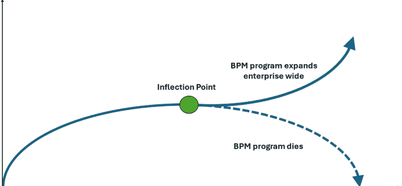
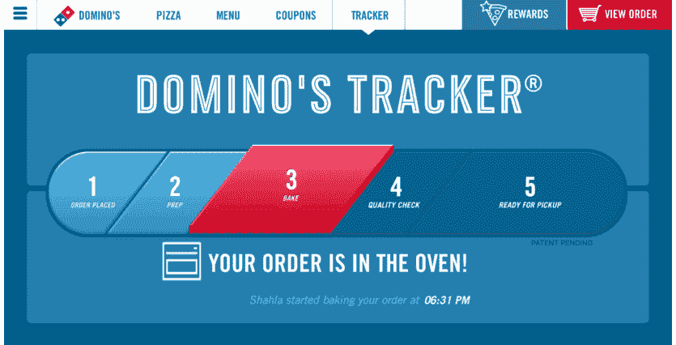
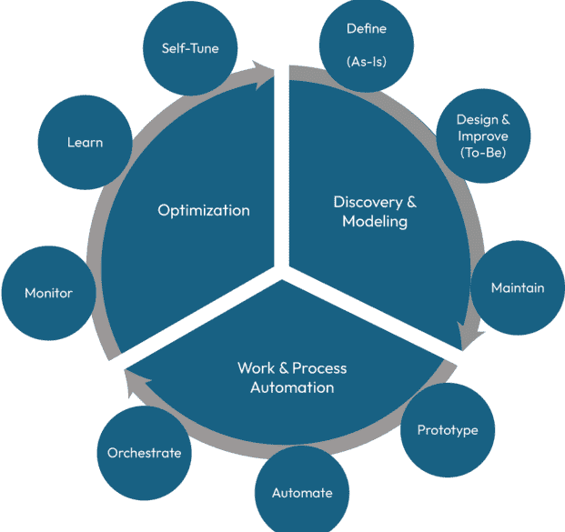
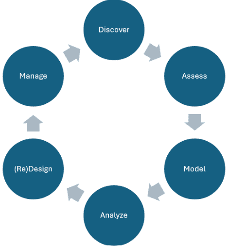
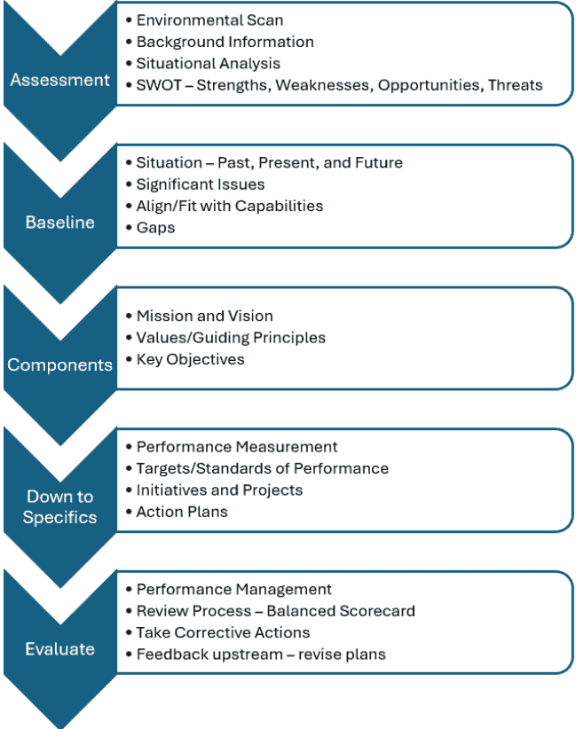
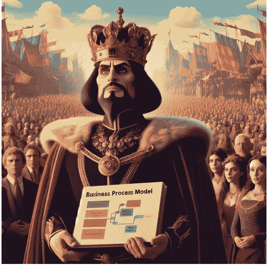
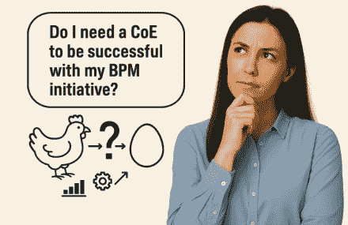
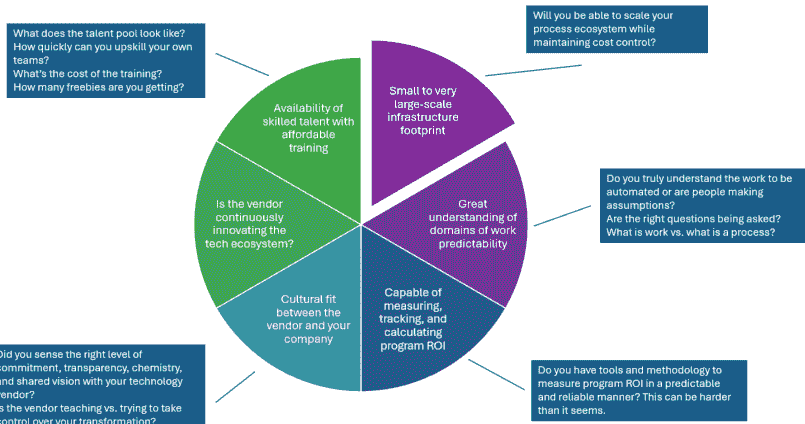
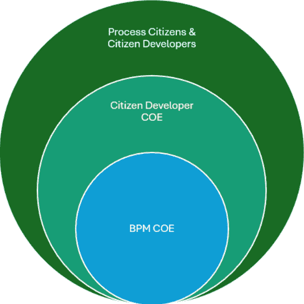

## 推动您竞争优势的 BPM 轮

企业级 **数字化转型 (DTX)** 需要战略规划和 **业务流程管理 (BPM)** 实践，这是数字化变革计划的重要组成部分。通过采用 BPM，公司可以适应快速变化的环境，并借助 AI 的帮助，通过自动化驱动的敏捷性新水平推动创新。作为一种科学实践，BPM 有助于准备和维持一波又一波的数字化变革计划。它关注人员、他们的专业知识以及许多在成功实施 DTX 计划中至关重要的非技术技能。这与常见的误解形成对比，即 DTX 仅仅关乎技术。它关乎人员、流程和技术共同协作以推动商业价值。

在本章中，我们将指导您在组织中启动和执行 BPM 转型。

您将学习如何做到以下几点：

- 识别表明需要 BPM 转型的迹象以及影响其时机和范围的因素
- 定义转型的目标和预期成果
- 使用各种技术和工具识别流程的当前状态，包括改进的差距和机会
- 制定引人注目的商业案例和转型的现实路线图，概述收益、成本和风险
- 将转型的愿景和战略与关键利益相关者和赞助者保持一致，以获得他们的支持和承诺
- 建立转型的治理和角色，并定义各方涉及的问责责任
- 向决策者和影响者推销转型，并克服潜在的反对意见和障碍

到本章结束时，您将拥有规划和启动成功 BPM 转型所需的技能和知识，这将推动您的竞争优势并为您迎接数字时代做好准备。您还将了解其他踏上类似旅程的组织的最佳实践和最常见错误。本章将帮助您为 BPM 转型打下坚实基础，并为后续章节奠定基础，后续章节将涵盖 BPM 生命周期和方法论的细节。

> 注意
> 本章由 BJ Biernatowski 撰写。

### 转型如何开始？

BPM 是一门旨在改善业务流程的绩效、效率和敏捷性的学科。通过自动化业务关键流程，BPM 可以帮助组织实现战略目标、优化资源并为客户提供价值。然而，BPM 不是一次性项目或快速修复。它是一个持续的旅程，需要对组织流程的管理和改进采取整体和系统的方法。这段旅程就是 BPM 转型，最终将导致大规模的 DTX。

您能尝试在不关注 BPM 的情况下推动此类计划吗？您可以试试。但是，您的结果会让我们想起一种尝试，即只建造 3-4 个车站之间的线路而不是覆盖所有 270 个车站来建造类似于伦敦地铁的地铁系统，省略维护设施，并且不为为列车供电规划足够的电力线路。换句话说，在不考虑和关注 BPM 的情况下进行 DTX 将产生部分结果，而无法将您的项目扩展为自动化计划，从而有效地转变支持公司价值链的主要流程路线上执行的工作。这种缺乏远见的做法还可能阻碍您的企业扩展公司努力以实现转型的全部潜力。

最好将 DTX 视为一项涉及采用 BPM 原则、方法和工具来发现、重新设计、自动化、监控、教育和改进业务流程的变革计划。换句话说，成功的 BPM 转型还将作为 DTX 的前兆，作为由公民开发者和项目团队推动的多个数字化变革项目的浪潮来执行。BPM 转型奠定的基础为组织的各个部分创造了共同愿景和共同语言。

## BPM 转型可为您的组织带来多种好处：

- 通过提供企业持续自我优化的视图，降低成本和浪费
- 通过规划增长与变革、消除瓶颈并简化工作交接，提高生产力和质量
- 通过从客户角度运用外部视角设计流程，提升客户满意度和忠诚度
- 将流程与战略和愿景相协调，确保投入的资源带来最大投资回报
- 营造持续改进的文化
- 为组织启动专注于在数字化业务平台和 AI 的协助下实现工作自动化的数字化变革计划做好准备

图 3.1 – 启动数字化变革项目是一项团队活动

启动 BPM 转型既非易事也并不简单。此类举措通常需要清晰的愿景、果断的领导力、支持性的文化、强有力的治理以及长期的视角。启动过程包括应对诸多挑战，例如吸引可能对流程方法不感兴趣的利益相关者、为业务的大部分领域设计流程架构、标准化和改进现有流程，以及获得并保持高管支持，以确保您的努力得到公司领导的认可。

其他挑战可能涉及大规模的变革管理。您如何管理变革最终将决定您的转型项目的成败，使成功的天平向您倾斜。此外，您还需要学习如何展示业务价值，将时间和资源投入到学习和发展中，并谨慎应对组织政治。

您如何启动和规划 BPM 转型，以便为您的公司带来最佳结果？
在接下来的章节中，我将探讨启动 BPM 转型的关键步骤和最佳实践，例如：

- 把握转型的拐点
- 定义范围和目标
- 制定转型的商业论证和路线图
- 传达并协调愿景和战略
- 建立转型的治理和角色

## 把握拐点

马萨诸塞州最赚钱却又最具争议的行业之一是捕鲸业。从 17 世纪到 19 世纪，成千上万的水手勇敢地穿越大西洋和太平洋，寻找鲸油、鲸须和龙涎香。这是一项需要勇气、耐力和技能的危险追求。捕鲸者面临风暴、海难、疾病以及鲸鱼本身的巨大力量。许多人再也没有回来。那些回来的人，往往带着身体和情感上的伤痕，以及少数人能想象的生存故事。

启动 BPM 转型可能会让人感到艰巨、复杂、资源密集且充满未知。就像历史上的新英格兰捕鲸者一样，转型领导者在追求巨大价值的过程中穿梭于风险之中。

此类项目可能令人兴奋；它们需要大量的耐力，并继续通过承诺几乎无限的投资回报（ROI）所带来的无限潜力的丰厚回报来诱惑许多人。哪个正常人会不被现代追逐数字化“鲸鱼”规模的 BPM 转型所吸引呢？

凭借我亲身体验到的公司在追求流程数字化战略时的巨大热情，我对“拐点”的概念着迷，即公司决定启动并推进流程驱动的 DTX（也称为具有企业级范围的自动化计划）的时刻。战略拐点是一个业务触发点，可以描述为目睹公司高管寻求先进数字化带来的第五阶段流程成熟度所承诺的永无止境的效率、三位数 ROI 和新商业模式的丰厚回报。外部因素，如技术创新、监管转变、竞争动向，或内部压力，如战略、愿景或文化的变化，都可能引发它。战略拐点可能是机遇，也可能是威胁，这取决于公司对其的反应程度。一个预见并拥抱变革的公司可以获得竞争优势并变得更加强大。相比之下，一个抵制或忽视变革的公司可能会失去市场份额和相关性。

在错误的时间启动您的企业级计划，缺乏充分准备，或选择错误的数字化平台，可能会让您和您的赞助商失去晋升机会，甚至毁掉职业生涯。

英特尔联合创始人安迪·格鲁夫将拐点描述为“改变我们思考和行动方式”的事件。

战略拐点理论由英特尔 CEO 安迪·格鲁夫在其著作《只有偏执狂生存》中提出

图 3.2 – BPM 转型的拐点表明了扩展计划的正确时机

哪些业务条件导致了这个拐点，您如何预测正确的条件组合，以便在最有利的时机启动您的计划？

这个问题的答案相对简单。然而，我经历了几次工作变动才体验到导致所谓的*数字化完美风暴*的正确条件组合。那些正确启动其 DTX 的公司专注于准备，并为员工配备适当的技能。它们还拥有由大胆高管支持的前瞻性使命观，该高管有助于推动高管协调。这些公司通过关注影响其环境的业务条件来创造有利的时机。正如著名的全球咨询公司希望您相信的那样，在为 DTX 狩猎做好准备之前，您可能永远无法在估计转型范围的大小时，知道下方的生物是白鲸还是一群沙丁鱼。因此，就像 200 年前一样，大型咨询公司，就像过去的转型捕鲸者一样，常常部署团队追求*高价值项目*——现代的“石油”。

然而，如果没有仔细规划，此类努力可能导致成本膨胀和机会错失，从而削弱您计划的业务影响。当当地劳动力参与度低且交付成本高时，转型的商业论证可能会减弱，导致的影响低于最初预期。

图 3.3 – 把握业务转型的拐点可能存在风险

正如捕鲸业曾定义马萨诸塞州的工业遗产一样，东海岸也得益于弗雷德里克·温斯洛·泰勒等先驱，催生了流程分析的早期进步，其科学管理原则为现代运营思维奠定了基础。

如今，追求数字化的方式有很多，但并非所有路径都能带来可持续的转型。通过本书，我们鼓励您考虑一条不同的路线，一条避免“现代捕鲸者”命运的路线。正如没有任何收益值得冒着危害自然世界的风险一样，没有任何 DTX 应该以效率为名危及您的员工或外包您的运营知识。

太多时候，转型计划依赖于高度专业化、不透明的技能集，这些技能仅通过与全球咨询公司的正式合作伙伴关系才能获得。这些技能作为实施服务的一部分被打包和销售，可能会带来结果，但代价是什么？当您的内部团队被排除在培训、治理或设计之外时，如果没有有意地转移或保留关键知识，这些知识可能会随外部合作伙伴离开。

这并不是说咨询不道德或不必要。远非如此——许多合作伙伴关系确实增加了真正的价值。但过度依赖专有专业知识可能会无意中取代本地团队，增加实施成本，并降低长期 ROI。

问题不在于你的团队无法掌握这些技能，而在于如果没有获得战略合作伙伴所享有的相同材料和学习路径，你的团队将处于劣势。而且，如果你在没有内部能力的情况下推出 DPA 平台，又如何能确保团队的角色——甚至他们的工作——不会被边缘化？

从顾问的经验中获益是一回事，而完全围绕你无法获取或无法持续的知识来构建一个项目则是另一回事。

为了应对这些风险并建立持久的数字基础，组织必须采取更加审慎的方法。要领导一场成功的转型，你需要保障措施：开放的知识获取、实践学习，以及让你的团队始终处于变革核心的有意识努力。

我们还希望，通过意识到推动你的雇主陷入此类永无止境的现代化计划的力量，并应用本书中的技巧和策略，你可以预见，甚至可能把握住公司 BPM 计划扩张的拐点。我也希望说服你，在你的计划达到企业级 DTX 的临界点之前，通过将 BPM 实践置于核心地位，为所需的支持规模做好准备。根据其他企业的经验，你的公司将流程数字化扩展到企业级只是时间问题。如果在错误的时间、使用错误的平台，或没有适当的准备和支持来执行，该计划将开始衰退。

对大多数全球公司而言，DTX 的竞争是生存和竞争优势的问题。请记住，有些转型可能由市场力量驱动，这些力量迅速发生且预警不多，迫使公司投入数月时间快速数字化运营。有些转型可以由有远见的高管提前数年规划，并由企业架构或业务转型办公室支持。有些转型是偶然发生的，许多则源于非常精明的销售团队的努力，他们在公司和客户之间不断传递和循环业务利益的愿景，而这些公司和客户尚未意识到即将触发的事件。创造 DTX 动力最传统但仍有些不常见的方式是，对 BPM 实践进行战略投资，通过流程倡导者创建一种流程为中心的文化，这种文化渗透到你公司的大部分领域。虽然这种方法有点费力，但它涉及向员工群体传授 BPM 能为其日常工作带来的价值，同时将愿景和实践与你业务领域的痛点联系起来。

BPM 是一项广泛的实践，取决于起点，你和你的团队可能需要进行大量学习。你的同事会提出许多关键问题，询问 BPM 如何帮助他们完成日常工作，以及对他们和他们的职业生涯有什么好处。

在一个习惯于即时结果的快节奏世界中，这种科学实践的引入有时会被认为过于理论化，与构建应用程序、执行项目以及管理软件和云系统等更令人兴奋的活动脱节。它也不如执行“自动化”项目、聘请咨询公司、评估供应商以及投资数字流程平台那么令人兴奋。

## 推动竞争优势的 BPM 轮

前面提到的所有活动都涉及“执行”而非“学习”，以及制定战略计划以准备未来数字变革计划的长期执行。人们通常在“执行”工作时比“规划和制定战略”时获得更多满足感，但正是后者有助于实现战略长期目标。

对 BPM 的一些负面看法可能会持续存在，直到领导者亲身体验到这门科学的好处，例如具有挑战性的项目首次达到目标、无法解决的问题得到解决，以及成功实施达到或超越目标后随之而来的日益增长的炒作。

让你感到惊讶的是，你可能还会受到 Z 世代专业人士的挑战，他们以高效和偏好快速结果而闻名，认为传统的冗长学习过程缺乏吸引力。社交媒体的影响塑造了一代重视精简高效工作流程的人。例如，在线披萨订购流程（点击、下单、支付、配送）的简单性体现了他们对快速有效解决方案的期望。因此，调整培训方法以使其更具吸引力和时间效率以满足他们的期望非常重要。成长于互联网驱动的披萨订购流程的这一代人，不想了解“从订购到配送披萨”业务流程的内部工作原理，如果这意味着数小时的发现和培训的话。

图 3.4 – Domino’s Pizza 订单追踪器是最受欢迎的业务流程之一

BPM 的主要挑战在于其广泛性，包括许多理论领域，这些领域可能只有在需要时才会变得相关。并非每个人都有时间和资源的奢侈去攻读两年的 BPM 硕士课程，例如在伊利诺伊大学斯普林菲尔德分校或其他通过专业教育课程提供 BPM 的学校。有效地包装和向适当受众提供培训将是你 DTX 成功的关键。此外，你必须调整信息传递方式，以吸引组织内不同用户群体的注意。众所周知，公司往往很难对流程改进计划和业务流程产生热情。趋势是构建低代码应用程序或参与 AI，而往往忽略了将此类应用程序集成到自适应和智能的端到端流程生态系统中所需的基本基础知识，这些生态系统使企业价值链的数字化成为可能。

确实，你可以构建一个低代码应用程序，甚至几个，而无需了解任何关于业务流程理论的知识。但是，如果你真正想要转变公司的运营和业务流程，你必须理解一些额外的非技术概念。这里没有捷径。

此外，像任何可能过于脱离实际结果的科学一样，单独衡量 BPM 转型计划投资的 ROI 可能具有挑战性且并非易事。本书专门用一个章节来讨论这个主题。

优秀的领导者本能地知道，对 BPM 的长期投资可以产生其他竞争对手只能梦寐以求的结果。但是，其他人是如何做到的呢？有许多关于成功 BPM 转型的公开案例研究，以及这些公司产生的惊人结果。要获得理想结果——首先，能够定义这些结果应该是什么样子——起初可能说起来容易做起来难，因为这项任务可能令人不知所措。

为了简化这个概念，我建议我们开始使用轮子隐喻来思考 BPM 转型，这个隐喻将在本书余下部分中使用。

轮子很容易理解；无论是在卡车玩具上、在《命运之轮》上，还是在宗教文本中提及，它们在文明史上始终占据着关键地位。

在大多数组织中，BPM 轮将围绕三个阶段组织：

- 流程发现、定义和重用。
- 自动化，涵盖各种用例。许多公司从这一点开始其转型之旅，很快就会陷入麻烦。
- 优化，随后是阶段 1 和 2，随着轮子不断旋转。

## 推动竞争优势的 BPM 轮

随着 BPM 转型的轮子按正确顺序继续在这三个循环中旋转，每成功转动一次，你的计划的增长应该会放大。

你的计划的增长和覆盖范围将由后续的数字变革项目发布所推动，当这些项目_正确启动并进行变更管理_，并且_公民开发者社区的人数不断增加_时，他们将成为你最大的盟友。

虽然许多组织转向外部咨询公司寻求专业知识，但这种方法应该补充，而不是取代维持有意义的转型所需的内部知识和承诺。

换句话说，你的计划的成功增长将与你在数字变革计划中取得的成功程度以及公民开发者获得的赋权程度相关。一旦你达到公民开发者人口的临界点，并且你公司未满足的自动化需求开始得到解决，轮子将开始推动持续改进计划，将你的数字化流程推向下一个成熟度水平。

随着这种动力的积累，BPM 轮不仅仅是一个隐喻——它成为指导 DTX 的实用框架。

轮子将继续转动数月甚至数年，直到你的公司达到最高水平的流程成熟度。即便如此，新的技术或科学发展可能会将 BPM 推向新的边疆，寻找流程管理和工作自动化的下一个最佳方案。最好将 BPM 视为一种业务实践，而不是软件类别或一组工具，即使两者紧密交织。先前提出的 BPM 采用公式将推动 DTX 的基层模式，与一些咨询公司仍在实践的自上而下模式形成对比。虽然自上而下的转型模式仍然很常见，特别是在咨询主导的计划中，但越来越多的组织转向公民开发者方法，这些方法促进基层创新，建立内部所有权，并将人才置于变革的中心。

BPM 轮通过提供一个实用、可重复的框架来支持这种转变，该框架将你的 DTX 策略建立在现实世界的流程理解和团队驱动执行的基础上。

下图对这些阶段进行了可视化展示：

图 3.5 – 基于美国零售商示例的 DTX 轮子式视图

要让整个公司熟悉这些概念，轮子必须转动几次，每次都会产生拐点，从而加速流程导向解决方案的采用，培养持续改进的文化，并通过成功的项目带来真正的兴奋感。当 BPM 产生成果时，你会在公司各个部门听到并感受到正面的反响，因为许多项目团队开始宣布他们的成功。这是该计划中令人欣慰且有趣的部分，因为他人的成功会挖掘出更多用例，让每个人都重新对改善运营的可能性充满热情。成功催生更多成功，因此你应提前做好准备，并考虑计划的潜在规模。

BPM 的轮子可以根据每家公司的方法进行调整，如以下示例所示：

图 3.6 – 全球软件公司定义的流程卓越框架

启动计划最初可能需要一些努力，因此请将实践采用的早期阶段可视化为一项团队练习，即将巨石推上一座小山。山丘（以及你的巨石）的大小将取决于你所在的工作地点以及获得的高管支持程度。通过这种可视化，我试图帮助你预见计划将面临的阻力类型和强度，也称为利益相关者的反对。最初的几次推动最困难；当你开始时，巨石仍然静止，重力几乎在向你反推。向前推动岩石（启动计划）需要专注、毅力、技能、团队、一点预算、强烈的方向感，以及坚定不移的信念，即你所做的事情将会奏效，并为你的雇主带来实质性成果。

图 3.7 – 启动 BPM 计划最好由团队来完成

必须坚信，成功的 BPM 计划将产生许多意想不到的积极成果，作为一种有益的力量推动公司效率向前发展，即使在困难时期也是如此。随着目标变得更加清晰，阻力减弱，进展开始自行积累动力。每个需要额外努力来应对组织挑战的阶段，都可以加强 BPM 计划在增强运营效率方面的作用。当实施良好时，这些计划有助于在业务绩效和战略对齐方面实现可衡量的改进——在某些情况下，甚至会影响公司的股票价值。

## 为什么会这样？

因为 BPM 提供了一种结构化且可重复的方法来改进工作方式，它为复杂运营带来清晰度，支持跨职能协作，并有助于减少浪费。随着时间的推移，这将带来可衡量的收益、降低运营成本、加快决策速度、更有效地利用人才，以及更清晰地了解哪些有效、哪些无效。这些是 ROI 的基石，在许多情况下，它们使公司能够承担更雄心勃勃的目标，包括新的商业模式。AI 将通过将结构良好的流程转变为智能、自适应系统来进一步放大这些效果。虽然并非总是能够准确量化 BPM 本身对公司估值的贡献，但改善的运营纪律始终能带来更好的执行，这在最终业绩中有所体现。

我们看到公司通过采用 BPM 实践取得了有意义的业务成果：

- **UnitedHealth Group (UNH)** 是一家领先的医疗保健和福祉公司，提供健康福利、技术驱动的护理解决方案和药房服务，以改善医疗可及性、可负担性和治疗效果。UNH 启动了其 BPM 计划，以改进端到端护理模式、整合客户服务、整合临床数据和分析，并简化行政流程，同时提升其各业务部门的运营效率。2007 年至 2014 年间，UNH 的股票上涨了 87.1%。
- **Heineken (HEINY)** 是一家全球酿酒公司，在多个市场生产和分销啤酒及其他饮料。Heineken 已利用流程数字化来推动员工创新、提高生产力、增强安全审计，并改善其销售点系统。2019 年至 2025 年间，HEINY 的股价上涨了 4.65%。
- **Goldman Sachs (GS)** 是一家全球投资银行、证券和资产管理公司，为企业、政府和个人提供金融服务。高盛已利用 AI 驱动的自动化进行算法交易、风险管理、合规监控和欺诈检测。2015 年至 2022 年间，GS 的股价上涨了约 116.9%。

重要的是要认识到，纯粹的财务表现（包括股价）也受到更广泛的市场趋势、经济状况和行业特定因素的影响。

其他也启动了 BPM 计划以增强竞争优势、嵌入运营纪律并为可持续 DTX 奠定基础的领先公司包括以下公司，以及许多其他公司：

- Google（及其母公司 Alphabet）
- Nordstrom
- Amazon
- Coca-Cola
- Microsoft
- NHS Healthcare
- Conoco-Philips
- ABN Amro
- NATO

要释放这种力量，你和你的团队（如果你有幸与团队一起工作）需要坚定地相信转型的愿景。如果没有对愿景的最终承诺，BPM 的魔力将无法发挥。这些项目通常需要强大的领导能力、大量的毅力，以及与几乎任何人合作的能力，因为你的计划、集体技能组合及其在企业中的覆盖范围将经历多次迭代，并在途中偶尔遇到障碍。

在你决定将巨石推上山是否值得付出努力之前，你必须明确你的业务单元或部门的转型范围和目标。我强烈建议不要在企业层面开始 BPM，除非你和你的团队过去成功启动过类似的计划，和/或你的计划获得了出色的领导支持。即使在这两个条件下，从小处着手，并随着每次轮子转动积累动力也是强烈建议的。虽然有公司几乎一夜之间启动企业级自动化计划的已知案例，但此类计划通常涉及庞大的顾问团队，这些场景不在本书范围内，因为很难估计实现的 ROI。

本书中介绍的 BPM 方法侧重于赋能和民主化，以便你和你的公司可以按自己的方式捕捉业务转型的价值，而无需承担大型顾问团队的额外费用。

一开始就大干一快涉及大规模解决问题，并伴随着每个组织最高层面遇到的严重公司政治阻力。在你的直接环境中学习和实验总是风险更小（也更有趣），意识到同样的业务实践可以随着时间的推移应用于组织最高层面的问题。我的建议是，不要急于求成。

外面有少数几家非常大的公司，在 BPM 的帮助下成功地一夜之间转型了自己。即使是最成功的公司，也常常在实现长期 BPM 成功之前，通过实验对其模型进行迭代。

## 定义范围和目标

定义范围是计划启动阶段的关键步骤。范围和目标应明确界定，并与组织的整体业务战略和愿景保持一致。如果业务战略不存在，请搜索它或找到负责定义它的人。

你需要研究两者，以帮助你识别转型将影响的关键流程和业务领域。与他人讨论 BPM 转型预期交付的期望成果和效益。这项活动涉及宏观思考，并在公司不同部分之间建立联系。你建立的联系越多，你的计划长期就会越成功，因为你会开始遇到其他志同道合的变革倡导者，他们正在尝试解决类似的问题。

请思考一家全球高科技企业的以下目标：

> “BPM 的最终状态目标是让我们的公司成为以流程为中心，持续定义、分析和优化端到端流程。技术投资应与由业务流程要求表达的业务目标保持一致，从而提高可预测性、敏捷性，降低故障率、风险和运营成本。”

评估当前业务流程的状态和成熟度将涉及创建一个带有中央存储库的清单，然后评估现有业务流程，以确定代表覆盖区域的工件的质量和准确性。请注意创建此类工件的人员姓名、版本、日期戳、政策手册和其他支持文档。业务流程图就像杂货店里的蔬菜；大多数都会随着工作的演变而过期，有些工件可能不是最新的。使用超过一年的流程模型很可能意味着你需要对其进行验证。六个月到一年的时间是需要进行一些返工的良好基准。

你的评估可以帮助识别差距和改进机会，为衡量转型的进展和影响提供基准。不要仅停留在业务流程上；你可以将此步骤扩展为全面的成熟度评估，以便更好地了解公司不同部分的集体流程智商和数字化业务平台采用准备情况。利益相关者地图、关于旧计划的历史信息，尤其是关于未按计划进行的转型的情报，将为你提供宝贵的信息。大多数流程顾问都知道，介入一个未能兑现承诺的计划将需要额外的时间、精力，并与利益相关者进行严重的重新校准。复苏前景可能具有挑战性，因为机构记忆会不断因你前任的错误而惩罚你。现场经验表明，如果计划结束不到两年，你不希望在旧的失败计划的废墟上重新启动新计划。有时，不成功的努力与特定的数字化软件供应商或技术相关，尤其是当公司试图在没有建立适当理论基础的情况下转型其运营的一部分，或者你与供应商的合作未按计划进行时。你可能会惊讶地发现，你的战略软件供应商更关注后续上线和确保下一批许可证席位，而不是使你和你的团队受益。

许多公司还犯了一个错误，即将投资于数字化流程自动化或低代码平台与构建 BPM 实践所需的实际工作联系起来。一旦你首次投资了一组许可证，ROI 时钟就会开始滴答作响，使得这款崭新的闪亮软件玩具太诱人，不得不使用。

企业在决定投资软件许可证之前，如果先投资于 BPM 培训和技能，将对自己有巨大的好处并节省大量投资资金。为了做个比较，除非你已经是经验丰富的驾驶员，否则你会想先拿到驾驶执照（它教你如何从 A 点到达 B 点），然后再买一辆新车。在这种情况下，驾驶和启动 BPM 转型有很多共同之处。为期一周的训练营课程可以让你掌握所有必要主题，并辅以一些实践操作。

这个准备阶段需要一些时间，你应该将与 BPM 的关系视为一段长期旅程。未来阶段以及你的计划可能面临的挑战将从这种准备中受益。虽然 BPM 与公民开发者风格的软件交付相结合时效果显著，但你可能没有意识到，BPM 在你组织中的寿命可能长达数年，将在未来创造许多新工作，并将实践与其他技术发明相结合或扩展。

正如该领域多个例子所示，当正确应用时，BPM 技能集可以在个人职业生涯中带来更大、更好的成就。从更广泛的意义上说，将投资于 BPM 视为购买保险政策，以确保新创造的工作将留在你的公司内，而不会被专业服务公司蚕食，这些公司都想分一杯羹，分享由你启动和培育的计划蛋糕。如果你的公司失去了将所有事情带回家所需的技能掌握，你的辛勤工作和布道可以转化为服务供应商的巨额利润。

如果你担任领导职务，不要忽视利害关系。你会希望投资于 BPM 以提高员工队伍的竞争力，并惠及你开展业务的当地社区。有许多转型的例子，它们使内部就业市场空心化，在数字化变革计划一个接一个迅速启动后，使员工处于不利地位。许多此类场景通常与使用专有且难以学习的低代码 DPA 平台进行的数字化努力相伴而生。

请问自己以下问题：

- 如果 BPM 和数字化对雇主的战略如此关键，为什么第三方软件供应商拥有并推动我公司内的大多数项目？运行这些程序和平台是否需要某种“秘诀”知识？
- 为我们的业务流程提供动力的知识和技术有什么特别之处，以至于需要长期顾问团队定期支持这些系统？
- 学习和实验供应商的低代码平台有多具挑战性？
- 该平台与企业的流程导向视图有多一致？我们是会更快地产生技术债务，还是我们的解决方案将与企业流程架构保持一致，打破孤岛并简化运营？
- 在适当的培训和一些支持下，我能否独立成功领导 BPM 转型和后续的数字化变革计划？
- 平台或咨询公司是否共享关于 DPA 授权和民主化的相同愿景？
- 用户、客户和合作伙伴是否都可以使用相同的培训套件？

## 识别差距和改进机会

此步骤涉及评估和分析流程清单，并创建业务的初始热图。尝试确定整个企业的企业流程架构状态。我们能看到一个正在形成的架构吗？

我们能否识别改进领域，列举利益和业务痛点，并在业务和技术领域定义战略目标和转型驱动因素？

## APQC 分类 - 运营流程

| 制定愿景和战略 | 开发和管理产品与服务 | 市场和销售产品与服务 | 交付产品与服务 | 管理客户服务 |
|---|---|---|---|---|
| 定义业务概念和长期愿景 | 管理产品和服务组合 | 了解市场、客户和能力 | 供应链规划 | 制定客户案例/客户服务战略 |
| B C V | B C V | B C V | B C V | B C V |
| 制定业务战略 | 开发产品和服务 | 制定营销战略 | 采购材料和服务 | 规划和管理客户服务运营 |
| B C V | B C V | B C V | B C V | B C V |
| 管理战略计划 | | 制定销售战略 | 生产/制造产品 | 衡量和评估客户服务运营 |
| B C V | | B C V | B C V | B C V |
| | | 制定和管理营销计划 | 向客户交付服务 | |
| | | B C V | B C V | |

图 3.8 – 基于美国生产力与质量中心 (APQC) 的运营流程热图示例

公司哪些部分已准备好将 BPM 作为实践来开展，哪些部分处于领先地位而非追赶？我们在哪里看到最大的阻力，以及原因是什么？

哪些业务领域因重大计划、人员配置问题或持续重组而过于繁忙，无法承担新挑战（即使是额外的自我发展形式）？你不希望在错误的时间与错误的群体启动你的计划。图 3.8 是组织内业务流程图形表示的示例。此热图作为工具，用于识别组织企业流程架构中的差距和改进机会。

热图使用颜色编码来突出显示利益、成本和量方面的优势和劣势，使利益相关者能够确定需要优化或战略关注的流程。你还可以根据流程与战略目标的契合度、对 BPM 计划的准备程度或不同业务领域的阻力程度来对流程进行分类。这种可视化为制定可操作的计划奠定了基础，例如创建有说服力的商业案例和转型路线图。通过这样做，它有助于围绕业务目标对齐优先级并组织项目，同时争取利益相关者对 BPM 驱动转型的支持。

一旦识别出差距和机遇，并制定出运营流程的全面热图，下一步就是通过制定引人注目的商业案例和清晰的转型路线图，将这些洞察转化为可执行的计划。

## 制定商业案例和路线图

此步骤将涉及为转型制定一份面向未来的路线图，并保持其定期更新。路线图旨在围绕业务目标组织各个项目，产生清晰度，并使多个利益相关者围绕同一组优先事项保持一致。转型路线图还应作为稳定的支柱，帮助根据一组目标评估进度，引导工作穿越组织变革的未知领域，并帮助利益相关者了解正在进行的工作。

您的商业案例应展示转型的价值和效益，以及其紧迫性和已识别的风险。许多预算请求都遵循此类商业案例，因此您希望确保为合适的持续时间和适当的工作强度规划和安排团队规模。

您的商业案例还应提及需要一套BPM策略来实现您的目标。这可能是一个“Catch-22”情境，即您必须在向高管申请资金之前先拥有策略的一部分。这就是为什么启动BPM计划有时会感觉如此具有挑战性。每个人都会期望您在开始与利益相关者讨论转型目标之前，就对许多问题有答案。希望在问题洪流袭来之前，您已经对贵组织、其业务需求和长期目标有了良好的了解。请记住，您并非在凭空捏造什么新事物；您正在努力争取支持，利用BPM实践在低代码和其他流程数字化技术的帮助下，从长远角度转型您的公司。

只有当您说服利益相关者，他们的目标与您的目标一致，并且他们在技术民主化中扮演着关键角色时，获得支持和激励您的社区才是有效的。您的社区不应依赖企业象牙塔团队来解决其业务挑战，因为这些团队通常运作缓慢，并且不按照客户的时间表优先考虑业务需求。

查看以下策略示例，以帮助您在准备商业案例时组织思路。制定商业案例的活动因公司而异：

图 3.9 – 示例 1：策略制定流程

## 传达和对齐愿景与策略

与商业世界中的大多数项目一样，沟通起着关键作用。未被看见的事物不存在，沟通不畅的事物通常得不到支持。

启动成功的转型需要进行大量活动，如果您在为资源奔波，那么一切的时机都会使执行变得更加具有挑战性。为了帮助您成功，请从小处着手，然后扩展到路演、办公时间、通讯、研讨会、项目上线庆典，甚至可能是DTX日，以创造多个机会来传达您团队的使命以及对您公司的机遇。

如果您从优先考虑适当的高管赞助并建立公民开发者社区的基础开始，您会发现自己参与关于潜在项目机会的讨论。这些对话将进一步验证您的追求是相关的、对公司是必要的，并且对正确的受众有吸引力。通过专注于识别真实的业务挑战，并运用您的技能和热情来解决它们，个人将对您的信息做出积极回应，并接受BPM作为解决真实业务问题的实践。

在我之前的一个组织工作期间，我能够在具有挑战性的业务条件下启动和发展数字流程自动化实践，以补充我们的流程**中心竞争力（CoC）**，处于以IT为中心且不支持公民开发者计划的环境中。在我的CoC总监的支持下，我以紧俏预算实现了目标，他理解流程驱动转型的力量，并建议采取非常企业家式的方法。我的老板建立了强大的流程文化，他正试图将BPM的飞轮推向下一个周期，扩展面向流程的企业愿景，进入自动化和优化阶段。我帮助团队将飞轮的动力带入下一个计划周期，将采用浪潮从0增长到60名公民开发者，穿越公司政治的迂回曲折和并非总是时机合适的情况。发展草根计划并不容易；它可能需要一些时间，并且需要对业务流程在公司战略中的地位有长远的看法。

经验丰富的领导者、企业和业务架构师以及管理顾问通常认识到，BPM和业务流程为成功的DTX奠定了基础。这不仅仅关乎AI、低代码平台或云；所有技术都旨在帮助公司更高效、更快速、以更低成本且具有更强适应性地执行其业务流程。许多技术人员会证明，当业务流程演变时，它们通常演变得很快，导致技术领域竞相支持这些变化。

流程模型和流程架构为各种利益相关者提供了关于当前和潜在工作流的清晰度，识别任何瓶颈。

## 数字流程自动化101

### 将您的流程自动化技能提升到新水平

- 业务流程自动化简介
- 术语
- K2 Five 平台：
  - 概念
  - 实践练习
  - 如何获得支持
  - 与K2架构师的设计诊所

**通过SharePoint预登记您的兴趣：**
https://harrison.sharepoint.com/sites/BPA/Lists/Digital%20Process%20Automation%20101%20Class/AllItems.aspx

**10/31/2018 9:00 AM – 12:30 PM**

Ala Moana 培训室，商店 807
1617 6th Avenue, Seattle, 98101

每位课程参与者将免费获得一份“Digital Transformation with BPM”和“Data-Driven Process Excellence: Special Edition”的数字副本，由 Future Strategies, Inc 提供（https://bpm-books.com）。

图 3.10 – 宣传和培训活动示例

工作流的可视化表示，其中任务映射到各种IT系统，有助于创建统一的愿景或“北极星”，将组织不同部分的个人连接到同一业务流程范式中，打破人为的障碍和孤岛。当人们开始使用同一种语言进行沟通，并欣赏格式良好的BPMN视觉隐喻的效力时，这将点燃旨在提高效率的优化、标准化和自动化举措。

但是，重要的是要承认这一阶段所需的努力和准备——您将面临大量工作。除非您的组织在BPM方面已经达到了成熟阶段，否则对该实践的支持需要来自最高层领导，并且其价值在C级高管中得到明确认可。尽管关于流程优化、自动化和转型的讨论在领导者中很常见，但BPM的实践技能却较少，因为它们历史上未被纳入MBA课程。虽然在全球范围内取得了一些进展，但只有少数商学院将BPM课程列为优先。

您的高管团队可能缺乏与BPM的理论和变革潜力的直接经验。具有咨询背景并了解BPM优势的高管将是您最大的盟友。同样重要的是要认识到，虽然BPM令人兴奋，但如果没有集成到业务架构和流程自动化领域，它很难长期维持。这些计划在削减成本期间可能会合并。您的策略应该涉及将BPM实践嵌入组织，将其发展为强大的流程文化，然后在公民开发者计划获得关注时加以利用。在企业环境中，为专家团队维持资金具有挑战性，除非这些团队直接为最终利润做出贡献。寻找不仅对流程充满热情，而且在关系建立、销售和技术方面表现出色的人，因为这些特质将提高成功的可能性。尽管BPM具有不断发展的科学性质，但其务实目标是支持DTX计划，除非在专注于工作和流程理论的学术环境中运作。

## 建立转型的治理和角色

角色和治理模型因公司而异；但是，无论您的组织规模如何，以下阵容都将是必需的。有些角色可以非正式地承担，有些可以共享，有些可能需要时间来发展，所有这些都基于您公司的成熟度水平。在如此多的流程驱动您的公司的情况下，即使在庞大且成熟的公司中，也常见发现没有负责人的流程：

- **BPM 赞助人**：这位高级高管在支持和倡导BPM愿景与策略方面发挥着关键作用。他们提供方向和指导，同时确保必要的资金和资源。您的高管赞助人是您计划最重要的倡导者；这不仅仅是关于获得财务支持。赞助人有助于提高可见度，并保护您的计划免受可能破坏您工作的外部影响。找到合适的高管赞助人可能需要一些时间，所以如果您暂时没有，请不要太担心。找到与您愿景一致的领导者，比不断被优先事项与您不同的人边缘化更有益。您可能还会在总监级别的预算中发现一些初始资金。但是，正是来自副总裁的支持才能真正帮助您获得正确的机会。

- **BPM 领导者**：这是领导BPM转型计划、协调活动和项目，并报告进度和结果的人。他们是教练、推销员、无所不知的人，也是计划的代表。

## BPM 团队

BPM 团队是一群专家，协助 BPM 领导者实施转型计划，提供流程分析、设计、改进、自动化、监控和治理方面的专业知识。鉴于该领域的复杂性，个人通常专注于不同的领域，因此一个人很少具备涵盖所有 BPM 方面的全面经验。如果你的团队有两名成员，请认为自己很幸运；如果你的团队非常幸运，请认为自己非常幸运，并充分利用这个机会。在组建团队时，避免将他们孤立在“象牙塔”中，或过早地在组织内部采用咨询方式。除非你已经赢得了内部利益相关者的信任，被视为顾问，否则你并非在充当顾问，这在公司内部需要时间才能实现。外部顾问可以迅速建立信誉，但项目结束后也可能失去职位。虽然在内部建立声誉需要更长时间，但它能更好地帮助你作为内部人员应对内部政治，并与公司的核心运营保持一致。

## BPM 社区

社区建设活动将帮助你获得知名度，寻找支持者，并识别新项目。如果你正确组织团队，可以征集创新想法并挖掘专业知识。想出一些想法来宣传你的使命，使其与社区的需求产生共鸣。将你的社区视为卓越中心（CoE）团队的延伸，并且不要一开始就称你的团队为 CoE。CoE 需要获得高管支持、合适的面向服务的模式（支持其他团队的团队）以及来自公司不同领域的信誉。过早地称你的团队为 CoE 可能会吸引公司其他部分试图完成相同目标的错误关注。请相信我的话：在一家规模中等的公司中，有许多变革倡导者，他们充满创新想法、知识和经验，正准备迎接数字化变革的挑战。你需要找到这些人，建立关系，提供帮助，并扩大你对团队的看法。这些人是你的实践存在的原因。不要把自己放在 CoE 的高台上；到达那里的正确方式是让你的社区将你提升到这个角色。当你的社区这么说时，你就会知道你是那个注定要在业务单元中引领和引入 BPM 的人。这通常需要许多对话、项目、提供的帮助、花费在排查流程和应用程序上的夜晚，以及建立信誉。在这个职业中，如同任何其他职业一样，信誉至关重要。

## 流程所有者

这些是业务经理，他们拥有并负责其领域内流程的绩效和结果，并与 BPM 团队合作以识别和实施改进机会或启动新的转型项目。在仍不熟悉流程思维的公司中，此角色可能没有明确定义。寻找关键应用程序和系统的业务所有者；这些人将在你的转型加速时进入这些角色。

例如，全国医疗保险公司呼叫中心的主管可以负责新成员入职、福利和索赔处理以及事先授权流程。

## 流程参与者

这些是员工，他们在流程中执行任务和活动，同时提供改进建议和反馈。如果你的参与者有兴趣并具备技术能力，你可以考虑将公民开发者支柱纳入你的计划。你的参与者是行动的核心；通过与他们保持联系，你可以获得有关流程的宝贵见解，发现改进机会，并因你的工作而受到赞赏。能够熟练管理涉及多人、机器以及偶尔外部公司的流程而得到认可，会带来巨大的满足感。

## 公民开发者

BPM 计划应支持公民开发者计划，最终合并为统一的数字流程卓越中心（CoE）。你选择的方法、所需持续时间和资金来源将根据公司的战略而有所不同。通常，业务部门支持 BPM 计划，而公民开发者平台则由 IT 预算提供资金。必须避免这种情况在团队之间造成不和；在更广泛的实践中，公民开发者属于你的转型框架中的工作和流程自动化部分。一个需要避免的关键问题是 CoE 中业务部门和 IT 部门之间的竞争，因为这可能会阻碍转型的进展。CoE 的运营应由一位强大且称职的领导者指导，该领导者能够管理这一层面的任何政治影响。如果不这样做，可能会产生连锁反应，破坏你有前途的实践。在这个组织层面，你会遇到有着巨大自我、寻求认可和名声的人。管理此类个性需要相当的技能，有时甚至可能是不可能的。在寻找备受认可且经验丰富的专家来合作并支持你的公司时，优先选择那些谦逊且能够管理自我的人。当一些人被提升到 CoE 团队工作时，他们会变成《怪物史莱克》中的洛德·法夸德。你应该识别数字化变革倡导者——那些拥有健康自我、其成功职业生涯轨迹的人。倡导者与 BPM 洛德·法夸德的区别在于他们既能阐述愿景，又能交付一致的结果。

法夸德通常通过大量的 PowerPoint 演示文稿来推进其 CoE 职业生涯，被高可见度的角色所吸引，而不愿承认自己缺乏经验，这对高风险团队构成风险。

为 BPM 转型创建明确定义且引人注目的治理结构和角色定义至关重要，以确保各利益相关者之间的协调、协作、责任和透明度。这是实现所期望的结果和利益的基础。如果正式化所有角色需要一些时间，请不要担心。重点是你的计划需要个人来履行这些角色，最终他们会适应。对于较大的组织，此模式可以扩展为中心，将 BPM 社区演变为多个实践社区。在这种情况下，保持清晰的沟通渠道，并确保标准和最佳实践在所有社区之间自由共享。你的社区可能运作得更加民主；然而，最有经验且有能力且有抱负的领导者应承担领导角色。如果事情不奏效或你的计划需要更改，你可以为转型的不同阶段寻找新的领导。尽管如此，保持知识的连续性并在此基础上开展工作至关重要。

## 如何推介转型？

作为战略举措的 BPM 转型需要高级管理层和组织关键利益相关者的支持和认可。如果没有他们的背书和赞助，BPM 转型可能会面临许多障碍和风险，例如：

- 缺乏资金和资源
- 缺乏协调和配合
- 缺乏问责和所有权
- 缺乏信任和信誉
- 缺乏动力和参与度
- 高管支持减弱
- 竞争性战略优先事项取代长期关注

因此，以引人入胜且有说服力的方式介绍 BPM 转型至关重要，以清晰地说明其对组织的价值和优势。如何成功推介 BPM 转型？在本节中，我们将介绍有效推介 BPM 转型的主要组成部分和策略，包括：

- 识别受众的需求和期望
- 强调当前的挑战和痛点
- 描绘未来状态的愿景和优势
- 利用故事和示例来展示转型的影响和成功
- 实施“快速胜利”项目以取得初步成功

## Presenting the business case and roadmap for the transformation

Figure 3.12 – Pitching business transformation is best done through storytelling

Prior to embarking on any new project, evaluate your current business landscape and contemplate whether the timing is right. Here are a few real-world examples that led to the establishment of a robust BPM practice, except for the last one:

- A company that invested in the process automation platform from the vendor Zeta discovered within 2–3 years that the product was difficult to use. The anticipated ROI remained out of reach, and the consulting teams responsible for driving transformation left behind a series of failed projects. These setbacks created a negative perception of BPM and automation.

- A company faces intense market pressure resulting from new regulations, shifting business environments, or key strategic initiatives that necessitate a comprehensive revamp of its core operating processes to maintain economic sustainability. This situation is referred to as the _automate or die_ scenario.

- Your new VP previously had successful experience with BPM at their former company and is eager to replicate that success at your organization.

- Faced with highly demanding business objectives, you recognize that achieving these targets will be impossible without implementing work and process automation. Consequently, your leadership encourages you to initiate the automation program.

- A successful business process automation project with the consulting firm Beta brought process-oriented thinking to your organization, leading to high satisfaction levels because of the positive ROI achieved. Other leaders within your company have heard about these successes and are interested in replicating them in various areas of the business.

- An adept process practitioner is promoted to a leadership position and chooses to apply greater rigor and discipline to business operations, drawing from their experience.

- Lacking hobbies outside of work, you decide to use insights from recent sales and marketing webinars to influence your colleagues’ thinking. So, you propose the launch of the BPM CoE to your boss for recognition and advancement.

All but the last one of these scenarios are correct, and you would tailor your pitch differently for each one. While your starting position doesn’t dictate your objectives and endpoint, it’s beneficial to be aware of it. The following tips can help you devise your action plan:

- Define BPM using terms and language compatible with your company culture. Avoid corporate jargon that does not explain concepts.
- Align your BPM terminology with the language of business architecture and the business itself. Avoid acronyms.
- Don’t use scientific papers or presentations; your initial messaging needs to be crisp and businesslike.
- Connect the vision and value of BPM with your company’s strategic DTX goals.
- Address the “What’s in it for me?” for the following:
  - The sponsor
  - Business leaders
  - Process owners
  - Citizen process architects
  - Citizen developers
- Develop a collection of reusable slides and maintain control over them. Avoid cluttering your presentation with content taken from vendors’ decks unless you are intentionally managing your partnership with the company.
- Ensure that your training materials are vendor-neutral; avoid using resources from specific software vendors to teach BPM. You might be astonished at the number of vendors necessary for a successful BPM implementation in your company. It’s common to begin with one vendor, say Zeta, only to later find that another vendor, Alpha, provides the tools and capabilities better suited to your company’s needs.
- Start by presenting your proposal to the business team; the most effective BPM programs are usually led by the business side, even when they involve a high degree of technical detail.
- Pay attention to the underdog. Occasionally, areas of business that have traditionally lacked funding can provide significant visibility by presenting solutions to problems that other regions have been grappling with.
- Refrain from making bold pitches and avoid mentioning enterprise transformations unless you have the backing of executives. Such discussions and plans are generally meant for executive audiences.
- Avoid exaggerating BPM’s capabilities. BPM is a disciplined approach that can lay strong groundwork for your digital change initiatives, ultimately driving your company’s DTX. Like any science, it is applied practically to solve real-world issues.
- Avoid becoming too comfortable with any one vendor; some companies base their sales strategies on engaging the most promising BPM advocates to adjust their strategy later. Build solid relationships with multiple vendors, but refrain from acting as their informant. There’s a delicate balance between being an advocate and turning into part of the software vendor’s sales force trying to penetrate your account. Teams that use these tactics lack true loyalty.
- Understand that the pitch that was successful with your previous employer or client might not be effective with your current one. Businesses, similar to individuals, react differently to various messages.
- Integrate the story of BPM with the specific requirements of your business and avoid overwhelming your audience by pitching too much initially. Keep in mind that BPM can become quite complex for those unfamiliar with it.
- Maintain your high standards; you’re aware that BPM is effective, so don’t consent to any shortcuts in process modeling, process architecture, or the quality of your presentation materials. Recognize your value, even if those around you haven’t yet seen the full extent of what you bring to the table. In time, your worth will become evident, even if you’re unable to demonstrate it immediately. As a practitioner, be rigorous in your standards but adaptable in other aspects.
- It’s great to have the advantage of a well-prepared pitch, but sometimes this can lead to complacency, emphasizing perfection over actual needs. I strongly advocate for pitching BPM within teams or programs during challenging times. Although focusing on intellectual work is more difficult under these conditions, the necessity and potential of BPM are easier to communicate when a business is in a phase of transformation. These programs will engage you with their narrative and create opportunities for rapid results. Conversely, presenting BPM to a stable business that isn’t expecting significant changes might require prolonged periods of advocacy, possibly spanning months or even years. Prosperous times often marginalize BPM, whereas challenging periods draw in practitioners along with their expertise.
- When pitching BPM, invest some time to create a library of pertinent case studies from companies and sectors similar to your business. These resources may develop fresh ideas, motivate your decision stakeholders, and inform you about potential benefits and pitfalls. Quality case studies from the local market can demonstrate how your peers are addressing business process management issues.
- Exploring LinkedIn for BPM roles will reveal companies that are looking for your expertise and identify the programs that are becoming popular.
- Attending vendor conferences online and in person will reenergize and educate you about market trends. Some worthy events to track include PEX Process Excellence, Gartner and Forrester webinars, and conferences hosted by specific software vendors.
- Keep in mind that tangible results are more impactful than any PowerPoint presentation. Utilize the “quick win” project method to generate an initial wave of success, which you can then expand upon with additional projects. The purpose of your “quick win” is to demonstrate the effectiveness of BPM in a low-risk environment, leveraging your initial success. This quick win might be exemplified by a prototype process implementation, identifying a new process from hidden data logs, or carrying out a feasibility study that recommends a technical approach based on business unit performance analysis. The critical aspect of a “quick win” is achieving swift success. Ensure you clearly understand what constitutes success for your stakeholders.

After achieving a few successful projects and finalizing your business case, you should present it to senior management to secure their support for the BPM transformation. Carefully plan your presentation and customize it according to the audience, taking into account their objectives, challenges, and expectations. Here are some guidelines to help you prepare and deliver an effective presentation:

- **Timing**: Choose when your audience is most receptive and attentive. Avoid scheduling your presentation right before or after a significant event, such as a board meeting, a product launch, or a holiday. Also, avoid cramming too much information into a short time slot. Ideally, you should allocate at least 30 minutes for your presentation plus 15 minutes for the Q&A.
- **Approach**: Use storytelling to engage your audience and make your case compelling. Start with a clear problem statement highlighting current challenges and gaps in your business processes. Then, show how BPM can help solve those problems and deliver value to your company. Use concrete examples and data to illustrate your points and showcase the benefits of BPM. Finally, present your roadmap for the BPM transformation, outlining your project’s scope, timeline, resources, and expected outcomes.
- **Audience**: Know your audience and anticipate their queries and concerns. Understand their motivations and provide information that builds support. Address objections and risks early, using evidence and testimonials. Highlight the benefits, such as increased efficiency, quality, customer satisfaction, and innovation. Communicate in a way that resonates with them, using familiar terms and concepts.

## 如何提升你的 BPM 专业知识？

BPM 转型是一段教育之旅，涉及培养和提升参与者的流程技能与能力。这些 BPM 技能和能力涵盖了有效识别、执行和管理业务流程（包括工作流自动化）所需的知识、能力和行为。它们可以分为与 BPM 生命周期相一致的四个不同类别：

- **流程设计**：分析、建模和重新设计业务流程所需的技能和能力
- **流程实施**：将业务流程作为工作流进行自动化、集成和部署所需的技能和能力
- **流程监控**：衡量、评估和控制业务流程所需的技能和能力
- **流程改进**：识别、优先排序和实施流程改进所需的技能和能力

除了这些类别之外，还有同样重要的一组技能子集，例如演示和公开演讲、战略制定、批判性思维和布道。

你如何提升 BPM 专业知识并成为一名 BPM 专业人士？你如何获取和提升与你的角色和组织相关且有价值的 BPM 技能和能力？

在第 4 章“长期趋势及其对你工作的影响”中，我们将探讨提升专业知识的各种来源和方法，例如以下内容：

- 学习 BPM 文献和研究
- 参与 BPM 培训和认证计划
- 加入 BPM 社区和网络
- 应用 BPM 工具和技术
- 实践 BPM 原则和方法
- 接受反馈和辅导

## 如何推动可衡量的结果？

BPM 转型是一项以绩效为导向的努力，旨在实现可量化的结果，以验证所涉及的投资和劳动。这些可衡量的结果是具体的、可量化的指标，反映了 BPM 转型的成功和影响。根据平衡计分卡框架，可衡量的结果和成果分为四种类型：

- **财务**：影响组织财务绩效和盈利能力的结果和成果
- **客户**：影响客户对组织的满意度和忠诚度的结果和成果
- **内部**：影响组织运营效率和质量的结果和成果
- **学习**：影响组织创新和增长的结果和成果

你如何从 BPM 转型中推动可衡量的结果和成果？你如何定义和跟踪**关键绩效指标（KPIs）**来衡量 BPM 转型的价值和效益？

在以下部分中，我将强调从 BPM 转型中实现切实结果和成果的最有效实践和策略，例如以下内容：

- 将 BPM 转型目标和 KPI 与组织战略和愿景相一致
- 设定**具体、可衡量、可实现、相关且具有时限（SMART）**的目标和指标
- 收集和分析数据和证据，以监控和评估 BPM 转型绩效
- 向利益相关者和用户报告和传达 BPM 转型的结果和成果
- 认可和奖励转型的成就和成功
- 从转型的反馈和经验教训中学习和改进

## 建立卓越中心

BPM 转型是一项协作倡议，需要在整个组织中协调和整合 BPM 活动和资源。卓越中心（CoE）是一个集中且专门的单位，为组织提供 BPM 领导、指导和支持。

卓越中心可以通过以下方式帮助促进和加速 BPM 转型：

- 布道业务流程转型的必要性并提供持续支持
- 定义和执行标准和政策
- 提供和管理工具和平台
- 开发和共享知识与最佳实践
- 建立和培养流程文化和社区
- 领导和赞助项目和倡议
- 协调和对齐 BPM 利益相关者和合作伙伴

你如何为你的 BPM 转型建立和运营卓越中心？

什么时候是启动卓越中心的合适时机？在设计和运营卓越中心时，需要考虑哪些关键要素和因素？BPM 卓越中心与公民开发者卓越中心有什么区别？

在本节中，我们将探讨与为你的 BPM 转型建立卓越中心相关的步骤和挑战，例如以下内容：

- 确定卓越中心的范围和职能
- 确保资金和资源
- 选择和组织团队与角色
- 制定和执行战略与计划
- 衡量和改进卓越中心的绩效和价值
- 使卓越中心适应并发展以满足不断变化的需求和期望

## 卓越中心时机困境

我听到的最紧迫的问题之一是，当公司正处于转型中或考虑启动转型时，什么时候是建立 BPM 卓越中心的好时机。

如果我们只有一个项目在进行中，为什么要投资建立卓越中心呢？

对于许多专业人士和领导者来说，在刚开始采用低代码 DPA 工具，或者仅仅是在讨论需求和潜在效益时创建卓越中心，有点像“先有鸡还是先有蛋”的讨论。哪个应该先出现？

图 3.13 – 我需要卓越中心才能让我的 BPM 倡议取得成功吗？

当你刚开始你的旅程时，你还没有确立自己作为业务流程倡导者的地位，更不用说有一个团队来支持使命了。在旅程的这个阶段，你很可能正在寻找任何可以获得的免费支持。

你希望从小处着手，在不引起对自己错误关注的情况下，获得新概念和新技术的经验。除非你处于一群已经牢固建立卓越中心的公司中，否则似乎将卓越中心的讨论加入其中是个坏主意。

虽然申请卓越中心资金可能看起来雄心勃勃，但我想分享其他公司经验的一些见解，以转变你的视角。

为卓越中心进行规划和战略制定应该是一项深思熟虑的练习，它结合了战略、精心的规划和几项有针对性的评估。这种全面的准备将使你处于有利地位，以便申请资金。然而，为卓越中心进行规划并不意味着你会立即为其创建招聘启事。

战略规划的长期价值有助于在计划不断变化（这是不可避免的）时调整你的转型方法。规划至关重要；没有它，我们就是在为失败做准备。

从小处着手并不意味着短期努力。许多公司表明，BPM 转型是广泛的，跨越数月到数年。

## BPM 驱动竞争优势的飞轮

当我在 2005 年开始我的第一个 BPM 项目时，我从未想象过多年后会在企业层面管理 BPM。在四家雇主处拥有近二十年的经验后，我认为 BPM 是一项已显著增长的实践。我最初的 BPM 转型从单一实施扩展到 6 年内在各个业务领域开展的 30 多个项目。最初，我的雇主在 BPM 项目开始时并未准备好建立卓越中心。更早地认识到这一需求本可以节省大量人工小时，但这并不意味着为尚未存在的倡议组建团队。许多项目在开始时尚未构思。

多年来，由于 DPA 软件平台、低代码工具、人工智能和营销活动的快速发展，BPM 转型与技术驱动型转型之间一直存在持续的混淆。技术转型往往因其创新且吸引人的软件元素而吸引更多关注。

专注于卓越中心规划活动，使你能够预见到不可避免地影响你和你的倡议的变化。在我作为 BPM 专业人士的经验中，我见证了各个领域的显著提升，例如以下内容：

- 智能自动化
- 基于云的流程
- 机器人流程自动化
- 低代码平台
- 流程挖掘
- 人工智能驱动的自适应流程
- 用于与我们的业务交互的社交渠道和聊天机器人的泛滥
- 卓越中心即装即用加速器
- 流程框架的出现
- DMN 和 CMMN 的标准化
- 大学开始提供高级 BPM 学位，例如 Stevens Institute of Technology，**昆士兰科技大学（QUT）**、列支敦士登大学和旧金山大学

当我在 2005 年于南加州的一家药品福利管理公司开始我的 BPM 之旅时，我无法预料随后会发生的发展。在 2025 年，进入该领域的 BPM 从业者和公民开发者可以预期未来二十年将出现重大技术创新、实践领域的更紧密整合以及以逐渐降低的成本实现更高的自动化能力。然而，这些进步不一定会让从业者更容易或更不费力地掌握所涉及的基本原理。

将 BPM 视为一门不断发展的科学，对于维持团队、推动职业发展以及支持雇主的转型计划至关重要。将你的视角从未来 1–3 个月的短期目标和交付成果转向长远愿景，因为你，就像我一样，可能会发现自己致力于这个领域多年。

启动卓越中心（CoE）往往具有政治敏感性。如果没有坚实的高管支持，最初最好不要将你的努力标记为 CoE。过早宣称卓越可能会招致审查和你尚未准备好回答的问题。相反，在专注于建立 CoE 运营模型时，将你的工作称为“实践社区”。当时机成熟且你的高级赞助人认可你的努力时，你可以无缝过渡到一个正式的 CoE。

为了让 CoE 被你的组织正式认可，你需要以下内容：

- 领导层的官方支持和背书
- 广泛的同行认可
- 一些成功案例，证明你的专业知识和影响力
- 清晰定义的服务产品，足够相关且成熟，可以提供给业务的其他部分
- 几种工具和最佳实践，使 BPM 的车轮持续运转

与 CoE 倡导者或团队的直接接触应清晰展示团队提供的优势、价值主张和高标准服务。有效的销售应主要通过行动而非幻灯片演示来实现，后者作为辅助材料。过早声称 CoE 地位可能会产生负面影响，因为企业动态通常不支持自封的影响力中心。

在任何组织中，几个团队可能都渴望将自己确立为 CoE。这是因为许多个人面临相似的挑战，并且关于使用低代码技术解决这些问题的全面信息广泛可得。此外，你的公司很可能正被推广其工具和 CoE 概念的软件供应商所瞄准。许多人认为在 CoE 工作比他们的日常职责更有吸引力。毕竟，谁不想成为一个能引起整个组织关注的团队的一员呢？

这就是为什么获得高管支持如此重要。不要让多个 CoE 出现，因为这会导致混乱，并表明领导层目标不一致。我曾在一家大公司工作，那里一个 IT 赞助的 BPM CoE 和一个业务 BPM CoE 正在争夺资源、项目和认可，原因是领导层无法协作以实现共同目标。这种方法破坏了 BPM 的原则，BPM 旨在实现业务与技术实践之间的统一运营。它还凸显了关键高管的缺乏经验，他们无法为了更大的目标而团结一致。理想情况下，你希望有一个单一的 BPM CoE，即使在“部落的部落”模型中，有多个卫星团队执行平行功能。

这些部落应通过整合和共享 IT 资产（如竞争情报报告、云服务以及执行测试等共享任务的团队）来优化公司资源。每个 BPM CoE 应提供业务导向和技术服务的混合体。如果你允许 BPM 分裂为独立的团队，你的项目也会变得支离破碎。

最好将 CoE 视为一个跨学科团队，致力于制定支持高管愿景的长期执行计划。它系统地处理与公司文化和限制相一致的 BPM 和自动化项目。此外，它负责定义和评估转型的投资回报率（ROI），提供对各单元举措的全面视角。

图 3.14 – 推动企业业务转型需要一个跨学科的 CoE

CoE 必须向其赞助人证明，公司资源的分配有效地实现了战略目标，同时提供了所需的投资回报率。通常由高级经理或总监领导，一个成熟的 CoE 有一个旨在捕获和传播知识与最佳实践、确保一致标准、支持各种项目以及管理计划所使用的共享服务的使命。CoE 演变为一个致力于通过倡导、赋能和技术评估帮助其他团队的团队。它还充当信息枢纽，供寻求将其举措与公司不同部门保持一致的领导者使用。

CoE 可能会监督与软件供应商、交付服务和咨询公司的关系；但是，它们必须保持警惕，以维护其愿景和公司利益的客观性和独立性。

## 如何选择数字业务平台

市场和业务需求随时间变化，技术革命不断揭示新的功能，最终增强流程数字化。这种进步通常通过快速、重大的进步而非渐进式演变来实现。很少有软件供应商能够支持当前的技术格局和快速出现的创新领域。

选择错误的数字化平台可能会发现，你的供应商的愿景与你不一致；他们可能难以跟上新的市场趋势，或无法扩展资源以满足你的业务需求。你也可能发现，你的组织与提供专业知识和工具的软件供应商的文化不一致。这可能是由于公司文化的差异、你的赞助人与供应商客户经理之间的关系，或领导团队内部的偏见造成的。

很容易陷入将 BPM CoE 变成软件销售团队推广流程和工作流自动化工具的跳板的陷阱。在这种情况下，请记住，即使是声誉极高的供应商也会推动他们的议程以提升平台采用成功率。如果供应商的转型愿景和往绩无法为你的组织带来成果，你最终可能需要寻找具有类似功能的替代解决方案。

下面的视觉图示说明了为你的公司选择最佳软件平台以支持你的长期 DTX 策略的方法：

图 3.15 – 如何选择你的 DTX 生态系统

虽然我并不是暗示供应商在与你作对——大多数供应商都将客户的最佳利益放在心上——但现实是，许多供应商仍然夸大其能力，声称可以完全自动化广泛的业务流程以增强其吸引力。通常，客户会接触两到三家数字业务软件供应商来降低此类风险，每个提供商专注于自动化的特定领域或解决 BPM 框架内的特定需求。Forrester、Gartner 和 IDC 等分析公司提供专门的工具排名和商业报告，揭示各种平台供应商的能力，帮助管理这些风险。但是，重要的是要注意，这些评估并不总是考虑项目执行因素。根据在多家公司实施 BPM 的经验，使用分析师认为是最佳的工具组合并不必然导致更好的 DTX 结果。从业者对价值和卓越的看法往往与分析师的看法不同。尽管如此，Gartner 和 Forrester 的资源不应被忽视；它们提供了关于市场趋势和流程数字化更广泛范围的宝贵见解。

## BPM CoE 使命声明示例

让我们回顾几个突出角色和职责的 CoE 使命声明示例。

以下是示例 1：

> “我们存在的目的是为我们的客户和股东创造价值。”
> 我们存在的目的是消除摩擦，并在我们的核心和战略流程中获得利益相关者的一致。”

以下是示例 2：

> “我们相信，成熟的 BPM 计划解锁了我们交付客户成功并提高业务活动效率和效果的能力。我们通过与利益相关者合作，嵌入包括流程发现与架构、分析与改进、工作自动化、流程绩效管理和优化在内的 BPM 最佳实践来完成这些事情。”

对于示例 3，让我们回顾一家总部位于美国太平洋西北地区的假设公司的使命声明：

> “业务流程卓越中心团队提供 BPM 实践和相关自动化技术的专业知识，以推动整个公司的效率。我们推动最佳实践、流程文化和风险管理服务，以帮助你以最优成本推动成功的数字化变革计划。”

如前面的示例所示，使命声明通常保持广泛，避免提及特定工具或供应商，而是专注于团队提供的与 BPM 车轮相一致的能力。在创建你的使命声明并巩固将 CoE 使命与组织转型目标联系起来的转型策略后，是时候从服务目录中识别你和你的团队可以提供的专家服务了。这些专家服务将涵盖业务、流程和技术，并通过 BPM 手册交付。

BPM playbook 是 BPM 实施计划的参考指南，涵盖 BPM 实施生命周期的所有方面，重点关注业务驱动的活动和职责。它旨在指导业务团队了解 BPM 计划每个阶段的何时、做什么、由谁做以及为什么，提供最佳实践和推荐检查清单。当正确使用时，此类 playbook 能够解决 BPM 计划失败背后的许多根本问题。

全面的 BPM playbook 将在以下领域提供建议：

- 计划基础
- 战略与愿景对齐
- BPM 计划成功因素
- 流程就绪度评估
- 业务就绪度评估
- 解决方案适配度评估
- 设计审查标准
- 工作量估算模型
- 培训计划
- 项目支持模板，包括 RACI
- 业务价值分析方法论
- 方法论指导
- 数字化平台引导指南
- 实施指南
- 公民开发者主导交付的治理模型
- 基于角色的培训路径

BPM playbook 可以采取网站、PowerPoint 幻灯片、Excel 表格、咨询团队提供的加速器服务、应用程序或这些形式的任意组合。它们作为公民流程架构师和开发者在转型框架中的指南，确保可重复的结果，并将内部项目获得的经验转化为未来的最佳实践。

请考虑以下统计数据：

- 一项调查显示，60% 到 80% 的流程转型项目失败。另一份来源提到，50% 的 BPM 项目因业务与 IT 之间缺乏协作而失败。
- 96% 在 BPM 中失败的高管将其归因于员工认可度不足（*What Business Process Management Statistics Experts Want You to Know*. Cflow. March 6, 2023. www.cflowapps.com/business-process-management-statistics/)。
- 超过 50% 不使用 BPM 软件的公司认为其成本过高。
- 只有 26% 的组织使用流程挖掘来评估其流程绩效。

投资于为 BPM 计划提供全面员工培训的公司，比那些没有充分培训员工的公司更有可能看到投资回报率（ROI）增加，可能性高出 2.1 倍。

当您启动转型计划时，至关重要的是要指定计划在整个组织中提供的几项专业服务。这些专家服务为计划参与者提供有针对性的转型目标。它们可以分组为服务剧本，帮助客户根据其成熟度、当前需求以及整体业务转型就绪度，实现精确的转型目标。一些供应商将专家服务纳入其 CoE 咨询套餐中，帮助客户转型其运营。Microsoft 为 Power Platform 客户提供其 CoE Toolkit 作为软件包。每个 CoE 产品的范围和性质将根据供应商的数字化策略及其目标受众而有所不同。许多公司倾向于在内部开发其服务产品以保留其知识产权。然而，这可能类似于重复造轮子。根据我参与的各种转型和 CoE 团队的经验，组织通常遵循类似的做法，仅存在特定于技术的差异。

下图提供了我参与的 CoE 团队提供的 BVA 服务的模板和示例。此模板帮助定义了我们 BPM CoE 组合中包含的 30 多项服务。

## 专家服务：业务价值分析
版本 1.0

### 服务描述

工作量估算可以在项目的多个阶段进行，每次都会为业务赞助商和计划领导层提供关键信息。我们的团队可以为您提供 2 种估算器：数量级估算（又称 T 恤尺寸估算）和预算指导。每种估算类型都需要项目团队投入不同程度的工作量。花费 1-4 周时间进行估算以产生指导性估算并不罕见，因为它们需要收集您的愿景和需求。T 恤尺寸估算可以在 3-5 天内完成。请记住，CoE 估算并不取代交付团队的估算，应视为基准。通过与 BPMS 和工作流技术提供商的紧密合作，我们拥有专有模型和最佳实践，可用于为您提供高质量的估算。通过内部开发的缩放因子，我们将外部估算模型调整以适应 Nordstrom 的实际情况。

### 业务价值

许多时候，如果没有了解如何实施新业务理念，这些理念就无法推进和蓬勃发展。T 恤尺寸估算将帮助您评估初始工作复杂性，帮助您在关键时刻快速导航并重新确认所做的任何假设。适当的估算技术通过采用通用标准和方法，提高了成功的可预测性。聘请有时需要进行迭代、临时工作的外部顾问并不总是可行，而且成本高昂。我们的服务降低了对业务举措工作量估算错误的风险。我们还会实话实说，您不必担心像顾问制作的估算那样存在利益冲突。

### 输入、要求和假设

根据估算类型而异。预算指导需要需求评估和适配度评估专家服务。业务用例，即带有复杂度的 iGrafx 流程模型，描述 SLA、通知、组织设计、报告要求、接口数量和复杂度、UI 要求（用于品牌和 UI 类型（使用速度与高美观度））。

全面的 BPM 计划涵盖一系列按需服务提供的端到端支持，例如：

- 需求评估
- 流程景观评估
- 流程发现与分析
- 适配度评估
- 环境引导
- 原型设计
- 设计审查
- 自动化治理
- 许可咨询
- 工作量估算
- 培训计划
- 项目和流程 RACI
- 方法论审查
- 业务价值分析

## 工作说明书方法及其优势

对于大型组织，我建议使用工作说明书来组织为客户提供的服务剧本。这些内部文档有助于明确期望、时间表、假设和成功标准。当服务剧本达到其目标时，更容易评估满意度并分享经验教训。避免在没有指导的情况下采用自助服务方法，因为将见解整合到 BPM playbook 中至关重要。除了定制 playbook 之外，还有 BPM CoE-in-a-box 加速器可用，提供最佳实践以快速建立 BPM CoE。这些工具包可以节省时间和精力，提供经过验证的框架，并就以下内容提供指导：

- 业务流程治理
- 项目状态报告
- 跟踪交付的业务价值
- 设计和估算标准
- 可重用组件的访问和利用
- 简化自动化平台引导
- 关键 CoE 角色的学习路径
- 公民开发者培训

## BPM CoE 与公民开发者 CoE 有什么区别？

取决于您对 BPM 的了解程度，您可能会发现很难区分 BPM CoE 和公民开发者 CoE。BPM CoE 是一个集中式业务单元，为公司内的流程转型提供领导、方向和支持。它通过协调活动、服务和资源来简化和加速 BPM 转型。BPM CoE 与业务方面联系更紧密。相反，公民开发者 CoE 是 BPM 计划的延伸，旨在使员工能够使用低代码和无代码平台（例如 Power Platform）创建自己的解决方案。在 BPM 计划滋养的社区支持下，公民开发者 CoE 随着 BPM 转型而发展。虽然 BPM CoE 强调广泛的转型，但公民开发者 CoE 使员工能够开发解决方案并专注于技术，架起与 IT 的桥梁。在某些情况下，公民开发者 CoE 可以独立于 BPM CoE 存在，这可能表明战略存在缺口或计划仍在发展中。

Without proper management, low-code solutions can lead to unconnected technical debt and a lack of alignment with business strategy or process architecture. Ideally, both BPM and citizen developer CoEs should operate under the same leadership and approach. Given that budgets often influence decisions, it's typical for IT to manage the budget for the citizen developer platform and Azure resources, while a different part oversees funding for the BPM CoE. Both teams should work together harmoniously, sharing the same vision and transformation goals.

Figure 3.17 – Overlapping relationships between groups of BPM practitioners

## CoE KPIs

To evaluate the effectiveness of the CoE and ensure ongoing funding, BPM CoEs can monitor several key metrics, such as the following:

- Number of processes discovered
- Percentage of process discovery coverage
- Number of projects completed
- Number of workshops conducted
- Number of business areas engaged in BPM
- Number of process practitioners
- Rate of process reuse

Conversely, citizen developer CoE KPIs can be assessed through the following:

- Number of projects completed
- Number of groomed ideas in the pipeline
- The ROI of implemented processes
- Number of engineering hours saved
- Number of citizen developers
- On-time and on-budget delivery
- Reuse rate of process and application artifacts
- Percentage of digitized processes indicating overall transformation progress

It is evident that these KPI sets complement each other. Tracking these measures across a growing portfolio of projects is challenging; thus, when beginning with a small scope, you might not gather data for all metrics. When introducing your CoE operating model, prioritize two or three key measures based on sponsor guidance and expand as you mature, develop your team, and secure additional funding.

## BPM program launch mistakes

As detailed earlier, various business scenarios can initiate BPM program launches. However, these scenarios do not always facilitate sequential planning and preparation phases, as one might ideally prefer. These instances often lead to common errors you should strive to avoid. The most effective strategy is to pause, assess the current stage of the BPM wheel, and step back if necessary to ensure no essential activity is overlooked. Here are some frequent mistakes made by those new to BPM practice:

- Advancing from the competency phase to excellence too quickly or too slowly.
- Failing to align your CoE strategy with the company’s maturity level.
- Approaching transformation solely through a technological perspective (i.e., focusing on automation for technology adoption rather than business transformation driven by strategy, process, and technology).
- Failing to secure two to three “quick win” projects and then successfully converting them into tangible outcomes.
- Not adjusting external process and methodology standards to fit your company culture and existing practices.
- Equating BPM with BPMS:
  - BPM is the discipline focused on driving efficiency, optimization, and process improvement
  - BPMS is the technology aimed at enhancing collaboration, real-time insight, intelligent decisions, and process agility
- Treating the CoE as a shared tech resource management organization without emphasizing business analysis, BPM consulting, project, and change management.
- Allowing management consultants to dominate your program. While they can offer valuable ideas and perspectives, they often lack the technical connection between problem solving, process improvement, change management, and solution architecture.

## Summary

In this chapter, you explored BPM as a discipline aimed at enhancing the performance, efficiency, and agility of business processes. A BPM transformation encompasses adopting principles, methods, and tools to discover, redesign, automate, monitor, and refine these processes. Each iteration of the BPM wheel contributes to the quality and scope of the business transformation. Such a program necessitates a clear vision, robust leadership, an effective operating model, a dedicated team, and a supportive culture. Establishing a CoE can offer BPM leadership, direction, and support across the organization. Over time, the citizen developer CoE can complement the BPM CoE by promoting the DTX of business processes in an inclusive manner.

The next chapter will delve into various sources and methodologies to advance your BPM skills and become a BPM professional, making you an essential component of your company’s DTX strategy.

## Further reading

- *Business process management* – Wikipedia: http://www.wikipedia.org/wiki/Business_process_management
- *The Modern Definition of BPM* – Poster by Fujitsu: http://social-biz.org/2014/09/30/bpm-poster/
- *UnitedHealth Group (UNH)* – Yahoo Finance historical stock data: http://finance.yahoo.com/quote/UNH/
- *Heineken Brews Digital Future at Lightning Speed with the Power Platform* – Macaw case study: http://www.macaw.net/eng/cases/heineken-brews-digital-future-at-lightning-speed-with-the-power-platform
- *Heineken (HEINY)* – Yahoo Finance historical stock data: http://finance.yahoo.com/quote/HEIA.AS/
- Goldman Sachs Delivers Automation at Scale – Camunda case study: https://camunda.com/about/customers/goldman-sachs/
- Goldman Sachs (GS) – Yahoo Finance historical stock data: http://finance.yahoo.com/quote/GS/history/
- JALLCC staff improves Business Process Management skills: https://www.jallc.nato.int/articles/jallc-staff-improves-business-process-management-skills
- Conoco Phillips Using BPM to Focus on Core Business - ProcessForum Nordic presentation: https://www.slideshare.net/slideshow/conoco-phillips-using-bpm-to-focus-on-core-businesstrack2processforumnordicnov142013/29106972
- NHS England enhances BPM with data analytics – Process Excellence Network: https://www.processexcellencenetwork.com/business-process-management-bpm/interviews/nhs-england-enhances-bpm-with-data-analytics

