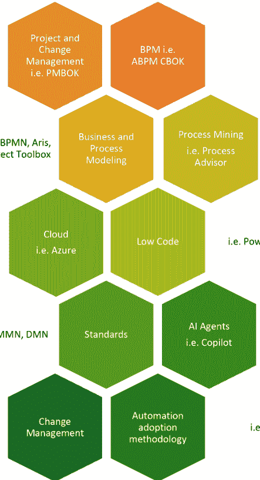
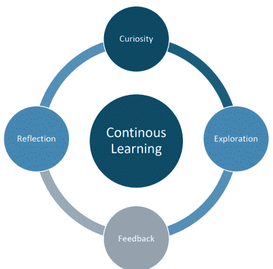
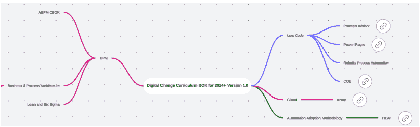

## Long-Term Trends and the Impact on Your Job

In the previous chapter, we examined how the **Business Process Management (BPM)** discipline enhances companies’ profitability and innovation while also highlighting the necessity to constantly keep pace with the evolving science of business process management and the array of technologies propelling it. As an employee, partner, or business owner, it is impossible to overlook the impact of **Digital Transformation (DTX)** on your profession. This reality impacts all industries and job types, demanding continuous adaptation and evolution of skills. Being aware of the long-term trends will help you stay relevant in the marketplace.

When companies aggressively embrace new DTX platforms as part of their digitization efforts, many employees encounter competition in the internal job market for which they are unprepared. A CTO’s decision to rely on a strategic partnership with a software provider can significantly impact one’s career trajectory with that employer. Although some companies foster cultures that support employee upskilling, digital change initiatives may progress so rapidly that employees lack sufficient time and resources to meet evolving job demands. Training is not always a budget priority, so if you find an employer who values employee self-development, you have found a company that has improved your chances of thriving amid DTX.

These are turbulent times, and hard and fast business decisions don’t always align with employees’ career needs. This chapter highlights strategies and skills you should pick up to help ensure your career will align with your company’s long-term DTX goals based on the author’s experience in the field. We will also discuss how you can leverage your existing knowledge and expertise in BPM to learn new competencies that will help you stay relevant and valuable in the constantly evolving job market.

In this chapter, you will learn about the following:

- Surprising truths no one tells you about
- Why is the understanding of digital change topics so critical?
- Definition of business process

## 揭示隐藏的真相：你从未意识到的惊喜

当你参与数字化变革计划时，你很可能是旨在转变业务单元、流程或团队运营的重大 DTX 计划的一部分。你的团队的成熟度和经验水平将显著影响这种转型的方法和结果。

你如何界定业务问题和项目，最终将决定你取得的结果。不幸的是，许多推动变革计划的领导者缺乏有效领导这些工作所需的核心技术技能，但他们仍被期望根据其权威来指导过程。虽然参与 DTX 计划的总监、经理或项目经理不必成为从 BPM 到 DTX 的每个领域的专家，但这些领导者和变革倡导者应具备基本技能，以提升团队的 DTX IQ。

你可能听过有人说：“我不知道我不知道什么。”领导者的经验广度和深度往往决定了其团队的基础 DTX IQ 水平。令人惊讶的是，推动重大计划的领导者或经理并未接受其对 DTX 理解程度的评估。

为什么学校里的学生要接受定期测试，而职场人士却被认为不再需要持续自我发展？领导技术驱动计划的个人应精通与其业务挑战相关的平台、方法论和框架的细节。

任何组织面临的最大风险，就是有一个无法认识自身弱点、试图从有限视角弥补知识差距、且对自身不了解的领域浑然不觉的领导者。领导者往往犹豫是否公开承认自身不足，这在担任新职责一两年后可能会变得明显。

有效的领导力需要知识、经验或两者的结合作为基础。理解 DTX 和 BPM 的挑战在于，这些主题范围广泛，而大多数现有课程面向业务分析师、企业架构师或高管领导者。因此，它们要么提供过多细节，要么价格高昂。行业需要一套标准化课程，在不需要大量资金投入的前提下提供足够的深度。这种方法将确保变革倡导者能够获得必要的知识和培训。

以 5,900 美元，斯坦福在线提供了一门面向高级领导者的优秀课程。然而，即使在这种情况下，斯坦福也选择将培训分为两个独立的轨道：管理和技术。

该课程重点关注以下主题：

- DTX 基础
- 适应不断变化的环境
- 管理不确定性
- 人本设计
- 构建 AI 赋能组织
- 制定产品平台策略

你可以在 https://online.stanford.edu/programs/digital-transformation-program 上找到包含入学条件和最近费用信息的课程描述。

对于 *变革推动者* 和 BPM 从业者，BPM 学院的课程满足各种需求，专业级证书的价格根据交付形式（按需、电子学习、私人学习或面对面课程）在 3,400 美元至 5,950 美元之间不等。BPM 学院提供多个自我评估问卷，使你能够方便地从家庭办公室评估自己的技能（https://www.bpminstitute.org/assessments/）。然而，学习路径众多（总共 14 个证书），在尝试确定适合你的路径时可能会让人不知所措。这些学习路径关注敏捷 BPM、业务流程分析、业务流程管理、运营卓越、业务架构、敏捷业务分析、决策自动化、流程挖掘以及低代码/无代码或智能自动化等领域。

作为一名参加过 BPM 学院培训课程的人，我可以确认培训材料的高质量和认证过程的彻底性。Gregg Rock 体现了这样一种观念：如果你想了解 BPM 和 DTX，波士顿是一个绝佳的地方——即使只是远程学习。

如果你在寻找成本效益高的学习选择，LinkedIn Learning 订阅仅需每年 240 美元（Premium Career 订阅）即可访问各种 BPM 课程。LinkedIn Learning 提供即时培训，使从业者能够根据日常工作需求选择合适的学习路径并安排培训。大多数课程专注于六西格玛、机器人流程自动化、业务分析、项目管理、流程分析以及微软产品，例如 Power Platform 和 Power Automate。例如，由 ASU 供应链管理项目主席 Eddie Davila 主讲的 *业务流程改进* 课程，以无与伦比的价格为 BPM 主题提供了坚实的入门介绍。

## 长期趋势及其对你工作的影响

截至 2025 年，有大量提供结业证书的小型培训课程。但是，在投入时间参加由试图搭乘超自动化热潮顺风车的人主持的课程时，请保持谨慎。偶尔，你可能会遇到要么非常笼统、要么由寻求在这个蓬勃发展的市场中引起注意的风险投资家授课的课程。许多教授 DTX 和 BPM 的培训师往往缺乏实践经验。一位有效的教练或培训师在指导他人之前，应该参与过 30 到 50 个计划或项目。鉴于超自动化周围存在巨大的炒作，在接受信息之前验证其可信度至关重要。

Zbigniew Misiak 在 `http://bpmtips.com` 上经常更新一份高质量免费在线资源列表，供寻求成本效益高的 BPM 培训的人使用。他每年花费大量时间研究可用的 BPM 课程，他博客上分享的见解对从业者和组织来说可能非常宝贵。*BPM Tips* 已成为一个全球性的、独立于供应商的信息来源，提高了人们对 BPM 作为一种实践的价值主张的认识。如果任何 BPM 主题都有免费培训，你很可能会在 `bpmtips.com` 上找到它。

除了各种免费资源之外，许多软件提供商现在提供免费的在线 DTX 培训。尽管如此，尽管他们的初衷良好，这些课程往往深入技术和实施方面，而没有提供足够的基础知识。通常，供应商特定的培训倾向于推广其一体化平台解决方案，而忽视了 DTX 的根本原因。我遇到的大多数软件供应商都匆匆完成了他们的技术课程，这可以理解，因为他们希望推动其平台的采用。

重要的是要明白，采用平台并不能保证数字化变革或 DTX 取得成功。如果你选择从这些资源开始你的学习之旅，请注意，未来可能会有隐藏成本。最终，你可能会花更多时间学习工具，而不是解决需要使用这些平台的实际业务挑战。

我非常喜欢微软 Learn 提供的自助式和模块化培训课程：`https://learn.microsoft.com/en-us/training/browse/`。微软提供灵活的培训职业路径，可以根据你的专业经验、兴趣、产品或期望的职业方向进行定制。这种方法使你能够创建自定义课程，而不局限于可能与你未来的角色不一致的特定工作描述。但是，值得注意的是，微软 Learn 不详细涵盖 DTX 主题，你需要通过阅读微软广泛生态系统中 **最有价值专业人士 (MVPs)** 的博客来补充你的学习。有很多有趣的博客和播客可供选择。我强烈推荐 Mark Smith (`nz365guy`) 的 _Microsoft Innovation_ 播客，该播客已运行超过 8 年。Mark 邀请了专家嘉宾，包括思想领袖、行业创新者和社区专家，他们正在通过人工智能和云技术的进步重新定义世界。他的网站可以在 `http://www.nz365guy.com` 上找到。

在花费大量时间审查和比较各种培训计划后，我观察到许多供应商设计课程是为了让学生为特定角色做准备。根据我的经验，这种方法有时会限制求职者在市场上的机会。在我的职业生涯中，我更倾向于基于技能的方法而非基于角色的方法，确保我对数字技术的关注不会将我限制在供应商销售策略中的某个特定利基市场。

在我的职业生涯的某个阶段，我得出结论：我不想成为专注于单一供应商平台的架构师，尽管有令人信服的培训材料表明并非如此。由于曾与多家公司的平台合作，我尊重 Forrester 和 Gartner 排名所认可的创新的可信度。当我从供应商特定的忠诚度转向更通用的方法时，我意识到 DTX 和数字化变革的范围太广，任何单一软件供应商都无法主导。因此，我选择专注于数字化变革，利用业务和技术专长来推动 DTX 计划。这使我能够更有效地在不同的工具集和平台之间导航。

如果你具备本章后面概述的基本技能，你将能够在各种平台上实施工作流自动化解决方案，例如 **ServiceNow**、**Microsoft Power Platform** 或 **Bizagi**。相比之下，专注于 **Pega** 或 **Appian** 等工具通常涉及更长期的承诺。这些平台性质更复杂且专有，通常需要更陡峭的学习曲线和更深入的技术沉浸。在快速变化的就业市场或由于技术进步的情况下，拥有多功能的核心技能集可以更容易地适应和提升你的技能。

发展核心 DTX 技能集还将帮助你适应各种自动化平台供应商，因为公司经常投资于多个平台以减轻供应商锁定的风险。今天在一个 DTX 平台上成为专家，将增加你与其他平台合作的机会。尽管供应商之间存在差异，但大多数平台都围绕可以使用 **业务流程模型和符号** (**BPMN**) 映射的业务流程构建。虽然切换平台需要灵活性和重新学习的意愿，但这完全可以实现，并能从多种角度提供关于 BPM 和业务流程自动化的宝贵见解。

这种策略的另一个优势是，与 BPM 合作会让你接触到各种主题，包括云技术、AI、数据科学、变革和项目管理、团队领导力、信息安全、战略构建、布道以及 DTX 的其他方面。随着雇主需求的变化，这种接触可以显著推动你的职业发展。

今天，由于 AI 的进步，工作和流程自动化再次成为焦点。AI 有望深刻地改变工作、自动化和企业架构。每个人心中的关键问题是：AI 将在多大程度上改变工作、自动化和企业架构？

通过适当的职业规划和正确的学习模式，当你的抱负或就业市场的需求发生变化时，你可能能够转向另一个职业。承诺单一供应商的路径是一项风险较高的提议；如果你选择这样做，请花时间研究市场规模、未来的工作机会和你的收入潜力。在一个供应商的生态系统中花费十年可能会让你错过其他市场细分领域出现的进步和机会。明智地选择你的工作自动化生态系统，因为与十年前（甚至五年前）相比，今天可用的选择要多得多，考虑到数字流程现在主导了大多数业务运营。

## 理解数字化变革主题的重要性

为什么我要强调推动数字化变革计划的人熟悉 BPM 科学的重要性？

在我的职业生涯中，我与许多经验丰富的领导者、架构师和项目经理合作过，他们凭借丰富的经验，可以轻松主持不同行业（例如建筑施工）的大型项目，仅凭其领导能力。这些领导者拥有卓越的组织和领导能力，无论在哪个行业，项目仍然是项目；范围、风险和问题具有相同的重要性。

改变物理对象与改变业务模式或运营不同，因为数字世界的结果不那么具体。数字业务可能是抽象的，尤其是涉及软件时，涉及导航复杂的多维概念。与砖块等物理对象不同，数字业务中的工作单元在不同群体中可能有着截然不同的含义。这个领域需要隐喻、有效的元模型以及各种图表来说明工作流、系统和结果。

当你向施工队、检查员或房主展示一块砖时，他们都感知到同一个物体。但是，如果你向业务分析师、流程架构师、工程师或公民开发者展示业务流程或需求，他们的解释往往会有所不同。这种差异受到他们个人经验、认知能力、用于记录需求的工具以及连接相关信息的能力的影响。当考虑情感和人为因素时，就清楚为什么超过 60% 的数字化转型计划会失败了。通常，我们的利益相关者并不共享相同的愿景。

举个例子，如果你正在建造一道篱笆，你很可能会使用砖块或木板来说明你的施工设计。

图 4.1 – 沃特林顿农场篱笆，诺福克（“沃特林顿农场篱笆”由 Lewis Collard 拍摄，根据 CC BY-SA 3.0 许可）

砖块或木板具有多种属性；可以将它们连接成墙壁或围绕土地或房屋的更大结构。在世界上，有许多粘土砖的替代品；例如，在爱尔兰，许多墙壁是用天然石头建造的，除了功能性之外，还创造了美丽的景观。

一块小砖可以成为巨大结构的基础。例如，波兰的马尔堡城堡，世界上最大的砖砌城堡，由条顿骑士团在 1400 年代用粘土砖建造。

图 4.2 – 波兰马尔堡城堡，世界上最大的砖砌城堡

> **注意**
> 以下是前一幅图的版权信息—*Panorama of Malbork Castle, part 4.jpg*，Wikimedia Commons，GNU 自由文档许可证，版本 1.2：`https://commons.wikimedia.org/wiki/File:Panorama_of_Malbork_Castle,_part_4.jpg`。

在过去几个世纪中，砖块已被证明是一种非常灵活且坚固的建筑模块。

在设计和规划你的业务时，你必须建立一个基础构建块。这个元素还将有助于扩大你公司的影响力。

我们建议你将 _业务流程_ 的元模型视为这个基础构建块。但是，有几个注意事项需要考虑：

- 企业业务流程，不同于篱笆或城堡，在不断变化并需要灵活性。有些仍然隐藏在数据日志、工作指令或日常实践的部落知识中。
- 业务流程适用于工作单元的转换，因此你需要能够描述工作以及可用于转换工作的业务流程。在我的职业生涯中，我与许多不同公司的架构师合作过，只有少数人能用通俗的语言解释什么是工作。了解如何将工作单元与流程驱动的业务转换联系起来并将其付诸实施的架构师更少。这是由于太多的软件应用程序是临时设计的，缺乏统一的企业 **业务架构 (BA)** 实践方法，以及没有将足够的 BA 概念信息从 EA 的象牙塔推向企业的前线。在那个每天都在经历痛点的公司部分，项目在没有提供全部价值的情况下执行，人们花费时间不断修复和改进——那是我们每天运作的公司部分。
- 让我们考虑一下，_业务流程_ 这个术语可以由营销部门、工程团队、流程架构和项目经理以不同方式定义。它是同一个业务流程，每次都使用不同的视觉效果、词语和元模型来定义。这些人可能都看不到底层的 BPMN 图，它深入到工作的细节。宇宙中讨论的每个业务流程都有一个 BPMN、**案例管理模型和符号 (CMMN)** 或 **决策模型和符号 (DMN)** 图（或其中几个）。有时，只需付出一点努力就能发现它。

现在让我们转换一下思路，来构想我们公司的蓝图。什么是可以用来代表我们业务的 _砖块、石头或木板_ 的等价物？

是业务流程吗？不是，因为如果你了解业务流程命名，它们是由动词（正在 _做_ 的事情）表示的。我们要找的是业务流程对其施加转换魔法、将输入转换为业务输出的项目。

引用 Copilot 的智慧，_业务流程作为组织动态错综复杂的织锦中的基础线程出现_。

### 定义业务流程

**业务流程** 代表一系列相互关联的活动或任务，这些活动或任务共同实现特定的组织目标。这些流程跨越组织内的各种职能、部门和角色。

Examples of business processes include **order fulfillment**, **inventory management**, **customer onboarding**, and **financial reporting**. It’s important to consider the role of verbs in naming conventions for these processes. Let’s take some time to discuss the characteristics of business processes to clarify the definition further:

+   - **Fundamental role of business processes:**

+   - **Operational efficiency**: Business processes streamline operations, ensuring that work is executed consistently and efficiently. They minimize redundancy, reduce errors, and enhance productivity.

+   - **Value creation**: Processes directly contribute to value creation for customers, stakeholders, and shareholders. Whether it’s delivering a product, providing a service, or managing resources, processes drive outcomes.

+   - **Alignment with strategy**: Effective processes align with the organization’s strategic objectives. They translate high-level goals into actionable steps, ensuring that everyone moves in the same direction.

+   - **Adaptability and agility**: Well-designed processes are adaptable. They can evolve to accommodate changes in technology, market conditions, and customer preferences.

+   - **Continuous improvement**: Organizations thrive when they embrace a culture of continuous improvement. Business processes provide a canvas for optimization, innovation, and refinement.

+   - **Process-centric view:**

+   - Some schools of thought emphasize a **process-centric view** of organizations. Here, processes take center stage, and organizational structures adapt to support these processes.

+   - In this paradigm, roles, hierarchies, and functions exist to serve the efficient execution of processes. The focus shifts from silos to seamless flow.

+   - **Holistic perspective:**

+   - While business processes are fundamental, they don’t stand alone. They interact with other organizational elements, such as **people**, **technology**, **data**, **culture**, and **strategy**.

+   - The synergy among these components creates a resilient and thriving organization.

## 长期趋势及其对你工作的影响

本质上，业务流程构成了组织的支柱，将其功能与目的的结构紧密交织在一起。对于业务人员来说，从业务流程定义（将输入转化为业务价值的事物）到流程图，再到代表整个业务单元能力的更大规模业务流程集合（架构），最后到推动实施并形成工作流生态系统的实际项目，这一过程相对容易。我还想提议，我们将业务流程视为一系列活动和任务，这些活动和任务可以做到以下几点：

+   - 学习
+   - 具备适应性
+   - 变换颜色并分发咖啡和糖果（并非真的，但那样该多好？）

想象一下，条顿骑士团试图在2025年在欧洲设计他们的下一个总部。如果他们采用业务流程主导的设计方法，以下内容可能适用于他们的下一座城堡：

+   - 它可以拥有几座可变形的塔楼和护城河，并能够根据天气条件、室内温度和来访客人的数量进行调整。条顿骑士团喜欢款待客人，因此能够通过增加几间房间来灵活调整住宿空间将是一项高价值的功能。
+   - 设计还将从纳瓦霍、西班牙、爱尔兰、英国、法国、葡萄牙、南印度和阿兹特克城堡设计师那里学习不同的建筑风格和布局，根据场合、情况或威胁等级选择最优的建筑风格。由于条顿骑士团对非基督徒采取侵略性立场，且位于中欧，因此其强调防护而非开放。
+   - 砖块将由类似LED的材料制成，可从太阳能充电。它们还可以改变颜色和半透明度（具备适应性和自给自足的特性）。
+   - 城堡可以由不属于条顿骑士团的农民建造，他们每周贡献几个小时，利用业余时间帮助建造这座堡垒。
+   - 新城堡可以在邻近城市的一块地块上在6个月内建成，然后在一夜之间，旧建筑被摧毁并被新设计取代。

上述心理练习旨在将业务流程的特性叠加到大规模部署的物理结构中，如企业级流程转型。

现在，考虑到有些领导者试图在没有充分理解流程架构、建模和执行的情况下设计和数字化核心业务流程。他们构建的是单独的护城河和桥梁（他们会将此类项目称为_自动化_），希望随着时间的推移，这些桥梁能够以某种方式连接起来，构建起他们企业或业务单元的整个_城堡_。

换句话说，如果你关注自己的职业生涯，并希望在数字化变革计划中发挥积极作用，你需要深入了解转型的基础构件以及业务流程本身的理论。从各个可能的角度研究业务流程，以便将这些知识应用于你公司的转型中。

请记住，你的核心基础技能将需要根据你的角色扩展技术技能，你的角色可能更接近实施工作（城堡建设与城堡设计）。数字化平台的技术能力每隔几个月就会发生变化，你需要时刻关注这些功能，并偶尔通过新认证来更新自己。有一件事能让你保持脚踏实地，让你在面对新工具、新术语以及常常出现的困惑时能够游刃有余，那就是你对业务流程和BPM基础知识的理解。这种知识将使你领先于70%的同事，这些同事声称自己正在转型和自动化业务流程，却不了解此类业务流程是什么、为何存在，也未意识到其生命周期。这类同事可以通过充满逻辑错误的流程图作品来识别，这些作品浪费时间并传播困惑。许多业务专业人士仍然不理解和重视基本的流程映射符号及其目的；他们将泳道视为必要之恶，在制作幻灯片时获得满足感和权力感。领域的民主化创造了需求，需要开始将流程设计、映射和架构视为补充MBA课程的通用技能。

## 导航主要趋势及其对技能要求的影响

影响BPM和DTX的趋势有很多，例如：

+   - AI
+   - Cloud computing
+   - Big data
+   - Blockchain
+   - Internet of things (IoT)
+   - Robotics, 3D printing
+   - Decision management
+   - Customer journey mapping
+   - Robotic process automation
+   - Process mining
+   - AI chatbots

这些趋势并非孤立的现象，而是相互关联、相互依赖的力量，它们创造协同效应和反馈回路。它们还根据行业和应用场景产生不同的影响和含义。

然而，这些技术趋势有一些共同的特征和后果，往往被大多数人忽视或低估。以下是其中一些：

+   • 技术趋势是指数级的，而非线性的。这意味着它们以加速的速度增长，性能和影响每隔几年就会翻一番。例如，摩尔定律指出，微芯片上的晶体管数量每两年翻一番，而成本减半。这导致计算能力呈指数级增长，成本降低。同样，AI、大数据和IoT等其他趋势也遵循改进和采用的指数曲线。这意味着未来将与当前截然不同，变化发生的速度将比我们预期的更快。

Figure 4.3 – The influence of Moore’s law on DTX

## 浏览主要趋势及其对技能要求的影响

- 技术趋势是趋同的，而非分散的。这意味着它们正在相互融合和整合，创造出新的组合和可能性。例如，AI 和云计算使海量数据的分析和处理成为可能，这些数据可用于优化和自动化业务流程。区块链和物联网使去中心化和分布式的智能设备网络得以创建，从而实现新的协作和协调形式。AR 和 VR 使身临其境且交互式的数字环境得以创建，这些环境可以增强客户和员工的体验。这些融合场景创造了新的价值主张和商业模式，超越了传统行业和部门的边界。

- 技术趋势也是颠覆性的，而非渐进的。这意味着它们正在创造事物运作方式的根本性转变和转型，而非微小的改进或修改。例如，AI 和机器人技术增强了人类能力，扩展了人类的任务和角色，为员工和组织创造了新的挑战和机遇。云计算和区块链提供了更高效、更安全的信息存储和传输方式，并实现了新的治理和信任形式，挑战了现有的机构和法规。

许多旨在 DTX 领域领先的供应商通常会迅速向数字化业务平台添加新功能。这导致了高密度功能，这些功能难以掌握，有时甚至难以发现，更不用说理解了。此类技术对用户构成挑战，使得跟上新功能和新兴功能变得困难。从市场角度来看，供应商不断创新，追赶其他供应商的功能集。这场永无止境的技术进步竞赛需要大量的工程资源、市场成熟度、创新能力和执行力，所有这些都是为其他公司提供 DTX 支持所必需的。

也很常见的是，新趋势会完全取代旧的数字化方法，使大量客户群处于不利地位，并迫使客户和平台供应商重新思考其数字化策略。BPMS 取代了工作流编排引擎，iBPMS 吞并了 BPMS，低代码吞噬了 iBPMS，而现在 AI 正在永久性地改变低代码和专业代码。

意识到这些动态促使我们提出几个问题：

- 这场永无止境的进步连续体何时以及如何结束？
- 谁来决定哪种方法或技术不再适用，或更擅长解决业务问题？
- 在不断变化的趋势中，你如何定位自己和你的未来职业？

作为 DTX 的参与者，你可能会发现，你对用于推动数字化变革计划的平台或技术的选择影响力有限。然而，在考虑你的职业生涯时，你可以就将时间投入到哪些技能提升方面做出决定。这将帮助你在就业市场上保持相关性，并对雇主有价值。我们想提出一套对数字化变革从业者至关重要的基础技能：

图 4.4 – 成功的数字化变革项目需要各种技能和专业知识

直到几年前，数字化的主要策略是与在各个平台供应商中拥有 DTX 经验的咨询公司合作。虽然这种方法对某些人来说是成功的，但也导致一些因缺乏内部专业知识或投资回报率不足而无法启动的计划延迟。此外，大型工作流自动化平台通常提供跨多个行业的广泛解决方案，但经常未能达到预期，试图强加一种一刀切的转型方法。

一个接一个的项目证明，如果你从大型全球咨询公司聘请流程转型和自动化专家，而不是对组织内部可以利用的员工进行再培训（并辅以一些咨询协助），**投资回报率（ROI）**方程式将受到打击。混合方法，即最初聘请顾问启动项目，同时培训内部员工，提供了两全其美的方案。

**公民开发者**运动在不久前爆发，受益于新一代更易于使用、交付结果更快的工具，这些工具利用了此前甚至未被考虑的未充分利用的软件交付资源。公民开发者计划可以带来巨大的成果；然而，它们不易启动，因为它们需要非传统的交付方法以及对 IT 管辖的合规模式进行更改。房间里的大象是，IT 组织不愿意将权力交给大量无需 IT 参与即可交付数字化流程的 DTX 变革倡导者。在这种模式下，创建连贯的业务流程生态系统还需要一种专业且创新的设计、项目和变革管理方法。

公民开发者运动也对现有员工更具赋权作用，提高了工作满意度，并修复了终于被正确诊断出的痛点。不再因为向多个业务架构师团队解释和描述业务问题而导致需求在翻译中丢失。

数字化技术的民主化直接将问题与解决方案连接起来，缩短了解决问题的时间和实现业务效益的时间。这种方法需要一种全新的工作方式，因为许多公司仍然习惯于通过多个团队、工具、方法论和软件工厂来获取需求。

公民开发者运动还释放了一波直接创新，为历史上由男性主导的团队提供了更多的性别平等。当我在西雅图的诺德斯特龙领导公民开发者计划时，在 2 年多的时间里，与我们团队合作的 95% 的公民开发者都是女性，她们试图借助低代码解决业务痛点，很好地平衡了由男性主导的工程团队。我们许多公民开发者利用在计划中获得的经验，跳板进入技术的其他领域，例如数据科学。当被问及动机时，她们提到与低代码的积极体验是推动她们朝着技术世界中更大胆、更大的抱负迈进的动力，而这个领域历史上由男性主导。虽然我不愿将我两年的偶然观察视为科学研究，但设计和推出低代码解决方案的女性公民开发者的数量让我思考此类技术对技术领域多样性的积极影响。据我所知，没有关于低代码对工作场所多样性影响的公开研究。

2016 年至 2020 年间，在西雅图诺德斯特龙涉及 60 多名公民开发者的计划经验证实，通过减少对传统工程团队的依赖，低代码平台允许更广泛的观点和声音，并提高了我们工作自动化计划的投资回报率，交付了更快的结果并改善了员工多样性。

## 拥抱持续学习的策略

与任何技能集一样，特定技能将提供更高的溢价价值，同时变化更频繁，而其他技能则不需要频繁更新。基本的业务分析和流程架构、项目管理知识体系（PMBOK）或变革管理知识体系（CMBOK）课程，其进步速度不如 AI、低代码和云课程的进步和修订那样剧烈。

掌握这些信息后，你可以计划如何构建核心技能，然后用技术课程来补充，从通用课程开始，然后随着你的职业生涯和兴趣的发展深入到专业领域。构建核心技能将作为你抵御重大技术突破的防御，这些突破总是需要一些学习。技术世界中不变的一件事是变化的步伐，这需要定期提升技能以跟上当前和相关的趋势。

鑒于技术趋势的指数级、趋同和颠覆性特征，在 BPM 和 DTX 领域保持相关性和竞争力需要持续且主动的学习和适应努力。然而，学习不是一次性事件或静态状态，而是一个动态且持续的过程，涉及获取、应用和更新知识和技能。此外，学习不仅是个人的努力，也是一种集体和协作的活动，涉及与其他人和信息来源的互动。

因此，我们提出了一种由四个主要元素组成的持续学习策略——好奇心、探索、反馈和反思，如下图所示，并在随后的列表中描述：

图 4.5 – 持续学习框架

+   - **Curiosity** 驱动人们渴望寻求新信息和新体验，这些信息和体验能够拓宽个人视野并挑战既有假设
+   - **Exploration** 涉及积极追求各种学习途径，例如阅读、观看、聆听、实验或与他人互动
+   - **Feedback** 包括接收和提供建设性的批评与指导，以提升绩效和理解
+   - **Reflection** 要求对学习成果、过程和目标进行批判性和创造性思考，并识别改进和进一步学习的领域

采用这种方法，你可以培养成长型思维和终身学习态度，这对于应对 BPM 和 DTX 领域快速且复杂的变化至关重要。

在我们父母的职业生涯中，技术变革的速度要慢得多，这并未为我们应对当今快速变化的世界做好准备。他们那个时代的技术对其生活至关重要，并在其一生中始终保持相关性。相比之下，我们生活在一个技术进步显著加速的时代，这些进步取代发明的速度比人类历史上任何时候都要快。这一趋势要求发展新的适应性学习策略。

回顾过去二十年 BPM 的演变，它已成熟为 DTX 计划的可信基础。然而，BPM 也因被认为过于宽泛、不切实际且支离破碎而受到批评，这通常源于在组织内部教授或实施它的方法。**Digital Process Automation (DPA)** 平台已成为数字化的关键驱动力，而 BPM 方法论也已演变为融入智能，使公司能够设计、优化和自动化关键业务流程。市场上出现了大量涌入该领域的软件供应商和咨询公司，每个都在努力创新并重塑市场。虽然演变往往是渐进的，但许多塑造技术格局的技术趋势呈指数级进步，导致显著的市场转变，从而改变实践并造成混乱。流程转型及相关工具并非孤立存在，即使在重大技术进步期间也是如此；它们通常受其他技术趋势的影响并与之相互关联。在回顾过去二十年 BPM 演变的同时，有必要从前瞻性角度审视这些发展。

## 过去：从纸质流程到数字流程的转型

数字化已将组织从依赖纸质流程转变为拥抱数字工作流。得益于面向公民开发者和公民流程架构师的用户友好、低代码且成本效益高的平台，这一转变现在对大部分企业员工都可及。自动化已释放资源、降低成本并消除瓶颈，使公司能够探索新的商业模式。将业务流程与旧系统集成，可确保数据流畅并消除流程孤岛。分析可提供实时流程性能的洞察。敏捷及相关方法论通过强调适应性和持续改进影响了 BPM。对流程科学进步的前瞻性展望值得考虑这些新发展。

## 未来：从数字流程演变为自适应、自主和涌现流程

AI 和机器学习将引领基于结果的流程自动化和预测分析，这对于自动化各种任务至关重要。低代码和无代码平台将进一步促进业务流程的数字化，使没有广泛编码知识的个人能够成为公民开发者。这一转变将鼓励公司采用基于模型的企业。虽然强大的企业流程和业务架构实践仍然至关重要，但它们也将变得更加普及，给传统的集中式架构团队带来压力。此外，机器人流程自动化将持续处理重复性任务，使人类能够专注于更复杂的工作。

上述能力承诺了组织可以自行实现的积极 ROI——这在几年前还是不可能的。长期经济趋势和适应的需求将继续推动公司走向实时流程数字化。这种转变创造了对熟练从业者和创新方法的持续需求，这些方法能够提供与每家公司战略目标一致的更快、更有效的解决方案。然而，速度并不总是等同于质量。与公司战略目标保持一致、遵守企业流程架构以及适应性对于长期成功至关重要。一个经常被忽视的问题是管理关键转型计划所需的技能和经验。负担得起的低代码技术、云服务和 AI 模型现在触手可及，为那些愿意学习的人提供了充满希望但又充满挑战的未来。考虑到普通员工可获得的广泛技术范围，有必要反思以下问题：

+   - 我们如何在跟上进步步伐的同时整合所有这些组件？
+   - 我们如何利用触手可及的大量技术？
+   - 在一个需要不断学习和重新学习的环境中（无论现在还是未来），我们如何提高成功的机会？

让我们花些时间讨论信息获取和学习。

## 掌握学习的艺术

学习涉及获取信息、在不同情境中应用信息，并将其与现有知识和经验相结合。为了促进这一过程，必须培养批判性思维、解决问题、创造力和创新等技能。这些技能使知识能够在各种领域和任务之间转移和适应。

学习不是一种被动或孤立的活动；它是一项积极且具有社会性的努力。接触多样且可信的信息来源，例如书籍、文章、播客、视频、博客、在线课程、网络研讨会、研讨会、导师、同行、专家和实践社区，对于主动学习至关重要。

为了有效学习，你应该培养好奇心、探索、反馈和反思的习惯。这些习惯将帮助你有效地寻找和利用不同的学习来源。

此外，学习不是一个固定或线性的过程；它是动态且迭代的。这意味着需要不断监控和调整你的学习目标、策略和结果。

你是否曾好奇过，为什么学校不教我们如何学习，而是将我们置于一个假设我们已经知道如何学习的教育体系中？

在此背景下，我想突出几门相关的培训课程，它们可以拓宽你对学习过程的理解并增强你的认知能力：

+   - **Learning How to Learn** 由 Dr. Terrence Sejnowski 和 Barbara Oakley 主讲：本课程概述了学习的科学与实践，涵盖记忆、注意力、元认知、动机和情感等主题。它还提供了提高学习效率和效果的实用技巧和策略，包括间隔重复、交错练习、提取练习、阐述和记忆术。可在 Coursera 上学习。

+   - **Learning with Your Mobile Device** 由 Kevin Kelly 主讲：本课程演示了如何利用移动设备的强大功能和便利性，随时随地进行学习。它涵盖如何查找和评估移动学习资源、创建和消费移动学习内容，以及管理移动学习活动和目标。可在 LinkedIn 上学习。

+   - **Developing a Learning Mindset** 由 Gary Bolles 主讲：本课程探讨了学习型思维的概念和优势——即相信自己始终可以学习新技能并在个人和职业上成长。它提供了培养学习型思维的指导，包括拥抱挑战、寻求反馈、反思失败和庆祝成功。可在 LinkedIn 上学习。

在探索完刚才提到的课程后，我建议创建一个学习地图——这是一份活跃的文档，你可以每隔几个季度参考一次，以跟踪你的进度。学习地图将帮助你组织和分块你需要获取的知识，在你了解将要学习的内容的全貌时提供清晰度和指导，同时展示不同信息片段之间的连接。图 4.6 展示了一个学习地图示例：

要查看此学习地图的完整版本，请访问此链接并使用您的电子邮件 ID 登录：https://packt.link/8M1It.

## 在快速变化的就业市场中导航

市场力量以及技术进步，导致一些技能变得更加相关，而另一些技能则变得过时。作为回应，公司正在创建新的职位并取消那些不再需要的职位。

在重大转型计划期间，HR 专业人员在帮助员工过渡到新岗位方面发挥着至关重要的作用。Mary Claude Milot，西雅图 Dairygold 的前首席转型官，提到 HR 团队旨在帮助宝贵员工在业务转型期间进行再培训。这一策略对组织有利，因为投资于现有员工并利用学习和发展团队，比寻找具备所需技能的新员工更有优势。

当 Dairygold 实施其基于 Oracle 的流程现代化时，这家位于太平洋西北地区的 1300 人公司采用了以学习为导向的方法。他们将培训整合到新的业务流程中，这在“大辞职”期间有助于缓解人员流动。公司在此期间经历了重大人员流失，其学习管理系统和标准操作程序未能及时更新，以保留离职员工的关键知识。

考虑 Dairygold 的例子，结合你自己的工作场所。反思你观察到的流动率，以及由于重组、流失、晋升或其他导致员工变更角色的因素，每个月离开你团队的专业知识。

虽然这个例子突出了雇主的视角，但同样重要的是要考虑，作为一名寻求为组织增加价值并提高自身就业能力的专业人士，你如何才能保持对当前和未来雇主的相关性。

为了在快速变化的市场中保持相关性，请考虑以下策略：

- **评估你的技能**：评估你当前的技能和能力。识别差距和需要改进的领域。
- **研究当前趋势**：了解 BPM 和 DTX 领域的新兴趋势和需求。将你的职业目标与这些见解相一致。
- **寻找学习机会**：寻找获取新知识和技能或更新现有技能的方法。考虑在线课程、认证、研讨会、网络研讨会、导师制或实践项目。通过实践学习尤其有益。
- **更新你的作品集**：修订你的专业作品集和简历，以展示你的成就、技能、项目和兴趣。作品集可以是网站、博客的形式，或在社交媒体网站上展示。
- **建立你的人脉**：建立并维护专业联系人网络。这可以提供支持、建议、反馈和推荐。
- **创建并推广个人品牌**：在拥挤的数字环境中，对你的网络和招聘人员保持可见性不是可选的。这是机会找到你的方式。一个反映你是谁以及你坚持什么的持续存在将增加你被发现的机会。
- **探索工作机会**：积极寻找与你的兴趣和资格相符的职位空缺。准备好适应各种情况和期望。
- **发布你的想法**：通过在 LinkedIn 和 Substack 上撰写文章分享你的见解。你的文章可以包括工作示例和案例研究，以展示你对主题的兴趣和熟练程度，同时提升你在搜索算法中的相关性。
- **拓宽你的 BPM 视角**：将 BPM 视为一种与供应商无关的实践。探索各种供应商的工具和平台。请记住，BPM 不由单一公司拥有——它由委员会或专业机构制定的标准定义。专注于特定供应商的 BPM 解决方案可能会限制你的视角。
- **保持更新**：阅读突出 BPM 最新发展的行业报告、博客、通讯和杂志。例如《Business Process Management Journal》和《MIT Sloan on Digital Transformation》等资源提供了宝贵的见解。
- **关注行业领袖**：在 LinkedIn、X/Twitter 和 YouTube 等社交平台上与思想领袖和专家建立联系，以获取最新的见解和观点。
- **参加活动**：参与专注于 BPM 和 DTX 的网络研讨会、研讨会和会议，例如 bpmNEXT、Gartner Business Process Management Summit、PEX 活动或 Digital Transformation World Series。
- **从最佳实践中学习**：研究行业领袖和其他从业者的案例研究和研究结果，以采用经过验证的最佳实践。
- **加入专业社区**：参与与 BPM 和 DTX 相关的在线社区、论坛和网络，例如 BPM.com 和 Digital Transformation Network，与同行和导师交流想法、提出问题并获得反馈。
- **探索工作趋势**：为了发现新的 BPM 和 DTX 角色，使用聚合和分析各种来源招聘信息的在线平台，例如 LinkedIn、Indeed、Glassdoor 和 Dice。这些平台允许你使用相关关键词搜索，按地点、行业和职能筛选，并比较不同职位所需的技能和资格。

监控市场趋势可以帮助你识别技能集中的差距并发现新的机会。通过了解行业趋势并提升你的技能，你可以为新的就业机会做好定位，并为 BPM 和 DTX 领域下一波角色做好准备。

## 发现新趋势

作为 BPM 和流程从业者，跟上塑造该领域并影响工作场所业务成果的最新趋势和创新至关重要。通过保持知情和适应性，你可以利用不断变化的市场需求、客户期望和技术进步所带来的机遇。本节将讨论一些可以帮助你发现和跟踪影响你职业生涯的新趋势的方法和来源。

## 在线平台

跟踪市场上 DTX 职位类型的一种方法是使用聚合和分析来自各种来源（例如 Indeed、Glassdoor 或 LinkedIn）的招聘信息的在线平台。这些平台可以帮助你搜索相关关键词，按地点、行业、职能、级别或薪资筛选，并比较不同职位所需的技能、资格和职责。通过监控就业市场趋势，你还可以识别个人资料中的差距和机会，并相应地定制你的简历和作品集。此外，你可以关注提供 BPM 和 DTX 解决方案的领先组织和咨询公司（例如 Accenture、McKinsey 和 EY）的新闻和更新，并通过定期的出版商报告和白皮书，了解他们的当前项目和成就。

## 社交媒体

用户社区倾向于围绕产品和公司聚集，因为他们对特定供应商的解决方案产生了强烈的亲和力。大多数流程和 DPA 供应商倾向于推广非常相似的产品功能集；使每个供应商与众不同的是培训方法、ROI 方程式以及用户社区的规模和实力。

我用来评估供应商实力的关键指标之一是社交媒体上的社区参与度。

## 专业网络

发现和跟踪新趋势的另一种有效方法是与其他流程专业人士、专家和同行建立和维护强大的专业网络。你可以加入专注于 BPM 和 DTX 主题的在线社区、论坛、群组或社交媒体平台，例如 BPM.com、BPM Forum 和 Process Excellence Network。

此外，你可以参与展示行业领袖和从业者的见解、最佳实践、案例研究和访谈的网络研讨会、播客、博客和通讯。一些著名的来源包括 _BPM Leader_、_BPM Institute_ 和 _Process Street_。

此外，参加会议、研讨会、讲座和聚会等线下活动，为与志同道合的专业人士建立联系、学习和交流想法提供了绝佳机会。流行的活动包括 BPM Conference、BPM Next 和 OPEX Summit。

我首选的与同行专业人士建立联系的方法是通过 LinkedIn 群组。但是，重要的是要认识到，许多人可能不会公开讨论他们的工作和项目，因为保密条款和 **非披露协议 (NDAs)**。通过关注积极参与 BPM 的群组和公司，而不仅仅是顺带提及它，你将发现真正发生业务转型的组织。

以下是一些可以关注的群组示例：

- Business Process Management Professionals Group
- Workflow/Business Process Management
- Business Process Improvement
- Workflow Management Coalition
- World BPM Magazine
- LinkedBPM

## 学术和研究来源

发现和跟踪 BPM 和 DTX 新趋势的一种有效方法是关注学术和研究出版物。这些来源推动了该领域的知识和创新。你可以访问期刊、书籍、文章、报告和白皮书，这些资料呈现了与 BPM 和 DTX 相关的最新发现和理论。著名的例子包括 _Business Process Management Journal_、《International Journal of BPM》和 _IEEE Transactions on Services Computing_。此外，你可以探索收集和组织各种与 BPM 和 DTX 相关资源的数据库、存储库或目录，例如 _BPM Academic Initiative_、_BPM Center_ 和 _BPM-Online_。此外，考虑参与

## 摘要

总而言之，发现并跟踪新趋势对于任何希望在数字化变革塑造的动态且复杂的商业环境中保持相关性和竞争力的 BPM 和流程专业人员来说都至关重要。人工智能和工作自动化领域的技术进步将继续演变，导致人们对什么保持相关性、什么将发生变化产生转变和困惑。积极评估哪些新技能将有助于保持你对雇主的价值非常重要。如果你表达出兴趣，好的企业会支持你的再培训努力。

技术进步的快速步伐要求采用新的在职学习方法，使专业人员能够掌握许多新兴且互补的 DTX 领域。强大技术的访问民主化（这些技术在历史上仅限于有限的一群用户）提高了自适应学习的要求。如果你负责领导数字化变革计划，你的 DTX IQ 将为整个团队设定标准。但是，请记住，仅具备领导能力是不够的。制定学习计划并定期审查将帮助你保持正确方向，并在 DTX 领域开辟新途径。

BPM 继续作为数字化变革和 DTX 计划的基础，使专业人员能够利用新工具和技术，同时保持对 BPM 科学的关注。没有单一供应商主导 BPM，这一学科仍在不断发展。通过使用 BPMN、CMMN 和 DMN 等共享标准进行沟通，我们可以为数字化企业创建蓝图。

这些蓝图可以借助各供应商的数字化业务平台来实施，融合不同的解决方案交付风格，并以民主化且 ROI 为正的方式开发具有韧性和适应性的数字化业务流程。本书即将到来的章节将深入探讨业务流程建模、流程架构和建模符号的细节，重点介绍实用的操作指南。

