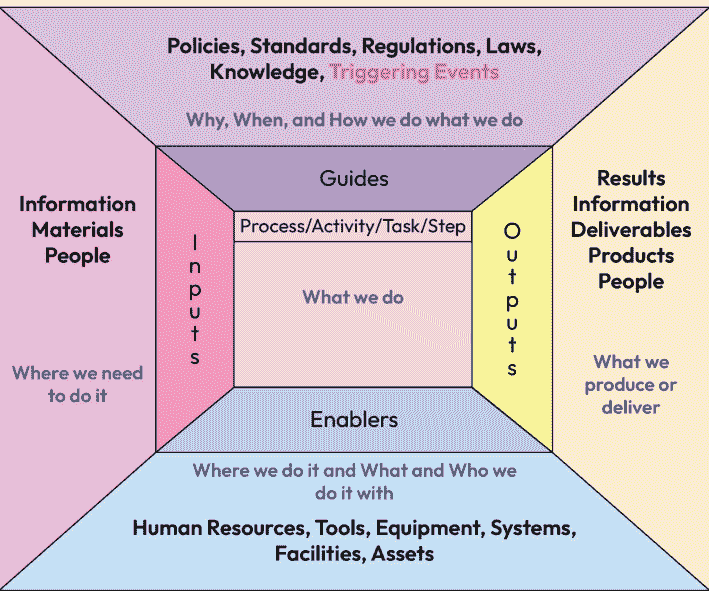
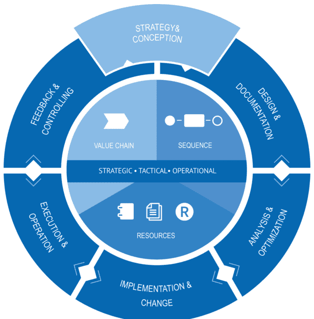

## 业务流程 101

业务流程是任何类型组织中价值创造的关键。人们常常只将这些流程视为需要采取的一系列步骤。然而，要获得流程思维的益处，你需要对流程有更广泛的视角。你需要了解流程的整个生态系统——影响你流程的其他流程以及受其影响的流程，还有支持流程和治理流程，为你的流程提供资源和指导。如果没有这种更广泛的视角，就很难真正理解一个流程，几乎不可能实施具有长期效益的有意义的改进。

为了管理流程，我们需要以某种方式记录它。仅使用文本描述流程是不够的，因此通常使用图形模型作为建模流程的主要方式。建模可用于各种目的。所有这些目的（称为**建模场景**）都有特定的要求，这些要求会影响我们将记录关于流程的内容以及需要多少细节。流程模型可以在各种工具中以不同的方式创建——本章将展示最重要的几种。我们还将简要提及流程模型的使用方式。

在本章中，我们将介绍以下主要主题：

- 作为价值创造驱动因素的流程
- 利用更广泛的流程视角进行改进和数字化转型
- 你的场景是什么，为什么它很重要？
- 你需要了解流程的哪些内容？
- 创建流程模型的工具、人员和方法以及使用方式

> **注意**
> 本章由 Zbigniew Misiak 撰写。

## 流程思维中的关键概念

在第 3 章《推动你竞争优势的 BPM 轮》和第 4 章《长期趋势及其对你工作的影响》中，你已经有机会了解一些关于**业务流程管理（BPM）**的历史，了解一些关键定义（例如什么是 BPM 和业务流程），并理解流程管理中的一些重要概念，例如业务流程的作用以及将 BPM 活动视为一个循环而非一次性活动的重要性。

在本章中，我们将回顾流程思维的一些基础知识，让你有机会加深理解，并推荐额外的阅读材料和资源。由于我的许多学生经常向我询问推荐的书籍和额外材料，这些内容将在第 5 章至第 9 章中提供。

BPM 是一门历史悠久的学科。不出所料，关于关键概念也有许多相互竞争的定义（如前几章中 BJ 所提到的）。由于没有单一机构管理全球所有与 BPM 相关的事务，你可以从许多来源寻找灵感，并选择最适合你和你组织的定义。

以下是来自**国际业务流程管理专业人员协会（ABPMP®）**的一段引言，该协会是 BPM 领域最权威的组织之一。ABPMP（https://www.abmp.org）是一个全球性的非营利性专业协会，致力于 BPM。它维护着 BPM 实践的全球标准，并提供广泛认可的认证。截至 2025 年，ABPMP 拥有超过 17,000 名会员，代表超过 750 家公司，并在全球拥有 56 个分会。

在其**业务流程管理通用知识体系（BPM CBOK®）**指南中，ABPMP 使用以下定义：

> “业务流程管理（BPM）是一种有纪律的方法，用于识别、设计、执行、记录、衡量、监控和控制自动化和非自动化的业务流程，以实现与组织战略目标一致的、一致的、有针对性的结果。”

> BPM 涉及对推动业务成果、创造价值并使组织能够以更大的敏捷性实现其业务目标的端到端业务流程进行有意识的、协作的和日益技术辅助的定义、改进、创新和管理。

> BPM 使企业能够将其业务流程与业务战略相一致，通过改进特定工作活动（无论是在特定部门内、跨企业还是在组织之间）来实现有效的整体公司绩效。”

你可以在此处了解更多关于 BPM CBOK 指南的信息：https://www.abmp.org/page/guide_BPM_CBOK。

> 注意
>
> 有效流程管理所需的知识体系（尤其是针对高影响流程）非常全面，涵盖了流程建模和模型使用（本书的重点）之外的许多方面。如果你想了解流程治理、监控和变更管理等方面，以及查看来自权威来源的其他 BPM 定义，请参阅本章的资源：`https://github.com/PacktPublishing/Practical-Business-Process-Modeling-and-Analysis/tree/main/Chapter05`。

如你所见，ABPMP 的定义与第 3 章中使用的定义有许多相似之处。在接下来的章节中，我们将逐一介绍这些重要概念，以便你更好地理解流程思维中的关键概念。我们将从**价值创造**的概念开始，因为它有助于理解流程管理中的许多其他事物。

## 作为价值创造驱动因素的流程

我们迄今为止介绍的 BPM 和业务流程定义都提到了价值创造这一极其重要的概念。业务流程代表需要完成的工作。然而，我们并不期望仅仅完成工作，然后**输出**就准备就绪。我们的雄心是产生**成果**，帮助组织实现其目标。

这表明战略与流程之间存在着清晰的关系。流程应使组织的战略愿景在日常工作中成为现实。业务流程应以与组织**价值主张**一致的方式进行设计和执行。

流程的结果应对客户（无论是外部客户还是内部客户）有价值。如果是面向客户的端到端流程，从客户的需求开始，以满足该需求的结果结束，那么更容易看出价值创造是什么样子。

当然，一个好的流程使我们能够提供客户愿意付费的产品或服务，因此价值是双向流动的。还有许多对客户不可见的重要流程。它们以较不直接的方式支持价值创造，例如，为面向客户的流程和整个组织提供必要的资源和指导。

例如，在公共部门（或非营利组织）中，情况会更复杂一些，从服务中受益的人可能不是直接为其付费的人，但理念是相同的：组织需要为某人创造价值才能生存和繁荣。同样的思维方式也可以应用于服务于内部客户的流程：只有当我们为客户和组织创造价值时，流程才有意义。

## 利用更广泛的流程视角进行改进和数字化转型

在上一节中，我们介绍了流程管理中的价值概念。现在，让我们看看如何确保创造价值。要创造有价值的产品和/或服务，需要具备必要知识和技能的人员来完成工作。这些人需要使用各种资源，例如 IT 系统或设备，以及完成工作所需的必要信息。

由于流程通常很复杂，仅有一个组织单位的人员是不够的。我们需要各种技能和能力，因此可能需要来自许多团队、部门甚至组织的人员。你可能还希望拥有一支**混合劳动力**，由人员和 AI 代理协作以产生所需的结果（很快，我们可能还要加入机器人）。

为了确保所有这些人都能正确完成工作，他们需要一些指导。不用说，AI 代理也需要一些指导，以便它们能够有效地工作，并以符合组织价值观的方式运行。

这种指导需要覆盖整个流程，而不能局限于单独的组织单位（以避免**筒仓思维**）。这就是为什么 BPM 强调**跨职能流程**的重要性，以及对整个流程及其所有依赖关系进行全局视角的重要性。

跨职能价值创造是流程管理中一个非常重要的概念。流程并非孤立运行；它不是一个孤岛。有许多其他流程会影响其运作。这就是为什么，在许多情况下，仅将单个流程纳入范围的改进计划，最多只能带来有限的成功，最坏的情况是仅仅将问题转移到其他流程。我们需要对流程有更广泛的视角，将流程视为具有所有依赖关系的更广泛生态系统的一部分。

采用这种更广泛的视角并共同分析流程，有助于识别问题的真正原因，并为流程改进/自动化计划提出更好的想法。我们将在 _第 6 章_ 中了解更多关于创建这种更广泛流程视角的实际方面，该章节涵盖了流程架构的概念。

现在，让我们简要讨论如何创建一个有用的概览（或所谓的**直升机视图**），展示我们流程的上下文，以便我们可以更好地理解它，而无需创建详细的流程图。在几种可能的方法中，我将在这里提到两种非常流行的技术，它们将帮助你比仅关注我们计划在单个流程中完成的工作更好地理解流程。

第一种方法是 **SIPOC**，它在 **精益管理** 中非常流行。SIPOC 图描述了以下方面：

- **供应商**：为流程提供输入的组织或人员
- **输入**：流程正常运行所需的事物——信息、文档、材料、知识等
- **流程**：流程中需要发生的（关键）事项，以产生所需结果
- **输出**：流程的结果（产品或服务）
- **客户**：（内部或外部）接收输出的组织或人员

值得提及的第二种方法是由 Roger Burlton 开发的 **IGOE** 方法。IGOE 认为以下方面对于正确理解流程很重要：

- **输入**：执行流程所需的元素，例如信息和材料，这些元素会被流程转换或消耗
- **指南**：所有元素，例如标准、法规和知识，它们向我们展示了为什么、何时（通过显示哪些事件定义了流程的范围）以及如何执行我们的流程
- **输出**：流程的所有结果（产品、交付物和信息）
- **使能者**：我们需要的所有资源或资产（例如人员、系统、设施或设备），以便我们的流程运行，且不会被流程消耗

图 5.1 – IGOE 图示例（由 Roger Burlton 提供）

这里重要的是，IGOE 不仅为每个领域提供元素列表。它还向你展示了连接，即与其他流程的连接。这就是为什么它也被称为**上下文图**或**范围图**。在 GitHub 仓库中，你还将找到两个关于 IGOE 的有用视频链接：一个是 Roger Burlton 和 Sasha Aganova 解释 IGOE 概念的视频，另一个是 Roger Tregear 关于“煮咖啡”流程 IGOE 示例的视频。两者都非常值得你花时间！

如果你想知道为什么提供流程快速概览（以及更深入理解）的这些方法很重要，让我们想象一下，我们有兴趣改进一家生产客户产品的公司的投诉处理流程（此示例将从本章用到第 9 章）。

如果投诉处理流程存在问题，也许第一个想法是让它更快。虽然这一改进可能非常合理，因为客户肯定会欣赏更快的解决，但也许值得找出流程表现不佳的根本原因，而不止于某些通用解决方案。

也许员工因客户投诉过多而不堪重负，这是由于选择了一家因价格较低但服务质量不佳的新配送公司造成的。或者，也许问题是出在包装上，因为物流团队的人员工作匆忙。或者更糟的是，也许产品本身仅仅因为设计错误而太脆弱。

正如你所见，要理解流程并改进它，我们通常需要比乍看之下多得多的信息。为了应对关于流程的大量知识，我们需要一个良好的描述机制，以确保不会遗漏任何重要事项。我们将在 Chapter 6，建立流程架构 中更深入地介绍这一点。我们还需要决定为我们的目的收集哪些信息。这将在下一节中介绍。

## 你的场景是什么，为什么它很重要？

我们已经知道，流程是任何组织运营中极其重要的方面，当我们根本不知道有哪些流程以及它们如何相互关联时，很难管理它们。

为此，我们需要业务流程模型。模型提供了对现实某些方面（在我们的情况中，组织的流程）的简化表示，其形式有助于我们更容易地理解它。可以将 Google Maps 想象成它向我们展示城市的数字表示，帮助我们找到正在寻找的位置。

然而，正如著名的谚语所说，“地图不是疆域”。我们的模型提供了有价值的信息，但它们并不等同于所代表的真实对象。模型也可以为不同的人服务于不同的目的。我将把它们称为流程建模场景。

有些用户对基本信息感兴趣，而另一些用户需要考虑许多如果没有模型就很难理解的方面。一名在陌生城市寻找景点的游客、一名规划新摩天大楼的建筑师、一名寻找漏水污水管详细位置的公用事业公司工人——他们都会搜索不同层次的详细信息，以适应他们的目的。业务流程模型也是如此，因此会有不同的建模层次和模型中不同的详细程度。

例如，所有顶级流程（流程景观）的概览就像整个城市的地图，而流程的详细图则类似于特定土地地块的平面图，包含管道、光纤电缆和其他基础设施元素的信息。

每个决定对其业务流程进行建模的组织都会进行某种投资。创建流程文档、使用它并保持文档的最新状态需要人员、时间和金钱。流程模型本身并不创造价值——它们需要支持组织的一些目标。这种支持越好，流程建模对组织就越有价值。

因此，在开始实际工作之前，确定需要做什么（特别是，需要进行哪些与流程相关的工作）通常是个好主意。否则，我们可能会做对组织没有益处的事情，我们的工作可能被视为徒劳，或者我们可能会遗漏一些关键信息。

想象一下，给一个寻找最佳拍照地点的游客提供一张极其详细的污水系统地图，或者忘记在提供给需要挖掘更换管道的公用事业工人的地图中添加关于光纤电缆和其他重要基础设施的信息。

流程模型可以记录组织的当前状态（即所谓的“现状模型”），也可以是我们正在设计的未来状态的蓝图（这些被称为“目标模型”）。

## 现状模型和目标模型

现状模型记录组织的当前状态。它们展示了基准，不仅可以用于培训新员工、促进沟通等，还可以用于收集改进需求和想法。

目标模型展示组织可能的未来状态。它们允许设计新的工作方式，识别依赖关系和变更的影响，比较不同的变体，并选择最适合组织实施的方案。

模型还可以帮助规划组织内部的转型，尤其是当达到期望状态需要多个阶段时。除了用于文档、分析、知识管理和变更管理之外，流程模型还可以用于流程自动化等。模型对于改善沟通以及在涉及许多相互依赖关系和多个团队的复杂情况下建立共同理解非常有帮助。这在自动化案例中对你大有裨益，例如实施支持流程的新 IT 系统、准备将从员工手中接管一些重复性任务的机器人流程自动化（RPA）机器人，或者使用 AI 工具和代理设计流程的新版本。

然而，并非所有模型都同样有用。我们需要在信息过少和过多之间找到平衡点，以便以适当的形式向目标受众呈现有用的内容。我们的模型必须正确描述现实（使用某种公认的方法），尽管它们是对现实的简化。这意味着，例如，一个好的模型不应遗漏关键的流程步骤。最后，合格的接收者应该能够在没有模型作者解释的情况下正确读取模型。为此，在组织内建立某种共同语言并使用建模标准会有很大帮助。

由于许多流程变得越来越复杂（例如，由于监管要求），对流程模型的需求也在增加，尤其是在我们准备对组织进行某些变更，并希望避免因忽略某些重要方面（例如，只关注流程步骤的成本而忽略客户体验和合规性方面）而导致的错误时。

有了这种零碎的观点，从一个团队的角度看似乎很合理的修改，可能会给其他团队带来更多工作，并导致流程结果更差。也可能发生这样的情况：新流程从组织的角度来看是有效且高效的，但无法满足客户的需求，或者不符合法律或法规。

当然，作为沟通工具的模型可以有不同的目标受众。记录流程的模型可以面向新员工，帮助他们更快地融入组织，以便他们能更快地获得所需知识并避免新手错误。它们也可以对现有员工有所帮助，作为提醒他们最佳工作方式的程序，或作为规划组织变更的工具。模型可以帮助我们改进流程或对其进行自动化。它们也可以为组织的合作伙伴创建，我们需要向他们解释我们的工作方式，或者为监管机构创建，对于监管机构来说，文档将是我们遵守法规的证明。

这些流程建模场景中的每一个都对流程所需的详细程度和属性（记录各种方面的信息）有要求。在下一节中，我们将看到一些实际中可能是什么样子的例子，以及如何创建一种方法，帮助根据组织中使用的通用标准创建模型。

## 理解流程 – 建模方法和详细程度

如果模型要作为与他人沟通的工具，它应该包含对接收者有用且以接收者能够使用的形式呈现的相关信息。但是，我们应该涵盖什么样的信息呢？仅仅描述流程的步骤就足够了吗？

就像在优秀的新闻报道中一样，在流程建模中，我们可以说模型应根据 5W1H 模型（也称为吉卜林方法，5W1H 代表 who、what、when、where、why 和 how）来呈现信息。

基于与客户和培训参与者关于他们希望在模型中拥有的信息的众多讨论，我编制了以下列表（基于 5W1H），以供您参考：

- **Who** 谁负责执行流程步骤？谁是流程负责人？
- **What** 流程中处理什么（产品、文档或数据）？
- **When** 流程中什么时候发生事情？什么必须发生流程才能启动？流程中是否应该在特定时间或情况下发生某事？流程何时结束？
- **Where** 流程在哪些物理位置或信息系统中进行（例如，在 CRM 系统中）？
- **Why** 我们为什么要执行这个流程？它创造了什么价值？
- **How** 流程内部的工作是什么样子？需要做什么？是否有更复杂的元素？流程有多少步骤？模型元素之间有哪些依赖关系？例如，流程的可能执行路径是什么？流程各个步骤中具体要发生什么？工作如何执行？应遵循哪些指南？

当然，这个列表只是一个灵感。对于某些建模场景，您可能需要较少的信息，而对于其他场景，则需要更多。这很大程度上取决于将使用您流程模型的人。

您模型的典型目标受众，或您流程相关计划的利益相关者，可能包括流程和项目管理部门的主管、ERP 实施项目的项目经理、参与 RPA 计划的业务分析师、软件工程师、程序员、质量管理专家、流程改进专家或风险管理专家。当然，可能需要了解如何执行流程的员工希望能够对流程文档感兴趣！这些人中的每个人可能都有自己的期望，这取决于他们希望如何使用流程模型。

为了防止每个人都创建只满足自己和同事需求的流程模型，创建共同指南（作为风格指南）是有帮助的，其中包括应包含在模型中的主题列表等内容。

这样一套标准的主题将帮助团队创建一致的流程模型（即使有许多流程分析师/建模人员），相互比较它们，并轻松分析模型。这样，模型可以作为组织内的共同语言，使沟通更容易，避免重复做同样的工作，并更快地实现预期结果。

以下是常见流程建模场景的概述，以及每个场景在实践中是什么样子：

- **记录流程和创建程序**：对于这种场景，模型通常使用减少的记号元素来创建，以便非专家易于阅读，但对各个步骤有详细的描述。这些模型通常包含诸如流程所有权、变更和批准历史、流程步骤的责任信息以及流程中使用的应用程序和文档等信息。
- **流程改进**：对于这种场景，模型也倾向于使用简化的记号。以流程模拟为目标创建的模型的特点是包含时间和成本数据，允许我们模拟流程并比较变体，以确定比当前使用的方法更快、更便宜的流程执行方式。根据组织的要求，我们可能还希望包含关于风险和用于缓解这些风险的控制措施的信息。

为了使流程改进发挥作用，我们通常需要收集有关流程中问题和错误的一些信息，以及改进的想法。经常会使用精益管理中的流程改进和**消除浪费**技术。例如，可以在流程模型中记录流程步骤的价值分析，以显示哪些步骤是**增值（VA）**、**使能增值（VE）**或**非增值（NVA）**。

- **流程自动化**：对于此场景，模型在对象数量和记法的复杂性方面通常更加复杂。流程自动化的第一步通常是流程改进的一部分变体分析，但用于自动化流程的模型通常比用于业务分析的模型复杂得多。除了我们迄今为止介绍过的流程模型属性之外，用于自动化的模型将包括特定自动化工具所需的技术属性，例如有关应向执行流程的人员呈现的表单的信息。如果自动化工具还具有流程编排功能，您可以期望有关 RPA 机器人、AI 代理以及许多其他允许您自动化流程的方法的额外信息。

如您所见，流程模型可以包含大量有价值的信息。但是，我们需要学习如何创建这些流程模型。

## 创建流程模型的工具、人员和方法以及使用方式

在前面的章节中，我们了解到流程模型对于管理流程非常有帮助。我们也知道这些模型可以包含各种各样的信息。在本节中，我们将讨论如何在组织中创建和使用流程模型。

在深入细节之前，值得再次提及的是，流程建模应始终服务于某个目的。我们对流程进行建模是为了给组织带来价值。因此，请记住，本节仅涵盖了组织中发生的所有流程管理活动的一小部分，并且流程建模通常不被视为**流程管理生命周期（PMLC）**的一个独立阶段，因为它是许多此类阶段中使用的一种技术。

图 5.2 – BOC Group 的流程管理生命周期

例如，在 BOC Group 的 PMLC 中，大部分流程建模将在设计和文档阶段进行，但第一批高层模型已经在战略和构思阶段创建。在分析和优化阶段，模型将用于提出流程的改进版本。在实施和变更阶段，模型将用于变更管理和流程自动化，等等。

在其他流行框架中，例如由 W. Edwards Deming 推广的 **PDCA/PDSA**（代表 **plan-do-check-act** 或 **plan-do-study-act**），以及 **BPM 生命周期**（在书籍《业务流程管理基础》，2018 年中描述），其工作方式类似。值得注意的是，这些框架建议采用迭代和增量的方法来进行流程管理和改进。

现在，让我们看看如何创建模型。在以下章节中，您将找到几种常见方法的概述。但是，这些信息并不详尽，因为新选项（例如使用 GenAI 工具对流程进行建模）正在不断涌现。

涉及 BPM 的不同角色的一般概述已在 _Chapter 3_ 中介绍过，因此这里我将只关注参与流程建模的角色，尤其是创建详细流程图（与高层流程图相对），因为这通常在组织中花费更多时间。

> Note
> 我想指出的一件事是，我与 BPM 卓越中心的人员合作的经验非常积极，幸运的是，我没有经历过 BJ 提到的任何问题。

## 组织内员工建模与外部专家建模

建模中值得提及的第一个方面是谁应该进行建模，即谁将充当**流程分析师/流程建模人员**。许多组织倾向于自行创建流程模型。这可以由流程管理团队（BPM CoE）中的专业流程分析师完成，也可以由流程管理团队支持的部门/团队中的本地流程建模专家完成，或者采用自下而上的方法，即部门/团队的人员在没有卓越中心支持的情况下自行学习建模。

第二种方法是让组织外部的人员参与。例如，可以是专门从事流程管理的外部顾问，或者是负责引入某些 IT 系统（如 ERP 套件）的承包商的分析师。

作为一名顾问，我经常帮助组织对其流程进行建模，定义建模指南和最佳实践，并培训其员工自行进行建模。如果您需要快速获得大量高质量的模型，引入外部专家可能会有所帮助。但是，如果您希望流程文档始终保持最新，（更重要的是）让员工参与流程管理和改进，那么拥有了解如何对流程进行建模的内部专家将大有裨益。在以下章节中，我将与您分享我在不同流程建模方法方面的经验。

## 基于流程各种知识来源的建模

接下来我们将介绍如何制定流程模型。有几种不同的方法可供选择，例如：

- 基于自身知识的建模
- 基于受访**主题专家（SMEs）**知识的建模
- 基于流程观察的建模
- 基于预先存在文档的建模
- 自动化流程发现
- 基于研讨会的建模
- 基于最佳实践/参考模型的建模

第一种选择是，一个人对自己熟悉的流程进行建模。由于 SMEs 通常不了解如何对流程进行建模，因此选择正确的人员进行流程分析和建模非常重要，因为并非每个人都想学习如何对流程进行建模。这些人还应该从更有经验的同事那里获得一些支持。理想情况下，这应包括建模记法和建模工具的培训，以及流程专家团队提供的模型创建指南。这将加快一切进度，并应有助于避免每个专家使用不同的工具、不同的记法和不同的方法来创建流程模型的情况。

由于培训许多人进行建模需要时间，而且他们不如专家熟练掌握流程建模，因此组织通常决定从一个较小的流程分析师团队开始，他们将基于与流程专家的访谈来创建模型。一位拥有更多建模经验的人进行建模并提出问题，而一位熟悉流程的人告诉他们流程在实践中是如何运作的。采用这种方法，模型创建得更快，因为经验更丰富的人负责建模，而了解流程的人不需要花费大量时间学习如何对流程进行建模。

对于这两种选择，确保让正确的人参与建模非常重要，即确保流程中涉及的所有团队都包含 SMEs。否则，您可能会得到不完整的流程模型，因为您的专家可能不了解整个流程，或出于各种原因未能提及某些步骤。

广泛共享所创建的流程文档也很有帮助，让员工和合作者不仅能够查看文档，还能以便捷的方式提供反馈。这些评论非常有价值，因为它们可以让您了解流程文档是否完整且准确。作为额外的好处，这种方法有助于促进流程思维，并让人们更加投入（尤其是当他们看到自己的反馈被听取并实施时）。

克服流程描述不完整这一问题的一种方法是，不仅根据人们的想法或说法进行建模，还要基于可靠的数据。从历史上看，这通常意味着创建模型的人会观察人们执行流程，并记录其中发生的所有步骤。

然而，记录流程并不总是容易。例如，流程分析师不应过多地用问题干扰工作。但是，如果不询问有关流程的问题，分析师可能并不总是能清楚地了解正在发生的事情，尤其是当某些步骤是自动化时。

为了使事情更加困难，当人们知道有人在观察他们时，往往会表现出不同的行为（这被称为**霍桑效应**）。考虑到所有这些因素，通常最好将分析师所见的内容与其他来源（例如流程文档）进行交叉核对。

现有的流程文档也可以作为流程分析师的知识来源。但是，有时它不是最新的，因此需要一些额外的工作来确保知道实际发生了什么。它是一个很好的起点，但有时需要验证，不应作为关于流程的单一知识来源。

在过去几年中，一种关于收集当前流程信息的新方法越来越流行：**自动化流程发现**。通过使用**流程挖掘**和**任务挖掘**技术，可以分析自动化流程的 IT 系统日志，或分析执行流程的员工屏幕，从而得出流程实际情况的数据支持版本。

当然，你应该意识到，虽然流程挖掘为你提供了许多令人兴奋的可能性，可以将流程管理提升到一个新的水平，但它并不是流程发现的万能药。这是因为对于相当比例的组织来说，仍有许多流程的部分无法以自动化方式分析。

下一种方法是通过让执行流程的团队以及**流程负责人**参与研讨会来创建流程模型。这需要仔细协调，因为让几个忙碌的人同时参加研讨会并不容易。但是，通过让所有感兴趣的团队参与建模，我们创建了一个考虑到每个人意见的模型。这样的模型是所有共同工作以记录他们对流程的共同理解的团队之间的一种契约。许多人参与提供了澄清任何歧义和误解的机会。此外，共同处理模型有助于在参与者中建立承诺。

有趣的是，一些组织还举办在线研讨会，由副驾驶根据转录稿为创建流程文档提供输入。

还值得提及的是，有时使用现有的参考模型或最佳实践来加快建模是有意义的。当我们不是试图记录现有流程，而是想要设计一个新流程，并且不想从头开始时，这尤其有帮助。

## 流程建模的流程

既然我们现在知道如何创建流程模型，那么简要讨论一下当我们已经拥有模型时会发生什么也是有意义的。一个希望管理其流程的组织可以从定义其在流程管理中将使用的一些流程中受益。虽然有许多这样的流程，但我将提到最常见的几个。

首先，我们需要一个流程来帮助我们识别组织中有哪些流程。一旦完成了这一点，我们应该计划哪些流程需要先前描述的详细建模。这可能是因为我们根本没有模型，或者因为流程模型需要更改，例如，由于流程改进计划。

当流程模型准备好后，通常需要一些正式步骤来由流程负责人批准，但也可能涉及其他角色。批准后的模型应易于**流程执行者**获取，以便他们可以在日常工作中使用它，但也可以让他们为流程发送反馈和改进建议。

更先进的组织通常还有监控**关键绩效指标**和/或定期审查流程的流程。这可能会触发改进流程的需求，这也将需要更新或完全重新设计流程模型。

正如你所看到的，有许多事情需要确保流程模型是最新的并且对组织有用。为了确保所有这些工作不会成为组织的负担，应该使用适当的工具来支持处理流程文档。

## 流程建模的工具

既然我们现在知道谁可以进行流程建模以及关于流程的知识将如何收集，是时候讨论如何创建流程模型以及可以使用哪些类型的应用程序了。

首先，值得注意的是，流程建模并非必须使用 IT 工具。有些组织（尤其是那些具有强大的精益或敏捷文化的组织）更喜欢使用翻页图表、白板和便利贴等工具。

但是，根据我的经验，虽然这些工具对于研讨会以及让人们参与流程改进计划和视觉管理非常出色，但如果流程管理计划范围更广并涉及来自不同地点的更多人员，则很难避免使用软件。这就是为什么我们将专注于支持流程建模的软件。

有许多 IT 工具可用于创建流程模型。目前，越来越多的工具通过浏览器在云端提供，但仍有许多可以下载到计算机上的独立应用程序。

组织将有不同的建模场景以及关于流程应如何记录、这些文档应如何发布以及如何确保其成为能够收集反馈和想法以及支持变更的活系统的不同愿景。这就是为什么没有一种工具能在每种情况下都效果最好，并帮助让整个组织参与 BPM。因此，我不会为你推荐一种可以统治一切的单一 BPM 工具，而是提供各种工具类别的概述及其优势信息，以便你可以决定什么最适合你。

一些组织通过使用通用办公套件创建流程文档来开始其流程管理之旅。这种由文本文档、表示流程的形状等组成的混合体非常容易创建，但保持其最新状态非常麻烦且耗时。此外，如果流程文档以幻灯片、文本文档和电子表格的形式提供，则很难让人们保持参与。

这就是为什么通常会使用更专业的工具。根据我的经验，有四大类应用程序可供希望记录其流程的组织使用：

- 绘图工具
- **企业流程分析（EBPA）工具**
- **基于模型的软件工程（MBSE）工具**
- 与流程自动化套件链接的建模工具

让我们更详细地看看每一类。

## 绘图工具

正如你所料，**绘图工具**允许比办公套件更轻松地创建图表。通常，它们是非常用户友好的工具套件，拥有数十种图表类型和数百种不同的模板，允许你为几乎任何你能梦想到的目的创建图表，从战略规划到规划办公室布局。

当然，它们还允许你创建许多对流程管理有用的图表类型：高级流程图景、详细流程图（使用各种表示法）、组织结构图等。

此类基础工具侧重于创建外观精美的图片并实现顺畅协作，但它们通常在流程分析和治理（例如，审批）方面提供的功能非常有限。

更高级的绘图工具还可以与外部系统集成，例如，为了让更广泛的受众接触流程文档，或导入实时数据并在图表中可视化。这使它们更接近下一类工具：EBPA。

我经常遇到的此类工具示例如下：

- **Draw.io/Diagrams.net (JGraph Ltd and draw.io AG)**
- **Lucidchart (Lucid Software)**
- **Visio (Microsoft)**

## EBPA 工具

EBPA 工具比绘图工具专业得多。它们允许你非常轻松地创建各种类型的流程模型，但它们更加专注，因此你可以期望有许多类型的模型，你可能需要这些模型来创建全面的流程文档，但不如绘图工具多。

这些模型通常比绘图工具具有更丰富的属性。虽然简单的绘图工具创建的是外观精美的图片或流程图，但流程模型通常有严格定义的允许和不允许的规则。此外，EBPA 工具中可用的模型类型要先进得多，包含特殊属性，并面向流程管理中涉及的不同角色等。

EBPA 工具的示例如下：

- **ADONIS** (BOC Group)
- **ARIS** (Software AG)
- **iGrafx** (iGrafx)

ADONIS 是我用来创建本书这一部分中大部分示例的工具。这是我最了解的工具，因为我在 BOC Group 工作。如果你愿意，可以使用该工具的免费版本，称为 ADONIS Community Edition。注册页面可以在 `https://www.adonis-community.com` 上找到。

值得注意的是，Visio 具有一些超出绘图工具标准功能的特性。例如，Visio BPMN 图表可以导出到 Power Automate。

还值得提及的是，简单的流程文档也可以使用**协作白板**（如 Miro、Mural 或 Klaxoon）来创建。绘图工具和协作白板都擅长在图表上进行可视协作。

## MBSE tools

MBSE tools are also commonly referred to as **computer-aided software engineering (CASE)**. As the name suggests, those tools are aimed at more technical users involved in software engineering. There are many types of CASE tools, so we will focus on those that allow modeling systems with their business context.

Those tools usually support many notations that are relevant to business analysts and IT specialists, such as **Unified Modeling Language (UML)** and **Systems Modeling Language (SysML)**, but also standards more relevant to business process modeling, such as ArchiMate and BPMN. Apart from creating precise models that can be analyzed and easily updated and preparing documentation (e.g., as requirements for the IT system), they often also allow you to generate code from the models and models from code.

Examples of MBSE tools are the following:

- **Enterprise Architect** (Sparx Systems)
- **Visual Paradigm** (Visual Paradigm)

## Modeling tools linked to process automation suites

The last category of tools that are often used for modeling processes is the tools linked to process automation suites (often referred to as BPMSs, or business process management suites). Modeling tools allow you to create process diagrams (often in BPMN notation) and enrich them with additional attributes needed for automation (e.g., information about forms, roles in a process, or integrations), often along with DMN diagrams for defining business rules important for automation.

Example tools from this category are the following:

- **Bizagi Modeler** (Bizagi)
- **Camunda Modeler** (Camunda)
- **IBM Blueworks Live** (IBM)

It is worth noting that Camunda Modeler uses the BPMN .io library, developed by Camunda, which is used by dozens of other tools from many companies.

Of course, apart from the tools that we have covered, there are many more tool categories that are important to companies interested in BPM. Companies managing their processes and using the hyperautomation approach will often use not only BPMSs and some tools for modeling their processes but also RPA tools, process/task mining tools, and so on.

Ideally, they will also have a platform facilitating process orchestration, which allows running end-to-end processes that include people, RPA bots, AI agents, and interfaces (APIs). This type of technology platform is termed by Gartner business orchestration and automation technology (BOAT).

## Summary

In this chapter, we learned about the basics of process thinking. We learned how processes help create value and why it is important to have a broader understanding of the processes before doing any analysis and improvement. We discussed various purposes of modeling processes and how they impact the content of the process models. Finally, we learned about the tools used to model processes and approaches to create process models and work with them. If you have a feeling that an organization may end up with many process models and that it would be helpful to arrange them somehow, you are right! This is what will be covered in the next chapter.

## Further reading

If you want to deepen your knowledge of BPM, the following are suggestions of books and additional resources:

- If you would like to learn more about the history of BPM, as well as the most important concepts in this field, I would recommend _Business Process Change: A Business Process Management Guide for Managers and Process Professionals_ by Paul Harmon.

- If you want to dig even deeper, have more time, and want to experience probably the widest coverage of leading BPM experts, take a look at the two-volume series from Jan vom Brocke and Michael Rosemann: _Handbook on Business Process Management 1. Introduction, Methods, and Information Systems_ and _Handbook on Business Process Management 2. Strategic Alignment, Governance, People and Culture_. You can find almost everything you would want to know about BPM there.

- If you would like to learn more about the concept of creating value through processes, I suggest two books written by authors whose ideas strongly influenced BPM as a discipline: _White Space Revisited: Creating Value through Process_ by Geary Rummler, Alan Ramias, and Richard Rummler, and _Faster Cheaper Better: The 9 Levers for Transforming How Work Gets Done_ by Michael Hammer and Lisa Hershman.

- If you would like to learn more about the concept of cross-functional business processes, I would recommend the timeless classic _Business Process Management: Profiting From Process_ by Roger Burlton, and the both insightful and fun-to-read _Elements_ by Roger Tregear.

- As another recommendation for a great book about BPM, I would like to suggest _Fundamentals of Business Process Management_ by Marlon Dumas, Marcello La Rosa, Jan Mendling, and Hajo A. Reijers. This book covers not just the fundamentals of BPM but nearly every topic important for process management professionals. It also offers lots of examples and case studies, plus it has a fabulous list of other BPM books if you would like to deepen your knowledge even more.

You can find more information and resources in this book's GitHub repository: `https://github.com/PacktPublishing/Practical-Business-Process-Modeling-and-Analysis/tree/main/Chapter05`.

## Unlock this book’s exclusive benefits now

Scan this QR code or go to packtpub.com/unlock, then search this book by name. Note: Keep your purchase invoice ready before you start.

