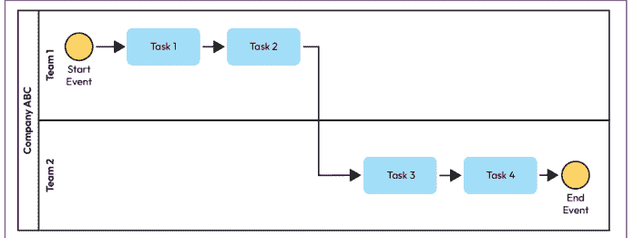
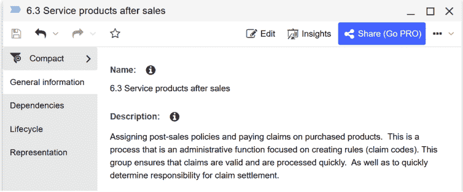
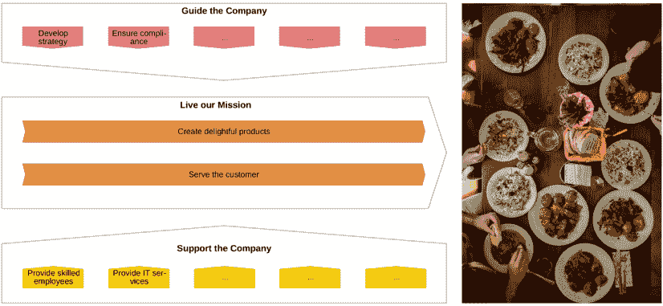
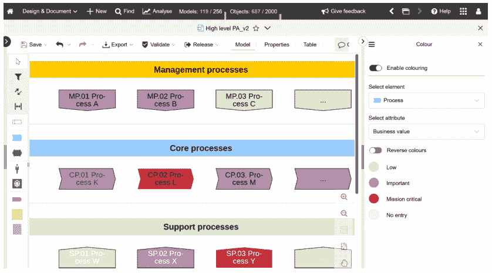
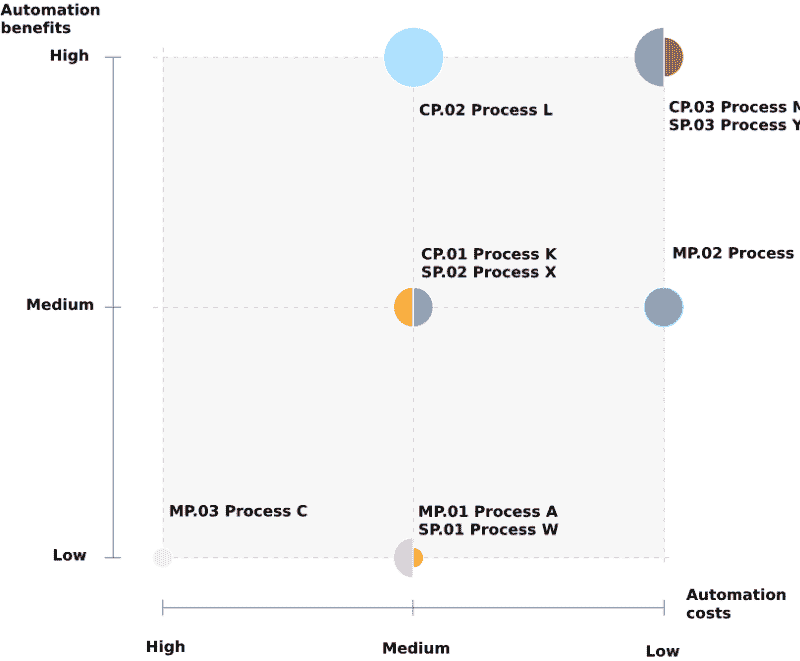

## Establishing Process Architecture

Every organization needs to run processes to create value. To get an overview of those processes, we need to have some kind of _table of contents_. However, since processes are interconnected, it is not sufficient to have one flat list containing hundreds of processes. We need something more sophisticated—something that will show what kind of processes we have, how they are connected, and what their details are, to mention just a few important aspects. The solution is **process architecture**.

In this chapter, we're going to cover the following main topics:

- What is process architecture, and why is it useful?
- How can **American Productivity & Quality Center’s (APQC’s) Process Classification Framework (PCF)** and other process libraries be used?
- How can we build our own process architecture?
- How can we use process architecture to select processes for improvement and automation?

> Note
> This chapter is authored by Zbigniew Misiak.

## What is process architecture?

In this section, we will learn what process architecture is and why it is useful for organizations to create one. Since many organizations are not sure why they should invest time and resources into building a process architecture, let's start by discussing why it is needed.

## Why do we need process architecture?

In Chapter 5, Business Process 101, we learned the basic concepts of business process management. We learned that processes can be seen as a way to create value for an organization. However, this requires many cross-functional processes to work together smoothly.

Many organizations can identify hundreds of processes. Of course, not all of them are equally important, and often, one top-level process can be decomposed into many lower-level processes.

To make things even more complex, organizations frequently model not only the current processes (as-is processes) but also design various possible future process variants (to-be processes) to compare them and pick the right one to implement. Not to mention, they also have an archive that contains models showing how the organization worked previously (e.g., for auditing purposes).

To get a good understanding of what the entire ecosystem of processes looks like, which are interconnected in different ways, it is not enough to create hundreds of detailed process diagrams and try to organize them in a folder structure. Building a huge spreadsheet (or a wiki page) that contains a list of all the identified processes is not the answer either.

This is because processes do not exist in a vacuum; instead, they influence each other. Processes are interrelated in many ways: very often, processes form a sequence or are part of a common value chain.

This term can be defined in many ways; I will quote Roger Burlton, who says it is “a set of processes that need to be performed together to make the line of business succeed.” He also stresses that “companies may have multiple value chains for different types of customers, such as retail and business, and wealth for banking.”

One process provides a product that is needed for the following process (and so on) before the result can be provided to the customer. In addition, to work properly, processes need certain resources, such as trained employees, well-functioning IT systems, and more, as well as guidance that is provided by other processes. An interesting point here is that even the best technology does not create value if the process and the strategic guidance are poor.

Therefore, if we do not have the big picture of how our organization works through its processes, silo thinking is also a challenge, causing people to plan and act only from the perspective of their organizational unit, not the whole organization. This is extremely risky for the whole organization, because processes need the involvement of many people from different parts of the organization to create value. So, if they don’t have a common, agreed-upon view of how the organization works, they may make wrong decisions.

If people simply think only about their own organizational silo, it is quite possible that a change in a process that seems to be beneficial, at least for the organizational unit responsible for a part of a whole process, will be harmful to the entire organization. This situation is called sub-optimization.

如果人们试图采取更广阔的视角，但对他人的工作存在一些误解，或者根本不知道还有其他人正在从事相同的流程，这也可能导致各种问题，例如设计出的解决方案无法为所有利益相关方提供适当的支持，或者基于并非源于真实需求的需求来制定流程。

由于流程在复杂的生态系统中运行，那么将单个流程与其他流程隔离开来进行建模、优化或自动化是否有意义呢？或者，从另一个角度来看，如果我们想要提升组织在某个流程领域的绩效，我们如何知道那里存在哪些流程，又如何选择要分析的流程呢？

解决方案是 **流程架构**。它是一种全面的识别和展示流程的方式，为组织的流程提供了一个共同且经过认可的定义。

流程架构有多个层级，使我们能够轻松地从总体概览导航到提供更多细节的更具体模型。它也是多维的，因为它展示了不同类别的流程及其相互依赖性，同时还考虑了其他维度——例如流程与 IT 架构之间的连接、策略和目标对流程的影响、与风险以及 **环境、社会和治理 (ESG)** 要求的关系，以及许多其他问题。

在接下来的章节中，我们将查看一个顶级流程架构模型的示例。我们将在本章中对其进行扩展，以便您可以在实践中看到重要的概念。

## 流程类别

创建流程架构的组织通常将其流程划分为不同的类别。通常使用三个类别：

- **管理流程**（有时也称为 **指导流程**）：管理流程通过给予其他流程方向、约束和规则来指导它们。

- **核心流程**：核心流程实施组织的战略并创造价值。对于商业组织而言，这些是提供客户愿意付费购买的产品和服务的流程。

- **支持流程**（也称为 **支持性流程** 或 **使能流程**）：支持流程提供其他流程所需的可重复使用资源，使它们能够按预期工作。

图 6.1 展示了流程架构中顶级概览模型（有时称为 **第 0 级**）的示例。在这里，通用流程以图形方式排列，以显示它们属于哪个类别。此外，还使用形状（向上或向下指的箭头或 V 形箭头）和颜色来使区分更清晰。然而，情况并非总是如此；对于某些组织，一致性更为重要，它们在整个过程中使用相同的形状（通常是蓝色、向右指且宽大的 V 形箭头）。

管理流程

核心流程

支持流程

图 6.1 – 流程架构顶级模型示例

有时，流程类别也可以通过字母数字前缀来表示——例如，不同的流程类别可能以 MP、CP 和 SP 开头。正如我们将在 *在实践中构建自定义流程架构* 章节中看到的那样，在流程名称中使用前缀并非强制性。对于某些组织，如果在名称中显示流程类型，甚至可能会造成一些误解。前缀还可以包含数字标识符，我们将稍后更详细地介绍这一点。

## 流程层级

流程架构的下一个重要元素是 **层级**。就像建筑规划一样，我们可以查看提供不同详细程度的地图和计划，例如城市规划、我们正在建造的土地地块的计划、建筑物内单个公寓的计划（包含电气、管道和空调系统布局的信息）等，并根据需要在这些层级之间移动（放大和缩小）。流程架构也意味着以连接模型的形式存在多个层级的文档。

这很有用，因为为了在组织中支持流程思维，我们需要让许多具有不同信息需求的利益相关方参与进来。对某些人来说，快速了解流程及其与其他流程的关系的总体概念很重要。另一些人则需要关于流程的更精确信息来完成工作或改进和自动化该流程。

在流程架构中，对于多个层级并没有一种适用于所有情况的方法。一些专家建议应该有固定数量的层级。当组织使用某个标准并希望将其流程与使用该标准的其他组织进行比较时，可能会出现这种情况。

另一些人建议，即使在单个组织内部，层级的数量也可能不同。这允许在需要时更深入地进行灵活性。此外，关于在一个模型中可以展示多少个流程层级，也没有共识。因此，我将在这里介绍的是基于我经验的最佳实践。

这个流程层级如何运作呢？当我们有一个显示流程架构概览的顶级模型（例如，类似于图 6.1）时，它通常显示 10-20 个流程组，这些组也可以称为 **流程领域** 或 **超级流程**。其中每个都可以分解为显示多个层级 **子** 流程的更详细模型。

最后——至少对于某些流程——我们可能希望通过提供详细的流程图来记录它们，这些图通常使用 BPMN 符号描述——非常适合记录我们如何执行流程，但不适合展示高级流程架构。我们将在第 8 章 BPMN——你需要知道的内容 和第 9 章 高级 BPMN 中介绍这一点。这些详细图表还可以分解为更详细的子流程，并可以丰富为单个流程步骤的说明。此类说明可以包括 **标准作业程序** (SOP) 文档，即使在不使用流程思维但只想通过提供精确信息并确保工作质量来帮助员工的组织中也经常使用。

除了与其他流程的连接之外，每个流程还可以包含更多信息。我们将在下一节中介绍这些流程属性。这样，我们就可以向感兴趣的人提供关于流程的必要信息，而无需为每个流程创建详细图表。这一点至关重要，因为创建和更新详细图表可能非常耗时。

图 6.2 展示了一个较低级别模型的示例，该模型更详细地描述了我们在图 6.1 中看到的 **CP.01 流程 K** 流程的内容。在此示例中，我们可以看到该流程有四个子流程（**Ka**、**Kb**、**Kc** 和 **Kd**），它们形成一个单一的价值链（它们按顺序依次进行）。除了视觉方面之外，您还可以通过查看它们的前缀（**CP.01.01**、**CP.01.02**、**CP.01.03** 和 **CP.01.04**）来看到这些流程处于同一层级，这些前缀显示它们的父流程是一个以 **CP.01** 作为前缀的（核心）流程。此外，其中一个流程（**Kb**）有子流程（**Kb1** 和 **Kb2**）。这些流程也可以以更详细的 BPMN 图表形式描述，以便您可以深入了解更多信息。

请记住，您可以在不使用前缀的情况下创建流程架构。前缀可能很有帮助，因为它们立即显示我们的流程属于哪里，并使父子关系更清晰，这通常非常方便。这就是为什么我在这一节中使用它们；它们使多级流程架构的解释变得容易得多。

另一方面，如果没有某种 IT 工具支持，要确保流程模型的所有前缀都是最新的可能是一项艰巨的任务，例如，当创建新流程或现有流程被拆分、合并或删除时，这会导致人们习惯的 ID 发生变化。

一般来说，如果人们将前缀视为支持而不是真实流程名称的一部分，可能会更好，尤其是当他们不关注前缀，从而忘记手头流程的真正含义时。如果人们能回忆起流程的编号，但不记得其名称以及流程究竟做什么，这通常是一个不好的迹象。

# 几个层级的流程架构...

管理流程
MP.01 流程 A
MP.02 流程 B
MP.03 流程 C
...
核心流程
CP.01 流程 K
CP.02 流程 L
CP.03 流程 M
...
CP.01.01 流程 Ka
CP.01.02 流程 Kb
CP.01.03 流程 Kc
CP.01.04 流程 Kd
CP.01.02.01 流程 Kb1
CP.01.02.02 流程 Kb2
SP.01 流程 W

其中部分流程
分解为流程图

图 6.3 – 流程架构的多级结构及其导航

## 流程属性

图 6.3 展示了多级流程架构的示例。它能够清晰地概述流程之间的依赖关系，同时通过超链接，让您能够轻松在不同模型之间切换，从而只需单击一次即可深入导航。

在我们的示例中，我们不仅展示了流程如何相互影响，还展示了它们如何进一步分解。前缀使我们能够快速确定当前所处的层级以及流程的 _父级_ 是什么。例如，**CP01.02.01** 前缀表明这是一个在第三层级描述的流程，其父级将是带有 **CP01.02** 前缀的流程。不过，也有更复杂的方法来捕获关于流程的关键信息，例如流程与其他流程的关系，这些方法允许我们在不更改流程名称的情况下更改关于流程的信息。

乍一看，像 _图 6.1_ 和 _图 6.2_ 中所示的模型可能看起来只是漂亮的图片，但流程架构远不止是允许轻松导航的美观图形。通常，代表流程的每个对象都有许多更多有助于信息、管理和分析目的的属性。

_图 6.4_ 展示了流程架构可能包含的附加信息示例（使用 ADONIS BPM 工具）。除了流程名称（**CP01.02.02 流程 Kb2**）之外，我们还可以拥有指向更详细的流程景观或 BPMN 业务流程图及描述的链接，这些链接提供了关于此流程中正在发生的事情以及其执行方式的更多信息（这对于没有提供更多细节的链接模型的流程尤其重要）。

然而，这还不是全部。我们还可以说明流程的目标（或目的）、触发流程的因素以及流程的结果。如果我们说明了流程目标，那么考虑该流程的 **关键绩效指标 (KPIs)** 也就非常有意义了。对于某些流程，还可以添加 **服务级别协议 (SLA)**。

除了在 **常规信息** 选项卡中显示的上述属性之外，我们还可以添加更多信息。其他可见选项卡的名称可以让您了解可以放置哪些类型的属性。

流程管理的一个非常重要的方面是流程与组织结构之间的连接。理想情况下，对于每个流程，我们都应该定义所有权和职责——谁是 **流程负责人**，谁支持负责人，哪些单位参与执行流程（通常称为参与者或 **参与方**），等等。

## CP.01.02.02 流程 Kb2

| 类型 | 名称 | 版本 | 状态 |
|---|---|---|---|
| 1 | CP.01.02.02 流程 Kb2 | | |

顺序：  
无条目

描述：  
关于流程的附加信息。

标签：  
无条目

外部流程：  
否

目标：  
流程的目标。

触发器：  
触发流程的因素。

结果：  
流程的结果是什么。

流程变体：  
无条目

图 6.4 – 流程属性示例（ADONIS 的截图）

我们可能还希望记录流程的依赖关系（在价值链中，哪些流程在我们的流程之前和之后，我们的流程的父级是什么以及是否有任何子级（或子流程），以及也许它影响哪些流程或受哪些流程影响）。

如果我们想将流程架构用于决策，例如优先处理与以客户为中心或数字化转型相关的变革举措，我们还可以使用额外的分类和评估。这将使我们能够，例如，区分任何改进和自动化都是优先事项的关键流程，或者按客户满意度、成本、质量、法规合规性等对流程进行排名。

在自动化方面，我们可以对流程自动化的成本和潜在收益进行排名，或根据流程的可预测性、复杂性和频率计算流程的自动化潜力，仅举几个潜在选项。一些组织还喜欢使用 **全时等效 (FTEs)** 来记录参与流程的人数。

当然，每个组织都不同，因此选择要使用的属性取决于组织希望如何使用流程架构，以及组织内部将与流程管理集成的管理系统。请注意，组织的工作方式会对此产生重大影响。

例如，一个在流程改进举措方面采取更集中方法、寻求协同效应并使用广泛的全组织视角的组织，可能需要一套更大的属性集，这些属性对许多领域都是强制性的。相反，如果组织倾向于由组织单位领导者发起旨在快速取得成果的单个项目，那么一套通用的属性可能要小得多。

请注意，与组织相关的主题将影响将记录的内容。因此，如果目标是为员工提供基本信息和便捷的导航，您可以期望看到描述、指向相关流程的链接、所有权信息、指向文档（程序、表格等）的链接以及少量额外属性。

对于风险管理和合规性是重要主题的组织，我们可以期望看到有关风险和控制、流程之间的链接以及各种合规要求的信息，以及用于 **业务连续性管理 (BCM)** 所需的信息。

另一方面，对于使用流程架构作为数字化转型举措的一部分来选择用于改进和自动化的流程的组织，除了我们已经提到的属性之外，还需要指向流程使用的应用程序的链接，以及有关项目的信息。在《如何使用流程架构》部分，我们将了解如何使用各种属性来对流程进行分类。

总结来说，如果我们希望确保为组织的许多不同管理系统提供一个共同的参考点，流程架构非常有用。虽然对单个流程进行建模可以实现其标准化和改进，但创建流程架构、维护它并使用它来管理组织，是实现更高水平的业务流程管理成熟度所必需的。

## 流程架构标准

正如我们在上一节中所学，流程架构是成功流程管理的一个重要方面。它还与组织中的许多其他管理系统相关联。当然，这可能会让你想知道，是否有一个普遍认可的流程架构应涵盖的主题列表以及以图形方式展示它们的方法，以及是否有一种创建流程架构的标准方式。

有趣的是，没有一种被普遍接受的构建方法。有些组织发现，仅关注流程及其所有属性和与组织单位的链接就足够了。其他组织使用更多主题，例如应用程序、风险、KPI 等。

然而，其他组织使用 **ArchiMate** 标准进行企业架构管理，其中 _流程_（更准确地说是 **业务流程**）只是用于描述组织及其元素之间相互关系的数十种可用对象类型之一。这些元素可以按不同层进行分组，这些层代表诸如业务或技术之类的类别，以及被动结构或主动结构之类的方面，所有这些都有助于对图表中的元素进行分类。

在 ArchiMate 中，如 _图 6.5_ 所示，业务流程属于业务层，并包含 **业务参与者**、**业务角色**、**业务功能**、**业务事件**、**业务服务**、**业务对象** 和 **产品** 等元素。请注意，这里 **价值流** 位于 **战略** 层。

_图 6.5_ 还显示了 ArchiMate 对象中的几个示例，例如 **战略**、**业务** 和 **应用** 层。要完整了解 ArchiMate 的表示法（包含超过 60 种对象类型和 11 种关系），请查看本书仓库中提供的图片：`https:// github.com/PacktPublishing/Practical-Business-Process-Modeling-and- Analysis/tree/main/Chapter06`。

|    | 被动结构 | 行为 | 主动结构 |
|---|---|---|---|
| 策略 | 资源 | 能力价值流行动方案 | |
| 业务 | 业务对象 合同 表现 产品 | 业务流程 业务交互 业务事件 业务服务 业务功能 | 业务参与者 业务协作 业务角色 业务接口 |
| 应用 | 数据对象 | 应用流程 应用服务 应用交互 应用功能 应用事件 | 应用组件 应用接口 应用协作 |

图 6.5 – ArchiMate 表示法的元素（图片来自免费的企业架构管理工具 ADOIT：社区版）

🔍 **快速提示**：需要查看此图像的高分辨率版本吗？在下一代 Packt Reader 中打开此书，或在 PDF/ePub 副本中查看。

📘 **下一代 Packt Reader 和免费的 PDF/ePub 副本** 随您购买的本书一起提供。扫描二维码 或访问 `packtpub.com/unlock`，然后使用搜索栏按名称查找此书。仔细核对显示的版本，以确保您获得正确的版本。

除了 ArchiMate，针对业务架构师的几种其他方法，例如 **业务架构知识体系 (BIZBOK®)** 以及对象管理组标准，如 **价值交付建模语言** 和 **业务架构核心元模型**，可以成为有价值的灵感来源，但迄今为止，其中没有一种可以被视为事实上的标准，因为它们没有提供关于如何创建流程架构的全面指导。

对于我有机会合作过的许多组织来说，这些标准可能对于立即实施来说有点过于复杂，因为它们需要一定的组织成熟度以及一群知道如何使用它们的人。在这种情况下，我的建议是将组织创建的 BPM 方法与这些标准进行交叉核对，以确保此阶段没有遗漏任何重要内容。

现在，让我们介绍如何记录流程架构。除了组织避免图形建模并维护文本流程列表的情况外，通常，流程由箭头或尖括号表示。但是，这并未以任何方式标准化（除非您使用 ArchiMate），因此这只是一种常见做法，并受到迈克尔·波特工作的启发。

剩下的最后一个问题是，如何创建流程架构？在实践中，我看到两种主要方法。第一种是利用最佳实践并使用可用的流程库。第二种是为特定组织准备定制的流程架构。

在本章的后续部分中，我们将介绍这两种选项。我们将使用这两种方法为一家名为 _BPMT Dishes_ 的虚构公司构建流程架构，该公司生产并销售碗、盘子和其他餐具。此示例还将在 _第 7 章至第 9 章_ 中使用，届时我们将使用该公司的投诉处理流程。当然，此示例将被简化，因为它仅用于说明目的。

## APQC 的 PCF® 和其他流程库

让我们先讨论一下什么是流程库以及它们如何工作。我们将更深入地介绍最流行的一个，即 APQC 的 PCF，但也会提及其他几个。

### 流程库简介

最常用的参考流程集是 APQC 提供的名为 PCF 的库。PCF 的文档以 Excel 和 PDF 文件形式提供，在 `www.apqc.org/pcf` 注册后即可免费获取。

APQC 将 PCF 描述为流程分类法。它可用于多种目的——通常，组织首先描述流程，或者，如我们稍后将看到的，他们可能希望验证流程描述的完整性。但是，通常，流程改进和标准化会成为重要的用例。但这还不是全部：PCF 还可用于对组织内创建的内容进行分类，以及用于流程 **基准测试** 目的，例如将组织的结果与同行组进行比较。

APQC 提供了十几种类型的 PCF。最基本的是通用 **跨行业** 类型。但也有针对特定行业定制的版本，例如 **航空公司**、**汽车**、**银行**、**市政府**、**消费品**、**教育**、**医疗保健提供商**、**生命科学**、**零售** 和 **公用事业**。

PCF 中的内容分为五个级别：

- 1. **类别。**
- 2. **流程组。**
- 3. **流程。**
- 4. 活动。
- 5. 任务。

让我们使用跨行业版本来了解这些级别在实践中的应用。为了更有趣，我们将使用 13.0 开发和管理业务能力类别，因为它包含与流程管理相关的元素。

类别是 PCF 中流程的最广泛分组，代表第一级。每个类别包含流程组，代表第二级。

在我们的示例中，有九个流程组，第一个是 13.1 管理业务流程。其他流程组包括管理组合、计划和项目 (13.2)、管理企业质量 (13.3)、管理变更 (13.4)、开发和管理企业范围知识管理 (KM) 能力 (13.5)、衡量和基准测试 (13.6)、管理环境健康与安全 (EHS) (13.7)、开发、管理和交付分析 (13.8)、以及管理可持续性 (13.9)。

正如您所期望的，流程组包含流程。我们的 13.1 流程组包含五个流程：13.1.1 建立和维护流程管理治理、13.1.2 定义和管理流程框架、13.1.3 定义流程、13.1.4 管理流程绩效、以及 13.1.5 改进流程。在我们的示例中，我们将专注于 13.1.3。流程代表第三级，如其前缀所示。

流程可以进一步分解为活动（第四级）。我们的活动将包括 13.1.3.1 范围界定流程、13.1.3.2 分析流程、13.1.3.3 识别和标记流程控制点、13.1.3.4 建模和记录流程、以及 13.1.3.5 发布流程。

有时，活动需要进一步分解。为此，使用代表第五级的任务。请注意，并非每个活动都有任务。在我们的示例中，13.1.3.1 范围界定流程没有进一步分解，而 13.1.3.2 分析流程有一个任务：13.1.3.2.1 识别已发布的最佳实践。

如果您想了解这些级别工作方式的更多示例，请查看 PCF 文件中的 PCF 级别说明部分。

在当前版本的 PCF (7.4) 中，有 13 个流程类别，如图 6.6 所示。PCF 不采用经典的管理、主流程和支持流程划分，而是将以价值链形式呈现的运营流程进行划分，其中管理和支持流程被分组。

每个元素，除了名称之外，还有一个唯一标识符，以及一个层次标识符，这使得非常容易找出它在架构中的哪个级别出现以及其父级是什么。

选定的流程还提供描述。对于有兴趣进行流程测量的组织来说，非常有用的是，对于选定的 APQC 流程领域，PCF 还包括拟议的指标以及计算它们的方法。

通过这种方式，PCF 为流程从业者提供了一种通用语言。它可用于不同公司之间的流程比较以及基准测试流程指标 (KPI)。

当您考虑 PCF 包含多少有价值的信息，以及许多行业变体包含约 1000 个描述的流程元素这一事实时，难怪它是许多组织在准备流程架构时的常见选择。重要的是，PCF 不仅可以作为流程架构结构的模板，还可以用于对组织各种类型的信息资源进行分类。对于最后这一点，您可以将其类比为图书馆目录，其中每本书都被分配到特定的类别。

但是，值得记住的是，PCF 的较低级别应被视为给定流程中可能出现的元素列表，而不是可以一对一使用的详细流程描述。此外，列表中元素出现的顺序不一定转化为序列。

APQC 的 PCF 是组织中流程管理团队的极其宝贵的资源，因为它帮助他们避免许多错误，并允许在流程计划中更快地交付更多价值。

但是，您不应期望在每种情况下都简单地将 PCF 中包含的内容一对一地应用。相反，可能需要对内容进行一些修改，并根据实体所在的特定行业、组织或法律环境对内容进行定制。

在这里，我将引用 Roger Tregear 的话，他说：“_即使管理和支持流程在不同组织中可能相似甚至相同，核心流程也可能不同，甚至可能是独特的，如果使用组织的术语来命名它们，将大有帮助。_” 这增加了共鸣和认同感。

> 注意
> 关于 PCF 的更多信息，以及关于其用途的大量资源，可以在 APQC 网站上找到 (https://www.apqc.org/process-frameworks)。

### APQC 的 PCF 在实践中的应用

在本节中，我们将看到我们的虚构公司 _BPMT Dishes_ 如何使用 APQC 的 PCF 来构建流程架构。第一个问题是决定使用哪个版本的 PCF：跨行业版本，还是任何行业特定的变体。

如前所述，虽然最高级别（拥有 13 个流程类别）非常相似，但并不完全相同，但我们越往下走，不同版本的 PCF 之间的差异就越多。

由于我们的示例公司 _BPMT Dishes_ 生产并销售餐具，我们可以轻松识别出两个可能与我们相关的行业特定变体。通过比较跨行业变体与消费品和零售版本，我们可以看到，虽然每个变体都有 13 个类别，但这些流程类别的名称是根据组织的特定运营量身定制的。这些差异在下表中显示：

| 过程类别（层级 ID） | 跨行业（PCF 7.4） | 客户产品（PCF 7.2.2） | 零售（PCF 7.2.1） |
|---|---|---|---|
| 1.0 | 制定愿景和战略 | 制定愿景和战略 | 制定愿景和战略 |
| 2.0 | 开发和管理产品与服务 | 设计和开发产品与服务 | 开发和管理客户体验 |
| 3.0 | 市场营销和销售产品与服务 | 市场营销和销售产品与服务 | 市场营销产品与服务 |
| 4.0 | 管理实物产品供应链 | 交付产品 | 商品化产品和服务 |
| 5.0 | 交付服务 | 交付服务 | 交付产品 |
| 6.0 | 管理客户服务 | 管理客户服务 | 交付服务 |
| 7.0 | 开发和管理人力资本 | 开发和管理人力资本 | 开发和管理人力资本 |
| 8.0 | 管理信息技术（IT） | 管理信息技术（IT） | 管理信息技术（IT） |
| 9.0 | 管理财务资源 | 管理财务资源 | 管理财务资源 |
| 10.0 | 获取、构建和管理资产 | 获取、构建和管理资产 | 获取、构建和管理资产 |
| 11.0 | 管理企业风险、合规性、补救和韧性 | 管理企业风险、合规性、补救和韧性 | 管理企业风险、合规性、补救和韧性 |
| 12.0 | 管理外部关系 | 管理外部关系 | 管理外部关系 |
| 13.0 | 开发和管理业务能力 | 开发和管理业务能力 | 开发和管理业务能力 |

表 6.1 – PCF 三个选定变体中过程类别的比较

基于此比较，BPMT Dishes（一家向客户制造并销售产品的公司）可以选择客户产品版本。然后，该公司可以基于从 PCF 中提取的过程类别来创建其流程架构。图 6.6 显示了一个示例。

## 操作流程

1.0 制定愿景和战略

2.0 设计和开发产品与服务

3.0 市场营销和销售产品与服务

4.0 交付产品

5.0 交付服务

6.0 管理客户服务

## 管理和支持流程

7.0 开发和管理人力资本

8.0 管理信息技术（IT）

9.0 管理财务资源

10.0 获取、构建和管理资产

11.0 管理企业风险、合规性、补救和韧性

12.0 管理外部关系

13.0 开发和管理业务能力

图 6.6 – 基于 APQC 的 PCF 的流程架构顶层模型

下一步是描述每个过程类别中发生的情况。在我们的示例中，我们将关注与客户服务相关的领域，因为处理投诉的领域也在那里。它将是一个名为 **Service products after sales** 的流程组，层级 ID 为 6.3：

6.1 制定客户关怀/客户服务战略

6.2 计划和管理客户服务运营

6.3 售后服务产品

6.4 管理产品召回和监管审计

6.5 评估客户服务运营和 cu...

图 6.7 – 过程类别分解示例

如图 6.7 所示，我们的流程组不仅有名称和层级 ID，还有一个描述，帮助我们更好地了解其范围。此外，对于我们的 6.3 流程组，还有提供更多信息的低级元素：五个流程（6.3.1 注册产品，6.3.2 处理保修索赔，6.3.3 管理供应商追偿，6.3.4 管理客户自助服务材料，以及 6.3.5 服务产品）和 30 多个低级元素（活动和任务），例如 6.3.2.3 调查保修问题和 6.3.2.3.1 定义问题。

如您所见，APQC 的 PCF 包含大量描述流程的元素。例如，客户产品版本的分类法在五个层级中包含近 2,000 个元素，其中超过 1,800 个包含描述。PCF 是用于识别、文档化、标准化和流程改进的宝贵辅助工具，也适用于许多其他应用，例如基准测试和组织内容。

鉴于此，PCF 成为世界上最流行的流程库也就不足为奇了。然而，它并非唯一可用的选项。电信公司经常使用增强电信运营图（eTOM），物流是运营重要方面的公司使用供应链运营参考模型（SCOR），IT 部门使用信息技术基础设施库（ITIL）。此外，参考流程库可以与 IT 系统（例如 SAP 的 ERP）一起提供，也可以由咨询公司提供。

许多这些流程知识来源也可以由 AI 使用，因此从技术上讲，可以使用生成式 AI 解决方案基于这些流程库来准备流程架构的初稿。或者，也许更好的是，可以使用 AI 赋能的工具来确保不会遗漏流程架构中应涵盖的任何重要利益相关者群体或其他业务概念。

然而，到目前为止，还没有办法在不涉及员工的情况下自动创建人们会使用的良好流程架构。因此，如果您有兴趣自动化流程，并希望确保不会遗漏任何重要事项，在开始自动化的技术部分之前，创建某种流程架构是有意义的。

对于许多组织，像 PCF 这样的流程库也非常有用，可以确保公司不会花几个月时间试图重新发明轮子并犯常见错误。有时，让所有人都同意一种全球标准的流程方法，比在内部达成共识更容易，尤其是如果组织有强大的筒仓文化。

对于一些组织，将流程库调整以满足其需求还不足以确保员工感觉流程架构是为他们量身定制的。下一节将展示如何处理此类情况，以便我们可以获得更好的员工接受度，并保留使用全球标准的好处。

## 如何构建您自己的流程架构

在本节中，我们将学习如何构建自定义流程架构。我们将首先讨论何时这样做有意义，然后看看为我们的虚构公司构建流程架构可能是什么样子。

### 为什么创建自定义流程架构是有意义的？

如前所述，对于一些组织，量身定制的流程架构是一个非常有吸引力的选择。与之前的情况一样，这也涉及连接模型的多级结构。通常，它们是在与组织员工的研讨会上创建的。如您所料，这比采用 PCF 花费更多时间，但如果做得正确，它可以帮助在组织中建立更强大的流程文化。

对于那些希望从现有最佳实践中受益，并拥有流程架构的自定义外观和感觉的人来说，混合方法也是可能的。可以基于研讨会的输入创建流程架构，但基于 APQC 的 PCF 等参考流程进行完整性的额外验证。这有助于加快整个过程并提高其质量。

流程架构的构建通常受益于对组织战略的分析。这是因为流程应确保该战略的运营化，以及考虑组织通过其为其创造价值的利益相关者以及产品和服务。

有趣的是，通常会发现，在组织内部，关于通过哪些流程创造价值以及为谁创造价值、组织的利益相关者是谁，以及组织打算如何满足这些期望，经常存在许多相互冲突的想法。

共同词汇也是许多组织非常常见的问题。这可能导致不同单位对谁是客户没有共同定义的情况！您可以轻松想象这对重要举措有多有害。

关于构建流程架构的不同方面的讨论有助于发展对组织如何运作及其流程如何融入整体价值创造生态系统的共同理解。这简直是无价之宝。架构工作本身的结果——例如，以互连模型形式记录的数十或数百个已识别和描述的流程集合——非常有用，但最重要的是确保这些模型是所有利益相关者之间达成协议的结果。

可以通过 BPM CoE 的一小群专家非常快速地准备流程架构，但真正的价值是来自组织中参与流程管理的人员之间的共同理解和协议所产生的架构。这充当了一份合同，总结了工作方式，并提供了已达成一致的组织共同视图。

也值得提醒的是，不要频繁陷入这种诱惑：试图通过组织结构来识别顶层流程，从而加快流程架构的工作进度。创造价值的流程贯穿整个组织，需要跨职能协作，因此基于组织结构构建流程架构将是徒劳的。

构建流程架构是流程知识中一个极其有趣的领域，它有许多方法和可能的解决方案。为了了解各种流程架构在实践中可能是什么样子，我邀请您访问 https://bpmtips.com/process-architecture-real-life-examples。

除了罗杰·伯顿（Roger Burlton）和罗杰·特雷加（Roger Tregear）等流程架构专家提供的一些额外示例外，在此页面上，您还将找到其他有用资源的链接，例如与罗杰·伯顿和马切洛·拉罗萨教授关于流程架构的访谈。这些资源提供了大量宝贵的见解。

## 在实践中构建自定义流程架构

到此为止，我们知道如何使用 APQC 的 PCF 创建流程架构。现在，让我们讨论一下我们的虚构公司 BPMT Dishes 如何构建自定义流程架构。

当然，值得再次强调的是，构建自定义流程架构并不意味着我们必须从零开始，凭空发明一切。像 APQC 的 PCF 这样的库也可以并且应该被用来检查我们是否忽略了任何重要的流程领域。

构建流程架构第一级的一个有价值输入可能是关于我们公司战略和运营的信息。对于我们的虚构公司，我们可以说它是一家以客户为中心的家族企业，生产餐具（例如盘子和碗），并直接或通过合作伙伴将其销售给客户。

为了简化问题，我们将只关注生产餐具并直接销售给客户。在现实生活中，我们的公司可能还会提供合作伙伴公司的其他产品，例如餐具、餐桌布等，但我们不会在本书中涵盖这些内容。

您可能已经看出，有两个主要领域我们为客户创造价值。第一个**端到端流程**将涵盖产品开发的完整生命周期，从创意开始，经过生产，到产品管理，并就变更或可能退役产品做出决策。这将保证公司拥有可以销售给客户的优质餐具。

第二个端到端流程将专注于服务客户，同时涵盖从让客户了解我们的产品、销售和交付产品，到处理投诉（如果出现问题）的完整生命周期。该流程应保证第一个流程中生产的餐具能够送达客户。

这两个流程都是实现公司使命的重要方式。这一使命可能是**创造令人愉悦的产品，帮助客户在餐桌旁拥有难忘的时刻**

图 6.8 – 流程架构自定义顶层模型示例

🔍 **快速提示**：需要查看此图像的高分辨率版本吗？在下一代 Packt Reader 中打开此书，或在 PDF/ePub 副本中查看。

🔒 **下一代 Packt Reader** 和本书的**免费 PDF/ePub 副本**包含在您的购买中。扫描二维码 或访问 `packtpub.com/unlock`，然后使用搜索栏按名称查找此书。仔细检查显示的版本，以确保您获得正确的那一本。

图 6.8 显示了流程架构顶层模型可能的样子。如您可能猜到的，此类模型在不同公司之间差异很大。流程类别的名称、单个模型中的流程级别数量、图形和徽标等视觉方面、决定显示哪些属性（例如流程所有者），以及提供指向描述组织的其他相关模型的额外导航支持——这些只是影响流程架构顶层模型外观的一些方面。

关于将给定流程放置在管理或支持类别中的讨论也很常见。对某些人来说，即使是他们认为属于自己的流程的位置也可能很重要。通常，左上角的元素与定义战略和愿景，并确保其指导整个组织有关。在许多组织中，这个流程被称为**战略管理**，尽管这个名称并不十分具体。这个流程之后可能会跟随一些其他指导组织的流程。对于支持流程，情况就不那么明显了。我们是从人（我们的员工）、IT 还是其他东西开始？这通常是一种被认为的重要性问题。

幸运的是，随着组织中的人们习惯于流程思维，某些流程位置更突出或不那么突出等问题不再重要。这是一个很好的指标，表明人们理解流程管理是一项团队运动，重点在于管理跨职能流程以创造价值。

命名约定也很棘手。一种经常使用的方法是**动词 + 名词**命名约定（例如，**制定战略**）。但是，您也会注意到其他方法（例如，**战略管理**）或不太精确的名词（例如，**管理战略**）。著名的 BPM 专家 Alec Sharp 警告不要使用不明确说明流程目的名称，因为它们无法帮助建立共同理解。Alec 在其备受赞誉的书籍《Workflow Modeling: Tools for Process Improvement and Applications Development》中用于描述此问题的一个生动名称是**模糊动词模糊性**。

虽然上述选项不如第一个示例那样清晰和优雅，在第一个示例中我们使用了动词，并且它们不能精确地显示流程的结果，但有时出于多种原因很难避免它们。有时，它们只是从流程库中获取的。其他时候，负责某些领域的人习惯于这样的名称（例如，**风险管理**）。通常，结果是某种妥协，但这通常会被广泛讨论，并且是共同协议的结果。

当然，我们在图形模型中_看到_的只是冰山一角：将收集到的关于流程的所有信息都可见化根本不切实际。基于讨论，每个流程都将被丰富必要的属性。当概览模型准备就绪后，通常接下来是一个决定，指定将按什么顺序进一步分解流程。

在理想世界中，流程架构顶层的每个流程都应该有一个显示较低级别流程的模型。然而，通常，组织首先只选择最重要的流程并更深入地记录它们。只有在这种方法显示出可见结果并且组织学会了如何构建流程架构后，才能处理剩余的流程领域。

## 如何使用流程架构

在本章前面，我们讨论了拥有流程架构的一些好处。我们已经知道，流程架构提供了组织如何创造价值以及流程如何相互关联并与其他组织资源相关的概览。这是架构的**信息功能**。这对于培训新员工和确保每个人都步调一致非常有帮助。

流程架构还允许您轻松地从概览模型下钻到显示所选流程领域正在发生的情况的模型。这是**导航方面**。

如果我们添加标准化和使用通用程序（可重用性）以及许多地方的协同效应所带来的巨大机遇的问题，我们可以看到，有几个其他业务领域可以作为良好实践的来源。

例如，**业务流程管理**的实践者可以从**企业架构管理**（特别是应用组合管理）、**产品组合管理**或**项目管理**等领域寻找灵感，在更高层次上，项目管理转化为**计划管理**，以便单个项目协同工作，以及**组合管理**，以便实践者可以为其实施选择合适的项目。

在每个领域，可重用性和寻求协同效应都是重要话题，因此在那里有效的方法在流程管理中也可能有用。

这对于计划推出新产品并进入新市场的组织尤其重要，因为他们不需要从零开始准备一切；相反，他们可以重用一些现有流程。这有助于降低成本、加快速度、降低风险并提高组织的整体敏捷性。

此外，计划进行合并和收购的公司可以从流程架构中获益良多，因为它使他们能够找出哪些元素是冗余的，在哪里可以使用标准化，以及在哪里仍然需要单独的流程。

在**流程属性**部分，我们了解到，在流程架构中，每个流程通常由一组不同的属性描述，这些属性在图形模型中乍一看通常不可见，尽管它们可以用于流程分析。

在本节中，我们将了解流程架构的其他实际应用可能是什么样子，以及流程架构如何在组织的数字化转型计划中发挥作用。

## 建立流程架构

让我们从一个通常是选择应纳入进一步架构工作的流程的核心话题开始：评估流程的重要性。根据组织的具体情况以及指导构建流程架构的倡议目标，例如，按业务价值、客户满意度水平、IT 支持、法规合规性等对流程进行分类可能会很有帮助。此类信息可以，例如，使用颜色可视化为热图，这有助于讨论进一步工作的优先级。图 6.9 展示了这种方法的示例。

使用多个数据维度的更复杂的分析也是可能的。例如，选择流程以进行改进的常见方法可能是根据两个标准进行评估：重要性和紧迫性（即 **艾森豪威尔矩阵**）或痛点和收益。另一方面，在选择用于 **机器人流程自动化 (RPA)** 的流程时，通常会关注流程执行频率和标准化程度（或业务相关性）。

另一组属性示例将涉及评估自动化给定流程的收益和该自动化的成本。对于这种类型的分析，结果通常以图形分析的形式呈现，将流程评估显示为图中每个元素中的气泡。图 6.10 展示了这种流程选择方法可能的样子。

气泡大小：业务价值

图 6.10 – 基于多级分析选择用于自动化的流程（自动化成本与自动化收益与业务价值）

通过将这种流程选择方法作为数字化转型倡议的一部分，正确的流程被纳入的机会会增加，而不是由组织中高知名度的人士大声倡导的流程。作为进一步分析工作的额外好处，参与设计新解决方案的人将更了解流程。

知道流程负责人是谁以及我们的流程与哪些其他流程相关联，可以确定在规划中应让谁参与。了解流程使用哪些应用程序和数据，也可以帮助避免因缺乏知识而导致的昂贵错误。

由于流程架构提供了流程的综合描述，以及关键属性和关系，设计无法为整个组织提供最佳结果的零散解决方案的风险显著降低。

拥有流程架构的另一个好处是，上述描述流程的属性，例如流程目标、流程描述、流程负责人等，不仅可以作为设计工作的一部分，还可以在日常工作中使用。通过使用正确的流程文档方法，我们可以确保所有利益相关方都能访问所需的知识。

## 如何展示流程架构的好处

如前所述，流程架构不仅对于文档化流程非常有帮助，而且对于改进和自动化流程也非常有帮助。一旦我们选择了合适的流程（例如，高流量、改进潜力巨大且可以自动化的流程），下一步就是选择合适的自动化方法。

对于某些高流量、标准化且不需要处理非结构化数据的流程，ERP 和 CRM 等更传统的自动化方法可能就足够了。对于其他流程，如果流量不那么高，但流程相对标准化，您可能希望使用 BPMS 工具/工作流自动化。当然，也有可能您需要编排许多技术，例如 RPA 机器人和 AI 代理，同时确保您的员工在流程中协同工作。

对流程有良好的了解将帮助您决定如何正确地自动化流程。这样，您就可以避免为一个 CRM 系统就完全足够的流程创建一个花哨且昂贵的 AI 代理解决方案。

关于流程的信息还将帮助您设计和实施解决方案。在此，除了高级流程架构外，显示工作流的详细图表也会很有用。我们将在本书后面更深入地讨论这个话题。

一个额外的令人兴奋的机会，可以缩短交付流程架构价值所需的时间（例如，运行成功的自动化项目），就是 **流程挖掘**。这一在第 5 章中提到的概念，允许您根据流程日志发现流程并改进它们。对于中型和大型组织，此类项目可以带来显著的好处，拥有流程架构可能有助于决定首先应解决哪些领域。

根据组织的具体情况，这可以通过流程工具来组织，很可能使用第 5 章中提到的基于存储库的 **企业业务流程分析** 工具之一，发布到 SharePoint 或 Confluence 等解决方案，或创建包含流程关键信息的可打印文档。

通过这种方法，可以在不为每个流程创建详细图表的情况下收集必要的流程信息，这在创建和更新方面都节省了大量时间。

## 总结

在本章中，我们了解了什么是流程架构及其在流程管理中的作用。我们了解了组织的流程架构可以如何构建：要么使用 APQC 的 PCF 等流行的流程库，要么构建针对组织具体情况量身定制的流程架构。我们还有机会了解流程架构在实践中如何应用，并了解了拥有流程架构的好处。

在许多地方，我们也有机会看到，流程架构允许我们选择应该详细描述哪些流程，或者流程架构允许我们选择要优化或自动化的流程，这通常需要我们更详细地描述它们。但是，我们如何以更高的详细程度描述流程呢？我们将在下一章中解决这个问题。

## 延伸阅读

- 如果您想了解更多关于流程命名以及构建涵盖流程架构及其与业务能力关系的业务架构的主题，我强烈推荐 Roger Burlton 的优秀书籍《业务架构：收集、连接和纠正要点》（_Business Architecture: Collecting, Connecting, and Correcting the Dots_）。另一本很棒的书是 Roger Tregear 的《重新想象管理：将流程置于业务管理的中心》（_Reimagining Management: Putting process at the center of business management_）。这两本书都是纯金！

- 如果您有兴趣构建将业务流程管理和企业架构管理相结合的组织架构，请查看 Roland Woldt 的书《成功架构实施：实施 EA/BPM 计划的实用指南》（_Successful Architecture Implementation: A practical guide on how to implement your EA/BPM program_）。

- 如果您有兴趣了解组织如何实施 BPM 的真实案例，我不知道有比 Jan vom Brocke、Jan Mendling 和 Michael Rosemann 编辑的《业务流程管理案例 Vol. 3：实践中的实施》（_Business Process Management Cases Vol. 3: Implementation in Practice_）更好的书了。特别是，我建议您阅读关于在波兰财政部构建流程架构的有趣案例，以了解不同的流程架构方法。

- 您可以在 Serge Schiltz 的《全面业务流程管理：使用 BPMN 2.0 和 OCEB 2 基础取得成功》（_Holistic Business Process Management: Successful with BPMN 2.0 and OCEB 2 Fundamental_）中找到创建流程架构的更多示例和最佳实践。如果您有兴趣获得 BPM 认证，这本书也是一个绝佳选择。更多关于此主题的内容将在第 11 章中介绍。

