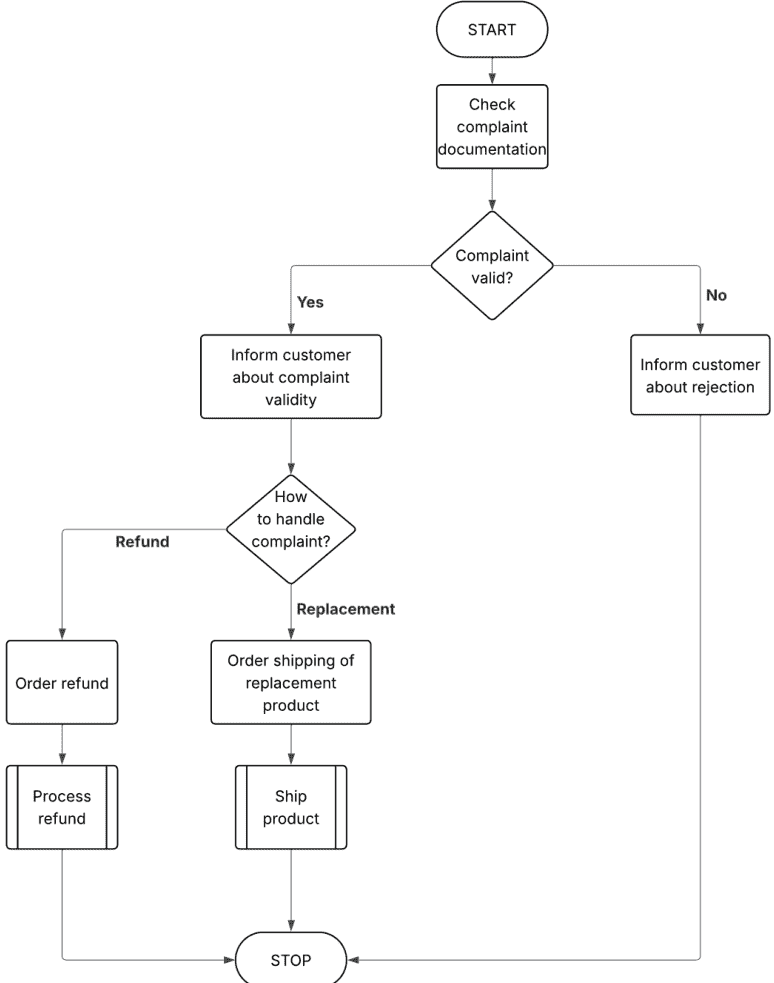
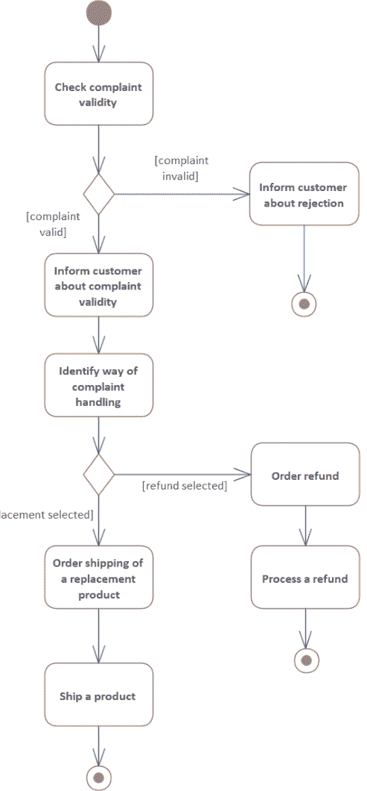

## 过程建模符号

第 1 章对图形建模的主要原因进行了很好的概述。过程管理历史悠久，因此在此期间出现许多建模方式——即所谓的建模符号——也不足为奇。正如我们在第 6 章中发现的，过程建模可以在不同层面上使用。模型也可以面向不同的受众。

由于没有一种符号能够满足所有用户和所有目的，在本章中，我们将学习如何建模过程，并讨论这些符号之间的差异。

由于存在数十种过程建模符号，我们无法全部深入介绍。相反，我们将回顾过程建模的历史，讨论当今仍然相关的重要符号，并简要提及那些目前不太流行但对当今最流行的过程建模符号——BPMN——产生了影响的符号。

在本章中，我们将介绍以下主要主题：

- 过程建模的基础知识
- 超越流程图——其他符号概述
- BPMN——我们如何走到这一步，以及它与我们的相关性

> **Note**  
> 本章由 Zbigniew Misiak 撰写。

### 过程建模的基础知识

很难想象，但业务流程建模可以追溯到 100 多年前。1921 年，Frank 和 Lillian Gilbreth（杰出的工业工程师和效率专家）在向美国机械工程师学会（ASME）发表的题为《过程图表：寻找工作最佳方式的第一步》的演示中，提出了一种全新的展示流程的方式。

令我着迷的是，文章开头提出的观点至今仍然有效：

> "过程图表是一种可视化流程以改进流程的工具。流程的每个细节或多或少都受到其他每个细节的影响；因此，整个流程必须以这种形式呈现，以便在对其任何细分部分进行任何更改之前，一次性可视化整个流程"。

除了提出过程建模的方法外，他们还为过程图表提出了几十种标准符号（形状）。他们的想法得到了认可，并于 1947 年，过程图表成为 ASME 标准（采用简化形式，形状更少，旨在减少错误）。

ASME 过程图表使用圆形、箭头、正方形和三角形等形状。这种建模过程的方式非常简单，这是有意为之。这些图表旨在不仅由管理人员使用，也由执行流程的人员使用，以便他们能更好地理解流程、发现错误，并提出更精简的流程版本。

Alan Mogensen 的一段精彩引语（我在名为《人员优先》的文章中找到，网址为：http://www.worksimp.com/articles/keynoteworkflowcanada.htm），他曾在咨询项目中使用这种建模方式，清楚地表明流程改进被视为一种民主活动，而不仅限于管理人员或专家：

> "做这项工作的人比世界上任何其他人都更了解它，因此他是最适合改进它的人。"

很可能，你已经见过一些流程图。但是，如果你决定查看显示原始流程图形状的图片，该图片可在本书第 7 章资源的 GitHub 页面上找到，（https://github.com/PacktPublishing/Practical-Business-Process-Modeling-and-Analysis/tree/main/Chapter07）你可能不熟悉所有形状。这是因为流程图不断演变，尤其是在发现它们对于创建表示计算机代码的图表非常有用之后。

有几个标准规定了流程图中使用的形状，例如，ANSI 于 1970 年发布的《流程图符号及其在信息处理中的应用》和 ISO 5807 于 1985 年发布的《信息处理——数据、程序和系统流程图、程序网络图及系统资源图的文档符号和惯例》。

然而，在各种程序中，你仍可能遇到一些差异。由于我们将比较不同的符号，我们将使用一种通用的表格样式，以便你更容易地看到相似之处和差异。在这个表中，你将看到图表中经常使用的对象（形状）的概览，但请注意，它们还需要一些连接器（箭头）。每种符号都有自己的连接器样式，但正如你将看到的，显示流程流向的连接器通常用实线绘制。

| 建模概念 | 形状和名称 | 描述 |
|---|---|---|
| 过程图表的开始 | Start | 过程图表的第一个元素。开始和结束形状看起来相同。 |
| 过程步骤（简单） | Process | 表示流程中要完成的某项工作的简单过程步骤。 |
| 过程步骤（复杂） | Subprocess | 更复杂的过程步骤，可以有多个子步骤——通常在单独的图表中显示。 |
| 过程分支 | Decision | 流程基于某个决定分为两条或多条路径的位置。 |
| 过程图表的结束 | End | 过程图表的最后一个元素。开始和结束形状看起来相同。 |

表 7.1 – 流程图形状（基础）

正如你所想象的，前面表格中显示的形状非常有用，可以让你记录流程的许多有趣方面，但它们并不是流程图所能提供的一切。下表显示了一些使用频率较低的建模概念：

| 建模概念 | 形状和名称 | 描述 |
|---|---|---|
| 文档创建 | Document | 创建文档的步骤 |

| 建模概念 | 形状和名称 | 描述 |
|---|---|---|
| 处理输入或输出 | Data or input/output | 从外部进入流程的数据或材料，或流程的输出 |
| 导航 – 同一页 | On-page reference | 跳转到流程图的另一部分 |
| 导航 – 另一页 | Off-page reference | 指向流程图另一页的超链接 |

表 7.2 – 流程图形状（高级）

现在，让我们看看在实践中，一个业务流程如何作为流程图来记录。我们将继续使用你在前两章中看到的 B2C 公司投诉处理流程。

该流程由客户报告投诉（通过电子邮件、电话或网站聊天）的通信启动。投诉专家会在自动化整个流程的系统中检查投诉的有效性。如果投诉无效，客户会收到关于其被拒绝的消息，并附有理由（理由应由专家在前一步中准备）。如果投诉有效，客户会收到投诉获批的信息，然后专家确定哪种解决方案能令客户满意：退还（部分）款项或用新产品更换产品。如果客户选择退款，相应的订单将转交给财务团队进行退款。如果客户偏好更换产品，订单将转交给物流团队发货相应产品。因此，该流程可以以三种方式结束：

1. 客户可能会收到关于投诉被拒绝的消息（附带理由）。
2. 客户可能会收到货币退款。
3. 客户可能会收到替换产品。

As you can see, it is pretty difficult to get a good overview of what is happening in this process simply by reading the text. Table 7.3 allows you to see how the tabular form of a process description may increase the readability a bit. While this is a step in the right direction, it does not make a huge difference either (e.g., the reader needs to guess that after step 5, we finish the process and do not continue with step 6, as they represent two mutually exclusive process flows).

| # | Name of the step | Responsibility |
|---|---|---|
| 1 | Complaint valid? Yes – go to step 2 No – go to step 8 | Complaint specialist |
| 2 | Inform the customer about the complaint’s validity | Complaint specialist |
| 3 | How to handle a complaint? Replacement – go to step 4 Refund – go to step 6 | Complaint specialist |
| 4 | Order shipping of the replacement product | Complaint specialist |
| 5 | Ship product | Logistics specialist |
| 6 | Order refund | Complaint specialist |
| 7 | Process a refund | Finance specialist |
| 8 | Inform the customer about the rejection | Complaint specialist |

Table 7.3 – Tabular description of a process

Now, let’s take a look at the same process shown as a flowchart.

Figure 7.1 – Example process as a flowchart (created in Lucidchart)

As you will immediately see, it is clear what the steps of the process are and what the logic of the process is, including where the process splits into exclusive paths (i.e., only one path can be taken: the complaint is either valid or invalid).

This simple flowchart shows in practice several things important for reading process diagrams:

- The process needs to have a specific place showing its start and end
- You read the process diagram by following the arrows connecting the objects
- Process steps, that is, work that needs to be done, are usually shown as rectangles
- Places where the process splits into several paths are usually shown as diamonds
- If a certain part of the process is complex, it may be helpful to simply mark it in what is called a subprocess, that is, a process of a lower level, instead of trying to show everything in one big diagram

Simple flowcharts do not show responsibilities for process steps, but this was added to more advanced versions of flowcharts (cross-functional flowcharts) later on.

## Going beyond flowcharts – overview of other notations

While flowcharts provided a nice way to show what is happening inside a process, it quickly became apparent that there are additional ideas regarding how processes can be modeled.

Notations that I think are worth mentioning in this section are the following:

- IDEF
- LOVEM
- UML
- EPC

### IDEF

The **Integrated DEFinition (IDEF)** method is a family of modeling notations developed for the US Air Force and the Department of Defense in the 1970s. It contains several model types serving various purposes – among them, IDEF3 is meant for modeling processes. It is not very popular nowadays outside the US but it shares some of the characteristics that we have already covered, such as representing activities as boxes and connecting them with arrows. You can learn more about IDEF3 and see examples at `https://www.idef.com/idef3-process-description-capture-method`.

### LOVEM

**Line of Visibility Engineering Methodology (LOVEM)** was introduced by IBM in the mid-1990s to model processes for the purpose of reengineering initiatives. As process reengineering lost its appeal, LOVEM also stopped being used frequently. Just like IDEF, LOVEM also had several types of charts (so-called **Line of Visibility Charts (LOVCs)**). You can see examples of various LOVCs and learn more about LOVEM from the (archived) publication by IBM available thanks to the Internet Archive: `https://web.archive.org/web/20140309022748/http://www.redbooks.ibm.com/redbooks/pdfs/sg242590.pdf`.

Just like in IDEF, LOVEM also used boxes representing activities and arrows, but also **swimlanes** showing who does what. The innovation in LOVEM is the **line of visibility** – a special line in a diagram showing the border between the company and the customer. Apart from this, LOVEM also helped show additional information such as data flows inside a process.

### UML

While IDEF and LOVEM are not used often, our next notation is still popular. **Unified Modeling Language (UML)** is a modeling standard still popular among IT specialists for documenting various aspects of software development. Just like the previous examples, UML also has many diagram types (14 in version 2.5) serving various purposes. Unlike other notations, UML is a standard supported by an independent body – the **Object Management Group (OMG)** – which oversees the standard and maintains it.

UML also boasts a long history – version 1.0 was proposed in 1997, and the latest update (version 2.5.1) was published in December 2017. You can learn more about UML on the standard’s website: `https://www.uml.org/`.

Out of the many diagram types, **activity diagrams** could be used for modeling processes. In the following figure, you can see an example of a UML activity diagram.

Figure 7.2 – Example process as a UML activity diagram (created in Enterprise Architect)

As you can see, activity diagrams preserve the rules we have mentioned so far. In addition, they introduce different visualizations for start and end nodes (circles) and use rounded rectangles for the process steps instead of normal rectangles. However, much more importantly, UML provides a metamodel and an XML-based interchange mechanism so that diagrams are not only pretty pictures but can also be shared among other tools.

### EPC

Finally, I want to mention a notation for modeling processes that for a long time was one of the most popular among business professionals: **Event-Driven Process Chain** (**EPC**). EPCs are part of the **Architecture of Integrated Information Systems** (**ARIS**) method, developed by Professor Scheer in the 1990s for the purpose of documenting organizations and their processes. Of course, it was not the only notation serving this purpose (e.g., the **BPMS** method was proposed by Professor Karagiannis around this time), but EPCs were popularized by their usage in SAP **Enterprise Resource Planning** (**ERP**) software.

As the name suggests, EPCs put a strong emphasis on events in a process; however, they also introduce several other elements that allow you to show who performs certain process steps (in case you are wondering: EPCs can also use swimlanes to show responsibility, which documents and IT systems are used, and so on). This allows conveying much more information in comparison to plain flowcharts.

> **Note**
> To learn more about EPC and see an example diagram prepared by Roland Woldt, visit the GitHub page with resources for this chapter: `https://github.com/PacktPublishing/Practical-Business-Process-Modeling-and-Analysis/tree/main/Chapter07`.

## BPMN – how we got there and why it is relevant to us

In a previous section of this chapter (_Going beyond flowcharts – overview of other notations_), you had a chance to see how complex it was to communicate with others using process models even 20 years ago. Numerous ways of describing processes made communication within and between organizations difficult because everyone used their own way of modeling. This resulted in the classic Tower of Babel syndrome. Local efforts to solve this problem (e.g., the creation of a standard process modeling notation for the German public administration) did not lead to a universally recognized modeling method. The BPMN notation was conceived as a solution to this very problem.

The first version of the standard was published by the **Business Process Management Initiative** (BPMI) in 2004 as Business Process Modeling Notation. Since 2005, when BPMI merged with OMG, an organization known for developing and maintaining many technology standards, BPMN has been developed by OMG. As part of this work, version 1.1 of the standard was published in 2008, followed by version 1.2 in 2009.

However, the most important moment in the development of BPMN was in 2011, when version 2.0 of the specification was published, which, with minor modifications (the latest version of the standard is 2.0.2, published in 2014 as the ISO/IEC 19510 standard), is still in force today.

Version 2.0 of the BPMN standard brought a lot of significant changes; many new object types and icons were added and some of the elements introduced in the earlier version of the specification were changed. So, in this book, we will be dealing with the current version.

The first important thing to know about version 2.0 is that the BPMN acronym now stands for **Business Process Model and Notation**. This name change naturally has a deeper rationale, which we'll address in a moment, but for those uninterested in the technical details, it has brought one very important benefit: if, in the course of searching for answers to questions related to BPMN, you find an article in which the author uses a different acronym expansion than Business Process Model and Notation, it's quite likely outdated content that doesn't take into account the latest version of the specification.

Another extremely important change introduced by version 2.0 of the standard was the definition of how data is exchanged between different tools supporting BPMN. This is very important as well. While earlier versions of the standard allowed generating – for some types of process diagrams – code to automate processes in **Business Process Execution Language (BPEL)**, there was no reliable way to go from BPEL code to a BPMN diagram that would work for every process diagram. For a while, another technology standard served as a workaround for this problem: **XML Process Definition Language (XPDL)**, developed by the – unfortunately no longer functional – **Workflow Management Coalition (WfMC)**. However, this was not an optimal situation, because not all elements possible to describe in WfMC could be exchanged between different tools using XPDL.

Version 2.0 of the standard introduced a special data exchange format, using the XML file format and described in the Diagram Interchange section (_chapter 12.1_) of the standard, which is often referred to as BPMN DI or BPMN XML. This ensures that any business process diagram can be saved as an XML file for data exchange with other modeling or process automation tools.

In addition, to take care of efficient data exchange, a special **BPMN Model Interchange Working Group (BPMN MIWG)** was established – for more than 10 years, it has provided a forum for tool developers to collaborate, conducted annual diagram exchange demonstrations, and maintained and developed a library of test models through which it is possible to verify the level of support of BPMN notation by a given tool. Test results are presented in the form of a table, the current state of which, at the time of writing this book, is shown in the following screenshot.

## BPMN Tools tested for Model Interchange

| Vendor | Tool | BPMN 2.0 | Import | Export | Roundtrip | Demo Participation | Last Test Submission | A Results Submitted | B Results Submitted | C Results Submitted | Schema-valid |
|-----------|---------|-------|--------|--------|-----------|-----------------------|------------|-----------|-----------|-----------|---------|
| Camunda | bpmn.io (Camunda Modeler 16.6.1) | ● | ○Diff | ○Diff | ○Details | ○2024, 2022, 2020, 2018, 2016, 2017, 2016, 2015, 2014, 2013 | ○2025 | ○24/24 | ○18 | ○24/24 | ○14/14 |
| BOC Group | ADONIS 17.0 | ● | ○Diff | ○Diff | ○Details | ○2024, 2022, 2020, 2018, 2016, 2017, 2016, 2015, 2014, 2013 | ○2025 | ○24/24 | ○18 | ○24/24 | ○14/14 |
| Trisotech | Trisotech Modeler Modeler 12.6.3 | ● | ○Diff | ○Diff | ○Details | ○2024, 2022, 2020, 2018, 2016, 2017, 2016, 2015, 2014, 2013 | ○2025 | ○24/24 | ○18 | ○24/24 | ○14/14 |
| OMNINET | OMNITRACKER BPMN 12.3 | ● | ○Diff | ○Diff | ○Details | ○2024, 2022, 2020 | ○2025 | ○24/24 | ○18 | ○24/24 | ○12/14 |
| Visio Unternehmensberatung AG | BPMN-Modeller for Confluence Enterprise 2.36.0 | ● | ○Diff | ○Diff | ○Details | ○2024, 2022, 2020 | ○2024 | ○24/24 | ○18 | ○24/24 | ○14/14 |
| Software AG | ARIS 10.0.22 | ● | ○Diff | ○Diff | ○Details | ○2024, 2022, 2020, 2018, 2018 | ○2023 | ○24/24 | ○18 | ○24/24 | ○14/14 |
| SAP Signavio | SAP Signavio Process Manager 17.5.1 | ● | ○Diff | ○Diff | ○Details | ○2024, 2022, 2020, 2018, 2017, 2016, 2015, 2014, 2013 | ○2023 | ○24/24 | ○18 | ○24/24 | ○9/12 |
| Esteco S.p.A. | modeFrontier (modeFrontier 5.3.1) | ● | ○Diff | ○Diff | ○Details | ○2024, 2022, 2020, 2018, 2016, 2017, 2016 | ○2023 | ○16/24 | ○18 | ○24/24 | ○10/10 |

图 7.3 – 来自 BPMN MIWG 进行的工具测试结果汇总表的摘录

BPMN 的目的是为关注流程的利益相关者提供一种通用语言。在规范文档中，作者表示，他们的目标是创建一种记号，使其成为各类用户群体（包括业务分析师、开发人员和业务用户，无论是在流程设计还是自动化方面）的 _通用语言_。他们希望简化各类流程利益相关者（即流程执行者、实施者、客户和供应商）之间的沟通。为此，他们旨在基于已有的其他记号及其经过验证的元素来创建一种标准记号。

这是一个相当大胆的假设，因为一方面，它应支持有兴趣创建易于阅读图表的业务用户；另一方面，它应使记号的一个目标得以实现，即允许任何图表可能作为准备流程自动化的基础。

规范提出的解决方案是合规性级别的概念（受 Bruce Silver 教授 BPMN 方法的启发），该概念将记号的元素分为三组。第一组包含用于在 **描述级别** 记录流程的最基本元素。使用这些元素的图表与流程图相比并不复杂太多，但它们能以清晰且标准化的方式确保信息传递。

第二组包含超出流程图用户习惯范围的元素——它们允许创建更复杂的模型，这些模型通常面向有兴趣为自动化分析流程的受众。这些元素属于 BPMN 的 **分析级别**。

最后一组通常由最先进的元素组成，这些元素旨在实现流程自动化，尽管你也可以将它们用于文档和分析目的。

在接下来的章节中，我们将了解更多关于 BPMN 记号元素的内容（在那里，你将看到更多对象类型的描述，以及关于 BPMN 中使用的类别的信息），但为了与其他记号进行比较，我们将先回顾基本元素，这些元素将用于我们的示例图表。请注意，BPMN 图表通常是水平绘制的，但我使用垂直表示法以使其与之前的示例保持一致。

| Modeling concepts | Shape and name | Description |
|---|---|---|
| Start of the process diagram | Start event | 表示启动流程的事件的流程图的第一个元素。请注意，所有事件都是圆形，但每种类型都有独特的外观。 |
| End of a process diagram | End event | 表示事件是流程结果的流程图的最后一个元素。请注意，所有事件都是圆形，但每种类型都有独特的外观。 |
| Process split | Gateway | 流程拆分为多个结果。请注意，在 BPMN 中，有几种可能的网关类型，内部带有不同的图标。没有内部图标的菱形表示最常见的类型：独占网关。 |
| Process step (simple) | Task | 表示流程中要完成的某项工作的简单流程步骤。请注意，任务和子流程都显示为矩形，但每种类型都有独特的外观。 |
| Process step (complex) | Subprocess | 流程中更复杂的步骤，可以包含多个子步骤——通常显示在单独的图表中。请注意，任务和子流程都显示为矩形，但每种类型都有独特的外观。 |

表 7.4 – BPMN 的基本形状

除了代表最重要建模概念的 BPMN 基本形状之外，当然还有更多形状，将在 _第 8 章_ 和 _第 9 章_ 中深入介绍。在下表中，您可以看到另外两个形状，您将在接下来的图中看到它们。

| Non-standard modeling concepts | Shape and name | Description |
|---|---|---|
| Data | Data object ![图片] | 流程中使用的数据（也可作为流程的输入或输出） |
| Storage/IT system | Data store ![图片] | 以文件柜或 IT 系统等形式永久存储的数据 |

表 7.5 – BPMN 的更高级形状（精选）

如您所见，BPMN 与之前的记号之间有许多相似之处。现在，让我们来看看用 BPMN 建模的投诉流程。

## Figure 7.4 – 作为 BPMN 业务流程图的示例流程（在 ADONIS 中创建）

## 流程建模记号

如您所见，BPMN 采用了其他记号引入的许多经过验证的方法并对其进行了扩展，因此适用以下内容：

- 开始事件和结束事件都表示为圆形，但可以根据边框粗细轻松区分。
- 您可以通过沿着用实线绘制的称为序列流的箭头来阅读流程图（我们将在后续章节中介绍其他类型的流）。
- 流程步骤（也称为活动）是带有圆角的矩形。无需分解的称为任务，而更复杂的（通常标记为“+”图标）称为子流程。
- 流程图拆分的位置称为网关，它们遵循常见的菱形形状。
- 您可以轻松看出谁在做什么，因为 BPMN 图表的元素被放置在代表流程参与者（例如，公司）及其更详细逻辑划分（例如，部门或团队）的泳道和泳道区域中。

因此，如果您之前使用其他记号建模过流程，那么您很可能能够非常轻松地阅读 BPMN 图表。

然而，与其他记号相比，BPMN 为您提供了更多选项。也存在一些陷阱——即形状和模型部分可能看起来熟悉，但在 BPMN 中，它们具有略有不同的含义的地方。

这就是为什么在接下来的章节中，我们将深入探讨 BPMN 并学习如何正确使用它——从基础开始。

## 摘要

在本章中，您了解了不同的流程建模方式以及如何阅读流程图。您了解了 BPMN 如何采用其他记号的经过验证的方法，以及它与这些记号有何不同，以便您能够轻松掌握图表中的视觉差异。

在下一章中，我们将了解更多关于在实践中使用 BPMN 需要知道的内容。

## 进一步阅读

如果你想了解本章所涵盖的建模符号（以及更多内容），我建议你查看以下书籍和资源：

- 如果你想了解 BPMN 的历史及其与其他标准（例如 XPDL）的关系，我推荐一篇非常有趣的免费论文，_Business Process Model and Notation—BPMN_，作者是 Mark von Rosing、Stephen White、Fred Cummins 和 Henk de Man，可在 `https://www.omg.org/news/whitepapers/Business_Process_Model_and_Notation.pdf` 上找到。你也可以阅读完整的书籍，_The Complete Business Process Handbook: Body of Knowledge from Process Modeling to BPM, Volume 1_，作者是 Mark von Rosing、Henrik von Scheel 和 August-Wilhelm Scheer。

- 如果你想进一步探索 UML，我建议查看我首选的 UML 专家 Filip Stachecki 提供的这个资源。访问 `https://www.uml-diagrams.org/` 以了解 UML 提供的内容的绝佳概览。

- 如果你更喜欢从书籍学习，在 `https://modeling-languages.com/list-uml-books/` 上，你会找到许多优秀书籍的列表。该网站还提供许多关于 UML 建模（以及更多内容）的有用资源。

- 最后，我推荐 Scott Ambler 的 `https://agilemodeling.com/`。

- 如需更多资源，请访问本书的 GitHub 仓库：`https://github.com/PacktPublishing/Practical-Business-Process-Modeling-and-Analysis/tree/main/Chapter07`。你还会找到关于 VSM 或 UPN 等符号的信息，我们在本章中未涵盖这些内容。

**立即解锁本书的专属权益**

扫描此二维码或访问 packtpub.com/unlock，然后按书名搜索本书。

注意：开始前请准备好您的购买发票。

