## BPMN – 你需要知道的内容

在第 7 章中，我们简要介绍了流程建模符号的历史，并了解了 BPMN 的最重要形状。如果你知道如何处理它，BPMN 是一种非常逻辑且易于学习的流程建模符号。在本章中，我们将介绍其基础知识，包括其最关键的元素——即可用于模型中的对象（事件、活动、网关、泳道、工件和数据对象）以及对 BPMN 图有正确理解所需的基本概念。

在本章中，我们将介绍以下主要主题：

- 如何读取 BPMN 图
- 何时以及如何在 BPMN 中使用网关
- 如何使用开始和结束事件
- 如何使用任务和子流程在流程图中显示工作
- 如何使用其他元素（例如泳道、工件和数据对象）为 BPMN 图添加更多含义

> **注意**
> 本章由 Zbigniew Misiak 编写。

### 如何读取 BPMN 图

让我们回到你在第 7 章中非常熟悉的投诉处理流程。这一次，我们将花更多时间讨论 BPMN 的基础知识，并基于此示例解释符号关键元素的用法。

以下是 BPMN 图的横向版本。虽然 BPMN 允许图表的横向和纵向方向，但横向方向要常见得多：

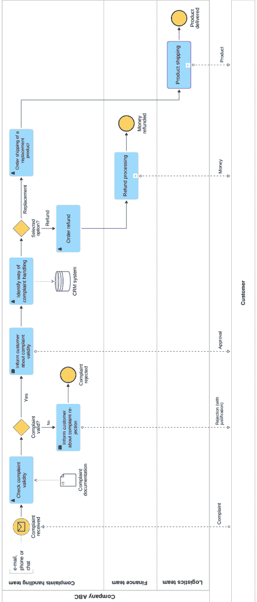

图 8.1 – BPMN 中的投诉处理流程

以下两个图（图 8.2 和图 8.3）将帮助你更多地了解图 8.1 中可见的最重要形状：

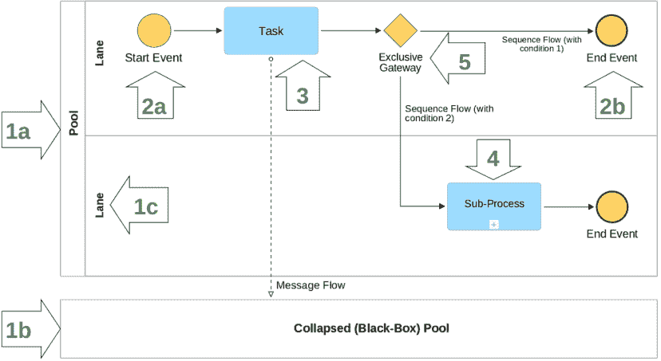

图 8.2 – BPMN 的基本元素（第 1 部分）

### 泳道和泳道区

让我们先看看 _Figure 8.1_ 中可见的两个大矩形：**Company ABC** 和 **Customer**。在 BPMN 中，我们称它们为 **pools**。这个名称旨在暗示流程在泳道内流动（就像人们在游泳池中游泳一样）。这是一个非常重要的概念，我们将稍后进一步阐述。

如你所见，如果你想展示协作中涉及的不同参与者，图表可以包含多个泳道，每个参与者都有自己的流程。泳道内部可以包含许多元素，以更详细地描述流程（这在 _Figure 8.2_ 中的元素 **1a** 可见），或者仅仅表示存在这样一个参与者，而不指定它如何执行其流程（这反过来是选项 **1b**）。

对于 **Company ABC**，我们不仅可以看到表示流程中发生情况的元素，还可以看到某种显示谁执行哪些步骤的结构。建模 **lanes**（见元素 **1c**）用于此目的。

值得注意的是，**lane** 的名称是对游泳池的另一种引用；游泳池可以分为泳道，以组织人们游泳的方式。在我们的例子中，我们有一个代表 **complaints handling team** 的泳道，一个额外的代表 **finance team** 的泳道，最后一个代表 **logistics team** 的泳道。

第二个泳道代表客户，不包含任何可见内容。这样的泳道通常被称为 **collapsed pool** 或 **black-box pool**。这意味着从图表的角度来看，我们要么不知道执行者在做什么，要么不需要在此图表中描述它。以防你担心错过关于客户活动的某些重要见解，例如，其目的是通过隐藏不必要的细节来使图表更易读。但是，它们可以在另一个连接的图表中捕获。

如你将在本章后面看到，泳道（和泳道区）不仅对于展示流程中的职责很有用，而且对于展示流程中涉及的不同实体之间的合作情况也很有用。泳道和泳道区是 BPMN 类别中称为 **swimlanes** 的一部分。

### 事件

虽然泳道和泳道区让我们了解流程中谁在做什么，但我们仍然需要了解流程的范围，特别是是什么启动了流程以及它如何结束。为此，BPMN 为我们提供了事件——始终显示为圆形的元素。在我们的示例图表（**Figure 8.1**）中，我们有两种类型的事件：**start event**（**2a**）和 **end event**（**2b**），它们分别具有细单边框和粗单边框。

BPMN 还允许你创建稍微复杂的中间事件，这将在下一章（**Chapter 9, Advanced BPMN**）中介绍。但是，所有事件都代表对流程很重要的某些现实状态。毫不奇怪，开始事件代表导致我们流程启动的情况。结束事件则展示流程的结果、其产品或最终状态（积极或消极）。在我们的示例中，我们有一个开始事件，**complaint received**，和三个结束事件：**complaint rejected**、**money refunded** 和 **product delivered**。这使我们能够立即了解流程的范围，即使不知道流程的各个步骤。

### 活动

现在我们知道如何表示流程的范围，是时候介绍同样重要的方面了：如何表示流程中需要执行的工作。那些代表工作的步骤（在 BPMN 中称为 **activities**）可以描述为 **tasks** 和 **sub-processes**，分别显示为元素 3 和 4。没有它们，建模流程图几乎毫无意义。

任务和子流程始终显示为圆角矩形。任务代表简单、不可分割的流程步骤，我们不需要进一步分解以进行更详细的描述。另一方面，子流程代表更复杂的流程步骤。这些步骤可以在更详细的模型中描述（这种方法允许我们从主模型导航到较低级别的图表），或者简单地作为占位符，显示潜在可以进行此类分解的位置。

通常，当我们有许多不同的事情（任务）要做，并且它们由组织中的不同角色执行时，子流程很有用。子流程通常在底部标记有 + 符号，表明它们可能隐藏着比普通任务 **something more** 的内容。

我们可以在示例中看到简单元素和更复杂元素之间的区别，其中 **Check complaint validity** 和 **Order refund** 等步骤是任务。另一方面，更复杂的步骤，例如 **Refund processing** 和 **Product shipping** 是子流程，因为我们可能可以为每个步骤定义至少几个任务，很可能不仅仅是活动序列（例如，在支付退款的情况下，当客户通过银行转账付款时我们执行方式不同，而当付款通过信用卡付款时又不同）。

### 网关

正如我们刚刚提到的，流程很少是连续活动的简单序列。因此，为了能够将流程分为不同的路径（拆分）并连接这些路径（合并），我们必须在 BPMN 中使用另一种类型的对象：**gateways**。网关（见元素 5）始终表示为菱形（菱形），带有入箭头和出箭头，表示流程序列流。

在我们的示例中，使用了最简单类型的网关——即 **exclusive gateway**。独占网关代表流程中有两个或多个路径可用，但只能选择一个的地方。在 **Complaint valid?** 网关的情况下，我们有 **Yes** 和 **No** 作为选项，而对于 **Selected option?** 网关，有两个互斥的选项来处理投诉：**Refund** 和 **Replacement**（当然，在实践中，我们会有更多路径展示处理投诉的其他可能方式，但这会使我们的图表稍微难以阅读一些）。

## 连接对象

为此，我们需要 BPMN 的另一类对象：所谓的**连接对象**，或者通俗地说，就是箭头。BPMN 中最重要的箭头类型是**序列流**，它始终由黑色实线标记，末端带有完整的三角形箭头（如图 8.3 中的元素 **A** 所示）。

顾名思义，这种箭头向我们展示了元素被激活的顺序，因为它连接了泳道内的事件、网关和活动，因此始终清晰地表明在流程中，给定元素之前是什么，之后是什么。序列流向我们展示了我们对流程元素的控制——无论是由流程自动化工具实现，还是由流程所有者实现，流程所有者控制流程中发生的事情。

通常，序列流只是一条没有额外标记或文本的线，但如果它用于流程路径分叉的地方（最常见于网关之后），你通常会在箭头上看到文本标签，帮助你判断哪条路径代表哪个流（在我们的示例中，它将帮助你判断如果我们的流程需要支持**退款**选项会发生什么，以及对于**更换**选项需要做什么）。

## 如何读取 BPMN 图

为了总结我们关于流程流动的原则，我们可以说，流程始终在特定的泳道内流动，并且可以在不同的泳道之间移动：从开始事件，经过各种活动和网关，到结束事件，始终遵循序列流箭头（没有间隙或跳跃）。

由于序列流只能在单个泳道内发生，我们如何展示不同实体之间的协作呢？这时，另一种箭头类型——消息流，标记为元素 B——就派上用场了。

与序列流不同，消息流只能在泳道之间使用。消息流始终由虚线标记。其起始处是一个填充白色的圆圈，末端是一个三角形空心箭头。

不同类型的线可能暗示这种流的行为与序列流不同，事实确实如此。虽然序列流告诉我们关于控制，并暗示流程有一个可以通过某种方式强制执行的定义路径，但消息流显示不同实体之间交换消息或信息。然而，这些交换更像是向另一个实体提出的请求、建议或意见。客户有权提出投诉，但不能强迫组织承认它，如果投诉是无根据的。

迄今为止我们讨论过的元素使我们能够描述流程的逻辑，并展示它如何与其他参与者交互。有了这些知识，你现在可以读取绝大多数 BPMN 图。然而，除了符号的这些关键构建块之外，还有其他类别的对象，为我们在两个额外领域提供了更多选择——传达关于流程的额外信息以及描述如何在流程中使用数据。

## 工件

为了为阅读图表的人提供关于图表的额外信息，BPMN 中使用了所谓的工件。工件有两种类型：文本注释和组。它们分别在图 8.3 中显示为元素 6a 和 6b。

这些对象允许流程建模者在创建 AS-IS 或 TO-BE 图表时，捕捉与流程当前运行方式或我们希望对其进行的更改相关的有用注释。但是，请注意，工件不会改变图表的含义，图表的含义基于我们之前讨论过的元素。因此，对于用作文档的图表和用于自动化的图表，工件仅提供更多信息，而不影响流程图中捕获的核心消息。

文本注释是一个允许你在图表中放置一些文本的元素。它具有非常独特的左方括号形状，内部包含文本。文本注释可以放置在流程图中的任何位置，或者与特定的图表元素连接。如果你的评论与整个流程相关，则前一种选择有意义。如果我们想显示评论适用于图表的某个特定部分，则后一种选择很有用。在这种情况下，会使用另一种类型的箭头——用点线绘制的关联（元素 C）。在我们的示例中，文本注释可见于开始事件旁边，并显示以下文本：Email, phone, or chat。

组则允许我们在视觉上区分图表中的某些元素，以强调它们有共同点并属于某个特定类别。组显示为带圆角的矩形，由点和划线组成的线条绘制（这让我想起摩斯电码）。组不通过箭头连接到图表中的其他元素，因此很容易将其与（几乎）所有其他符号元素区分开来。组可以有标签，显示包含的元素有什么共同点。

BPMN 对象的最后一类是**数据对象**，它们（不出所料）允许我们展示数据在流程中如何流动。有几种具有不同可视化效果的数据对象，但通常，它们看起来像是一张右上角折角的纸（在我们的示例图表中，如图 8.1 所示，它是**投诉文档**——即图 8.3 中的元素 7a）。

在我们的示例（图 8.1）中，我们还可以看到一种特定的数据对象（**CRM 系统**），它看起来像是一个顶部带有三条条纹的圆柱体（元素 7b）。为了在 BPMN 图中展示数据如何从活动流出或流入，我们可以使用**数据关联**箭头。它看起来与普通关联非常相似，但带有一个由黑线绘制的箭头（元素 D）。

如图 8.1 所示，BPMN 中的对象在每种类型内部可能有所不同。例如，任务可能在左上角带有图标，指示它们代表什么类型；在事件内部，可能有特殊图标，指示流程如何启动（例如，我们的开始事件内部有一个信封图标，这意味着流程是由客户的消息触发的）；子流程可能有所不同，例如，在边框样式上。这样，BPMN 允许我们传达关于流程的额外信息。我们将在本章和下一章中介绍这些形状差异。

总的来说，如果我们尝试计算所有允许的形状、图标和线条样式的可能组合，将会有上百种具有特定含义的形状。幸运的是，并非所有这些元素都同样常用。因此，在本书中，我们将从最有用和最流行的元素开始，并将最多的精力投入到它们上。对于那些使用频率较低的元素，我们将分配较少的篇幅，但会指出它们何时以及对谁可能有用。

## 流程如何流动？

如我们在上一节中所知，一个更重要的问题是理解流程中需要完成什么工作，以及各种元素之间的关系，或者更简单地说，需要做什么以及何时做。

这似乎很简单，但对于不了解整个流程的人来说，仅仅知道要做什么是不够的。这就像给一个学习做饭的人一道菜的食谱，但没有关于何时添加哪些原料的信息。仅仅知道我们会执行所有必要步骤是不够的——我们不能按错误的顺序执行它们，或者做在那种情况下不需要的事情。

流程模型可以大可以小，可以简单也可以非常复杂，但无论其大小和复杂程度如何，当我们分析它们时，可以区分出某些重复出现的模式。工作流/流程**模式**的概念，最初是为分析流程自动化（工作流）解决方案而创建的，在分析流程和学习建模符号方面也证明非常有用。这就是为什么我们将在本书中使用它们。

在讨论各种流程模式时，我们将使用一个额外的概念，因为它是 BPMN 规范的一部分——**令牌**。这不是绘制 BPMN 图时可以使用的符号元素之一，因为它只是一个理论概念。然而，它对于理解流程如何执行非常有用，尤其是当流程中有多个路径时。如果你感兴趣，有一些 BPM 工具允许你在实践中使用令牌——无论是用于模拟业务流程，还是用于可视化流程中工作的进度。但是，BPMN 规范不要求在建模或自动化工具中实现令牌。

当开始事件被触发时，令牌诞生，然后沿着序列流箭头流经流程，直到到达结束事件，在那里被消耗。

# 序列

最简单的模式是**序列**——一系列按顺序执行的操作。这个序列显示了首先应该发生什么，以便能够进入流程的下一阶段。为了讨论这个序列，我们将再次引用令牌的概念。

想象一下我们正在盖房子。首先，我们必须准备地基。只有在地基准备好之后，才能砌墙。一旦墙壁竖立起来，我们就可以考虑屋顶了。常识告诉我们，试图通过在未完成的地基上砌墙并覆盖屋顶来加快建设速度的想法是有风险的。

让我们看看这样一个简单序列的示例：

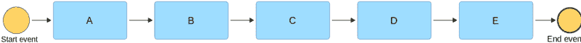

图 8.4 – 序列

当流程启动时，令牌进入任务 A 并使其被激活。这是规范中的一个正式名称。在实践中，这不一定意味着有人已经开始处理任务 A（为此，你仍然需要一个资源，例如分配给该任务的员工），而是意味着如果所有情况都有利，你可以开始处理任务 A（与尚不可行的任务 B 相反）。

那么，在某个时间点，任务 A 开始工作，并在一段时间后，在其仍在执行时完成。在建模时，明确一个流程步骤的范围在哪里结束以及下一个步骤在哪里开始非常重要。当任务 A 结束时，令牌沿着序列流箭头流向任务 B，依此类推，直到最后一个任务。当流程中的最后一个活动被执行时，令牌到达结束事件并被其消耗。在序列的流程实例中，我们只有一个令牌，因此当这个唯一的令牌被“消耗”时，实例的生命周期结束，我们可以认为没有更多事情可做。

如果我们的流程写了日志或日记（或者如果我们有一个记录了执行了哪些任务的系统），那么在这样的 **流程日志** 中，我们总是会有以下条目：ABCDE。执行任务的人、执行时间以及持续时间可能会有所不同，但对于这样的流程，不可能跳过步骤（ACDE）、重复步骤（ABBCDE）或以不同顺序发生（AEDCB）。

现在，让我们转向投诉处理，看看一个略有不同的序列示例——这是一个我们迄今一直使用的图表的简化版本，其中只包含一条路径（我们假设投诉总是有效的，并且我们总是进行退款）：

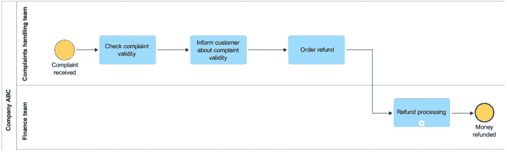

图 8.5 – 具有不同泳道中流程步骤的顺序流程示例

如图 8.5 所示，序列的元素可能位于单个泳道内，但工作也可能在组织的不同单元之间流动。在这种情况下，流程步骤可以放置在不同的泳道中。从序列的角度来看，这种放置并不重要——重要的是，当流程的一个元素结束时，我们就进入下一个元素——也就是说，只有在分析完投诉的有效性后，我们才能通知客户其投诉已被接受为有效，而只有在那之后，我们才能设置退款订单，否则无法处理付款。

## 排他网关（XOR）

在前一节中，我们处理的是简单步骤序列的流程。但是，通常，我们的流程更复杂，只有在满足某些条件时才会执行某些片段。模拟这种情况的最常见方式是使用排他网关。这通常被称为 XOR 网关（exclusive OR）：

图 8.6 – XOR 网关的两种可能可视化

XOR 网关可以是一个简单的菱形，也可以在中心带有 X 标记。有趣的是，虽然允许这两种可视化，但不应在单个模型中混合使用。在组织内，确定 XOR 网关应如何绘制以避免混淆是很好的做法。我倾向于使用中间没有 X 标记的 XOR 网关，但我知道对许多人来说，X 是一个很好的助记符，帮助他们记住这是一个 XOR 网关。

### 命名

BPMN 规范没有规定命名排他网关的特定方式。因此，在实践中，您可能会遇到不同的方法，如图 9.7 所示。在一种方法中，您不命名 XOR 网关，而是只确保从网关出来的箭头的条件/标签足够清晰（例如，Complaint valid 和 Complaint invalid）。

我更喜欢第二种方法，即用问题命名 XOR 网关（例如，Complaint valid?），并将该问题的答案放在从该网关出来的序列流上（例如，Yes 和 No）。

值得注意的是，虽然我们在命名从排他网关出来的序列流的条件方面有一定的自由度，但不允许使用任务来表示需要采取哪些路径，并避免在箭头上使用条件。这种反模式在图 8.8 中所示：

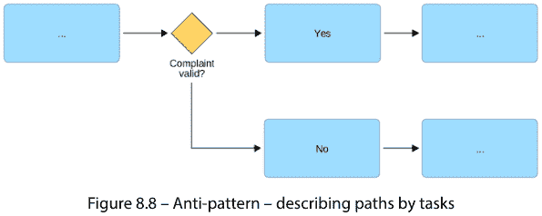

### 替代流程路径

我们已经知道，排他网关用于将流程拆分为几个互斥的路径。但是，在流程的后续部分会发生什么呢？从符号的角度来看，这些路径中的每一条都可能通向其结束事件。我们在示例流程中遇到了这种情况——第一个网关通向 **Complaint rejected** 结束事件，或者进一步通向我们处理已确认投诉的部分，在那里流程拆分为两条路径，分别以 **Money refunded** 和 **Product delivered** 结束事件结束：

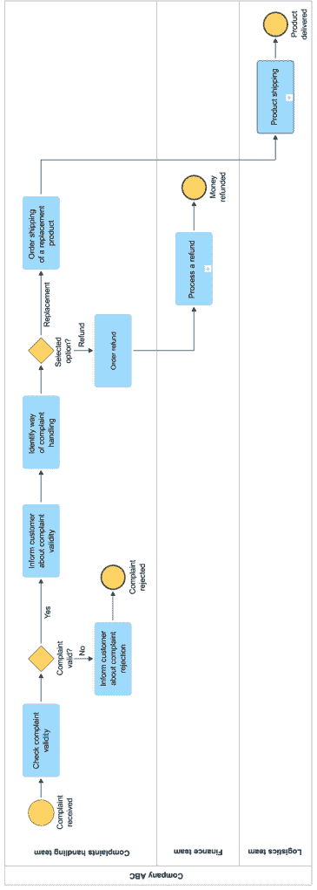

图 8.9 – 带有排他网关和多个结束事件的示例流程

使用简化的流程，任务使用字母命名，我们可以展示多个不再汇合并通向不同结束事件的路径的情况，如图 8.10 所示：

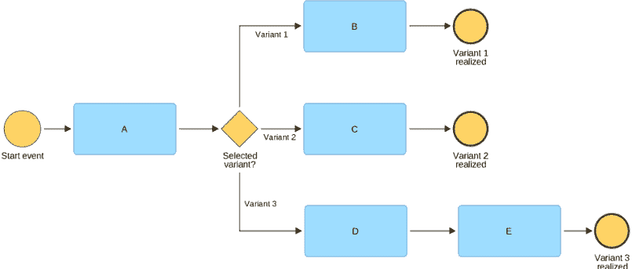

图 8.10 – 排他网关后带有多个结束事件的流程

根据所选的流程执行变体，我们可以得到以下流程日志：AB、AC 和 ADE。两条/三条路径不能在单个实例中执行，因此我们永远不会得到 ABC、ABDE 或 ABCDE 条目。

### 汇合

除了路径拆分且不再汇合的情况外，还有一种可能性是，根据所执行的变体，流程的某一部分有所不同，其余部分保持相同，因为流程路径汇合。

正如我们稍后将学到的，汇合是在创建更多令牌的流程中一个极其重要的概念。但是，正如我们所知，排他网关不会复制令牌——它只是将令牌重定向到正确的路径。那么，在这种情况下，我们如何处理汇合呢？

规范为我们提供了两种可能性。一方面，我们可以跳过 XOR 汇合网关，并将序列流直接附加到下一个流程步骤。另一方面，我们可以插入第二个排他网关来汇合流程路径。这个汇合网关不需要命名。还值得知道的是，它会将进入它的所有令牌传递过去。

正如您所想象的，规范为我们提供了这样的可能性，导致出现了两种观点非常强烈的建模流派。第一个流派的代表倾向于不使用汇合 XOR 进行建模，因为这使图表简单易读，并且节省空间。

另一方面，第二个流派的代表声称，XOR 网关应该始终成对插入——开启和关闭——因为只有这样才能使图表可读。

根据我的经验，第一种方法更接近具有 **业务** 背景的人。第二种方法则更常见于具有 IT 或学术背景的人。我假设那些用户将关闭网关与代码中的关闭括号联系起来，这成为了一种习惯。

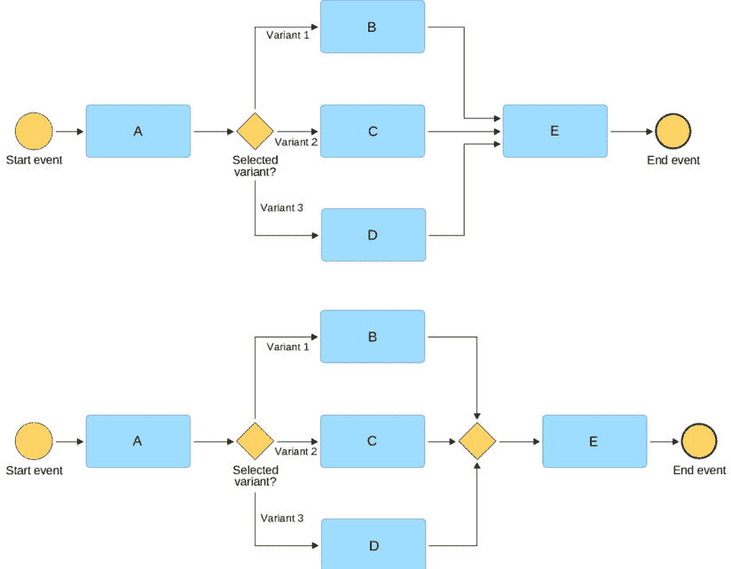

图 8.11 – 建模具有互斥路径的流程的两种可能方法

无论我们选择哪种方式进行建模，前两个图表具有相同的含义，并可以生成相同的流程日志：ABE、ACE 和 ADE。

## 实践中的 XOR 网关

让我们回到我们的业务场景，看看排他网关在实践中是如何工作的（使用图 8.12 中所示的简化示例）。如您所见，如果投诉被认为有效，那么我们将继续执行 **Inform customer about complaint validity** 任务。或者，它可以被认为无效，此时我们执行 **Inform customer about complaint rejection** 任务。在单个流程实例中不可能执行这两项任务。

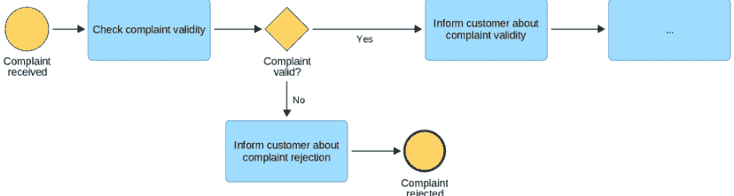

图 8.12 – 示例流程的一部分 – 排他网关在实践中

在这里，值得强调 BPMN 的一个有趣特性。虽然在许多建模方法中，例如流程图，菱形代表做出决策、验证信息等地方，但 BPMN 网关的含义略有不同。尽管根据 BPMN 规范，网关被称为决策，但值得注意的是，实践中经常使用的网关类型属于称为 **数据网关** 的类别。这意味着网关——尤其是排他网关——类似于有轨电车道岔装置。它决定哪些流程路径获得其令牌。网关本身不会产生工作、增加流程持续时间或增加其成本。

但是，网关如何 *知道* 哪个流应该接收令牌呢？这受到将流程早期元素传入网关的数据与序列流上找到的条件进行比较的影响。这些数据通常来自网关之前的任务或子流程，但不一定是这样——它可能在处理它的网关出现之前很久就已经获得。同样，让我们参考我们的示例——可能是 **Identify way of complaint handling** 任务将为我们提供数据，根据这些数据，我们将继续沿着 **Replacement** 或 **Refund** 路径进行。

从技术角度来看，负责 **投诉处理方式** 任务并在 IT 系统中工作的用户，会在案件处理表单上看到一个单选按钮，用于选择正确的选项 – **更换** 或 **退款**。此选择将影响当前任务完成后将接收哪个任务。在流程的早期部分也可以这样工作，用户需要标记投诉是否合理。

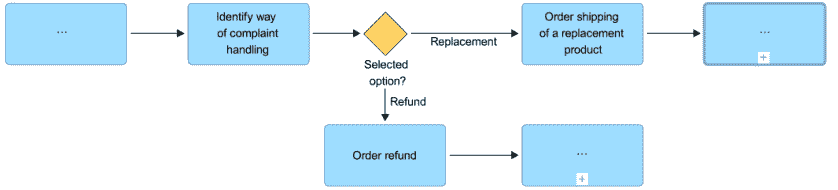

图 8.13 – 示例流程的一部分 – 在网关之前放置的任务中收集数据

但是，也有可能出现这种情况：客户在流程早期就被要求指定解决投诉的首选方式。如果我们假设客户始终会填写表单中的相关字段（并且之后不会改变主意），那么我们的流程将如下所示：关于解决投诉的首选方式的数据在 **接收表单** 任务中获取，并且仅在 **选定选项？** 网关处影响流程。此时，我们的员工需要选择是否将投诉视为有效。他们将获得 **订购退款** 还是 **订购发送更换产品** 任务，不取决于他们在系统中 _点击_ 什么，因为数据已经可用。

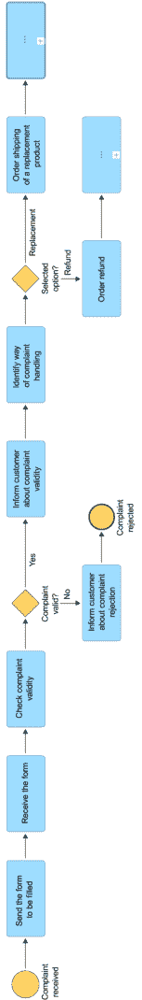

图 8.14 – 示例流程的一部分 – 网关使用在流程早期收集的数据

一旦我们有了数据，并且令牌到达网关，就会分析为流程每条路径定义的条件。对于独占网关，第一条满足条件的路径将接收令牌，流程将继续。自然，这种独占网关行为使得在路径上正确定义条件非常重要。因此，一种非常流行的方法是尝试以这样的方式记录流程，即独占网关只有两条出口路径，代表网关中提出问题的是和否选项。我们在图 8.14 中看到了这种方法在“投诉有效？”网关上的示例。

但是，BPMN 允许我们以其他方式分离流程路径，使得从网关出来的流程流具有比是和否更复杂的条件。这为我们提供了更多选项（尤其是如果我们的流程中有三个或更多可能的流），并使图表更易读（否则，我们可能不得不一个接一个地插入网关），但它也迫使我们对经过深思熟虑的条件更加小心。

## 注意条件中的错误

让我们使用我们流程的一个稍微复杂的版本来分析处理这种情况的一种反模式。假设我们的组织决定简化索赔处理流程，以便对低价值商品的索赔自动接受，从而无需员工参与。图 8.15 显示，价值低于 100 美元的投诉将被自动接受，并发出退款（我们假设这是我们快速通道的条件），而价值超过 100 美元的投诉将由员工分析。

但是，价值正好为 100 美元的投诉怎么办？不幸的是，在这样的情况下，我们的流程会遇到错误且无法继续，因为没有提供的路径支持这样的金额。对于流程的读者来说，这令人困惑，但对于流程的自动化来说，这是一个更大的问题。

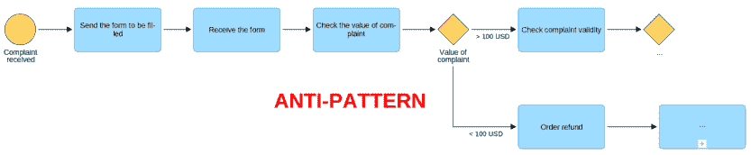

图 8.15 – 反模式 – 关于索赔金额的不明确条件

如果我们的条件重叠，也会很麻烦。不过，这种情况会比前一种情况麻烦较小，因为你可以选择第一个满足条件的路径。

## 默认序列流

但是，如果我们无法预料所有可能存在的选项怎么办？在这里，BPMN 为我们提供了一种简单而巧妙的解决方案 – 默认序列流。我们经常用它来指代从独占网关出来的流程流。默认流有一个额外的标识，表现为箭头起始处附近的一条对角线交叉线。

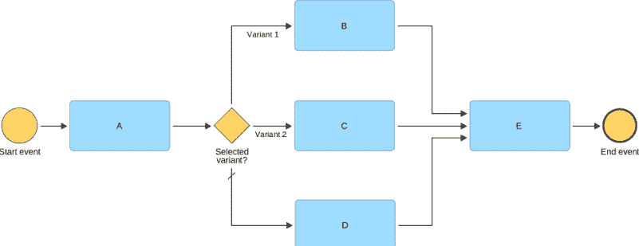

图 8.16 – 默认序列流

默认序列流允许我们指示，如果在其他箭头上定义的条件都未满足，流程应走哪条路径。这保证了我们的流程永远不会因为收到意外数据而卡住。

值得注意的是，默认流不一定意味着执行流程的最常见方式，或者从组织角度来看最期望的选项（所谓的快乐路径）。它只是一个标识 – 如果没有定义的条件被满足，就走那条路径。IT 专业人员可能会将其与许多编程语言中存在的 ELSE 命令联系起来。

## 并行网关（AND）

另一种基于数据的网关是 **并行网关**，也称为 **AND 网关**。这个网关由中间的 + 符号表示。但是，与 XOR 网关不同，这个符号不是可选的，因此对于这种网关，+ 符号必须始终存在。

并行网关用于标记在流程继续之前必须执行的流程路径。有趣的是，这并不意味着这些路径上的活动必须同时运行（正如其名称可能暗示的那样），而只是它们都必须完成，然后我们才能继续。关键点是顺序对我们不重要（如果重要，我们可以使用简单的序列），但所有元素都必须执行。

AND 网关有简单的解释和行为，因此通常不需要在图表上显示其名称（尽管这是允许的）。原理很简单：当令牌进入并行网关时，它会被复制，以便从网关出来的每条序列流都获得其令牌（不检查条件）。由于令牌的生成与条件无关，因此在从该网关出来的路径上添加条件没有意义。

但是，以这种方式创建的令牌接下来会发生什么？它们中的每一个都会继续流过流程并激活进一步的任务。这听起来无害，但对于初学者来说，这里潜伏着 BPMN 最大的陷阱之一。让我们看看图 8.17，并考虑在这样的流程中会发生什么。

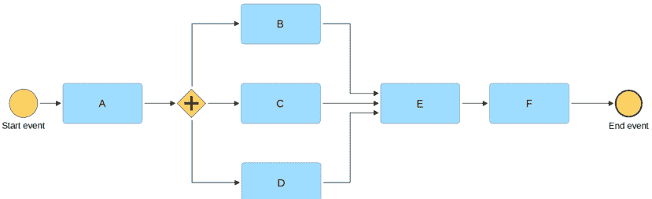

图 8.17 – 一种有风险的建模方式 – 仅使用开启（分叉）AND 网关

为了更容易描述这种情况，让我们假设任务 B 需要 5 分钟，任务 C 需要 10 分钟，任务 D 需要 15 分钟，任务 E 和 F 各需要 1 分钟。这些任务负责资源的可用性没有问题。

流程的开始如我们所料：任务 A 执行后，我们的令牌到达并行网关并分裂成三个令牌 – 每条路径一个 – 从而激活了任务 B、C 和 D。5 分钟后，任务 B 完成（目前我们的日志是 AB）。接下来，令牌到达任务 E 并激活它。又过 1 分钟，任务 E 完成（我们的日志是 ABE），令牌到达任务 F 并激活它。又过 1 分钟，令牌到达结束事件并被消耗。此时，我们的流程日志是 ABEF。又过 3 分钟，任务 C 执行（所以我们有 ABEFC）。它的令牌也进入任务 E 并激活它，然后继续直到结束事件（当第二个令牌消失时；我们已经有日志 ABEFCEF）。第三个令牌从任务 D 出来时也会发生类似的情况。当最后一个令牌到达结束事件，从而流程实例（即其特定执行）结束时，我们的流程日志将如下所示：ABEFCEFDEF。如你所见，我们执行了任务 E 和 F 三次！

悖论的是，从 BPMN 的角度来看，这种情况不是错误，而是一种建模方式，即我们有一个没有关闭（合并）网关的分叉 AND 网关，这很可能会让大多数人感到非常困惑，因为他们不会预期多次执行。

当然，也可能存在我们希望出现这种行为的流程，但通常，当人们想到并行流程路径时，往往期望的是一种情况：必须等到所有并行部分都完成后，才能继续。这种行为从商业角度来看非常有用，因为它向我们展示了只有在所有零件都准备好时才能组装设备，或者只有在业务部分和财务部分都准备好时才能向客户准备报价。那么，我们如何实现这种行为呢？

解决我们问题的方法是同步的概念。与排他网关不同，在排他网关中，使用合并网关是可选的，而对于并行网关，我们通常也会想要插入一个并行合并网关。

让我们看看插入这样的网关会对我们的示例产生什么变化。为了简单起见，我不再插入任务 F，该任务之前旨在展示当令牌在流程中不受控制地流动时会发生什么。这次，我们不再假设任务需要多长时间或资源的可用性如何，因为我们想关注使用合并并行网关进行同步在实践中是什么样子。

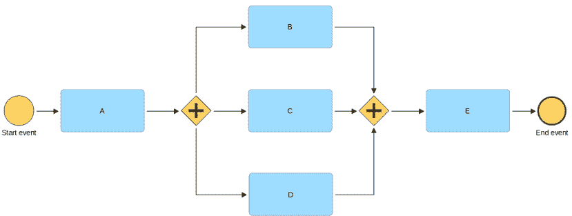

图 8.18 – 使用合并 AND 网关进行同步

开头是熟悉的：任务 A 完成后，令牌到达 AND 网关。在这个网关，它会被复制（我们可以开玩笑地说令牌被复印了），这样离开网关的每个序列流都会得到一个令牌。然后，每个令牌独立流动并激活路径上的任务。资源的可用性决定了它们执行的顺序。因此，ABCDE、ABDCE 和 ACBDE 的顺序都是可能的。

但是，我们如何知道可以执行任务 E 了呢？为什么只执行一次？这都归功于合并并行网关，它提供了同步。第一个令牌到达同步网关的那一刻，它会被停止，因为网关会等待所有进入它的序列流的令牌。在我们的例子中，只有当第三个令牌到达网关时，网关才会将它们全部合并为一个，并允许其通过。

要使其像这样工作，我们需要使用合并并行网关。这是因为使用排他网关进行合并会偏离目标，因为它会让每个令牌都通过。

与建模并行网关相关的一个常见问题是：通过更改图表中任务的位置，我们能否暗示什么应该先发生，什么应该后发生？

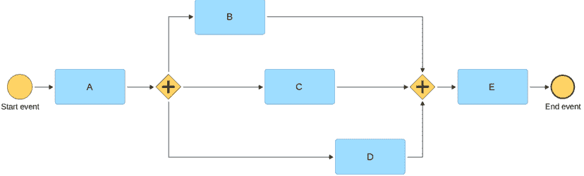

图 8.19 – 并行路径中任务的位置不决定其执行时间

BPMN 通过显示流程的逻辑来暗示流程步骤的时间。因此，通过遵循序列流箭头，我们可以看到任务 B 必须在任务 A 之后、任务 E 之前发生。但是，无论我们将任务 B、C 和 D 垂直排列在一条线上，还是以其他方式放置（如图 8.19 所示），都不会影响图表的解释。

执行顺序完全取决于执行任务的资源以及令牌如何到达流程步骤以激活它们。因此，值得记住的是，如果我们想要保证流程步骤的特定执行顺序，序列是一个不错的选择。另一方面，当我们想要在保证流程只能在选定元素执行后才能继续的同时，为某些流程步骤的执行顺序提供一些灵活性时，应该使用并行网关。

## 包容网关（OR）

到目前为止，我们讨论了两种最常见的网关类型：排他网关，它允许我们描述在许多选项中只能选择一个的情况；以及并行网关，其中离开网关的所有路径都必须执行，流程才能继续。然而，在实践中，我们也会遇到某些路径始终执行，而另一些路径仅在特定情况下执行的流程。

我们自然可能会想将它们描述为 XOR 和 AND 网关的组合，但我们也可以使用另一种类型的网关——包容网关。包容网关的行为类似于 XOR 和 AND 网关的组合，从而允许更紧凑地描述更复杂的流程流。

包容网关通常被称为 OR 网关。像所有网关一样，它显示为菱形，中心指示其类型的图标是一个圆形（可以与 OR 中的 O 联系起来）。

如何读取带有 OR 网关的流程？简单来说，如果离开网关的路径上未定义条件，那么该路径将始终获得一个令牌（即，它的行为类似于 AND 网关）。

另一方面，如果离开网关的序列流上定义了条件，则只有在条件为真时，它才会获得一个令牌。重要的是，OR 网关可以有多个带有条件的出口路径，这些条件可以是互斥的，也可以重叠。

在实践中，这意味着当你看到 OR 网关时，应该仔细查看。在我们有一个带有无条件序列流的 OR 网关的情况下，它的行为类似于 AND 网关。另一方面，如果我们看到一个包容网关，其所有路径都有互斥条件，那么它的行为将与 XOR 网关相同。

然而，大多数时候，包容网关用于多个路径可能同时处于活动状态的情况。由于我们将读取路径上的条件，通常给网关命名是有用的——就像排他网关一样，与并行网关不同。

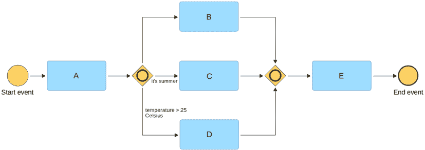

图 8.20 – OR 网关示例

这对我们的示例将如何工作呢？由于通往任务 B 的序列流没有条件，因此该路径将始终获得一个令牌。另一方面，正如我们所看到的，通往任务 C 和 D 的序列流的条件是以这样的方式构建的，即所有、仅一个或都不满足它们都可能同时发生。

因此，我们的流程日志可能如下所示：ABE（寒冷的春天）、ABCE（寒冷的夏天）、ABDE（温暖的春天）和 ABCDE（温暖的夏天）。但是，不可能出现 ACE（因为 B 必须执行，因为该路径没有条件）或 AE（因为同步网关不会让我们通过）。

但是，如果图表中不包含 OR 网关后面没有条件的路径（即始终会获得令牌的路径），那么添加一个默认序列流可能是个好主意，以防止出现没有条件满足且流程出错导致死锁的情况。

值得注意的是，我们的流程可以以略有不同的方式建模：由于任务 B 始终执行，我们可以尝试将其移到 OR 开始网关之前。当然，这的前提是任务 C 和 D 不能在 B 之前执行。

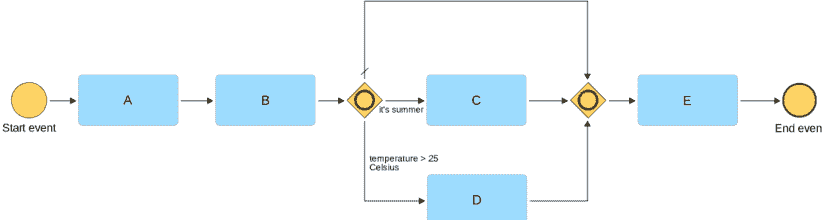

图 8.21 – OR 网关的默认序列流

在 BPMN 建模中，通常是一个好的实践，即确保结束网关的类型与开始网关相同。这是因为如果我们插入一个结束 AND 网关，那么在开始 OR 网关没有为每个路径生成令牌的情况下，我们的流程将会卡住。

## 不使用网关进行建模

BPMN 的一个有趣方面是，规范作者给用户留出了很大的自由度，提供了许多建模方式。然而，正如我们已经提到的，这种自由度和众多的选择并不总是对我们有帮助，当我们思考如何建模特定流程时。

在本节中，我们将讨论不使用网关进行建模的问题。其背后的想法是值得称赞的——如果我们不使用网关，我们的模型会更小，因此更加用户友好。然而，正如我们稍后将看到的，更小的模型并不总是更悦目。因此，本节中介绍的建模方式不应被视为推荐。我只是想展示根据记号规则允许的内容，以便如果你在实践或考试中遇到这样的模型，你将知道如何解释它。

让我们从并行网关开始。众所周知，进入 AND 网关的令牌会_复制_，使得离开网关的每个流程路径都获得一个令牌。同样的效果也可以通过另一种方式实现——我们只需向任务或子进程添加多个出口序列流（无条件）。然后，每个路径都将获得一个令牌！

在实践中，图 8.22 中的两个图表具有相同的含义。左侧带有 AND 网关的图表占用的空间稍大，但你可以立即看出如何解释该模型。对于右侧的图表，你需要仔细查看流程流，以确保它们没有条件，并且每条路径都获得其令牌：

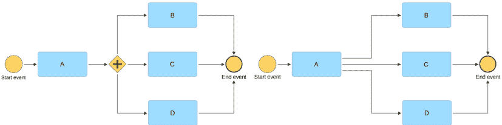

图 8.22 – 比较 – 带有和不带有 AND 网关的拆分流程路径

如前所述，虽然可以不使用网关来拆分路径，但在大多数情况下，跳过同步网关不是个好主意。例如，图 8.23 显示了一种情况，其中没有任何东西同步在任务 A 中创建的三个令牌，这当然会导致任务 E 被执行三次。

正如我们在图 8.17 中提到的，这种建模方式在形式上是允许的，但你必须意识到，许多人会认为这是一个错误，更多人会误解我们的意图，因此不推荐这样做。

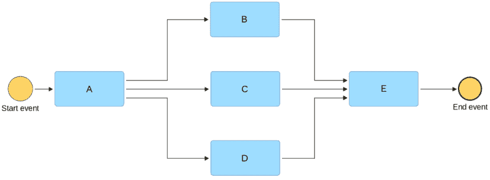

图 8.23 – 一种冒险的建模方式 – 缺乏同步

当存在多个带有条件的流（即我们讨论过的 XOR 和 OR 网关的情况）时，也可以避免使用网关。在这种情况下，需要一种新的序列流类型——条件序列流。条件流可以从任务或子流程发出，但不能在网关之后使用（原因显而易见）。它的外观表明它用于替代网关，因为它在开头有一个特殊的小菱形符号。

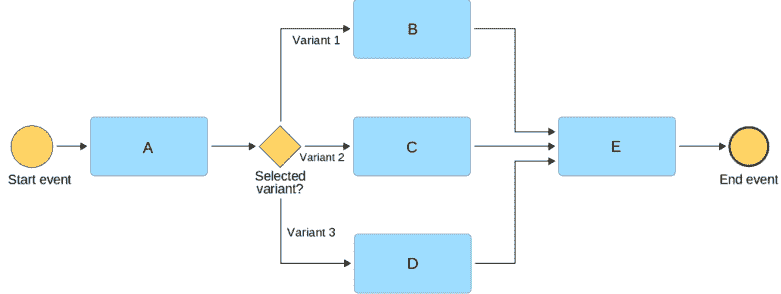

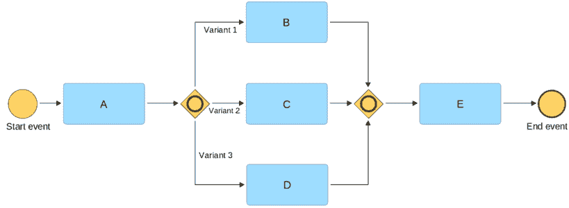

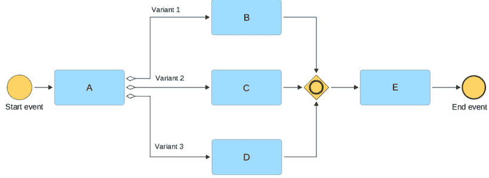

图 8.24 – 使用网关（XOR 和 OR）与条件流的建模比较

图 8.24 展示了一个使用了独占网关的图表、一个使用了 OR 网关的图表以及一个仅使用条件流来拆分路径的图表之间的比较。当然，这些图表并不完全等价，因为对于独占网关，我们选择第一个条件为真的路径，而对于 OR 网关和条件流，我们检查所有条件以确定哪个有效。在第一个图表中，我们可以立即看到只有一个条件可以为真。在第二个和第三个图表中，除非我们检查条件，否则这并不明显。

## 流程步骤 – 任务

我们已经知道如何读取图表中的各种流程流类型，但这并不是我们可能感兴趣的全部。关于任何流程模型，我们需要知道的基本事情之一是其中需要完成什么工作。为此，我们使用任务。任务代表流程中需要完成的一个不可分割的工作单元。为什么不可分割？正如我们在本章开头提到的，BPMN 提供了两种对象（活动）来描述要完成的工作——任务和子流程。

当我们的工作复杂、可以分解为多个步骤，并且可能由不同的参与者执行时，我们应该使用子流程，其内容可以在单独的图表中描述。当不需要以这种方式添加更多细节时，任务就足够了，尤其是因为我们可以添加描述来记录流程步骤中应该发生什么。

任务表示为圆角矩形，通常中间有一个名称。与大多数 BPMN 元素一样，我们可以停止使用没有指定类型的简单任务，这对于服务于文档目的的模型来说已经完全足够。或者，如果我们考虑自动化流程或需要它用于分析目的，我们可以设置特定类型，这由任务左上角的图标表示。这些类型告诉我们更多关于任务工作如何完成的信息。

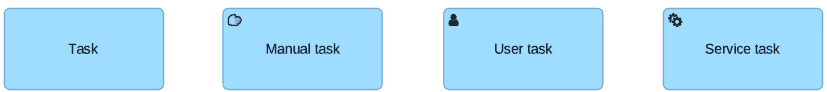

图 8.25 – 最常见的任务类型 – 无、手动、用户和服务

有许多不同类型的任务，但从三个基本类型开始学习它们是有用的：手动任务、用户任务和服务任务。虽然没有类型的普通任务告诉我们流程的特定步骤必须执行，但前面提到的三种类型中的任何一种都允许对流程的自动化程度进行简单分析。

此时，值得提及 BPMN 规范作者的一个默认假设。他们的想法是，任何用 BPMN 描述的图表都可能成为流程自动化的基础（甚至有一个特殊属性说明图表是否可执行）。因此得名任务——自动化后，每个任务都可能被路由给员工执行。

## 用户任务

让我们从用户任务开始描述三种基本任务类型。用户任务由任务左上角的用户头像图标标记。此图标在应用程序中很常用，代表应用程序的用户。它也通常允许用户访问其账户中的个人设置。

用户任务由协调流程的信息系统中的人员执行。这样的系统可以是工作流/BPMS 工具，也可以是 CRM、ERP 或“帮助台”系统，例如 Jira。

重要的是，这样的系统控制整个流程。因此，当用户执行第一个任务时，系统根据流程逻辑知道接下来是什么，会将下一个任务分配给同一用户或另一个用户。

## 服务任务

更高级的自动化选项由服务任务描述。它由任务左上角的两个齿轮图标标记。

服务任务是完全自动执行的流程步骤，无需任何用户参与。这些任务可以包括自动计算、文档生成、集成过程中的系统间数据交换等。

然而，从规范的角度正式来说，并非每个自动活动都是服务。根据定义，服务是自动化流程的引擎调用提供某些服务的其他软件的元素。我们可以参考**面向服务架构**（SOA）或更现代的微服务概念。

## 手动任务

众所周知，并非所有流程步骤和流程都是自动化的。在这种情况下，第三种任务类型——手动任务——非常有用。手动任务由任务左上角的手形图标标记。

但是，我们究竟应该将什么视为手动任务呢？规范在这里帮助不大，它给出了一个技术人员安装电话的明显示例。此外，除了明显的陈述，即手动任务在没有流程自动化引擎支持的情况下执行（这很清楚——否则，它将是用户任务）之外，规范还包括注释 *nor any application*，而其他地方仅说明手动任务不是由流程自动化工具执行或管理的。在随规范附带的附加文档（*BPMN by example*）中，我们可以看到手动任务的示例，这些任务虽然不由流程自动化工具协调，但需要 IT 支持（例如，通过发送电子邮件）。

毫不奇怪，我经常遇到这样一个问题：手动任务是否是我们根本不使用计算机的任务。在我看来，这不一定是事实。由于关键问题是任务是否由某种流程引擎协调，我在没有 IT 工具协调的地方使用手动任务。

对我来说，手动任务的一个示例可能是为客户准备报价——也就是说，除非是在 CRM 系统中完成的，在那里你可以看到有人在做它，并在必要时将报价转发给组织中合适的人批准后再发送给客户。同样，如果我在电脑上准备 Excel 报告，然后通过电子邮件发送给同事，这里合适的任务类型应该是手动任务，而不是用户任务。

如果我们的流程没有自动化，我们可以完全不使用任务类型，或者使用手动任务。如果流程已部分自动化但包含系统之外发生的步骤，那么添加用户任务步骤可能有意义，员工可以在其中标记他们已执行某些手动任务。在带有手动任务的自动化流程中，假设执行者知道他们应该做什么以及何时做，自动化流程的系统将简单地跳过手动任务，因为它会将它们视为不可见。

这三种基本任务类型使我们能够非常轻松地分析流程。例如，如果我们看到所有流程步骤都是手动的，那么我们可以预期会出现人为错误和延迟。很可能，通过流程引擎为员工提供支持、使用软件机器人或更高级的流程自动化可以大大提高效率。然而，即使我们的流程无法自动化，我们也可以预期记录它将有助于减少错误数量，而流程步骤和流程逻辑的可见性增加可能会带来有价值的改进想法。

如果我们处理的是大部分步骤为用户任务和服务任务的流程，我们可以预期更好的流程性能。当然，即使在这样的流程中，也可能出现用户在协调流程两个独立步骤的两个系统之间手动传输数据的情况。在这种情况下，使用 RPA 工具或其他系统集成方法将能够进一步改进整体流程。

## 发送和接收任务

我们将讨论的下两种任务类型对于更高级的建模很有用，因为它们用于描述消息的自动交换——一种用于发送消息，另一种用于接收消息。我在此处介绍它们，作为我们将在第 9 章中探讨的内容的“预览”，第 9 章专门介绍 BPMN 的更高级元素。然而，这也将帮助我解释 BPMN 中最重要的概念之一——发送和接收消息。

此时，值得提及 BPMN 关于消息和图标的几个原则。首先，正如我们已经知道的，根据定义，消息在不同的流程参与者（池）之间发送和接收，并可以与消息流箭头相关联。

第二，如你可能记得本章介绍中所述，表示消息的 BPMN 图标始终是一个信封。当我们讨论不同类型的事件时，这个知识将会派上用场。

第三，在 BPMN 中，主动（抛出）元素始终具有深色图标，而被动（捕获）元素具有浅色图标。我们稍后将详细介绍这一点。

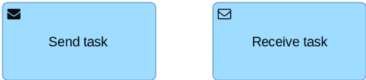

图 8.26 – 发送和接收消息的任务

既然我们知道了所有这些，那么发送任务（向其他池发送消息）将在左上角带有一个深色信封图标，而接收任务（等待来自外部的消息以便流程继续）将在左上角带有一个浅色信封图标，这也就不足为奇了。

在使用发送和接收消息的任务时，显示进行消息交换的池，并使用消息流来呈现消息交换可能会有所帮助。但是，这不是强制性的，因此你可以在不显示消息流和其他池的情况下展示发送和接收任务。这将帮助你节省一些空间并避免绘制许多线条，尽管代价是失去一些上下文。

图 8.27 展示了发送和接收任务与消息流结合使用的实际应用。同样，我们使用了熟悉的投诉处理流程——但是，为了表示发送和接收任务同时发生（这在实践中非常常见），我稍微修改了流程片段，以描述以下逻辑：流程始于收到投诉，该投诉由客户提交（同样，在这里，我们可以看到由消息触发的开始事件，由信封图标指示）。

然后，员工必须分析投诉，并告知客户投诉已被拒绝（如果无效）或投诉已被接受（如果有效）。无论哪种情况，我们都在向我们的池外部发送消息——在此情况下，是发送给客户。

流程的其余部分已稍作更改，以使示例更清晰。一方面，我们假设总是更换商品（即，我们不支持退款），另一方面，我们的接受还包括向客户请求运输数据。

此时，值得注意的是流程的逻辑：一旦我们告知客户投诉有效，我们的令牌将立即转到 **Receive shipping details** 任务。但是，由于这是一个接收任务，我们开始等待来自客户的消息。只有当客户向我们提供运输数据时，我们才能继续进行 **Order shipping of a replacement product** 任务。

# 图 8.27 – 示例流程的一部分 – 在实践中发送和接收消息

如果客户没有回复我们，我们的流程将永远无法继续。当然，这不是我们乐于看到的，因为作为与他人通信的流程的一部分，我们应该能够应对对我们消息的无回应情况。幸运的是，BPMN 有几种解决这个问题的方法，我们将在第 9 章中介绍。

在发送和接收任务的情况下，值得记住的是，规范将它们视为自动流程步骤，因此不应用于员工准备然后发送电子邮件的步骤。在这种情况下，我们可以使用，例如，手动任务或用户任务，它们也可以发送消息（这由一个出站消息流箭头表示）。

还值得注意的是，我们的 **Inform customer about complaint validity** 任务通过序列流与 **Receive shipping details** 任务连接。有些人假设，由于我们正在发送消息并等待返回消息，可以跳过序列流，如图 8.28 所示。但是，这是不允许的，因为两个任务必须由序列流连接。

那些觉得令牌概念有帮助的人可以想象，一个没有序列流的令牌无法在流程中 *跳转* 到下一个任务，因为它不允许沿着消息流移动。

在这里，再次，阅读 BPMN 图表的规则派上用场——我们从开始事件开始，一步一步地遵循序列流，没有中断，始终在单个池内，直到结束事件。如你所见，我们将在这里违反 *no-breaks* 规则。

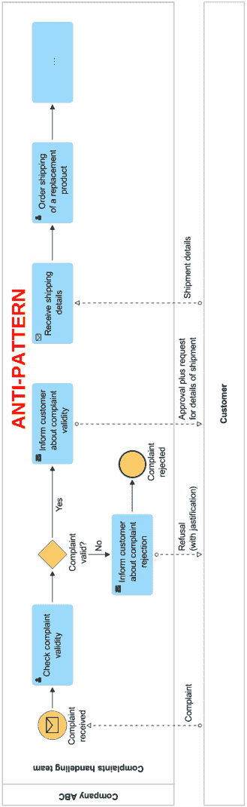

图 8.28 – 反模式 – 发送和接收任务之间流程中的间隙

在讨论发送和接收任务时，还值得提及与这些任务相关的另一个常见错误，如图 8.29 所示。许多刚开始使用 BPMN 的人将信封符号与邮件客户端图标联系起来，并使用发送和接收任务来显示同一组织内不同团队（由泳道表示）之间的电子邮件交换。

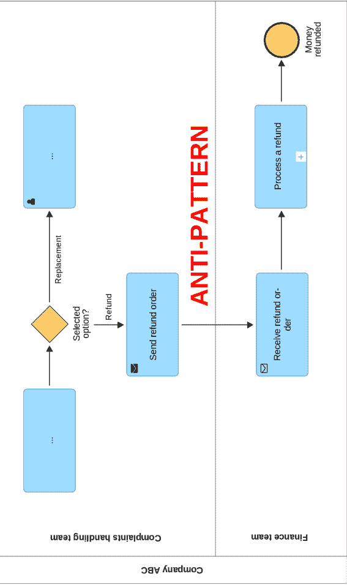

图 8.29 – 反模式——在一个池内发送和接收消息

## 流程的范围 – 开始和结束事件

这种方法很诱人，但不幸的是错误的。由于根据定义，消息仅在池之间传输，并且我们不允许在单个池内发送消息，因此我们也不能以这种方式使用发送和接收任务。

那么，在我们想要显示正在一个团队和另一个团队之间发送电子邮件的情况下，我们可以做什么呢？我们可以使用一对手动或用户（或无类型）任务——即，**Send refund order** 和 **Receive refund order**。

当在我们的描述或分析中，清楚地展示我们如何使用更经典的方法与他人通信很重要时，这种建模可能是有意义的。一个示例可能是仍然使用纸质文档的流程——有人必须亲自携带一份文档信封并将其留在秘书办公室，而另一个人必须去那里取走它。通过记录这两个任务，我们可以展示这种工作需要多长时间。

但是，如果是数字流程，我们可能只需指示团队 A 的某人向团队 B 的某人发送某物就足够了。这是因为由于流程中的下一个任务将在团队 B 的泳道中，流程的逻辑本身就向我们展示了工作已被转移。

到目前为止描述的任务类型是实践中最常用的，但这并不是一个完整的列表。在第 9 章中，我们将了解一些额外的、稍微高级的任务类型并讨论它们的用途。

我们在这里关于发送和接收任务所学到的内容，将在我们讨论 BPMN 中最重要的事件类型时非常有用。在本书的后面，我们将了解一些特殊类型的事件，它们可以替代发送和接收任务。

我们已经知道任务如何让我们展示流程中需要完成的工作。但是，我们如何展示是什么导致我们的流程开始，以及它可以以什么结果结束呢？如我们已经知道，事件是为此目的而使用的。

事件是 BPMN 规范中一个非常有用的元素。它们允许我们展示是什么启动了我们的流程（开始事件）以及我们的流程可能以什么结果结束（结束事件）。此外——这使 BPMN 与其他表示法有所区别——我们可以使用它们来描述流程中可能发生的重要事情（中间事件），以及我们将如何在处理错误、异常和特殊情况时对这些事件做出反应。

BPMN 中有多种不同类型的事件，其中一些对更高级的建模场景（例如，流程规范/自动化）很有用，而另一些在实践中偶尔使用。因此，在本章中，我们将只关注其中几种最常见的类型，没有它们就无法在 BPMN 中进行建模。这将帮助我们了解事件工作原理的基础知识。

## 简单开始事件

开始事件始终显示为带有单条细线的圆形。以下是一个未定义触发器的开始事件。

图 8.30 – 开始事件（无触发器）

让我们从一个简单的开始事件开始。开始事件始终表示为带有单条细边框的圆形。它表示流程启动必须发生的事情（从技术上讲——需要发生什么，以便流程实例或特定“案例”的执行可以开始）。在此情况下，开始事件没有定义特定的触发器（这很容易看出，因为内部没有图标）。

所有开始事件都是捕获型的，这意味着它们被动地监听正在发生的事情，并且只有当发生触发它们的事情时，它们才会创建一个向后流动并使流程开始的令牌。在开始事件之前，没有什么（至少从流程图的角度来看），因此不能有指向开始事件的传入序列流箭头。

## 命名开始事件

BPMN 规范并未规定命名开始事件的特定方式。我喜欢以一种方式命名事件，使其名称清楚地描述流程启动必须存在的某种现实状态。

在实践中也会遇到各种其他方法（如图 8.31 所示），其中一些可能，例如，受流程图（START）的启发。虽然所示的示例从 BPMN 角度来看都没有错误，但它们在信息价值上有所不同。我喜欢使用被动方面，这避免了与流程中完成的工作混淆。因此，我可以给无类型的开始事件命名，例如“需要投诉原因摘要”（用于与我们的投诉处理流程相关的流程）或“需要新员工”（用于招聘新员工的流程）。

## Simple end event

End events are also shown as circles. However, they have a border drawn with a single thick line. The following is an end event without any trigger.

End event

Figure 8.32 – End event (no trigger)

Now that we know how to use start events to show what starts our process, it’s a good time to look at the other end of the spectrum and think about how our process might end. End events are the second element of the process scope. They illustrate what result our process might end with. Start events are, by definition, passive elements. End events are their opposite – they’re always active, which in the BPMN specification is referred to as throwing.

As we know, there can’t be anything before the start event in a process flow, so a sequence flow arrow can’t enter it; only outgoing flows are allowed. On the other hand, in the case of an end event, we can’t place any flow objects after them, such as events, gateways, or activities. Therefore, a sequence flow arrow can enter the end event, but there can be no outgoing sequence flow from it.

Each end event will have a border drawn with a distinctive single thick line, which allows us to easily distinguish it from the start event (which always has a single thin line).

## Naming end events

As in the case of start events, the BPMN specification doesn’t impose special ways of naming end events, so we have quite a bit of freedom. My preference is to name end events so that it’s clear what result the process ends up with – that is, what we achieved. Ideally, this name should emphasize what _happened_ in this process path and not something we _do_. This way, we can see _how_ the process ended, not just that it’s finished, as shown here.

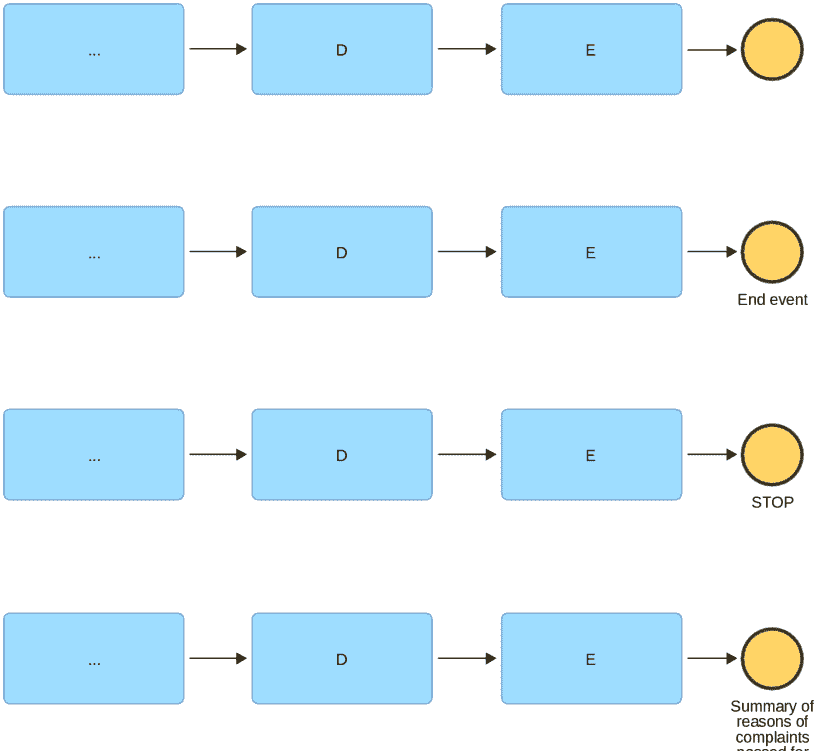

Figure 8.33 – Possible approaches to naming end events

## One or more end events?

It’s also worth noting that BPMN allows us to put multiple end events in a diagram, and this is a very useful option. As we saw in Figure 8.4, a glance was enough to determine what result our process could have, without us having to read the entirety of the diagram.

This is especially helpful when there are exclusive gateways in the diagram. Our process may finish in various other ways besides the “happy end,” and we want to show them clearly for process analysis and improvement.

So, while it’s possible to connect multiple sequence flow arrows to a single end event to show that multiple paths of the process share a common end (for example, in our process, the **Money refunded** end event is sufficient for analytical purposes; we don’t need to emphasize how we make the refund), I’m not in favor of using only one end event where all paths – the happy one and the others – meet.

The standard end event behaves as follows: when a token reaches it, this token is _consumed_ and disappears. If there are no more active tokens within that process instance, the process instance ends, and we can consider that the process has come to an end.

If, on the other hand, there are more tokens in the process, then the entire instance “lives,” so long as at least one token is active. Let’s look at the process example shown in _Figure 8.34_. If we assume that each of the tasks (A through E) lasts for 1 day, how long will the entire process instance live, assuming there are no delays?

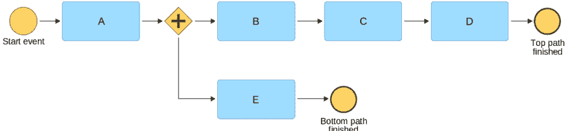

Figure 8.34 – Example of a process with many paths (process instance life cycle)

As you can easily calculate, even though the **bottom** token (that is, the one going to task E) will reach the **Bottom path finished** end event after just 2 days, we still have the **top** token within our instance. So, for the entire process to complete the longest of the paths (ABCD), we need 4 days. Only when task D is completed and the token reaches the **Top path finished** end event can we say that the process instance was completed.

Before we discuss start and end events with triggers, there’s one more interesting thing to say about start and end events without types. From a formal point of view, the BPMN specification doesn’t force us to insert start and end events without types. We can omit them from our diagrams because they’re assumed to be there as **invisible and default** elements.

The only limitation is that we must be consistent in this approach – that is, we can’t skip the start event without a type and must show the end events without a type. However, I don’t recommend such an approach because with properly named events, it only takes one glance to determine when the process starts and what it might end with. Figure 8.35 compares these two approaches:

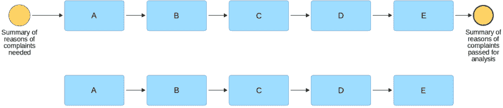

Now that we’ve learned the general rules for dealing with start and end events, we can move on to something a little more complex. As we know from the previous section, which was dedicated to tasks, we can define different types of tasks. These are marked with special icons.

## Message events

As we learned from our complaint handling process, events can also contain additional icons that represent possible triggers. Let’s begin by comparing events for which a message is a trigger since we already know a bit about messages. This will allow us to understand how different types of events behave.

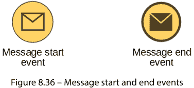

In addition to the rather obvious difference due to the type of events (a start event has a thin border, while an end event has a thick border), we can also see that the envelope icons differ in fill color. Using this example, we can observe a very important principle of BPMN: catching (passive) event icons are always light, while throwing (active) event icons are always dark.

## The scope of a process – start and end events

Message start events indicate that a process is triggered by receiving some information from the outside – from some external entity, another organization, or perhaps a customer or partner. This information can be transmitted in a variety of ways – by letter, email, SMS, telephone, and so on.

For each message, we must always have a specific sender and a specific recipient, and that message exchange is always done between different participants (pools). Messages can’t be sent or received within the same pool. As we’ve seen, the message icon is always an envelope, so the start event that’s triggered by the message must have a light envelope icon.

If we want to show the readers of the diagram where the message comes from, we can draw an incoming message flow arrow, but this isn’t mandatory. A message flow is always drawn with a dashed line, with an open arrowhead at the end and an open circle at the beginning. Figure 8.37 shows the use of a message flow named Complaint, which flows from the Customer pool to the Complaint received start event.

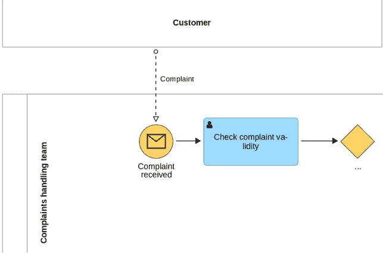

Figure 8.37 – Example of a message flow between a black-box (collapsed) pool and a start event

While this is often helpful, there’s no obligation to show other participants or message flows, so we might as well start our process more easily, as shown in Figure 8.38.

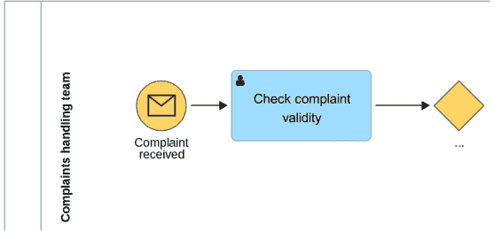

Figure 8.38 – A simplified process without an external participant and message flow

As for naming message start events, as in the case of plain start events, I would suggest using the passive side while referring to the message that starts the process. Possible examples include **Order received**, **Inquiry received**, **Invoice received**, and, as in our example of the complaint handling process, **Complaint received**.

I don’t recommend using the active side so that you don’t confuse the audience by implying that some work is being done within the event (for example, **Receive order**).

Now that we know how the message start event and regular end event behave, let’s consider how the message end event works.

As you can easily guess, this type of end event is marked with a dark envelope icon. Like any end event, it consumes incoming tokens, but since it has a trigger defined, it also does something extra.

Since nothing else happens in the process after the end event, this _something extra_ can be considered a _swan song_ – the last breath of our process, so to speak. For a message end event, this something extra is the action of sending a message.

An example of this behavior might be sending an email to a customer regarding a record of a chat with a consultant or sending a request to evaluate an interaction – for example, a **Net Promoter Score (NPS)** satisfaction survey after the shipment was delivered.

在这一点上，值得注意的是，在高度自动化的流程中，通过结束事件发送消息是有意义的，因为这种发送不需要人工干预。这就是为什么我们通常使用任务发送消息，而结束事件仅用于总结已经发生的事情。这可以在图 8.39 中看到。

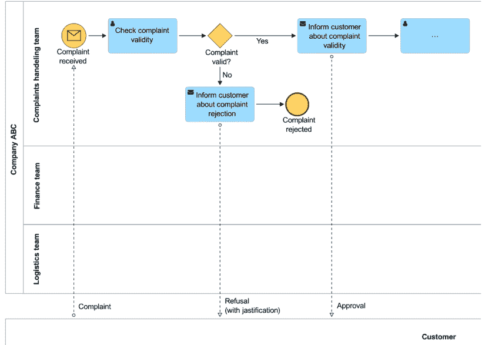

图 8.39 – 示例流程的一部分 – 使用任务发送消息以及事件的正确命名

但是，如果我们想要（并且我们的流程已正确自动化），我们可以从结束事件发送消息，如图 8.40 所示：

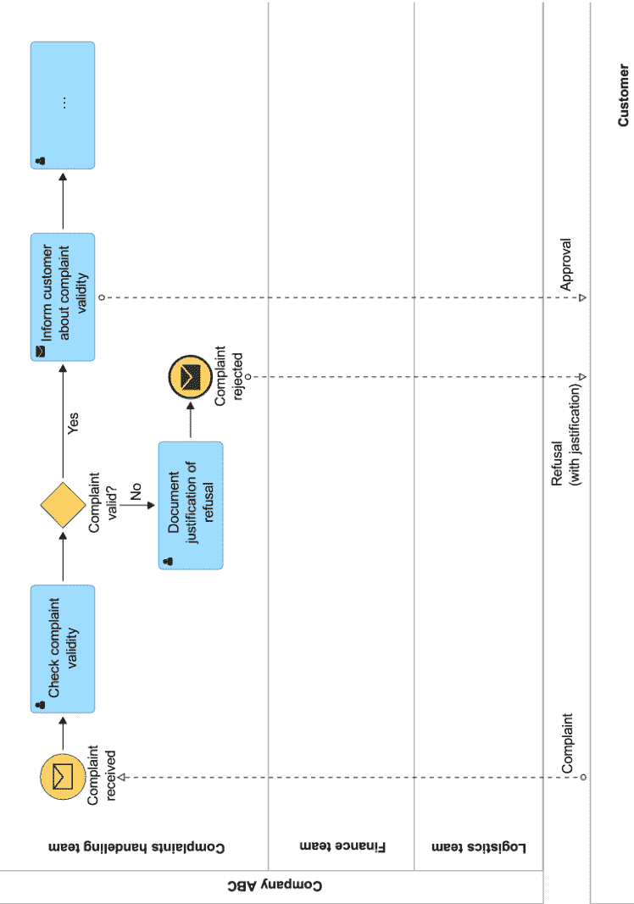

图 8.40 – 示例流程的一部分 – 使用结束事件发送消息

图 8.39 和图 8.40 在含义上相似，但仍有一些差异。在前一张图中，消息流连接到发送任务，而结束事件仅陈述指代前一任务中发生的工作的结果。

在后一张图中，任务仅为发送消息 _做好准备_，因为用户输入拒绝原因。这将在下一步发送给客户（如果你好奇，对于图 8.39，这种准备应该在 **检查投诉有效性** 任务中进行，因为发送任务不应用于编写和发送电子邮件，仅用于发送）。消息由 **投诉被拒绝** 结束事件发送。

如果你使用发送消息的结束事件，值得注意的一点是不要错误地暗示消息被发送了两次——一次由任务发送，另一次由结束事件发送，如图 8.41 所示的反模式。当你不使用消息流（消息流澄清了与外部参与者的通信）时，这种混淆尤其危险：

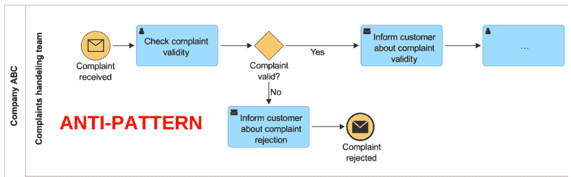

图 8.41 – 反模式 – 使用任务和结束事件发送两次消息

## 定时器事件

现在我们已经学习了使用消息作为示例来建模开始事件和结束事件的更高级规则，是时候熟悉另一种触发器类型——时间了。由于人类无法控制时间，这种触发器类型仅以捕获形式存在，因此不存在定时器结束事件。

让我们了解更多关于定时器开始事件的信息。这些事件具有非常独特的外观，因为其图标是一个时钟表盘。它们用于显示流程在特定时刻开始。这可以是一个特定时刻（例如“季度第一个工作日”、“工作日 下午 6 点”或“12 月 31 日 23:59”）或一个时间段（例如“每 8 小时”）。使用这些类型的事件，我们可以轻松地在流程中表示时间。

图 8.42 – 定时器开始事件

让我们回到我们的投诉处理示例。在讨论 _图 8.31_ 时，我们说，对于我们分析投诉原因以改进流程的相关流程，我们可以使用 **需要投诉原因摘要** 开始事件。

这将显示分析投诉原因的流程是不定期进行的，取决于参与流程的人员的专家决策。但是，如果我们希望作为组织改进的一部分确保一定的规律性，我们可以决定该流程每月定期执行，并且我们总是在每月的第一个工作日执行它。_图 8.43_ 显示了这可能是什么样子。

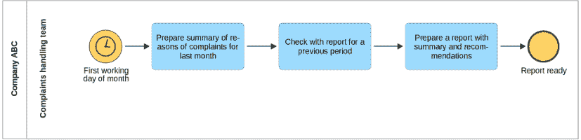

图 8.43 – 示例 – 定时器开始事件在实践中的应用

同样，定时器开始事件可以用于货物运输，将一批包裹分组并在每天一次一起发送，例如，或者用于为通过电汇付款的客户退款的流程中，这样我们的财务团队员工就不必在每次需要退款时都登录网上银行。相反，他们收集一批要进行的转账并在合适的时间一起发送。

在本节中，我们学习了开始事件和结束事件如何让我们传达关于什么可以启动我们的流程以及它如何结束的非常重要的信息。因此，它们定义了我们流程的范围。但是，如果在建模时，我们注意到流程步骤太多，以至于图表不再可读，我们该怎么办？我们将在下一节讨论这个问题。

## 使用子流程改进图表可读性

如我们已知，在创建模型时，一个非常重要的问题是确保它们可以与他人沟通。要实现这一点，我们的模型必须对受众可读。可读性取决于许多方面，但其中一些最重要的方面是模型的大小（它占用多少空间以及包含多少对象）以及阅读的难易程度。

在这一点上，值得注意的是，由于媒介的性质，在书中传达良好的建模实践往往很困难。这就是为什么本书中的一些图表仅在其 GitHub 仓库中提供。

在实践中，我们通常在计算机上创建模型，并以电子方式或纸质副本阅读它们。一本纸质书比标准打印件小得多，因此较大的图表需要旋转并放在单独的页面上；如果它们放在文本中，会有建议将所有内容挤在一起以使其看起来更好。这通常会导致蛇形图，这是一种反模式。

虽然 BPMN 规范本身并不对我们施加限制——包含一个开始事件、一个任务和一个结束事件的图表与包含几百个任务和几十个网关的图表一样正确——但图表的大小对其读者非常重要。

建模专家之间对于图表可以有多大以保持可读性并没有共识。通常认为，理想的图表应该适合一张纸。

我建议创建不超过 20 到 30 个元素的图表。但是，如果我们有一个非常复杂的流程，需要 40、50 个或更多元素才能以适当的详细程度覆盖所有内容，该怎么办？这时子流程就派上用场了。

子流程允许以层次结构进行建模。虽然 BPMN 不支持高级流程架构，但它确实允许我们以非常方便的方式在不同图表之间移动，从一般到具体。

让我们看看图 8.44，它显示了我们处理投诉的示例流程。更准确地说，我们正在查看当所选投诉处理选项为退款时发生的情况的部分。

我们可以看到，索赔处理团队的一名员工需要下令退款。之后，该退款由财务团队处理。

图 8.44 – 带有可见子流程的示例流程，允许我们导航到较低级别的图表

## 嵌入式子流程

我们在这里看到的元素是一种标准的子流程类型，称为 **嵌入式子流程**。它通常以折叠形式出现，显示为一个带有圆角的矩形，底部有一个加号标记。

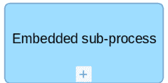

图 8.45 – 嵌入式子流程

当然，处理退款是一件相当复杂的事情。当地法规可能有所不同，就像公司政策一样，但我们可以假设，如果需要退款，退款应使用客户选择的相同方式进行。

因此，我们应该不仅支持卡支付，还应支持电子钱包/支付系统、银行转账，以及可能更多方式。

这些细节对关心投诉处理流程的人来说相关吗？我们应该将它们添加到投诉处理流程图中吗？对于大多数受众来说，这可能太多细节了。因此，与其帮助我们的读者，不如说会阻碍沟通。因此，根据金发姑娘原则，最好只显示必要的内容。

我们在实践中如何做到这一点？与其将所有内容添加到投诉处理流程的主图中，不如我们可以创建一个新图表，显示我们如何处理退款，并将其与主图中的相应子流程对象链接起来。这种层次化建模使得只需单击一下即可轻松移动到较低级别，从而便于处理关联的图表。

## 流程中的责任 – 池和泳道

正如我们已经知道的那样，BPMN 不仅可以让我们描述组织内流程中发生的事情，还可以描述我们如何与其他实体交互。为此，我们使用池和泳道。

池代表流程中的参与者，而泳道代表该池的逻辑划分。池和泳道始终表示为矩形，但池的名称通常通过一条线与其内容分开，而泳道没有这样的线。

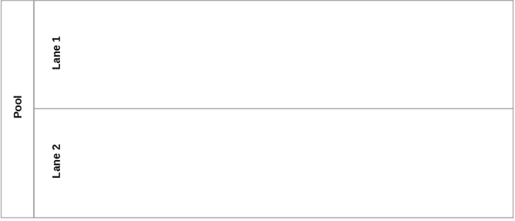

图 8.52 – 带有两个泳道的池

有趣的是，在 BPMN 中，池既可以代表执行流程的组织，也可以代表该组织的部门或另一个业务角色。关键问题是视角，因为我们假设在池内，流程以某种方式受到控制。这可能是因为流程已被自动化且其步骤由工作流应用程序控制而产生的控制。当然，控制也可以由流程的所有者行使，他确保流程正确执行，并且流程中不会出现问题。

虽然这两种方法都有可能，但我建议根据池代表整个组织、泳道代表各个部门和组织单元的假设来建模流程。这种建模方式支持将流程管理视为一项团队运动的思维方式。

让我们回到泳道——它们始终代表池的某种子分区，但我们在这里有很大的自由度。理论上，泳道可以按例如增加价值或使能价值的方式对任务进行排序，但在实践中，泳道通常用于显示对单个流程步骤的责任。在这种情况下，泳道对应于组织单元或角色。

另一种方法是，每个单元都有自己的流程，并与其他池交换消息，如果我们的优化项目范围仅限于单个部门或团队，这可能看起来很诱人，因为我们可以忽略其他人在流程中需要做什么。然而，这往往会加强筒仓思维，因此不是一种推荐的建模方法。

这些方法翻译成了不同的池命名方式。通常，池以其所代表的参与者命名。然而，在为具有此要求的平台创建流程自动化模型时，池与其中流动的流程同名的情况也很常见。类似的方法也可以在简单的建模工具中找到，这些工具没有其他地方来输入所描述流程的名称。

正如我们在示例图中已经看到的，BPMN 允许我们描述带有内容的池，也可以显示存在一个我们与之交换消息的流程参与者，而无需显示该参与者的详细流程。

在这种情况下，我们使用折叠（黑盒）池，其内容不显示。此类池没有将名称与内容分隔的线（因为没有内容），并且其名称通常显示在中间。请注意，您也可以添加一个普通池并将其留空。

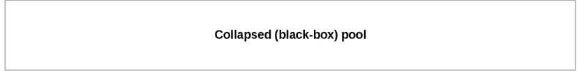

图 8.53 – 折叠（黑盒）池

BPMN 的独特功能之一是支持显示一个参与者的流程如何与其他参与者交互。虽然其他流程建模表示法允许我们使用不同类型的泳道显示谁负责什么，但 BPMN 允许更多内容。

## 私有流程

第一个有趣的区别是，在 BPMN 中，流程可以定义为私有或公共。**私有流程**以适当的详细程度描述正在分析的组织中发生的事情。它们可用于文档和分析目的（**不可执行**的私有流程模型）或流程自动化目的（**可执行**的私有流程模型）。

从设计上讲，可执行图表应包含更多技术信息来自动化流程，例如用户表单、用于控制流程通过不同路径流动的技术表达式（取决于接收到的数据）等。

另一方面，用于文档的图表只能包含为其创建目的所需的详细程度。图 8.54 显示了我们流程的简化版本，展示了作为流程文档创建的图表可能是什么样子（它也可能包含流程步骤的描述，但此处已隐藏）。

图 8.54 – 作为文档目的的私有流程示例流程

## 流程中的职责 – 池和泳道

有趣的是，从正式角度来看，我们并不总是需要将池插入图表中。规范允许我们为一个选定的流程省略它。因此，它再次调用了不可见默认元素的概念。

我不推荐这种节省空间的方法，因为对于许多受众来说，划分不可见池的泳道视图非常令人困惑，而且，去掉泳道会使更难以看出谁负责流程中的哪些步骤。

## 公共流程

另一方面，**公共流程**用于仅显示与参与者之间的通信相关的流程元素（基本上，与发送和接收消息相关的元素）。公共流程是私有流程的缩写版本，允许我们快速向业务伙伴展示他们需要知道的关于我们开展业务方式的信息，而无需用他们不感兴趣的流程步骤的不必要信息来负担他们。

图 8.55 – 作为公共流程显示的示例流程

## 协作图

让我们再进一步，展示不同参与者如何使用**协作图**协同工作。这些图包含两个或多个池（展开或折叠），消息在这些池之间交换。

通常，协作看起来像我们从图 8.1 中知道的示例——在主池中，我们拥有所有必要的流程步骤，而不仅仅是消息交换所需的步骤。其他池可以折叠，也可以在其中包含其流程。

图 8.56 – 作为协作显示的示例流程

如果我们只想显示池之间的通信，可以使用所有池都折叠的协作图，但这并不常见。

## 最佳实践和应避免的错误

说到池和泳道，也值得记住三个 BPMN 建模原则，它们可以帮助我们避免许多常见错误（我已在图 8.57 中包含示例）：

- 流程在特定池内流动，并可以在不同泳道之间移动，从开始事件经过各种活动和网关到结束事件。它始终沿着序列流箭头流动（没有“间隙”或“跳跃”）。
- 序列流只能在池内发生；它不能跨越池的边界。
- 消息流只能在池之间发生；它不能在单个池内进行。这也适用于同一池中泳道之间的消息发送和接收。

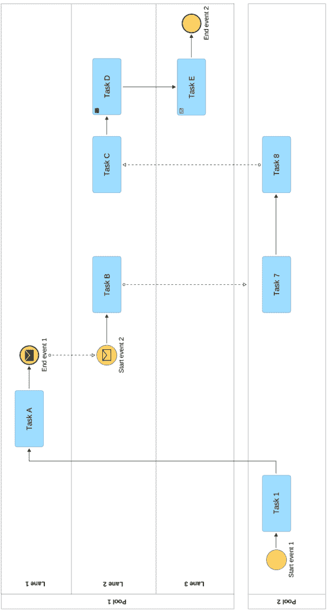

### 反模式

图 8.57 – 反模式 – 与池和泳道相关的最常见错误摘要

## 流程中的职责 – 池和泳道

首先引起我们注意的是 **Task 1** 和 **Task A** 之间的序列流，它们位于两个不同的池中。这不符合表示法规则，因为序列流不能在不同池之间传递——它始终与特定池相关。

如果我们仔细观察，还可以看到一个更微妙的错误——流程从 **Pool 2** 中的 **Start event 1** 开始，然后继续在 **Pool 1** 中进行。这也是错误的，因为 **Pool 1** 应该有自己的开始事件，该事件很可能会有一个来自 **Task 1** 的传入消息流。

下一个错误是 **Lane 1** 和 **Lane 2** 过于独立，因为它们有自己的开始和结束事件，而流程应该贯穿 **Pool 1** 的整体。这将强调泳道只是池的划分，流程与池相关联，而不是分配给特定泳道。

另一个不容易发现的错误是，来自 **Task B** 的消息流没有进入 **Pool 2** 中的 **Task 7**，而是附加到池边缘。诚然，BPMN 允许我们在池边缘开始和结束消息流，但这仅适用于不包含内容的池（通常是折叠池）。如果池确实有内容，那么我们应该准确地显示消息流正在指向或来自哪里。

错误还出现在另外两个地方：在 **Pool 1** 中，我们可以看到 **Task B** 和 **Task C** 没有通过序列流连接。而在 **Pool 2** 中，我们在 **Task 1** 和 **Task 7** 之间的序列流中存在一个间隙。这两种情况都违反了序列流中不能有“间隙”或“跳跃”的规则。

在 **Pool 2** 的情况下，我们还可以看到流程是不完整的。它有一个开始事件和 **Task 1**，但随后出现了中断。后来，我们可以看到 **Task 7** 和 **Task 8** 与 **Pool 1** 中包含的流程交换消息，但我们不知道 **Task 8** 之后是什么，因为末尾没有结束事件。

这种建模方式，即我们描述流程的一些但不是所有元素，甚至不费心将它们正确连接起来，是不合适的。

如果我们不需要详细信息，那么使用折叠池表示参与者就足够了。如果我们只关心对通信重要的元素，我们使用公共流程，它可能不包含所有元素（如我们的示例，其中有 **Tasks 1**、**Task 7** 和 **Task 8**），但它仍然需要有效。当然，我们也可以详细建模 **Pool 2** 中包含的流程。

最后一个重大错误——在单个池内发送消息——也出现在几个地方。我们第一次看到它是在 **End event 1** 和 **Start event 2** 之间。这是将流程“切片”为每个泳道的小型流程的结果：不是从整个组织（由池表示）的角度，而是从其组织单元（由泳道表示）的角度。

当然，**End event 1** 和 **Start event 2** 之间不能交换消息，因为我们不允许在单个池内有消息流（或消息交换）。

第二个稍微不那么极端的与消息交换相关的错误出现在 **Pool 1** 的末尾，其中 **Task D** 和 **Task E** 都通过序列流连接，但分别被标记为发送和接收。

只有当我们向 **Pool 2** 发送东西并从中接收东西时，这才说得通，但我们看不到任何表明这种用法的迹象。因此，这是不正确的——我们不允许在单个池内发送消息，即使理由是：“毕竟，我正在给另一个部门的同事发送一封电子邮件，他们收到邮件并了解其内容。”

我们在本节中更加熟悉的池和泳道有时对于传达关于流程的非常重要的信息（即谁参与了流程以及谁负责流程的每个步骤）可能非常有用。然而，我们可能希望在图表中包含更多信息。

## 使用工件向图表添加更多信息

如我们已知，工件用于传达关于图表的更多信息，而不影响其解释和执行方式。在本节中，我们将了解更多关于 **文本注释** 和 **组** 的内容。

### 文本注释

最常用的工件类型是文本注释，它允许你向图表中插入文本。

这个注释非常简单——它始终呈现为一个开放的方括号，后跟文本。根据我们的需求，我们只能更改对象的大小，以便文本占用更多或更少的空间。

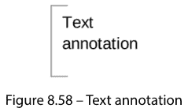

尽管简单，注释可以非常有用。首先，它们包含的文本始终在图表中可见（当然，除非我们缩小对象，使文本不再适合可用空间），这使得它在打印输出中容易发现，并可供不是 BPMN 专家且不了解许多对象可能具有额外不可见信息（描述，但不止于此）的查看者访问。因此，注释允许我们传达与流程上下文相关的相关信息。

其次，因为注释易于看到，我们可以使用它们来记录流程中的问题和改进想法。当然，这种用法主要在我们使用的工具不提供更好的变更管理机制时才有意义。

第三，文本注释可以用于各种场景。BPMN 规范定义了许多不同的属性，但——如前面所述——作者决定其目标不是支持所有可能的业务建模场景。因此，如果我们使用的工具不支持流程的时间成本分析，并且我们想显示执行单个流程步骤平均需要多少时间，或按价值创造对流程步骤进行分类以用于文档和改进目的，我们可以使用注释。

同样，我们可以使用文本注释来记录流程负责人是谁，或记录流程的目的或对我们重要的其他属性。

使用注释时，值得记住的是，我们在其中写的任何内容都被视为纯文本——它不影响所描述流程的行为，不是自动化的基础，也不允许进行更高级的分析。我们可以开玩笑地说，注释相当于我们附在重要文件上的彩色便利贴，上面有给收件人的信息，告诉他们应该注意什么，在哪里签名，等等。

注释可以链接到图表中选定的元素，也可以指整个图表。在第一种情况下，注释使用 **关联** 箭头连接到另一个元素（例如任务），该箭头由虚线表示。

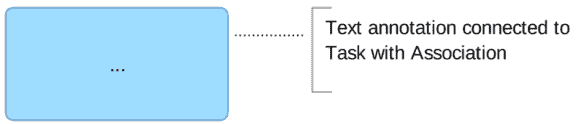

图 8.59 – 文本注释和关联箭头

在第二种情况下，我们可以简单地将注释 *自由浮动* 放置，而不将其连接到图表中的其他元素。我们可以在以下图表片段（*图 8.60*）中看到这两种方法的示例。使用关联的文本注释链接到开始事件，而放置 *自由* 的注释展示了如何可视化流程负责人及其目标。

这个图表还说明了使用工件的一些风险：它们对于在图表中显示重要内容非常有用，但添加得越多，整个图表的可读性就越差，因此最好保持适度。

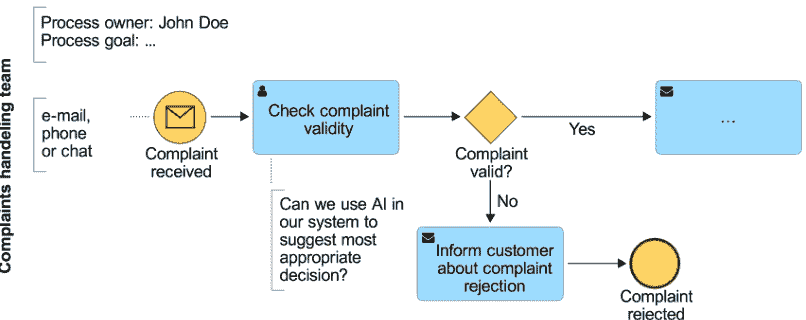

图 8.60 – 使用注释提供关于流程的附加信息的示例

### 组

另一种工件类型是 **组**。组，如同文本注释，始终以一种方式呈现。它显示为带圆角的矩形，但很难与任务和子流程混淆，因为它有一条非常独特的线，由交替的短划线和点组成（类似于摩尔斯电码），并且不通过箭头连接到图表中的其他元素。

#### 组

图 8.61 – 组

当我们希望引起接收者注意所选图表元素有共同点——它们属于某个共同类别时，会使用组。如果我们想使用类似文本注释的类比，我们会说使用组就像用荧光笔标记文档中的某些元素。

在实践中，添加组涉及调整其大小以覆盖我们想要的所有元素，并为其赋予一个适当的名称，暗示这些元素有什么共同点。这使我们能够突出表示快乐路径的图表元素或将以类似方式处理的元素（例如，“在实施 XYZ 系统后将被消除”）。

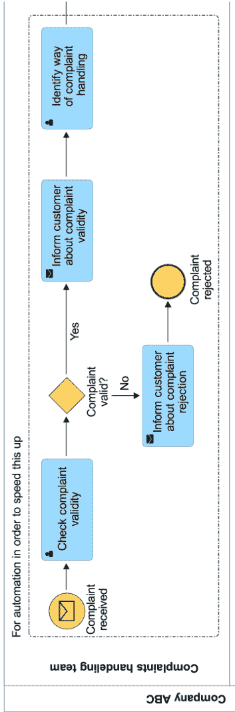

图 8.62 – 使用组突出显示流程部分的示例

## 使用数据对象在图表中显示数据流

BPMN 规范还允许向图表添加其他类型的工件。然而，这更多是一种理论可能性，因为它们需要流程建模工具支持，而我们在实践中不太经常遇到这种情况。值得记住的是，根据 BPMN 规范的规则，它们必须与已经定义的对象看起来不同——也就是说，你不能创建一种新的工件类型，它是带有单个细边框的圆形（因为这样的符号已经为开始事件保留），但多边形的形状是允许的。

本节中涵盖的工件使我们能够用附加信息扩展 BPMN 图表，但不会转化为流程的解释和执行方式。

现在，是时候发现 BPMN 对象的最后一类了。这些对象允许我们向图表添加更多关于流程的上下文，但方式可以（至少在理论上）不仅仅是纯粹的信息性。

数据使用是 BPMN 超出其核心关注点（即描述流程）的另一个领域。值得注意的是，我们将在本节中讨论的元素使我们能够显示数据如何在流程中流动，但这并不是 IT 专业人员可能需要充分建模数据所需的全部内容——例如，它们不提供支持以确保数据结构及其依赖关系得到表示。

还值得注意的是，BPMN 中的数据层在 IT 工具中通常具有较弱的支持级别——尤其是流程自动化工具——比记法中的其他元素要弱。许多流程自动化工具使用自己的方法来描述流程中的数据，因此 BPMN 规范中包含的数据建模概念通常仅被视为文档，并不影响流程的执行方式。甚至存在自动化工具在从其他建模工具导入图表时删除数据对象的情况！

如我们所知，表示数据的基本对象是数据对象。它的符号看起来像一张右上角折角的纸。然而，值得注意的是，数据对象可能对应也可能不对应物理文档（规范强调数据可以指物理或信息元素）。通常，我们用它来描述作为流程一部分处理的某组数据。此类数据的示例可能是“投诉文档”、“转账数据”和“运单”。

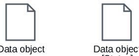

图 8.63 – 数据对象

除了名称之外，数据对象通常在名称后方的方括号中显示状态。得益于此状态，我们可以立即看到数据因流程中的操作而发生了哪些变化。例如，在我们针对**投诉文档**数据对象的流程中，可以定义以下状态：待分析、已拒绝、已接受和已关闭。当然，这种建模方式会占用更多空间，但它允许我们更详细地描述图表中数据的变化情况。

为了展示数据如何在流程内的活动之间流动，我们使用**数据关联**箭头。由于箭头末端带有箭头，你可以立即看到数据从哪里流向哪里。重要的是，数据流不必与流程流一致，因此我们可以有一系列 ABCD 任务，以及一种数据流，其中数据来自任务 A 并作为任务 D 的输入（假设它在步骤 B 和 C 中未被处理）。

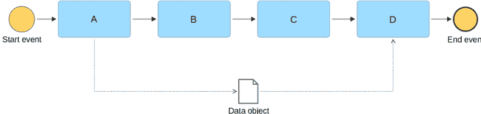

图 8.64 – 使用数据关联显示数据流

还值得一提的是，数据对象和数据存储（我们稍后将介绍）都不能通过序列流与任务连接。这种错误对于拥有长期流程图经验且开始使用带有简单绘图工具的 BPMN 的人来说尤其危险，因为这些工具通常没有内置正确符号的规则。

说到 BPMN 中的数据层，最好意识到标准类型的数据对象是作为给定流程的一部分进行处理的东西——一种存储在计算机 RAM 中并在计算机关闭时被“清理”的变量。这意味着在特定流程实例终止后，我们无法访问这些数据，因为它们不是永久的！

如果我们想显示流程中的数据是永久存储的，应该使用另一种类型的对象——**数据存储**。数据存储由数据库图标（圆柱体）表示。在这里，你应该注意另一个惊喜——尽管其外观暗示数据以电子形式存储，但数据存储也可以以物理形式使用，例如文件柜。

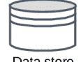

图 8.65 – 数据存储

数据存储也可以通过数据关联箭头连接到图表中的其他元素，以显示数据如何流动。如果图表相当大，我们可能希望避免数据存储上有太多连接器。在这种情况下，可以将同名的数据存储多次插入到图表的不同部分，以提高其可读性。如果你对技术方面感兴趣，在这种情况下，我们的图表有一个数据存储定义和对该公共定义的多个引用，但这只能通过分析 BPMN 图表导出文件来注意到。

由于数据存储看起来像样式化的数据库，并且 BPMN 没有更好的方式来直观表示流程中使用的 IT 系统，因此常见的情况是数据存储代表流程中使用的应用程序。当然，这通常是简单建模工具的情况，这些工具没有共享存储机制和字典定义。

最后两种类型的数据对象用于显示进入和离开流程的数据。这些分别称为**数据输入**和**数据输出**。由于它们代表进入和离开流程的数据，它们不共享普通数据对象的非永久特性。

数据输入和数据输出的符号与普通数据对象的符号非常相似，但它们在左上角有一个额外的箭头图标。正如你所期望的，BPMN 中标记活动和被动的规则得以保留，因此数据输入图标（进入流程的数据，例如来自前一个流程）具有浅色填充，而数据输出图标（离开流程的数据，可能发送到另一个流程）具有深色填充。

图 8.66 – 数据输入和数据输出

除了象征数据对象类型的图标之外，可能还有另一个标记——三个垂直短划线。这称为**集合**。在实践中，当我们想要显示我们正在处理的不是一张发票，而是一整批发票，或者我们正在向 CRM 系统输入多个项目以包含在我们想要生成的报价中时，这种标记可能会出现。通常，如果我们将此标记与数据对象一起使用，应该考虑图表中的任务和子流程是否以一种方式描述，表明正在处理更多项目。我们将在第 9 章中了解更多关于此主题的内容：

图 8.67 – 集合

与 BPMN 中数据对象相关的最后一个有趣方面是多级流程图结构中此数据的可访问性。在单个图表中，行为相当合乎逻辑，因为该图表中包含的数据对象可以被该图表中的所有活动访问。

但是，如果我们将一个子流程插入到图表中，该子流程指向另一个图表，而该图表也包含另一个数据对象，会发生什么呢？位于更高级别图表中的数据对象将可被其图表和较低级别图表中的所有活动访问，但（值得注意的是）位于较低级别图表中的数据对象将仅可被更高级别图表中的子流程、其图表中的活动以及可能来自更低级别图表的活动访问。

这可能听起来有点技术性，这是有充分理由的——数据建模是 BPMN 中稍微高级的元素，更适用于以更复杂的流程分析为目标创建的图表。在使用数据对象和存储于旨在作为面向广泛受众的流程文档的图表之前，我们应该仔细考虑它是否有助于我们实现沟通目标。

记法的进一步元素也将如此，我们将在下一章中讨论。它们提供了许多有趣的可能性，但可能并不总是对每个人都直观，因此应谨慎使用。

## 摘要

在本章中，你了解了 BPMN 的最重要元素。借助 BPMN，你可以创建不仅作为流程文档和流程分析，还为未来流程自动化程序奠定基础的图表。我们学习的元素非常流行，其中大多数对于阅读图表的人来说应该是直观的，即使他们不是 BPMN 专家。通常，开始使用这样简单形状的图表是个好主意，并通过向流程步骤添加描述或（在需要时）使用 BPMN 的其他元素提供更多信息来迭代地对其进行工作。

在下一章中，我们将基于迄今所学的内容，介绍 BPMN 中更高级的概念和形状。

## 进一步阅读

如果你想了解本章涵盖的更多概念，我建议查看 Bruce Silver（知名专家）编写的《BPMN Quick and Easy Using Method and Style: Process Mapping Guidelines and Examples Using the Business Process Modeling Standard》。

除了本章在 `https://github.com/PacktPublishing/Practical-Business-Process-Modeling-and-Analysis/tree/main/Chapter08` 上提供的资源外，我还建议查看标准的官方网页：`https://www.bpmn.org/`。

## 立即解锁本书的独家权益

扫描此二维码或访问 packtpub.com/unlock，然后按书名搜索此书。

注意：开始前请准备好您的购买发票。

