## 高级 BPMN

在第 8 章中，我们了解了 BPMN 的关键元素。有了这些知识，你可以轻松理解大多数实际图表。但是，BPMN 还允许你创建用于流程分析和自动化的更复杂图表。为了帮助你从这些额外可能性中受益，我们将介绍 BPMN 的更高级元素。

我们还将讨论 BPMN 如何扩展以支持决策管理、通过案例管理实现的知识密集型流程、模拟、风险管理、使用 RACI 显示职责等概念。

在本章中，我们将介绍以下主要主题：

- 如何使用事件处理 BPMN 中的特殊情况
- 何时以及如何使用其他类型的任务、子流程和网关
- 如何使用其他符号和属性扩展 BPMN

> **注意**
> 本章由 Zbigniew Misiak 撰写。
> 本章的其他资源已上传至：`https://github.com/PacktPublishing/Practical-Business-Process-Modeling-and-Analysis/tree/main/Chapter09`。

## 其他类型的事件

在第 8 章中，我们了解了定义流程范围的最重要的启动和结束事件类型。但是，值得注意的是，BPMN 还允许你建模中间事件，顾名思义，这些事件发生在流程过程中：在流程开始后、结束前。


## 中间事件—基础

**中间事件**表示为中心带有图标的圆形，指示其触发器，与所有其他事件一样。但是，您可以通过查看其边框轻松将其与开始事件和结束事件区分开来。开始事件始终以单细线作为边框，而结束事件具有一条单粗线，中间事件始终具有双细线。


图 9.1 – 比较：开始、中间和结束事件

中间事件有不同的变体。最常见的是，它们是流程的一部分，用于显示流程已达到某个特定状态，或者流程必须等待某个事件发生后才能继续。正如您所期望的，我们可以应用一个熟悉的概念：**抛出（主动）**和**捕获（被动）事件**。

与开始和结束事件的情况一样，也可以存在没有定义触发器的中间事件。这种类型的事件内部没有图标，因此是一个边框为双细线的简单圆形。没有触发器的中间事件始终主动行为；它是一个抛出事件（尽管从视觉上无法猜测，因为没有图标）。这种情况相当少见，但可以用于显示流程已达到某个重要阶段（**里程碑**）。

中间事件也可以用于标记流程中的异常、错误和特殊情况。为此，使用**边界中间事件**。它们始终附加到任务或子流程的边界，为这些任务或子流程提供异常处理。边界中间事件始终是捕获（被动）元素，其行为类似于哨兵。它们用于“监听”可能影响其所附加活动执行的事项，并指定如何处理这些情况。

一般来说，有两种可能的选项：发生某些事情迫使我们中断正在进行的工作（这由**中断中间事件**描述），或者在不中断当前正在执行的活动的情况下，可以导致我们在“旁边”做一些额外的事情（这就是**非中断中间事件**的用途）。

## 消息事件—回顾

让我们从学习**消息事件**开始——即消息作为触发器的事件。为了帮助您更轻松地了解这一点，我们将使用投诉处理流程的一个略有修改的版本，在该版本中，我们使用中间事件（而不是任务）与客户通信。

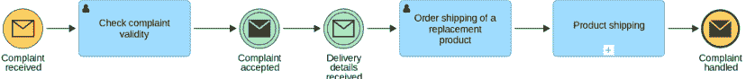

图 9.2 – 使用示例：投诉处理流程中的开始、中间和结束事件

由消息触发的开始事件与我们之前讨论的相同——它仅表示当客户关于投诉的消息到达我们公司时，流程开始。

发送消息的结束事件也应该看起来很熟悉。它告诉我们，当我们的**产品发货**子流程结束时，处理投诉的主流程也结束，但除此之外，我们向客户发送一条消息（例如电子邮件），告知投诉已关闭，并很可能附带一个调查链接，以便我们了解客户对投诉处理流程的满意度。

## 捕获和抛出中间事件

**图 9.2** 中值得注意的新项目是两个中间事件：**投诉已接受**和**交付详情已接收**。对于这两个事件，消息都是触发器，如对象内部的信封图标所示。正如您在示例中所见，主动（抛出）事件具有深色信封图标，而被动（捕获）事件具有浅色图标。所有中间事件都以这种方式行为，使图表的含义易于解释。

让我们稍微复杂化一下示例，并添加两个边界中间事件，两者都将附加到**订单发货替换产品**任务。如明亮图标所示，两个事件都是被动的，因为它们的角色是“监听”其所附加活动执行期间是否发生特定事项，并指定我们的反应将是什么。

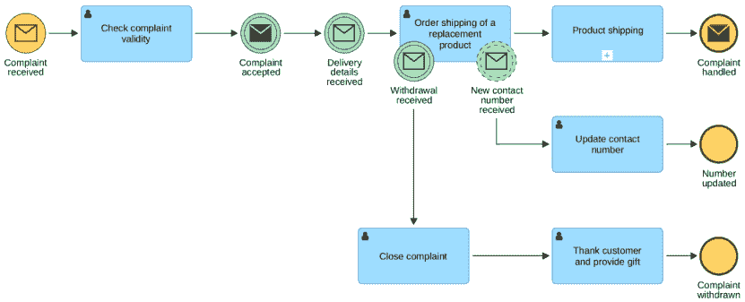

图 9.3 – 使用示例：投诉处理流程中的边界中间事件

## 中断和非中断边界事件

让我们想象一下，我们需要处理一种（假设的）情况，即客户撤回其索赔，因为他们确定问题不是我们公司或快递公司的过错，而是一个孩子在玩耍时撞到了包裹并导致其内容物损坏。在这种情况下，完成**订单发货替换产品**任务没有意义，因为我们不需要发送替换产品。在关闭投诉后（也许在 CRM 系统中标记），我们可能希望感谢客户的诚实，并作为一份小礼物，给他们下次订单的折扣。

我们可能希望响应的第二种情况是客户方面更改联系电话。如果我们的客户在投诉时不小心提供了错误的号码（例如商业电话），他们可能希望更改为不同的号码（例如私人电话），以便快递拨打正确的号码。在我们仍在订购发货期间，可以随时进行此更改，但必须在我们进入产品发货子流程之前发生（那时进行更改就太晚了）。

正如您所见，在这两种情况下，边界事件包含相同的图标，因为它们正在等待消息。此外，两者都有指向处理这些特殊情况所需活动的传出序列流。用于边框的不同类型的线条表明，这些事件在中断其所附加活动方面可能具有不同的含义。

非中断边界事件具有虚线双细线，而中断边界事件的边框为实线双细线。你如何记住这一点？这个技巧可能对你有帮助：实线表示“自信且果断”的事件。当它发生时，它会从其“父级”（其所附加的活动）中拿走令牌，从而中断该活动，并使用令牌进行其目的。另一方面，虚线表示事件是“害羞”的，为了不打扰其“父级”，它会产生自己的令牌并执行一些额外的流程步骤，而不打扰“父级”。

有趣的是，中间捕获事件和边界捕获中断事件之间没有视觉差异——两者都有双实线和带有浅色填充的图标。然而，它们在属性方面有所不同（当然，这取决于您使用的工具），以及在事实方面有所不同：作为流程一部分的中间捕获事件具有入站和出站序列流，而附加到活动边界的边界事件只能具有出站序列流。

值得注意的是，边界事件并不总是准备好执行其工作。边界事件（有一个例外，我们将在本章后面介绍）仅在其所附加的任务或子流程处于活动状态时才“监听”。

在实践中，它是如何工作的？如果我们的边界事件正在等待的消息在我们开始任务之前或刚完成任务后到达，它将被忽略。其他类型的边界事件也会发生同样的情况。

有时，这是好事，因为它允许我们准确地显示特定流程步骤的异常处理。但是，如果我们想显示两个任务的异常处理相同，我们应该为每个任务添加一个边界事件，或者将两个任务放入一个子流程中，并为其添加一个边界事件。

如果我们想显示我们可以在整个流程中处理某种情况，该怎么办？幸运的是，BPMN 规范通过一种特殊的子流程和相关的特殊开始事件使这成为可能。

## 事件子流程

这些特殊的子流程称为事件子流程。就其用途而言，它们是 BPMN 中相当不寻常的元素，因为我们不会将它们作为正常流程的一部分插入（没有序列流可以进入或退出它们），而只是将它们放置在泳道中的某个位置。这足以表明它们负责处理该流程的异常。


Figure 9.4 – 事件子流程的可视化与使用

另一个不寻常的方面是它们的可视化——与所有子流程一样，它们具有圆角矩形形状，但带有不寻常的虚线边框。

与其他子流程一样，它们可以用于层次化建模（由 + 图标表示）。不过，更常见的是，它们以展开形式使用——内容立即可见，且没有 + 图标。

这种第二种情况有时会导致混淆，尤其是当你使用的工具中所有记法元素都是黑白色时，因为很容易将此类子流程与组混淆，尤其是当图表缩小且难以区分虚线与点划线时。

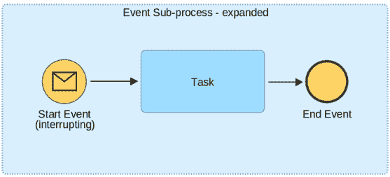

Figure 9.5 – 展开的事件子流程

事件子流程更具挑战性，但值得学习，因为它们能够为整个流程启用异常处理，这有时非常有用。我发现，将事件子流程视为边界事件的“年长兄弟”很有帮助。它们可以中断整个流程，也可以在不中断流程的情况下执行。不过，它们也有更多相似之处。你将在下文中发现这些相似之处。

## 事件子流程中的启动事件

每个事件子流程始终具有一个带有定义触发器的启动事件。同样，这里与边界事件有很强的相似性，因为绝大多数触发器组合对于边界事件和这些子流程的启动事件都是相同的。

让我们以消息为例，看看这在实践中是如何工作的。由消息触发的边界事件可以是中断型或非中断型。要区分它们，只需查看它们的边框即可。中断事件用实线标记，而非中断事件用虚线标记。

在中断型事件子流程中，由消息触发的启动事件带有一个浅色填充的信封图标。由于事件子流程以中断方式行为，启动事件的边框是用实线绘制的。这意味着中断型事件子流程的启动事件在视觉上与“正常”启动事件相同。相比之下，非中断型事件子流程中的启动事件的边框是用虚线绘制的。这两种变体都在 Figure 9.6 中显示。

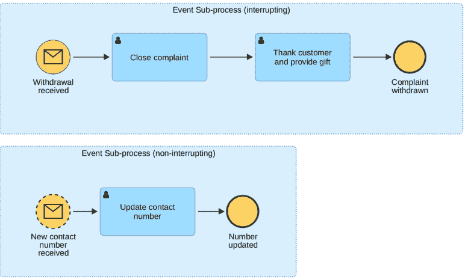

Figure 9.6 – 事件子流程：中断型和非中断型（由消息触发）

现在我们已经了解了使用消息示例的不同类型中间事件的工作原理，是时候讨论其余可能的触发器了。为了帮助你学习，我们将从一个与消息行为非常相似的触发器开始。

## 信号事件

从上一节中，我们知道当我们想要展示不同池之间的信息交换时，消息非常有用，始终有一个发送者和一个接收者。但是，如果我们的流程中存在信息交换，但不满足这些条件怎么办？

这时，**信号事件**就派上用场了。你可以将其视为消息的孪生兄弟，因为这种触发器类型出现在所有可以使用消息作为触发器的事件类型中。然而，它允许我们绕过消息事件的限制。

虽然消息图标始终是一个信封，但信号图标是一个尖端向上的等边（正规）三角形。与往常一样，对于捕获信号事件，三角形具有浅色填充，而对于抛出信号事件，它具有深色填充。

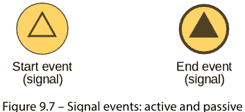

## 信号与消息

在讨论信号类型示例之前，值得提及信号的双重性质。首先，BPMN 的创建者希望描述这样一种情况：有一个发送者，但有许多可能的接收者——因此得名“信号”。正如救护车警笛不是针对某个特定司机，而是针对该地区的每个司机一样，信号会通知所有潜在相关方某个情况，但他们如何反应则由他们自己决定。一个很好的例子是在门户上发布招标公告。此类信息由一个实体发布，但通常有许多接收者。也没有确定性谁会对信号做出反应。

其次，信号有源于克服消息限制的愿望而产生的额外用途。对许多人来说，发送和接收消息的概念非常有用，但他们发现很难接受这样一个限制：消息的发送者和接收者是拥有各自池的两个不同参与者。由于并非总是可能，信号有第二个用例：它们可以用于在不同池之间以及在一个池内传输信息。这样，你可以展示你正在接收来自同一组织同事的信息。此类信号启动事件的示例可能是 **Payroll transfers confirmed**。

如前所述，信号的行为与消息非常相似，因此以信号为触发器的中间事件既可以是捕获型也可以是抛出型，在边界事件的情况下，它们既可以是中断型也可以是非中断型。启动事件（包括与事件子流程关联的启动事件）和结束事件也是如此。

_Figure 9.8_ 显示了各种信号事件的示例。假设信号 1、3、4、5、7 和 8 各不相同，我们以不同方式对它们做出反应。例如，**Signal 4** 将导致我们中断 **Task 2**，而 **Signal 7** 将导致我们中断整个流程。

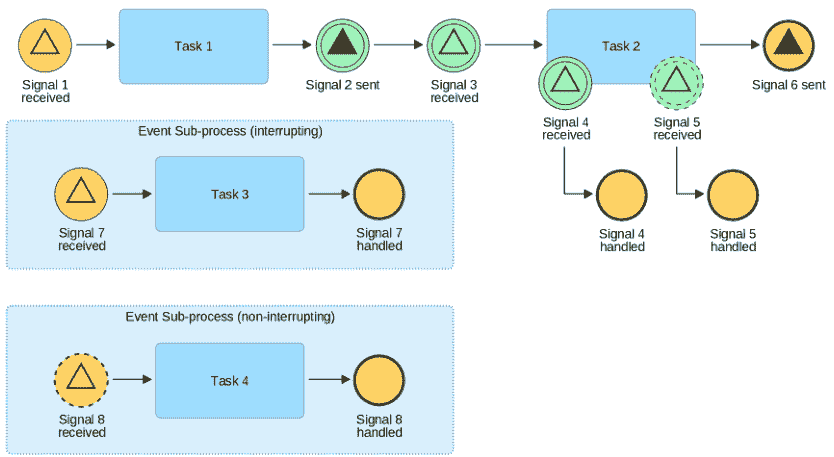

Figure 9.8 – 信号事件

## 定时器事件

现在我们已经讨论了消息和信号触发器，是时候讨论另一对孪生触发器：**定时器**和**条件**了。让我们从我们在 _Chapter 8_ 中已经了解的触发器开始：定时器。以时间为触发器的事件称为**定时器事件**。它们始终用时钟图标标记。

说到时间，我们总是被动的（我们只能等待特定时刻，无法影响时间），因此图标仅出现在浅色填充的变体中。


Figure 9.9 – 定时器事件：被动

启动事件、流程流中的中间事件（显然，仅限捕获型）、中断型和非中断型边界事件，以及事件子流程的启动事件，对于定时器事件都是可能的。这些在 _Figure 9.10_ 中显示。

当然，在此示例中，每个定时器事件都可以表示不同的时刻——例如，流程可能每个星期一早上启动（**Timer 1**）；执行 **Task 1** 后，我们等到中午（**Timer 2**）；如果 **Task 2** 超过 1 小时（**Timer 3**），我们中断它，但在执行 45 分钟后（**Timer 4**），我们可以在不中断 **Task 2** 的情况下做些事情，整个流程级别也是如此（**Timer 5** 和 **6**）。同样的方法也适用于我们将要讨论的其他事件。

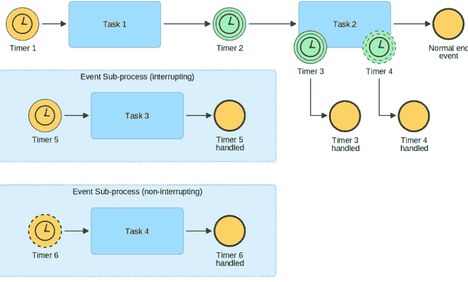

Figure 9.10 – 定时器事件

## 条件事件

现在，让我们看看我们对定时器事件的了解如何应用于由条件触发的事件。**条件事件**，例如由时间触发的事件，仅以捕获（被动）形式出现。它们的图标始终是一张横线纸。


启动事件（条件）

Figure 9.11 – 条件事件：被动

通过条件事件，我们可以展示我们的流程如何响应其环境中发生的事情。有许多情况可以使用条件。即使是规范中相当幽默的示例，涉及温度（很可能用于烹饪），我们也可以找到面向业务的案例，例如学校停课流程，该流程以启动事件 **Temperature in the rooms where classes are held below 18 degrees Celsius/64 degrees Fahrenheit** 开始。

条件也可以指库存（**Number of items in stock below the defined minimum**——如果我们要为公司提供的关键商品创建补货流程）、股票价格（**Stock price in market A lower than...** 用于所谓高频交易下的自动套利交易）以及许多其他方面。

一般来说，如果有我们可以测量的东西，就可以添加条件来处理它。这使得流程能够响应广泛的事件，从我们引用的经典示例到更技术先进的案例，例如由 **Internet of Things (IoT)** 收集的传感器数据。

与定时器事件一样，启动事件、流程流中的中间事件（捕获型）、中断型和非中断型边界事件，以及事件子流程的启动事件都可以是条件型。它们都在 **Figure 9.12** 中显示。


## Escalation events

The ability to describe error and exception handling is extremely important when modeling processes for automation. This allows us to specify what should happen if something undesirable occurs in the process so that we can handle it properly.

Importantly, BPMN distinguishes two types of problems of different severity: less serious escalations and very serious errors (which we will cover shortly). An **escalation** is always indicated by an upward-facing arrowhead icon (which reminds me a bit of the _Star Trek_ insignia).

Figure 9.13 – Escalation events: passive and active

Events whose trigger is escalation can be both throwing and catching, but they have far fewer allowed options compared to the events we’ve covered so far. This is due to the nature of the trigger used to handle exceptions, such as a delay in a process that we need to inform someone about, the unavailability of a product, and so on.

Therefore, escalation cannot be used for normal start events, but for intermediate events within the process flow, where it only occurs as a throwing event (it shows that the process is continuing, but something has gone wrong, and we need to handle this situation somehow). We can also throw an escalation in the end event and use escalation for interrupting and non-interrupting boundary events, as well as for both variants of event sub-processes. We can see all these options in Figure 9.14.

Figure 9.14 – Escalation events

It is worth noting a slight change in Figure 9.14 from the previous examples. Why do we have Sub-process 2 instead of Task 2? This is due to the nature of escalation, which is often used to inform a higher-level process that it needs to respond to something that happened (for example, a delay in a process, or an unusual process result that may require special handling).

The example shown in Figure 9.14 could be extended by an additional diagram showing the content of Sub-process 2. Escalations 3 and 4 would be thrown (similar to how, in our example, escalations 1 and 2 are being thrown) so that we could catch them by boundary events attached to the border of Sub-process 2. This is because escalations should occur in "teams"—they must be thrown somewhere so that they can be caught and handled in a higher-level process.

## Error events

As we know, escalations are used to describe situations when not all is lost, and the process can continue. However, there can be cases of severe problems in our process that do not allow the process to finish successfully. Error events are meant to provide handling for such situations. Error events have an easy-to-recognize and remember lightning bolt icon.

Figure 9.15 – Error event: passive and active

As you can see, just like it was the case for escalations, both throwing and catching error events are possible. However, error events have fewer options than escalations. This is because an error is something extremely serious, preventing the process from normal completion. That’s why there are no non-interrupting error events. Examples of situations where we could use error events are a critical IT failure that we cannot overcome, a big business problem such as failure to collect a payment from a customer’s credit card, or a lack of the item that the customer has ordered.

The only type of throwing error event is an end event. If this end event were part of a diagram documenting the content of a sub-process, we would usually have a boundary event attached to this sub-process that would catch this error and provide some handling. For example, if our error was a failed payment, we could contact the customer and use an alternative payment method. We can also handle the error within the same diagram with an event sub-process. All these options are shown in Figure 9.16.

Figure 9.16 – Error events

Errors and escalations allow us to handle various problems with our processes. However, there are also additional options for handling emergencies.

## Compensation events

Many people happen to do something in life that they regret and wish they could undo. While this is not always possible in relationships, there is a way to do it in business processes with **compensation events** and **compensation activities**. Compensation is symbolized by an icon commonly used in music players for rewinding.

Figure 9.17 – Compensation icons: passive and active events and activities

As you can see, compensation events can be both catching and throwing. Throwing occurs either as an intermediate event within the process flow or as an end event. Catching compensation can be a boundary event, or it can be the start event for an event sub-process, as shown in Figure 9.18.

Figure 9.18 – Compensation events

Compensation events have several unique features. These are visible in Figure 9.18 and will be discussed here. First, since compensation is used to undo something that has already happened, we model it in a rather unusual way, so reading diagrams with compensations requires some preparation.

For the so-called “sunny day scenario,” where everything is OK with our process, after performing Task 1 and Task 2, we would reach an end event, Normal end event. However, if we have determined that something is not right, we cannot finish the process normally, so we need to roll back something that has already happened in Task 1 (e.g., charging a customer account, setting a status in the system, saving data to a database, etc.), after which we need to throw appropriate compensation(s).

Let’s start with a throwing intermediate event named Compensation 1. From the pure logic of the process, you can see that after this event, we go to the end event, where the token of our process instance can be consumed. However, since Compensation 2 is also a compensation event, it will throw additional compensation, which will provide additional handling for this situation.

Now, let’s look at a Compensation 1 boundary event, which is attached to the border of Task 1. This will help us understand the concept of undoing/reverting to a previous state. As you can see, next to Compensation 1, we have Task A, with a compensation marker. However, this does not look like the diagrams that we’ve covered so far.

We can read it as follows: if we throw a specific compensation, it must be caught somewhere. Here, there is an exception to the rule, which states that boundary events can only “listen” so long as the element to which they are attached is active. This is completely different from compensation boundary events—they only start “listening” when the task or sub-process to which they are attached is completed. However, a compensation that is not a part of a normal flow does not follow the standard rules we’ve learned about so far. As you can see, there is nothing more after **Task A**. There is no outgoing sequence flow because it only shows what needs to be done to undo **Task 1**.

Interestingly, **Task A** also has no incoming sequence flow! This is because it connects to the boundary event through an association relation—the same one that is used for attaching text annotations to elements of a process flow. However, this relation also has an arrowhead, indicating the direction of the flow.

An important rule related to compensation events is that to undo specific process steps, you usually need to “call by name” their specific compensations. In our case, this was quite simple, but there may also be process diagrams in which we want to roll back many different steps. Does this mean we always need to throw many compensations in such situations?

## Cancel events

Many people try to use cancel as a marker for an end event to signify, for example, the end of a process that occurred prematurely, such as a customer’s decision to cancel an order. **Cancel events**, however, are meant as a workaround for the problem of calling each of the many compensations separately. There are only two types of cancel events: the end event and the intermediate boundary event. Both have the icon of a rotated cross with dark and light fill, respectively.

Figure 9.19 – Cancel events: passive and active

However, cancel events always occur in tandem with a special type of sub-process: transaction. It can easily be recognized by its characteristic double-lined boundary.

Figure 9.20 – Transaction sub-process


A **transaction sub-process** 是用于标记流程中必须正确执行或必须撤销的部分的。顾名思义，我们可以将其用于银行交易或 IT（例如，数据库事务），但这只是众多示例中的两个。重要的是，如果附加到 transaction sub-process 边界上的 cancel boundary event 被触发，其中我们已使用 compensation 定义了撤销能力的所有元素将被集体触发，而无需逐个调用它们的名称。

## Terminate events

与 cancel events 类似，terminate events 也可能有点棘手，因为它们的名称似乎暗示与 BPMN 规范中不同的含义。**Terminate end event** 是具有此触发类型的唯一事件。该事件的标记是一个黑点。


Figure 9.21 – Terminate end event: active

通常，新接触 BPMN 的人会使用此类事件来强调流程结束。然而，terminate end event 还有其他含义。众所周知，标准 end event 会“消耗”进入它的 token，但只要该流程实例中还有其他活跃的 token，实例就会继续存在。这种行为对应于我们最常见的业务需求：能够将流程划分为独立的路径并分别流转，只有当每条路径都结束时，我们才能认为整个流程完成。

然而，有时我们可能会在流程中达到一种状态，继续进行其他活动已无意义。这时 terminate event 就派上用场了。当 token 达到此类事件时，流程实例内的所有其他 token 都会被查找并移除。

## Link events

现在是时候了解下一种（不寻常）的事件类型了。虽然我们迄今为止涵盖的其他类型的事件都与现实生活场景有明确联系，但 **link events** 仅用于导航目的。它们只能在流程流中作为中间事件使用。链接图标始终是一个指向右侧的箭头。不出所料，该箭头对捕获事件使用浅色填充，对抛出事件使用深色填充。


Figure 9.22 – Link events: active and passive

link events 的背后理念非常简单：在处理大型图表时，可读性是一个重要问题。在 2000 年代初期，当流程建模工具尚未像今天这样发达时，处理需要多于一张纸的图表可能会成为问题。即使在今天，对于包含许多元素和箭头的大型图表，也存在序列流相交的风险，这可能会让流程读者感到困惑，因为他们无法判断特定箭头通向何处。

link events 使我们能够处理此类情况。它们允许将流程模型拆分为多个部分（每个部分都易于打印），并促进它们之间的导航，无论是数字形式还是打印形式。幸运的是，目前，体面的流程建模工具很少会在大型模型上出现问题，因此我们不再那么依赖 link events。然而，还有一个额外原因：link events 允许我们避免序列流相交。与其绘制一条会与其他序列流交叉的长线（看起来有点凌乱），不如使用 link events。

Figure 9.23 展示了两个等效图表。在第一个图表中，流元素通过普通序列流连接（线条交叉处的桥接不是 BPMN 的一部分；这是 ADONIS 提供的功能）。在第二个图表中，我们有一对中间事件：A（抛出）和 A（捕获）。

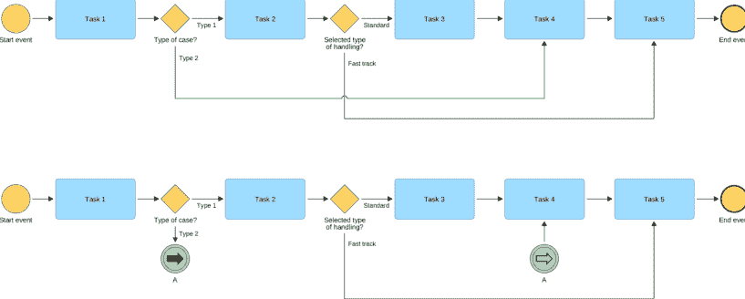

Figure 9.23 – Using link events to improve the readability of big diagrams

Quick tip: Need to see a high-resolution version of this image? Open this book in the next-gen Packt Reader or view it in the PDF/ePub copy.

The next-gen Packt Reader and a free PDF/ePub copy of this book are included with your purchase. Scan the QR code OR go to packtpub.com/unlock, then use the search bar to find this book by name. Double-check the edition shown to make sure you get the right one.


即使你看不到它们之间的序列流线，也应该将图表解读为如果那条线存在一样。这一点很重要，因为有时，学习 BPMN 的人试图使用 link events 来规避符号规则，这些规则不允许序列流跨越池（或子流程）的边界。他们希望 link events 能像传送门一样，将 token 从一个池传输到另一个池。正如你可能预料的那样，这不是一种推荐的建模方式，因为即使用户设法欺骗了工具验证机制，图表本身仍然是不正确的。

## Multiple and parallel events

我们已经了解了许多类型的事件和触发器。然而，到目前为止，一个事件始终只有一个触发器。这是绝大多数情况下的情况，但也存在此规则的可能例外。规范允许我们使用具有多个触发器的事件，分为两种类型，我们将在本节中讨论。


Figure 9.24 – Multiple and parallel events

第一种类型是 **multiple event**。如你所见，它可以是捕获或抛出。其图标是一个正五边形。第二种类型是 **parallel multiple event**，其图标是一个加号。此事件只能是捕获。

让我们先简单介绍一下，以了解这些事件背后的理念；我们稍后会了解更多关于它们的内容。

## How to start a process

通常，在建模流程图时，我们使用单个开始事件，以便读者容易看出应该从哪里开始阅读图表。然而，有时我们需要展示我们的流程可以响应多个事件而启动。

BPMN 允许我们在图表中添加多个开始事件。例如，如果我们的流程在特定时间点启动，或响应客户请求，我们可以插入两个开始事件，分别由时间和消息触发。

图表也可能有多个开始事件，分别通向流程的不同部分。一个简单的例子是订购新计算机设备的流程。如果普通员工提出新笔记本电脑的请求，这很可能需要一些时间，并且需要几个验证步骤。只有在几个人接受此购买后，IT 才能向员工提供设备。然而，如果新笔记本电脑是由董事或首席执行官（或存在另一种更紧急的情况）需要，我们可以预期流程的验证部分将被跳过，或至少大幅减少，下单人将很快获得所需的设备。

然而，流程拥有多个开始事件的情况是例外而非常规。尽管 BPMN 规则允许这样做，但开始事件越多，受众正确阅读图表就越困难。此外，如果我们打算使用模拟机制进行流程优化，许多开始事件往往会成为问题，因为许多模拟引擎要求流程图中只有一个开始事件。

对于 BPMN 规范的作者来说，多个开始事件是解决是否保持图表易于阅读（且只允许一个开始事件）还是允许图表记录更复杂情况（通过允许多个开始事件）这一两难困境的解决方案。多个开始事件让我们既能拥有蛋糕又能吃掉它，因为我们可以有一个带有多个触发器的单个开始事件。它是如何工作的？例如，在之前描述的情况下，即我们的流程在某个时间点启动，或在客户订单到达时启动，我们可以只使用一个多个开始事件，并标记它可以由时间或消息触发。

有趣的是，在多个事件的情况下，一眼不足以确定是什么触发了流程：无论我们的触发器是消息和定时器，还是定时器和信号，或者是条件和消息，图标始终相同，并且始终是一个五边形。因此，为了能够向接收者传达是什么触发了流程，我们必须为开始事件赋予一个有意义的名称，例如 **Order received OR deadline reached**。

BPMN 作者并未止步于此——**parallel multiple start event** 也是可能的。对于多个开始事件，*任何一个触发器* 都足以启动流程，而对于并行多个事件，*所有触发器* 都必须发生。

如你所见，对于捕获事件，使用多个和并行事件的原理很简单。多个事件（带有五边形的那个）显示任何一个触发器都足以继续，而并行事件（带有加号的那个）显示所有触发器都是必需的。不幸的是，在抛出事件的情况下，事情变得更加复杂，如 *Figure 9.25* 所示。


Figure 9.25 – 多个事件

如您所见，在存在多个抛出事件的情况下，我们处理的是本应期望来自并行多个事件的逻辑。这是因为 _多个抛出事件会抛出所有定义的触发器_（例如，它们会发送一条消息和一个信号）。因此，不存在多个并行抛出事件也不足为奇，如图 9.26 所示。

Figure 9.26 – 并行多个事件

在实践中，多个事件和并行多个事件都不常用，但值得记住五边形图标。这是因为——正如我们稍后将看到的——它在 BPMN 的一个非常有趣的元素中被使用，而理解多个事件的机制对我们将非常有用。

## 其他类型的网关

迄今为止我们介绍的网关类型（XOR、AND、OR）是最常用的。但是，BPMN 还提供了更高级（且使用频率较低）的网关类型。我们将在本节中介绍它们。

### 基于事件的网关

我们迄今为止学习的所有网关都是基于数据的。在实践中，这意味着当令牌到达网关时，我们可以立即（通过检查网关类型，并在必要时检查序列流上的条件）确定哪条或哪些路径将获得令牌。

然而，有时我们无法立即判断，因为我们必须等待某事发生。在这种情况下，**基于事件的网关**非常有用。如果您仔细观察这样的网关，内部显示的标记会向您暗示它与我们迄今为止介绍的其他网关不同。与所有网关一样，基于事件的网关是菱形（菱形），但它们包含一个独特的图标，看起来像中间多个（捕获）事件。请看图 9.27，并将其与图 9.25 中的中间捕获事件进行比较。

Figure 9.27 – 基于事件的网关

这些网关应如何使用？基于事件的网关类似于排他网关——网关之后，可以有两个或多个出站序列流，但一次只能选择其中一个（即，获得令牌）。

区别在于，我们不是基于序列流上定义的条件进行选择，而是通过检查中间捕获事件来选择。原理很简单：在网关之后，我们可以有多个中间事件，每个事件都代表我们期望的某个选项。首先发生的事件决定了我们将采取的路径。如果在第一个事件发生后的一瞬间，其他事情也发生了，那么另一条路径的事件将被忽略。

消息、信号、条件、定时器和多个中间事件可以在基于事件的网关之后使用（但仅限于我们已提到的触发器）。

有趣的是，规范不仅允许在此网关之后使用中间事件，还允许使用接收任务。唯一的要求是我们需要保持一致，不能同时使用接收任务和中间捕获消息事件。然而，在实践中，这种建模既不常见也不推荐。

我们如何在实践中使用基于事件的网关？让我们回到我们的投诉处理流程。假设客户通过聊天提出投诉。我们的顾问要求选择选项，我们通常会得到两个可能的答案之一：退款或更换商品。但是，可能会发生客户不给我们答案的情况。我们图表的早期版本无法处理这种情况（当然，我们可以添加一个带有条件的额外序列流，声明 _15 分钟内无答复_，对于对流程文档感兴趣的人来说可能没问题，但这样的图表不会 100% 正确），但通过使用基于事件的网关，我们可以显示如果响应在预定义时间内（例如，15 分钟）未到达，将发送一封提醒电子邮件和一个网页表单链接。

Figure 9.28 – 基于事件的网关在实践中的应用

基于事件的网关非常有用，尤其是当我们的流程与其他参与者（池）通信，并且我们想展示如何响应来自他们的消息以及在未收到响应时该怎么做。它还可以用于任何流程，其中某些事件必须在一定时间内发生，例如在线订单的快速付款（如果在一定时间内未付款，订单将被取消）。

### 基于事件的网关的（部分）替代方案

虽然有用，但基于事件的网关也是一个稍微复杂的 BPMN 概念。并非每个接收者都可能知道如何正确解释它们。因此，我想介绍一种方法，允许您在不使用基于事件的网关的情况下处理最常见的场景——在有时间限制的情况下处理不同的消息。我从两位来自 BPMN MIWG 的同事 Denis Gagné 和 Falko Menge 那里学到了这个绝妙的技巧（这符合 BPMN 规范且不特定于工具）。

Figure 9.29 – 基于事件的网关的替代方案

🔍 **快速提示**：需要查看此图像的高分辨率版本吗？在下一代 Packt Reader 中打开此书，或在 PDF/ePub 副本中查看。

🔒 **下一代 Packt Reader** 和本书的 **免费 PDF/ePub 副本** 包含在您的购买中。扫描二维码 或访问 `packtpub.com/unlock`，然后使用搜索栏按名称查找此书。再次检查显示的版本，以确保您获得正确的版本。

如您所见，我们图表的开头与图 9.28 中的相同。区别出现在处理客户决策消息的阶段。我们不再使用两个单独的中间事件来捕获每条消息，而是插入一个单一的接收任务，从客户处获取信息。收到消息后，我们拥有选择正确序列流所需的数据，因此可以使用易于理解的排他网关。

但是，我们如何处理时间限制呢？我们不能只是给排他网关添加第三条路径并将其称为 _时间已过_，因为从图表中可以清楚地看出，我们只有在收到消息后才会进入网关，因此没有消息，我们将永远无法继续。

幸运的是，此时，我们了解了使用边界事件进行异常处理的概念。由于我们期望的行为是在 15 分钟后停止等待客户的决策并发送电子邮件，我们可以简单地使用一个中断性边界定时器事件，它将确保我们不会永远等待答案。

## 其他类型的基于事件的网关

出现在流程流中的基于事件的网关代表了符号中更高级——但在某些情况下很有用——的元素。但是，值得提及的是，规范还描述了可以启动流程的这两种网关的更多变体。它们被称为 **实例化基于事件的网关**。

Figure 9.30 – 实例化基于事件的网关

正如内部图标所暗示的，这些网关在某种程度上旨在替代开始事件（这就是为什么它们有一个由单条细线绘制的圆），其中有几个触发器可能（五边形或带有浅色填充的加号图标，因为它们需要是捕获的）。根据类型，要启动流程，必须发生这些事件中的任何一个或所有事件。这种建模方式既不流行也不推荐；我只是想向您展示它们，以帮助您避免任何误解。

## 复杂网关

除了我们刚刚讨论的基于事件的网关之外，BPMN 中还有另一种基于数据的网关。这就是 **复杂网关**。它在中心有一个独特的星号图标，并且具有相当特定的行为。

Figure 9.31 – 复杂网关

我们开始时介绍的 XOR 和 AND 网关的行为立即就很清楚（对于 XOR，只有一条路径获得令牌，而对于 AND，每条路径都获得令牌）。对于 OR 网关，这稍微困难一些，但也很清楚，通过读取序列流上的条件（以确定哪些路径获得令牌），我们就会知道流程中会发生什么。然而，复杂网关的行为更为复杂（双关语）。


这个网关在原则上可以像任何其他网关一样行为（或者具有我们无法通过任何其他网关获得的超级复杂行为），其行为取决于一个特殊条件，该条件不是针对序列流定义的，而是针对网关本身定义的。不幸的是，这个条件是 BPMN 的不可见属性之一，因此只看到 BPMN 图形的人无法确定这个网关将如何行为，除非模型创建者决定通过文本注释（例如）来显示该条件。

对于某些用户来说，一个可以如此灵活行为的网关的可能性非常有吸引力。然而，在我看来，尽管表面上具有多功能性，复杂网关在实践中用处不大，因为它几乎没有信息价值，但却有很大的潜力误导经验不足的图表读者。

规范允许对开启和关闭流都使用复杂网关，但根据我的经验，如果使用网关，则是为了合并路径，并且仅用于更高级的建模案例（例如，用于自动化目的）。一般来说，除非您的自动化项目真的需要它，否则我不建议使用它。

## 其他类型的子流程

在第 8 章中，我们学习了两种最常见的子流程类型：嵌入式子流程和调用活动。在本章中，在发现其他类型的事件的同时，我们还学习了另外两种：事件子流程和事务。我们还知道子流程可以以两种变体使用：折叠变体，它可以导致较低级别的模型，或者展开变体（子流程的内容可见）。

现在，是时候介绍最后一种子流程类型了，它被称为临时子流程，由波浪号（波形）表示。


这个子流程允许我们记录结构不那么严格且需要执行者具备更多知识的流程。它不包含我们通常在流程中看到的完整元素集——例如，没有开始或结束事件，我们放在其中的任务或子流程不必通过序列流连接。

我们可以将临时子流程的全部内容视为一个自助餐，有很多选项可供选择。这为执行流程的人提供了很大的灵活性，让他们可以选择自己觉得有用的元素，而不必强制执行所有元素或按任何特定顺序执行它们。

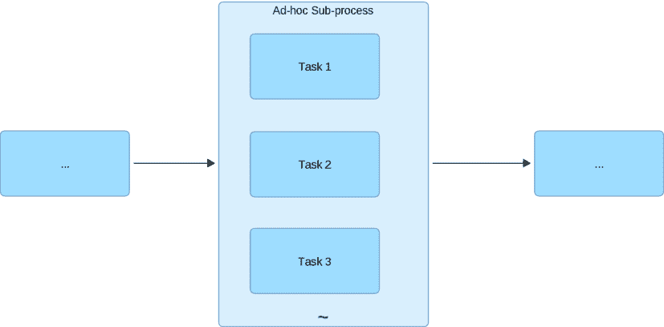

虽然为流程提供更多灵活性的概念非常有价值，但临时子流程在实践中并不流行。原因之一可能是这些元素不受流程自动化解决方案的支持。还有一个额外原因——有几种其他方法用于知识密集型流程。它们可能像清单一样简单（但强大），也可能像 OMG 提供的名为 **案例管理模型和符号（CMMN）** 的额外规范一样正式。我们将在本章最后部分简要介绍这一点。

## 其他类型的任务

在本书前面部分，我们学习了最重要的任务类型：没有类型的任务、用户任务、服务任务、手动任务、发送任务和接收任务。在本节中，我们将简要讨论 BPMN 规范中发现的其他类型的任务。

### 业务规则任务

我们将从 **业务规则任务** 开始。它比我们迄今为止介绍的其他任务要先进一些，但对于复杂流程非常有用，其中许多方面会影响流程的执行，尤其是我们希望自动化的流程。此任务类型的图标是一个样式化的表格。

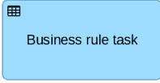

业务规则任务允许我们通过消除许多不必要的决策网关和序列流来显著简化我们的图表，但最重要的是，它使我们的自动化流程更加灵活。

想象一家在不同市场向不同客户细分群体销售产品的公司。有些客户订购较多，有些订购较少。有些是长期的老客户。有些是我们不了解的新客户。我们可以通过招标向公共部门提供商品，也可以向私营实体提供商品。再加上不同的国家、法律体系和货币，正如您所看到的，情况变得相当复杂。我们会向所有人提供相同的价格吗？还是会变化折扣级别？

如果我们要建模销售流程，我们就必须决定如何处理折扣计算。我们是否应该尝试将所有内容描述为单个图表？这样的图表会很大且难以阅读。此外，基于这样的模型，要确定我们的规则是否一致、没有内部矛盾，或者是否遗漏了与某个客户细分群体相关的某些重要条件组合，是非常困难的。以这种方式描述的规则修改起来既困难又有风险。

此类问题不仅出现在与折扣相关的流程中，还出现在确定保险费率、定价复杂服务、复杂的采购流程，或与接受发票或其他文件相关的流程中，其中根据类型和金额有多个接受级别。

正如您所看到的，使用业务流程图来展示 **决策管理** 的这些方面可能并不总是可接受的选择。幸运的是，有一种更好的方法，由 **业务规则宣言** 推广，它建议业务流程模型不应包含详细的书面规则，而应以不同的方式描述和管理规则。

这些规则不仅用于文档目的。一种特殊的软件，称为业务规则引擎，还允许对这些规则进行自动化，而 BPMN 业务规则任务假设流程可以使用这种方法。通过使用业务规则任务，我们可以大大简化图表，展示引用业务规则的流程片段，然后展示这如何影响我们的流程。

正如您将在本章最后部分学到的，我们可以通过 OMG 提供的额外规范将这一点进一步扩展：**决策模型和符号（DMN）**。

如果您想了解更多关于业务规则概念的信息，我建议阅读 `https://www.businessrulesgroup.org/brmanifesto.htm` 上的业务规则宣言。

## 脚本任务

BPMN 中的另一种任务类型是 **脚本任务**。此类任务的图标是一卷写有字的纸，或者简单地称为脚本。

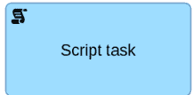

像服务一样，它是一个自动执行的流程元素，但方式略有不同。正如规范作者所意图的那样，服务是流程自动化引擎调用提供某些服务的外部应用程序的步骤。而脚本，则是由流程执行引擎直接执行某些简单操作的步骤。

此类元素的示例包括对用户输入数据的简单验证和运行简单计算。这些只是理论建议；然而，如同许多模型一样，这些原则并未被遵循。在某些工具中，服务任务用于调用特定类的 Java 代码。一般来说，服务任务在 BPMN 图表中比脚本任务更常见。

## 调用活动

最后一种任务类型是 **调用活动任务**。它在许多方面都很独特。首先，它没有特定于其类型的图标，而是具有与调用活动子流程相同的粗边框。

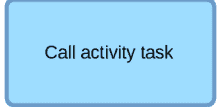

BPMN 允许我们拥有既是任务又是子流程的调用活动。在两种情况下，它都指重用某个标准，但方式不同。

子流程调用活动允许我们调用其他流程图，是 BPMN 中一个非常有用且流行的元素。另一方面，任务调用活动既不太有帮助也不流行。

原因是什么？BPMN 规范的作者希望能够显示某些标准化活动出现在流程中。他们的想法使得可以将某些类型的任务（例如，用户任务、手动任务、脚本任务和业务规则任务）定义为所谓的 **全局任务**，作为一种关于事情应如何完成的定义。


全局任务可以通过任务调用活动引用。这个概念很有趣，但在我看来，它并不完全符合实际业务需求。此外，建模工具应如何支持这一点也没有明确定义的方式，这意味着规范中这部分的实现可能会大相径庭。因此，这是一种不太可能在实践中以标准化方式在各工具间广泛使用的记法元素。

## 多实例

本章中我要提到的 BPMN 规范的最后一个元素，是将活动标记为多次执行的机制。

通常，当我们想到一个流程及其步骤时，脑海中浮现的是：一旦某个步骤完成，就可以继续下一步。不过，有时情况会复杂一些。完成某个步骤后，可能需要进行检查，看是否已达到预期结果——如果达到，可以继续；如果没有，则必须重复该步骤。也有可能，我们可以预先知道某个流程步骤需要执行多次才能继续。

对于这种情况，BPMN 提供了特殊的标记，可以应用于任务和子流程。

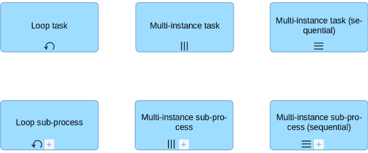

图 9.37 – 循环、多实例和顺序多实例任务及子流程

**循环**，其标记为圆圈中的箭头，表示给定步骤必须执行多次，但我们无法预先知道执行多少次。我们只能说它会执行所需的次数（直到满足某个条件）。一个经典的例子是谈判——进入会议时，我们不确定第一次是否就能达成协议，或者是否还需要进一步的会议。

**多实例**，常简称为 **MI**，任务具有熟悉的三条垂直线符号，在 BPMN 中表示有更多的某些东西。

此类元素也会执行多次，但这次，我们预先知道会执行多少次。一个完美的例子是处理需要支付的发票批次/组。在执行此活动时，我们知道所有转账都必须执行，不能有任何发票未付。

多实例标记也可以有一个**顺序**变体，由三条水平线表示。这意味着工作不能分配给不同的人并行执行（这是标准 MI 版本所假设的），而必须按顺序执行。如果你不确定如何记住哪个标记版本是并行的，哪个是顺序的，有一个很好的技巧是我从 EduMAX 的 Filip Stachecki 那里学到的：并行变体的名称中有三个垂直线（三个 **l**s）。

## 扩展 BPMN

正如你所见，BPMN 为你提供了许多可能性。它是一种易于使用的标准记法，可以由业务用户和 IT 用户使用。有数百种工具支持它，还有大量学习材料可以帮助你加深知识。

然而，即使是 500 多页的 BPMN 规范也无法涵盖所有业务建模场景（尤其是考虑到 BPMN 2.0 规范还涵盖所谓的**舞蹈图**和**对话图**——两种不太流行的额外图表类型）。作者明确指出，BPMN 的范围是关于流程，而不是关于组织建模、数据和信息建模以及策略建模等概念，以及业务规则建模、流程模拟和监控。他们甚至没有提到其他重要场景，例如风险和合规性管理或流程架构。

幸运的是，BPMN 包含了扩展的绝妙概念。可以添加新属性、标记或工件形状，只要更改不与已有元素冲突即可。扩展还以特殊方式保存在 XML BPMN 图交换文件中。

## BPMN 扩展在实践中

BPMN 扩展允许工具供应商将其扩展存储在 BPMN 文件中（例如表单定义和流程自动化所需的其他元素），但它们也为 BPMN in Color 和 BPMN i18n 等标准提供了一些插件（你可能已经猜到，前者允许在 BPMN 图中交换颜色，而后者提供国际化支持，涉及将多种语言的图表翻译存储在单个文件中）。

我想分享一个来自 BPMN MIWG 提供的参考文件的简单示例，位于 `https://github.com/bpmn-miwg/bpmn-miwg-test-suite/tree/master/Reference`。如果你想探索从完整文件中提取的 BPMN XML 的不止一小段，请查看 `C.8.0.bpmn` 文件：

```
`<semantic:sendTask id="_a97cla48-faba-447b-bfa6-7aa81a6fe0a0"
name="Notify Employee of Approval" triso:readOnly="false"
implementation="##WebService">
<semantic:extensionElements>
<adonis:MailTo>${email}</adonis:MailTo>
<adonis:MailSubject>Your Vacation Request ${SYS.PROCESSINSTANCE_ID}
was approved manually</adonis:MailSubject>
```

```
<adonis:MailBody>Dear ${first-name},
your Vacation Request ${SYS.PROCESSINSTANCE_ID}
from ${fromdatepicker}
to ${todatepicker}
was approved manually.
Comment: ${comment}
Best regards,
Your BOC Adonis Process Automation</adonis:MailBody>
<zeebe:taskDefinition type="emailService"/>
<zeebe:ioMapping>
<zeebe:input source="= &quot;&lt;lt;html&gt;&lt;p&gt;Hi &quot; +
Current Vacation Status.name + &quot;&lt;/p&gt;&lt;p&gt;Your vacation request from &quot; +
&lt;lt;p&gt;&lt;p&gt;Your vacation request from &quot; +
&lt;lt;p&gt;&lt;p&gt;Your vacation request from &quot; +
&lt;lt;p&gt;&lt;p&gt;Your vacation request from &quot; +
&lt;lt;p&gt;&lt;p&gt;Best regards&lt;/p&gt;&lt;p&gt;This is an automated message generated by the vacation system.&lt;/p&gt;&lt;/html&gt;&quot; target="mailBody"/>
<zeebe:input source="= &quot;Vacation Approved&quot;" target="mailSubject"/>
<zeebe:input source="= Current Vacation Status.email" target="mailAddress"/>
</zeebe:ioMapping>
<kp:field name="to" stringValue="info@knowprocess.com"/>
<kp:field name="htmlVar" stringValue="vacationApproved"/>
<i18n:translation xml:lang="de">Mitarbeiter über die Genehmigung informieren</i18n:translation>
<i18n:translation xml:lang="es">Notificar al empleado de la aprobación</i18n:translation>
<i18n:translation xml:lang="fr">Aviser l'employé de l'approbation</i18n:translation>
</semantic:extensionElements>
<semantic:incoming>f2b0da63-d841-4457-ad85-7d86c8b5c1d2</semantic:incoming>
<semantic:outgoing>a5441c65-06f8-4972-8158-e6f61f904841</semantic:outgoing>
</semantic:sendTask>
```

如你所见，除了任务的标准元素外，例如类型（在此示例中为 send）、名称、ID、关于入站和出站序列流的信息等，还有一个块可用于存储所有扩展。

为简单起见，我删除了某些元素，因此这不是 XML 文件的完整片段，但它很好地概述了不同工具（在此示例中为 Trisotech、ADONIS、Camunda/Zeebe 和 KnowProcess）如何将其技术扩展添加到 BPMN 中以自动化流程（在此示例中，发送关于休假请求接受的电子邮件），以及翻译也可以如何存储。当然，这是 BPMN MIWG 用于展示不同 BPMN 工具如何协同工作的示例文件，因此在实际场景中，你不会有那么多工具的扩展。

此示例仅包含带有额外技术属性的扩展 BPMN，但也可以用额外记法扩展 BPMN。例如，完整用例 C.8.0 使用 DMN 和决策服务，使关于休假请求的一些决策完全自动化。

## BPM+（BPMN、DMN 和 CMMN）

我们已经多次提到，OMG 还创建了其他可以与 BPMN 一起使用的标准。BPMN、DMN 和 CMMN 这三者被称为 **BPM+**。这组标准在医疗保健领域非常有用，但在其他领域也同样适用。

**DMN** 规范是一种记法，允许以决策要求图的形式描述业务规则，并自动化组织的决策。

**CMMN** 规范处理自适应案例管理，这是一个无法精确指定需要逐步做什么的领域，因为需要人工决策。CMMN 为此目的提供图形记法和交换格式。

虽然 BPMN 成熟、稳定且日益流行，但 DMN 尚未那么流行，但正在快速发展（截至 2025 年 6 月，DMN 1.7 的工作正在进行中），而 CMMN 更新频率不高（1.1 版于 2016 年发布），是三者中最不流行的。

## 为什么选择 DMN？

我认为 DMN 是一个非常有趣的标准。它正在迅速获得流行，对于拥有大量频繁变化的复杂规则的组织非常有价值。将这些规则保存在 BPMN 图之外，可以使它们更易于阅读，也更容易维护。

这是因为试图将所有规则都保存在流程图中通常需要大量网关和额外任务。这不仅会使图表变大，还常常导致其他问题。让我们通过我们的投诉处理流程来看看实际情况。

我们迄今使用的流程（如 _图 8.1_ 所示）假设投诉文档需要由员工在某个 IT 系统中检查，从而自动化整个流程。基于员工对投诉有效性的决定，有两种可能：投诉可能被拒绝，或者被认定有效并接受进一步处理。


即使此流程有 IT 支持，由于员工需要在流程继续之前检查所有文档，因此该流程不会很快。我们如何加快速度？

虽然在某些情况下可能需要让员工参与，但也许我们可以识别出可以实现完全自动化快速处理的案例。

就本示例而言，我将假设我们可以自动拒绝投诉文档未确认产品是从我们公司购买的案例。对于未被自动拒绝的案例，我们将有两种处理方式。对于明显应接受投诉的案例，将自动接受以加快流程，而不明显的案例将路由给员工以便进行检查。这样，员工只需检查复杂案例，其余案例即可自动完成。

我们如何判断一个案例是否明显？也许如果在短时间内有多个关于同一产品和交付方式的有效投诉，这意味着存在共同的问题根本原因，因此类似的投诉也应被接受。这也将是持续改进专家的宝贵输入，他们可以找出应该改变什么以避免未来出现此类问题。

也许可以建议一条额外规则：对于长期客户的低价值投诉，我们也可以自动接受。这可能会触发建议，检查这些客户在过去一年中是否投诉过多或被拒绝过多（以避免欺诈）。

当然，现实生活中的投诉处理要复杂得多。我们应该考虑更强大的欺诈防护（例如，不仅涵盖长期客户的案例），确保我们的流程在收集决策所需的所有数据的同时创造良好的客户体验，并确保法律合规性。

如果我们的公司为不同法律体系的多个国家的客户提供服务，这一点可能尤其棘手，因为它将影响我们处理客户数据的方式（例如，欧盟客户的 GDPR）、退货处理方式，以及客户是否获得有关其投诉权利的所有必要信息（例如，告知英国客户可以升级至法律监察员，并且弱势客户得到公平对待）。

图 9.38 – 尝试使用网关和任务记录规则

图 9.38 显示了一个可能的流程图，其中所有提到的规则都使用任务和网关来处理。如您所见，它不太容易阅读。如果我们需要更改某些值（例如，50 美元改为 100 美元），这将需要一些时间。如果我们需要添加更多规则或更改其组合，情况将变得困难。几乎不可能发现我们的规则出错的地方。现在，让我们看看如何使用 DMN 来简化这一点。

## DMN 基础

虽然 DMN 本身是一个相对较新的标准（DMN 1.0 于 2015 年正式发布），但它基于业务规则管理专家的许多最佳实践。就像 BPMN 一样，它既可用于文档目的，也可用于自动化。

允许在 DMN 中记录决策的图形模型称为 **决策需要图 (Decision Requirement Diagram, DRD)**。_图 9.39_ 显示了一个非常简单的 DRD 示例，可以帮助我们记录客户投诉流程。

如您所见，这里有几个 DMN 元素，例如 **决策 (Decision)**、**输入数据 (Input Data)** 和 **知识源 (Knowledge Source)**。其他更高级的元素，例如 **业务知识模型 (Business Knowledge Model)**，加上两种类型的 **决策服务 (Decision Service)**，未显示。

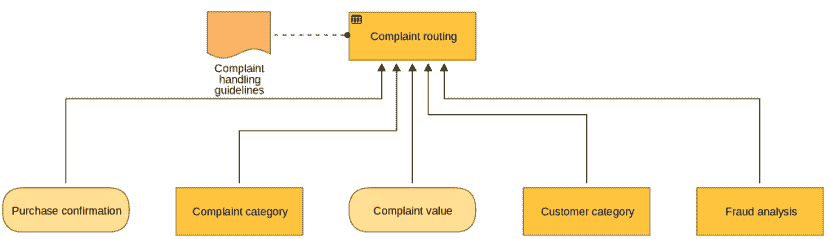

**图 9.39 – 简单 DRD**

矩形（**投诉路由**、**投诉类别**、**客户类别**和**欺诈分析**）是 **决策**。在 DMN 中，它们显示需要分析某些输入数据以得出某些结果（输出）的位置。

椭圆形（**购买确认**和**投诉价值**）是 **输入数据**。它们表示决策所需的输入数据。

带有三条直线和一条波浪线的元素（**投诉处理指南**）是 **知识源**。它表示影响决策的元素，例如法规或立法条文。

DMN 还提供了几种连接对象的线条类型。实线称为 **信息需求 (Information Requirement)**。带有黑点的虚线称为 **权威需求 (Authority Requirement)**。还有几种其他类型的箭头在我们的示例中未使用。

## 330 高级 BPMN

虽然显示决策、输入数据和其他元素之间连接的图形模型有助于更好地理解，但它无法帮助我们解决决策复杂性的问题。为此，我们需要另一个 DMN 元素：**决策表**。

决策表允许我们清晰且明确地显示哪些输入数据组合会导致哪些输出（即我们决策的结果）。这作为文档非常有用，但在用于自动化时更为强大。

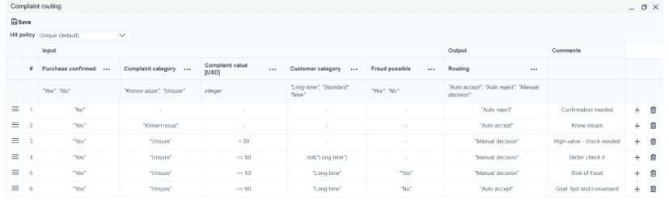

图 9.40 – 决策表

_图 9.40 显示了一个简单的决策表示例。每一行代表一条规则。第 2 列（**购买已确认**）到第 6 列（**欺诈可能**）代表做出决策所需的输入。第 7 列（**路由**）显示输出，即我们决策的结果。第 8 列（**评论**）允许我们为这些规则添加一些背景信息。_

如您所见，决策表旨在易于阅读和使用。例如，第一行显示，如果没有确认商品是从我们公司购买的，则投诉将被自动拒绝，我们不关心其他输入。

第二行也很容易阅读。如果我们知道客户是从我们这里购买的，并且商品可能由于我们的错误（无论是生产、包装还是运输）而有缺陷，我们希望为客户和公司节省时间，并自动接受已知问题的案例。

在第 3 到第 5 行中，事情开始变得更有趣。购买已确认，但这次，我们不确定问题发生的原因。这就是为什么我们需要让员工调查该案例。

需要这三行是因为我们基于不同的输入达到了相同的结果。第 3 行显示，如果投诉价值超过 50 美元，我们希望进行人工检查，因为价值较高。第 4 行和第 5 行涵盖价值不超过 50 美元但客户类别不同的案例，而对于长期客户，我们担心可能存在欺诈。

为了更好地理解这些规则，我们需要了解 DMN 涵盖的另一个重要概念：**友好足够表达语言 (Friendly Enough Expression Language, FEEL)**。让我们看看 **投诉价值** 列中的值。在第 3 行中，我们有 > 50，而在第 4 行和第 5 行中，我们有 <= 50。正如您所期望的，这显示了哪些投诉金额将应用哪些规则。

FEEL 提供了多种运算符。对于数字，我们可以使用比较（小于、大于或等于）或范围。例如，]30..50] 将表示从大于 30（但不包括 30）到 50 的范围。还有针对文本的运算符。例如，第 5 行显示，对于“长期”类型且存在欺诈风险的客户，我们将触发人工检查。第 4 行适用于所有不属于“长期”类别的客户。

DMN 为流程专业人士提供了许多有趣的可能性。它可以使自动化更加容易，并减少误解的风险，因为图表和决策表清楚地说明了在什么情况下应该做什么。这是对 BPMN 的非常有价值的扩展。但是，正如您接下来将看到的，还有其他方式可以扩展 BPMN，使其对业务和技术用户都更有价值。

## 适合业务的 BPMN

除了为自动化流程扩展 BPMN 的技术属性或将其与其他 OMG 标准结合之外，还可以将其与其他属性、对象和模型链接，以支持其他业务场景。

许多 EBPA 工具供应商向 BPMN 图表添加特殊属性，以便它们可以用于不同目的。我将展示 BOC Group 的 ADONIS 示例，其中提供所谓的适合业务的 BPMN。您可以在 https://docs.boc-group.com/adonis/en/docs/17.0/sample-models 上了解更多有关此主题的信息。

让我们回到我们的投诉处理流程。我们如何扩展它？除了提供可作为负责执行此流程的人员文档的有意义描述之外，我们很可能还希望指定组织中负责执行任务的角色，以及负责批准结果并使其得到咨询和告知的人员（RACI）。我们可能还希望为流程执行者提供包含最佳实践和操作指南的文档，提及使用哪些应用程序、此步骤如何改进、我们如何衡量 KPI、风险是什么（例如，欺诈）、执行此流程步骤需要多长时间以及成本是多少。

在包含本章资源的 GitHub 仓库中（https://github.com/PacktPublishing/Practical-Business-Process-Modeling-and-Analysis/tree/main/Chapter09），您可以找到更多关于扩展 BPMN 的信息，以及展示风险管理、模拟等元素的示例。

关键是，您在本书中学习的 BPMN 元素是通用的，并且在不同工具之间是相同的。如果您的工具支持 BPMN 图交换，您可以在工具之间移动图表，以便您可以在一个工具中与业务用户合作，当您对未来状态流程有了愿景时，可以将图表移动到自动化工具中，由 IT 专家添加技术细节。因此，您不仅可以使用 BPMN 技能来记录流程，还可以用来分析和改进流程，以及规划数字化转型和流程自动化。


## 摘要

在本章中，您了解了 BPMN 的更高级概念。我们介绍了事件及其各种用途，尤其是在流程中处理错误、异常和特殊情况的支持（这是 BPMN 的独特功能之一）。您了解了事件如何帮助我们创建复杂的模型，这些模型不仅可用于文档目的，还可用于分析和自动化。我们还介绍了其他类型的元素，例如任务、子流程和网关，以便您了解哪些元素可能对您的项目有益。最后，我们有机会了解 BPMN 如何扩展以支持 BPMN 原生不支持的场景。

## 延伸阅读

- 如果您想了解更多关于 DMN、CMMN 以及它们如何与 BPMN 协同工作的内容，我建议阅读一份名为《Field Guide to Shareable Clinical Pathways》的优秀文档。由于负责该文档的小组最近已从 OMG 迁移至 Health Level Seven International，请查看本书 GitHub 仓库中提供的下载链接：`https://github.com/PacktPublishing/Practical-Business-Process-Modeling-and-Analysis/tree/main/Chapter09`。

- 如果您想了解更多关于 CMMN 的内容，有一本名为《CMMN Method and Style: A Practical Guide to Case Management Modeling for Documentation and Execution》的优秀书籍，由 Bruce Silver 编写。Bruce 还撰写了《DMN Method and Style: 3rd edition》以及《DMN Cookbook》。您需要了解他的“Method and Style”方法！

- 我也想推荐 Bernd Ruecker 和 Jakob Freund 编写的《Real-Life BPMN (5th edition): Includes an introduction to DMN》。我对他们书籍的五星评价足以说明我对其作品的喜爱程度。

- 最后，如果您想探索决策管理主题，我知道的最佳地点是 `https://dmcommunity.org`，由 Jacob Feldman 运营。除了 DMN 相关内容外，您还会发现许多关于决策管理和 AI 的发人深思的文章。


