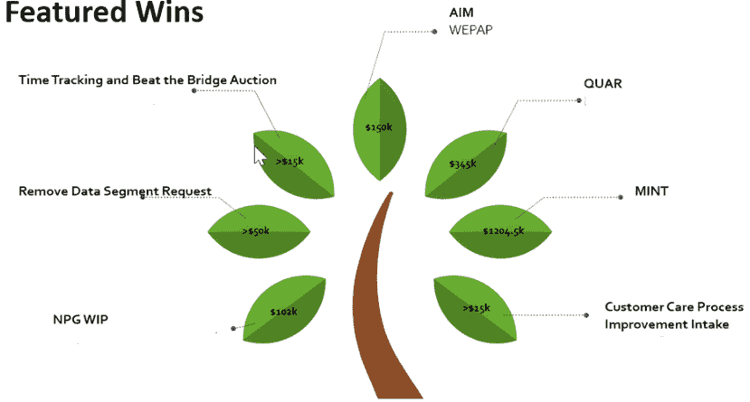
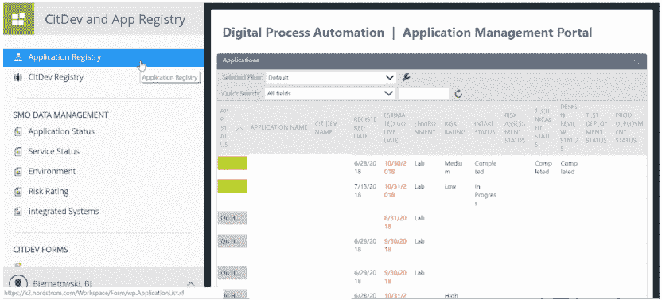
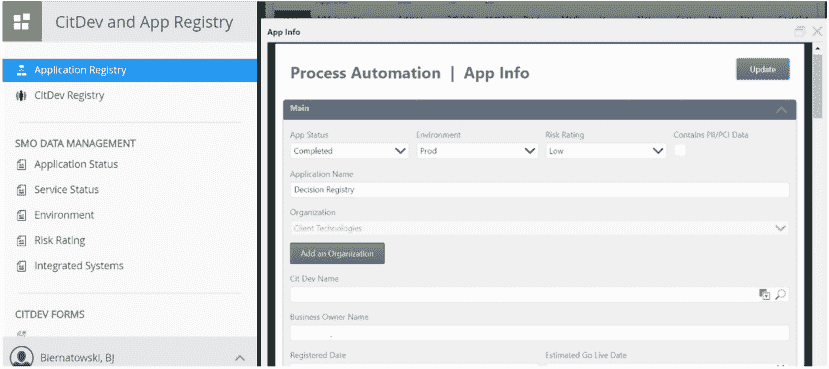
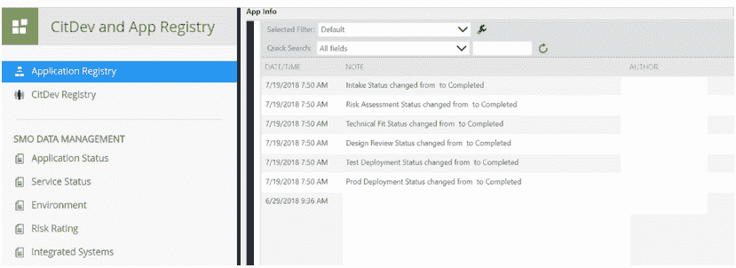
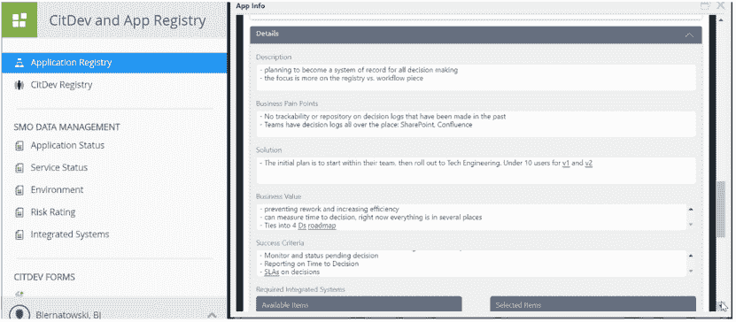
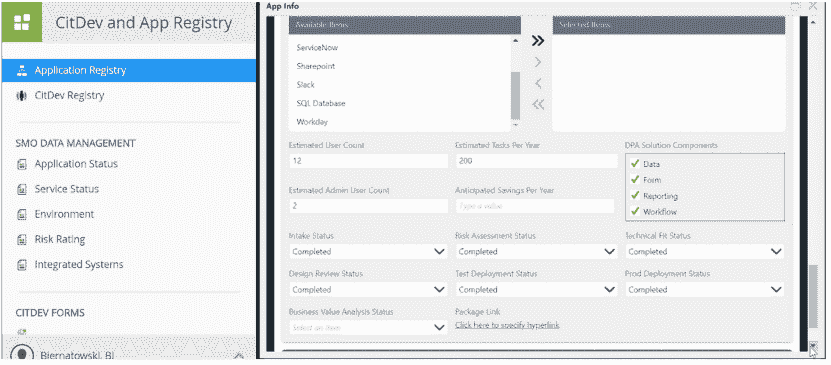
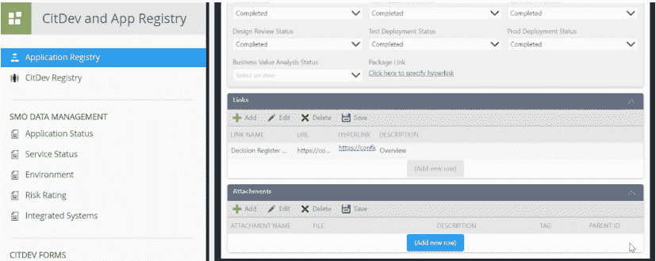

## 衡量流程转型的商业价值

随着我们在本书中的进展，您可能已经注意到我们强调了业务流程在数字化转型背景下的重要性，以及这对您职业生涯的影响。

参与流程转型、数字化自动化计划以及业务运营的全面改造，可以帮助您培养新技能，从而增强您在业务技术方面的专业知识。我们旨在激励您探索业务流程的世界，并将其视为您专业技能组合中不可或缺的组成部分。

如何在您的业务群体或公司中传达拥抱流程管理的重要性，尤其是当一些同事持怀疑态度时？

在当今快节奏的商业环境中，公司不断寻求改进、自动化并增强其运营流程的战略适应性，以保持竞争力，并应对一个可能一日千变的世界。

数字化举措失败的原因很简单：没有人能看到工作是如何完成的。有时，在全球范围内了解工作内容可能会面临重大挑战。不可见性会导致浪费和延误，AI 项目往往无法通过 AI 合规性检查。没有强大的流程架构，关于数字化转型或 AI 自动化计划的讨论缺乏坚实的基础。

在 AI 驱动的未来，结构良好的流程架构将对治理至关重要，确保 AI 解决方案按照组织设定的负责任标准执行任务。通过要求对业务运营的每个步骤进行文档记录，流程架构强制执行可追溯性，使审计 AI 决策和 AI 驱动的流程变得更加容易——这是监管和道德合规性的基本要求。

虽然获得新技能和参与创新项目的前景可以让我们在工作中充满活力，但我们的业务赞助商必须证明并认可这些转型是成功的。数字化举措的成败取决于一个关键问题：我们能否证明业务回报？优化工作流、启动自动化项目，甚至重新架构整个流程景观听起来很有说服力。然而，最终，您的赞助商仍然会问：“给我看看钱”或者“投资回报率（ROI）是多少？”这就需要准确预测和衡量此类举措的商业价值或收益，而本章将使您能够自信地回答这些问题。

本章解决以下关键问题：

- 什么是商业价值？
- 为什么有必要衡量商业价值？
- 衡量商业价值的关键指标有哪些？
- 商业价值分析有哪些公认的方法论？
- 可以使用哪些工具和技术来衡量商业价值？
- 衡量商业价值时有哪些常见挑战？
- 一个**商业价值评估（BVA）**的案例研究是什么样子的？
- 我们如何衡量 AI 转型的商业价值？

## 什么是商业价值？

在业务和流程转型方面，商业价值是指组织通过发现和改进其流程所获得的有形和无形收益。

当我们在 Nordstrom 的 Citizen Developer Automation 计划开始规模扩大、成本增加并需要额外资源时，副总裁并没有要求一个更漂亮的仪表板——他要求展示每天节省了多少美元。

当 UnitedHealthcare 开始将流程自动化应用于新用例，使业务用户能够在高度受控的环境中编写和部署业务规则，以支持数百万 Medicare 用户时，第一步涉及创建一个 BVA。

当 Microsoft 运营团队开始将 RPA 自动化应用于其手动采购订单流程时，赞助商希望通过基于场景的分析来评估这项投资，可靠地预测三年的商业价值。然后，为了获得更高的结果信心和可预测性，团队希望标准化所有自动化项目中捕获和预测商业价值的方式。

像这样的问题迫使从业者衡量商业价值，而不是衡量流程步骤的改进，并且通常在举措的最初阶段提出，这使得在项目早期预测此类数字变得有些具有挑战性，原因有几个。

在业务和流程转型方面，商业价值是指组织通过发现和改进其流程所获得的有形和无形收益。**商业价值分析（BVA）** 是一种结构化方法，用于识别具有可衡量收益的痛点，将解决方案选项与技术可行性相连接，应用组织特定的缩放因子，量化有形（资本、工时）和无形（**净推荐值（NPS）**、风险）收益，并随时间跟踪收益的实现，以持续改进框架并保持赞助商的参与度。

可以借助 BVA 衡量的以下业务收益：

- 收入增加
- 运营成本降低
- 流程错误减少
- 由于流程效率提高而带来的生产力提升
- 员工参与度和效率提高
- 员工流失率降低
- 客户满意度提高，流失率降低
- 市场上的更强竞争地位
- 客户忠诚度增加
- 避免或减少不合规罚款
- 解决方案开发成本降低
- 风险缓解

在工作流自动化中，企业通过优化流程、减少人工干预和加速决策来实现价值。这类举措会带来一个更加敏捷和灵敏的商业环境，这一特征被称为**战略适应性**。

衡量商业价值使组织能够验证其投资、与战略目标保持一致，并促进持续改进。

以下是一些有形收益的示例：

- 通过在销售渠道提供卓越的合作伙伴体验来提高销售额，从而增加收入（销售、财务）
- 通过优化资源利用率来降低运营成本（联络中心、运营）

+   - 改进端到端业务流程的**服务级别协议 (SLAs)**，变化幅度可能令人印象深刻，例如将时间表从 20 天缩短至 12 小时（例如，在保险、金融等领域）
+   - 通过自动化对账和会计账簿更新等重复性任务来提高效率（金融）
+   - 缩短新产品上市时间，从而提供更广泛的产品选择以应对季节性（产品设计）
+   - 通过更好的需求预测、货物跟踪和路线优化降低库存成本（供应链）
+   - 通过实施解决盗窃、丢失和欺诈的安全流程来减少缩水（零售）
+   - 减少不合规问题的案例，从而降低罚款并改善患者信任（医疗索赔和事先授权）

具体结果可以轻松衡量，并直接影响最终利润，通常表现为数值数据或百分比。另一方面，还有无形收益，更难以量化，但仍为组织提供显著价值，且不会立即反映在财务报表中。虽然这些收益易于识别，但有效衡量它们面临更大挑战。评估其价值需要更细致的评估方法，例如客户反馈调查、员工参与度评分或品牌认知分析。

以下是无形收益：

+   - 由于更快、更准确的服务交付而提高客户满意度
+   - 员工士气提升，源于更精简的工作环境以及减少琐碎、重复、耗费精力的任务
+   - 通过创新和敏捷性增强竞争地位
+   - 品牌忠诚度提升以及更好的整体声誉
+   - 更好地适应市场变化和不断变化的客户需求
+   - 更短的部署周期
+   - 更短的上市时间
+   - 业务赋能

虽然这些收益可能更难以量化，但它们对组织的整体成功和可持续性至关重要，应将其纳入 BVA 作为影响因素。

## 认识量化业务价值的重要性

转型举措对于在快速变化的商业环境中保持竞争优势至关重要。对于在组织内推动数字化变革的专业人士来说，阐述和量化业务价值至关重要。这项技能可以证明未来投资的合理性，确保与战略优先事项保持一致，并促进数据驱动的决策。虽然初始 ROI 可能不显著，但从一开始就以业务价值为重点来推动流程转型，将使您在项目追求目标 ROI 的过程中走上正确的长期道路。思考业务价值也迫使您寻找关键问题的答案。以下几个场景解释了为什么评估和验证收益至关重要。

### 构建业务案例以证明投资的合理性

大规模转型通常需要在技术（如软件、平台、工具和基础设施）、人才（人力成本）、新技能（用于培训）和变革管理（涵盖时间和经验）方面进行重大投资。财务论证对利益相关者至关重要，必须作为要求包含在项目章程中。

一个明确定义的业务价值衡量框架可以提供预期回报的具体证据，使领导者能够获得董事会、指导委员会、决策者和运营领导者的支持。ROI、**净现值 (NPV)**、回收期和定性战略收益等指标，为涉及多个项目的转型举措创造了强有力的业务案例。

这种方法也可以应用于有潜力发展为更大规模转型的小型项目。公民开发者和业务专业人士常常面临挑战，因为他们缺乏顾问及其分析资源的支持。然而，起步小并不意味着旅程不能带来显著的转型节省。

在 Nordstrom 进行转型时，我们的计划完全由业务用户驱动，他们认识到使用低代码**数字流程自动化 (DPA)**解决自身问题的价值。下图展示了一些关键成果，这些成果已被识别、设计并推出，通过多项举措产生了显著的业务价值。这些举措通常起步较小，但有时会扩展为更大规模的实施。

我们的业务节省分为三类：每年少于 15,000 美元、50,000 美元和超过 100,000 美元。值得注意的是，有些项目每年产生的收益超过 1,200,000 美元。重要的是要理解，即使是最小的项目也可能是更大规模计划的一部分，公民开发者识别的流程可能有潜力显著影响最终利润。因此，我们不应低估那些起初看似微不足道的项目。

当这些节省累积时，流程转型的故事就揭示了其真正的潜力，如图 10.1 所示。

### 精选成果

图 10.1 – 跟踪公民开发者流程应用的收益

随着时间的推移，已实现的业务节省可以迅速累积，尤其是每过一个季度。当您计划中即使是最小的成功得到认可时，所创造的整体价值可以迅速倍增，并可能导致更大规模的举措。这就是为什么执行良好的流程转型计划的价值主张对企业如此有吸引力——仿佛节省的资金在树上生长。然而，重要的是要强调“执行良好”这一短语，因为管理不善的计划可能会对预算和声誉产生负面影响。

### 确保企业范围内的战略一致性

业务专业人士认识到将举措与总体企业战略保持一致的重要性，这些战略通常通过**目标与关键结果 (OKRs)**来阐述。衡量业务价值对于确保转型项目直接为长期目标（如市场扩张、运营卓越和以客户为中心的创新）做出贡献至关重要。这种一致性最大限度地提高了资源和投资的影响，同时促进跨职能协作，确保所有部门朝着统一的愿景努力。

随着项目的启动和进展，OKR 和整体业务价值的可见性往往会下降。日常工作量可能占据优先地位，关于未来资金的讨论可能会排除直接参与者的意见。在大型矩阵式组织中，业务专业人士可能缺乏与领导者一对一互动的机会来展示其举措的成功，这使得将其工作与战略目标联系起来变得具有挑战性。

明智的领导者明白，持续产生小规模的业务价值可以带来显著影响，而无需处理涉及供应商和外部顾问的大规模计划的复杂性。这些顾问经常在项目之间转换，需要大量监督，并产生获取机构知识的成本，增加了可能只有在更大规模的转型中才合理的额外费用。

此外，较小的转型可以推动更大规模的计划向前发展，因为当实际业务挑战被识别、解决并运营化时，其直接影响会随时间不断滚雪球式增长。必须强调的是，民主化数字化变革工具需要同样民主化的方法来评估和衡量业务价值，即使该价值看起来很小。涉及实施团队的传统项目交付机制在公民开发者场景中面临更多挑战。

### 数据驱动的持续改进

“可衡量即可管理”的格言在持续改进中尤其相关。通过跟踪与业务价值相关的**关键绩效指标 (KPIs)**，组织可以识别低效率，优先考虑优化领域，并为数字化制定可操作的路线图。定期评估业务价值提供必要的反馈，使公司能够快速适应重组或不断变化的市场条件，从而确认技术驱动的流程改进计划的好处。

该过程的初始阶段可能具有挑战性，因为数据收集涉及收集大量数据点并建立基线。虽然大多数领导者都同意数据收集至关重要——呼应 W. Edwards Deming 的名言，“在上帝我们信赖；其他人必须带来数据”——但关于收集哪些类型的数据以及何时收集数据，以及用于计算业务价值的公式，可能会产生分歧。

## 推动员工参与度和客户忠诚度

当员工和客户都能感受到明确的收益时，成功的流程转型就会发生。配备更好工具、优化工作流程和明确目标的积极员工，将成为数字化变革的坚定拥护者。他们的参与加速了采用进程并推动业务成功，使组织能够沿着流程架构师概述的方向前进。此外，可衡量的服务交付、速度和质量的改进直接提升了客户体验，培养了忠诚度和拥护力。

## 为未来的数字化创新奠定基础

衡量当前举措的业务价值对于为未来的转型、计划扩展和公民开发者应用程序的开发奠定基础至关重要。即使是小规模公民开发者项目的初始指标，也能为扩展数字化创新提供关键基准，使组织能够更有效地证明未来投资的合理性。随着时间的推移，这种改进的价值衡量能力将增强组织在流程驱动环境中的韧性、敏捷性和竞争力。

随着我们向日益受 AI 工作流影响的世界过渡，采用知情实验的策略将至关重要，认识到路径可能并不总是一帆风顺。通过系统地记录业务收益并将其与初始业务假设进行比较，您可以有效地从一个业务挑战过渡到另一个挑战，同时最大限度地降低风险。

以下屏幕截图展示了公民开发者应用程序组合从构思到发布的 BVA 管理生命周期流程。该系统将概念通过多个阶段门：摄入、风险评估、技术适配性、设计评审、测试部署和生产部署。这种方法确保选择了适当的技术来解决相关的业务问题，同时在整个组合中捕获和跟踪 BVA：

图 10.2 – 公民开发者应用程序注册表（组合视图）

以下视图描述了一个单一应用程序，即名为 _Decision Registry_ 的自动化流程，该流程已完全部署到生产环境，已投入运营，并且风险等级较低，无需处理任何敏感数据：

图 10.3 – 公民开发者应用程序注册表（应用程序视图）

以下视图显示了应用程序的审计跟踪，突出显示了应用于该流程的所有专家服务，包括其上线日期：

图 10.4 – 公民开发者应用程序注册表（服务生命周期视图）

以下视图概述了用于描述业务问题的数据，并突出显示了与拟议解决方案相一致的痛点。它还列举了业务价值的有形和无形驱动因素。要使应用程序被视为有效，自动化流程必须满足指定的成功标准：

图 10.5 – 公民开发者应用程序注册表（BVA 视图）

此视图识别潜在的自动化平台，并收集预测 BVA 所需的初始数据元素。此外，对流程进行风险评估，并突出显示各种类型的解决方案组件，以确保技术一致性：

图 10.6 – 公民开发者应用程序注册表（专家服务状态）

摄入流程完成后，该应用程序允许我们收集支持文档以及用户故事、测试用例和 Jira 或 Azure DevOps 仓库的链接，从而提高文档质量并提供额外的上下文：

图 10.7 – 公民开发者应用程序注册表（应用程序文档）

工作和流程应用程序经历一个与其支持的业务流程相镜像的生命周期。类似于杂货，有些应用程序有保质期。新应用程序可以快速开发并添加到组合中以解决紧急的流程挑战，而其他应用程序可能仅服务于特定目的，并可在几周内逐步淘汰。这种方法与 **业务流程管理 (BPM)** 生命周期一致。关键是创建一个衡量这些应用程序为组织提供的价值的系统。

## 衡量业务价值的关键指标

在流程转型的动态环境中，各种指标在推动成功举措方面发挥着关键作用。此类指标包括财务、运营、客户和员工导向的指标。这些指标可用于为数字化变革实验创建基准，建议将其作为逐步大规模引入流程数字化技术的策略。让我们更详细地探讨每个指标。

### 财务指标

- **ROI**：衡量相对于初始投资的流程转型所产生的财务收益或损失。
- **NPV**：评估投资或项目的盈利能力。正 NPV 表示预期收益超过预估成本，从而认定投资可行。
- **投资回收期**：确定投资产生足够现金流以收回初始成本所需的时间。
- **成本节约**：评估由于效率提高和消除浪费而降低的成本。
- **收入增长**：评估由于改进流程提高生产力和市场覆盖范围而带来的收入增长。

单个转型（包括您的公民开发者举措）的业务收益应归入财务指标范畴。换句话说，如果您预期三年投资的 ROI 为 320%，那么作为您的计划一部分执行的所有单个项目的集体 ROI 应达到 320%。ROI、成本节约和收入增长将在整个计划执行过程中进行监控，而 NPV 将在开始时用于帮助您做出投资决策。

### 运营指标

- **周期时间缩短**：衡量完成流程从开始到结束所需时间的减少
- **错误率**：跟踪错误和缺陷的减少，从而产生更高质量的输出
- **生产力提升**：评估每单位投入（例如，劳动工时、机器使用量）的产出增加

这些指标将归入您公司的 OKR。它们也可以纳入您的个人绩效目标。

让我们考虑一些示例：

- 在未来六个月内将延迟付款错误率降低 10%（质量改进场景）
- 由于业务量增加和预算冻结，您的目标是在未来 6–9 个月内将团队的生产力提高 20%（以少胜多场景）

### 客户导向指标

- **客户满意度**：通过调查和反馈机制衡量客户满意度的改进。**客户满意度评分 (CSAT)** 是由客户通过量表评分来衡量的。
- **NPS**：衡量客户向他人推荐公司产品或服务的可能性。这是在 0 到 10 的量表上衡量的，将客户分为推荐者（9-10）、中立者（7-8）或贬损者（0-6）。
- **客户保留率**：评估流程改进对客户忠诚度和保留率的影响。它表示在特定期间内继续开展业务的客户百分比。

+   - **Customer churn**: Also known as customer attrition, this refers to the percentage of customers who discontinue using a company’s products or services over a certain period. It is a crucial metric for businesses, especially those with subscription-based models or long-term customer relationships, such as in the telecom, **Software-as-a-Service (SaaS)**, and retail industries.

## Employee-focused metrics

+   - **Employee satisfaction**: Measures increased employee morale and job satisfaction due to streamlined processes. It’s expressed through surveys and **employee net promoter score (eNPS)**.

+   - **Training time**: Evaluates the reduction in training time required for new processes, leading to quicker employee onboarding.

+   - **Employee turnover**: Assesses the impact of process transformation on employee retention and turnover rates.

Working with poorly designed or manually executed processes can cause all types of challenges for your team or business. Employee-focused metrics tend to be evaluated a bit on the sidelines, while core business metrics get immediate visibility. There is a clear connection between the quality of your processes’ execution and team thriving scores. Happy and high-performing teams are not bugged by missing operating procedures, broken processes, or the need to search for clarifications while performing work. Considering employee-focused metrics in the scope of process design is a smart business strategy that directly contributes to operational metrics. If you want to drive successful operations, don’t neglect to include employee-focused metrics in the scope of your transformation. Your leaders and your teams will thank you for it.

In addition to the reasons mentioned here, defining and measuring metrics can serve as a compass that’s used to evaluate the maturity of your DTX program. Let’s take a closer look:

+   - **Establishing a baseline for digital change experimentation**: The measured benefits of the early stages of digital change programs will evolve as the program progresses, and the organization becomes more comfortable adopting new skills, frameworks, and technologies. This process will continually enhance the cycle of BPM and continuous improvement. By establishing a baseline for your program’s value, you will be able to immediately notice shifts in performance as your processes launch and mature over time. Time spent transforming operations flies quickly and, sooner rather than later, you will have to explain or contribute to a business justification as your initiatives require additional funding or program extensions. Coming to these discussions prepared with data collected over time will elevate these conversations to a different level. The alternative is to scramble for data and models while attending your day-to-day job, trying to piece together data to demonstrate the work that’s been completed over the last few months. It’s harder to do than it seems, as in this case, a methodical, forward-looking approach to data collection and business value evaluation will be key. It is the most frustrating feeling in the world trying to piece together the BVA story by chasing your project stakeholders, refreshing assumptions and calculations from over 1-2 years ago, and working with teams when people move and priorities shift. You may find yourself in a tough spot, having to explain to others what you did and did not accomplish with your time and resources. Leaders can suffer from short-term memory when it comes to overcoming challenges if the numbers they present do not reflect well on their historical decisions. Protect yourself from this type of self-preservation and scapegoating by embedding fair and transparent methodologies for BVA and benefits verification.

+   • **Challenging assumptions**: Projects that promise significant ROI but take much longer to deliver than initially planned require a reality check through a thorough retrospective. Launching AI automation or process transformation programs without using the critical BVA methodology, especially by individuals lacking experience in this area, can lead to prolonged implementations, failure to achieve the intended vision, or damage to the reputation of otherwise promising initiatives. There is nothing wrong with an organization encouraging learning and experimentation, so long as fundamental principles are firmly established upfront. Your BVA framework should act as an anchor amid the uncertainty and chaos that can arise when business professionals experiment with digital change. Capturing and aligning people around assumptions will provide everyone with a unified starting point, allowing learning through experimentation to take place. Unspoken assumptions should be treated as cracks in the foundation of your initiative; it’s always safer to bring them into the open.

In the following section, we will describe the most commonly encountered techniques for measuring business value.

## Models and techniques for measuring business value

Accurately measuring value is critical to ensuring that investments provide tangible benefits. Different models and techniques have been developed to drive companies in this endeavor, each offering unique perspectives and advantages. Adopting different methodologies allows businesses to modify their approach to specific needs or phases of the program, whether it’s optimizing processes, evaluating financial implications, or assessing potential program ROI. Leveraging a diverse set of methodologies allows us to make informed decisions. Among these methodologies, the following six deserve a mention:

+   • **Six Sigma**: A data-driven methodology that focuses on improving processes and reducing variation to enhance overall performance. An example of this is provided in the Case study 3 section of this chapter.

+   • **Cost-benefit analysis (CBA)**: A systematic approach that’s used to evaluate the financial and non-financial impacts of a project or decision. By comparing the total expected costs against the total expected benefits, CBA helps organizations determine the feasibility and profitability of an initiative. This method involves identifying and quantifying all relevant costs, such as technology, implementation, training, and maintenance, as well as the anticipated benefits, including cost savings, revenue increases, productivity gains, and quality improvements. For an example, see Case study 1.

+   • **Analyst methodologies—Forrester TEI**: This comprehensive methodology combines four key components: cost, benefits, flexibility, and risk. By assessing these elements, organizations can gain a holistic view of the financial impact of their initiatives. The TEI methodology involves detailed data collection and analysis to quantify the costs associated with technology investments, implementation, and ongoing operations. It also identifies and measures the benefits, such as cost savings, productivity gains, and revenue growth. Additionally, the TEI technique considers a solution’s flexibility to adapt to future changes and the risks that may affect the expected outcomes. An example of this can be found at https://tools.totaleconomicimpact.com/go/forrester/teioftei/index.html.

+   • **Digitization platform vendor ROI calculators**: These serve as a structured framework to quantify and articulate the business value generated from a process transformation. By leveraging this toolkit, organizations can systematically assess key value drivers such as cost savings, efficiency gains, risk reduction, and enhanced user experience resulting from automation or optimization initiatives led by citizen developers. The toolkit enables teams to capture tangible and intangible benefits through standardized metrics, helping build a clear business case for transformation efforts. Additionally, it supports continuous improvement by offering insights into value realization and alignment with broader organizational goals, ensuring that process transformations deliver measurable impact and strategic advantage. Examples include UiPath Automation Hub, Microsoft Power Platform COE Starter Kit, and Pega Solution Finder.

+   • **Citizen developer COE business value toolkit**: This is a powerful resource for measuring the business value of process transformations led by citizen developers. This toolkit provides a structured framework for evaluating initiatives’ financial and non-financial impacts, ensuring that even small-scale projects can demonstrate their value effectively. By leveraging this toolkit, organizations can quantify costs such as technology investments, implementation expenses, and training while identifying benefits such as cost savings, productivity gains, and revenue growth. The toolkit includes data collection and analysis methodologies, enabling citizen developers to present clear and compelling evidence of their projects’ ROI. Additionally, it offers guidance on assessing flexibility and risk, ensuring that the solutions are adaptable to future changes and resilient to potential challenges. An example of this can be found at https://learn.microsoft.com/en-us/power-platform/guidance/coe/business-value-toolkit#the-business-value-toolkit.

+   • **Service-play-based BVA**: This methodology employs expert services to systematically evaluate the various stages of a new initiative. It integrates elements of process management, solution architecture, estimation, and risk management. The analysis draws on historical use cases, industry benchmarks, and scaling factors such as utilization, self-enablement levels, and experience. These factors are adjusted dynamically to suit the specific scenario being assessed. Staying updated on the latest technology and software options that are proposed as solutions is essential. Additionally, this service provides valuable insights for financial models that calculate values for CBA, ROI, and Net NPV. For an example, see Case study 2. The method for assessing business value depends on your preference, the type of project, the technology being utilized

to solve the business problem, and the organization’s maturity level. Moreover, the individual’s experience in measuring the benefits is critical. This role demands strong analytical skills, effective data collection, and prior experience in process improvement and work automation. It’s essential not to underestimate the expertise required to conduct this type of analysis, as it necessitates a diverse range of skills. According to Wayne Padcayan, senior enterprise business and process architect, “It is helpful to conduct BVA in partnership with other teams such as Finance to put together a pro forma as supporting documentation.” A **pro forma** is a financial document or projection that outlines expected results based on certain assumptions. It’s often used to forecast future performance, evaluate potential investments or projects, and support business cases during initiatives such as DTX or work automation.

While these methodologies provide robust frameworks for evaluating business value, practitioners must remain vigilant to avoid common pitfalls that can undermine the effectiveness of their analysis.

## Common challenges in conducting BVA

Although analyzing business value may appear simple at first glance, numerous pitfalls can unexpectedly hinder practitioners. To help you steer clear of these mistakes and enhance your confidence in your analysis, I’m sharing the following list of common errors to avoid:

- Reinventing the wheel by developing multiple internal Excel-based models that do not leverage the organization’s past experiences.
- Not sharing financial data with others and wanting to make your analysis perfect.
- Building financial models without adequate practical experience in transforming and automating processes.
- Failing to connect financial analysis with process and solution architecture.
- Not evaluating benefits across a range of scenarios.
- Neglecting to fully document and revise assumptions.
- Not prioritizing improvements to the BVA model.
- Failing to treat business value analysis and benefits validation as a mandatory, ongoing activity to support the goals of company transformation.
- Calculating the ROI of your projects at the wrong point in time. This is usually caused by rushing to the financial part of the analysis without stepping through and collecting inputs for the requirements review, process landscape, and technical fit services.
- Not validating BVAs after project implementation.
- Overlooking institutional learning as a scaling factor.
- Underestimating the impact of a missed BVA on the success of the program.

## Measuring the business value of agentic AI systems (experimental)

Several robust methodologies and approaches are employed to measure the effectiveness of AI-driven workflow automation and transformation programs. The **Balanced Scorecard (BSC)** framework, Six Sigma, and Lean Metrics stand out here. BSC provides a comprehensive view by evaluating financial, customer, and internal processes, as well as learning and growth perspectives.

For instance, a global insurance firm applied this methodology to measure the impact of AI on their claims processing, achieving a 30% reduction in processing time and a significant increase in customer satisfaction. With its focus on reducing errors and improving quality, Six Sigma has been utilized by manufacturing giants such as General Electric to optimize AI-driven predictive maintenance, resulting in substantial cost savings and uptime improvements. Lean Metrics, emphasizing waste reduction and efficiency, was instrumental for an e-commerce leader in streamlining their AI-powered supply chain operations, leading to faster deliveries and reduced operational costs. These methodologies provide quantifiable metrics and align AI transformations with strategic objectives, supporting data-driven decision-making and fostering a culture of continuous improvement.

## BVA case studies

To provide a comprehensive understanding of how BVA can be applied in various scenarios, I will explore three distinct case studies. Each case study will focus on a different type of analysis, highlighting its unique approach and impact on business decision-making:

- **Case study 1: Retail industry**: This study examines how a company optimized and automated its core processes by implementing a low-code DPA platform across the enterprise.
- **Case study 2: Financial services**: This analysis looks at how a global finance business unit improved its core processes, reduced cycle times, and achieved significant cost savings through process transformation and **robotic process automation (RPA)**.
- **Case study 3: Adaptive logistics and fulfillment**: This hypothetical use case focuses on workflow automation driven by agentic AI through the use of autonomous agents, with a focus on dynamic workflows and intelligent systems that optimize supply chains, delivery networks, and customer satisfaction through continuous adaptation and high-level autonomy.
- **Case study 4: Agentic AI and the modern ranch**: AgSights is transforming Canada’s ranching sector by enabling smaller producers to access real-time insights, optimize processes such as feed costs and grazing schedules, and compete more effectively with larger operations. This technology, combined with strategic frameworks such as BSC and BPA, empowers ranchers to align AI-driven actions with measurable growth objectives and operational efficiency.

Let’s take a look at each case study in greater detail.

## Case study 1: Calculating the BVA of enterprise adoption of a low-code DPA platform

A national retailer has transformed its core and supporting processes by shifting from a brick-and-mortar model to a digital business approach. To expedite this transformation, the company’s leadership is considering investing in a DPA platform to enhance the automation of the existing process architecture.

Preferring in-house development, the company aims to launch, manage, and support the initiative internally to minimize consulting costs. However, this initiative carries significant risks due to past negative experiences with scaling automation technologies. It requires careful planning, a non-standard grassroots and bottom-up approach to project delivery, and multiple checkpoints throughout the program.

The analysis is based on various inputs that need to be collected in advance, resulting in several outputs that outline comprehensive benefits over three years. You will need to invest time in collecting data used for inputs.

The following are inputs:

- Process discovery and repository licensing costs
- Process architect training costs
- Investment in the internal team
- Citizen developer training costs (effort and certification)
- DPA platform licensing costs:
  - Cloud infrastructure spend forecast, including connectivity costs (varied by scenario)
- Evangelism and community-building costs
- 6-9 months’ worth of consulting costs in the staff augmentation model:
  - Platform launch
  - COE operating model
  - Support of the first quick-win project
  - Support of the second quick-win project
  - Monitor and grow

This analysis results in several data points and outputs being calculated that help describe the scope of the anticipated investment.

The following are outputs:

- CBA:
  - Gather the benefits that have been calculated over the past three years:
    - Reduction in the risk of manual process errors, including driver value, driver growth, improvement factor, financial factor, percentage of benefit accrued, and total
    - Reduced time to market for revenue-generating applications
    - Reduction of customer churn through improved customer experience
    - Reduction of monitoring hours for new business applications
    - Improved business productivity through added process efficiencies
    - Reduction of labor costs through reduced reliance on senior-level developers
    - Reduction of BPA development costs
  - Calculate for worst, optimal, and best-case scenarios
  - Express the ROI as follows:
    - Three-year total cost
    - Three-year total benefit
    - Net benefits
    - Net present value
    - Payback period
    - ROI

Calculating outputs over three years allows us to chart the benefits-to-costs ratio, clearly demonstrating the positive impact of the investment from year 1 to year 3. See Figure 10.8:

Figure 10-8 – 三年内流程转型的成本效益分析（CBA）

**Outcome:** 该公司在 DPA 平台的授权许可上进行了战略投资，其中包括咨询和云服务，以及内部流程自动化支持团队的资金。随后，这项投资在两年内孵化了 60 个项目，包括 3 个大型项目、10 个中型项目、25 个小型项目和 22 个原型。

## 案例研究 2：计算基于 RPA 的流程自动化的投资回报率

一家全球科技公司希望改进其核心基金投资流程。项目领导层旨在利用 RPA 改进这一业务流程。产品管理团队此前的工作涉及创建包含自定义计算的 Excel 电子表格，最终超出了最初估算，并削弱了自动化计划的可信度。为解决这一情况，采取了以下步骤：

1. 他们获得领导层的支持，在采用经过实战检验的方法论的同时重新计算业务价值。
2. 他们创建了一份工作演示文稿，向利益相关者和领导层介绍正在实施的方法和时间表，并达成共识。
3. 他们根据现成信息设计了服务方案，以应对中型流程。
4. 他们制定了现实的时间表，描述 BVA 工作的持续时间。
5. 他们分享了时间表，并解释了 BVA 各阶段的预期结果。结果令人惊讶。
6. 他们收集并分析了需求。
7. 他们通过审查核心流程和支持流程的流程图来评估流程图景，以识别已知差距。
8. 他们对两种技术替代方案进行了适配性评估，随后突出了差异并从中汲取了经验。
9. 他们制作了 T 恤衫和 ROM 工作量估算。
10. 他们将收益分为硬性收益和软性收益两组，将项目驱动因素与收益相关联。
11. 他们利用 Excel 或 Shark Finesse、Forrester TEI 等专业工具计算 ROI 和 NPV：
   - i. 对于 ROI 计算模型，Excel 提供以下函数：NPV()、IRR() 和 XNPV()。
   - ii. 对于蒙特卡洛模拟，使用 RAND() 和 @RISK 来分析风险和不确定性。
   - iii. 提示：为公民开发者自动化项目创建 ROI 分析。包括 ROI、NPV、IRR、回收期、TCO，以及关于初始投资成本和运营成本的输入。
   - iv. 提供关于节省、收入影响、开发节省以及风险和敏感性分析的详细信息。包括情景分析和仪表板。
12. 他们回顾了经验教训，并将其纳入 BVA 流程。
13. 他们启动了项目，并在上线后 3-6 个月验证了收益。

**Outcome**: 最终演示文稿被小组负责人接受，其方向是根据此方法论简化和标准化 BVA。项目已获批：

## 方法与方法论

Figure 10.9 – 中型流程转型的 BVA 方法

## 案例研究 3：自适应物流与履行：涉及 AI 和代理的 BVA 流程转型

自适应物流与履行（Adaptive Logistics and Fulfillment，一家假设公司）利用基于代理的 AI 的变革力量，彻底改变供应链运营。这种方法涉及利用能够进行动态决策、实时分析和预测建模的 AI 代理。因此，组织可以优化履行流程、缩短前置时间并提高客户满意度。

引入基于代理的 AI 能够实现更具响应性的物流系统，该系统可以适应需求波动、资源限制和外部中断等不可预测因素。通过自动化流程，这些智能代理可以简化复杂工作流，并促进供应商、仓库和分销商之间的无缝协调。

其结果是一个不仅高效而且可扩展的物流框架，推动切实的业务价值和运营卓越。

这个假设的案例研究为评估该项目的业务价值提供了详细模型。它包括方法论、指标和示例计算，以展示基于假设的美国本土全球组织的评估流程。

我们的模型假设年收入为 9000 万美元（7500 万至 1 亿美元范围），由于 AI 驱动的代理自动化，收入增加了 2.22%（200 万美元）。

## BVA 模型的组成部分

在此场景中，我们从四个不同的角度计算 BVA，每个角度都针对特定受众。任何 BVA 最耗时的方面之一是整个项目过程中数据的准确收集和验证，尤其是当新信息或更可靠的数据可用时。将您的 BVA 视为一个小型项目，包括时间表、里程碑和明确目标。根据受众，您可以利用 BVA、BSC、精益方法论、六西格玛或这些方法的组合来实现目标。对于供应链等高风险项目，进行多种类型的分析可能有助于有效地与组织内的不同利益相关者接触。

## 识别和量化成本

首先，准确识别和量化与 AI 驱动的工作流自动化项目相关的所有成本。这些成本包括以下内容：

- 技术成本：新软件、硬件和基础设施的费用
- 实施成本：咨询服务、项目管理和部署的成本
- 培训成本：培训员工使用新数字工具和流程的费用
- 维护和支持成本：维护和支持 AI 系统的持续费用

| 成本类别 | 详情 | 金额（美元） |
|---|---|---|
| 技术成本 | AI 平台授权、云计算、数据基础设施和网络安全增强。这些是一次性和年度成本。 | $2,500,000 |
| 实施成本 | 系统集成、流程重新设计、AI 模型训练和部署。一次性成本。 | $1,200,000 |
| 培训成本 | 员工培训、变革管理和 AI 素养培训计划。一次性加持续。 | $350,000 |
| 维护和支持成本 | 持续的 AI 模型调优、基础设施监控、合规性更新和客户支持。年度。 | $400,000 |
| 总成本 | | $4,050,000 |
| 经常性年度 | | $400,000 |

表 10.2 – 示例计算（已识别成本）

## 识别和量化收益

接下来，识别和量化 AI 驱动的工作流自动化项目的收益。

这些收益如下：

- 成本节约：由于效率提高而降低的运营成本
- 生产力提升：由于自动化工作流而提高的生产力
- 资源效率：确保 AI 驱动的代理和系统最优地使用资源
- 实时反馈和迭代速度：流程依赖实时决策来快速迭代和改进
- 收入增加：由于服务交付改善而产生的额外收入
- 质量改进：错误减少和服务质量提升
- 客户满意度：由于更快、更准确的服务而提高的客户满意度评分

| 收益类别 | 描述 | 价值指标 | 预计影响（假设） | 金额（美元） |
|---|---|---|---|---|
| 成本节约 | 通过 AI 自动化减少人工工作、运营成本和间接费用 | 劳动力成本、系统维护成本的百分比降低 | 后台运营成本降低 21% | $1,500,000 |
| 生产力提升 | 自主代理减少流程周期时间，使员工能够专注于高价值任务 | 每小时完成任务的百分比增加 | 任务完成速度提高 17% | $1,200,000 |

| 利益类别 | 描述 | 价值指标 | 预计影响（假设） | 金额（美元） |
|---|---|---|---|---|
| 资源效率 | AI 优化计算能力、劳动力和流程执行的分配 | 浪费资源的百分比减少 | 冗余工作流减少 11% | $750,000 |
| 实时反馈和迭代速度 | AI 代理根据实时数据动态调整，提高敏捷性 | 决策周期时间的百分比减少 | 决策速度提升 7% | $500,000 |
| 收入增加 | 更快的流程和自动化使交易量和服务产品增加 | 来自新机会的收入百分比增加，例如改进、产品创新和市场扩张 | 收入流增长 29% | $2,000,000 |
| 质量改进 | 错误和返工减少 | 流程错误的百分比减少 | 处理错误减少 6% | $400,000 |
| 客户满意度 | 客户满意度评分提高 | NPS 或 CSAT 的百分比增加 | CSAT 改善 9% | $600,000 |
| 总利益 |  |  |  | $6,950,000 |

表 10.3 – 示例计算（量化利益）

## 计算 ROI

通过将总利益与总成本进行比较来计算 ROI。ROI 公式如下：

ROI (%) = [(总利益 - 总成本) / 总成本] x 100

这里有一些需要考虑的假设。NPV 的 8% 折现率反映了美国中型公司的**加权平均资本成本（WACC）**。8% 属于保守側，用于项目风险中等且公司稳定且在各地区多元化的商业案例中。

| 利益 | $6,950,000 |
|---|---|
| 年度净利益 | $6,550,000 |
| 成本 | $4,050,000 |
| 总投资（第 0 年 + 三年持续支持成本） | $4,050,000 + ($400,000 x3) = $5,250,000 |
| 总净利益（第 1-3 年） | $19,650,000 = (3 x $6,550,000) |
| 三年期 ROI | [($19,650,000 – ($4,050,000 + $1,200,000)) / $5,250,000] x 100 = 274% |
| NPV（使用 8% 折现率） | -$4,050,000 + [$6,550,000/(1.08)] + [$6,550,000/(1.08)²] + [$6,550,000/(1.08)³] = $12,829,140 |
| 回收期 | 第 1 年约 8 个月 |

表 10.4 – 示例计算—ROI

274% 的 ROI 表明，AI 驱动的工作流自动化项目将实现快速回收、强劲结果，并与所发生的成本相比带来显著利益。

## BSC 方法

实施 BSC 方法以提供项目影响的全面视图。这涉及从四个维度评估项目：

- 财务：评估财务绩效指标，例如成本节约和 ROI
- 客户：评估客户满意度、保留率和忠诚度
- 内部流程：衡量运营效率和流程质量的改进
- 学习与成长：监控员工参与度、技能发展和创新

以下表格展示了使用 BSC 指标方法的示例计算：

| 领域 | 影响 | 指标/数值 |
|---|---|---|
| 成本节约 | 基础设施和旧系统维护减少 | 每年 $1,500,000 |
| 收入增加 | AI 启用的自动化带来的额外收入 | 每年 $2,000,000（2.2% 收入增长） |
| 运营成本降低 | 资源效率和减少手动工作 | 每年 $750,000 |
| 回收期 | 对初始投资的快速回报 | ~8 个月 |
| 三年期 ROI | 投资期限内的高回报 | 三年期 274% ROI |
| NPV | 项目利益的未来价值 | 三年期 $12.83M（8% 折现率） |

表 10.5 – 财务维度

| 领域 | 影响 | 指标/数值 |
|---|---|---|
| 客户满意度 | 由于服务更快且错误更少，NPS/CSAT 提高 | 来自减少流失/忠诚度的 $600,000 价值 |
| 更快的服务交付 | 提高满足客户请求和解决问题的速度 | 服务解决时间减少约 20% |
| 产品/服务质量 | AI 提高质量，减少错误和返工 | 来自质量改进的每年 $400,000 年度价值 |
| 客户保留 | 终身价值增加，流失率降低 | 客户保留率提高 +5% |

表 10.6 – 客户维度

| 领域 | 影响 | 指标/数值 |
|---|---|---|
| 流程自动化 | AI 自动化手动、重复性任务 | 当前手动流程约 35% 自动化 |
| 效率提升 | 周期时间缩短，工作流程精简 | 每年 $1,200,000 的生产力收益 |
| 实时洞察 | 更快的迭代、决策和反馈循环 | 来自更快迭代的每年 $500,000 年度价值 |
| 风险缓解 | 降低运营风险（错误、合规差距） | 定性收益，且通过减少事件节省了 $400K |

表 10.7 – 内部流程维度

| 领域 | 影响 | 指标/数值 |
|---|---|---|
| 员工技能提升 | AI 实施需要对劳动力进行技能提升 | $350,000 的培训投资 |
| 文化转变 | 向数据驱动、敏捷文化转型 | 员工参与度评分提高 |
| 人才保留 | 由于 AI 处理重复性任务，满意度更高，倦怠减少 | 定性收益 |
| 创新赋能 | 团队能够通过更快的反馈循环进行创新 | 计划上市时间加快 +15% |

表 10.8 – 学习与成长维度

| 维度 | 指标 | 数值 |
|---|---|---|
| 财务 | $5.25M 总成本对比 $19.65M 利益 | 回收期短，ROI 高 |
| 客户 | $600K + CSAT 驱动的价值 | 保留率更高，服务更快 |
| 内部流程 | 每年 $2.45M 的流程驱动节约 | 运营精简，风险降低 |
| 学习与成长 | $350K 投资 | 员工技能提升，文化改善 |

表 10.9 – 摘要视图

基于此基于 BSC 的分析，该项目预计将带来显著的财务收益、改善的客户结果、增强的运营效率，并促进增长和学习。

## 案例研究 4：代理 AI 与现代牧场——在数据集中型供应链中民主化流程洞察

在加拿大牧场行业，小型生产者长期以来一直因数据分散、依赖旧系统（例如 Red Books）以及由上游买家制定的不灵活定价结构而处于劣势。代理 AI 的出现正在改变这一现状。

从本质上讲，代理 AI 将传统 AI 从被动的数据存储库转变为主动的决策伙伴，使牧场主能够查询洞察、接收个性化建议，并以一种以前仅限于大规模运营的自主程度进行操作。

### 挑战

农业传统价值链由大型聚合商和加工商严格控制。小型生产者通常数据匮乏且资源有限，处于劣势，被迫处于价格接受者地位，几乎没有杠杆来优化其运营或谈判合同。

### 代理 AI 带来的转型

代理 AI 通过可访问的实时数据分析，使牧场主能够弥补这一差距。加拿大牧场主与 AgSights 等公司合作，利用整合生物传感器、环境数据和供应链预测的工具，生成他们可以立即采取行动的洞察。

让我们考虑一个示例：

- 牧场主可以问：“上个季度，饲料成本与不同育种群体的体重增加之间有何相关性？”并接收 AI 生成的洞察，以调整饲料采购
- 通过连接牛群动态和牧场数据，他们可以重新平衡放牧时间表，以提高碳效率并降低过度放牧风险

### 通过 BSC 进行战略对齐

代理 AI 并非孤立部署——它被置于绩效驱动架构中。通过将关键举措与 BSC 相挂钩，牧场主可以将 AI 赋能的行动与四个战略支柱中的具体成果对齐：

| 维度 | 目标 | KPI | 目标 | 举措 |
|---|---|---|---|---|
| 财务 | 增加收入 | 销售收入（$） | 三年内增长 +30% | 市场扩张：从农场到餐桌 |
| 客户 | 提高满意度 | NPS | 40% ≥ 8+ | 产品重新设计：直销 |
| 内部流程 | 精简数据采集 | 新内容来源 | 一年内增长 +20% | 与本地加工商合作 |
| 学习与成长 | 员工技能提升 | 能力评分 | 六个月内达到 95% | 培训启动：饲料优化 |

表 10.10 – BSC 视图（代理 AI 与现代牧场）

通过这一视角，AI 成为战略增长的可衡量贡献者，而不仅仅是技术实验。

### BPA 和自动化的作用

为了确保 AI 采用成功，牧场主利用 BPA 来可视化和优化现有工作流。这包括以下方面：

- 发现和映射“现状”运营，例如育种时间表、产犊检查或牧场轮换
- 识别流程低效问题，例如手动水槽检查、放牧错位和饲料规划，以更好地分配团队资源
- 在 GPS 传感器、IoT 设备和牛群管理软件之间集成数据流
- 培训牧场主与 AI 代理协作——将本地知识与智能系统相结合，重点关注让牧场主始终参与其中

通过此，BPA 成为从数据可用性到决策自主权的桥梁。

### 结果与更广泛的影响

这种转变创造了复合优势：小型生产者获得自我优化、预测市场趋势，甚至与其他数据赋能牧场主形成合作联盟以在新条件下竞争的能力。他们不再是全球供应链中不可见的节点，而是积极、敏捷的参与者。

As Betty-Jo Almond, General Manager of AgSights, puts it, “AI is giving ranchers access to insights from their own data. Simply asking questions using their phone... is unlocking tremendous potential.”

For organizations invested in continuous improvement methodologies and to further refine operational excellence and translate insights into actionable metrics, methodologies such as Six Sigma and Lean Metrics offer a framework for assessing AI-driven solutions.

## Six Sigma and Lean Metrics

Six Sigma and Lean Metrics can be used as a framework for assessing the business value of solutions that incorporate AI and agents. By concentrating on reducing defects and eliminating inefficiencies, these methodologies help quantify improvements in quality and operational effectiveness. This dual approach enables organizations to align innovations with strategic goals while promoting continuous improvement across their processes. The following Six Sigma metrics-based BVA example focuses on reducing errors and improving quality:

| Six Sigma Metric | Impact of AI Automation | Quantified Outcome |
|---|---|---|
| Defects per million opportunities (DPMO) | AI reduces manual errors in key processes (e.g., data entry, approvals) | 30% reduction in defects, moving from 4σ (6,210 DPMO) to nearly 5σ (~233 DPMO) |
| First pass yield (FPY) | AI automates routine processes and reduces rework | FPY improves from 85% to 95% due to fewer human errors |
| Cost of poor quality (COPQ) | Lower rework and scrap due to AI decision-making accuracy | $400,000 annual savings (as previously quantified under quality improvements) |
| Process sigma level | Shift from ~4σ to ~4.8σ-5σ across key processes | Improved process capability index (Cpk) > 1.67 |
| Cycle time reduction | Automation decreases manual processing steps | ~25-30% cycle time reduction across automated workflows |

Table 10.11 – Example calculation (Six Sigma metrics)

The Lean Metrics view of BVA emphasizes waste reduction and efficiency:

| Lean Metric | Impact of AI Automation | Quantified Outcome |
|---|---|---|
| Value-added versus non-value-added time | AI eliminates non-value-added tasks (e.g., data gathering, routine validations) | Reduction in non-value-added activities by ~35% |
| Lead time reduction | AI enables faster process completion end to end | 20-25% reduction in lead time per process |
| Takt time alignment | Improved ability to meet customer demand rhythms | Increased capacity utilization and throughput by 15-20% |
| Inventory/WIP reduction | Less WIP and backlog due to automation speed | ~20% WIP reduction in targeted departments |
| Employee utilization | Employees reallocated to high-value tasks | Improved utilization from 65% to 80% for knowledge workers |

Table 10.12 – Example calculation (Lean Metrics)

Here is a comparison of BVA, BSC, Lean, and Six Sigma concerning business analysis and value realization:

| Framework | Best For | Key Weakness |
|---|---|---|
| BVA | Business cases and financial justifications | Limited view on non-financial value |
| BSC | Holistic view of performance across all dimensions | May be too strategic and not always action-oriented |
| Lean | Waste reduction, faster processes, and better agility | May sacrifice depth of quality focus if overused |
| Six Sigma | Quality improvement, defect reduction, and process control | Can be rigid or overly detailed for fast-moving organizations |

Table 10.13 – A comparison of business analysis frameworks and their suitability

Many successful organizations integrate BVA with BSC to make investment decisions guided by balanced key performance indicators, and combine Lean and Six Sigma methodologies (**Lean Six Sigma**) to enhance operations while maintaining quality control.

## The hidden costs of mismanaged AI

As companies increasingly deploy AI as part of their process transformation initiatives, one crucial element must be closely monitored to ensure that BVA remains on track. AI innovation has a hidden downside—one that is costly, silent, and often overlooked. Not all failures are evident during the project’s execution; some gradually undermine the process over time. This can be seen in teams starting to second-guess outputs, diminishing confidence in automation, and eroding trust in automated programs, all of which make it harder to achieve the anticipated business benefits.

Additional rework may need to be incorporated into the project scope to achieve the efficiency gains initially expected. Even the most advanced tools, including AI, can be implemented without proper governance and safeguards, or they might be trained on inappropriate data and launched out of enthusiasm or to showcase AI capabilities to the company board.

Joy Mookerji, director of consulting and sales, warns: “_The most dangerous AI isn’t the one that fails rapidly. It’s the one that performs well enough to obscure its misalignment. Until it quietly starts altering decisions, leaking value, and confidently hallucinating, that’s not transformation._” Joy further cautions about AI, stating that it is “_a liability disguised as innovation. What you don’t see can cost you the most._”

To ensure successful AI governance and promote responsible AI practices, these will need to be foundational assumptions for all transformations and BVAs measuring the future benefits of programs that involve such technologies.

Understanding these hidden risks and implementing robust safeguards ensures that the process transformation initiatives deliver measurable business value and remain aligned with organizational goals.

## Summary

Measuring the business value of process transformation is essential for demonstrating the impact of these initiatives and ensuring their long-term success. This task becomes even more critical when the transformation is led by citizen developers or technologists who may lack the tools or experience to capture the results of their work effectively. By combining financial, operational, customer, and employee-focused metrics, organizations can gain a comprehensive understanding of the benefits of process transformations.

Utilizing tools and techniques such as BSC, Six Sigma, Lean Metrics, Forrester TEI, CBA, and ROI calculations provides valuable insights that support data-driven decision-making. Effectively measuring business value helps organizations justify investments, align with strategic objectives, and cultivate a culture of continuous improvement.

Typically, these types of measurements are utilized only at the beginning or end of programs, when teams or leaders seek additional funding. However, this approach is a strategic mistake. While technologists involved in process automation initiatives may undervalue financial analysis, BVA should be a critical activity guiding the direction of your organization’s efforts over the long term. Using a consistent BVA framework not only educates stakeholders but also protects against unnecessary scrutiny, especially when the future of your initiative may be at risk.

It is a red flag if your leaders do not invest resources or time in measuring business value. Raising awareness about the importance of this topic and addressing any gaps is essential. Unlike many other technical initiatives, process transformations can impact the bottom line quickly, placing greater responsibility on practitioners to articulate the value of their contributions. Reliable BVA assessments require a blend of process expertise, solution architecture, and financial analysis skills. While it may be challenging to arrive at high-confidence values from the outset, adopting a mindset of continuous improvement, gathering necessary information, and properly validating business benefits will enhance the credibility of your model and experiences.

The next chapter provides a comprehensive summary of the most essential ideas from this book. It emphasizes the significance of well-managed business processes in achieving operational excellence, better financial results, and exceptional customer experience. It also encourages you to reflect on turning your newly acquired knowledge into new career paths as you turn your attention to additional learning opportunities.

## Unlock this book’s exclusive benefits now

Scan this QR code or go to packtpub.com/unlock, then search this book by name.

Note: Keep your purchase invoice ready before you start.

