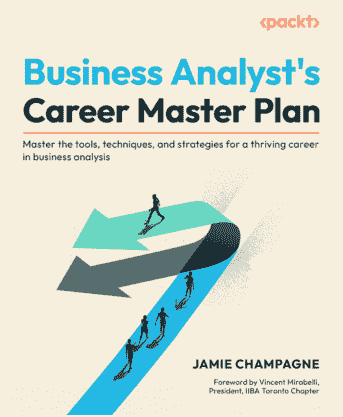

## 索引

### 符号

5W1H 模型 157, 158

### A

学术和研究出版物 147  
意外转型 64-66  
缺点 65  
优点 65  
收购或合并  
缺点 63  
优点 63  
收购转型 62, 63  
活动 220  
活动图 206, 208  
临时子流程 319  
ADONIS 325, 370  
ADONIS 工具 166  
代理 AI 362  
挑战 362  
通过 BSC 的战略对齐 362, 363  
转型 362  
替代流程路径 230  
美国生产力与质量中心 (APQC) 171  

美国机械工程师学会 (ASME) 199  
AND 网关 236  
注释 223  
Appian 377  
APQC 的 PCF® 183  
最佳实践 185-188  
流程库 183-185  
ArchiMate 181  
集成信息系统架构 (ARIS) 208  
ARIS 工具 166  
工件 223-284  
组 223, 286, 288  
文本注释 223, 284, 285  
人工智能 (AI) 376  
现状模型 156  
现状流程 172  
ASME 流程图 200  
关联箭头 285  
国际业务流程管理专业人员协会 (ABPMP®) 150  
权限要求 329  
自动化流程发现 163  

### B

### 平衡计分卡 (BSC) 350

- 与业务价值分析 (BVA) 的对比 365  
- 与精益指标的对比 365  
- 与六西格玛的对比 365  

### Bizagi 129, 377  

### Bizagi Modeler 工具 168  

### 黑盒池 220  

### Bonitasoft 377  

### 边界中间事件 294  

### BPM+ 326  

### BPM CoE

- KPIs 121  
- 与公民开发者 CoE 的对比 120  

### BPM 社区 100  

### BPM 领导者 99  

### BPM 生命周期 160  

### BPMN

- 多实例 323, 324  

### BPMN 图

- 活动 221  
- 工件 223, 224  
- 协作图 279, 281  
- 连接对象 222, 223  
- 数据流，带数据对象 288-291  
- 事件 220  
- 网关 221  
- 池和泳道 219, 273  
- 实践和错误 281, 283  
- 私有流程 275  
- 流程流 224  
- 公共流程 277  
- 可读性，带子流程 265  
- 阅读 217, 219  
- 任务 244  

### BPMN 图，流程流

- 替代流程路径 228, 230  
- 默认序列流 236  
- 错误条件 235  
- 独占网关 (XOR) 227  
- 包含网关 (OR) 239-241  
- 合并 230, 231  
- 建模，无网关问题 241-244  
- 命名 227, 228  
- 并行网关 236-239  
- 序列 225, 226  
- XOR 网关，232-235  

### BPMN 图，可读性

- 调用活动 271-273  
- 嵌入式子流程 267-271  

### BPMN 图，任务

- 手动任务 245, 246  
- 接收任务 246-252  
- 发送任务 246-252  
- 服务任务 245  
- 用户任务 245  

### BPMN 扩展 324

- BPM+ 326  
- CMMN 规范 326  
- DMN，基础 329-331  
- DMN，意义 326-329  
- DMN 规范 326  
- 适合业务 331, 332  
- 实践中 324-326  

### BPMN 符号 208-214  

### BPMN，带事件类型 293, 294

- 取消事件 309, 310  
- 补偿事件 307-309  
- 条件事件 303, 304  
- 错误事件 306, 307  
- 升级事件 304, 306  
- 事件，在事件子流程中启动 299, 300  
- 事件子流程 297-299  
- 中间事件 294  
- 中间事件，捕获 295  
- 中间事件，抛出 295  
- 中断边界事件 296, 297  
- 链接事件 310-312  
- 消息事件 295  
- 多个和并行事件 312  
- 非中断边界事件 296, 297  
- 流程，启动 313-315  
- 信号事件 300  
- 信号，与消息的对比 300, 301  
- 终止结束事件 310  
- 计时器事件 302  

BPMS 方法 208  
BPM 赞助人 99  
BPM 团队 100  
BPM 转型 78  
收益 79  
商业案例和路线图，制定 95  
挑战 79  
差距和改进机会，识别 93-95  
拐点，时机 80-89  
启动 79  
生命周期 108  
可衡量结果，推动 109  
角色和治理模型，建立 99  
范围和目标，定义 91-93  
结构化和可重复的方法 89-91  
愿景和战略，对齐 97, 99  
愿景和战略，沟通 97, 99  
工作 103-107  
更广泛的生态系统流程 152-155  
BSC 方法 359-361  

业务架构 (BA) 132  
业务架构知识体系 (BIZBOK®) 182  
业务架构核心元模型 182  
业务连续性管理 (BCM) 180  
业务编排和自动化技术 (BOAT) 168, 377  
业务流程 132, 374  
特征 133  
定义 133-135  
业务流程执行语言 (BPEL) 209  
业务流程管理 (BPM) 77, 125, 150, 344  
业务流程管理通用知识体系 (BPM CBOK®) 150  
参考链接 150  
业务流程管理倡议 (BPMI) 209  
业务流程管理套件 (BPMSs) 168  
业务流程管理系统 (BPMS) 377  
业务流程模型和符号 (BPMN) 70, 129, 209, 375  
业务流程模型 (BPM) 155-157  
特征和后果 136-139  
趋势影响 135, 136  
业务规则任务 320, 321  
业务价值 334, 336  
代理 AI 系统，衡量 350  
收益 336  
常见挑战 349  
数据驱动的持续改进 339, 340  
数字创新，建立 341-344  
员工参与和客户忠诚度 341  

## C

- call activity 271-273
- call activity task 322, 323
- Camunda 377
- Camunda Modeler tool 168
- Camunda/Zebee 325
- cancel events 309, 310
- Case Management Model and Notation (CMMN) 132, 326
- Center for Enablement (C4E) 61
- center of competency (CoC) 97
  - BPM CoE, versus citizen developer CoE 120
  - digital business platform, selecting 115, 116
  - mission statement examples 116-119
  - statement-of-work approach 120
- center of excellence (CoE) 60, 61, 100, 372, 377
  - BPM program launch mistakes 122
  - establishing 110
  - KPIs 121
  - timing dilemma 110-114
- change management body of knowledge (CMBOK) 140
- choreography diagrams 324
- citizen developer CoE
  - KPIs 122
  - versus BPM CoE 120
- citizen developers (cit-devs) 61, 101, 102, 139
- collaboration boards 166
- collaboration diagrams 279, 281
- collapsed (black-box) pool 275
- collapsed pool 220
- collection 290
- compensation events 307-309
- complex gateway 318, 319

- investments, building 337, 338
- models and techniques, measuring 347, 348
- strategic alignment, ensuring 338
- business value analysis (BVA) 335
  - versus Balanced Scorecard (BSC) 365
  - versus Lean Metrics 365
  - versus Six Sigma 365
- business value analysis (BVA), case study 350
  - Adaptive Logistics and Fulfillment 355, 356
  - low-code DPA platform, calculating 351, 352
  - RPA-based process automation, calculating 353, 354
- business value analysis (BVA), component model 356
  - agentic AI 362
  - benefits, identifying 357, 358
  - benefits, quantifying 357, 358
  - BPA role and automation 363
  - BSC approach 359-361
  - costs, identifying 356
  - costs, quantifying 356
  - Lean Metrics 365
  - mismanaged AI hidden cost 366
  - outcome and broader implications 363
  - ROI, calculating 358, 359
  - Six Sigma 364
- business value assessment (BVA) 55, 334
- business value, key metrics
  - customer-focused metrics 345
  - employee-focused metrics 346
  - financial metrics 344
  - measuring 344
  - operational metrics 345

## computer-aided software engineering (CASE) 167

## conditional events 303, 304

## connecting objects 222, 223

## context diagram 154

## continuous learning

- business processes 142
- digitization 142
- information 143, 144
- strategy 140, 141

## conversation diagrams 324

## Copilot 370

## CRM system 224

## cross-functional processes 152

## customer-focused metrics 345

## customer satisfaction score (CSAT) 345

## D

## data association 224, 289

## data input 290

## data objects 224

## data output 290

## data store 289

## Decision Model and Notation (DMN) 132, 321

- basics 329-331
- elements 329
- need for 326-329

## Decision Requirement Diagram (DRD) 329

## default sequence flow 236

## diagramming tools 165

## Digital Change (DtC) 47, 49

- vision 66

## digital change program 126-129

- need for 130-32

## Digital Process Automation (DPA) 57, 141, 337

## Digital Transformation (DTX) 45, 49-51, 77, 125

- accidental transformation 64-66
- acquisition transformation, triggering 62, 63
- common pitfalls, avoiding 57-59
- continuous adaptability, planning 67, 68
- evolution, versus revolution 52-57
- grassroot transformation 60, 61
- growth, planning 72
- intellectual property, generating 69, 70
- legacy modernization transformation 62
- long term/short term, planning 70
- overview 46-49
- planning 67
- plans, adjusting 71
- process modeling 26, 27
- process modeling, contributing 27-30
- scenarios 59
- size and scope, planning 71
- top-down transformation 60
- work optimization 68

## E

## embedded sub-process 267-271

## employee-focused metrics 346

## employee net promoter score (eNPS) 346

## enabling processes 173

## end event 220, 252, 253

- message end event 258-263
- more end event 257, 258
- naming end event 255
- one end event 256-258
- simple end event 255

## end-to-end process 190

## Enhanced Telecommunications Operations Map (eTOM) 188

## Enterprise Architect 167

## Index

enterprise business process analysis (EBPA) 166, 197
examples 166
Enterprise Resource Planning (ERP) 208
environmental, social, and governance (ESG) 173
error conditions 235
error events 306, 307
escalation events 304-306
event-based gateways 315, 316
- alternative 316, 317
- other types of 318
Event-Driven Process Chain (EPC) 208
events 220
event sub-processes 297-299
events, starting 299, 300
event types
- end event 220
- start event 220
exclusive gateway (XOR) 221, 227
executable private model 275
others types, of event-based gateways 318
partial event-based gateways 316, 317
global tasks 322
Goldman Sachs (GS) 90
grassroot transformation 60, 61
- cons 61
- pros 61
group 223, 286, 288
guiding processes 173

### H

Hawthorne effect 162
Heineken (HEINY) 90
helicopter view 153
hierarchy 174
hybrid workforce 152
hyperautomation approach 168

### I

IBM Blueworks Live tool 168
IDEF3
- reference link 206
IGOE method 153
iGrafx tool 166
inclusive gateway (OR) 239-241
Information Requirement 329
Information Technology Infrastructure Library (ITIL) 188
instantiating event-based gateways 318
Integrated DEFinitions (IDEF) 206
Intelligent Business Process Management Systems (iBPMS) 47
intermediate events 294
- catching 295
- throwing 295

### F

financial metrics 344
flowcharts 200
flow elements 222
Friendly Enough Expression Language (FEEL) 330
full-time equivalents (FTEs) 180

### G

gateways 221
gateways types, for BPMN 315
- complex gateway 318
- event-based gateways 315, 316

### J

job market
- navigating through 144-146

### K

key performance indicators (KPIs) 109, 164, 178, 339
Kipling method 157
Klaxoon 166
KnowProcess 325

### L

lanes 219, 274
Lean Metrics
- versus Balanced Scorecard (BSC) 365
- versus business value analysis (BVA) 365
- versus Six Sigma 365
legacy modernization transformation 62
- cons 62
- pros 62
Level 0 173
line of visibility 206
Line of Visibility Charts (LOVCs)
- reference link 206
Line of Visibility Engineering Methodology (LOVEM) 206
- reference link 206
link events 310-312
loop 323

### M

Management Professionals (ABPMP) 377
manual task 245, 246
Master of Business Administration (MBA) 69
mega-areas 175
mergers and acquisitions (M&A) 371
merging 230, 231
message end event 258-263
message events 295
message start event 258-263
Microsoft Power Automate 377
Microsoft Power Platform 129
milestone 294
Miro 166
model-based software engineering (MBSE) tools 167
- examples 167
modeling by employees versus modeling by outside experts 161
modeling by outside experts versus modeling by employees 161
modeling scenarios 149
modeling without gateways issue 241-244
more end event 257, 258
Most Valuable Professionals (MVPs) 128
multi-instance (MI) 323, 324
multiple event 312
Mural 166

### N

naming 227, 228
naming end event 255
naming start event 253
net present value (NPV) 337

Internet of Things (IoT) 135, 303
interrupting boundary events 296, 297
interrupting intermediate events 294

### O

- objectives and key results (OKRs) 338
- Object Management Group (OMG) 206
- OMG Certified Expert in BPM (OCEB) 377
- one end event 256-258
- online platforms 146
- operational metrics 345

### P

- parallel gateway 236-239
- parallel multiple event 312
- parallel multiple start event 313
- patterns 225
- Pegasystems’ GenAI Blueprint 376
- plan-do-check-act/plan-do-study-act (PDCA/PDSA) 160
- pools 219, 273
- private process 275
- process analyst/process modeler 161
- process architecture 171
  - attributes 178-181
  - benefits 196
  - building 189
  - categories 173, 174
  - custom creation 189, 190
  - custom creation, building 190, 192
  - hierarchy 174-178
  - need for 172, 173
  - standards 181, 182
  - usage 193-197
- process architecture, categories
  - core processes 173
  - management processes 173
  - support processes 173
- process areas 175
- process-centric view 133
- process chart 200
- Process Classification Framework (PCF) 171
- process libraries 183-185
- process log 226
- process management life cycle (PMLC) 159
- process mining 196
  - technique 163
- process modeling
  - basics 199-205
  - contributing, to digital transformation 27-30
  - in digital transformation 26, 27
  - knowledge based modeling 161-163
  - modeling by employees, versus modeling by outside experts 161
  - need for 159-161
  - processes 163
  - process modeling method 157-159
  - process modeling tools 164
    - diagramming tools 165
    - enterprise business process analysis (EBPA) tools 166
    - linking, to process automation suites 168
    - model-based software engineering (MBSE) tools 167
  - process models 370
- process owners 100
- process participants 101
- process thinking
  - key concepts 150, 151
- professional network 147

- Net Promoter Score (NPS) 260, 335
- non-disclosure agreements (NDAs) 147
- non-executable private model 275
- non-interrupting boundary events 296, 297
- non-interrupting intermediate events 294
- non-value adding (NVA) 159

### Q

Queensland University of Technology (QUT) 112

### R

receiving task 246-252  
Responsible Accountable Consulted Informed (RACIs) 69  
return on investment (ROI) 80, 139  
Return on Investment (ROI) 334  
Robotic Process Automation (RPA) 156, 194, 350, 377  
Rough Order of Magnitude (ROM) 71  

### S

scope diagram 154  
script task 322  
sending task 246-252  
sequence 225, 226  
example 225  
sequence flow 222  
sequential variant 324  
Service Level Agreement (SLA) 178, 335  
ServiceNow 129  
service-oriented architecture (SOA) 245  
service task 245  
shadow IT 48  
signal event 300  
silo thinking 172  

pro forma 349  
project management body of knowledge (PMBOK) 140  
Project Management Professional (PMP) 69  
public process 277  

simple end event 255  
simple start event 253  
SIPOC approach 153  
Six Sigma  
versus Balanced Scorecard (BSC) 365  
versus business value analysis (BVA) 365  
versus Lean Metrics 365  
social media 146  
Software-as-a-Service (SaaS) 346  
specific, measurable, achievable, relevant, and time-bound (SMART) 109  
Standard Operating Procedure (SOP) 175  
start event 220, 252, 253  
message start event 258-263  
naming start event 253  
simple start event 253  
timer start event 263, 264  
statement-of-work approach  
benefits 120  
strategic adaptability 51, 335  
strategy management 192  
subject matter experts (SMEs) 161  
sub-optimization 172  
sub-processes types, for BPMN 320  
business rule task 320, 321  
call activity task 322, 323  
script task 322  
Supply Chain Operations Reference (SCOR) 188  
swimlanes 206, 220  
Systems Modeling Language (SysML) 167  

### T

task mining technique 163  
terminate end event 310  
text annotation 284, 285  
timer events 302  

### U

Unified Modeling Language  
(UML) 167, 206, 208  
reference link 206  
UnitedHealth Group (UNH) 90  
user task 245  

### V

value adding (VA) 159  
value chain 172  
value creation  
processes 151  
Value Delivery Modeling Language 182  
value enabling (VE) 159  
value proposition 151  
Visual Paradigm 167  

### W

weighted average cost of capital (WACC) 359  
Workflow Management Coalition  
(WfMC) 209  

### X

XML Process Definition  
Language (XPDL) 209  
XOR gateway 227, 232-235  

timer start event 263, 264  
to-be models 156  
to-be processes 172  
token 225  
top-down transformation 60  
cons 60  
pros 60  
transaction sub-process 310  
Trisotech 325  

## Why subscribe?

- Spend less time learning and more time coding with practical eBooks and Videos from over 4,000 industry professionals  
- Improve your learning with Skill Plans built especially for you  
- Get a free eBook or video every month  
- Fully searchable for easy access to vital information  
- Copy and paste, print, and bookmark content  

Did you know that Packt offers eBook versions of every book published, with PDF and ePub files available? You can upgrade to the eBook version at packtpub.com and as a print book customer, you are entitled to a discount on the eBook copy. Get in touch with us at customercare@packtpub.com for more details.

At www.packtpub.com, you can also read a collection of free technical articles, sign up for a range of free newsletters, and receive exclusive discounts and offers on Packt books and eBooks.

Subscribe to our online digital library for full access to over 7,000 books and videos, as well as industry leading tools to help you plan your personal development and advance your career. For more information, please visit our website.

packtpub.com

## Other Books You May Enjoy

If you enjoyed this book, you may be interested in these other books by Packt:

### Business Analyst's Career Master Plan

Jamie Champagne

ISBN: 978-1-83620-684-2

- Master foundational skills and apply them to real-world scenarios  
- Explore techniques for effective requirements elicitation and modeling  
- Improve stakeholder communication, ethics, and leadership skills  
- Plan career progression by setting goals and creating a roadmap  
- Explore business analysis specializations and find your path  
- Stay updated on emerging technologies’ impact on analysis work  
- Build and grow your career with best practices in a dynamic field  

## Packt is searching for authors like you

If you're interested in becoming an author for Packt, please visit **authors.packtpub.com** and apply today. We have worked with thousands of developers and tech professionals, just like you, to help them share their insight with the global tech community. You can make a general application, apply for a specific hot topic that we are recruiting an author for, or submit your own idea.

## Share Your Thoughts

Now you've finished *Practical Business Process Modeling and Analysis*, we'd love to hear your thoughts! If you purchased the book from Amazon, please click here to go straight to the Amazon review page for this book and share your feedback or leave a review on the site that you purchased it from.

Your review is important to us and the tech community and will help us make sure we're delivering excellent quality content.

