# 第 1 部分：梯度提升和 LightGBM 基础

在本部分中，我们将通过让你掌握机器学习的基本概念（从基本术语到随机森林等复杂算法）来启动对机器学习的探索。我们将深入探讨集成学习，重点介绍决策树结合使用时的威力，然后将重点转移到梯度提升框架 LightGBM。通过 Python 的实践示例以及与 XGBoost 和深度神经网络等技术的对比分析，你将在机器学习领域（尤其是 LightGBM）获得基础理解和实践能力。

本部分将包含以下章节：

- 第 1 章，机器学习简介
- 第 2 章，集成学习 – 装袋与提升
- 第 3 章，Python 中的 LightGBM 概览
- 第 4 章，LightGBM、XGBoost 与深度学习对比

## 机器学习简介

我们的旅程始于对机器学习及贯穿本书所用基本概念的介绍。

我们将从软件工程的角度开始概述机器学习。然后，我们将介绍机器学习和数据科学领域使用的核心概念：模型、数据集、学习范式及其他细节。本介绍将包含一个实践示例，清晰地说明所讨论的机器学习术语。

我们还将介绍决策树，这是一种至关重要的机器学习算法，是理解 LightGBM 的第一步。

完成本章后，你将在机器学习及其技术的实际应用方面建立坚实的基础。

本章将涵盖以下主要主题：

- 什么是机器学习？
- 模型、数据集和监督学习简介
- 决策树学习

### 技术要求

本章包含简单机器学习算法的示例，并介绍如何使用 scikit-learn。你必须安装带有 scikit-learn、NumPy、pandas 和 Jupyter Notebook 的 Python 环境。本章代码可在 https://github.com/PacktPublishing/Practical-Machine-Learning-with-LightGBM-and-Python/tree/main/chapter-1 获取。


## 什么是机器学习？

机器学习是更广泛的人工智能领域的一部分，涉及方法和技术，使计算机能够在无需显式编程的情况下“学习”特定任务。

机器学习只是从数据编写程序的另一种方式，尽管是自动的。抽象地说，程序是一组将输入转换为特定输出的指令。程序员的工作是理解计算机程序的所有相关输入，并开发一组指令以生成正确的输出。

但是，如果输入超出了程序员的理解范围呢？

例如，让我们考虑创建一个程序来预测大型零售店的总销售额。程序的输入将是可能影响销售的各种因素。我们可以想象诸如历史销售数据、即将到来的公共假期、库存可用性、商店可能正在进行的任何特别交易，甚至天气预报或与其他商店的距离等因素。

在我们的商店示例中，传统的方法是将输入分解为可管理、可理解（程序员能够理解）的部分，也许咨询商店销售预测专家，然后制定手工制作的规则和指令以尝试预测未来的销售额。

虽然这种方法当然是可能的，但它也很脆弱（在程序可能需要针对输入因素进行广泛更改的意义上），并且完全基于程序员（或领域专家）对问题的理解。有可能有成千上万个因素和数十亿个示例，这个问题就变得不可行了。

机器学习为我们提供了这种方法的替代方案。与其创建规则和指令，不如我们反复向计算机展示我们需要完成的任务的示例，然后让它自行想出如何自动解决它们。

然而，我们以前拥有一组指令，现在我们拥有一个训练有素的模型，而不是一个编程的模型。

这里的关键认识是，特别是如果你来自软件背景，我们的机器学习程序仍然像常规程序一样运作：它接受输入，有处理输入的方式，并产生输出。与所有其他软件程序一样，机器学习软件必须经过正确性测试、集成到其他系统、部署、监控和优化。集体而言，这构成了机器学习工程领域。我们将在后面的章节中介绍所有这些方面及更多内容。

## 机器学习范式

广义上说，机器学习有三种主要范式：监督学习、无监督学习和强化学习。

使用**监督学习**，模型在带标签的数据上进行训练：数据集中的每个实例都有针对输入示例的关联正确输出，或标签。模型被期望学习预测未见输入示例的标签。

使用**无监督学习**，数据集中的示例是未标记的；在这种情况下，模型被期望在数据中发现模式和关系。无监督方法的示例包括聚类算法、异常检测和降维算法。

最后，**强化学习**涉及一个通常被称为代理的模型与特定环境交互，并通过为特定动作接收惩罚或奖励来学习。目标是代理执行能够最大化其奖励的动作。强化学习广泛应用于机器人、控制系统或训练计算机玩游戏。

LightGBM和本书后面讨论的大多数其他算法都是监督学习技术的示例，也是本书的重点。

下一部分将深入探讨我们将在整本书中使用的机器学习术语以及机器学习过程的详细信息。

## 介绍模型、数据集和监督学习

在上一节中，我们介绍了模型作为一种构造，用于替代通常构成执行特定任务的程序的一组指令。本节将更详细地介绍模型和其他核心机器学习概念。

### 模型

更正式地说，模型是执行特定任务的特定过程的数学或算法表示。机器学习模型通过使用**训练算法**在**数据集**上进行训练来学习特定任务。

> **注意**
> 
> 训练的替代术语是拟合。历史上，拟合源于统计学领域。模型在训练后被称为“拟合数据”。我们将在整本书中交替使用这两个术语。

存在许多不同类型的模型，它们都使用不同的数学、统计或算法技术来对训练数据进行建模。机器学习算法的示例包括线性回归、逻辑回归、决策树、支持向量机和神经网络。

模型类型与该模型的训练实例之间存在区别：大多数机器学习模型可以被训练以执行各种任务。例如，决策树（一种模型类型）可以被训练来预测销售额、识别心脏病和预测足球比赛结果。

然而，这些任务中的每一个都需要在不同数据集上训练过的决策树的不同*实例*。

特定模型所做的事情取决于模型的**参数**。参数有时也被称为**权重**，技术上它们是模型参数的特定类型。

**训练算法**是一种用于为特定任务找到最合适模型参数的算法。

我们使用**目标函数**来确定拟合的质量，或模型的性能如何。这是一个数学函数，用于测量给定输入的预测输出和实际输出之间的差异。目标函数量化了模型的性能。我们可能会根据要解决的问题来最小化或最大化目标函数。目标通常被衡量为我们在训练期间力求最小化的误差。

我们可以概括模型训练过程如下：训练算法使用来自数据集的数据来为特定任务优化模型的参数，通过目标函数进行测量。

### 超参数

虽然模型由参数组成，但训练算法有其自己的参数，称为**超参数**。超参数是影响训练过程或算法的可控值。例如，考虑寻找抛物线函数的最小值：我们可以从猜测一个值开始，然后在使函数输出最小化的方向上采取小步骤。步长必须选好：如果我们的步子太小，找到最小值将花费禁止性的长时间。如果步长太大，我们可能会超过并错过最小值，然后在最小值周围继续振荡（来回跳跃）：

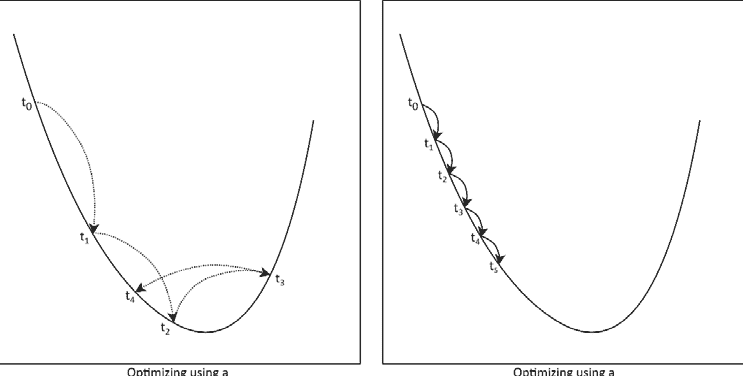

图 1.1 – 步长过大（左）和过小（右）的效果

在这个例子中，步长将是我们最小化算法的超参数。步长的效果在图 1.1 中说明。

### 数据集

如前所述，机器学习模型使用数据集进行训练。数据是机器学习过程的核心，数据准备通常是耗时最长的部分。

在整本书中，我们将使用表格数据集。表格数据集在现实世界中非常常见，由行和列组成。行通常被称为样本、示例或观测值，列通常被称为特征、变量或属性。

重要的是，列中没有数据类型限制。特征可以是字符串、数字、布尔值、地理空间坐标，或音频、图像或视频等编码格式。

数据集也很少被完美定义。数据可能不完整、有噪声、不正确、不一致，并包含各种格式。

因此，数据准备和清洗是机器学习过程的重要组成部分。

数据准备涉及处理数据以使其适合机器学习，通常包含以下步骤：

- 1. **收集和验证**：某些数据集最初太小或对问题的表示不佳（数据不代表其抽样的实际数据总体）。在这些情况下，从业人员必须收集更多数据，并进行验证以确保数据代表问题。
- 2. **检查系统性错误和偏差**：检查并纠正收集和验证过程中可能导致数据集偏差的任何系统性错误至关重要。在我们的销售示例中，系统性收集错误可能是数据仅从城市商店收集而排除了农村商店。仅在城市商店数据上训练的模型在预测商店销售额时会有偏差，我们可能预期该模型用于预测农村商店销售额时性能较差。
- 3. **清理数据**：必须解决任何格式或值范围不一致的问题。缺失值也需要以不引入偏差的方式进行处理。
- 4. **特征工程**：某些特征可能需要转换，以确保机器学习模型能够从中学习，例如对句子进行数值编码。此外，可能需要从现有特征准备新特征，以帮助模型检测模式。
- 5. **归一化和标准化**：特征的相对范围必须进行归一化和标准化。归一化和标准化确保没有单个特征对整体预测产生过大影响。


- **数据集平衡**：在数据集不平衡的情况下——即一个类别或预测的示例数远多于另一个类别时——需要对数据集进行平衡。平衡通常通过过采样少数类示例来实现，以平衡数据集。

在第 6 章“使用 LightGBM 解决现实世界的数据科学问题”中，我们将讲解整个数据准备过程，展示前述步骤在实际中的应用。

> **注意**
> 值得记住的一句良箴是“垃圾进，垃圾出”。模型会从给定的任何数据中学习，包括数据中包含的任何缺陷或偏差。当我们在垃圾数据上训练模型时，就会得到一个垃圾模型。

关于数据集，最后需要理解的一个概念是训练集、验证集和测试集。在完成数据准备步骤后，我们将数据集分为这三个子集：

- **训练集**是最重要的子集，通常包含 60% 到 80% 的数据。这些数据用于训练模型。

- **验证集**与训练数据分开，并在整个训练过程中用于评估模型。拥有独立的验证数据可确保模型在未见过的数据上进行评估，这也称为其泛化能力。超参数调优（在第 5 章“使用 Optuna 优化 LightGBM 参数”中详细介绍）也使用验证集。

- 最后，**测试集**是一个可选的留出集，与验证集类似。它在流程结束时用于评估模型在非训练或调优过程数据上的性能。

验证集的另一个用途是监控模型是否对数据过拟合。让我们更详细地讨论过拟合。

## 过拟合与泛化

要理解过拟合，我们首先必须定义模型**泛化**的含义。如前所述，泛化是模型准确预测未见数据的能力。与训练准确率相比，泛化准确率作为模型性能估计更具意义，因为它指示了我们的模型在生产环境中的表现。泛化有两种形式：**内插和外推**：

- 内插是指模型在两个已知数据点之间预测值的能力——换句话说，就是在训练数据范围内进行泛化。例如，假设我们使用 1 月到 7 月的月度数据训练模型。在进行内插时，我们会要求模型对 4 月的某一天进行预测，该日期在我们的训练范围内。

- 外推，正如你可能推断的那样，是模型预测超出训练数据定义范围之外的值的能力。外推的一个典型示例是预测——即预测未来。在我们之前的示例中，如果我们要求模型对 12 月进行预测，我们期望它从训练数据进行外推。

在两种泛化类型中，外推要具挑战性得多，可能需要特定类型的模型才能实现。然而，在这两种情况下，模型都可能过拟合数据，失去准确内插或外推的能力。

**过拟合**是一种现象，其中模型过于紧密地拟合训练数据，并失去对未见数据进行泛化的能力。模型没有学习数据中的基本模式，而是记住了训练数据。更技术地说，模型拟合了训练数据中包含的噪声。噪声一词源于数据包含信号和噪声的概念。信号是指我们试图预测的数据中捕获的基本模式或信息。相比之下，噪声是指掩盖信号的数据点的随机或无关变化。

例如，考虑一个我们试图预测特定地点降雨量的数据集。数据中的信号将是降雨的一般趋势：冬季或夏季降雨量增加，或其他地点正好相反。噪声将是我们数据集中每个月和每个地点降雨测量的微小变化。

下图说明了过拟合现象：

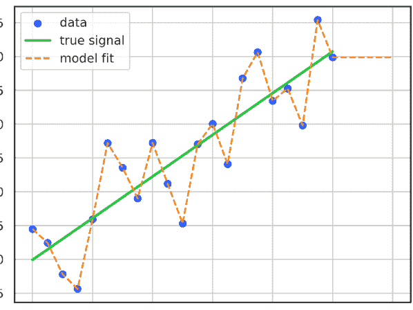

图 1.2 – 显示过拟合的图表。模型已过拟合并完美预测了训练数据，但失去了对实际信号进行泛化的能力

上图显示了信号和噪声的区别：每个数据点都从实际信号中采样。数据遵循信号的一般模式，带有轻微的随机变化。我们可以看到模型如何过拟合数据：模型完美拟合了训练数据，但代价是牺牲了泛化能力。我们还可以看到，如果我们使用模型通过预测 4 的值来进行内插，我们得到的结果远高于实际信号（6.72 对比 6.2）。还显示了模型无法外推：对 12 的预测远低于信号的预测（7.98 对比 8.6）。

在现实中，所有真实世界的数据集都包含噪声。作为数据科学家，我们的目标是准备数据，以尽可能多地去除噪声，使信号更容易被检测到。数据清洗、归一化、特征选择、特征工程和正则化都是从数据中去除噪声的技术。

由于所有真实世界的数据都包含噪声，过拟合无法消除。以下条件可能导致过拟合：

- **过于复杂的模型**：对于我们拥有的数据量来说过于复杂的模型会利用额外的复杂性来记住数据中的噪声，从而导致过拟合
- **数据不足**：如果我们为所使用的模型没有足够的训练数据，这与过于复杂的模型类似，会导致对数据过拟合
- **特征过多**：包含过多特征的数据集可能包含不相关（噪声）特征，这些特征会降低模型的泛化能力
- **过度训练**：训练模型时间过长会使其记住数据集中的噪声

由于验证集是训练数据中模型未见过的一部分，我们使用验证集来监控过拟合。我们可以通过随时间观察训练误差和泛化误差来识别过拟合点。在过拟合点，验证误差增加。相比之下，训练误差仍在改善：模型正在拟合训练数据中的噪声并失去泛化能力。

防止过拟合的技术通常旨在解决我们之前讨论的导致过拟合的条件。以下是一些避免过拟合的策略：

- **早停**：当我们看到验证误差开始增加时，可以停止训练。
- **简化模型**：参数更少的不太复杂的模型无法学习训练数据中的噪声，从而泛化得更好。
- **获取更多数据**：收集更多数据或数据增强是一种有效的防止过拟合的方法，它能让模型更好地学习数据中的信号，而不是较小数据集中的噪声。
- **特征选择和降维**：由于某些特征可能与要解决的问题无关，我们可以丢弃我们认为冗余的特征，或使用主成分分析等技术来降低维度（特征）。
- 添加正则化：较小的参数值通常能带来更好的泛化能力，具体取决于模型（神经网络就是这种模型的一个例子）。正则化向目标函数添加惩罚项，以阻止较大的参数值。通过将参数驱动到较小（或零）值，它们对预测的贡献减少，从而有效地简化了模型。
- 集成方法：组合多个较弱模型的预测可以带来更好的泛化能力，同时也能提升性能。

重要的是要注意，过拟合及其防止技术是特定于我们模型的。我们的目标应始终是尽量减少过拟合，以确保对未见数据的泛化。某些策略（例如正则化）可能不适用于特定模型，而其他策略可能更有效。还有一些针对模型的更具针对性的策略，我们将在讨论决策树过拟合时看到一个示例。

### 监督学习

商店销售示例是监督学习的一个实例——我们有一个由特征组成的数据集，并正在训练模型来预测目标。

监督学习问题可以分为两大类问题类别：分类问题和回归问题。

### 分类与回归

在分类问题中，模型需要预测的标签是类别标签或定义一个类。类的示例包括垃圾邮件或非垃圾邮件、猫或狗、糖尿病或非糖尿病。这些是二进制分类的示例：只有两个类。

多类分类也是可能的；例如，电子邮件可能被分类为重要、促销、杂项或垃圾邮件；云的图像可能被分类为卷云、积云、层云或雨云。

在回归问题中，目标是预测连续的数值。示例包括预测收入、销售额、温度、房价和人群规模。

机器学习艺术的很大一部分在于将问题正确定义或转录为分类或回归问题（或者可能是非监督或强化学习）。后续章节将涵盖这两类问题的多个端到端案例研究。

### 模型性能指标

让我们简要讨论如何衡量模型的性能。模型性能是指机器学习模型基于给定输入进行准确预测或生成有意义输出的能力。评估指标量化了模型对新的未见数据的泛化程度。


模型性能高表明模型有效地学习了数据中的底层模式，并能对未见过的数据做出准确预测。在处理监督学习问题（无论是分类还是回归问题）时，我们可以根据已知目标来衡量模型的性能。

重要的是，衡量分类任务和回归任务上模型性能的方法不同。scikit-learn 内置了许多可直接用于分类或回归问题的指标函数（https://scikit-learn.org/stable/modules/model_evaluation.html）。让我们回顾一下其中最常见的指标。

分类指标可以根据模型做出的正预测和负预测来定义。以下定义可用于计算分类指标：

- **真阳性（TP）**：正实例被正确分类为正
- **真阴性（TN）**：负实例被正确分类为负
- **假阳性（FP）**：负实例被错误地分类为正
- **假阴性（FN）**：正实例被错误地分类为负

基于这些定义，最常见的 *分类* 指标如下：

- **准确率**：准确率是最直观的分类指标。准确率是正确预测的数量除以预测总数。然而，准确率容易受到数据不平衡的影响。例如，假设我们有一个电子邮件数据集，包含 8 个垃圾邮件示例和 2 个非垃圾邮件示例，而我们的模型只预测垃圾邮件。在这种情况下，模型的准确率为 80%，即使它从未正确分类非垃圾邮件。从数学上讲，我们可以这样定义准确率：

  \( Accuracy = \frac{TP + TN}{TP + FP + TN + FN} \)

- **精确率**：精确率得分是深入了解分类性能的一种方法。精确率是真阳性预测（正确预测）与所有正预测（真阳性和假阳性）之间的比率。换句话说，精确率得分表明模型预测正类的精确程度。在我们的垃圾邮件示例中，只预测垃圾邮件的模型不太精确（因为它将所有非垃圾邮件都分类为垃圾邮件），并且精确率得分较低。可以使用以下公式计算精确率：

  \( Precision = \frac{TP}{TP + FP} \)

- **召回率**：召回率得分是精确率得分的对应指标。召回率得分衡量模型查找（或召回）所有真阳性案例的效果。召回率计算为真阳性预测与所有正实例（真阳性和假阴性）之间的比率。在我们的垃圾邮件示例中，只预测垃圾邮件的模型具有完美的召回率（它可以找到所有垃圾邮件）。我们可以这样计算召回率：

  \( Recall = \frac{TP}{TP + FN} \)

- **F1 分数**：最后，我们有 F1 分数。F1 分数计算为精确率和召回率的调和平均数。F1 分数平衡精确率和召回率，给出一个总结分类器性能的单一值。可以使用以下公式计算 F1 分数：

  \(F_1 = \frac{2 \times Precision \times Recall}{Precision + Recall} = \frac{2 \times TP}{2 \times TP + FP + FN}\)

前述分类指标是最常见的，但还有更多指标。尽管 F1 分数常用于分类问题（因为它汇总了精确率和召回率），但选择最佳指标取决于你正在解决的具体问题。通常，可能需要特定的指标，但其他时候，你必须根据经验和对数据的理解来选择。我们将在本书后面查看不同指标的示例。

以下是常见的回归指标：

- **均方误差**（MSE）：MSE 计算为预测值与实际值之间平方差的平均值。MSE 常用是因为一个关键的数学属性：MSE 是 *可微* 的，因此适合用于基于梯度的学习方法。然而，由于差值被平方，MSE 对大错误的惩罚比小错误更严重，这可能适合也可能不适合正在解决的问题。

- **平均绝对误差**（MAE）：MAE 不对差值求平方，而是计算预测值与实际值之间绝对差的平均值。通过避免对错误求平方，MAE 对错误的大小更具鲁棒性，且比 MSE 对异常值的敏感度更低。然而，MAE 不可微，因此不能用于基于梯度的学习方法。

与分类指标一样，选择最合适的回归指标取决于你正在尝试解决的具体问题。

> **指标 versus 目标**
> 
> 我们将模型训练定义为寻找最合适的参数以最小化 *目标函数*。需要注意的是，特定问题使用的目标函数和指标可能不同。决策树就是一个很好的示例，构建树时使用不纯度度量（熵）作为目标函数。然而，我们仍然计算之前解释过的指标来确定树在数据上的性能。

在掌握基本指标的理解后，我们可以结束对机器学习概念的介绍。现在，让我们通过一个示例来回顾我们讨论过的术语和概念。

## 建模示例

请参考以下按月份划分的销售数据（单位：千）：

| 一月 | 二月 | 三月 | 四月 | 五月 | 六月 |
|---|---|---|---|---|---|
| 4,140 | 4,850 | 7,340 | 6,890 | 8,270 | 10,060 |
| 七月 | 八月 | 九月 | 十月 | 十一月 | 十二月 |
| 8,110 | 11,670 | 10,450 | 11,540 | 13,400 | 14,420 |

表 1.1 – 按月份划分的示例销售数据（单位：千）

这个问题很简单：只有一个特征，即月份，目标是销售数量。因此，这是一个监督回归问题的示例。

> > **注意**
> > 你可能已经注意到，这是一个时间序列问题的示例：时间是主要变量。时间序列也可以使用更高级的时间序列专用算法（如 ANOVA）来预测，但本节将使用简单算法进行说明。

我们可以将数据绘制为每月销售图表，以便更好地理解：

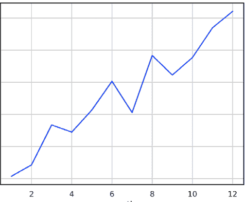

图 1.3 – 显示商店按月销售的图表

这里，我们使用直线模型（也称为简单线性回归）来模拟销售数据。直线的定义由以下公式给出：

\( y = mx + c \)

这里，\( m \) 是直线的斜率，\( c \) 是 Y 轴截距。在机器学习中，直线是模型，\( m \) 和 \( c \) 是模型参数。

为了找到最佳参数，我们必须衡量模型对特定参数集拟合数据的效果——即输出中的误差。我们将使用 MAE 作为指标：

\( MAE = \frac{\sum_{i=1}^n |\hat{y} - y|}{n} \)

这里，\( \hat{y} \) 是预测输出，\( y \) 是实际输出，\( n \) 是预测数量。我们通过对每个输入进行预测，然后根据公式计算 MAE 来计算 MAE。

## 拟合模型

现在，让我们将线性模型拟合到数据中。拟合直线的过程是迭代的，我们首先猜测 \( m \) 和 \( c \) 的值，然后从那里开始迭代。例如，让我们考虑 \( m = 0.1 \)，\( c = 4 \)：

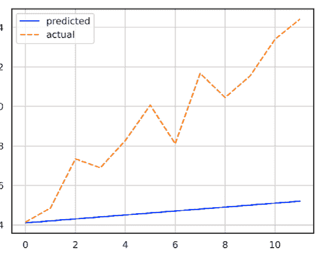

图 1.4 – 显示 m = 0.1 和 c = 4 的线性模型预测的图表

使用这些参数，我们得到的误差为 4,610。

我们的猜测远远偏低，但没关系；我们现在可以更新参数以尝试改善误差。实际上，更新模型参数是通过梯度下降等训练算法完成的。我们将在 _第 2 章，集成学习 – 装袋和提升_ 中讨论梯度下降。


在本示例中，我们将利用对直线的理解和直觉，手动更新每次迭代的参数。我们的直线太平缓，截距太低；因此，我们必须增加这两个值。我们可以通过选择一个 _step size_ 来控制每次迭代所做的更新。我们必须在每次迭代中通过添加 step size 来更新 _m_ 和 _c_ 值。对于 step size 为 0.1 的情况，结果如表 1.2 所示。

| 猜测# | m | c | MAE |
|---|---|---|---|
| 1 | 0.1 | 4 | 4.61 |
| 2 | 0.2 | 4.1 | 3.89 |
| 3 | 0.3 | 4.2 | 3.17 |
| 4 | 0.3 | 4.3 | 2.5 |
| 5 | 0.4 | 4.4 | 1.83 |

表 1.2 – 逐步猜测直线斜率（**_m_**）和 y 轴截距（**_c_**）以拟合我们的数据。拟合优度使用 MAE 进行衡量。

在我们的示例中，_step size_ 是我们训练过程的一个 _hyperparameter_。

我们最终得到的误差为 1.83，这意味着，平均而言，我们的预测误差小于 2。

现在，让我们看看如何使用 scikit-learn 来解决这个问题。

## 使用 scikit-learn 进行线性回归

与手动建模不同，我们可以使用 scikit-learn 构建线性回归模型。由于这是我们的第一个示例，我们将逐行讲解代码并解释正在发生的事情。

首先，我们必须导入将要使用的 Python 工具：

```
import numpy as np
import pandas as pd

from matplotlib import pyplot as plt
import seaborn as sns

from sklearn.linear_model import LinearRegression
from sklearn.metrics import mean_absolute_error
```

这里有三组导入：我们首先导入 numpy 和 pandas。导入 NumPy 和 pandas 是启动所有数据科学笔记本的广泛使用的方式。还要注意简写名称 `np` 和 `pd`，这是使用 numpy 和 pandas 时的标准惯例。

接下来，我们导入一些将用于绘制图表的标准绘图库：matplotlib 中的 `pyplot` 和 `seaborn`。Matplotlib 是一个广泛使用的绘图库，我们通过 pyplot Python 接口访问它。Seaborn 是构建在 Matplotlib 之上的另一种可视化工具，它使绘制专业外观的图表变得更加容易。

最后，我们来到 scikit-learn 的导入部分。在 Python 代码中，scikit-learn 库称为 sklearn。从其 linear_model 包中，我们导入 LinearRegression。scikit-learn 实现了大量预定义的指标，这里我们将使用 mean_absolute_error。

现在，我们准备好设置数据了：

```python
months = np.array([ 1, 2, 3, 4, 5, 6, 7, 8, 9, 10, 11, 12])
sales = np.array([4.14, 4.85, 7.34, 6.89, 8.27, 10.06, 8.11,
11.67, 10.45, 11.54, 13.4, 14.42])
df = pd.DataFrame({"month": months, "sales": sales})
```

在这里，我们为月份和对应的销售额定义了新的 numpy 数组，为了更方便地操作，我们将两个数组收集到一个新的 pandas DataFrame 中。

数据准备就绪后，我们进入代码中有趣的部分：使用 scikit-learn 进行建模。代码很简单：

```python
model = LinearRegression()
model = model.fit(df[["month"]], df[["sales"]])
```

首先，我们通过构造 LinearRegression 的实例来创建模型。然后，我们使用 model.fit 并传入 DataFrame 中的月份和销售额数据来拟合模型。这两行代码足以拟合一个模型，正如我们在后续章节中将看到的，即使是复杂的模型也使用相同的方法来实例化和训练模型。

我们现在可以通过为数据创建预测，并将预测值和实际目标传递给指标函数来计算 MAE：

```python
predicted_sales = model.predict(df[["month"]])
mean_absolute_error(predicted_sales, df[["sales"]])
```

我们得到的误差为 0.74，略低于我们的猜测。我们还可以检查模型的系数和截距（即前面提到的 m 和 c）：

```python
print(f"Gradient: {model.coef_}")
print(f"Intercept: {model.intercept_}")
```

scikit-learn 拟合了一个系数为 0.85、截距为 3.68 的模型。我们的猜测方向是对的，但可能需要花些时间才能找到最优值。

这结束了我们对 scikit-learn 以及建模和机器学习基础知识的介绍。在我们的玩具示例中，我们没有将数据拆分为单独的数据集，没有优化模型的超参数，也没有应用任何技术来确保模型不过拟合。在下一节中，我们将探讨分类和回归示例，在那里我们将应用这些以及其他最佳实践。

## 决策树学习

本节介绍决策树学习，这是理解 LightGBM 的关键机器学习算法。我们将逐步演示如何使用 scikit-learn 构建决策树。本节还将提供构建决策树的一些数学定义；理解这些定义并不关键，但将帮助我们理解关于决策树超参数的讨论。

决策树是基于树的学习器，通过就数据提出一连串问题来确定结果。沿着树向下走一条路径，使用一个或多个特征对输入做出决策。路径在叶子节点处终止，该节点表示预测的类或值。决策树可用于分类或回归。

以下是针对 Iris 数据集拟合的决策树示例：

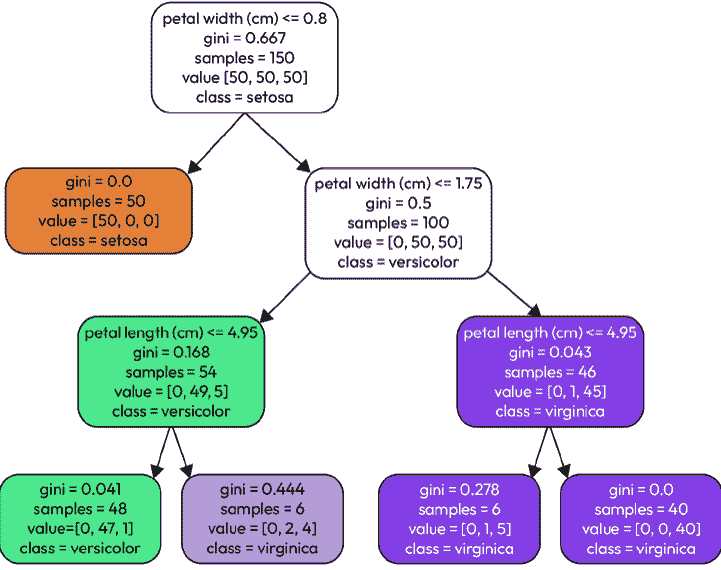

图 1.5 – 对 Iris 数据集建模的决策树

Iris 数据集是一个分类数据集，其中使用 Iris 花的萼片和花瓣尺寸来预测 Iris 花的类型。每个非叶子节点使用一个或多个特征来缩小数据集中的样本范围：根节点从全部 150 个样本开始，然后根据花瓣宽度（<= 0.8）将它们分割。我们继续沿着树向下，每个节点进一步分割样本，直到到达一个包含预测类（versicolor、virginica 或 setosa）的叶子节点。

与其他模型相比，决策树有许多优点：

- **特征可以是数值型或类别型**：可以使用数值特征（通过分割范围）或类别特征来分割样本，而无需对其中任何一种进行编码。

- **减少数据准备需求**：决策分割对数据范围或大小不敏感。许多其他模型（例如神经网络）要求数据归一化到单位范围。

- **可解释性**：如前所示，解释树所做的预测非常简单。在需要向决策者解释预测的场景中，可解释性非常有价值。

这些只是使用基于树模型的一些优点。然而，我们也需要了解与决策树相关的一些缺点：

- **过拟合**：决策树非常容易过拟合。在拟合决策树时，设置正确的超参数至关重要。决策树中的过拟合将在后面详细讨论。

- **外推能力差**：由于决策树的预测不连续且实际上受限于训练数据，因此它们在外推方面表现不佳。

- **不平衡数据**：在不平衡数据上拟合树时，高频类别会主导预测。需要准备数据以消除不平衡。

关于决策树优缺点的更详细讨论可在 https://scikit-learn.org/stable/modules/tree.html 上查阅。

## 熵与信息增益

在研究构建（或拟合）决策树的算法之前，我们首先需要对熵和信息增益有基本的理解。

熵可以被视为衡量系统无序度或随机性的一种方法。熵衡量特定输入或事件的结果有多么令人惊讶。考虑一副洗好牌的牌：从顶部抽牌可能会给我们牌组中的任何一张牌（每次都是一个令人惊讶的结果）；因此，我们可以说一副洗好的牌具有 **高熵**。从有序牌组的顶部抽牌并不令人惊讶；我们知道接下来的牌是什么。因此，一副有序的牌具有 **低熵**。解释熵的另一种方式是数据集的不纯度：低熵数据集（整齐有序）的不纯度低于高熵数据集。

信息增益，则是在修改或观察底层数据时获得的信息量。信息增益涉及从观察前降低熵。在我们的牌组示例中，我们可以拿一副洗好的牌，按花色（黑桃、红心、方块和梅花）将其分成四个较小的牌组。如果从较小的牌组中抽牌，结果就不那么令人惊讶了：我们知道下一张牌是同一花色的。通过按花色分割牌组，我们


降低了较小牌组的熵。基于特征（花色）分割牌组与决策树中分割的工作方式非常相似；每一次划分都力求最大化信息增益——也就是说，它们最小化划分后的熵。

在决策树中，衡量信息增益或不纯度损失有两种常见方法：

- 吉尼指数
- 对数损失或熵

每种方法的详细解释可在 https://scikit-learn.org/stable/modules/tree.html#classification-criteria 上找到。

## 使用 C4.5 构建决策树

C4.5 是一种从数据集构建决策树的算法 [1]。该算法是递归的，并从以下基本情况开始：

- 1. 如果子数据集中的所有样本都属于同一类别，则在树中创建一个选择该类别的叶子节点。
- 2. 如果使用任何特征进行分割都无法获得信息（数据集无法再进一步划分），则创建一个预测子数据集中出现频率最高类别的叶子节点。
- 3. 如果子数据集中达到最小样本阈值，则创建一个预测子数据集中出现频率最高类别的叶子节点。

然后，我们可以应用该算法：

- 1. 检查三种基本情况中的任何一种，如果其中任何一种适用于数据集，则停止分割。
- 2. 对数据集的每个特征或属性，计算基于该特征分割数据集所获得的信息增益。
- 3. 基于信息增益最高的特征分割数据集，创建一个决策节点。
- 4. 基于决策节点将数据集分割为两个子数据集，并对每个子数据集递归应用该算法。

构建树后，会应用剪枝。在剪枝过程中，会移除信息增益相对较低的决策节点。移除节点可以避免对训练数据过拟合，并提高树的泛化能力。

## 分类和回归树

你可能已经注意到，在前面的解释中，我们仅使用类别通过决策节点来分割数据集；这并非巧合，因为标准 C4.5 算法仅支持分类树。分类和回归树（CART）扩展了 C4.5，以支持数值目标变量——也就是说，回归问题 [2]。使用 CART 时，决策节点也可以分割连续数值输入变量以支持回归，通常使用阈值（例如，x <= 0.3）。当到达叶子节点时，通常将剩余数值范围的均值或中位数作为预测值。

构建分类树时，仅使用不纯度来确定分割。然而，对于回归树，不纯度会与其他标准结合以计算最优分割：

- 均方误差（MSE 或 MAE）
- 泊松偏差的一半

每种方法的详细数学解释可在 https://scikit-learn.org/stable/modules/tree.html#regression-criteria 上找到。

scikit-learn 使用 CART 的优化版本来构建决策树。

## 决策树中的过拟合

决策树最显著的缺点之一是它们容易过拟合。如果没有适当的超参数选择，C4.5 和其他训练算法会创建过于复杂和深层的树，几乎完全拟合训练数据。管理过拟合是构建决策树的关键部分。以下是一些避免过拟合的策略：

- **剪枝**：如前所述，我们可以移除贡献不大的信息增益的分支；这会减少树的复杂性并提高泛化能力。
- **最大深度**：限制树的深度也可以避免过于复杂的树并防止过拟合。
- **最大叶子节点数**：与限制深度类似，限制叶子节点的数量可以避免过于具体的分支并提高泛化能力。
- **每个叶子节点的最小样本数**：对叶子节点可能包含的样本数设置最小限制（当子数据集达到最小大小时停止分割）也可以避免过于具体的叶子节点。
- **集成方法**：集成学习是一种结合多个模型以改进单个模型预测的技术。对多个模型的预测求平均也可以减少过拟合。

这些策略可以通过设置适当的超参数来应用。既然我们了解了如何构建决策树以及应对过拟合的策略，让我们来看看如何在 scikit-learn 中构建决策树。

## 使用 scikit-learn 构建决策树

是时候通过使用 scikit-learn 训练分类树和回归树来探讨如何使用决策树了。

## 对乳腺癌进行分类

我们将使用乳腺癌数据集（https://scikit-learn.org/stable/datasets/toy_dataset.html#breast-cancer-dataset）作为分类示例。该数据集包含从细针穿刺乳腺肿块图像中计算得出的特征，任务是预测肿块是恶性还是良性。

使用 scikit-learn，我们可以用五行代码解决这个分类问题：

```python
dataset = datasets.load_breast_cancer()

X_train, X_test, y_train, y_test = train_test_split(dataset.data,
    dataset.target, random_state=157)

model = DecisionTreeClassifier(random_state=157, max_depth=3, min_samples_split=2)
model = model.fit(X_train, y_train)

f1_score(y_test, model.predict(X_test))
```

首先，我们使用 load_breast_cancer 加载数据集。然后，我们使用 train_test_split 将数据集分割为训练集和测试集；默认情况下，25% 的数据用于测试集。与之前一样，我们实例化 DecisionTreeClassifier 模型，并使用 model.fit 在训练集上对其进行训练。实例化模型时传入的两个超参数值得注意：max_depth 和 min_samples_split。这两个参数都控制过拟合，将在下一节中更详细地讨论。我们还为训练-测试分割和模型指定了 random_state。通过固定随机状态，我们确保结果可重复（否则，scikit-learn 会在每次执行时创建一个新的随机状态）。

最后，我们使用 f1_score 衡量性能。我们的模型达到 0.94 的 F1 分数和 93.7% 的准确率。F1 分数的满分是 1.0，因此我们可以得出结论，模型表现非常好。如果我们对预测进行分解，模型在测试集的 143 个样本中只漏掉了 9 个样本的预测：7 个假阳性和 2 个假阴性。

## 预测糖尿病进展

为了说明如何使用决策树解决回归问题，我们将使用糖尿病数据集（https://scikit-learn.org/stable/datasets/toy_dataset.html#diabetes-dataset）。该数据集有 10 个特征（年龄、性别、体重指数等），模型的任务是预测 1 年后疾病进展的定量指标。

我们可以使用以下代码来构建和评估回归模型：

```python
dataset = datasets.load_diabetes()

X_train, X_test, y_train, y_test = train_test_split(dataset.data,
    dataset.target, random_state=157)

model = DecisionTreeRegressor(random_state=157, max_depth=3, min_samples_split=2)
model = model.fit(X_train, y_train)

mean_absolute_error(y_test, model.predict(X_test))
```

我们的模型达到 45.28 的 MAE。该代码与我们的分类示例几乎相同：我们没有使用分类器，而是使用 DecisionTreeRegressor 作为模型，并计算 mean_absolute_error 而不是 F1 分数。scikit-learn 在使用不同类型的模型解决各种问题时 API 的一致性是经过设计的，这说明了机器学习工作中的一个基本真理：即使数据、模型和指标发生变化，构建机器学习模型的整体过程仍然相同。在即将到来的章节中，我们将展开这一一般方法论，并在构建机器学习流水线时利用该过程的一致性。

## 决策树超参数

我们在前面的分类和回归示例中使用了一些决策树超参数来控制过拟合。本节将介绍 scikit-learn 提供的最关键的决策树超参数：

- max_depth：树允许达到的最大深度。更深的树允许更多的分割，导致更复杂的树和过拟合。
- min_samples_split：分割节点所需的最小样本数。仅包含少量样本的节点会过拟合数据，而较大的最小值可提高泛化能力。
- min_samples_leaf：叶子节点中允许的最小样本数。与分割中的最小样本数类似，增加该值会导致树更不复杂，从而减少过拟合。
- max_leaf_nodes：允许的最大叶子节点数。更少的叶子节点可减小树的大小，从而降低复杂性，可能会提高泛化能力。
- max_features：确定分割时要考虑的最大特征数。丢弃一些特征可减少数据中的噪声，从而改善过拟合。特征是随机选择的。
- criterion：确定分割时要使用的不纯度度量，可以是 gini 或 entropy/log_loss。


如您可能已经注意到，大多数决策树超参数都涉及通过控制树的复杂度来控制过拟合。这些参数提供了多种实现方式，而找到参数及其值的最佳组合并非易事。找到最佳超参数被称为**超参数调优**，本书后续章节将对此进行详细介绍。

完整的超参数列表可在以下位置找到：

- https://scikit-learn.org/stable/modules/generated/sklearn.tree.DecisionTreeClassifier.html#sklearn-tree-decisiontreeclassifier
- https://scikit-learn.org/stable/modules/generated/sklearn.tree.DecisionTreeRegressor.html#sklearn.tree.DecisionTreeRegressor

现在，让我们总结本章的关键要点。

## 摘要

本章将机器学习介绍为一种通过从数据集中学习执行任务来创建软件的方法，而不依赖于手动编程指令。我们重点介绍了监督学习的机器学习核心概念，并通过scikit-learn的示例说明了它们的应用。

我们还将决策树作为一种机器学习算法进行了介绍，并讨论了其优缺点，以及如何使用超参数控制过拟合。本章以使用scikit-learn中的决策树解决分类和回归问题的示例作为结论。

本章让我们对机器学习有了基础性的理解，使我们能够深入数据科学流程和LightGBM库。

下一章将重点介绍决策树中的集成学习，这是一种将多个决策树的预测相结合以提高整体性能的技术。提升方法（尤其是梯度提升）将进行详细介绍。

## 参考文献

- [1] J. R. Quinlan, 《机器学习的C4.5程序》，Elsevier, 2014.
- [2] R. J. Lewis, 分类与回归树（CART）分析简介，载于旧金山，加利福尼亚州学术急诊医学会年会，2000年.

## 集成学习 – 装袋与提升

在上一章中，我们介绍了**机器学习（ML）**的基础知识、使用数据和模型，以及过拟合和**监督学习（SL）**等概念。我们还介绍了决策树，并了解了如何在scikit-learn中实际应用它们。

在本章中，我们将学习集成学习及其两种最重要的类型：装袋和提升。我们将介绍将集成学习应用于决策树的理论与实践，并以更高级的提升方法作为本章的重点收尾。

本章结束时，您将对集成学习有良好的理解，并知道如何通过装袋或提升实际构建决策树集成。我们还将准备深入LightGBM，包括其更高级的理论方面。

本章将涵盖的主要主题如下：

- 集成学习
- 装袋和随机森林
- 梯度提升决策树（GBDTs）
- 高级提升算法——Dropouts meet Multiple Additive Regression Trees (DART)

### 技术要求

本章包含简单ML算法的示例，并介绍如何使用scikit-learn。您必须安装带有scikit-learn、NumPy、pandas和Jupyter的Python环境。本章代码可于以下网址获取：https://github.com/PacktPublishing/Practical-Machine-Learning-with-LightGBM-and-Python/tree/main/chapter-2.

### 集成学习

集成学习是将多个预测器或模型相结合以创建更强健模型的做法。模型可以是同一类型（同质集成）或不同类型（异质集成）。此外，集成学习并非专属于决策树，可以应用于任何ML技术，包括线性模型、神经网络（NN）等。

集成学习背后的核心思想是，通过聚合许多模型的结果，弥补单个模型的弱点。

当然，在相同数据上训练相同的模型对集成没有帮助（因为模型会有相似的预测）。因此，我们追求模型的多样性。多样性是指集成中每个模型之间的差异程度。高多样性集成包含截然不同的模型。

我们有多种方法可以确保集成中的多样性。一种方法是在训练数据的不同子集上训练模型。每个模型都会接触到训练数据中不同的模式和噪声，从而增加训练模型的多样性。

同样，我们可以在训练数据的不同特征子集上训练每个模型。有些特征比其他特征更有价值，有些可能无关，从而导致模型预测的多样性。

我们还可以使用不同的超参数训练每个模型，从而产生复杂度和能力各异的不同模型。超参数的影响在决策树中尤为显著，因为超参数显著影响树的结构，从而产生截然不同的模型。

最后，我们可以通过使用不同类型的模型来使集成多样化。每个模型都有独特的优缺点，从而使集成具有多样性。

集成学习方法是指我们通过指定如何训练成员模型以及如何组合模型结果来在集成模型中引入多样性的方式。最常见的集成方法如下：

- 自助聚合（装袋，bagging）：这些方法在训练数据的子集（样本或特征）上训练模型，并聚合预测结果。
- 提升（Boosting）：这涉及迭代地在前一模型的错误上训练模型。最终预测是通过组合链中所有模型的预测来得出的。
- 堆叠（Stacking）：这涉及训练多个基础模型，然后训练一个高阶模型（称为元模型）以从基础模型预测中学习并做出最终预测。
- 混合（Blending）：这与堆叠非常相似。但是，元模型是在基础模型在留出集（基础学习者未用于训练的训练数据的一部分）上所做的预测上进行训练，而不是在整个训练集上进行训练。

集成学习方法的目的是提高我们的预测性能，集成相对于单个模型提升性能的方式有多种，如下所示：

- 提高准确性：通过组合预测，我们增加了最终预测准确的可能性，因为总体而言，模型犯错更少。
- 改善泛化能力和过拟合：通过聚合预测，我们降低了最终预测的方差，从而改善泛化能力。此外，在某些集成方法中，模型无法访问所有数据（装袋集成），从而减少噪声和过拟合。
- 提高预测稳定性：预测聚合降低了单个预测的随机波动。集成对异常值不那么敏感，成员模型的离群预测对最终预测的影响有限。

决策树非常适合集成学习，并且存在专门用于集成学习的决策树算法。以下部分将讨论决策树中的装袋集成，重点介绍随机森林。

### 装袋和随机森林

装袋是一种集成方法，其中多个模型在训练数据的子集上进行训练。模型的预测被组合以做出最终预测，通常对数值预测（回归）取平均值，或对类别（分类）采用多数投票。在训练每个模型时，我们从原始训练数据集中有放回地选择一个数据子集——也就是说，特定的训练样本可以属于多个子集。由于每个模型只接触训练数据的一个样本，因此没有单个模型能够“记忆”训练数据，这减少了过拟合。以下图示说明了装袋过程：


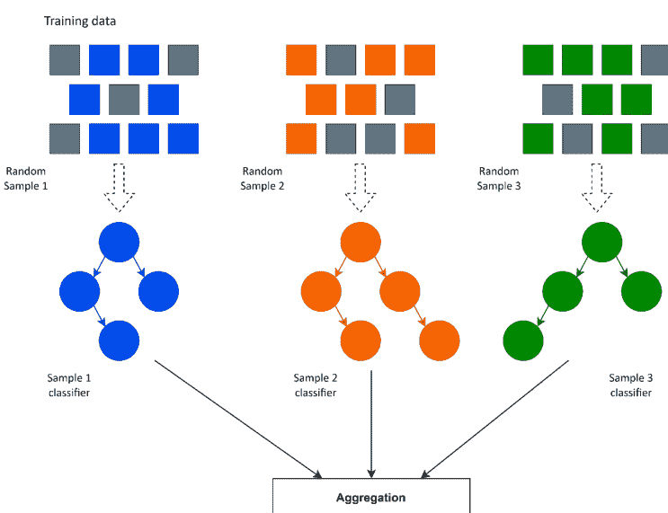

图 2.1 – 装袋过程示意图；每个独立分类器在训练数据的随机子样本上进行训练，最终预测通过聚合所有分类器的预测来做出。

装袋集成中的每个模型仍然是一个完整的模型，能够独立运行。因此，装袋在强模型上效果最好——也就是说，在决策树的情况下，是深层或宽层的决策树。

虽然前面的示例说明了从训练集中采样模式，但也可以为每个模型从数据集中随机子采样特征。在创建训练集时随机选择特征的方法称为随机子空间法或特征装袋。特征装袋可防止特定属性可能主导预测或误导模型的情况，并进一步减少过拟合。

在决策树中，一种同时应用样本装袋和特征装袋的流行算法是随机森林。让我们现在来看看这个算法。

## 随机森林

随机森林是一种针对决策树的装袋集成学习方法 [1]。顾名思义，它不是构建单棵决策树，而是使用装袋训练许多决策树：每棵树都在训练数据的随机样本、随机特征或两者上进行训练。随机森林支持分类和回归。

随机森林中单棵树的训练方法与单棵决策树相同，如前所述，每棵树都是一棵完整的树。森林的最终预测是在预测时对所有树取算术平均数，或在分类情况下对类别进行多数投票。

关于性能，随机森林学习产生的模型更加稳健，精度更高，倾向于避免过拟合（因为没有单一模型能在所有训练数据上过拟合）。

## 随机森林超参数

在 scikit-learn 中，可以预见，随机森林可用的超参数与训练决策树可用的超参数相同。我们可以指定 `max_depth`、`min_samples_split`、`max_leaf_nodes` 等，然后用它们来训练单个树。但是，有三个值得注意的其他参数，如下：

- n_estimators: 控制森林中树的数量。一般来说，树越多越好。但是，通常会达到边际收益递减点。
- max_features: 确定分割节点时用作子集的最大特征数。设置 max_features=1.0 允许在随机选择中使用所有特征。
- bootstrap: 决定是否使用装袋。如果 bootstrap 设置为 False，则所有树都使用整个训练集。

scikit-learn 中所有可用参数的列表可在此处查阅：https://scikit-learn.org/stable/modules/generated/sklearn.ensemble.RandomForestClassifier.html.

## 极端随机树（ExtraTrees）

极端随机树（ExtraTrees）是一种构建随机决策树的相关方法。使用 ExtraTrees 时，在构建决策节点时，会随机生成多个候选分割，而不是使用基尼指数或信息增益指标来计算最佳分割 [2]。然后从所有随机分割中为节点选择最佳分割。ExtraTrees 的方法可以应用于单棵决策树，也可以与随机森林结合使用。scikit-learn 将 ExtraTrees 实现为随机森林的扩展（https://scikit-learn.org/stable/modules/ensemble.html#extremely-randomized-trees）。

在 scikit-learn 中，ExtraTrees 实现具有与随机森林相同的超参数。

## 使用 scikit-learn 训练随机森林

我们现在来看看如何将随机森林与 scikit-learn 一起使用。

在本示例中，我们将使用 Forest CoverType 数据集（https://archive.ics.uci.edu/ml/datasets/Covertype），该数据集可在 scikit-learn 中使用（https://scikit-learn.org/stable/modules/generated/sklearn.datasets.fetch_covtype.html#sklearn.datasets.fetch_covtype）。该数据集比我们之前使用的玩具数据集有了显著提升。该数据集包含 581,012 个样本，维度（特征数）为 54。这些特征描述了美国的一块 30x30m 森林区域（例如，海拔、坡向、坡度和距水文的距离）。我们必须构建一个分类器，将每个区域分类为七种描述森林覆盖类型的类别之一。

除了训练 RandomForestClassifier 外，我们还将训练一个独立的 DecisionTreeClassifier 和一个 ExtraTreesClassifier，并比较这些算法的性能。

RandomForestClassifier 和 ExtraTreesClassifier 位于 sklearn.ensemble 包中。除了常规导入外，我们还从那里导入分类器，如下所示：

```
from sklearn import datasets
from sklearn.tree import DecisionTreeClassifier
from sklearn.ensemble import RandomForestClassifier,
ExtraTreesClassifier
from sklearn.model_selection import train_test_split
from sklearn.metrics import f1_score
```

scikit-learn 数据集包提供了 Forest Cover 数据集。我们可以使用 scikit-learn 获取数据集，并将其分割为训练集和测试集，如下所示：

```
dataset = datasets.fetch_covtype()
X_train, X_test, y_train, y_test = train_test_split(dataset.data,
dataset.target, random_state=179)
```

最后，我们可以训练分类器，并使用测试集对每个分类器进行评估：

```
tree = DecisionTreeClassifier(random_state=179, min_samples_leaf=3,
min_samples_split=6)
tree = tree.fit(X_train, y_train)
print(f1_score(y_test, tree.predict(X_test), average="macro"))
forest = RandomForestClassifier(random_state=179, min_samples_leaf=1,
min_samples_split=2, n_estimators=140)
forest = forest.fit(X_train, y_train)
print(f1_score(y_test, forest.predict(X_test), average="macro"))
extra_tree = ExtraTreesClassifier(random_state=179, min_samples_leaf=1,
min_samples_split=2, n_estimators=180)
extra_tree = extra_tree.fit(X_train, y_train)
print(f1_score(y_test, extra_tree.predict(X_test), average="macro"))
```

我们已经为模型设置了适合该问题的超参数。额外的一步是优化算法超参数以发现最佳参数值。参数优化将在后面章节中详细讨论。

运行前面的代码，我们得到每个算法的以下 F1 分数：

| 模型 | F1 分数 |
|---|---|
| 决策树 | 0.8917 |
| 随机森林 | 0.9209 |
| ExtraTrees | 0.9231 |

表 2.1 – Forest CoverType 数据集上每个算法的 F1 分数

ExtraTrees 模型略优于随机森林模型，两者均优于决策树分类器。

在本节中，我们概述了装袋和随机森林，这是一种基于装袋的决策树集成学习方法，相较于标准决策树具有一些优势。下一节将探讨一种替代的集成学习方法：梯度提升。

## 梯度提升决策树

**梯度提升**是一种集成学习方法，它*按顺序*组合多个模型，以产生更稳健的集成模型。与装袋不同，装袋使用多个*强*模型（并行），而提升训练多个弱学习器，每个学习器从之前学习器的错误中学习，以构建更准确、更稳健的集成模型。与装袋的另一个显著区别是，每个模型都使用整个数据集进行训练。

> 注意
> 
> 如下文所述，梯度提升总是构建一系列回归树作为集成的一部分，无论求解的是回归问题还是分类问题。梯度提升也称为**多元加法回归树（MART）**。

抽象地说，提升过程始于一个弱基学习器。在决策树的情况下，基学习器可能只有一个分割（也称为决策树桩）。然后计算误差残差（预测值与实际目标之间的差异）。随后，在之前学习器的误差残差上训练一个新学习器，旨在最小化误差。最终预测是所有学习器预测的*求和*。下图说明了迭代梯度提升过程：


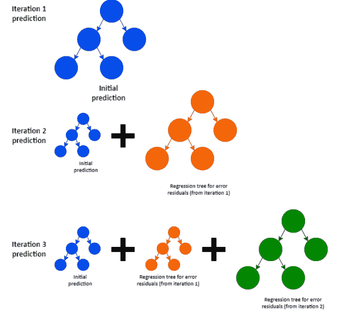

图 2.2 – 梯度提升过程示意图；在每次迭代中，添加一棵新的回归树以弥补上一次迭代的误差残差

一个关键问题是如何确定能够减少误差残差的变化。梯度提升通过应用广泛使用的优化问题：梯度下降，来解决误差最小化问题。

## 梯度下降

梯度下降是一种优化算法，旨在寻找能够最小化损失函数的最优参数。参数通过沿损失函数负梯度方向采取小步骤进行迭代更新（从而降低函数值）。损失函数在概念上与误差函数类似，但具有下面概述的两个重要属性：

- 损失函数会生成一个数值，用于量化模型的性能，或者更准确地说是模型表现有多差。一个好的损失函数对性能不同的模型会产生显著不同的输出。某些误差函数也可以用作损失函数——例如，**均方误差 (MSE)**。
- 第二个属性是，损失函数必须可微分，特别是在梯度下降的语境中。一个不可微分的误差函数示例是 F1 分数。F1 分数可能生成模型性能的数值，但它不可微分，不能用作损失函数。

梯度下降过程可以定义如下。假设我们有一个针对参数 $x$ 定义的损失函数 $L$。对于初始参数集，损失计算为 $L(x_0)$。梯度下降迭代进行以最小化损失函数：

```
$L(x_{n+1}) < L(x_n)$
```

要更新参数，我们沿 $L$ 的负梯度方向迈出一步。我们可以按如下方式指定梯度下降更新规则：

```
$x_{n+1} = x_n - \gamma_n \nabla L(x_n)$
```

这里，$\gamma_n$ 是 **学习率**，它定义步长，而 $\nabla L(x_n)$ 是 $L$ 在 $x_n$ 处的梯度。

图 2.3 中的图表说明了梯度下降过程：

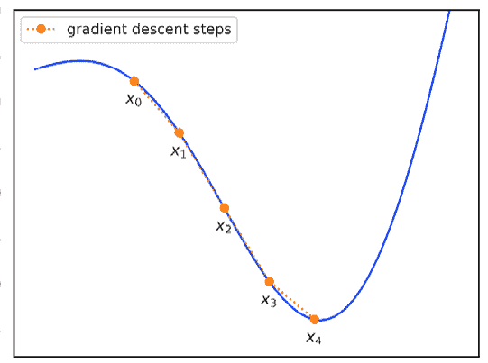

图 2.3 – 显示梯度下降过程以寻找函数最小值的图表

选择合适的学习率对梯度下降的成功至关重要。如果学习率过低，优化过程将非常缓慢，可能无法在允许的迭代次数内达到最小值。学习率过小还可能导致过程陷入局部最小值：步长太小以至于无法逃脱。反之，假设学习率过大。在这种情况下，我们可能会跨过最小值并完全错过它，或者陷入在最小值周围振荡的困境（不断来回跳跃，但永远不会下降到最优值）。

## 梯度提升

既然我们了解了梯度下降的工作原理，就可以看到它在梯度提升中的应用。我们将通过一个小示例详细讲解整个梯度提升算法。在我们的示例中，我们将使用回归树，因为与分类情况相比，它稍微容易理解一些。

## 梯度提升算法

梯度提升算法定义如下，其中 _M_ 是提升树的数量 [3]：

- 1. 给定训练数据 \(\{(x_p, y_p)\}_{i=1}^n\)，包含 _n_ 个训练样本（由特征 _x<sub>i</sub>_ 和目标 _y<sub>i</sub>_ 定义）以及一个可微分的损失函数 _L_(_y<sub>p</sub>, F_(_x_))，其中 _F_(_x_) 是模型 _F_ 的预测值。
- 2. 使用常数预测值 _F_<sub>0</sub>(_X_) = \(\text{argmin}_\gamma \sum_{i=1}^n L(y_i, \gamma)\) 初始化模型。
- 3. 对 _m_ = 1 到 _M_：
   - 计算伪残差 \(r_{im} = -[\frac{\partial L(y_i, F(x_i))}{\partial F(x_i)}]_{F(x)=F_{m-1}(x)} for i = 1, ..., n\)
   - 将回归树拟合到 _r<sub>im</sub>_ 值，并为 _j_ = 1..._J<sub>m</sub>_ 创建终端区域 _R<sub>jm</sub>_
   - 对 _j_ = 1..._J<sub>m</sub>_ 计算 \(\gamma_{jm} = \text{argmin}_\gamma \sum_{x_i \in R_j} L(y_i, F_{m-1}(x_i) + \gamma)\)
   - 更新 _F<sub>m</sub>_(_x_) = _F_<sub>_m_-1</sub>(_x_) + \(\nu \sum_{j=1}^{J_m} \gamma_{jm} I(x \in R_{jm})\)
- 4. 结果：_F<sub>M</sub>_(_x_)

虽然算法和尤其是数学可能看起来令人生畏，但实际上它比看起来要简单得多。我们将逐步讲解该算法。请考虑以下示例数据集：

| 性别 | 空腹血糖 | 腰围 | BMI | LDL 胆固醇 |
|---|---|---|---|---|
| 男性 | 105 | 110 | 29.3 | 170 |
| 女性 | 85 | 80 | 21 | 90 |
| 男性 | 95 | 93 | 26 | 113 |

表 2.2 – 由患者身体测量值和测得的低密度脂蛋白 (LDL) 胆固醇组成的示例数据集

鉴于身体测量值，我们的目标是预测患者的 LDL 胆固醇。

前面的表格定义了我们的训练数据 \(\{(x_p, y_p)\}_{i=1}^n\)，其中 _x_ 是特征（血糖、腰围、BMI），_y_ 是目标：LDL 胆固醇。

我们需要一个可微分的损失函数，为了简化本示例中的某些数学推导，我们选择以下损失函数，它与 MSE 函数类似：

$$L = \frac{1}{2} \sum_{i=0}^n (y_i - \gamma)^2$$

我们现在详细讲解每个算法步骤，以了解梯度增强树是如何生成的。

第一步是找到 $F_0(x) = \text{argmin}_\gamma \sum_{i=1}^n L(y_i, \gamma)$，其中 $y_i$ 是我们的目标值，$\gamma$ 是我们的初始预测值。我们的初始预测是常数，仅仅是目标值的平均值。但让我们看看为什么。

$F_0(x)$ 的方程表明，我们需要找到一个 $\gamma$ 值来最小化我们的损失函数。为了找到最小值，我们对 gamma 求损失函数的导数：

$$\frac{\partial L}{\partial \gamma} = \frac{2}{2} \left( \sum_{i=0}^n (y_i - \gamma) \right) \times -1$$

然后，将其设为 0 并求解以下方程：

$$- \left( \sum_{i=0}^n (y_i - \gamma) \right) = 0$$
$$- \frac{1}{n} \sum y_i + \gamma = 0$$
$$\gamma = \frac{1}{n} \sum y_i$$

该方程简化为计算目标值的平均值。

用预测值更新我们的表格，得到以下结果：

| 性别 | F. 血糖 | W. 腰围 | BMI | LDL 胆固醇 | 预测 F0(x) |
| :--- | :--- | :--- | :--- | :--- | :--- |
| 男性 | 105 | 110 | 29.3 | 170 | 125 |
| 女性 | 85 | 80 | 21 | 90 | 125 |
| 男性 | 95 | 93 | 26 | 113 | 125 |

表 2.3 – 每位患者的 LDL 胆固醇初始预测值 ($F_0(x)$) 均为常数

我们重复以下过程 $M$ 次，其中 _M_ 是我们选择构建的树的数量。

我们现在需要计算伪残差 $r_{im} = - \left[ \frac{\partial L(y_i, F(x_i))}{\partial F(x_i)} \right]_{F(x)=F_{m-1}(x)}$。关于 $r_{im}$ 的这个方程表明，我们使用损失函数对预测值的偏导数的负值来计算伪残差。梯度提升算法的这部分与梯度下降相关：我们正在取梯度的负值来最小化残差。幸运的是，我们已经计算出了这个导数：

$$- \left[ \frac{\partial L(y_i, F(x_i))}{\partial F(x_i)} \right] = - \frac{\partial}{\partial F(x_i)} \left( \frac{1}{2} (y_i - F(x_i))^2 \right) = \frac{2}{2} (y_i - F(x_i)) = \left( y_i - F(x_i) \right)$$

这里，$F(x_i)$ 是预测值。换句话说，该方程简化为目标值与预测值之间的差。我们可以将残差添加到表格中，如下所示：

| 性别 | F. 血糖 | W. 腰围 | BMI | LDL 胆固醇 | 预测 F0(x) | F0(x) 的残差 |
|---|---|---|---|---|---|---|
| 男性 | 105 | 110 | 29.3 | 170 | 125 | 45 |
| 女性 | 85 | 80 | 21 | 90 | 125 | -35 |
| 男性 | 95 | 93 | 26 | 113 | 125 | -12 |

表 2.4 – 基于我们的初始预测，我们可以计算每位患者的残差，如 F0(x) 的残差 列所示

下一步非常简单：我们构建一棵回归树来预测残差。我们不直接使用回归树的预测值。相反，我们使用 *终端区域* 来计算更新后的预测值。终端区域指的是树的叶子节点。

在本示例中，我们假设构建了以下简单的回归树：

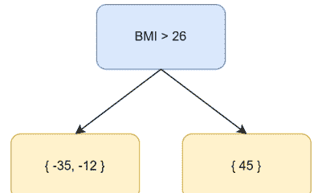

图 2.4 – 预测残差的回归树

构建回归树并定义叶子节点后，我们可以进行下一步。我们需要计算 $\gamma_{jm}$ 以最小化我们的损失函数，并考虑之前的预测值，如 $\gamma_{jm} = \text{argmin}_{\gamma} \sum_{x_i \in R_j} L(y_i, F_{m-1}(x_i) + \gamma)$。这几乎正是我们在 *步骤 1* 中所做的，在那里我们展示了，由于我们选择的损失函数，该方程简化为取预测值的平均值。*在这里，这意味着取每个叶子节点中残差的平均值。*因此，我们有 $\gamma_{1,1} = \frac{-35-12}{2} = -23.5$ 和 $\gamma_{2,1} = \frac{45}{1} = 45$。

最后，我们现在可以计算下一个预测值 $F_1(x)$，定义为：$F_m(x) = F_{m-1}(x) + v \sum_{j=1}^J \gamma_{jm} I(x \in R_{jm})$，这意味着我们的下一个预测值由先前的预测值加上 *步骤 2.3* 中计算的 $\gamma$ 值（由学习率 $v$ 加权）组成。这里的求和意味着，如果一个样本属于多个叶子节点，我们将取 gamma 值的总和。让我们使用学习率 0.1 计算数据集中第一个样本的 $F_1(x)$。根据 *步骤 2.2* 的回归树，我们的样本（BMI > 26）映射到 $\gamma_{2,1}$。由于它只映射到一个叶子节点，我们不需要方程中的求和部分。因此，方程如下：


$$F_1(x) = F_0(x) + \nu \gamma_{2,1} = 125 + 0.1(45) = 129.5$$

正如预期，我们的预测已朝着目标值的方向改进。对其他样本执行相同操作，我们得到以下结果：

| 性别 | 空腹血糖 | 腰围 | BMI | LDL胆固醇 | 预测 F 0(x) | F 0(x) 的残差 | 预测 F 1(x) |
|---|---|---|---|---|---|---|---|
| 男性 | 105 | 110 | 29.3 | 170 | 125 | 45 | 129.5 |
| 女性 | 85 | 80 | 21 | 90 | 125 | -35 | 122.65 |
| 男性 | 95 | 93 | 26 | 113 | 125 | -12 | 122.65 |

表 2.5 – 按照步骤 2.1 至 2.4，基于初始预测和残差，我们计算出新的预测 $\mathbf{F}_1(\mathbf{x})$

学习率的目的是限制每棵树对整体预测可能产生的影响：通过小步改进我们的预测，最终得到整体上更准确的模型。

然后重复步骤 2，直到得到最终预测 $F_M(x)$。

总之，我们的梯度增强集成由一系列回归树做出的预测的加权（由学习率加权）求和组成，每棵树都预测前一次预测的伪残差（相对于前一次预测的误差梯度），从而最小化前一次预测的误差以产生准确的最终预测。

## 用于分类的梯度增强

此前对梯度增强的解释使用回归问题作为示例。由于算法相同，我们不会对分类进行详细示例说明。不过，我们不是使用连续预测值，而是采用与逻辑回归（https://en.wikipedia.org/wiki/Logistic_regression）相同的技术。因此，各棵树预测样本属于某个类别的概率。概率的计算方法是取样本的对数几率，并使用逻辑函数将其转换为概率，如下所示：

$$p(x) = \frac{1}{1 + e^{-(x-\mu)/s}}$$

伪残差计算为观察值（类别为 1 或 0）与预测值（逻辑函数得出的概率）之差。另一个不同之处是损失函数。我们可以使用交叉熵作为损失，而不是 MSE 之类的函数，如下所示：

$$H_p(q) = -\frac{1}{N} \sum_{i=1}^N y_i \log(p(y_i)) + (1 - y_i) \log(1 - p(y_i))$$

### 梯度增强决策树超参数

除标准决策树训练的参数外，scikit-learn 中还提供了以下专用于梯度增强树的新超参数：

- n_estimators: 控制集成中树的数量。通常，树越多越好。然而，通常会达到边际效益递减点，当树太多时会发生过拟合。

- learning_rate: 控制每棵树对集成的贡献。较低的学习率会导致更长的训练时间，并可能需要构建更多树（n_estimators 的较大值）。将 learning_rate 设置为非常大的值可能会导致优化遗漏最优点，并且必须与较少的树结合使用。

scikit-learn 梯度增强超参数的完整列表可在 https://scikit-learn.org/stable/modules/generated/sklearn.ensemble.GradientBoostingClassifier.html 找到。

### scikit-learn 中的梯度增强

梯度增强的细节涉及数学且复杂；幸运的是，通过 scikit-learn，该算法与其他算法一样易于使用。以下是 scikit-learn 中 GradientBoostingClassifier 类的示例，再次使用本章前面用于训练随机森林分类器的 Forest CoverType 数据集。

该分类器也从 ensemble 包导入，如下所示：

```
from sklearn.ensemble import GradientBoostingClassifier
```

我们像之前一样获取并分割数据，然后拟合模型，如下所示：

```
dataset = datasets.fetch_covtype()

X_train, X_test, y_train, y_test = train_test_split(dataset.data,
dataset.target, random_state=179)
booster = GradientBoostingClassifier(random_state=179, min_samples_leaf=3, min_samples_split=3, learning_rate=0.13, n_estimators=180)
booster = booster.fit(X_train, y_train)
print(f1_score(y_test, booster.predict(X_test), average="macro"))
```

运行上述代码应产生 0.7119 的 F1 分数，这个分数甚至比标准决策树还要差得多。我们可以花时间优化超参数以提高性能。然而，有一个更严重的问题。之前的代码执行时间非常长——在我们的硬件上大约需要 45 分钟——而 ExtraTrees 大约只需 3 分钟。

LightGBM 解决了我们对梯度增强树的两个问题，并在极短的时间内构建了性能显著更好的梯度增强树。

在接下来的章节中，我们将简要介绍与梯度增强相关的一种高级算法：DART。

### 高级增强算法 – DART

**DART** 是前一节讨论的标准 GBDT 算法的扩展 [4]。DART 采用 **脱落**，一种源自 **深度学习（DL）** 的技术，以避免决策树集成的过拟合。该扩展简单明了，包含两部分。首先，在拟合下一棵预测树 \( M_{n+1}(x)（由所有先前树 \( M_n...M_1 \) 的缩放求和组成）时，而是使用先前树的一个随机子集，将其他树从求和中舍弃。\( p_{drop} \) 参数控制先前树被包含的概率。DART 算法的第二部分是对新树贡献应用额外缩放。设 \( k \) 为计算新树 \( M_{n+1} \) 时被舍弃的树的数量。由于 \( M_{n+1} \) 在更新我们的预测 \( F_{n+1}（包含所有树）时未包含这 \( k \) 棵树的贡献，因此预测会过冲。因此，新树按 \( \frac{1}{k} \) 的因子进行缩放以进行补偿。

研究表明，DART 在性能上优于标准 GBDT，同时也显著改善了过拟合问题。

Scikit-learn 未为 GBDT 实现 DART，但 LightGBM 中已集成 DART。

## 总结

总之，本章探讨了决策树集成学习的两种最常用方法：袋装法（bagging）和提升法（boosting）。我们研究了使用袋装法构建决策树集成的随机森林和 ExtraTrees 算法。

本章还通过逐步讲解 GBDT 算法，详细概述了决策树中的提升法，说明了如何应用梯度增强。我们介绍了 scikit-learn 中随机森林、ExtraTrees 和 GBDT 的实际示例。

最后，我们探讨了如何使用 DART 算法将脱落法应用于 GBDT。我们现在已彻底理解决策树集成技术，并准备深入研究 LightGBM。

下一章将详细介绍 LightGBM 库，包括该库所取得的理论进步及其实际应用。我们还将探讨如何使用 LightGBM 与 Python 解决机器学习问题。

## 参考文献

- [1] L. Breiman, “Random forests,” Machine learning, vol. 45, p. 5-32, 2001.
- [2] P. Geurts, D. Ernst and L. Wehenkel, “Extremely randomized trees,” Machine learning, vol. 63, p. 3-42, 2006.
- [3] J. H. Friedman, “Greedy function approximation: a gradient boosting machine,” The Annals of Statistics, p. 1189-1232, 2001.
- [4] R. K. Vinayak and R. Gilad-Bachrach, “Dart: Dropouts meet multiple additive regression trees,” in Artificial Intelligence and Statistics, 2015.

## Python 中 LightGBM 概览

在上一章中，我们探讨了决策树的集成学习方法。**自助聚合（bagging）**和梯度增强都进行了详细讨论，并附有在 scikit-learn 中应用这些技术的实际示例。我们还展示了**梯度增强决策树（GBDT）**训练缓慢，并且在某些问题上可能表现不佳。

本章介绍 LightGBM，一种使用基于树的学习器的梯度增强框架。我们探讨 LightGBM 对集成学习方法所做的创新和优化。还给出了通过 Python 实际使用 LightGBM 的更多详细信息和示例。最后，本章包含一个使用 LightGBM 的建模示例，融合了用于模型验证和参数优化的更高级技术。

本章结束时，您将彻底理解 LightGBM 的理论和实际特性，从而能够深入研究在数据科学和生产系统中使用 LightGBM。

本章的主要主题如下：

- 介绍 LightGBM
- 在 Python 中开始使用 LightGBM
- 构建 LightGBM 模型

### 技术要求

本章包含示例和代码片段，说明如何在 Python 中使用 LightGBM。本章完整示例以及设置合适环境的说明可在 https://github.com/PacktPublishing/Practical-Machine-Learning-with-LightGBM-and-Python/tree/main/chapter-3 获取。


## LightGBM 简介

LightGBM 是一个开源的、用于基于树的集成的梯度提升框架（https://github.com/microsoft/LightGBM）。LightGBM 侧重于速度、内存使用和精度提升的效率，尤其是针对高维性和大数据规模的问题。

LightGBM 首次在论文 LightGBM: A Highly Efficient Gradient Boosting Decision Tree [1] 中提出。

LightGBM 的效率和精度通过对标准集成学习方法（尤其是 GBDT）的多种技术和理论优化来实现。此外，LightGBM 支持带有网络通信优化以及基于 GPU 的树集成训练支持的分布式集成训练。

LightGBM 支持许多 **机器学习 (ML)** 应用：回归、二分类和多分类、交叉熵损失函数，以及通过 LambdaRank 进行排序。

LightGBM 算法也可通过其超参数进行高度定制。它支持许多指标和功能，包括 **丢弃法与多元加法回归树 (DART)**、袋法（随机森林）、持续训练、多个指标和早停。

本节回顾了 LightGBM 利用的理论和实际优化，包括控制 LightGBM 功能的超参数的详细概述。

## LightGBM 优化

从本质上讲，LightGBM 实现了我们在上一章中讨论的相同集成算法。但是，LightGBM 应用理论和技术优化来提升性能和精度，同时显著减少内存使用。接下来，我们讨论 LightGBM 中实现的最重要的优化。

## GBDT 中的计算复杂度

首先，我们必须了解构建 GBDT 时的低效率源自何处，以了解 LightGBM 如何提高 GBDT 的效率。GBDT 算法中计算量最大的部分是对每次迭代训练回归树。更具体地说，找到最佳分割点的代价非常高。基于预排序的算法是找到最佳分割点的最流行方法之一 [2]、[3]。一种天真的方法要求为每个决策节点按特征对数据进行排序，算法复杂度为 O(#data × #feature)。基于预排序的算法在训练前一次性对数据进行排序，这将构建决策节点的复杂度降低到 O(#data) [2]。即使有预排序，在为决策节点寻找分割点时，对于大型数据集来说，复杂度仍然过高。

## 基于直方图的采样

相较于预排序，另一种方法是为连续特征构建直方图 [4]。在构建这些 **特征直方图** 时，连续值会被添加到离散桶中。在计算决策节点的分割点时，我们现在可以使用直方图桶，而不是直接使用数据。构建直方图的复杂度为 `O(#data)`。但是，构建决策节点的复杂度现在降低到 `O(#bins)`，由于桶的数量远小于数据量，这显著加快了构建回归树的过程，如下图所示：

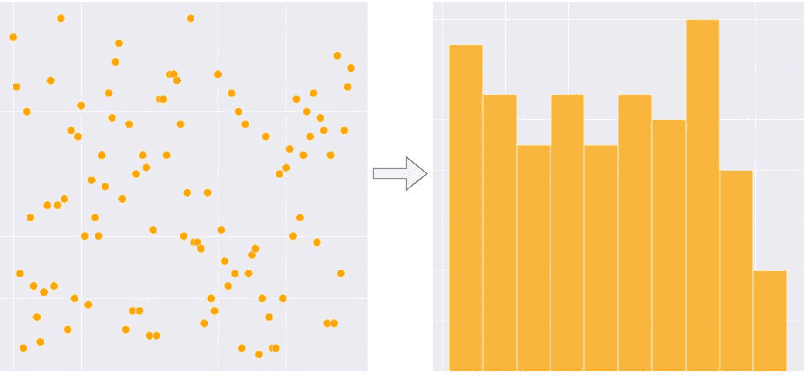

图 3.1 – 从连续特征创建特征直方图允许使用桶边界值计算决策节点的分割点，而不必对每个数据点进行采样，由于 #bins << #data，这显著降低了算法的复杂度。

使用直方图带来的次要优化是用于构建叶节点直方图的“直方图相减”。与为每个叶节点计算直方图不同，我们可以从父节点的直方图中减去叶节点邻居的直方图。选择数据量较小的叶节点，由于直方图相减，第一个叶节点的复杂度较小为 `O(#data)`，第二个叶节点的复杂度为 `O(#bins)`。

LightGBM 应用直方图的第三项优化是降低内存成本。特征预排序需要为每个特征维护一个辅助数据结构（字典）。构建直方图时不需要此类数据结构，从而降低了内存成本。此外，由于 #bins 很小，可以使用较小的数据类型，如 `uint8_t`，来存储训练数据，从而减少内存使用。

有关构建特征直方图的算法的详细信息，可在论文 CLOUDS: A decision tree classifier for large datasets [4] 中找到。

## 独占特征捆绑

独占特征捆绑 (EFB) 是 LightGBM 在处理稀疏数据时应用的另一种基于数据的优化（稀疏数据在高维数据集中普遍存在）。当特征数据稀疏时，通常会发现许多特征是 *相互排斥的*，这意味着它们绝不会同时呈现非零值。鉴于这种互斥性，将这些特征合并为一个通常是安全的。EFB 如下图所示：

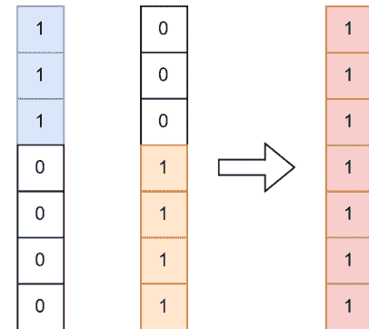

图 3.2 – 从两个相互排斥的特征构建特征捆绑

将相互排斥的特征捆绑，可以构建与单独特征相同的特征直方图 [1]。该优化将构建特征直方图的复杂度从 O(#data × #feature) 降低到 O(#data × #bundle)。对于存在许多相互排斥特征的数据集，由于 #bundle << #feature，这会显著提升性能。关于 EFB 的详细算法及正确性证明可在 [1] 中找到。

## 基于梯度的单侧采样

LightGBM 框架中可用的最后一种基于数据的优化是基于梯度的单侧采样 (GOSS) [1]。GOSS 是一种丢弃不再对训练过程产生显著贡献的训练数据样本的方法，从而有效减少训练数据规模并加快过程。

我们可以使用每个样本的梯度计算来确定其重要性。如果梯度变化很小，则意味着训练误差也很小，我们可以推断树对特定数据实例拟合良好 [1]。一种选择是丢弃所有梯度较小的实例。但是，这会改变训练数据的分布，降低树的泛化能力。GOSS 是一种用于选择在训练数据中保留哪些实例的方法。

为保持数据分布，GOSS 的应用方式如下：

- 1. 按梯度的绝对值对数据样本进行排序。
- 2. 然后选择前 a × 100% 的实例（梯度较大的实例）。
- 3. 然后从其余数据中随机抽取 b × 100% 的实例。
- 4. 向损失函数（针对这些实例）添加一个因子以放大其影响：1/b^a，从而补偿梯度较小的数据表示不足的问题。

因此，GOSS 对梯度较大的实例采样大部分，对梯度较小的实例采样随机部分，并在计算信息增益时放大小梯度的影响。

GOSS 启用的下采样可以显著减少训练期间处理的数据量（以及 GBDT 的训练时间），尤其是在处理大型数据集时。

## 最佳优先树生长

构建决策树最常见的方法是按层生长树（即一次一层）。LightGBM 采用另一种方法，按叶节点或最佳优先方式生长树。叶节点方式选择损失变化最显著的现有叶节点，并从此处构建树。这种方法的缺点是，如果数据集较小，树可能会过度拟合数据。必须设置最大深度来应对这一问题。但是，如果要构建的叶节点数量固定，研究表明叶节点方式构建树优于按层算法 [5]。

## L1 和 L2 正则化

LightGBM 在训练集成中的回归树时支持目标函数的 L1 和 L2 正则化。从第 1 章 机器学习简介 中我们记得，正则化是控制过拟合的一种方法。在决策树的情况下，更简单、更浅的树过拟合程度较低。

为支持 L1 和 L2 正则化，我们用正则化项扩展目标函数，如下所示：

```
obj = L(y, F(x)) + Ω(w)
```

这里，L(y, F(x)) 是第 2 章 集成学习 – 袋法与提升法 中讨论的损失函数，Ω(w) 是定义在 w（叶节点得分，即根据第 2 章 集成学习 – 袋法与提升法 中定义的 GBDT 算法的步骤 2.3 从叶节点计算出的输出）上的正则化函数。

正则化项实际上向目标函数添加了一个惩罚项，我们的目标是惩罚更容易过拟合的更复杂的树。


关于 $\Omega$ 有多种定义。决策树中各项的典型实现如下：

```
$$\Omega(w) = \alpha \sum_i^n |w_i| + \lambda \sum_i^n w_i^2$$
```

这里，$\alpha \sum_i^n |w_i|$ 是 L1 正则化项，由参数 $\alpha$ 控制，$0 \le \alpha \le 1$，而 $\lambda \sum_i^n w_i^2$ 是 L2 正则化项，由参数 $\lambda$ 控制。

L1 正则化通过惩罚绝对输出较大的叶子，使叶子得分趋向于零。较小的叶子输出对树的预测影响较小，从而有效简化了树。

L2 正则化类似，但由于对输出取平方，它对异常值叶子有过大影响。

最后，当构建更大的树（叶子更多，因此 $w$ 向量更大）时，$\Omega(w)$ 的两个求和项都会增加，从而增加目标函数的输出。因此，较大的树会受到惩罚，过拟合也就减少了。

## LightGBM 优化总结

总而言之，LightGBM 通过以下方式改进了标准集成算法：

- 实现基于直方图的特征采样，以降低寻找最佳分裂点的计算成本
- 计算互斥特征束，以减少稀疏数据集中的特征数量
- 应用 GOSS 对训练数据进行下采样而不损失精度
- 按叶子生长树以提高精度
- 可通过 L1 和 L2 正则化及其他控制参数来控制过拟合

这些优化共同使 LightGBM 的计算性能相对于标准 GBDT 算法提升了**数量级 (OOM)**。此外，LightGBM 使用 C++ 实现并提供 Python 接口，因此其代码比基于 Python 的 GBDT（例如 scikit-learn 中的 GBDT）快得多。

最后，LightGBM 还支持改进的数据并行和特征并行分布式训练。分布式训练和 GPU 支持将在后续的第 11 章“使用 LightGBM 进行分布式和基于 GPU 的学习”中讨论。

## 超参数

LightGBM 暴露了许多可用于自定义训练过程、目标和性能的参数。接下来，我们将讨论最显著的参数以及如何使用它们来控制特定现象。

**注意**
核心 LightGBM 框架使用 C++ 开发，但包含用于在 C、Python 和 R 中使用 LightGBM 的 API。本节讨论的参数是框架参数，各 API 会以不同方式公开这些参数。下一节将讨论使用 Python 时可用的参数。

以下是用于控制优化过程和目标的 **核心框架参数**：

- **objective**: LightGBM 支持以下优化目标（不限于此）——回归（包括使用其他损失函数（如 Huber 和 Fair）的回归应用）、二分类（分类）、多分类（分类）、交叉熵以及用于排序问题的 lambdarank。
- **boosting**: boosting 参数控制 boosting 类型。默认情况下，此参数设置为 `gbdt`，即标准 GBDT 算法。其他选项包括 `dart` 和 `rf`（用于随机森林）。随机森林模式不执行 boosting，而是构建随机森林。
- **num_iterations**（或 **n_estimators**）：控制 boosting 迭代次数，从而控制构建的树的数量。
- **num_leaves**：控制单棵树中叶子的最大数量。
- **learning_rate**：控制学习率（或缩减率），即每棵树对整体预测的贡献。

LightGBM 还提供许多用于控制学习过程的参数。我们将根据这些参数如何用于调整训练的特定方面来讨论它们。

以下控制参数可用于提高 **准确性**：

- **boosting**: 使用 `dart`，已证明其优于标准 GBDT。
- **learning_rate**: 为获得更好的准确性，学习率必须与 `num_iterations` 共同调整。学习率小且 `num_iterations` 值大可以提高准确性，但会以优化速度为代价。
- **num_leaves**: 叶子数量越多，准确性越高，但可能导致过拟合。
- **max_bin**: 构建直方图时特征分桶的最大桶数。`max_bin` 值越大，训练速度越慢，内存占用越高，但可能提高准确性。

以下 **学习控制参数** 可用于处理 **过拟合**：

- `early_stopping_round`: 启用早停，并控制用于确定是否停止训练的迭代次数。如果在 `early_stopping_round` 设置的迭代次数内，任何指标均无改进，则停止训练。
- `min_data_in_leaf`: 叶子中允许的最小样本数。值越大，过拟合越少。
- `min_gain_to_split`: 执行分裂所需的最小信息增益。值越高，过拟合越少。
- `reg_alpha`: 控制 L1 正则化。值越高，过拟合越少。
- `reg_lambda`: 控制 L2 正则化。值越高，过拟合越少。
- `max_depth`: 控制单棵树的最大深度。树越浅，过拟合越少。
- `max_drop`: 控制使用 DART 算法时丢弃的树的最大数量（仅当 `boosting` 设置为 `dart` 时使用）。值越大，过拟合越少。
- `extra_trees`: 启用 **极度随机树 (ExtraTrees)** 算法。随后，LightGBM 会为每个特征随机选择分裂阈值。启用 Extra-Trees 可以减少过拟合。该参数可与任何 boosting 模式配合使用。

此处讨论的参数仅包含 LightGBM 中可用参数的一部分，并侧重于提高准确性和控制过拟合。完整参数列表可通过以下链接获取：https://lightgbm.readthedocs.io/en/latest/Parameters.html。

## LightGBM 的局限性

LightGBM 旨在比传统方法更高效、更有效。它尤其以其处理大型数据集的能力而闻名。然而，与任何算法或框架一样，它也有其局限性和潜在缺点，包括以下内容：

- **对过拟合敏感**：LightGBM 可能对过拟合比较敏感，尤其是在处理小型或带噪声的数据集时。使用 LightGBM 时，应注意监控并控制过拟合。
- **最佳性能需要调参**：如前所述，LightGBM 有许多超参数，需要对其进行适当调优才能从算法中获得最佳性能。
- **缺乏表示学习**：与深度学习（DL）方法不同，深度学习方法擅长从原始数据中学习，而 LightGBM 在学习前需要对数据进行特征工程。特征工程是一个耗时且需要领域知识的过程。
- **处理序列数据**：LightGBM 并非天生用于处理序列数据（如时间序列）。要使用 LightGBM 处理时间序列数据，需要应用特征工程来创建滞后特征并捕获时间依赖性。
- **复杂交互和非线性**：LightGBM 是一种基于决策树的方法，可能无法捕捉复杂的特征交互和非线性。需要应用适当的特征工程，以确保算法对这些进行建模。

虽然这些是使用该算法的潜在局限性，但它们可能并不适用于所有用例。在合适的情况下，LightGBM 通常是一个非常有效的工具。与任何模型一样，理解权衡对于为您的应用做出正确选择至关重要。

在下一节中，我们将介绍如何开始在 Python 中使用各种 LightGBM API。

## 在 Python 中开始使用 LightGBM

LightGBM 使用 C++ 实现，但提供官方 C、R 和 Python API。本节将讨论可用于使用 LightGBM 的 Python API。LightGBM 提供三个 Python API：标准 **LightGBM** API、**scikit-learn** API（与其他 scikit-learn 功能完全兼容）以及用于使用 Dask 的 **Dask** API。Dask 是一个并行计算库，将在第 11 章“使用 LightGBM 进行分布式和基于 GPU 的学习”（https://www.dask.org/）中讨论。

在本书的其余部分，我们主要使用 LightGBM 的 scikit-learn API，但首先让我们来看看标准 Python API。

### LightGBM Python API

深入学习 Python API 的最佳方式是通过动手示例。以下是代码清单中的摘录，用于说明 LightGBM Python API 的用法。完整代码示例可在以下网址获取：https://github.com/PacktPublishing/Practical-Machine-Learning-with-LightGBM-and-Python/tree/main/chapter-3。

需要导入 LightGBM。导入通常缩写为 lgb：

```
import lightgbm as lgb
```

LightGBM 提供了一个 Dataset 包装器类用于处理数据。Dataset 支持多种格式。通常，它用于包装 numpy 数组或 pandas DataFrame。Dataset 还接受指向 CSV、TSV、LIBSVM 文本文件或 LightGBM Dataset 二进制文件的路径。当提供路径时，LightGBM 会从磁盘加载数据。

这里，我们从 sklearn 加载 Forest Cover 数据集，并将 numpy 数组包装在 LightGBM Dataset 中：

```
dataset = datasets.fetch_covtype()
X_train, X_test, y_train, y_test = train_test_split(dataset.data,
dataset.target, random_state=179)
training_set = lgb.Dataset(X_train, y_train - 1)
test_set = lgb.Dataset(X_test, y_test - 1)
```

我们从 y_train 和 y_test 数组中减去 1，因为 sklearn 提供的类标记范围为 [1, 7]，而 LightGBM 期望零索引的类标记，范围为 [0, 7]。


我们无法设置训练的参数。我们将使用以下参数：

```python
params = {
    'boosting_type': 'gbdt',
    'objective': 'multiclass',
    'num_classes': '7',
    'metric': {'auc_mu'},
    'num_leaves': 120,
    'learning_rate': 0.09,
    'force_row_wise': True,
    'verbose': 0
}
```

我们使用标准 GBDT 作为提升类型，并将目标设置为七类的多类分类。在训练期间，我们将捕获 auc_mu 指标。AUC 是 Kleiman 和 Page [6] 定义的接收者操作特征曲线下面积（AUC）的多类改编。

我们将 num_leaves 和 learning_rate 设置为问题的合理值。最后，我们将 force_row_wise 指定为 True，这是大型数据集的推荐设置。

LightGBM 的训练函数也支持回调。回调是训练过程中的一个钩子，在每次提升迭代时执行。为了说明其目的，我们将使用以下回调：

```python
metrics = {}
callbacks = [
    lgb.log_evaluation(period=15),
    lgb.record_evaluation(metrics),
    lgb.early_stopping(15),
    lgb.reset_parameter(learning_rate=learning_rate_decay(0.09,
    0.999))
]
```

我们使用周期为 15 的 log_evaluation 回调，它会每 15 次提升迭代将我们的指标记录（打印）到标准输出。我们还设置了一个 record_evaluation 回调，它在 metrics 字典中捕获我们的评估指标。我们还指定了一个 early_stopping 回调，停止轮次设置为 15。early_stopping 回调会在经过指定的停止轮次后，如果没有验证指标改善，则停止训练。

最后，我们还使用 reset_parameter 回调来实现学习率衰减。衰减函数定义如下：

```python
def learning_rate_decay(initial_lr, decay_rate):
    def _decay(iteration):
        return initial_lr * (decay_rate ** iteration)
    return _decay
```

reset_parameter 回调将一个函数作为输入。该函数接收当前迭代并返回参数值。学习率衰减是一种随时间降低学习率值的技术。学习率衰减提高了所达到的总体准确率。理想情况下，我们希望初始树在纠正预测错误方面产生更显著的影响。相比之下，稍后，我们希望减少额外树的影响，让它们对错误进行微小调整。我们实现了一种轻微的指数衰减，在整个训练过程中将学习率从 0.09 降低到 0.078。

现在，我们准备好进行训练了。我们使用 lgb.train 来训练模型：

```python
gbm = lgb.train(params, training_set, num_boost_round=150, valid_sets=test_set, callbacks=callbacks)
```

我们使用 150 个提升轮次（或提升树）。配合较低的学习率，进行许多提升轮次应该能提高准确率。

训练后，我们可以使用 lgb.predict 为测试集获取预测并计算 F1 分数：

```python
y_pred = np.argmax(gbm.predict(X_test, num_iteration=gbm.best_iteration), axis=1)
f1_score(y_test - 1, y_pred, average="macro")
```

LightGBM predict 函数输出一个激活值数组，每个类一个。因此，我们使用 np.argmax 选择激活值最高的类作为预测类。LightGBM 还支持一些绘图函数。例如，我们可以使用 plot_metric 来绘制在 metrics 中捕获的 AUC_mu 结果：

```python
lgb.plot_metric(metrics, 'auc_mu')
```

结果如图 3.3 所示。

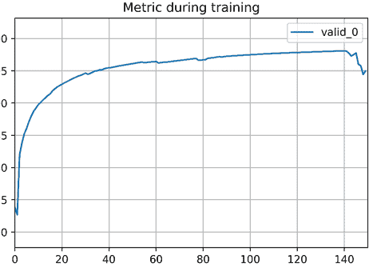

图 3.3 – 使用 lgb.plot_metric 创建的每次训练迭代的 AUC μ 指标图

运行前面的代码应该会生成一个 LightGBM GBDT 树，F1 分数约为 0.917，与第 2 章 集成学习 - 装袋与提升中随机森林和 Extra-Trees 算法达到的分数一致。但是，LightGBM 达到这些准确率的速度要快得多。LightGBM 在我们的硬件上仅用了 37 秒就完成了训练：这比在同一问题和硬件上运行 Extra-Trees 快 4.5 倍，比在我们的测试中运行 scikit-learn 的 GradientBoostingClassifier 快 60-70 倍。

## LightGBM scikit-learn API

现在我们来看看 LightGBM 的 scikit-learn Python API。scikit-learn API 提供四个类：LGBMModel、LGBMClassifier、LGBMRegressor 和 LGBMRanker。这些类提供与 LightGBM Python API 相同的功能，但使用与我们之前使用过的相同便捷的 scikit-learn 接口。此外，scikit-learn 类与其余 scikit-learn 生态系统兼容并可互操作。

让我们使用 scikit-learn API 复制前面的示例。

数据集加载方式与之前完全相同。scikit-learn API 不需要将数据包装在 Dataset 对象中。我们也不需要将目标类零索引化，因为 scikit-learn 支持类的任何标签：

```python
dataset = datasets.fetch_covtype()
X_train, X_test, y_train, y_test = train_test_split(dataset.data,
dataset.target, random_state=179)
```

scikit-learn API 也支持 LightGBM 回调；因此，我们使用与之前相同的回调：

```python
metrics = {}
callbacks = [
lgb.log_evaluation(period=15),
lgb.record_evaluation(metrics),
lgb.early_stopping(15),
lgb.reset_parameter(learning_rate=learning_rate_decay(0.09,
0.999))
]
```

然后我们像创建任何其他 scikit-learn 模型一样创建 LGBMClassifier。在创建分类器时，我们还设置参数：

```python
model = lgb.LGBMClassifier(
boosting_type='gbdt',
n_estimators=150,
num_leaves=120,
learning_rate=0.09,
force_row_wise=True
)
```

请注意，我们不需要指定类的数量；scikit-learn 会自动推断。然后我们在模型上调用 fit，传递训练和测试数据以及我们的回调：

```python
model = model.fit(X_train, y_train, eval_set=(X_test, y_test), eval_metric='auc_mu', callbacks=callbacks)
```

最后，我们使用 F1 分数评估模型。我们不需要在预测上使用 np.argmax，因为使用 scikit-learn API 时会自动完成此操作：

```python
f1_score(y_test, model.predict(X_test), average="macro")
```

总体而言，我们可以看到，通过 scikit-learn API 使用 LightGBM 比使用标准 Python API 更简单直接。scikit-learn API 在我们的硬件上也比 LightGBM API 快大约 40%。本节考察了可用于 LightGBM 的各种 Python API 的使用细节。下一节将探讨使用 scikit-learn API 训练 LightGBM 模型。

## 构建 LightGBM 模型

本节提供了一个使用 LightGBM 解决现实问题的端到端示例。我们更详细地探讨了问题的数据准备，并解释了如何为我们的算法找到合适的参数。我们使用多种 LightGBM 变体来探索相对性能，并将其与随机森林进行比较。

## 交叉验证

在深入解决问题之前，我们需要讨论验证算法性能的更好方法。将数据分成两个或三个子集是训练模型时的标准做法。训练数据用于训练模型，验证数据是训练期间用于验证数据的保留集，测试数据用于验证训练后的性能。

在之前的示例中，我们只做过一次这样的分割，构建一个单一的训练集和测试集来训练和验证模型。这种方法的问题是，我们的模型可能会“走运”。如果偶然，我们的测试集与训练数据非常匹配但不具备现实世界数据的代表性，我们就会报告良好的测试误差，尽管我们无法对模型的性能有信心。

另一种方法是多次进行数据集分割，并多次训练模型，每个分割训练一次。这种方法称为交叉验证。

交叉验证最常见的应用是 k 折交叉验证。使用 k 折交叉验证时，我们选择一个值 k，并将（打乱的）数据集分成 k 个子样本（或折叠）。然后我们重复 k 次训练过程，每次使用不同的子集作为验证数据，所有其他子集作为训练数据。模型的性能计算为所有折叠中的平均分（或中位数分）。以下图表说明了此过程：


图 3.4 – k 折交叉验证，k = 3；原始数据集被洗牌并分成 3 个相等的部分（或折）；对每个子采样数据组合重复训练和验证，并报告平均性能

使用较高的 _k_ 值可降低模型巧合地表现良好的可能性，并表明模型在现实世界中可能的表现。但是，对于每个折，整个训练过程都会重复，这可能计算开销大且耗时。因此，我们需要平衡可用资源与验证模型的需求。_k_ 的典型值为 5（scikit-learn 的默认值），也称为 5 折交叉验证。

## 分层 k 折验证

k 折交叉验证可能出现的一个问题是，由于偶然性，某个折可能只包含来自单一类别的样本。**分层采样**通过在创建折时保留每个类别的样本百分比来解决此问题。这样，每个折的类别分布都与原始数据集相同。当应用于交叉验证时，这种技术称为分层 k 折交叉验证。

## 参数优化

**参数优化**，也称为参数调优，是为特定问题寻找模型和训练过程的良好超参数的过程。在之前的模型训练示例中，我们一直根据直觉和最少实验来设置模型和训练算法的参数。无法保证参数选择对优化问题是最优的。

但是，我们如何找到最佳参数选择呢？一种天真的策略是为某个参数尝试广泛的值范围，找到最佳值，然后对下一个参数重复此过程。但是，参数经常是 **相互依赖** 的。当我们更改一个参数时，另一个参数的最佳值可能会不同。GBDTs 中相互依赖的一个绝佳例子是提升轮数和学习率。学习率较小需要更多的提升轮数。因此，先优化学习率，然后再独立优化提升轮数，不太可能产生最佳结果。两个参数必须协同优化。

## 网格搜索

一种考虑参数相互依赖的方法是网格搜索。在网格搜索中，会设置一个参数网格。该网格包含我们要优化的每个参数的待尝试值范围。随后会进行穷尽搜索，对每个可能的参数组合训练和验证模型。

以下是三个参数的参数网格示例：

```
grid = {
	'learning_rate': [0.001, 0.01, 0.1, 0.2, 0.5],
	'num_rounds': [20, 40, 60, 80, 100],
	'num_leaves': [2, 16, 32, 64, 128, 256],
}
```

每个参数都指定了一组可能的值。之前的网格需要 150 次试验才能搜索完毕。

由于网格搜索是穷尽的，它的优势在于保证能在指定范围内找到最佳参数组合。但是，网格搜索的缺点是成本。尝试每个可能的参数组合成本很高，对于许多参数和大参数范围来说，很快就会变得无法处理。

Scikit-learn 提供了一个实用工具类，用于同时实现网格搜索并执行交叉验证。GridSearchCV 将模型、参数网格和交叉验证折数作为参数。GridSearchCV 随后会搜索网格以寻找最佳参数，并使用交叉验证来验证每个参数组合的性能。我们将在下一节中说明 GridSearchCV 的用法。

参数优化是建模过程中的关键部分。为模型找到合适的参数可能是成功与失败过程之间的区别。但是，如前所述，参数优化在时间和计算复杂性方面通常也极其昂贵，需要在成本和性能之间权衡。

## 预测学生学业成功

现在进入我们的示例。我们使用 LightGBM [7] (https://archive-beta.ics.uci.edu/dataset/697/predict+students+dropout+and+academic+success) 基于一系列社会和经济因素构建了一个模型来预测学生的辍学率。数据以 CSV 格式提供。我们首先探索数据。

## 探索性数据分析

任何数据集最基本的属性之一是形状：数据包含的行和列。这也是验证数据读取是否成功的绝佳方式。在此，我们的数据包含 4,424 行和 35 列。对数据进行随机抽样可以让我们了解列及其值：

```
df = pd.read_csv("students/data.csv", sep=";")
print (f"Shape: {df.shape}")
df.sample(10)
```

接下来，我们可以运行 df.info() 以查看所有列、它们的非空计数和数据类型：

```
df.info()
<class 'pandas.core.frame.DataFrame'>
RangeIndex: 4424 entries, 0 to 4423
Data columns (total 35 columns):
 #   Column              Non-Null Count  Dtype
---  ------              --------------  -----
0   Marital status      4424 non-null   int64
1   Application mode    4424 non-null   int64
2   Application order   4424 non-null   int64
...
```

运行前面的代码显示，大多数列都是整数类型，除了 Target 列，中间夹杂了一些浮点数。Target 列被列为 object 类型；如果查看样本中的值，可以看到 Target 列由 Graduate、Dropout 和 Enrolled 字符串组成。LightGBM 不能将字符串用作目标，因此我们将在训练模型之前将这些值映射为整数。

我们还可以运行 df.describe() 以获取每个列中值的统计描述（均值、标准差、最小值、最大值和百分位数）。计算描述性统计有助于检查数据的边界（使用决策树模型时不是大问题）并检查异常值。对于此数据集，没有数据边界或异常值问题。

接下来，我们需要检查重复值和缺失值。如果存在缺失值，我们需要删除包含缺失值的行或填充适当的替代值。我们可以使用以下代码检查缺失值：

```
df.isnull().sum()
```

运行前面的代码显示，此数据集没有缺失值。

要定位重复项，可以运行以下代码：

```
df.loc[df.duplicated()]
```

数据集中也没有重复项。如果有任何重复数据，我们将删除多余的行。

我们还需要检查目标类的分布，以确保其平衡。在此，我们展示一个指示目标类分布的直方图。我们使用 Seaborn 的 countplot() 方法创建直方图，如下所示：

```
sns.countplot(data=df, x='Target')
```

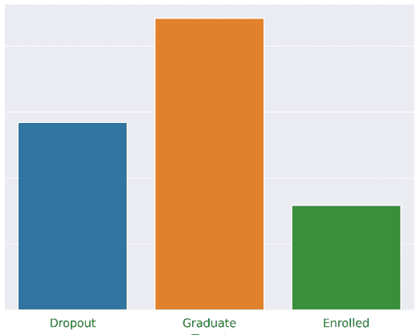

图 3.5 – 学业成功数据集中的目标类分布

虽然分布不完全平衡，但目标分布并未过度偏向某个类别，我们无需执行任何补偿操作。

到目前为止，我们发现我们的数据集适合建模（我们仍需要重新映射 Target）且干净（它不包含缺失值或重复值，并且分布良好）。我们现在可以更深入地研究一些特征，从特征相关性开始。以下代码绘制相关性热图。使用 df.corr() 计算成对 Pearson 相关性。代码片段后的截图显示了使用成对 Pearson 相关性构建的相关性热图：

```
sns.heatmap(df.corr(), cmap='coolwarm')
```

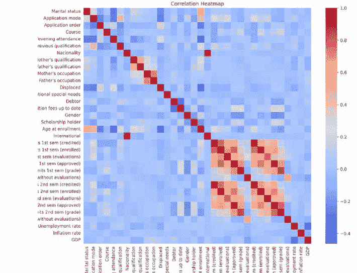

图 3.6 – 学业成功数据集的成对 Pearson 特征相关性

我们可以看到三种相关模式：第一学期学分、入学人数、评价和批准都相互相关。这些指标的第一学期和第二学期数值也相互相关。这些相关性暗示，学生一旦入学，倾向于坚持完成全年，而不是在学期中途退学。尽管存在相关性，但相关性不足以考虑删除任何特征。

第三种相关模式是 `Nacionality` 和 `International` 之间，它们强烈相关。

> **注意**
>
> 单词 Nacionality 指的是国籍。为了保持一致性，我们在此也保留了原始数据集中的拼写。

仔细观察 Nacionality 发现，几乎所有行都只有一个值：即收集数据集的国家。强相关性也暗示 `International` 的情况相同：


nationalities = df.groupby(['Nacionality', 'Target']).size().reset_index().pivot(columns='Target', index='Nacionality', values=0)
nationalities_total = nationalities.sum(axis=1)
nationalities_total = nationalities_total.sort_values(ascending=True)
nationalities.loc[nationalities_total.index].plot(kind='barh', stacked=True)

```
nationalities = df.groupby(['Nacionality', 'Target']).size().reset_index().pivot(columns='Target', index='Nacionality', values=0)
nationalities_total = nationalities.sum(axis=1)
nationalities_total = nationalities_total.sort_values(ascending=True)
nationalities.loc[nationalities_total.index].plot(kind='barh', stacked=True)
```

以下截图显示了国籍的堆叠条形图：

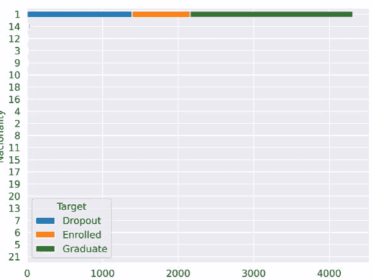

图 3.7 – 'Nacionality' 特征的分布，显示学术成功数据集中几乎所有行都只有一个值

'Nacionality' 和 'International' 的分布表明它们不太具有信息性（几乎所有行都有相同的值），因此我们可以从数据集中删除它们。

最后，我们注意到 'Gender' 特征。在处理性别时，检查偏见始终是个好习惯。我们可以使用直方图可视化 'Gender' 特征相对于目标类别的分布。结果显示在此代码片段之后的截图中：

```
sns.countplot(data=df, x='Gender', hue='Target', hue_order=['Dropout',
'Enrolled', 'Graduate'])
plt.xticks(ticks=[0, 1], labels=['Female', 'Male'])
```

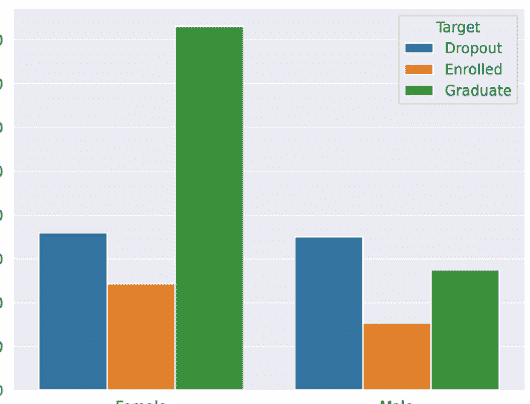

图 3.8 – 学术成功数据集中 'Gender' 特征的分布

存在轻微的女性学生偏向，但不足以引起担忧。

## 建模

现在我们可以为建模准备数据集了。我们必须将 Target 值映射为整数，并删除 Nacionality 和 International 特征。我们还需要删除特征名称中的空格。LightGBM 无法处理名称中带有空格的特征；我们可以将其替换为下划线：

```
df.columns = df.columns.str.strip().str.replace(' ', '_')
df = df.drop(columns=["Nacionality", "International"], axis=1)
df["Target"]=df["Target"].map({
    "Dropout":0,
    "Enrolled":1,
    "Graduate":2
    })
X = df.drop(columns=["Target"], axis=1)
y = df["Target"]
```

我们训练并比较四个模型：一个 LightGBM GBDT、一个 LightGBM DART 树、一个带有 GOSS 的 LightGBM DART 树，以及一个 scikit-learn 随机森林。

我们将使用 GridSearchCV 进行 5 折交叉验证参数优化，以确保模型性能良好。

以下代码设置了 GBDT 的参数优化。其他模型遵循类似的模式，可以在源代码中看到：

```
def gbdt_parameter_optimization():
    params = {
        "max_depth": [-1, 32, 128],
        "n_estimators": [50, 100, 150],
        "min_child_samples": [10, 20, 30],
        "learning_rate": [0.001, 0.01, 0.1],
        "num_leaves": [32, 64, 128]
    }

    model = lgb.LGBMClassifier(force_row_wise=True, boosting_type="gbdt", verbose=-1)
    grid_search = GridSearchCV(estimator=model, param_grid=params,
                               cv=5, verbose=10)
    grid_search.fit(X, y)
    return grid_search

results = gbdt_parameter_optimization()
print(results.best_params_)
print(results.best_score_)
```

运行上述代码需要一些时间，但完成后，它会打印找到的最佳参数以及最佳模型的得分。

所有模型训练完成后，我们可以使用找到的最佳参数，通过 5 折交叉验证的 F1 得分的平均值来评估每个模型。以下代码说明了如何对 GBDT 模型执行此操作：

```
model = lgb.LGBMClassifier(force_row_wise=True, boosting_type="gbdt",
    learning_rate=0.1, max_depth=-1, min_child_samples=10, n_estimators=100, num_leaves=32, verbose=-1)
scores = cross_val_score(model, X, y, scoring="f1_macro")
scores.mean()
```

每个模型的参数优化 Jupyter 笔记本可在 GitHub 仓库中找到：https://github.com/PacktPublishing/Practical-Machine-Learning-with-LightGBM-and-Python/tree/main/chapter-3。

以下表格总结了每个模型找到的最佳参数值和交叉验证的 F1 得分：

| 模型 | 学习率 | 最大深度 | 最小子样本数 | N 估计器数 | 叶子数 | 最小叶样本数 | 最小分割样本数 | F1 得分 |
|---|---|---|---|---|---|---|---|---|
| GBDT | 0.1 | - | 10 | 100 | 32 | N/A | N/A | 0.716 |
| DART | 0.1 | 128 | 30 | 150 | 128 | N/A | N/A | 0.703 |
| DART (GOSS) | 0.1 | 128 | 30 | 150 | 128 | N/A | N/A | 0.703 |
| Random Forest | N/A | N/A | N/A | 150 | N/A | 10 | 20 | 0.665 |

表 3.1 – 每个模型找到的最佳参数及其对应的 F1 得分摘要

从表中可以看出，LightGBM 模型的表现远优于 scikit-learn 随机森林。两个 DART 模型获得了几乎相同的 F1 得分，GOSS 的 F1 得分略低（表格中的值保留 3 位小数）。

这标志着我们探索数据集并为该数据集构建优化模型（使用参数网格搜索）的端到端示例的结束。在即将到来的章节中，我们将研究更复杂的数据集，并深入分析模型性能。

## 摘要

本章介绍了 LightGBM 作为高效训练提升机器的库。我们探讨了构建 GBDT 的复杂性来源以及 LightGBM 中解决这些问题的特性，例如基于直方图的采样、特性捆绑和 GOSS。我们还回顾了 LightGBM 最重要的超参数。

我们还详细概述了在 Python 中使用 LightGBM，涵盖了 LightGBM Python API 和 scikit-learn API。随后，我们使用 LightGBM 构建了第一个调优模型来预测学生学业表现，利用交叉验证和基于网格搜索的参数优化。

在下一章中，我们将 LightGBM 与另一个流行的梯度提升库 XGBoost 以及用于表格数据的 DL 技术进行比较。

## 参考文献

- [1] G. Ke, Q. Meng, T. Finley, T. Wang. W. Chen, W. Ma, Q. Ye 和 T.-Y. Liu，“LightGBM：一种高效梯度提升决策树”，载于《神经信息处理系统进展》，2017。

- [2] M. Mehta, R. Agrawal 和 J. Rissanen，“SLIQ：一种用于数据挖掘的快速可扩展分类器”，载于《数据库技术进展—EDBT’96：第 5 届国际扩展数据库技术会议，法国亚维农，1996 年 3 月 25-29 日 论文集 5》，1996。

- [3] J. Shafer, R. Agrawal, M. Mehta 等人，“SPRINT：一种用于数据挖掘的可扩展并行分类器”，载于《Vldb》，1996。

- [4] S. Ranka 和 V. Singh，“CLOUDS：一种用于大数据集的决策树分类器”，载于《第 4 届知识发现与数据挖掘会议论文集》，1998。

- [5] H. Shi，“最佳优先决策树学习”，2007。

- [6] R. Kleiman 和 D. Page，“Aucu：一种用于多类机器学习模型的性能指标”，载于《国际机器学习会议》，2019。

- [7] V. Realinho, J. Machado, L. Baptista 和 M. V. Martins，预测学生辍学和学术成功，Zenodo，2021。

## 比较 LightGBM、XGBoost 和深度学习

上一章介绍了用于构建梯度提升决策树 (GBDT) 的 LightGBM。在本章中，我们将 LightGBM 与另外两种用于表格数据建模的方法进行比较：XGBoost，另一个用于构建梯度提升树的库；以及深度神经网络 (DNN)，一种最先进的机器学习技术。

我们在两个数据集上比较 LightGBM、XGBoost 和 DNN，重点关注复杂性、数据集准备、模型性能和训练时间。

本章面向高级读者，需要一定的深度学习基础。然而，本章的主要目的不是详细理解 XGBoost 或 DNN（这两种技术在后续章节中都不会使用）。相反，在本章结束时，你应该了解 LightGBM 在机器学习领域有多具竞争力。

本章的主要主题如下：

- XGBoost 概述
- 深度学习与 TabTransformers
- 比较 LightGBM、XGBoost 和 TabTransformers

## 技术要求

本章包含示例和代码片段，说明如何在 Python 中训练 LightGBM、XGBoost 和 TabTransformer 模型。本章完整示例和设置合适环境的说明可在以下 GitHub 仓库中找到：https://github.com/PacktPublishing/Practical-Machine-Learning-with-LightGBM-and-Python/tree/main/chapter-4。


## XGBoost 概述

XGBoost，即 eXtreme Gradient Boosting 的缩写，是一个广受欢迎的开源梯度提升库，其目标和功能与 LightGBM 相似。XGBoost 比 LightGBM 更早，由 Tianqi Chen 开发，最初发布于 2014 年 [1]。

从本质上讲，XGBoost 实现了 GBDT，并支持高效地构建它们。XGBoost 的一些主要功能如下：

- **正则化**：XGBoost 同时融合了 L1 和 L2 正则化，以避免过拟合
- **稀疏感知**：XGBoost 能高效处理稀疏数据和缺失值，并在训练期间自动学习最佳填充策略
- **并行化**：该库采用并行和分布式计算技术同时训练多棵树，显著缩短训练时间
- **早停**：XGBoost 提供在模型性能没有显著提升时停止训练过程的选项，从而提升性能并防止过拟合
- **跨平台兼容性**：XGBoost 支持多种编程语言，包括 Python、R、Java 和 Scala，使其面向多样化的用户群体

多年来，由于 XGBoost 支持多种应用，且该库易于使用且高效，因此在机器学习社区中获得了广泛的欢迎。

## 比较 XGBoost 和 LightGBM

XGBoost 和 LightGBM 在功能上存在相当大的重叠。两个库都实现了 GBDT 和 DART，并支持构建随机森林。两者都具有类似的避免过拟合技术，并能自动处理缺失值和稀疏数据。

不过，XGBoost 和 LightGBM 之间的一些差异如下：

- **树生长策略**：XGBoost 采用逐层树生长方法，即逐层构建树；而 LightGBM 使用按叶子生长策略，专注于选择增益最大的叶子来生长树。这种生长策略的差异通常使 LightGBM 更快，尤其是在处理大型数据集时。
- **速度与可扩展性**：LightGBM 在内存使用和计算时间方面设计得更高效，因此更适合大规模数据集或训练时间至关重要的场景。不过，这种速度优势有时会以模型预测的方差更高为代价。
- **类别特征处理**：LightGBM 内置对类别特征的支持，可以直接处理它们，无需独热编码或其他预处理技术。相比之下，XGBoost 要求用户在将数据输入模型之前预处理类别特征。
- **早停**：如果模型性能没有显著提升，XGBoost 提供停止训练过程的选项。LightGBM 没有内置此功能，但可以通过回调手动实现，如前面章节所示。

总结来说，LightGBM 和 XGBoost 提供相似的功能。LightGBM 在具有大量特征的大型数据集上表现更好，而 XGBoost 在较小或中等规模的数据集上可能提供更稳定、更准确的结果。

## Python XGBoost 示例

XGBoost 提供基于 scikit-learn 的接口来构建模型。以下示例展示了如何在森林覆盖数据集上使用 XGBoost：

```
from xgboost import XGBClassifier
...
dataset = datasets.fetch_covtype()

X_train, X_test, y_train, y_test = train_test_split(
    dataset.data, dataset.target, random_state=179
)
y_train = y_train - 1
y_test = y_test - 1
xgb = XGBClassifier(
    n_estimators=150, max_leaves=120, learning_rate=0.09
)
xgb = xgb.fit(X_train, y_train)
f1_score(y_test, xgb.predict(X_test), average="macro")
```

到本阶段，scikit-learn 接口应该对你来说已经很熟悉了。前面的代码显示，XGBoost 支持与我们用于训练基于 LightGBM 的模型时相似的超参数。完整的参数列表可在 https://xgboost.readthedocs.io/en/stable/parameter.html 查看。

XGBoost 作为另一个梯度提升库，是 LightGBM 的直接替代方案。在下一节中，我们将探讨深度学习——一种完全不同但极其流行的学习技术——以及它在表格学习问题上与梯度提升的对比情况。

## 深度学习与 TabTransformers

我们现在探讨一种使用深度学习解决基于表格的数据问题的方法。近年来，由于深度学习模型的出色表现，深度学习获得了巨大的流行度。基于深度学习的技术，例如 AlphaZero、Stable Diffusion 以及 GPT 系列语言模型，在游戏、艺术生成和基于语言的推理方面都已达到人类或超人水平。

### 什么是深度学习？

深度学习是更广泛的人工神经网络机器学习领域的一个子领域。人工神经网络是对人脑的数学模拟，由相互连接的节点层（或“神经元”在生物学术语中）组成，这些节点用于处理和传输信息。

简单的人工神经网络仅包含几层。深度学习中的“深”指的是使用拥有更多层的神经网络，每层可能包含数千个神经元。这些层以层级方式组织，底部为输入层，顶部为输出层，中间为隐藏层。每层在数据通过网络时提取和精炼特征，使模型能够学习复杂的模式和表示。

下图展示了一个名为多层感知机的简单神经网络，它具有一个隐藏层。

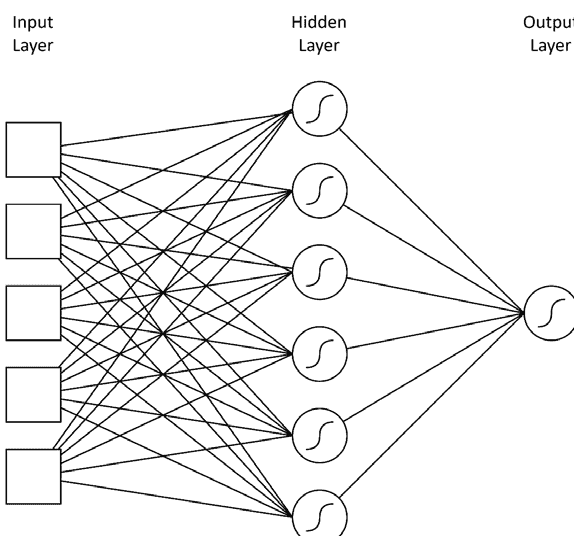

图 4.1 – 具有一个隐藏层和一个输出层的多层感知机。各层完全连接

每个神经元接收来自其他神经元的输入，执行数学运算，然后将结果传递给下一层神经元。

该数学运算涉及两个主要步骤——加权和与激活函数：

1. **加权和**：神经元获取输入（输入数据或来自前一层神经元的输出），将每个输入乘以其对应的权重，然后将它们相加。通常会向加权和中添加一个偏置项，以便更好地控制神经元的输出。从数学上表示如下：

   \( z_j = \sum_i(w_{ij}x_i) + b_j \)

   这里，\( x_i \) 表示神经元的所有输入，\( w_{ij} \) 是与第 \( i \) 个输入关联的权重，\( b_j \) 是神经元的偏置。

2. **激活函数**：随后将加权和传递到激活函数中，以确定神经元的输出。激活函数的目的是将非线性引入数学运算中。非线性使神经网络能够建模输入与输出之间的非线性，因此是复杂的关系。存在多种激活函数，例如 **sigmoid**（逻辑函数）、**双曲正切 (tanh）** 和 **修正线性单元 (ReLU)**，每种都有其自身的特性和应用场景。可以表示为：

   \( a_j = \sigma(z_j) \)

   其中，\( a_j \) 是神经元输出，\( \sigma \) 是激活函数。

结合这两个步骤，神经网络中的一个神经元处理输入数据，使网络能够学习和建模复杂的模式。

神经网络通过调整与神经元相关的权重进行训练。该算法可以总结如下：

1. 权重初始化为小的随机值。
2. 执行 **前向传播**：对于批次中的每个样本，将输入特征传递给整个网络（在每个神经元处计算求和和激活），以在输出层产生预测。
3. 随后通过将输出与批次中每个样本的实际输出进行比较来计算损失。与 GBDT 类似，损失函数必须可微分，标准损失函数包括 MSE 和交叉熵损失。
4. 执行 **反向传播**：使用微积分链式法则计算损失函数相对于权重的梯度。该过程从输出层开始，向后通过网络。
5. 随后根据反向传播的梯度，使用梯度下降或其现代变体（如 Adam）来更新权重。
6. 该过程重复设定数量的 epoch（每个 epoch 遍历整个数据集），以最小化损失函数。

神经网络的一个独特属性是，神经网络已被证明是 **通用函数逼近器**。深度神经网络（DNN）在理论上能够逼近任何连续函数，精度可达


所需的精度水平，前提是拥有足够数量的隐藏神经元和适当的激活函数。这一特性基于**通用逼近定理**，该定理已针对各种类型的神经网络得到证明。

这意味着神经网络可以学习表示输入和输出数据之间的复杂关系，无论这些关系多么复杂或非线性。这种能力是神经网络（尤其是 DNNs）能够成功解决不同领域中广泛问题的原因之一。然而，这一保证是理论上的。在实践中，找到合适的网络架构、超参数和训练技术以达到所需的近似水平可能具有挑战性。该过程通常需要实验、专业知识和高昂的计算资源。

## 深度学习的优缺点

鉴于 DNNs 的能力，我们可能会认为它们应该是解决所有机器学习问题的首选。使用 DNNs 的主要优势在于其在非常复杂领域中的高精度：在广泛复杂任务、自然语言处理、生成式 AI、图像识别和语音识别方面的当前最先进性能均由 DNNs 实现，因为它们能够在大型数据集中学习复杂和隐藏的模式。

另一个优势是自动特征提取。使用正确的架构，DNN 可以自动提取复杂或高阶特征，从而减少数据科学家进行特征工程的需求。

最后，DNN 还可以进行迁移学习：预训练的深度学习模型可以在较小的数据集上针对特定任务进行微调，利用初始训练期间获得的知识。迁移学习可以显著减少新任务的训练时间和数据需求。

然而，深度学习并非解决所有机器学习问题的万能药。使用 DNNs 的一些缺点包括：

- **计算资源**：深度学习模型训练通常需要大量的计算能力和内存，尤其是在处理大型数据集和复杂架构时。
- **大型数据集**：DNNs 在大型数据集上训练时通常表现良好，但在较小数据集上训练时性能可能下降。当数据集太小时，DNN 会过拟合训练数据且无法推广到未见数据。
- **可解释性**：由于其复杂的架构和大量参数，DNN 通常被视为“黑箱”。这种复杂性会使理解模型如何做出决策变得困难，这可能成为需要透明度或监管合规性的应用的关注点。
- **超参数调优**：DNN 涉及大量超参数，例如网络架构、学习率和激活函数。结合更长的训练时间和资源需求，找到这些超参数的最佳组合可能既昂贵又耗时。

## TabTransformers 简介

我们希望将深度学习应用于表格数据，因为大多数实际机器学习问题都涉及表格数据。为此，我们使用一种称为 **TabTransformer** 的新深度学习架构：一种专门设计用于处理表格数据的深度神经网络模型。

与 DNN 的 GPT 家族类似，TabTransformer 基于 Vaswani 等人最初引入的 Transformer 架构 [2]。TabTransformer 调整 Transformer 架构以有效处理表格数据，为决策树和梯度提升机等其他机器学习模型提供了一种替代方案，用于此类数据 [3]。

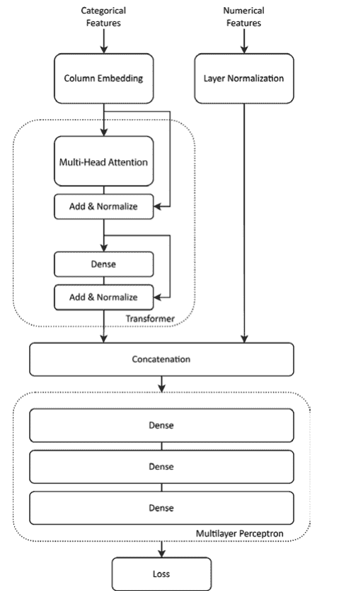

图 4.2 – Keras 中实现的 TabTransformer 架构 [3]

TabTransformer 的模型架构如图 4.2 所示。使用 TabTransformer 时，表格数据中的每个特征都被视为一个 token，类似于自然语言处理中将单词视为 token 的方式。模型应用自注意力机制来学习输入数据中特征之间的复杂交互和依赖关系。token 嵌入和注意力机制使模型能够捕捉特征之间的全局和局部关系。

TabTransformer 模型包含几个关键组件：token 嵌入、位置编码、Transformer 层、池化层和输出层。token 嵌入将每个特征值转换为连续向量表示，并通过位置编码结合位置信息。

通过图 4.2 所示的层，我们可以看到分类特征和数值特征被分开处理。

分类特征首先通过嵌入层，由 Keras 中的 `layers.Embedding` 实现，然后传递给 Transformer 块。可以实现可变数量的 Transformer 块（通过超参数设置），但每个块都包含一个 `layers.MultiHeadAttention` 层和一个带 Dropout 的 `layers.Dense` 层。输出值在通过注意力层和稠密层后相加并进行归一化。

由于其性能，我们的实现中 Transformer 前馈层使用高斯误差线性单元（GELU）激活函数。不过，也可以使用其他激活函数 [5]。

数值特征经过归一化层（归一化数值输入范围），然后与 Transformer 的输出拼接。

拼接后的结果经过多层感知机（MLP）块，该块包含可变数量的稠密层，每层都带有 Dropout。我们的实现使用缩放指数线性单元（SELU），它会使激活值自归一化 [6]。

最后，MLP 块的输出被传递给损失函数，其具体实现取决于学习问题（分类或回归）。

TabTransformers 的实现和训练比梯度提升树复杂得多。与其他 DNN 一样，TabTransformers 比梯度提升树需要更多的数据准备和计算能力。

除了 TabTransformers，本节还介绍了深度学习及其优缺点。在下一节中，我们将使用实际示例来比较不同的方法，包括使用 TabTransformers 的复杂性。

## 比较 LightGBM、XGBoost 和 TabTransformers

本节将比较 LightGBM、XGBoost 和 TabTransformers 在两个不同数据集上的性能。我们还将探讨更多针对类别不平衡、缺失值和分类数据的数据准备技术。

### 预测人口普查收入

我们使用的第一个数据集是 Census Income 数据集，它根据教育、婚姻状况、职业等属性预测个人收入是否超过 50,000 美元 [4]。该数据集有 48,842 条实例，正如我们将看到的，存在一些缺失值和类别不平衡。

该数据集可从以下 URL 获取：https://archive.ics.uci.edu/ml/machine-learning-databases/adult/adult.data。数据已分为训练集和测试集。加载后，我们可以对数据进行采样：

```
train_data.sample(5) [["age", "education", "marital_status", "hours_per_week", "income_bracket"]]
```

所选列的数据样本如表 4.1 所示。

| | 年龄 | 教育 | 婚姻状况 | 每周工作小时 | 收入区间 |
|---|---|---|---|---|---|
| 12390 | 34 | Some-college | Never-married | 40 | <=50K |
| 20169 | 41 | Assoc-acdm | Married-civ-spouse | 45 | >50K |
| 17134 | 35 | Doctorate | Never-married | 60 | >50K |
| 23452 | 49 | HS-grad | Married-civ-spouse | 40 | >50K |
| 22372 | 31 | HS-grad | Separated | 45 | <=50K |

表 4.1 – Census Income 数据集的示例数据

表 4.1 显示我们拥有混合数据类型：某些特征是数值型，而其他则是文本型。值得注意的是，数据集中的某些列是**分类特征**：具有固定值集合的字符串特征。接下来，我们将了解如何对这些特征进行编码以供机器学习使用。

### 对分类特征进行编码

大多数机器学习算法需要将字符串特征编码为数字；在某些情况下，这可以自动完成。我们在第 6 章《使用 LightGBM 解决现实世界的数据科学问题》中讨论了 LightGBM 的自动编码。在本示例中，我们对特征进行编码以了解这涉及哪些内容。

我们需要将每个分类值映射到唯一数字；因此，我们首先为每个特征构建所有值的词汇表：

```
CATEGORICAL_FEATURES_WITH_VOCABULARY = {
    "workclass": sort_none_last(list(train_data["workclass"].unique())),
    "education": sort_none_last(list(train_data["education"].unique())),
    "marital_status": sort_none_last(list(train_data["marital_status"].unique())),
}
```


"occupation": sort_none_last(list(train_data["occupation"].unique())),
"relationship": sort_none_last(list(train_data["relationship"].unique())),
"race": sort_none_last(list(train_data["race"].unique())),
"gender": sort_none_last(list(train_data["gender"].unique())),
"native_country": sort_none_last(list(train_data["native_country"].unique())),
"income_bracket": sort_none_last(list(train_data["income_bracket"].unique())),
}

前面的代码将每个列的唯一值提取到列表中并对列表进行排序，将空值放在最后。使用 pandas DataFrame 时，显式将分类列的数据类型设置为 category 也很有用：

```
for c in CATEGORICAL_FEATURES_WITH_VOCABULARY.keys():
    for dataset in [train_data, test_data]:
        dataset[c] = dataset[c].astype('category')
        dataset[c] = dataset[c].astype('category')
```

使用我们的词汇表，现在可以将每个列中的值更新为表示其类别的数字（使用词汇表列表中的索引作为数值）：

```
def map_to_index(val, vocab):
    if val is None:
        return None
    return vocab.index(val)

for dataset in (train_data, test_data):
    for feature, vocab in CATEGORICAL_FEATURES_WITH_VOCABULARY.items():
        dataset[feature] = dataset[feature].map(lambda val: map_to_index(val, vocab))
```

结果是一个所有特征现在都是数值的 DataFrame：

| | age | education | marital_status | hours_per_week | income_bracket |
|---|---|---|---|---|---|
| 18545 | 37 | 11 | 2 | 40 | 0 |
| 26110 | 51 | 14 | 0 | 60 | 1 |
| 21905 | 36 | 11 | 5 | 32 | 0 |
| 1496 | 32 | 1 | 0 | 43 | 1 |
| 3148 | 47 | 15 | 2 | 40 | 0 |

我们的分类特征现在已编码，可以继续进行进一步的数据清洗。

## 缺失值和重复项

我们需要检查缺失值、重复项和异常值。可以使用以下代码：

```
train_data.isnull().sum()
train_data.drop_duplicates(inplace=True)
train_data.describe()
```

我们删除重复数据，查看 `describe` 的输出显示没有显著的异常值。但是，数据集中存在 **缺失值**。LightGBM 和 XGBoost 可以自动处理缺失值，这是基于树算法的一个显著优势。但是，对于 TabTransformer，我们需要实现特定逻辑来处理缺失值，正如我们接下来将看到的。

## 不平衡数据

数据集也存在偏斜：每个类的示例数量不平衡。可以使用以下代码计算偏斜：

```
counts = np.bincount(train_data["income_bracket"])
class_weight = {
    0: counts[0] / train_data.shape[0],
    1: counts[1] / train_data.shape[0]
}
```

输出显示大约 75%/25% 向负类（0）偏斜。处理不平衡类（如果是二进制类）的最简单方法之一是给正类比负类更大的权重。因此，在计算损失时，漏掉正类的预测会有更大的影响。

LightGBM 和 XGBoost 都通过 `scale_pos_weight` 参数支持此功能，计算方法如下：

```
scale_pos_weight = class_weight[0]/class_weight[1]
```

## 训练 LightGBM 和 XGBoost 模型

数据清洗和准备就绪后，现在可以训练我们的模型了。训练 LightGBM 和 XGBoost 模型很简单。对于 LightGBM，我们有如下代码：

```
model = lgb.LGBMClassifier(force_row_wise=True, boosting_type="gbdt",
                         scale_pos_weight=scale_pos_weight)
model = model.fit(X_train, y_train)
```

对于 XGBoost，可以运行以下代码：

```
model = xgb.XGBClassifier(scale_pos_weight=scale_pos_weight)
model = model.fit(X_train, y_train)
```

前面的代码突出了使用这两个库的简单性。

## 训练 TabTransformer 模型

现在我们将构建一个 TabTransformer 模型。我们将使用 TensorFlow 的 Keras 根据示例代码定义模型：https://keras.io/examples/structured_data/tabtransformer/。

我们的数据集准备基本保持不变，有两个关键区别：我们不编码分类特征，并且必须显式处理缺失值。

我们不编码分类特征，因为 Keras 提供了一个特殊层来执行字符串查找和转换为数值。但是，我们仍然必须提供词汇表。以下代码说明了创建查找层：

```
lookup = layers.StringLookup(
    vocabulary=vocabulary,
    mask_token=None,
    num_oov_indices=0,
    output_mode="int",
)
```

num_oov_indices 参数设置为 0，意味着如果遇到不在词汇表中的（OOV）值，则不使用任何索引。由于我们的词汇表是详尽的，因此不需要此设置。mask_token 参数也设置为 None，因为我们没有对任何字符串输入进行掩码。

我们需要为数据集中的每个列提供默认值来处理缺失值。我们的策略是将字符串值替换为默认字符串值 NA。我们使用数值列的统计均值来填充缺失值。以下代码创建默认值列表：

```
train_data_description = train_data.describe()
COLUMN_DEFAULTS = [
    train_data_description[feature_name]["mean"] if feature_name in
    NUMERIC_FEATURE_NAMES else ["NA"]
    for feature_name in HEADERS
]
```

实现 TabTransformer 模型的 Keras 代码大约有 100 行长，可在我们的 GitHub 仓库中找到：https://github.com/PacktPublishing/Practical-Machine-Learning-with-LightGBM-and-Python/blob/main/chapter-4/tabtransformer-census-income.ipynb。

以下代码设置了可以与 TabTransformer 模型一起使用的梯度优化器和数据：

```
optimizer = tfa.optimizers.AdamW(
    learning_rate=learning_rate,
    weight_decay=weight_decay
)
model.compile(
    optimizer=optimizer,
    loss=keras.losses.BinaryCrossentropy(),
    metrics=[keras.metrics.BinaryAccuracy(name="accuracy"),
    f1_metric,
    precision_metric,
    recall_metric],
)
train_dataset = get_dataset_from_csv(
    train_data_file, batch_size, shuffle=True
)
validation_dataset = get_dataset_from_csv(
    test_data_file, batch_size
)
```

我们使用带有权重衰减 [7] 的 AdamW 优化器和二元交叉熵损失函数来拟合二进制分类问题。然后可以使用以下代码训练和评估我们的模型：

```
callback = keras.callbacks.EarlyStopping(
    monitor='loss', patience=3
)
history = model.fit(
    train_dataset,
    epochs=num_epochs,
    validation_data=validation_dataset,
    class_weight=class_weight,
    callbacks=[callback]
)
model.evaluate(validation_dataset, verbose=0)
```

我们还通过 Keras 回调添加了早期停止，耐心为 3 个时代。在训练和验证期间，我们跟踪准确率和 F1 分数。

训练所需时间比任一梯度提升框架都长得多，并且需要 GPU（在 CPU 上训练在技术上是可能的，但需要花费大量时间）。

现在可以查看三个算法在 Census Income 数据集上的结果了。

## 结果

使用前一章讨论的网格搜索技术对所有三个算法进行了参数优化。对于两个提升算法，优化了学习率、桶大小和树的数量。对于 TabTransformer，必须优化参数和架构的各个方面。就参数而言，优化了学习率、权重衰减和 dropout 率；就架构而言，必须选择 Transformer 块的数量和隐藏层（在 MLP 中）的数量。优化后的参数可在源代码中找到。

以下表格显示了算法在验证集上的结果。

| Model | Training Time | Accuracy | F1 score |
|---|---|---|---|
| LightGBM GBDT | 1.05s | 84.46% | 0.71 |
| XGBoost GBDT | 5.5s | 84.44% | 0.72 |
| TabTransformer | 113.63s | 77.00% | 0.64 |

表 4.3 – 在普查收入数据集上训练三个模型的结果

XGBoost 和 LightGBM 在该数据集上的表现相似，准确率达到 84%，F1 分数为 0.7。TabTransformer 模型表现较差，准确率和 F1 分数都较低。

关于训练时间，LightGBM 比其他方法快得多。LightGBM 模型的训练速度比 XGBoost 快 5.23 倍，比 TabTransformer 快 108.22 倍。TabTransformer 在 8 核 P4000 GPU 上训练了 15 个时代。

作为另一个比较点，并说明当没有分类特征时如何调整 TabTransformer 架构，我们将使用三个算法解决第二个问题。

## 检测信用卡欺诈

我们的第二项任务是在信用卡交易数据集 [8] 中检测欺诈交易。数据集可在 https://www.kaggle.com/datasets/mlg-ulb/creditcardfraud 上获取。该任务是一个二进制分类问题，训练数据中的交易标记为非欺诈（0）和欺诈（1）。数据集仅包含为保密性而匿名化的数值特征。值得注意的是，数据集高度不平衡，欺诈交易仅占数据的 0.17%。

## 训练 LightGBM 和 XGBoost 模型

由于所有值都是数值，梯度提升模型需要的数据准备工作很少。为了抵消数据集中的不平衡，我们再次计算 `scale_pos_weight` 并将其作为参数传递给模型。我们执行带交叉验证的网格搜索以找到良好的


LightGBM 和 XGBoost 模型的超参数。对于 LightGBM，尝试了 DART 和 GBDT 模型，其中 DART 表现更好。与普查收入数据集不同，信用卡数据集未预先划分为训练集和测试集。因此，我们应用五折交叉验证来衡量对未见数据的性能。以下代码训练 LightGBM 模型，XGBoost 代码非常相似：

```
model = lgb.LGBMClassifier(force_row_wise=True, boosting_type="dart",
learning_rate=0.0023, max_bin=384, n_estimators=300, scale_pos_weight=scale_pos_weight, verbose=-1)
scores = cross_val_score(model, X, y, scoring="f1_macro")
print (f"Mean F1-score: {scores.mean()}")
```

LightGBM 和 XGBoost 的结果与 TabTransformer 结果一起显示在表 4.4 中。

## 训练 TabTransformer 模型

没有分类特征时，TabTransformer 架构可以大大简化。让我们看看图 4.2 所示的架构。可以看到，嵌入层和注意力层不再需要。事实上，模型简化为常规 MLP（将模型仍称为变换器是不诚实的，因为根本没有使用注意力层）。

除了移除不需要的层之外，其余架构和流程与普查收入问题保持相同。AdamW 再次用作优化器，我们对超参数和模型中的隐藏层数量进行网格搜索优化。与梯度提升模型一样，执行五折交叉验证来衡量性能。

## 结果

尽管接下来也报告了准确率，但必须注意的是，它在不平衡数据上不是一个良好的性能指标。在该数据集中，99.82% 的样本属于同一类别，而只预测该类别的模型将具有 99.82% 的准确率且完全毫无意义。F1 得分不受类别不平衡影响，仍然是不平衡数据集中分类性能的良好指标。以下表格显示了三种算法在五折交叉验证下的结果。

| 模型 | 训练时间 | 准确率 | F1 得分 |
| --- | --- | --- | --- |
| LightGBM GBDT | 113s | 99.88% | 0.80 |
| XGBoost GBDT | 351s | 98.41% | 0.82 |
| TabTransformer | 528.59s | 93.37% | 0.05 |

表 4.4 – 在信用卡欺诈数据集上训练三种模型的结果。训练时间包括五折交叉验证

XGBoost 和 LightGBM 在该数据集上的表现非常相似，分别获得 0.82 和 0.80 的 F1 得分。DNN 在该问题上困难重重，即使使用类别权重来补偿不平衡数据集，F1 得分也仅为 0.05。

调试 DNN 的性能问题众所周知非常棘手。由于构建和训练 DNN 模型的复杂性和不透明性，小的更改可能会产生显著影响。

性能不佳的可能原因包括以下几点：

- **模型架构不足：**这是最可能的原因。该架构不适合该问题。需要对架构、层大小甚至神经网络类型进行进一步实验。
- **训练不足：**模型可能训练时间不够长。增加训练轮数可以提高性能。然而，在我们的实验中，损失在 10 个轮数后停滞不前（而训练继续了 15 个轮数）。
- **损失函数不当：**我们应用了带有类别权重的 `BinaryCrossentropy` 损失函数。然而，可以尝试更高级的损失函数，例如焦点损失 [9]。

就训练和验证时间而言，情况与普查收入数据集类似。LightGBM 模型的训练和验证速度比其他方法快得多：比 XGBoost 快 3.1 倍，比 DNN 快 4.62 倍。

## 总结

在本章中，我们讨论了可用于解决表格学习问题的两种其他算法：XGBoost，另一种梯度提升框架，以及 TabTransformer，一种深度学习方法。

我们展示了如何在两个数据集上设置和训练 XGBoost 模型和 TabTransformer。我们还展示了如何为基于树的模型和神经网络模型编码分类特征。两个数据集也存在类别不平衡，我们在训练期间需要对此进行补偿。

我们发现 LightGBM 和 XGBoost 产生的模型准确率相似，但 LightGBM 训练模型的速度要快得多且更高效。我们也看到了训练 DNN 的复杂性以及在这些问题上表现平平的情况。深度学习是一种极其强大的技术，但在处理表格数据集时，基于树的方法往往更适用。

在下一章中，我们将重点介绍使用名为 Optuna 的框架对 LightGBM 进行更有效的参数优化。

## 参考文献

- [1] T. Chen 和 C. Guestrin，“XGBoost”，载于第 22 届 ACM SIGKDD 知识发现与数据挖掘国际会议论文集，2016 年。
- [2] A. Vaswani, N. Shazeer, N. Parmar, J. Uszkoreit, L. Jones, A. N. Gomez, L. Kaiser, 和 I. Polosukhin，“Attention Is All You Need”，2017 年。
- [3] X. Huang, A. Khetan, M. Cvitkovic, 和 Z. Karnin，TabTransformer：使用上下文嵌入进行表格数据建模，2020 年。
- [4] R. Becker，Adult，UCI 机器学习库，1996 年。
- [5] D. Hendrycks 和 K. Gimpel，高斯误差线性单元（GELUs），2020 年。
- [6] G. Klambauer, T. Unterthiner, A. Mayr 和 S. Hochreiter，自归一化神经网络，2017 年。
- [7] I. Loshchilov 和 F. Hutter，解耦权重衰减正则化，2019 年。
- [8] A. Dal Pozzolo, O. Caelen, R. Johnson 和 G. Bontempi，“用于不平衡分类的欠采样概率校准”，2015 年。
- [9] T.-Y. Lin, P. Goyal, R. Girshick, K. He 和 P. Dollár，用于密集物体检测的焦点损失，2018 年。
