# 第二部分：使用 LightGBM 进行实用机器学习

第二部分深入探讨了支撑实用机器学习工程的复杂流程，首先介绍了通过名为 Optuna 的框架进行高效超参数优化。接着，我们将全面探索数据科学生命周期，阐述从问题定义和数据处理到实际数据科学建模应用的严谨步骤。本部分的最后，重点将转向自动机器学习，重点介绍 FLAML 库，该库旨在简化和优化模型选择和调优。贯穿本部分，案例研究和动手示例的结合将为利用这些高级工具的全部潜力提供清晰的路线图，强调效率和优化的主题。

本部分将包括以下章节：

- 第 5 章，使用 Optuna 进行 LightGBM 参数优化
- 第 6 章，使用 LightGBM 解决现实世界的数据科学问题
- 第 7 章，使用 LightGBM 和 FLAML 进行 AutoML

## 使用 Optuna 进行 LightGBM 参数优化

前几章讨论了 LightGBM 超参数及其对模型构建的影响。构建新模型时的一个基本问题是找到最佳超参数以实现最佳性能。

本章重点介绍使用名为 Optuna 的框架进行参数优化过程。除了超参数空间的剪枝，还讨论了不同的优化算法。一个实际示例展示了如何应用 Optuna 为 LightGBM 找到最佳参数。还展示了 Optuna 的高级用例。

本章的主要主题如下：

- Optuna 和优化算法
- 使用 Optuna 优化 LightGBM

## 技术要求

本章包含示例和代码片段，说明如何使用 Optuna 对 LightGBM 进行参数优化研究。有关设置本章适当环境的完整示例和说明，可在 https://github.com/PacktPublishing/Practical-Machine-Learning-with-LightGBM-and-Python/tree/main/chapter-5 上找到。

## Optuna 和优化算法

前几章的示例表明，为问题选择最佳超参数在解决机器学习问题中至关重要。超参数对算法的性能和泛化能力有显著影响。最佳参数也特定于所使用的模型和正在解决的学习问题。


使超参数优化变得复杂的其他问题如下：

- **成本**：对于每组唯一的超参数（可能有很多组），都必须执行完整的训练运行，通常伴随交叉验证。这非常耗时且计算开销大。

- **高维搜索空间**：每个参数都可能有大量潜在取值，使得逐一测试每个值变得不可能。

- **参数交互**：单独优化每个参数往往是不可能的，因为某些参数的值会相互影响。以 LightGBM 中的学习率和估计器数量为例：估计器数量越少，需要的学习率越大，反之亦然。该现象在图 5.1 中所示。

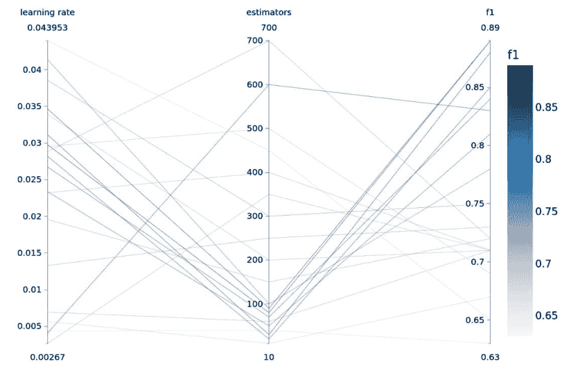

图 5.1 – 展示学习率与估计器数量之间参数交互的平行坐标图：估计器越多，所需的学习率越低，反之亦然

图 5.1 使用一种称为 **平行坐标图** 的技术来可视化参数交互。平行坐标图是一种用于表示高维数据的可视化工具，因此特别适用于可视化超参数优化的结果。每个维度（在此上下文中，即一个超参数）都表现为并排排列的垂直轴。每个轴的范围反映了该超参数可以采用的值域。每个单独的超参数配置都描绘为穿过所有这些轴的一条线，每条轴上的交点表示给定配置下该超参数的值。还可以根据性能指标（如验证准确率）对线条进行颜色编码，以辨别哪些超参数组合能产生更好的结果。

平行坐标图的优势在于其能够说明多个超参数之间的关系及其对性能的累积影响，例如图 5.1 中所示的参数交互。通过观察线条的聚集或颜色相似性，我们可以洞察超参数之间的趋势和复杂的相互依赖。这种可视化多维模式的能力有助于数据科学家确定哪些超参数值或组合最有利于模型的最佳性能。

鉴于超参数优化的挑战和复杂性，寻找最佳参数的一种朴素方法是手动优化。在手动优化中，人类从业者基于直觉理解和经验选择参数。使用这些参数训练模型，并重复该过程，直到找到令人满意的参数。手动优化实现简单，但由于该过程涉及人工干预，因此非常耗时。人类直觉也可能出错，优秀的参数组合很容易被遗漏。

**注意**

寻找最佳参数的过程通常称为参数 **研究**。在研究中测试的每个配置（参数组合）称为一次 **试验**。

在前面章节的示例中，我们迄今所采用的方法是 **网格搜索**。使用网格搜索时，我们会建立一个参数网格，包含每个参数及其潜在值范围，并穷举测试每个可能的组合，以找到最优值。

网格搜索很好地解决了参数交互问题：由于测试了每个可能的组合，因此每种交互都得到了考虑。

然而，使用网格搜索的缺点是成本。由于我们穷举测试每个参数组合，试验次数会迅速变得难以承受，尤其是在添加更多参数时。例如，请考虑以下网格：

```
params = {"learning_rate": [0.001, 0.01, 0.1],
 "num_leaves": [10, 20, 50, 100],
 "num_estimators": [100, 200, 500]}
```

对该网格进行优化研究将需要 36 次试验。仅添加一个具有两个可能取值的额外参数，就会使研究成本翻倍。

我们需要一种算法和框架，能够在我们控制的有限试验次数内智能优化参数。为此目的存在多种框架，包括用于调优机器学习模型的 Python 库 SHERPA；用于在复杂搜索空间上进行参数优化的另一个 Python 库 Hyperopt；以及专为 Keras 定制的工具 Talos。然而，在下一节及本章余下部分中，我们将介绍 Optuna，这是一种旨在自动化机器学习模型调优的框架。

## 介绍 Optuna

Optuna 是一个开源的 **超参数优化（HPO）** 框架，旨在自动化寻找机器学习模型的最佳超参数（https://optuna.org/）。它使用 Python 编写，可以轻松与各种机器学习库集成，包括 LightGBM。

Optuna 提供高效的优化算法，以更有效地搜索超参数空间。除了优化算法外，Optuna 还提供剪枝策略，通过剪枝表现不佳的试验来节省计算资源和时间。

除了优化和剪枝算法，Optuna 还提供易于使用的 API，用于定义参数类型（整数、浮点数或类别）、创建和自动化可恢复的优化研究，以及可视化优化运行的结果。本章稍后将展示如何实际使用该 API。

## 优化算法

Optuna 提供多种高效的优化算法。在本节中，我们将重点介绍两种可用算法：一种是 **树结构 Parzen 估计器（TPE）**，另一种是 **协方差矩阵自适应进化策略（CMA-ES）** 算法。

## TPE

要理解 TPE，我们必须先知道什么是 Parzen 估计器。

Parzen 估计器，或称 **核密度估计器（KDE）**，是一种用于估计一组数据点概率分布的技术。它是一种非参数方法，意味着它不会对数据的任何特定底层分布做出假设。相反，它试图根据观察到的数据点来“学习”分布。

假设你有一组数据点，想要知道数据是如何分布的。一种方法是在每个数据点上放置小的“丘陵”（核函数）。这些“丘陵”可以有不同的形状，例如高斯（钟形）或均匀（箱形）。任何位置“丘陵”的高度都表示新数据点落在该位置的可能性。Parzen 估计器通过将所有这些“丘陵”相加来工作，从而创建一个代表数据估计概率分布的平滑地貌。

在 TPE 中，我们关心的数据点是参数组合，而概率分布是一组参数是好是坏的可能性 [1]，[2]。

TPE 首先对少量随机超参数组合进行采样，并评估每个组合的模型性能。根据这些初步结果，TPE 将超参数组合分为两组：好组（性能更好的组合）和坏组（性能较差的组合）：

- l(x)：好配置的概率密度函数

- g(x)：坏配置的概率密度函数

接下来，TPE 使用 Parzen 估计器技术，对好坏两组的超参数组合概率分布进行估计。

在获得概率分布估计后，TPE 计算超参数配置的预期改进（EI）。EI 可以计算为两个密度之比：l(x)/g(x)。在每次试验中，算法会采样最大化 EI 的新超参数配置。

TPE 中的树状结构源于算法在超参数搜索空间内处理参数交互的能力，其中特定超参数的相关性取决于其他超参数的值。为了处理此问题，TPE 构建了一个层次结构，以捕捉不同超参数之间的关系，并相应地调整采样过程。

总之，TPE 估计好坏参数的分布，并利用它们通过最大化新试验的预期改进来寻找最优参数。TPE 具有成本效益，因为它近似了分布，并可以以最优方式（非穷举方式）搜索更好的参数。TPE 还处理参数交互。

Optuna 提供的另一种算法是 CMA-ES 算法，我们将在下一节中讨论。

## CMA-ES

CMA-ES 是另一种可用于寻找最优超参数的优化算法 [3]。与 TPE 相比，CMA-ES 适合涉及连续变量且搜索空间非线性且非凸的情况。

CMA-ES 是进化算法（EA）的一个示例。EA 是一种受自然演化过程启发的优化算法类型。它旨在通过模仿自然通过选择、繁殖、突变和遗传来演化物种的方式，找到问题的最佳解决方案。进化算法从一组候选解开始，并对每一代后续候选解进行修改，以更紧密地适应最佳解。这种代际过程在图 5.2 中进行了说明。


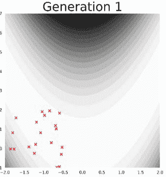

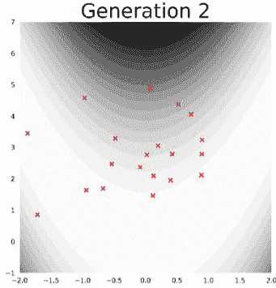

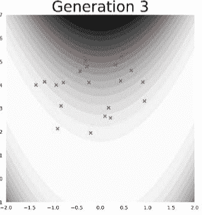

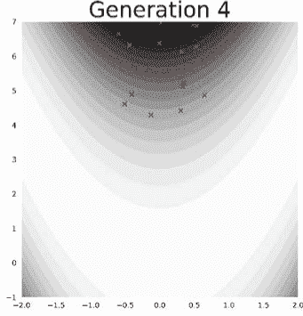

图 5.2 – 候选解（红色 x 标记）随每一代演进以逼近全局最优解（位于每个地貌的顶部和中心）的二维示意图。在 CMA-ES 的上下文中，每个候选解代表一组超参数值，算法的性能决定最优解。

CMA-ES 演化过程的核心是协方差矩阵。协方差矩阵是一个方阵、对称矩阵，表示变量对之间（在 CMA-ES 的情况下即超参数）的协方差，从而揭示它们之间的关系。矩阵的对角线元素表示各个变量的方差，而非对角线元素表示变量对之间的协方差。当存在正协方差时，这表明变量通常朝同一方向移动，要么都增加，要么都减少。相反，负协方差指出一种关系：当一个变量上升时，另一个变量往往下降，反之亦然。协方差为零表明变量之间没有线性关系。

CMA-ES 在优化超参数时按以下原则应用进化策略：

- 1. 在超参数搜索空间内，初始化均值和协方差矩阵。
- 2. 重复执行进化过程：
  - I. 使用均值和协方差矩阵从搜索空间生成候选解种群。每个候选解代表一组超参数值。
  - II. 评估候选解的适应度。**适应度**指候选解的质量或其解决优化问题的优劣程度。在 CMA-ES 中，这意味着使用候选超参数在数据集上训练模型，并在验证集上评估其性能。
  - III. 从种群中选择最佳候选解。
  - IV. 根据最佳候选解更新均值和协方差矩阵。
  - V. 重复上述过程，直到达到最大试验次数，或直到种群的适应度不再改善。

CMA-ES 在复杂搜索空间中表现良好，并在协方差矩阵的指导下智能地采样搜索空间。当超参数搜索空间复杂且非线性，或者验证数据的评估存在噪声时（例如，当某个指标是不一致的性能指标时），它非常有益。

TPE 和 CMA-ES 都解决了超参数优化相关的问题：这两种算法都能有效搜索高维搜索空间。这两种算法都能捕捉参数交互作用。这两种算法都让我们能够控制成本：我们可以确定优化预算，并将搜索限制在该范围内。

TPE 和 CMA-ES 之间的主要区别在于它们的总体方法。TPE 是一种具有序列搜索策略的概率模型，而 CMA-ES 是基于种群的并行评估解决方案。这通常意味着 TPE 在搜索中更具开发性，而 CMA-ES 则利用种群控制机制在探索和开发之间取得平衡。然而，TPE 通常比 CMA-ES 更高效，尤其是参数数量较少时。

Optuna 通过剪枝无效试验，为搜索过程提供了进一步的优化。我们将在下一节讨论一些剪枝策略。

## 剪枝策略

剪枝策略是指通过从研究中剪除不 promising 的试验，从而避免在优化上浪费时间的方法。剪枝与模型训练过程同步进行：在训练期间检查验证错误，如果算法表现不佳，则停止训练。因此，剪枝类似于 _早停_。

### 中位数剪枝

Optuna 提供多种剪枝策略，其中最简单的一种是 **中位数剪枝**。使用中位数剪枝时，每个试验在 n 步后报告一个中间结果。然后取中间结果的中位数，并停止任何在相同步骤上低于先前试验中位数的试验。

### 连续半减法与 Hyperband

一种更高级的策略称为 **连续半减法** [4]。它采用更全面的方法，为所有试验分配一个较小且相等的训练步骤预算。连续半减法随后按迭代方式进行：在每次迭代中，评估每个试验的性能，并为下一轮选出一半排名靠前的候选解，而将一半排名靠后的剪除。下一次迭代的训练预算翻倍，并重复此过程。这样，优化预算就用在了最有前景的候选解上。结果，只需花费较少的优化预算来淘汰表现不佳的候选解，而将更多资源用于寻找最佳参数。

**Hyperband** 是另一种剪枝技术，它通过引入随机搜索和多括号资源分配策略扩展了连续半减法 [5]。虽然连续半减法通过迭代剪除表现不佳的候选配置并将更多资源分配给剩下的有前景配置来缩小候选配置集合，但它依赖于固定的初始配置集合和单一的资源分配方案。

相反，Hyperband 采用多括号资源分配策略，将总的计算预算划分为多个括号，每个括号代表不同的资源分配水平。在每个括号内，应用连续半减法来迭代淘汰表现不佳的配置，并将更多资源分配给剩下的有前景配置。在每个括号开始时，使用随机搜索采样一组新的超参数配置，这使得 Hyperband 能够更广泛地探索超参数空间，并降低遗漏良好配置的风险。这种并发过程使 Hyperband 能够在搜索过程中自适应地平衡探索与开发，最终实现更高效、更有效的超参数调优。

Optuna 对优化算法及其对应的剪枝策略进行了实证研究（https://github.com/optuna/optuna/wiki/Benchmarks-with-Kurobako）。从实证上看，他们发现 Hyperband 是 TPE 或 CMA-ES 的最佳优化策略。

本节概述了驱动 Optuna 的理论和算法，重点介绍了 TPE、CMA-ES 和高级剪枝策略。在下一节中，我们将使用 LightGBM 在机器学习问题中实际应用 Optuna。

## 使用 Optuna 优化 LightGBM

我们将通过一个分类示例来演示如何应用 Optuna。我们要建模的问题是预测电信运营商的客户流失（是/否）。该数据集可从 https://github.com/IBM/telco-customer-churn-on-icp4d/tree/master/data 获取。

数据使用运营商可获得的信息来描述每个客户——例如，性别、客户是否购买互联网服务、是否选择无纸化账单、是否支付技术支持费用以及他们的月费。数据既包含数值特征，也包含类别特征。数据已清洗并平衡，使我们能够专注于参数优化研究。

我们首先定义参数研究的目标。目标函数对每个试验调用一次。在此示例中，我们希望在数据上训练 LightGBM 模型并计算 F1 分数。Optuna 将一个 trial 对象传递给目标函数，我们可以使用它来设置特定试验的参数。以下是一个示例代码片段，展示如何定义带有参数的目标函数：

```python
def objective(trial):
    boosting_type = trial.suggest_categorical(
        "boosting_type", ["dart", "gbdt"])
    lambda_l1= trial.suggest_float(
        'lambda_l1', 1e-8, 10.0, log=True),
    ...
    min_child_samples= trial.suggest_int(
        'min_child_samples', 5, 100),
    learning_rate = trial.suggest_float(
        "learning_rate", 0.0001, 0.5, log=True),
    max_bin = trial.suggest_int(
        "max_bin", 128, 512, 32)
    n_estimators = trial.suggest_int(
        "n_estimators", 40, 400, 20)
```

在此，我们可以看到如何使用 trial 提供的方法来设置超参数。对于每个参数，优化算法会在指定范围内建议一个值。我们可以使用 trial.suggest_categorical 建议类别变量（如 boosting type 所示），并分别使用 suggest_int 和 suggest_float 建议 int 和 float 参数。在建议浮点数或整数时，会指定一个范围，并且可选地指定一个步长：

```python
n_estimators = trial.suggest_int(
    name="n_estimators", low=40, high=400, step=20)
```

设置步长意味着优化算法不会在范围内建议任意值，而是将建议限制在下限和上限之间的步长上（40、60、80、100、...、400）。

我们还可以通过为数值参数传递 log=True 来对可能值的范围进行对数缩放。对参数范围进行对数缩放的效果是：在接近范围下限的地方测试更多值，而（对数地）在接近上限的地方测试更少值。对数缩放特别适用于学习率，因为我们希望关注较小的值，并指数级地增加测试值，直到达到上限。


要在训练 LightGBM 模型时应用剪枝，Optuna 提供了一个专用回调，与优化过程集成：

```
pruning_callback = optuna.integration.LightGBMPruningCallback(trial,
"binary")
```

创建回调时必须指定错误度量指标，在本例中，我们为二元错误指定了 "binary"。

设置好超参数后，我们可以像往常一样进行拟合，正常传递参数和回调：

```
model = lgb.LGBMClassifier(
    force_row_wise=True,
    boosting_type=boosting_type,
    n_estimators=n_estimators,
    lambda_l1=lambda_l1,
    lambda_l2=lambda_l2,
    num_leaves=num_leaves,
    feature_fraction=feature_fraction,
    bagging_fraction=bagging_fraction,
    bagging_freq=bagging_freq,
    min_child_samples=min_child_samples,
    learning_rate=learning_rate,
    max_bin=max_bin,
    callbacks=[pruning_callback],
    verbose=-1)

scores = cross_val_score(model, X, y, scoring="f1_macro")
return scores.mean()
```

我们使用五折交叉验证训练模型，以 F1 宏观分作为评分指标。最后，目标函数返回 F1 分数的平均值作为试用评估。

我们已准备好使用定义的目标函数启动优化研究。我们创建采样器、剪枝器和研究本身，然后使用目标函数调用 optimize：

```
sampler = optuna.samplers.TPESampler()
pruner = optuna.pruners.HyperbandPruner(
    min_resource=10, max_resource=400, reduction_factor=3)

study = optuna.create_study(
    direction='maximize', sampler=sampler,
    pruner=pruner
)

study.optimize(objective(), n_trials=100, gc_after_trial=True, n_jobs=-1)
```

我们将 TPE 优化算法作为采样器，配合 Hyperband 剪枝使用。Hyperband 剪枝器指定的最小和最大资源控制每个试用训练的最小和最大迭代次数（或估计器数量）。在应用剪枝时，缩减因子控制每次减半轮次中提升的试用数量。

通过指定优化方向（最大化或最小化）来创建研究。在这里，我们优化的是 F1 分数，因此希望最大化该值。

然后我们调用 study.optimize 并设置优化预算：n_trials=100。我们还进行内存优化设置 gc_after_trial=True。执行垃圾回收（GC）有助于确保每个试用后清理内存，避免内存不足或内存泄漏错误。Optuna 研究可以并行运行试用。设置 n_jobs=-1 与 CPU 核心数相同地并行运行尽可能多的试用。

运行优化后，我们可以通过调用以下内容获取最佳试用和参数：

```
print(study.best_trial)
```

前面的示例展示了如何有效地将 Optuna 应用于查找 LightGBM 超参数。接下来，我们将了解 Optuna 框架的一些高级功能。

## Optuna 高级功能

在为大型机器学习问题优化超参数时，优化过程可能运行数天或数周。在这些情况下，保存优化研究并稍后恢复有助于防止数据丢失或在不同机器之间迁移研究。

## 保存和恢复优化研究

Optuna 支持以两种方式保存和恢复优化研究：**内存中** 和 使用 **远程数据库 (RDB)**。

当研究在内存中运行时，可以应用标准 Python 对象序列化方法。例如，可以使用 joblib 或 pickle。我们使用 joblib 保存研究：

```
joblib.dump(study, "lgbm-optuna-study.pkl")
```

要恢复和继续研究，我们反序列化研究对象并继续优化：

```
study = joblib.load("lgbm-optuna-study.pkl")
study.optimize(objective(), n_trials=20, gc_after_trial=True, n_jobs=-1)
```

运行内存中研究的替代方案是使用 RDB。使用 RDB 时，研究的中间（试用）和最终结果将持久化到 SQL 数据库后端。RDB 可以托管在单独的机器上。可以使用 SQL Alchemy 支持的任何 SQL 数据库（https://docs.sqlalchemy.org/en/20/core/engines.html#database-urls）。

在我们的示例中，我们使用 SQLite 数据库作为 RDB：

```
study_name = "lgbm-tpe-rdb-study"
storage_name = f"sqlite:///{study_name}.db"
study = optuna.create_study(
    study_name=study_name,
    storage=storage_name,
    load_if_exists=False,
    sampler=sampler,
    pruner=pruner)
```

Optuna 管理与 RDB 的连接以及结果的持久化。设置连接后，优化可以照常进行。

从 RDB 后端恢复研究很简单；我们指定相同的 `storage` 并将 `load_if_exists` 设置为 True：

```
study = optuna.create_study(study_name=study_name, storage=storage_name, load_if_exists=True)
```

## 了解参数影响

在很多情况下，在解决特定问题时，更好地了解超参数的影响也很有价值。例如，`n_estimators` 参数直接影响模型的计算复杂度。如果知道某个参数不那么重要，可以选择较小的值以提高模型的运行时性能。Optuna 提供了多种可视化，以深入了解研究结果并深入了解超参数。

一种简单的可视化绘制了 **每个参数的重要性**：即每个参数在多大程度上影响了训练结果。我们可以按如下方式创建重要性图：

```
fig = optuna.visualization.plot_param_importances(study)
fig.show()
```

我们研究的重要性图如下所示：

## 超参数重要性

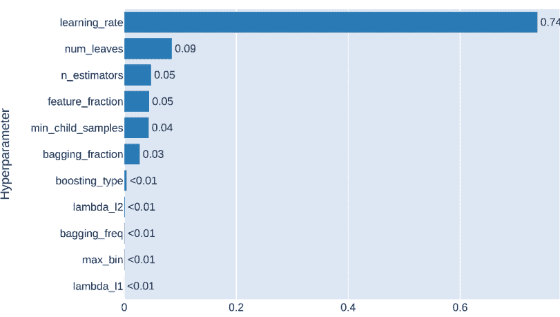

图 5.3 – 参数重要性图，显示每个超参数对目标值（F1 分数）的重要性

在图 5.3 中，我们可以看到学习率远远是影响试用成功的最关键参数。其次是叶子数和估计器数量。利用这些信息，我们可以决定在未来的研究中更加专注于寻找最佳学习率。

我们按如下方式创建平行坐标图，指定它应包含的参数。该图帮助我们可视化超参数之间的交互作用：

```
fig = optuna.visualization.plot_parallel_coordinate(study,
    params=["boosting_type", "feature_fraction", "learning_rate", "n_estimators"])
fig.show()
```

以下是生成的图：

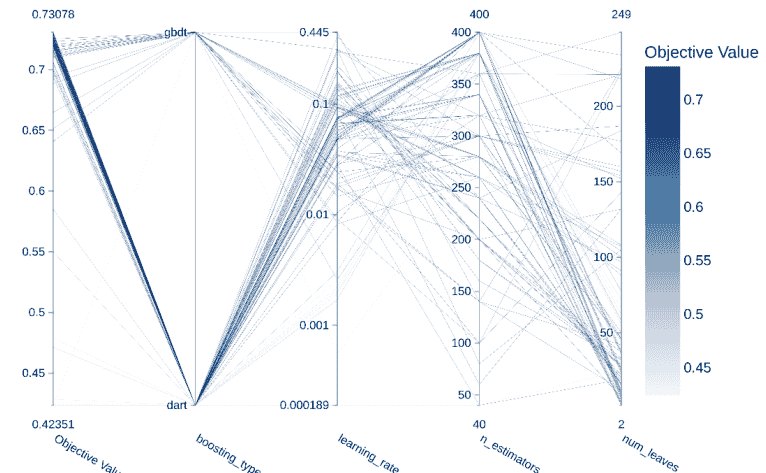

图 5.4 – 我们研究的平行坐标图。每条水平线是单个试用的配置。较深的线条表示更成功的试用（更高的 F1 分数）

平行坐标图显示，最佳试用均使用 DART 作为增强类型，学习率略低于 0.1，且估计器数量超过 200。我们也可以直观地看到一些参数交互作用：GBDT 模型与略高的学习率相关。当估计器数量较大时，所需的叶子节点数量要少得多，因为拥有大量估计器和大量叶子节点会导致过拟合。

## 多目标优化

在之前所示的优化研究中，我们专注于单个优化目标：最大化我们的 F1 分数。然而，在某些情况下，我们希望优化两个可能相互竞争的目标。例如，假设我们想要创建尽可能小的 GBDT（最少的叶子数），同时获得良好的 F1 分数。减少叶子数可能会对性能产生负面影响，因此存在权衡。

Optuna 支持通过使用 **多目标优化 (MOO)** 来解决这类问题。在优化多个目标时，我们从 `objective` 函数返回两个评估并指定优化方向。

例如，考虑学习率与性能之间的权衡。我们希望尽可能快地训练模型，这需要较高的学习率。然而，我们知道使用较小的学习率和更多迭代可以获得最佳性能。

我们可以使用 Optuna 优化此权衡。我们定义一个新的 `objective` 函数，将所有其他参数固定为先前找到的最佳值。我们返回两个评估：学习率和交叉验证的 F1 分数。我们希望最大化这两个值：

```
def moo_objective(trial):
    learning_rate = trial.suggest_float("learning_rate", 0.0001, 0.5,
    log=True),

    model = lgb.LGBMClassifier(
        force_row_wise=True,
        boosting_type='gbdt',
        n_estimators=200,
        num_leaves=6,
        bagging_freq=7,
        learning_rate=learning_rate,
        max_bin=320,
    )

    scores = cross_val_score(model, X, y, scoring="f1_macro")
    return learning_rate[0], scores.mean()
```

调用 optimize 时，我们然后为两个评估设置优化方向：

```
study = optuna.create_study(directions=["maximize", "maximize"])
study.optimize(moo_objective, n_trials=100)
```

在执行 MOO 时，并不总是存在单一的最佳结果：目标之间往往存在权衡。因此，我们希望可视化研究结果以探索权衡并选择在两个目标上都表现良好的参数值。这种可视化称为 **Pareto 前沿**，可以按如下方式创建：


## Pareto 前沿图

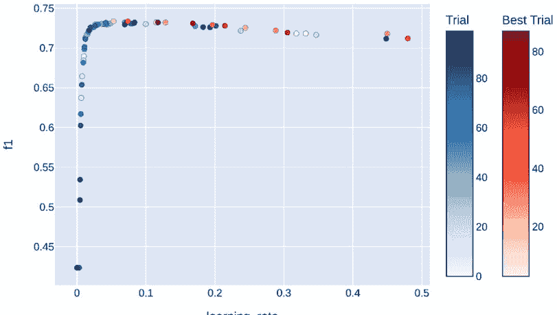

图 5.5 – 显示 MOO 研究中 Pareto 前沿的散点图

如图 5.5 所示，如果学习率过低，F1 分数会很差，但当学习率达到 0.01 时会迅速提升。F1 分数在 0.12 时达到峰值，随后随学习率增加而缓慢下降。我们现在拥有了做出权衡所需的信息：可以选择更高的学习率以加快训练速度，只牺牲极少量的分类性能。

### Summary

本章介绍了 Optuna 作为超参数优化（HPO）框架。我们讨论了寻找最优超参数的问题，以及如何利用 HPO 算法高效找到合适的参数。

我们讨论了 Optuna 中可用的两种优化算法：TPE 和 CMA-ES。两种算法都允许用户设定优化的具体预算（要执行的试验次数），并在约束条件下找到合适的参数。此外，我们还讨论了剪枝不理想的优化试验以节省额外资源和时间。讨论了中位剪枝，以及更复杂但更有效的剪枝技术，如连续半减法和 Hyperband。

接着，我们通过一个实际示例展示了如何对 LightGBM 进行 HPO 研究。我们还展示了 Optuna 的高级功能，这些功能可用于保存和恢复研究、了解参数影响以及执行 MOO。

下一章将重点介绍使用 LightGBM 的两个案例研究，详细讨论和应用数据科学流程。

### References

- [1] J. Bergstra, R. Bardenet, Y. Bengio, and B. Kégl, “超参数优化算法,” in Advances in Neural Information Processing Systems, 2011.
- [2] J. Bergstra, D. Yamins, and D. Cox, “使模型搜索科学化：面向视觉架构的数百维超参数优化,” in Proceedings of the 30th International Conference on Machine Learning, Atlanta, 2013.
- [3] N. Hansen and A. Ostermeier, “进化策略中任意正态突变分布的自适应：协方差矩阵自适应,” in Proceedings of IEEE International Conference on Evolutionary Computation, 1996.
- [4] K. Jamieson and A. Talwalkar, 非随机最佳臂识别与超参数优化, 2015.
- [5] L. Li, K. Jamieson, G. DeSalvo, A. Rostamizadeh, and A. Talwalkar, Hyperband：一种基于盗贼的新型超参数优化方法, 2018.

## 使用 LightGBM 解决现实世界的数据科学问题

通过前几章，我们逐步构建了一套工具集，用于解决机器学习问题。我们已经看到过检查数据、解决数据问题和创建模型的示例。本章正式定义并将数据科学流程应用于两个案例研究。

本章详细概述了数据科学生命周期及其包含的所有步骤。在回归和分类问题的背景下，讨论了问题定义、数据探索、数据清洗、建模和报告等概念。我们还探讨了如何为建模准备数据，并利用所学技术构建优化的 LightGBM 模型。最后，我们深入探讨了利用训练好的模型，作为 **机器学习运营（MLOps）** 的入门。

本章的主要主题如下：

- *数据科学生命周期*
- *使用 LightGBM 预测风力涡轮机发电量*
- *使用 LightGBM 对个人信用评分进行分类*

### 技术要求

本章包含示例和代码片段，说明如何使用 Optuna 对 LightGBM 进行参数优化研究。本章示例和设置合适环境的完整说明可在 https://github.com/PacktPublishing/Practical-Machine-Learning-with-LightGBM-and-Python/tree/main/chapter-6 获取。

### 数据科学生命周期

数据科学已成为一门关键学科，使组织能够从数据中获取有价值的洞察并推动更好的决策。数据科学生命周期是数据科学的核心，是一种系统性的迭代过程，指导各行各业进行数据驱动的问题解决。该生命周期概述了一系列数据科学家遵循的步骤，以确保他们解决正确的问题并交付能产生现实世界影响的可操作洞察。

数据科学生命周期的第一阶段是定义问题，包括了解业务背景、阐明目标并制定假设。这一关键阶段通过确立明确的方向和范围，奠定了整个项目的基础。生命周期中的后续阶段侧重于数据收集、准备和探索，包括收集相关数据、清洗和预处理数据，以及进行探索性数据分析以揭示模式和趋势。

数据分析完成后，数据科学生命周期进入模型选择、训练、评估和调优阶段。这些阶段对于通过选择最合适的算法、在预处理数据上训练模型并优化其性能来开发准确可靠的预测或描述性模型至关重要。目标是构建一个对未见数据具有良好泛化能力并能有效解决当前问题的稳健模型。

最后，数据科学生命周期强调将最终模型部署到生产环境、监控其性能并对其进行维护以确保其持续相关性和准确性的重要性。同样重要的是向利益相关者传达结果和洞察，这对于推动明智决策和充分释放数据科学潜力至关重要。通过遵循数据科学生命周期，组织可以系统地从数据中提取价值，并释放增长和创新的新机遇。

在前面的示例中，我们遵循了一套用于处理数据和创建模型的宽松步骤配方。在下一节中，我们将正式定义和讨论数据科学生命周期的步骤。

### 定义数据科学生命周期

以下是数据科学生命周期中广泛应用的关键步骤。这些步骤也在图 6.1 中展示，该图说明了生命周期的周期性。

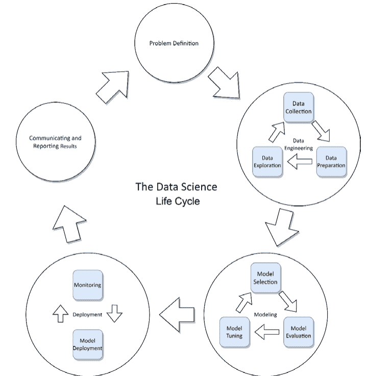

图 6.1 – 描绘数据科学生命周期的图表

以下是关键步骤：

- 1. **定义问题：** 清晰阐述业务问题、目标和宗旨。此阶段包括了解利益相关者需求、制定假设和确定项目范围。定义问题还为数据收集奠定基础，并可决定我们如何利用模型。

- 2. **数据收集：** 从各种来源收集所需数据，例如数据库、API、网络爬虫或第三方数据提供商。确保数据具有代表性、准确性，并与问题相关。记录数据来源及其流动过程非常重要，以建立数据血统。此外，构建记录数据格式、结构、内容和含义的数据字典。重要的是，验证数据收集或抽样中的任何潜在偏差。

- 3. **数据准备：** 清洗和预处理数据，使其适合分析。此阶段包括诸如 **数据清洗**（例如，处理缺失值和删除重复项）、**数据转换**（例如，归一化和对分类变量进行编码）和 **特征工程**（例如，创建新变量或聚合现有变量）等任务。移动和连接数据以进行分析和建模也可能是必要的。

- 4. **数据探索：** 进行探索性数据分析（EDA）以深入了解数据。此步骤包括可视化数据分布、识别趋势和模式、检测异常值和离群点，以及检查特征之间的关系和相关性。

- 5. **模型选择：** 根据问题类型（例如，回归、分类或聚类）和数据特征选择最合适的数据建模技术。选择多个模型算法以在数据集上验证性能非常重要。

- 6. **模型训练：** 使用准备好的数据训练所选模型。此步骤包括将数据拆分为训练集和验证集、设置模型参数（超参数）以及将模型拟合到数据上。

- 7. **模型评估：** 使用适当的评估指标（例如，准确率、精确率、召回率、F1 分数、**ROC 曲线下面积（AUC-ROC）**或**均方根误差（RMSE）**）评估训练好的模型的性能，并对其进行比较以选择表现最佳的模型。执行交叉验证或使用留出测试集以确保无偏评估。

- 8. **模型调优：** 通过优化超参数、特征选择或结合领域知识来精调所选模型。此步骤旨在提高模型对未见数据的性能和泛化能力。针对特定问题调优模型也可能是合适的；例如，在人脸识别中，高精确率比高召回率更合适。

- 9. **模型部署：** 如果模型是更大型软件系统的一部分，则将最终模型部署到生产环境中，以便用于进行预测或辅助决策。部署可能涉及将模型集成到现有系统、创建 API 或设置监控和维护程序。

- 10. **模型监控和维护：** 持续监控模型性能并根据需要进行更新，以确保其保持准确和相关。应使用检测模型和数据漂移等技术来确保模型性能。模型维护可能涉及使用新数据重新训练模型、更新特征或优化问题定义。

- 11. **传达结果：** 与利益相关者分享洞察和结果，包括基于分析的任何建议或行动。传达结果可能涉及创建可视化、仪表板或报告，以有效传达调查结果。

我们现在将考察两个案例研究，了解数据科学生命周期如何实际应用于现实世界数据。我们将研究一个回归问题，即预测风力涡轮机发电量，以及一个分类问题，即对个人信用评分进行分类。


## 预测风力涡轮机发电量与 LightGBM

我们的第一个案例研究是一个旨在预测风力涡轮机发电量的问题。该问题的数据集可从 https://www.kaggle.com/datasets/mukund23/hackerearth-machine-learning-challenge 获得。

我们将使用前一节定义的步骤来解决这个问题，并在每个步骤中阐述涉及的细节，同时附带代码片段。完整的端到端解决方案可在 https://github.com/PacktPublishing/Practical-Machine-Learning-with-LightGBM-and-Python/tree/main/chapter-6/wind-turbine-power-output.ipynb 获得。

### 问题定义

该数据集包含在特定日期和时间获取的风力涡轮机发电量（kW/h）测量值。除了每个测量值外，还有风力涡轮机的参数，包括风车的物理测量值（包括风车高度、叶片宽度和长度）、涡轮机的操作测量值（包括欧姆电阻、电机转矩、发电机温度和转子转矩）以及大气条件（包括风速、温度和气压）。

鉴于一组参数，我们必须构建回归模型来预测以 kW/h 为单位的发电量。因此，我们采用回归建模。模型的质量使用 **均方误差（MSE）** 和决定系数（$R^2$）来衡量。我们还必须确定哪些因素对发电量影响最显著。

### 数据收集

该数据集包含 22,800 个样本，收集于 11 个月内，从 2018 年 10 月到 2019 年 9 月。数据以 CSV 文件形式提供，并作为公共领域数据发布。未收集其他数据。

### 数据准备

我们现在可以着手准备数据以进行清洗和探索。正如我们从 pandas DataFrame 中获取信息所见，该数据集包含 18 个数值特征、2 个分类特征和日期特征：

| # | 列 | 非空计数 | 数据类型 |
|---|--------|----------------|-------|
| 0 | tracking_id | 28200 非空 | object |
| 1 | datetime | 28200 非空 | object |
| 2 | wind_speed (m/s) | 27927 非空 | float64 |
| 3 | atmospheric_temperature (°C) | 24750 非空 | float64 |
| 4 | shaft_temperature (°C) | 28198 非空 | float64 |
| 20 | windmill_height (m) | 27657 非空 | float64 |
| 21 | windmill_generated_power(kW/h) | 27993 非空 | float64 |

我们立即可以看出数据集存在缺失值，某些特征的值少于 28,200 个。我们可以通过计算统计描述来更好地了解数据分布：

```
train_df.describe().T.style.bar(subset=['mean'])
```

这将打印出以下内容：

| 特征 | 计数 | 均值 | 标准差 | 最小值 | 最大值 |
|---|---|---|---|---|---|
| wind_speed(m/s) | 27927 | 69.04 | 76.28 | -496.21 | 601.46 |
| atmospheric_temperature(°C) | 24750 | 0.38 | 44.28 | -99.00 | 80.22 |
| shaft_temperature(°C) | 28198 | 40.09 | 27.20 | -99.00 | 169.82 |
| blades_angle(°) | 27984 | -9.65 | 47.92 | -146.26 | 165.93 |
| gearbox_temperature(°C) | 28199 | 41.03 | 43.66 | -244.97 | 999.00 |
| engine_temperature(°C) | 28188 | 42.61 | 6.12 | 3.17 | 50.00 |
| motor_torque(N-m) | 28176 | 1710 | 827 | 500 | 3000.00 |
| generator_temperature(°C) | 28188 | 65.03 | 19.82 | 33.89 | 100.00 |
| atmospheric_pressure(Pascal) | 25493 | 53185 | 187504 | -1188624 | 1272552 |
| area_temperature(°C) | 28200 | 32.74 | 7.70 | -30.00 | 55.00 |
| windmill_body_temperature(°C) | 25837 | 20.80 | 54.36 | -999.00 | 323.00 |
| wind_direction(°) | 23097 | 306.89 | 134.06 | 0.00 | 569.97 |
| resistance(ohm) | 28199 | 1575.6 | 483.33 | -1005.22 | 4693.48 |
| rotor_torque(N-m) | 27628 | 25.85 | 32.42 | -136.73 | 236.88 |
| blade_length(m) | 23107 | 2.25 | 11.28 | -99.00 | 18.21 |
| blade_breadth(m) | 28200 | 0.40 | 0.06 | 0.20 | 0.50 |
| windmill_height(m) | 27657 | 25.89 | 7.77 | -30.30 | 78.35 |
| windmill_generated_power (kW/h) | 27993 | 6.13 | 2.70 | 0.96 | 20.18 |

表 6.1 – 风力涡轮机数据集中数值特征的统计描述

查看表 6.1 中特征的统计描述，我们可以发现以下不规则之处：

- **许多特征存在异常值**：通常，标准差大于均值可能表明存在异常值。示例包括风速、大气温度和大气压力。同样，最小值或最大值与均值相差甚远也可能表明数据中存在异常值。我们可以通过使用直方图可视化数据分布来进一步验证这一点。

- **物理上的不可能性**：数据显示某些测量值存在物理上的不可能性：长度（米）小于 0（例如，叶片长度）以及温度超出自然范围（身体温度为 -999）。

- **重复值**：-99.0 和 -999.0 这两个值在少数特征中重复出现。这些值在不同特征中自然出现的可能性极低。我们可以推断，这些值表明样本中存在缺失或错误的测量值。

我们可以可视化特征分布以调查异常值。例如，对于大气温度，我们有以下内容：

```
sns.histplot(train_df["atmospheric_temperature(°C)"], bins=30)
```

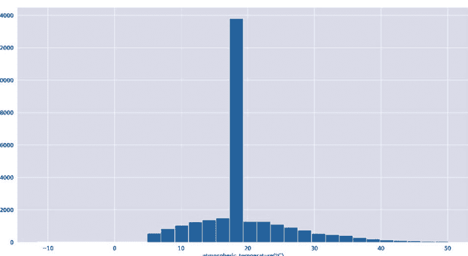

图 6.2 – 显示摄氏度大气温度的直方图

图 6.2 说明了数据中发现的两个问题：-99.0 值的高频测量值，表明存在错误。还有一些远离均值的异常值。

最后，我们可以使用以下内容检查重复数据：

```
train_df[train_df.duplicated()]
```

未返回任何行，表明数据集中没有重复项。

## 数据清洗

我们在数据集中识别出了多个需要在数据清洗步骤中解决的问题：

- **异常值**：许多特征具有会影响特征值分布的异常值。
- **测量错误**：某些特征的值超出了物理不可能性的范围（长度小于 0 或温度处于不可能范围内）。
- **缺失值**：许多特征都有缺失值。还有某些特定值（-99.0 和 -999.0）被视为缺失值。

我们首先处理异常值和测量错误，因为这会影响我们如何处理缺失值。

### 处理异常值

在数据集中处理异常值包括两部分：准确识别异常值和选择适当的替换值。识别异常值的方法如下：

- **可视化**：如前所示，直方图或其他可视化数据分布的图表（如箱线图或散点图）可用于此目的。
- **领域知识**：就像我们识别测量错误一样，可以利用领域知识来决定数值是否属于异常值。
- **统计分析**：使用统计方法确定数值是否属于异常值的两种流行方法是四分位距（IQR）和标准差。

IQR 是第 25 个四分位数和第 75 个四分位数之间的差值。偏离第 25 个或第 75 个四分位数超过 1.5 倍 IQR 的数值被视为异常值。

或者，我们可以利用标准差：计算数据集的均值和标准差。任何偏离均值两倍或三倍的数值都被视为异常值。将边界设为两倍或三倍标准差取决于底层数据。使用两倍标准差可能会导致许多误报，但如果大量数据集中在均值附近，则适用。使用三倍标准差更为保守，仅将偏离均值很远的数值标记为异常值。

检测到异常值后，我们必须采取措施。通常，我们的选择如下：

- **删除**：如果异常值是由数据录入、测量或收集错误造成的，那么将其从数据集中删除可能是合理的。但是，应谨慎进行此操作，因为删除太多数据点可能导致信息丢失和结果偏差。从我们的数据集中删除带有异常值的实例将导致接近 70% 的数据丢失，因此不可行。
- **插补**：类似于缺失值，用更具代表性的值替换异常值，例如变量的均值、中位数或众数，或使用更复杂的插补方法，如 k-近邻或回归插补。


- 限制或截断：设置一个阈值（上限或下限），并将异常值限制或截断在该阈值处。该方法在减少极端值影响的同时，保留了数据的原始结构。

```python
column_data = frame[feature]
column_data = column_data[~np.isnan(column_data)]
mean, std = np.mean(column_data), np.std(column_data)
lower_bound = mean - std * 3
upper_bound = mean + std * 3
frame.loc[((frame[feature] < lower_bound) | (frame[feature] > upper_bound))] = np.nan
```

## 处理测量错误

被检测为测量错误类型的值也可以被视为异常值，尽管不是统计学意义上的异常值。不过，我们可以以略有不同的方式处理这些值，与处理统计异常值不同。

我们应用领域知识和关于天气的一些研究来识别这些特征的适当范围。然后我们将错误值限制在这些范围内：

```python
frame.loc[frame["wind_speed (m/s)"] < 0, "wind_speed (m/s)"] = 0
frame.loc[frame["wind_speed (m/s)"] > 113, "wind_speed (m/s)"] = 113
frame.loc[frame["blade_length (m)"] < 0, "blade_length (m)"] = 0
frame.loc[frame["windmill_height (m)"] < 0, "windmill_height (m)"] = 0
frame.loc[frame["resistance (ohm)"] < 0, "resistance (ohm)"] = 0
```

在这里，我们将任何负的长度、高度和电阻设置为 0。我们还将风速限制在 113 m/s，即有记录的最大阵风速度。

最后，我们可以处理数据集中的缺失值。

## 处理缺失值

我们在前面的章节中讨论过如何处理缺失值。在此总结一下，我们可以采取的一些潜在方法如下：

- 移除包含缺失值的实例
- 使用描述性统计量（均值、中位数或众数）填补缺失值
- 使用其他机器学习算法，通常是非监督技术（如聚类），来计算更稳健的统计量

移除缺失值将丢弃我们数据集的很大一部分。这里，我们决定使用描述性统计量替换缺失值，以尽可能保留更多数据。

首先，我们将 -99.0 和 -999.0 值标记为缺失值：

```python
df.loc[frame[f] == -99.0, f] = np.nan
df.loc[frame[f] == 99.0, f] = np.nan
df.loc[frame[f] == -999.0, f] = np.nan
df.loc[frame[f] == 999.0, f] = np.nan
```

然后我们用均值替换缺失的数值，用众数替换缺失的类别值：

```python
if f in numerical_columns:
    frame[f].fillna(frame[f].mean(), inplace=True)
else:
    frame[f].fillna(frame[f].mode()[0], inplace=True)
```

通常，使用均值时需要小心，因为均值受异常值影响。不过，由于我们已经将异常值标记为 np.nan，计算均值时会排除它们。在测试集中替换缺失值时还有一个额外的注意事项：由于测试集应被视为未见数据，我们必须使用训练数据集的均值来替换测试集中的缺失值。

这就完成了我们数据集所需的数据清洗工作。我们应该通过重新检查缺失值并重新计算描述性统计量和数据直方图来验证我们的工作。

数据集清洁后，我们可以进入下一步数据准备：特征工程。

## 特征工程

**特征工程**是指创建新特征或修改现有特征以提高机器学习模型性能的过程。本质上，特征工程是利用领域知识和数据理解来创建特征，使机器学习算法能更有效地工作。这既是一门艺术，也是一门科学，需要创造力、直觉和对问题的深刻理解。

特征工程过程通常从探索数据开始，以了解其特征、分布以及变量之间的关系。这一探索阶段可以揭示特征创建的潜在机会，例如交互项、聚合特征或时间特征；例如，如果你处理的数据集包含客户交易数据，你可以创建捕捉交易频率、平均交易额或上次交易以来时间的特征。

特征工程中还有几种标准技术。这些技术包括对类别变量进行编码、对数值变量进行归一化、创建多项式特征以及对连续变量进行分箱。例如，类别变量通常会被编码为数值格式（如独热编码或有序编码），以便用于数学模型。同样，数值变量通常会被归一化（如最小-最大缩放或标准化），以确保它们处于可比较的尺度，并防止某些变量仅因其尺度而主导其他变量。

然而，特征工程并非一种适用于所有情况的过程。模型的合适特征很大程度上取决于特定问题、所使用的算法以及数据的性质。因此，特征工程通常需要迭代实验和评估。尽管存在挑战，但有效的特征工程可以显著提升模型性能。

> **注意**
> 如你所注意到的，特征工程需要理解和探索数据，这取决于已工程化特征的可用性。这突显了数据科学生命周期中的循环过程：我们在数据准备和探索之间迭代。

例如，我们数据中适合进一步工程化的特征是 `datetime` 字段。测量所采集的具体日期和时间对模型的未来预测没有信息价值。

然而，假设我们将年份、月份、日期和小时提取为新特征。那样的话，模型就可以捕捉所产生电力与不同时间周期之间的潜在关系。日期分解允许提出诸如：一年中的时间、季节、特定月份等是否会影响所产生的电力？或者，一天中的时间（早晨、正午或夜晚）是否有任何影响？

我们可以按如下方式将日期分解为新特征：

```python
frame["date_year"] = train_df["datetime"].dt.year
frame["date_month"] = train_df["datetime"].dt.month
frame["date_day"] = train_df["datetime"].dt.day
frame["date_hour"] = train_df["datetime"].dt.hour
frame = frame.drop(columns=["tracking_id", "datetime"], axis=1)
```

如果建模后发现这些特征没有信息价值，我们可以对 `time` 字段进行进一步处理以辅助建模。未来可探索的方向包括基于特定时期的聚合，或通过对测量值进行排序来创建时间序列，以研究随时间变化的电力生成趋势。

我们现在进入案例研究的 EDA 部分，以可视化并更好地理解我们的数据。

## EDA

我们已经对数据集进行了一些 EDA 以查找缺失值和异常值。对数据集执行 EDA 没有固定的方法论；需要一些经验和创造力来指导过程。

除了获得数据的洞察和理解之外，主要目的是尝试识别数据中的模式和关系。这里，我们从相关性热图开始，以探索特征之间的任何直接相关性：

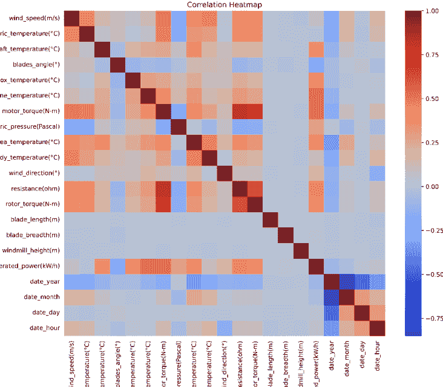

图 6.3 – 风力涡轮机数据集的相关性热图

图 6.3 的相关性热图显示，风速与大气温度之间存在几个显著相关性，与发动机温度、发电机温度和电机转矩等发动机指标之间也存在相关性，而我们的日期特征与大气条件之间的相关性较弱。

值得注意的是，电机转矩与发电机温度之间存在非常强的相关性。从直觉上讲，这很合理：如果电机产生更多转矩，它就会产生更多热量。由于转矩是因果特征，我们可以考虑在建模时删除发电机温度。

我们还可以看到电力生成与发动机指标之间的相关性，包括电阻和风向。我们可以预期这些特征将对模型性能产生重大影响。


我们还可以探索分类特征与生成电力之间的相关性。涡轮状态看似对生成电力几乎没有影响（单独来看）。然而，云量有显著影响。将云量与生成电力进行绘图，我们得到以下结果：

```
train_df.groupby("cloud_level")["windmill_generated_power (kW/h)"].mean().plot.bar()
```

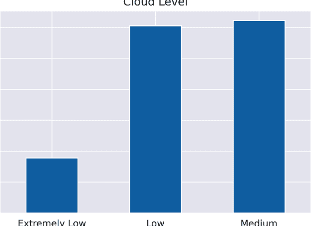

图 6.4 – 各种云量下的平均生成电力

如图 6.4 所示，极低云量与发电量降低呈强相关。在进一步探索数据时，控制云量是有帮助的，以确保云量的影响不会主导任何新出现的模式。

查看各种特征影响的另一个有用可视化方法是散点图。绘制每个值可以直观地识别数据中的模式和聚类，从而轻松发现特征。

接下来，我们提供揭示数据内部模式的散点图示例。

为调查叶片角度对发电可能产生的影响，我们可以按以下方式创建散点图：

```
sns.scatterplot(x='blades_angle (°)', y='windmill_generated_power (kW/h)', hue='cloud_level', data=train_df)
```

在散点图中，我们还为云量添加了色调区分，以便直观验证任何影响并非仅源于云量本身：

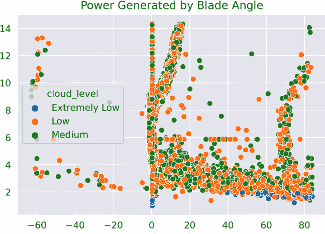

图 6.5 - 生成电力（y 轴）与叶片角度（x 轴）的散点图

叶片角度散点图如图 6.5 所示。散点图表明，特定的叶片角度范围与增加的生成电力相关：[0, 10] 度和 [65, 75] 度（在另一个方向上也同样成立）。基于树的算法也会建模此类相关性。

说明特征工程能力的另一个示例是月份与生成电力的散点图。我们同样通过为这些点使用不同的色调来控制云量：

```
sns.scatterplot(x='date_month', y='windmill_generated_power (kW/h)', hue='cloud_level', data=train_df)
```

## 按月划分的电力生成

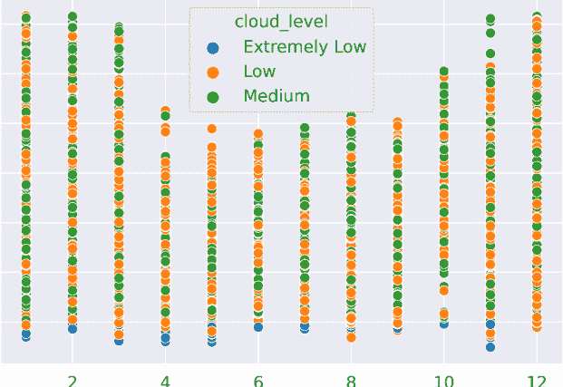

图 6.6 – 按月划分的生成电力（y 轴）散点图（x 轴为月份）

图 6.6 表明，四月至九月与生成电力显著下降相关。我们可以得出结论，风力涡轮机在这些月份所处的位置并不特别多风，其他能源将不得不补充发电量的不足。通过分解日期特征，我们使学习算法能够利用这种相关性。

探索性数据分析（EDA）并没有确定的终点。对于大型复杂数据集，分析可以不断深入数据，几乎无限期地迭代探索更多方面和细微差别。然而，有两个有用的健全性检查，可帮助确定数据是否已被充分探索：

- 我们是否充分理解每个特征的含义及其对模型输出的潜在影响？
- 数据是否已为建模做好充分准备？据我们所知，特征是否具有信息量，数据是否干净且无偏见，并以模型可用于训练的格式编排？

我们现在继续对数据进行建模，利用前几章的技术构建一个优化良好的模型。

## 建模

建模的第一步是模型选择。最佳做法是首先使用简单直接的算法对数据进行建模，以验证我们的数据准备并建立基线。如果使用简单算法建模失败，则更容易调试可能出错的地方或隔离可能导致问题的数据实例。

### 模型选择

对于我们的风力涡轮机数据，我们使用线性回归模型来建立基线并验证数据是否适合建模。

我们还训练一个随机森林回归模型，作为与 LightGBM 模型比较的参考点。如果预算允许，训练多个使用不同学习算法的模型也是一种良好的做法，因为特定问题可能更适合特定算法。

最后，我们训练一个 LightGBM 回归器作为我们的主要模型。

### 模型训练与评估

从 EDA 中，我们看到发电机温度是冗余的（因为它与电机扭矩相关）。因此，我们从训练数据中排除它：

```
X = train_df.drop(columns=["windmill_generated_power (kW/h)"], axis=1)
y = train_df["windmill_generated_power (kW/h)"]
```

与 LightGBM 不同，线性回归和 scikit-learn 的随机森林回归器都无法自动处理分类特征。

因此，我们使用 pandas 的 get_dummies 来对特征进行编码以供训练。get_dummies 操作执行一个称为 **独热编码** 的过程。分类值被分解为与唯一值数量相同的二进制（0 或 1）列。每个模式的对应值标记为 1（独热），其他值标记为 0。例如，考虑云量特征：有三个类别（中、低和极低）。我们数据集中云量为中的一行将被编码为 100（三个单独的列）。同样，低云量被编码为 010，以此类推。

执行独热编码允许仅支持数值列的算法（如线性回归）以增加额外列的内存使用为代价来对数据进行建模。

如问题定义中所述，我们将使用两个指标来评估模型：决定系数和 MSE。两者都使用五折交叉验证计算。

我们现在可以继续训练线性回归、随机森林和 LightGBM 回归器：

```
X_dummies = pd.get_dummies(X)
linear = LinearRegression()
scores = cross_val_score(linear, X_dummies, y)
scores = cross_val_score(linear, X_dummies, y, scoring="neg_mean_squared_error")
forest = RandomForestRegressor()
X_dummies = pd.get_dummies(X)
scores = cross_val_score(forest, X_dummies, y)
scores = cross_val_score(forest, X_dummies, y, scoring="neg_mean_squared_error")
lgbm = lgb.LGBMRegressor(force_row_wise=True, verbose=-1)
scores = cross_val_score(lgbm, X, y)
scores = cross_val_score(lgbm, X_dummies, y, scoring="neg_mean_squared_error")
```

下表总结了每个模型的性能：

| 算法 | R² | MSE |
|---|---|---|
| 线性回归 | 0.558 | 2.261 |
| 随机森林 | 0.956 | 0.222 |
| LightGBM | 0.956 | 0.222 |

表 6.2 – 风力涡轮机数据集上的五折交叉验证性能指标

LightGBM 和随机森林回归器显示出几乎相同的性能，具有相同的四舍五入后的 R² 和 MSE 分数。两种算法均显著优于线性回归。

我们的模型表现非常好，绝对误差约为 471 W/h。但是，如果我们绘制训练模型的特征重要性，就很容易发现一个问题。

图 6.7 显示了我们 LightGBM 模型中每个特征的相对重要性。

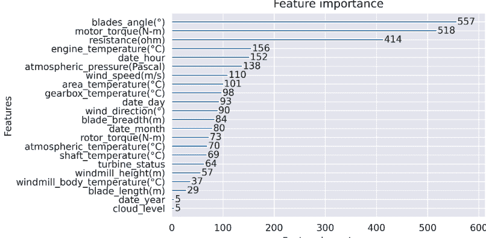

图 6.7 – 每个特征对我们 LightGBM 模型的相对特征重要性

从特征重要性可以看出，有三个特征脱颖而出：blades_angle、motor_torque 和 resistance。但是，对于其中两个特征，motor_torque 和 resistance，我们可以问：这些特征是导致生成电力提高，还是它们是生成电力增加的结果？这些特征是目标泄漏的示例，如下文所述。

## 目标泄漏

目标泄漏，通常称为“泄漏”，是设计和训练机器学习模型中的常见陷阱。它发生在训练过程中，模型无意中获取了目标变量（或目标变量的某个代理）的访问权限。结果，模型在训练期间的表现可能看起来令人印象深刻，但在新的、未见过的数据上表现不佳，因为它在训练期间实际上“作弊”了。

泄漏可能发生的一些常见示例如下：

- **基于时间的泄漏**：假设你正在尝试预测明天的股票价格。如果你将明天的数据包含在训练集中（可能是意外），这将导致泄漏。同样，仅在事后才可用的数据（例如所有股票的汇总数据）也是基于时间的泄漏的另一个示例。
- **预处理错误**：当你使用包含训练集和测试集的统计数据执行特定操作（例如缩放或归一化）时会发生这种情况。
- **数据分割不正确**：对于时间序列数据，使用简单的随机分割可能会导致未来数据出现在训练集中。
- **验证集受污染**：有时，在创建验证集或测试集时，某些数据可能与训练数据重叠或高度相关，导致过于乐观且不具代表性的验证分数。

在我们的示例中，motor_torque 和 resistance 是基于时间的泄漏示例：这两个指标只有在生成电力后才能测量，而这正是我们试图预测的内容。这也说明了进行基线训练测试的重要性，因为此类问题可能事先不容易发现。

我们通过从数据集中删除这些特征来修复此错误。然后我们可以继续进行模型调参，以进一步提高模型的性能。

## 模型调参

我们使用 Optuna 执行参数优化研究。我们将利用 Optuna 的树结构 Parzen 估计器（TPE）采样算法，并结合 Hyperband 剪枝以提高效率。我们定义目标函数，包含所需参数、剪枝回调，并测量 MSE：

```
def objective(trial):
    boosting_type = trial.suggest_categorical("boosting_type",
    ["dart", "gbdt"])
    lambda_l1 = trial.suggest_float(
```


```
'lambda_l1', 1e-8, 10.0, log=True),
...
pruning_callback = optuna.integration.LightGBMPruningCallback(trial, "mean_squared_error")
...
model = lgb.LGBMRegressor(
...
    callbacks=[pruning_callback],
    verbose=-1)
scores = cross_val_score(model, X, y, scoring="neg_mean_squared_error")
return scores.mean()
```

我们使用 TPE 采样器、Hyperband 剪枝和 200 次试验的优化预算创建 Optuna 研究：

```
sampler = optuna.samplers.TPESampler()
pruner = optuna.pruners.HyperbandPruner(
    min_resource=20, max_resource=400, reduction_factor=3)

study = optuna.create_study(
    direction='maximize', sampler=sampler,
    pruner=pruner
)
study.optimize(objective, n_trials=200, gc_after_trial=True, n_jobs=-1)
```

通过 Optuna 找到的优化参数，我们进一步将 LightGBM 模型的性能提升至 R^2 为 0.93、MSE 为 0.21（在我们的运行中）。由于 Optuna 研究的随机性，您的结果可能会略有不同。

在拥有训练好的优化模型后，我们可以进入数据科学流程的下一阶段：部署和报告。

## 模型部署

现在，我们可以使用训练好的模型对未见数据进行预测。接下来的章节将重点介绍作为 MLOps 流程一部分的各种模型部署和监控方式。

然而，使用我们模型的最简单方法是保存模型，并编写一个简单脚本来加载模型并进行预测。

我们可以使用标准 Python 序列化或 LightGBM API 保存模型。这里，我们演示使用标准 Python 工具：

```
joblib.dump(model, "wind_turbine_model.pkl")
```

加载模型并进行预测的简单脚本如下：

```
def make_predictions(data):
    model = joblib.load("wind_turbine_model.pkl")
    return model.predict(data)

if __name__ == '__main__':
    make_predictions(prepare_data(pd.read_csv("wind-turbine/test.csv")))
```

重要的是，对于任何我们想要预测的数据，都必须重复数据准备过程，以添加经过特征工程的特征并删除未使用的列。

## 传达结果

数据科学流程的最后一步是传达结果。数据科学家通常会编译一份包含重要发现和可视化的报告，以向利益相关方展示结果。

报告将类似于本案例研究的撰写。例如，我们可能会展示特征之间的相关性，比如月份与产生的电量之间的相关性。我们还会突出数据中的问题，例如异常值和缺失值，以改进未来的数据收集工作。

我们还将强调对模型重要的特征，以便风力涡轮机可以得到优化以最大化产生的电量。

注重报告的质量。使用设计良好且详细的可视化以及其他辅助材料，而不仅仅依赖文本。信息图或交互式图表可能比详细的撰写更有帮助。检查写作中的错误，并在发送报告前确保已校对。

报告的内容应解决问题定义中定义的问题。任何经过测试的假设都必须在报告中得到回答。但报告也高度依赖于受众，并应针对受众进行定制。例如，如果您的受众是企业高管，请包含他们能理解的内容，并回答他们可能提出的问题，这些问题将围绕您的发现对业务的影响。

我们现在来看一个分类问题的案例研究。我们将展示，尽管每个数据集都是独特的并且有特定的挑战，但整体数据科学流程保持不变。

## 使用 LightGBM 对个人信用评分进行分类

我们的第二个案例研究是关于个人信用评分分类的问题。该数据集可从 https://www.kaggle.com/datasets/parisrohan/credit-score-classification?datasetId=2289007 获取。

该数据集比之前的问题大得多，并且具有独特的数据格式问题。为了简洁，我们不会像处理之前的问题那样详细介绍解决方案（因为大部分工作是相同的），但端到端解决方案可在 https://github.com/PacktPublishing/Practical-Machine-Learning-with-LightGBM-and-Python/tree/main/chapter-6/credit-score-classification.ipynb 查看。

## 问题定义

该数据集包含 100,000 行和 27 列，代表个人的人口统计和财务信息，包括信用评分评级。数据包括关于个人收入、贷款数量、付款行为和投资的信息。信用评分可能评为 good、standard 或 poor。

我们的任务是分析数据并构建一个模型，准确分类未见个人的信用评分。预测质量使用分类准确率和 F1 分数来衡量。

## 数据收集

数据收集自美国金融机构的客户数据库。年龄在 14 到 65 岁之间的个人包含在数据集中。没有记录显示对特定人群（低收入群体、年龄或种族群体）的抽样偏向，但必须进行验证。没有收集额外数据。

## 数据准备

与之前一样，我们从简单的数据探索任务开始，以确定数据的清洁度。我们首先检查数据结构和类型：

| | 列 | 非空计数 | 数据类型 |
|---|---|---|---|
| 0 | ID | 100000 个非空值 | object |
| 1 | Customer_ID | 100000 个非空值 | object |
| 2 | Month | 100000 个非空值 | object |
| 3 | Name | 90015 个非空值 | object |
| 4 | Age | 100000 个非空值 | object |
| 5 | SSN | 100000 个非空值 | object |
| .. | .. | .. | .. |
| 25 | Payment_Behaviour | 100000 个非空值 | object |
| 26 | Monthly_Balance | 98800 个非空值 | object |
| 27 | Credit_Score | 100000 个非空值 | object |

我们注意到某些特征存在缺失值。此外，许多我们预期是数值型的特征（年收入、贷款数量等）被解释为对象而不是整数或浮点数。这些特征必须被转换为数值特征。

我们还检查了特征的描述性统计量和重复行。发现两个特征存在异常值，即年龄和银行账户数量，需要进行清理。

值得注意的是，`Type_of_Loan` 字段包含逗号分隔的列表，其中包括连词，列出了每个人的贷款类型。例如“student_loan , mortgage_loan , and personal_loan”。建模算法无法从字符串中提取贷款类型。我们需要构建新字段以实现有效的建模。

### 数据清理

现在我们可以开始清理数据。总之，需要解决以下问题：

- 在适当的地方将 object 列转换为数值列
- 处理年龄、银行账户数量和月度余额列中的异常值
- 为贷款类型构建新特征
- 处理缺失值和重复行

### 转换为数值列

该数据集的主要问题之一是，本应为数值型的列中存在混合类型，但由于错误值，pandas 将其解释为对象。例如，`Annual_Income` 列包含 `100000.0_` 这样的值，随后被解释为字符串。

为了清理并将特征转换为数字，我们首先使用正则表达式删除字符符号：

```
frame[col] = frame[col].astype(str).str.replace(r'^[\\d.]', '', regex=True)
```

这样我们就可以使用 pandas 将列转换为数值特征，将任何错误（空值）转换为 `np.nan` 值：

```
frame[col] = pd.to_numeric(frame[col], errors="coerce")
```

`Credit_History_Age` 特征需要我们做更多工作。年龄是用自然语言指定的，例如“12 年 3 个月”。在这里，我们使用 Python 字符串处理将年份和月份转换为浮点数：

```
def clean_credit_age(age):
    if age == 'nan':
        return np.nan
    if not "Years" in age:
        return age
    years, months = age.split(" Years and ")
    months = months.replace(" Months", "")
    return int(years) + int(months) / 12
```


## 分隔符分隔字符串的拆分

如前所述，Type_of_Loan 特征是个人持有的贷款类型的逗号分隔列表。尽管我们可以以多种方式处理这个问题，但最有用的技术是解析字段并构建一个指示个人持有哪些贷款的布尔列数组。

共有八种独特的贷款类型，以及贷款类型未指定时的特定类别。这些包括汽车贷款、信用建设贷款、债务整合贷款、房产净值贷款、抵押贷款、发薪日贷款、个人贷款和学生贷款。

然后，我们的编码策略将按如下方式处理该特征。我们创建九个新列（每种贷款类型和未指定各一个），如果个人持有该贷款类型，则将列设置为 true。例如，这里有三个连贯的贷款描述：

```
"Home Equity Loan, and Payday Loan"
"Payday Loan, Personal Loan"
"Student Loan, Auto Loan, and Debt Consolidation Loan"
```

表 6.3 显示了这些示例的编码结果，如果个人持有该类型的贷款，则设置 true 标志。

| Auto | Credit-Builder | Debt Cons. | Home Equity | Mortgage | Payday | Personal | Student | Unspecified |
| :--- | :--- | :--- | :--- | :--- | :--- | :--- | :--- | :--- |
| F | F | F | T | F | T | F | F | F |
| F | F | F | F | F | T | T | F | F |
| T | F | T | F | F | F | F | T | F |

表 6.3 – 贷款类型列对客户的贷款类型进行编码

我们可以利用 pandas 的字符串实用工具来完成上述编码，如示例所示：

```
frame["auto_loan"] = frame["Type_of_Loan"].str.lower().str.contains("auto loan").astype(bool)
```

## 异常值和缺失值

我们遵循与之前相同的一般策略：使用描述性统计量填补缺失值，并且在可能的情况下，使用领域知识定义的边界将异常值设置到边界值。

删除重复行。

就异常值而言，年龄、银行账户数量和月度余额特征存在异常值（我们使用均值和标准差以及分布图予以确认）。我们将这些特征的异常值设置为上限：

```
frame.loc[frame["Age"] > 65, "Age"] = 65
frame.loc[frame["Num_Bank_Accounts"] > 1000, "Num_Bank_Accounts"] = 1000
frame.loc[frame["Monthly_Balance"] > 1e6, "Monthly_Balance"] = np.nan
```

数据清洗完成后，我们可以验证所有特征都具有正确的类型，并且缺失值已得到处理：

```
train_df.info()
train_df.isnull().sum()
train_df[train_df.duplicated()]
```

使用清洗后的数据集，我们可以进行更彻底的探索性分析。

## 探索性数据分析 (EDA)

接下来，我们突出在探索性数据分析中发现的一些模式。

如问题描述中所述，我们需要验证数据中是否存在任何潜在偏差。

我们首先可视化客户的年龄：

```
sns.histplot(train_df["Age"], bins=20)
```

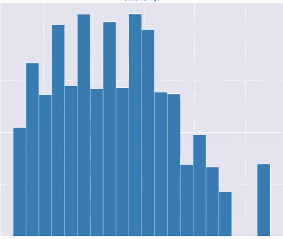

图 6.8 – 按年龄显示客户数量的直方图

图 6.8 显示所有年龄组都有代表，数据主要围绕中年人群呈正态分布。

我们还检查月收入。低收入档缺乏数据可能表明少数群体被排除在外：

```
sns.histplot(train_df["Monthly_Inhand_Salary"], bins=30)
```

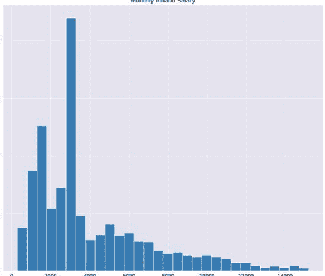

图 6.9 – 按月实发工资显示客户数量的直方图

如图 6.9 所示，月收入遵循预期分布，且低收入档有良好代表性。

我们再次对数值特征可视化相关性热图，以突出和指示相关性：

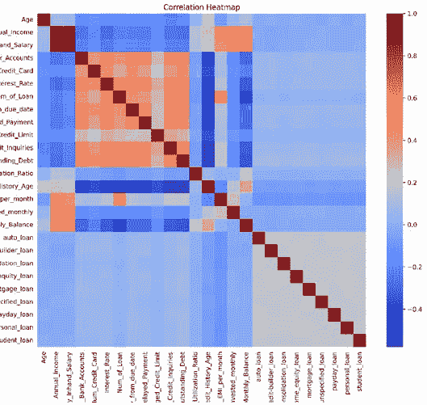

图 6.10 – 信用评分数据集的相关性热图

有两个显著的强相关性：月度余额与月薪，以及未偿债务与到期延迟。对这些相关性的进一步可视化表明，客户的月度余额随薪水增加，而较差的信用评分与较低的余额和薪水相关联。

未偿债务与信用评分之间也存在类似的相关性：债务增加与较差的信用评分相关联，反之亦然。分析确认，我们的模型应该能够捕捉这两种相关性。

最后，也是重要的是，我们还需要检查数据集的类别分布：

```
sns.histplot(train_df["Credit_Score"], bins=30)
```

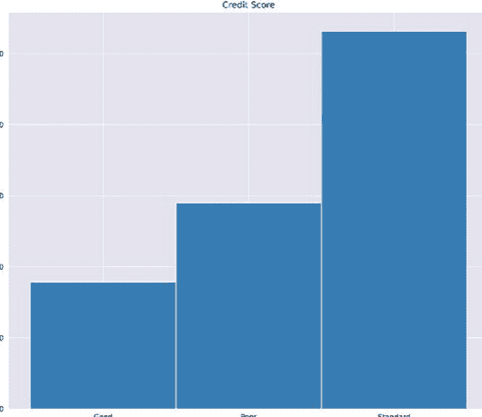

图 6.11 – 信用评分数据集的类别分布直方图

我们数据集的类别分布如图 6.11 所示。如图所示，存在显著的类别不平衡。在继续建模之前，必须解决不平衡问题。

## 建模

与之前一样，我们首先进行模型选择。

### 模型选择

由于数据集的大小和复杂性，线性模型不太可能表现很好。因此，我们使用普通决策树作为基线模型，并加入随机森林以供比较。

### 模型训练与评估

我们几乎准备好训练模型了，但仍有一个问题：必须解决类别不平衡问题。

### 处理类别不平衡

类别不平衡可能会使任何训练好的模型偏向多数类或类别。尽管基于树的算法在处理类别不平衡方面优于大多数其他学习算法，但在建模之前处理类别不平衡仍然是最佳实践。

一般来说，可以采用以下策略来处理类别不平衡：

- 重采样技术：
  - **过采样**：这涉及增加少数类样本的数量以匹配多数类。一种常见的技术是 **合成少数类过采样技术 (SMOTE)**，其中新样本基于现有样本创建。
  - **欠采样**：这涉及减少多数类样本的数量以匹配少数类。这种方法的一个风险是可能丢失有价值的数据。
  - **代价敏感学习**：此方法在训练过程中为少数类的误分类分配更高的代价。其理念是让模型更关注少数类。LightGBM 通过 `class_weight`（用于多分类）和 `scale_pos_weight`（用于二分类）参数支持此功能。应用这些参数的示例在 *第 4 章，比较 LightGBM、XGBoost 和深度学习* 中给出。
  - **数据增强**：这涉及通过向现有实例添加小扰动来在数据集中创建新实例。此方法在图像分类任务中很普遍。
  - **使用适当的评估指标**：在类别不平衡中，准确率往往具有误导性。相反，精确率、召回率、F1 分数、**ROC 曲线下面积 (AUC-ROC)** 和混淆矩阵等指标可以提供更全面的模型性能视图。

在我们的案例研究中，我们已经针对类别不平衡采用了强健的评估指标。对于此问题，我们使用 SMOTE（一种过采样技术）来平衡类别，同时保留数据。

### SMOTE

SMOTE 的开发旨在克服对少数类进行简单过采样的一些缺陷，后者可能由于实例的精确复制而导致过拟合 [1]。SMOTE 不仅仅是复制少数类样本，而是创建合成（“假”）样本，这些样本与少数类中现有样本相似但不完全相同。

SMOTE 算法按如下方式进行。新样本点（称为合成样本）通过在接近少数类样本的样本之间选择点来合成。具体来说，对于每个少数类样本，SMOTE 计算 k 近邻，选择其中一个邻居，然后将样本与其选定邻居的特征向量之差乘以 0 到 1 之间的随机数，并将此结果加到原始样本上以创建一个新的合成样本。

通过创建合成示例，SMOTE 为不平衡问题提供了一个更强健的解决方案，鼓励模型绘制更具泛化能力的决策边界。然而，需要注意的是，虽然 SMOTE 可以提高模型在不平衡数据集上的性能，但它并不总是最佳选择。例如，如果少数类样本在特征空间中不足够接近，它可能会引入噪声，导致类别重叠。与所有采样技术一样，至关重要的是


使用交叉验证或单独的验证集，仔细评估 SMOTE 对模型性能的影响。

SMOTE 过采样在 imblearn Python 库中实现。我们可以按如下方式拟合并重新采样数据：

```
X = train_df.drop(columns=["Credit_Score"], axis=1)
X_dummies = pd.get_dummies(X)
y = train_df["Credit_Score"]
smote = SMOTE(sampling_strategy='auto')
return smote.fit_resample(X_dummies, y)
```

图 6.12 显示了使用 SMOTE 重新采样后数据集的类分布。如图所示，类别现在完全平衡。

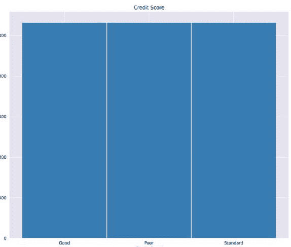

图 6.12 – 使用 SMOTE 重新采样数据后 Credit Score 数据集的类分布直方图；类别现在已平衡

## 模型训练与评估

我们现在可以继续建模。下表显示了使用默认参数运行决策树分类器、随机森林和 LightGBM 模型的结果。

| 算法 | 准确率 | F1 分数 |
|---|---|---|
| 决策树 | 59.87% | 0.57 |
| 随机森林 | 69.35% | 0.67 |
| LightGBM | 70.00% | 0.68 |

表 6.4 – Credit Score 数据集上五折交叉验证的性能指标

如表 6.4 所示，LightGBM 模型表现最佳，略高于随机森林模型的准确率。两种算法均优于决策树基线。LightGBM 模型训练速度也最快，比随机森林模型快七倍多。

我们现在对 LightGBM 模型进行参数优化。

## 模型调优

与之前的案例研究类似，我们使用 Optuna 进行参数优化。我们再次使用 TPE 采样器，优化预算为 50 次试验。

## 模型部署与结果

我们的模型现已准备就绪，可以部署到我们选择的平台。潜在的部署选项包括围绕我们的模型构建 Web API、使用 PostgresML 等工具进行部署，或使用 AWS SageMaker 等云平台。这些及其他选项将在接下来的章节中详细讨论。

我们还可以将模型作为数据科学报告的一部分。关于如何撰写优秀报告的详细信息，请参见上一节。请牢记传达数据科学结果的最重要方面，如下：

- 始终以无偏见和公平的方式报告结果
- 牢记受众，并关注报告中为他们提供最大价值的细节

## 总结

本章介绍了两个关于如何使用 LightGBM 应用数据科学流程的案例研究。详细讨论了数据科学生命周期及其典型组成步骤。

一个涉及风力涡轮机发电的案例研究被介绍为在贯穿生命周期的同时处理数据问题的示例。详细讨论了特征工程以及如何处理异常值。进行了示例性探索性数据分析，并给出了用于可视化的样本。模型训练和调优与用于导出和作为程序使用模型的基本脚本一起展示。

还介绍了第二个涉及多类信用评分分类的案例研究。再次遵循数据科学流程，特别关注数据集中的数据清理和类别不平衡问题。

下一章将讨论 AutoML 框架 FLAML 并介绍机器学习管道的概念。
