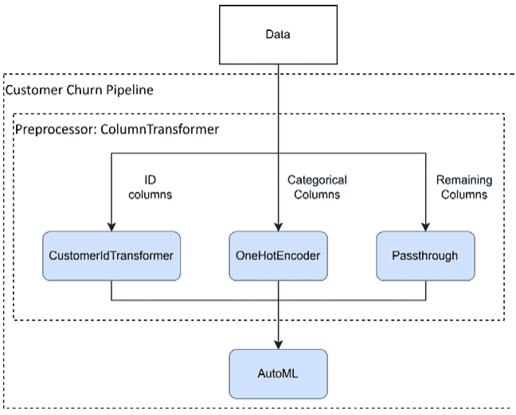

## 使用 LightGBM 的机器学习管道和 MLOps

本章将重点从数据科学和建模问题转移到为我们的机器学习解决方案构建生产服务。我们介绍了机器学习管道的概念，这是一种处理数据和构建模型的系统方法，以确保一致性和正确性。

我们还介绍了 MLOps 的概念，这是一种融合 DevOps 和 ML 的实践，解决了部署和维护生产级机器学习系统的需求。

本章包含使用 scikit-learn 构建机器学习管道的示例，封装数据处理、模型构建和调优。我们展示了如何将管道包装在 Web API 中，暴露一个用于预测的安全端点。最后，我们还探讨了系统的容器化和部署到 Google Cloud。

本章的主要主题如下：

- 机器学习管道
- MLOps 概述
- 部署客户流失的机器学习管道

### 技术要求

本章包含创建 scikit-learn 管道、训练 LightGBM 模型和构建 FastAPI 应用程序的示例。设置环境的要求可以与完整的代码示例一起在 https://github.com/PacktPublishing/Practical-Machine-Learning-with-LightGBM-and-Python/tree/main/chapter-8 处找到。

## 介绍机器学习管道

在第 6 章《使用 LightGBM 解决现实世界的数据科学问题》中，我们详细概述了数据科学生命周期，其中包括训练机器学习模型的各个步骤。如果只关注训练模型所需的步骤，给定已收集的数据，则步骤如下：

- 1. 数据清洗和准备
- 2. 特征工程
- 3. 模型训练和调优
- 4. 模型评估
- 5. 模型部署

在之前的案例研究中，我们在使用 Jupyter 笔记本时手动应用这些步骤。但是，如果我们将上下文转移到长期机器学习项目中会发生什么？如果在有新数据可用时需要重复该过程，我们将不得不遵循相同的程序来成功构建模型。

同样，当我们想要使用模型对新数据进行打分时，我们必须每次都正确地应用这些步骤，并使用正确的参数和配置。

从某种意义上说，这些步骤为数据形成一个管道：数据进入管道，完成后产生一个可部署的模型。

正式地，机器学习管道是一个指导机器学习项目工作流程的系统化和自动化过程。它涉及多个相互连接的阶段，封装了之前列出的步骤。

机器学习管道旨在确保这些任务是结构化的、可重复的和高效的，从而更容易管理复杂的机器学习任务。管道在处理大型数据集时特别有益，或者当将原始数据转换为机器学习模型可用输入的步骤复杂且必须频繁重复时（例如在生产环境中）。

管道中涉及的步骤具有一定的流动性：根据管道的使用方式，可以添加或删除步骤。一些管道包括数据收集步骤，从各种数据源或数据库拉取数据，并为机器学习建模暂存数据。

许多机器学习服务和框架提供实现机器学习管道的功能和实用程序。Scikit-learn 通过其 Pipeline 类提供此功能，我们将在下一节中探讨。

### Scikit-learn 管道

Scikit-learn 提供 Pipeline 类作为实现机器学习管道的工具。Pipeline 类提供一个统一的接口来执行一系列数据和模型相关任务。管道依赖于 scikit-learn 的标准 fit 和 transform 接口，以实现操作的链式调用。每个


流水线由任意数量的中间步骤组成，这些步骤必须是 `transforms`。一个 transform 必须同时实现 `fit` 和 `transform`，而 `Pipeline` 类会依次应用每个 transform，先将数据传递给 `fit`，再传递给 `transform`。最后一步通常涉及将模型拟合到数据上，只需实现 `fit` 方法。这些转换通常是预处理步骤，用于转换或增强数据。

使用 scikit-learn 流水线的主要优势是确保工作流以清晰且可重复的方式实现。它有助于避免常见错误，例如在预处理步骤中将测试数据的统计信息泄露到训练好的模型中。通过将预处理步骤包含在流水线内，我们确保在训练期间以及使用模型预测新数据时，都能一致地应用相同的预处理步骤。

此外，scikit-learn 流水线可以与模型选择和超参数调优工具结合使用，例如网格搜索和交叉验证。我们可以通过为预处理步骤和最终估计器定义参数网格，使用网格搜索在整个流水线中自动选择最佳参数。这可以显著简化代码并减少复杂 ML 工作流中的错误。FLAML 等工具也支持与 scikit-learn 流水线集成。

例如，可以按以下方式创建一个简单的流水线：

```
from sklearn.pipeline import Pipeline
from sklearn.preprocessing import StandardScaler
from sklearn.linear_model import LinearRegression

pipeline = Pipeline(
    [
        ('scaler', StandardScaler()),
        ('linear', LinearRegression())
    ]
)
```

这里，流水线包含两个步骤：一个用于标准化数据的缩放步骤和一个用于拟合线性回归模型的最终步骤。

scikit-learn Pipeline 的强大之处在于，它随后可以像任何其他估计器或模型一样使用：

```
pipeline.fit(X_train, y_train)
pipeline.predict(X_train)
```

这为我们提供了访问流水线中封装的所有步骤的统一接口，并使可重复性变得微不足道。此外，我们可以像导出其他 scikit-learn 模型一样导出流水线，以便部署流水线及其封装的所有步骤：

```
import joblib
joblib.dump(pipeline, "linear_pipeline.pkl")
```

接下来，我们将展示使用 scikit-learn 流水线的更多示例。

虽然我们花了大量时间来处理数据工作、构建和调优模型等问题，但尚未深入探讨模型训练后会发生什么。MLOps 的世界正是在此刻登场。下一部分将提供详细概述。

## 了解 MLOps

**机器学习运维 (MLOps)** 是一种融合机器学习和系统运维领域的实践。它旨在标准化和简化机器学习模型开发和部署的生命周期，从而提高商业环境中机器学习解决方案的效率和效果。在许多方面，MLOps 可以被视为对机器学习运营化所面临挑战的响应，将 DevOps 原则引入机器学习领域。

MLOps 旨在将通常专注于模型创建、实验和评估的数据科学家，与负责部署、监控和维护的运维专业人员聚集在一起。目标是促进这些群体之间更好的协作，从而实现更快、更强健的模型部署。

MLOps 的重要性在于机器学习系统带来的独特挑战。机器学习系统比传统软件系统更具动态性且更难以预测，这导致在可靠性和强健性方面可能面临挑战，尤其是在快速变化的生产环境中。

MLOps 的一个核心目标是加速机器学习生命周期，促进更快的实验和部署。这通过机器学习流水线的自动化来实现。**自动化**可以涵盖多个阶段，包括数据预处理、特征工程、模型训练、模型验证和部署。MLOps 的另一个关键方面是确保可重复性。鉴于机器学习模型的动态特性，要精确复制结果可能具有挑战性，尤其是在模型使用新数据重新训练时。MLOps 强调对代码、数据和模型配置进行版本控制的重要性，这确保每次实验都能被精确复制，对于调试和审计至关重要。

**监控**也是 MLOps 的重要组成部分。一旦模型部署，*监控其性能并持续验证其预测至关重要*。MLOps 强调需要强大的监控工具来跟踪模型性能、输入数据质量和其他重要指标。这些指标中的异常可能表明模型需要重新训练或调试。

MLOps 还鼓励为机器学习使用强大的测试实践。机器学习测试包括传统的软件测试实践，例如单元测试和集成测试，但也包括更多特定于机器学习的测试，例如验证模型预测的统计特性。

MLOps 还专注于管理和扩展机器学习部署。在现实世界中，机器学习模型可能需要每秒处理数千甚至数百万个预测。容器化和无服务器计算平台等 DevOps 实践在此发挥作用，以促进部署和扩展的自动化。

需要注意的是，MLOps 如何融入更广泛的软件生态系统。就像 DevOps 在软件工程中弥合了开发和运维之间的差距一样，MLOps 旨在为机器学习做同样的事情。通过促进共同的理解和责任，MLOps 可以带来更成功的机器学习项目。

MLOps 是一个快速发展的领域，随着越来越多的企业采用机器学习，其重要性日益凸显。通过将 DevOps 原则应用于机器学习的独特挑战，MLOps 提供了一个管理端到端机器学习生命周期的框架，从最初的实验到强健且可扩展的部署。MLOps 强调标准化、自动化、可重复性、监控、测试和协作，以实现高吞吐量的机器学习系统。

现在，我们将学习一个使用 scikit-learn 创建机器学习流水线并将流水线部署在 REST API 后面的实际示例。

## 为客户流失部署机器学习流水线

对于我们的实际示例，我们将使用在 *第 5 章，使用 Optuna 进行 LightGBM 参数优化* 中使用的电信（telco）客户流失数据集。该数据集包含每个客户的描述性信息（例如性别、账单信息和费用）以及客户是否离开电信提供商（流失为 *是* 或 *否*）。我们的任务是构建一个分类模型来预测流失。

此外，我们希望将模型部署在 REST API 后面，以便它可以集成到更大的软件系统中。REST API 应该有一个端点，用于对传递给 API 的数据进行预测。

我们将使用 **FastAPI**，一个现代的高性能 Python Web 框架，来构建我们的 API。最后，我们将使用 Docker 将模型和 API 部署到 Google Cloud 平台。

## 使用 scikit-learn 构建机器学习流水线

我们将首先使用 scikit-learn 的 `Pipeline` 工具集来构建一个机器学习流水线。我们的流水线应封装数据清洗和特征工程步骤，然后构建和调优合适的模型。

我们将评估两种建模算法：LightGBM 和随机森林，因此不需要对数据进行任何缩放或标准化。但是，该数据集为每个客户带有一个唯一标识符 `customerID`，我们需要将其删除。

此外，该数据集包含数值特征和类别特征，我们必须为类别特征实现独热编码。

### 流水线预处理步骤

要在 scikit-learn 流水线中执行这些步骤，我们将使用 `ColumnTransformer`。`ColumnTransformer` 是一个只对子集列进行操作的 `Pipeline` 转换器。


在数据集中。该transformer接受形式为(name, transformer, columns)的元组列表。它将子transformer应用于指定的列并串联结果，使得所有生成的特征都成为同一结果集的一部分。

例如，考虑以下DataFrame和ColumnTransformer：

```python
df = pd.DataFrame({
    "price": [29.99, 99.99, 19.99],
    "description": ["Luxury goods", "Outdoor goods",
    "Sports equipment"],
})

ct = ColumnTransformer(
    [("scaling", MinMaxScaler(), ["price"]),
    ("vectorize", TfidfVectorizer(), "description")])

transformed = ct.fit_transform(df)
```

这里，我们有一个包含两个列的DataFrame：price和description。创建了一个带有两个子transformer的列transformer：一个缩放transformer和一个向量化器。缩放transformer仅对price列应用min-max缩放。向量化器仅对description列应用TF-IDF向量化。当调用fit_transform时，将返回一个单一数组，其中包含缩放后的price列和表示词向量的列。

> **注意**
>
> TF-IDF，即术语频率-逆文档频率，是从文本中提取特征的一种方法。分析和从文本中提取特征，以及自然语言处理，通常是ML中的一个广泛领域，我们不会在此深入探讨。鼓励您在 https://scikit-learn.org/stable/modules/feature_extraction.html#text-feature-extraction 上进一步阅读该主题。

我们可以将Customer Churn数据集的预处理设置为单个ColumnTransformer。我们首先定义两个单独的transformer，id_transformer和encode_transformer，它们分别应用于ID列和类别特征：

```python
id_transformer = (
    "customer_id",
    CustomerIdTransformer(id_columns),
    id_columns
)

encode_transformer = (
    "encoder",
    OneHotEncoder(sparse_output=False),
    categorical_features
)
```

然后将单独的transformer合并为ColumnTransformer：

```python
preprocessor = ColumnTransformer(
    transformers=[
        id_transformer,
        encode_transformer,
    ],
    remainder='passthrough'
)
```

ColumnTransformer使用remainder='passthrough'参数定义。remainder参数指定ColumnTransformer不转换的列的处理方式。默认情况下，这些列会被丢弃，但我们希望将它们原样传递，以便将它们包含在数据集中。

编码transformer为类别特征创建并应用OneHotEncoder。

为示例说明，我们创建了一个自定义transformer类，以维护ID列列表并在转换过程中将它们从数据中删除。

类如下所示：

```python
class CustomerIdTransformer(BaseEstimator, TransformerMixin):
    def __init__(self, id_columns):
        self.id_columns = id_columns

    def fit(self, X, y=None):
        return self

    def transform(self, X, y=None):
        return X.drop(columns=self.id_columns, axis=1)
```

可以看出，该类扩展了scikit-learn基类中的BaseEstimator和TransformerMixin，并必须实现fit和transform。实现这些方法还使其适合作为pipeline中的transformer。如果需要，实现fit是可选的；在我们的情况中，fit期间不执行任何操作。我们的转换步骤删除相关列。

> **注意**
>
> 将删除不相关列（在此情况下为ID列）的功能封装在pipeline本身中非常重要。在为生产环境部署pipeline时，我们预期在进行预测时会将这些列传递给pipeline。将它们作为pipeline的一部分删除，简化了模型消费者对pipeline的使用，并减少了用户出错的可能性。

这完成了预处理所需的转换，我们准备好继续以下步骤：拟合和调整模型。

## Pipeline建模步骤

就pipeline建模部分而言，我们将使用FLAML。我们也将利用这个机会展示如何将参数传递给pipeline中的步骤。首先，我们为AutoML模型定义设置：

```python
automl_settings = {
    "time_budget": 120,
    "metric": "accuracy",
    "task": "classification",
    "estimator_list": ["lgbm", "rf"],
    "custom_hp": {
        "n_estimators": {
            "domain": flaml.tune.uniform(20, 500)
        }
    },
    "verbose": -1
}
```

前面的代码为AutoML设置了时间预算、优化指标和分类任务。我们还将估计器限制为LightGBM和随机森林模型。最后，通过指定n_estimators应在20和500之间均匀采样，自定义搜索空间。

pipeline要求组件步骤的参数以步骤名称和双下划线为前缀。我们可以设置一个字典，将这些参数传递给pipeline中的AutoML类：

```python
pipeline_settings = {
    f"automl__{key}": value for key, value in
    automl_settings.items()
}
```

在这里，automl是pipeline中步骤的名称。因此，例如，时间预算和指标的参数分别设置为automl__time_budget: 120和automl__metric: accuracy。

最后，我们可以添加FLAML的AutoML估计器：

```python
automl = flaml.AutoML()
pipeline = Pipeline(
    steps=[("preprocessor", preprocessor),
           ("automl", automl)]
)
```

最终pipeline显示在以下图中：



图8.1 – 用于客户流失预测的最终ML pipeline

图8.1显示了一个由两个子transformer组成的ColumnTransformer，将其馈入AutoML估计器。

## 模型训练和验证

我们现在可以将pipeline拟合到我们的数据上，传递我们之前设置的pipeline设置。Pipelines支持标准scikit-learn API，因此我们可以直接调用pipeline本身：

```python
pipeline.fit(X, y, **pipeline_settings)
```

运行fit执行所有预处理步骤，然后将数据传递给AutoML建模和调制。单个Pipeline对象说明了ML pipeline的强大之处：包括训练和调制过的模型在内的整个端到端过程都被封装并可移植，我们可以像使用单个模型一样使用pipeline。例如，以下代码对训练数据进行F1评分：

```python
print(f"F1: {f1_score(pipeline.predict(X), y,
pos_label='Yes')}")
```

要导出pipeline，我们使用joblib将模型序列化到文件中：

```python
joblib.dump(pipeline, "churn_pipeline.pkl")
```

导出pipeline允许我们在生产代码中重新实例化并使用它。接下来，我们将研究为模型构建API。

在此阶段，我们的pipeline（封装了预处理、训练、优化和验证）已定义，我们准备将其部署到系统中。我们将通过使用FastAPI将模型包装在API中来实现这一点。

## 使用 FastAPI 构建 ML API

我们现在将研究围绕我们的pipeline构建REST API，使pipeline的消费者能够通过Web请求获取预测。为模型构建Web API还简化了与其他系统和服务的集成，并且是微服务架构中集成的标准方法。

要构建API，我们使用Python库FastAPI。

### FastAPI

FastAPI是一个用于使用Python 3.6+构建API的现代高性能Web框架。它从一开始就设计为易于使用，并能实现高性能API开发。FastAPI的关键特性是其速度和易用性，使其成为开发强大的生产就绪型API的绝佳选择。FastAPI广泛采用Python的类型检查，这有助于在开发过程中尽早捕获错误。它还使用这些类型提示来提供数据验证、序列化和文档，减少开发者需要编写的样板代码。

FastAPI的性能是其定义特性之一。它与Node.js相当，并且比传统的Python框架快得多。这种速度归功于其在Web部分使用Starlette、在数据部分使用Pydantic，并且其非阻塞特性使其适合处理许多并发请求。

FastAPI提供自动交互式API文档，在开发复杂API时是一个显著优势。使用FastAPI，开发者可以通过Swagger UI访问自动生成的交互式API文档。Swagger UI还提供与REST资源交互的功能，无需编写代码或使用外部工具。此功能使FastAPI非常开发者友好，并加速开发过程。


FastAPI 还支持行业标准的安全协议，例如 OAuth2，并提供工具以简化实现。FastAPI 的大部分工具依赖于其依赖注入系统，使开发者能够高效地管理依赖项并处理共享资源。

由于其易用性和高性能，FastAPI 非常适合为 ML 模型构建 Web API 和微服务，这使 ML 工程师能够专注于生产环境 ML 部署周围的众多其他问题。

## 使用 FastAPI 构建

要使用 FastAPI 创建 REST API，我们可以创建一个新的 Python 脚本并实例化 FastAPI 实例。实例启动后，我们可以从文件加载模型：

```
app = FastAPI()
model = joblib.load("churn_pipeline.pkl")
```

在应用程序启动时加载模型会增加启动时间，但可确保在应用程序启动完成时 API 已准备好处理请求。

接下来，我们需要实现一个用于进行预测的 REST 端点。我们的端点接受输入数据，并以 JSON 形式返回预测结果。输入 JSON 是一组 JSON 对象，如下所示：

```
[
  {
    "customerID": "1580-BMCMR",
    ...
    "MonthlyCharges": 87.3,
    "TotalCharges": "1637.3"
  },
  {
    "customerID": "4304-XUMGI",
    ...
    "MonthlyCharges": 75.15,
    "TotalCharges": "3822.45"
  }
]
```

使用 FastAPI，我们通过创建一个以输入数据作为参数的函数来实现 REST 端点。FastAPI 将前述 JSON 结构序列化为 Python 字典列表。因此，我们的函数签名实现如下：

```
@app.post('/predict')
def predict_instances(
    instances: list[dict[str, str]]
):
```

我们使用 FastAPI 的 post 装饰器装饰该函数，指定端点路径（'/predict'）。

为对模型进行实际预测，我们将字典转换为 DataFrame 并执行预测：

```
instance_frame = pd.DataFrame(instances)
predictions = model.predict_proba(instance_frame)
```

我们使用 predict_proba 获取每个类别（是或否）的概率，因为我们希望将这些额外信息发送给 API 的使用者。将概率与预测结果一起返回是一种推荐做法，因为这让 API 使用者能够更好地控制预测结果的使用方式。API 使用者可以根据预测结果的使用方式，决定其应用程序所需的概率阈值。

为了以 JSON 形式返回结果，我们构建一个字典，然后由 FastAPI 将其序列化为 JSON。我们使用 NumPy 的 argmax 获取最高概率的索引以确定预测类别，并使用 amax 获取最高概率本身：

```
results = {}
for i, row in enumerate(predictions):
    prediction = model.classes_[np.argmax(row)]
    probability = np.amax(row)
    results[i] = {"prediction": prediction,
                  "probability": probability}

return results
```

前述代码为输入列表中的每个数据实例生成一个预测对象，使用列表中的位置作为索引。调用端点时，将返回以下 JSON：

```
{
    "0": {
        "prediction": "Yes",
        "probability": 0.9758797243307111
    },
    "1": {
        "prediction": "No",
        "probability": 0.8896770039274629
    },
    "2": {
        "prediction": "No",
        "probability": 0.9149225087944103
    }
}
```

我们现在已经构建了 API 端点的核心部分。然而，我们也必须关注安全性等非功能性问题。通常，ML 工程师会忽略安全性或性能等方面，只关注 ML 问题。我们不应犯这个错误，必须确保给予这些问题必要的关注。

## 保护 API

为保护我们的端点，我们将使用 HTTP 基本认证。我们使用预设的用户名和密码，并从环境中读取它们。这样可以在部署期间安全地将这些凭据传递给应用程序，并避免硬编码凭据等陷阱。我们的端点还需要增强以接受用户提供的凭据。HTTP 基本认证凭据作为 HTTP 标头发送。

我们可以按以下方式实现。首先，我们为 FastAPI 设置安全性，并从环境中读取凭据：

```
security = HTTPBasic()
USER = bytes(os.getenv("CHURN_USER"), "utf-8")
PASSWORD = bytes(os.getenv("CHURN_PASSWORD"), "utf-8")
```

然后，我们将以下内容添加到端点函数中：

```
@app.post('/predict')
def predict_instances(
    credentials: Annotated[HTTPBasicCredentials,
        Depends(security)],
    instances: list[dict[str, str]]
):
    authenticate(credentials.username.encode("utf-8"),
        credentials.password.encode("utf-8"))
```

authenticate 函数将接收到的凭据与从环境中获取的 API 凭据进行验证。我们可以使用 Python 的 secrets 库来执行验证：

```
def authenticate(username: bytes, password: bytes):
    valid_user = secrets.compare_digest(
        username, USER
    )
    valid_password = secrets.compare_digest(
        password, PASSWORD
    )
    if not (valid_user and valid_password):
        raise HTTPException(
            status_code=status.HTTP_401_UNAUTHORIZED,
            detail="Incorrect username or password",
            headers={"WWW-Authenticate": "Basic"},
        )
    return username
```

如果凭据无效，我们会抛出带有 HTTP 状态码 401 的异常，指示使用者未获授权。

我们的 API 端点现在已完全实现、已保护，并准备好部署。要部署我们的 API，我们将使用 Docker 对其进行容器化。

## 为我们的 API 容器化

我们可以使用以下 Dockerfile 为我们的 API 构建 Docker 容器：

```
FROM python:3.10-slim
RUN apt-get update && apt-get install -y --no-install-recommends apt-utils
RUN apt-get -y install curl
RUN apt-get install libgomp1
WORKDIR /usr/src/app
COPY requirements.txt ./
RUN pip install --no-cache-dir -r requirements.txt
COPY . .
CMD [ "uvicorn", "telco_churn_api:app", "--host", "0.0.0.0", "--port", "8080" ]
```

Dockerfile 非常直接：我们从基础 Python 3.10 镜像开始，并安装 LightGBM 需要的某些操作系统依赖项（libgomp1）。然后，我们设置 FastAPI 应用：复制 Python 要求文件，安装所有依赖项，然后复制必要的源文件（使用 `COPY . .`）。

最后，我们运行一个 Uvicorn 服务器，监听端口 8080 上的所有地址。Uvicorn 是一个支持异步 I/O 的 Python ASGI Web 服务器实现，可显著提高 Web 服务器的吞吐量。我们绑定到端口 8080，即我们部署平台的默认端口。

我们可以使用以下命令构建和运行 Docker 镜像，并传递用户名和密码环境变量：

```
docker build . -t churn_api:latest
docker run --rm -it -e CHURN_USER=***** -e CHURN_PASSWORD=********** -p 8080:8080 churn_api:latest
```

API 现在应该可以在你的本地主机上通过端口 8080 访问，并受到你在环境变量中提供的凭据的保护。

由于我们的应用程序已容器化，我们已准备好将其部署到任何支持容器的平台。对于流失率应用程序，我们将其部署到 Google Cloud Platform。

## 将 LightGBM 部署到 Google Cloud

我们将利用 Google Cloud Run 平台将我们的应用程序部署到 Google Cloud Platform。

Google Cloud Run 是一个无服务器平台，可让您无需担心基础架构管理即可开发和运行应用程序。Cloud Run 允许开发者在安全、可扩展且零运维的环境中运行应用程序。Cloud Run 完全托管，意味着所有基础架构（如服务器和负载均衡器）都被抽象化，让用户可以专注于运行应用程序。Cloud Run 还支持完全自动伸缩，运行中的容器数量会自动增加以应对不断增长的负载。Cloud Run 也非常经济高效，因为您仅在容器运行并处理请求时才被收取费用。

要使用 Cloud Run，您需要一个 Google Cloud 账户，并需要创建 Google Cloud 项目、启用结算功能，以及设置并初始化 Google Cloud CLI。以下资源将指导您完成这些步骤：

- https://console.cloud.google.com/getting-started
- https://cloud.google.com/resource-manager/docs/creating-managing-projects
- https://cloud.google.com/sdk/docs/install
- https://cloud.google.com/sdk/docs/initializing

完成 Google Cloud 设置后，我们可以使用 CLI 部署我们的 API。这可以通过单个命令完成：

```
gcloud run deploy --set-env-vars CHURN_USER=****, CHURN_PASSWORD=********
```

运行该命令会提示您输入服务名称和部署服务的地区。我们还设置了安全凭据所需的环境变量。对于部署，Cloud Run 会为您创建 Cloud Build，它会自动构建和存储 Docker 容器，然后将其部署到 Cloud Run。

Cloud Run 命令完成后，我们已部署一个安全、可扩展的 RESTful Web API，用于提供我们的客户流失 ML 管道。


## Summary

本章介绍了 ML 管道，说明了在实现 ML 解决方案时实现一致性、正确性和可移植性的优势。

对 nascent MLOps 领域进行了概述，这是一种结合 DevOps 和 ML 的实践，用于实现经过测试、可扩展、安全且可观测的生产 ML 系统。

此外，我们讨论了 scikit-learn Pipeline 类，这是一套使用熟悉的 scikit-learn API 实现 ML 管道的工具集。

还给出了实现客户流失 ML 管道的实际端到端示例。我们展示了如何创建执行预处理、建模和调优并可导出到软件系统的 scikit-learn 管道。然后，我们使用 FastAPI 构建了一个安全的 RESTful Web API，为从客户流失管道获取预测提供了一个端点。最后，我们使用 Cloud Run 服务将 API 部署到 Google Cloud Platform。

虽然我们的部署是安全且完全可扩展的，并且 Cloud Run 提供了可观测性、指标和日志，但我们的部署没有解决一些 ML 特定的方面：模型漂移、模型性能监控和重新训练。

在下一章中，我们将研究 AWS SageMaker，这是一个专门的 ML 云服务，为构建和托管基于云的 ML 管道提供特定于平台的解决方案。
