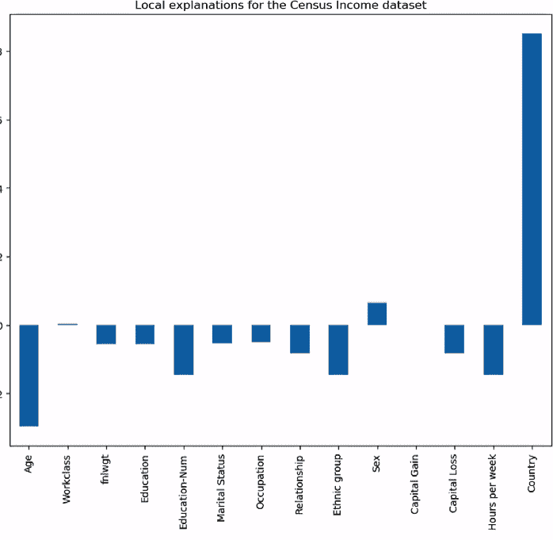
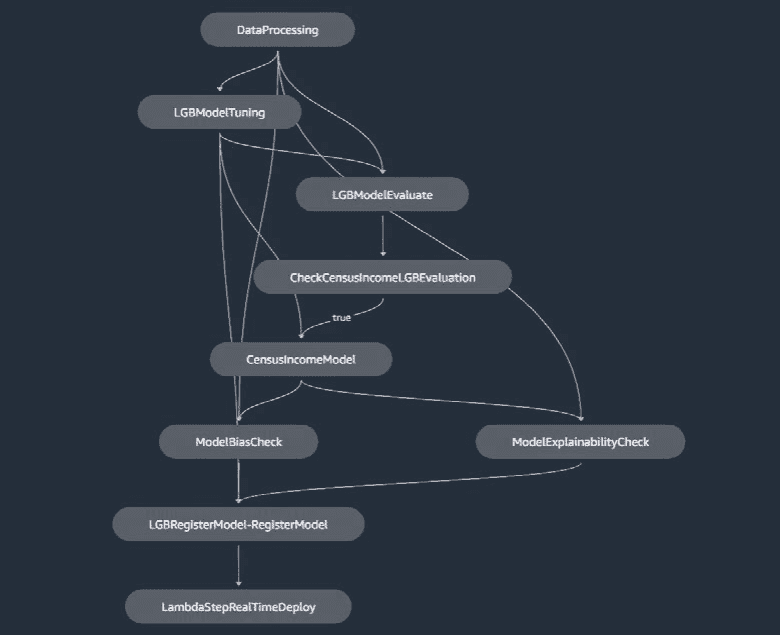
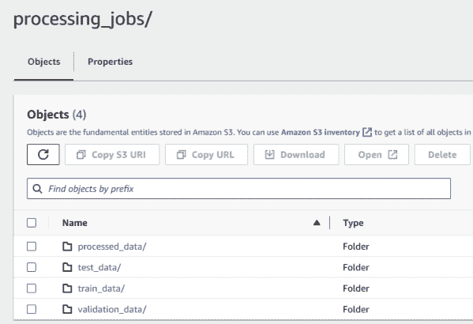
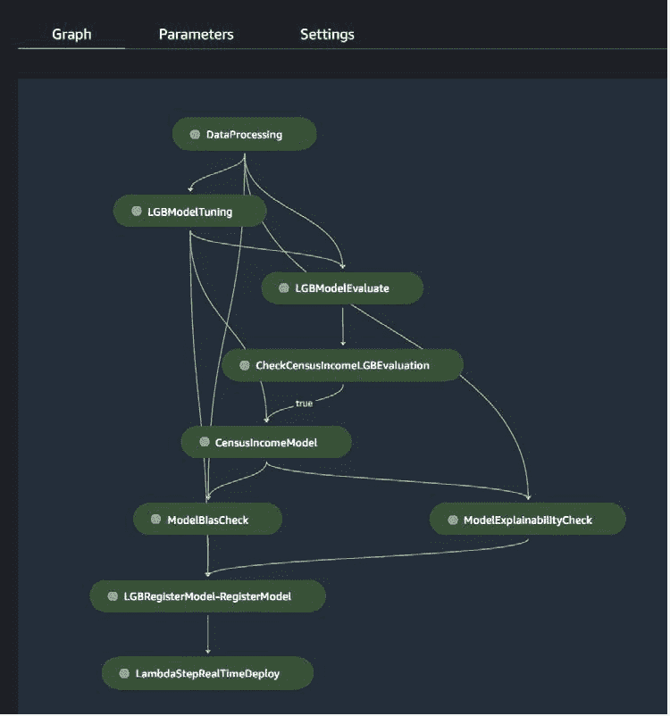
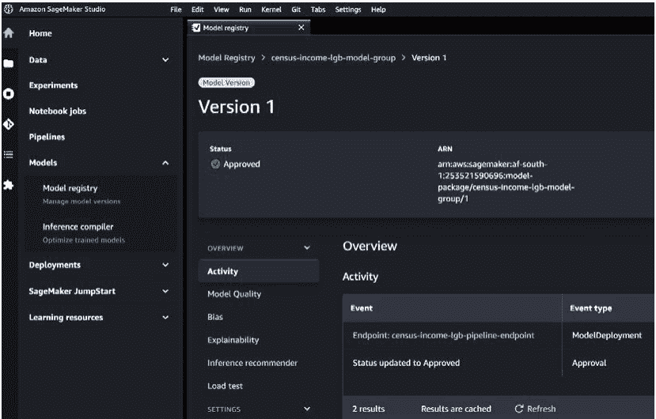
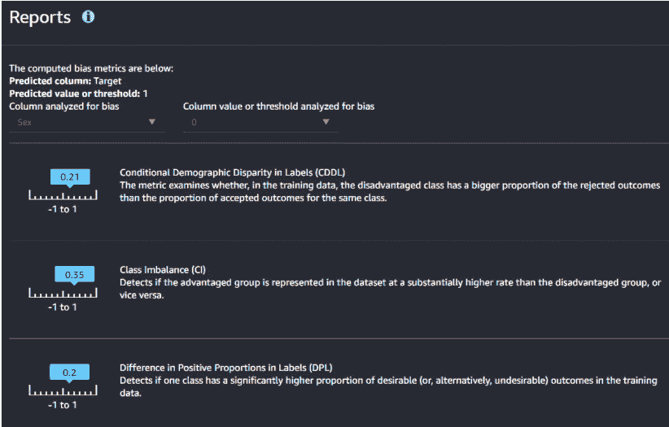
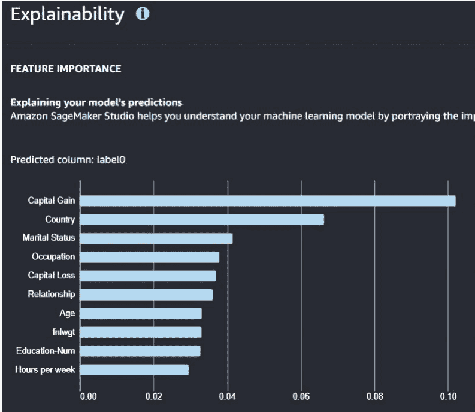

## LightGBM MLOps with AWS SageMaker

LightGBM 与 AWS SageMaker 的 MLOps

在 Chapter 8, Machine Learning Pipelines and MLOps with LightGBM 中，我们使用 scikit-learn 构建了端到端 ML 管道。我们还研究了将管道封装在 REST API 中，并将我们的 API 部署到云端。

本章将研究使用 **Amazon SageMaker** 开发和部署管道。SageMaker 是 **Amazon Web Services (AWS)** 提供的一套完整的生产服务，用于开发、托管、监控和维护 ML 解决方案。

我们将通过研究检测训练模型中的偏差和将部署自动化到完全可扩展的无服务器 Web 端点等高级主题，扩展我们在 ML 管道方面的能力。

本章将涵盖以下主要主题：

- AWS 和 SageMaker 简介
- 模型可解释性和偏差
- 使用 SageMaker 构建端到端管道

### Technical requirements

技术要求

本章深入探讨了使用 Amazon SageMaker 构建 ML 模型和管道。您需要访问 Amazon 账户，并且还必须配置支付方式。请注意，运行本章的示例代码将在 AWS 上产生费用。本章的完整笔记本和脚本可于 `https://github.com/PacktPublishing/Practical-Machine-Learning-with-LightGBM-and-Python/tree/main/chapter-9` 获取。

### An introduction to AWS and SageMaker

AWS 和 SageMaker 简介

本节提供了 AWS 的高级概述，并深入探讨了 SageMaker，AWS 的 ML 产品。

### AWS

AWS

AWS 是全球云计算市场的主要参与者之一。AWS 提供许多基于云的产品和服务，包括数据库、机器学习 (ML)、分析、网络、存储、开发工具和企业应用程序。AWS 的理念是为企业提供负担得起且可扩展的计算解决方案，无论其规模或行业如何。

AWS 的一个关键优势是弹性，这意味着服务器和服务可以快速且随心所欲地停止和启动，可从零台机器扩展到数千台。服务的弹性与其即用即付的主要定价模式相辅相成，这意味着客户只需为其使用的服务和资源付费，无需任何前期成本或长期合同。这种弹性和定价使企业能够根据需要按需扩展计算需求，以临时和细粒度的方式，然后只为其使用的内容付费。这种方法改变了企业扩展 IT 资源和应用程序的方式，使它们能够快速响应不断变化的业务需求，而无需承担传统上与硬件和软件采购和维护相关的高昂成本。

AWS 的另一个优势是其全球覆盖范围。AWS 服务在全球许多地区提供。地理上分离的区域，每个区域进一步划分为可用区。区域-可用区设置允许用户创建全球分布和冗余的基础设施，以最大限度地提高弹性并为灾难恢复构建架构。区域数据中心还允许用户在靠近最终用户的位置创建服务器和服务，最大限度地减少延迟。

### Core services

核心服务

核心 AWS 服务提供计算、网络和存储功能。AWS 的计算服务包括 Amazon Elastic Compute Cloud (EC2)，它为客户提供可配置的虚拟机，以及 AWS Lambda，这是一个无服务器计算平台，允许您运行代码而无需预配和管理服务器。在 ML 中，EC2 实例和 Lambda 函数通常用于通过 API 端点训练、验证或提供模型。EC2 服务器的弹性特性允许 ML 工程师将训练服务器扩展到数千台，这可以显著加快训练或参数调优任务。

AWS 的存储和数据库服务，例如 Amazon Simple Storage Service (S3) 和 Amazon RDS (关系数据库服务)，提供可靠、可扩展且安全的数据存储解决方案。这些服务管理存储基础设施，并提供备份、补丁管理以及垂直和水平扩展等高级功能。S3 是一种广泛用于数据工程和 ML 的服务。S3 提供低成本、高度冗余的安全存储，可扩展至数千兆字节。

AWS 还通过 Amazon Redshift 提供数据仓库解决方案。大型企业经常使用 Redshift 作为数据仓库或数据湖的基础，这意味着它通常是 ML 解决方案的数据源。

AWS 还提供网络服务，帮助企业满足复杂的网络和隔离需求。AWS Direct Connect 允许客户从客户站点到 AWS 云设置专用网络连接。路由和名称服务器可以通过 Amazon Route 53 进行管理，这是一个灵活且可扩展的域名系统 (DNS) 服务。

然而，网络服务中最重要的是 **Amazon Virtual Private Cloud (VPC)**。VPCs 为客户提供配置完全隔离的虚拟网络的功能。客户可以细粒度地配置子网、路由表、地址范围、网关和安全组。VPCs 允许用户隔离其环境和云资源，并控制入站和出站流量，以提高安全性和隐私性。

### Security

安全

任何基础设施方程中的关键部分是安全性。在安全性方面，AWS 提供高度安全、可扩展且灵活的云计算环境。AWS 的安全服务，包括 **AWS Identity and Access Management (IAM)** 和 **Amazon Security Hub**，通过实施强大的安全措施帮助客户保护其数据和应用程序。

AWS 还符合多项国际和行业特定的合规性标准，例如 GDPR、HIPAA 和 ISO 27001。此外，在数据治理方面，AWS 使遵守数据驻留和隐私要求变得容易。由于 AWS 的区域结构，数据可以保留在特定国家，而工程师可以访问完整的 AWS 服务套件。

### Machine learning

机器学习

AWS 还提供专注于 ML 和 **人工智能 (AI)** 的服务。其中包括许多用于特定 ML 任务的完全托管服务。**AWS Comprehend** 提供许多 **自然语言处理 (NLP)** 服务，例如文档处理、命名实体识别和情感分析。**Amazon Lookout** 是一种用于设备、指标或图像中异常检测的服务。此外，**Amazon Rekognition** 提供用于机器视觉用例的服务，例如图像分类和人脸识别。

对我们特别感兴趣的是 **Amazon SageMaker**，这是一个完整的 ML 平台，允许我们在 Amazon 云中创建、训练和部署 ML 模型。下一节将详细讨论 SageMaker。

### SageMaker

SageMaker

**Amazon SageMaker** 是一个端到端的 ML 平台，允许数据科学家处理数据并开发、训练、部署和监控 ML 模型。SageMaker 是完全托管的，因此无需预配或管理服务器。

Amazon SageMaker 的主要吸引力在于其作为平台的综合性。它涵盖了 ML 过程的所有方面，包括数据标记、模型构建、训练、调优、部署、管理和监控。通过处理这些方面，SageMaker 使开发人员和数据科学家能够专注于核心 ML 任务，而不是管理基础设施。

如我们所讨论，ML 生命周期始于数据收集，这通常需要手动数据标记。为此，SageMaker 提供了一项名为 **SageMaker Ground Truth** 的服务。此服务使高效注释 ML 数据集变得容易。它可以通过使用自动化标记工作流显著减少通常与数据标记相关的时间和成本，并且还提供劳动力用于


手动数据标记任务。此外，SageMaker 还提供 Data Wrangler 服务，可帮助进行数据准备和探索性数据分析（EDA）。Data Wrangler 提供从 S3、Redshift 和其他平台查询数据的功能，然后从单个可视化界面清洗、可视化和理解数据。

SageMaker 为模型训练阶段提供一项完全托管的服务，可通过训练作业（Training Jobs）处理大规模、分布式模型训练。该服务旨在灵活且可适应，允许用户根据需要优化其机器学习模型。用户只需指定数据的位置（通常是 S3）和机器学习算法，SageMaker 即会处理其余的训练过程。模型训练服务充分利用了底层 AWS 基础架构的弹性特性：可以快速创建许多服务器来执行训练作业，并在训练完成后丢弃它们以节省成本。

这一范式也扩展到超参数调优。为简化超参数优化，SageMaker 提供了一项自动模型调优功能。提供了多种调优算法，例如 Optuna 或 FLAML，并且调优可以在多个服务器上运行。

SageMaker 还通过 SageMaker Autopilot 支持更完整的 AutoML 体验。Autopilot 是一项支持自动模型创建的服务。用户只需提供原始数据并设置目标，然后 Autopilot 会自动探索不同解决方案以找到最佳模型。Autopilot 对该过程提供完全可见性，以便数据科学家了解模型是如何创建的，并做出任何必要的调整。

模型训练和优化完成后，即需进行部署。SageMaker 通过提供一键式部署流程简化了这一过程。用户可以快速将模型部署到生产环境，并具备自动扩缩容能力，无需担心底层基础架构。此部署自动扩缩容功能允许用户设置基于指标的策略，以增加或减少后端服务器。例如，如果某段时间内的调用次数超过特定阈值，则可以扩展部署规模。SageMaker 确保模型的高可用性，并支持对模型进行 A/B 测试，以比较不同变体并确定最佳方案。SageMaker 还支持多模型端点，允许用户在单个端点上部署多个模型。

Amazon SageMaker 还提供在模型部署后监控其性能并进行分析的功能。SageMaker Model Monitor 会持续监控（针对实时端点）或分批监控（针对异步作业）已部署模型的质量。可以定义警报，以便在超过指标阈值时通知用户。Model Monitor 可以基于准确性等指标监控数据漂移和模型漂移。

最后，SageMaker 既是 AWS 中的一个平台，也是一个软件 SDK。该 SDK 提供 Python 和 R 两种版本。SageMaker SDK 提供一系列内置算法和框架，包括对机器学习社区中最流行算法的支持，例如 XGBoost、TensorFlow、PyTorch 和 MXNet。它还支持一个市场，用户可以从中选择 AWS 和其他 SageMaker 用户共享的大量算法和模型包。

SageMaker 中一个值得注意的部分是 **SageMaker Clarify**，它简化了模型开发中最重要的方面之一（偏差和公平性）。

## SageMaker Clarify

Amazon SageMaker Clarify 是一款可提高机器学习模型透明度的工具。SageMaker Clarify 旨在帮助理解机器学习模型如何进行预测，从而实现模型可解释性和公平性。

SageMaker Clarify 的主要功能之一是其提供模型可解释性的能力。它帮助开发者理解输入数据与模型预测之间的关系。该服务生成特征归因，展示数据集中每个特征如何影响预测，这在许多领域中至关重要，尤其是在需要理解模型预测背后的推理过程的领域。除了对个别预测提供洞察之外，SageMaker Clarify 还提供全局解释能力。它衡量输入特征在整个数据集上的模型预测中的重要性（以汇总方式）。特征影响分析让开发者和数据科学家能够了解模型的整体行为，帮助他们解释不同特征在全局层面如何驱动模型预测。

此外，Clarify 可以帮助识别训练好的模型中潜在的偏差。该服务包括训练前和训练后的偏差指标，帮助我们了解模型是否不公平地偏爱某些群体。检查所有新模型的偏差属于最佳实践，但在金融或医疗保健等受监管行业中，这一点至关重要，因为有偏见的预测可能会带来严重后果。

Clarify 使用一种称为 **SHapley Additive exPlanations (SHAP)** 的先进技术来提供模型可解释性。

### SHAP

SHAP 是一种基于博弈论的方法，用于解释任何机器学习模型的输出 [1]。SHAP 旨在提供对单个特征对模型整体预测影响的理解。

本质上，SHAP 值通过将某个特征值与该特征的基准值进行对比来评估其效果，从而突出其对预测的贡献。SHAP 值是每个特征对每个实例预测做出的公平贡献分配。SHAP 值根植于合作博弈论，代表了对以下问题的解答：

> “鉴于某个特征在预测结果中产生的差异，该差异中有多少部分可归因于每个特征？”

这些值是使用博弈论中 Shapley 值的概念计算的。Shapley 值通过对比模型在特征存在和缺失情况下的预测来确定特征的重要性。然而，由于模型遇到特征的顺序可能会影响其预测，Shapley 值会考虑所有可能的排列。然后，它为特征分配一个重要性值，使其等于该特征在所有可能联盟中的平均边际贡献。

使用 SHAP 进行模型解释具有多项优势。首先，它提供解释的一致性。如果某个特征的贡献发生变化，则归因于该特征的重要性会按比例变化。

其次，SHAP 保证局部准确性，即所有特征的 SHAP 值之和等于预测值与数据集平均预测值之间的差异。

可视化 SHAP 值的一个绝佳方法是使用 SHAP 摘要图。这些图提供了特征重要性及其驱动因素的鸟瞰图。它们在图表上绘制某个特征的所有 SHAP 值，以便于可视化。图表上的每个点代表一个特征和一个实例的 SHAP 值。Y 轴上的位置由特征决定，X 轴上的位置由 SHAP 值决定：



图 9.1 – Census Income 数据集的局部解释示例。条形表示 SHAP 值，或每个特征在预测特定实例中的相对重要性。

在 SageMaker Clarify 的上下文中，当运行说明作业时，该服务会为数据集中的每个实例生成一组 SHAP 值。SageMaker Clarify 还可以通过聚合整个数据集的 SHAP 值来提供全局特征重要性度量。

SHAP 值可以帮助你理解复杂的模型行为，突出潜在问题，并随时间改进你的模型。例如，通过检查 SHAP 值，你可能会发现某个特定特征对模型预测的影响比预期更显著，这会促使你探究原因。

在本节中，我们探讨了 AWS 以及更具体地说 AWS 机器学习服务族 SageMaker 所提供的内容。SageMaker 中可用的功能，例如模型可解释性、偏差检测和监控，是我们尚未在机器学习管道中实现的组件。在下一节中，我们将探讨如何使用 SageMaker 构建一个完整的端到端 LightGBM 机器学习管道，包括这些关键步骤。

## 使用 Amazon SageMaker 构建 LightGBM 机器学习管道

我们将用于构建 SageMaker 管道案例研究的数据集是第 4 章（比较 LightGBM、XGBoost 和深度学习）中的 Census Income 数据集。该数据集也可作为 SageMaker 示例数据集使用，因此如果你刚开始使用，在 SageMaker 上操作它非常方便。

我们将构建的管道包含以下步骤：

- 1. 数据预处理。
- 2. 模型训练与调优。
- 3. 模型评估。
- 4. 使用 Clarify 进行偏差和可解释性检查。
- 5. 在 SageMaker 内注册模型。
- 6. 使用 AWS Lambda 部署模型。

下面的图展示了完整的管道：




图 9.2 – 用于人口普查收入分类的 SageMaker ML 管道

我们的方法是在 SageMaker Studio 中运行的 Jupyter Notebook 里创建整个管道。以下各部分将解释并逐步介绍每个管道步骤的代码，从设置 SageMaker 会话开始。

## 设置 SageMaker 会话

以下步骤假设您已经创建了 AWS 账户并设置了 SageMaker 域以开始使用。如果没有，可以参考以下文档来完成：

- 先决条件: https://docs.aws.amazon.com/sagemaker/latest/dg/gs-set-up.html
- 加入 SageMaker 域: https://docs.aws.amazon.com/sagemaker/latest/dg/gs-studio-onboard.html

我们必须初始化 SageMaker 会话，并通过 boto3 创建 S3、SageMaker 和 SageMaker Runtime 客户端以开始使用：

```python
sess = sagemaker.Session()
region = sess.boto_region_name
s3_client = boto3.client("s3", region_name=region)
sm_client = boto3.client("sagemaker", region_name=region)
sm_runtime_client = boto3.client("sagemaker-runtime")
```

我们将使用 Amazon S3 存储训练数据、源代码以及管道创建的所有数据和工件（例如序列化模型）。我们的数据和工件被分为读取存储桶和单独的写入存储桶。这是一种标准的最佳实践，因为它分离了数据存储的关注点。

SageMaker 会话有针对会话的默认 S3 存储桶概念。如果未提供默认存储桶名称，则会生成一个并为您创建该存储桶。这里，我们获取对存储桶的引用。这是我们的输出或写入存储桶。读取存储桶是我们之前创建的用于存储训练数据的存储桶：

```python
write_bucket = sess.default_bucket()
write_prefix = "census-income-pipeline"
read_bucket = "sagemaker-data"
read_prefix = "census-income"
```

管道中每个步骤的源代码、配置和输出均捕获在 S3 写入存储桶内的文件夹中。为每个 S3 URI 创建变量很有用，以避免在反复引用数据时出现错误，如下所示：

```python
input_data_key = f"s3://{read_bucket}/{read_prefix}"
census_income_data_uri = f"{input_data_key}/census-income.csv"
output_data_uri = f"s3://{write_bucket}/{write_prefix}/"
scripts_uri = f"s3://{write_bucket}/{write_prefix}/scripts"
```

SageMaker 要求我们指定在运行训练、处理、Clarify 和预测作业时要使用的计算实例类型。在我们的示例中，我们使用 m5.large 实例。大多数 EC2 实例类型都可以与 SageMaker 一起使用。但是，也提供了一些支持 GPU 和深度学习框架的特殊实例类型：

```python
train_model_id, train_model_version, train_scope = "lightgbm-classification-model", "*", "training"
process_instance_type = "ml.m5.large"
train_instance_count = 1
train_instance_type = "ml.m5.large"
predictor_instance_count = 1
predictor_instance_type = "ml.m5.large"
clarify_instance_count = 1
clarify_instance_type = "ml.m5.large"
```

SageMaker 使用标准 EC2 实例进行训练，但在实例上运行特定的 Docker 映像以提供 ML 功能。Amazon SageMaker 为各种 ML 框架和堆栈提供许多预构建的 Docker 映像。

SageMaker SDK 还提供了一个函数，用于搜索我们正在使用的 AWS 区域中与所需实例类型兼容的映像。我们可以使用 retrieve 搜索映像：

```python
train_image_uri = retrieve(
    region="us-east-1",
    framework=None,
    model_id=train_model_id,
    model_version=train_model_version,
    image_scope=train_scope,
    instance_type=train_instance_type
)
```

我们为 framework 参数指定 None，因为我们自己管理 LightGBM 安装。

要参数化我们的管道，我们必须从 sagemaker.workflow.parameters 包定义 SageMaker 工作流参数。各种参数类型都有可用的包装器：

```python
train_instance_type_param = ParameterString(
    name="TrainingInstanceType",
    default_value=train_instance_type)

train_instance_count_param = ParameterInteger(
    name="TrainingInstanceCount",
    default_value=train_instance_count)

deploy_instance_type_param = ParameterString(
    name="DeployInstanceType",
    default_value=predictor_instance_type)

deploy_instance_count_param = ParameterInteger(
    name="DeployInstanceCount",
    default_value=predictor_instance_count)
```

在设置好管道参数、S3 数据路径和其他配置变量后，我们可以继续创建管道的预处理步骤。

## 预处理步骤

设置我们的预处理步骤包含两部分：创建执行预处理的 Python 脚本，以及创建添加到管道的处理器。

我们将使用的脚本是带有 main 函数的常规 Python 脚本。我们将使用 scikit-learn 进行预处理。预处理脚本在此处未完全复制，但在我们的源代码仓库中可用。值得注意的是，当管道执行该步骤时，数据从 S3 检索并添加到预处理实例上的本地暂存目录。从此，我们可以使用标准 pandas 工具读取数据：

```python
local_dir = "/opt/ml/processing"
input_data_path = os.path.join("/opt/ml/processing/census-income",
                               "census-income.csv")

logger.info("Reading claims data from {} ".format(input_data_path))
df = pd.read_csv(input_data_path)
```

同样，处理完成后，我们可以将结果写入本地目录，SageMaker 将从中检索并上传到 S3：

```python
train_output_path = os.path.join(f"{local_dir}/train", "train.csv")
X_train.to_csv(train_output_path, index=False)
```

定义预处理脚本后，我们需要将其上传到 S3，以便管道能够使用它：

```python
s3_client.upload_file(
    Filename="src/preprocessing.py", Bucket=write_bucket,
    Key=f"{write_prefix}/scripts/preprocessing.py"
)
```

我们可以按如下方式定义预处理步骤。首先，必须创建 SKLearnProcessor 实例：

```python
sklearn_processor = SKLearnProcessor(
    framework_version="0.23-1",
    role=sagemaker_role,
    instance_count=1,
    instance_type=process_instance_type,
    base_job_name=f"{base_job_name_prefix}-processing",
)
```

SKLearnProcessor 处理需要 scikit-learn 的作业的处理任务。我们指定 scikit-learn 框架版本以及之前定义的实例类型和数量。

然后将处理器添加到 ProcessingStep 中以在管道中使用：

```python
process_step = ProcessingStep(
    name="DataProcessing",
    processor=sklearn_processor,
    inputs=[...],
    outputs=[...],
)
```

```python
job_arguments=[
    "--train-ratio", "0.8",
    "--validation-ratio", "0.1",
    "--test-ratio", "0.1"
],
code=f"s3://{write_bucket}/{write_prefix}/scripts/preprocessing.py"
)
```

inputs 和 outputs 使用 ProcessingInput 和 ProcessingOutput 包装器定义，如下所示：

```python
inputs = [ ProcessingInput(source=bank_marketing_data_uri,
               destination="/opt/ml/processing/bank-marketing") ]
outputs = [ ProcessingOutput(destination=f"{processing_output_uri}/train_data", output_name="train_data",
               source="/opt/ml/processing/train"), ... ]
```

ProcessingStep 接受我们的 scikit-learn 处理器以及数据的 inputs 和 outputs。ProcessingInput 实例定义 S3 源和本地目录目标，以便复制数据（这些是我们的预处理脚本使用的相同本地目录）。同样，ProcessingOutput 实例接受本地目录源和 S3 目标。我们还设置作业参数，这些参数作为 CLI 参数传递给预处理脚本。

设置好预处理步骤后，我们可以继续进行训练。

## 模型训练和调优

我们以与预处理脚本相同的方式定义训练脚本：一个带有 main 函数的 Python 脚本，它使用我们的标准 Python 工具（例如 scikit-learn）来训练 LightGBM 模型。但是，我们还需要安装 LightGBM 库本身。

安装库的替代方案是将其构建到 Docker 映像中，并将其用作 SageMaker 中的训练映像。这是在 SageMaker 中管理环境的标准方法。但是，这涉及大量工作，并且长期需要维护该映像。或者，如果我们只需要安装少数几个依赖项，可以直接从训练脚本中执行此操作，如下所示。

我们必须定义一个辅助函数来安装包，然后使用它安装 LightGBM：

```python
def install(package):
    subprocess.check_call([sys.executable, "-q", "-m", "pip",
    "install", package])
install("lightgbm")
import lightgbm as lgb
```


这也有一个优势，即每次运行训练时都会安装最新版本（或特定版本）。

安装包后，训练脚本的其余部分将在预处理步骤准备的数据上训练标准的LGBMClassifier。我们可以从脚本的参数中设置训练数据和参数：

```python
train_df = pd.read_csv(f"{args.train_data_dir}/train.csv")
val_df = pd.read_csv(f"{args.validation_data_dir}/validation.csv")
params = {
    "n_estimators": args.n_estimators,
    "learning_rate": args.learning_rate,
    "num_leaves": args.num_leaves,
    "max_bin": args.max_bin,
}
```

然后，我们必须执行标准的scikit-learn交叉验证评分，将模型拟合到数据上，并输出训练和验证分数：

```python
X, y = prepare_data(train_df)
model = lgb.LGBMClassifier(**params)

scores = cross_val_score(model, X, y, scoring="f1_macro")
train_f1 = scores.mean()
model = model.fit(X, y)

X_test, y_test = prepare_data(val_df)
test_f1 = f1_score(y_test, model.predict(X_test))

print(f"\ttrain-f1:{train_f1:.2f}")
print(f"\tvalidation-f1:{test_f1:.2f}")
```

如所示，脚本接受CLI参数来设置超参数。这由超参数调优步骤在优化阶段用于设置参数。我们可以为此目的使用Python的ArgumentParser：

```python
parser = argparse.ArgumentParser()
parser.add_argument("--boosting_type", type=str, default="gbdt")
parser.add_argument("--objective", type=str, default="binary")
parser.add_argument("--n_estimators", type=int, default=200)
parser.add_argument("--learning_rate", type=float, default=0.001)
parser.add_argument("--num_leaves", type=int, default=30)
parser.add_argument("--max_bin", type=int, default=300)
```

我们还可以看到，我们记录了训练和验证F1分数，允许SageMaker和CloudWatch从日志中提取数据用于报告和评估目的。

最后，我们需要将训练结果写入JSON文档。结果随后可用于后续的管道进程，并在SageMaker接口中作为作业的输出显示。JSON文档与序列化的模型文件一起存储在磁盘上：

```python
metrics_data = {"hyperparameters": params,
    "binary_classification_metrics":
    {"validation:f1": {"value": test_f1}, "train:f1": {"value": train_f1}}
}
metrics_location = args.output_data_dir + "/metrics.json"
model_location = args.model_dir + "/lightgbm-model"
with open(metrics_location, "w") as f:
    json.dump(metrics_data, f)
with open(model_location, "wb") as f:
    joblib.dump(model, f)
```

与预处理步骤一样，结果被写入本地目录，SageMaker会提取它们并复制到S3。

定义脚本后，我们可以在管道中创建调优步骤，它训练模型并调整超参数。

我们必须定义一个SageMaker Estimator，类似于SKLearnProcessor，它封装了训练的配置，包括对脚本（在S3上）的引用：

```python
static_hyperparams = {
    "boosting_type": "gbdt",
    "objective": "binary",
}
lgb_estimator = Estimator(
    source_dir="src",
    entry_point="lightgbm_train.py",
    output_path=estimator_output_uri,
    code_location=estimator_output_uri,
    hyperparameters=static_hyperparams,
    role=sagemaker_role,
    image_uri=train_image_uri,
    instance_count=train_instance_count,
    instance_type=train_instance_type,
    framework_version="1.3-1",
)
```

然后我们可以定义SageMaker HyperparameterTuner，它执行实际的超参数调优。类似于Optuna或FLAML，我们必须使用SageMaker包装器指定超参数的有效范围：

```python
hyperparameter_ranges = {
    "n_estimators": IntegerParameter(10, 400),
    "learning_rate": ContinuousParameter(0.0001, 0.5, scaling_type="Logarithmic"),
    "num_leaves": IntegerParameter(2, 200),
    "max_bin": IntegerParameter(50, 500)
}
```

HyperparameterTuner可以按以下方式设置：

```python
tuner_config_dict = {
    "estimator": lgb_estimator,
    "max_jobs": 20,
    "max_parallel_jobs": 2,
    "objective_metric_name": "validation-f1",
    "metric_definitions": [{"Name": "validation-f1", "Regex": "validation-f1: ([0-9\\.]+)"}],
    "hyperparameter_ranges": hyperparameter_ranges,
    "base_tuning_job_name": tuning_job_name_prefix,
    "strategy": "Random"
}

tuner = HyperparameterTuner(**tuner_config_dict)
```

SageMaker支持许多超参数调优策略，包括Hyperband调优。有关更多信息，请参阅超参数调优文档：https://docs.aws.amazon.com/sagemaker/latest/dg/automatic-model-tuning-how-it-works.html。在这里，我们使用了随机搜索，最大作业数为20。AWS的弹性基础架构在此可以带来显著好处。如果我们增加训练实例数量，SageMaker会自动将训练作业分布到所有机器上。配置额外机器有一些开销并会增加成本，但如果我们运行数千次试验，它也可以大幅减少调优时间。

调优器的度量定义定义了正则表达式，用于从日志中提取结果度量，正如我们在之前的训练脚本中所示。参数优化框架相对于此处定义的度量进行优化，最小化或最大化该度量。

定义超参数调优器后，我们可以创建一个TuningStep以包含到管道中：

```python
tuning_step = TuningStep(
    name="LGBModelTuning",
    tuner=tuner,
    inputs={
        "train": TrainingInput(...),
        "validation": TrainingInput(...),
    }
)
```

我们迄今定义的管道步骤准备数据并生成序列化到S3的训练模型。管道的下一步是创建包装模型的SageMaker Model，用于评估、偏差和推理步骤。可以按以下方式完成：

```python
model = sagemaker.model.Model(
    image_uri=train_image_uri,
    model_data=tuning_step.get_top_model_s3_uri(
        top_k=0, s3_bucket=write_bucket, prefix=model_prefix
    ),
    sagemaker_session=sess,
    role=sagemaker_role
)
inputs = sagemaker.inputs.CreateModelInput(instance_type=deploy_instance_type_param)
create_model_step = CreateModelStep(name="CensusIncomeModel", model=model, inputs=inputs)
```

Model实例封装了部署和运行模型所需的所有必要配置。我们可以看到model_data来自调优步骤产生的表现最好的模型。

我们迄今定义的管道步骤将生成处理后的数据并训练调优模型。S3中处理后的数据布局如图9.3所示：



图9.3 – 处理作业结果的S3目录布局

如果需要，我们可以进入部署步骤。但是，我们将遵循最佳实践，向管道中添加质量门禁，以检查模型的性能和偏差并对其功能产生洞察。

## 评估、偏差和可解释性

迄今为止，我们已经看到向SageMaker管道添加步骤的一般模式：使用SageMaker的配置类设置配置，然后创建相关管道步骤。

### 偏差配置

要向我们的管道添加偏差检查，我们必须创建以下配置：

```python
bias_config = clarify.BiasConfig(
    label_values_or_threshold=[1], facet_name="Sex", facet_values_or_threshold=[0], group_name="Age"
)
model_predictions_config = sagemaker.clarify.ModelPredictedLabelConfig(probability_threshold=0.5)
model_bias_check_config = ModelBiasCheckConfig(
    data_config=model_bias_data_config,
    data_bias_config=bias_config,
    model_config=model_config,
    model_predicted_label_config=model_predictions_config,
    methods=["DPPL"]
)
```

BiasConfig描述我们想要检查偏差的哪些方面（特征）。我们选择了Sex和Age，在处理人口统计数据时，这些始终是需要检查的重要方面。

ModelBiasCheckConfig封装了偏差检查步骤的数据配置、模型配置和偏差确认。它还设置了偏差检查使用的方法。这里，我们使用**预测标签中正比例差异（DPPL）**。

DPPL是用于衡量模型是否对不同数据方面做出不同预测结果的指标。DPPL计算为方面“a”和方面“d”的正预测比例之差。它通过将训练后的模型预测与数据集中存在的初始偏差进行比较，帮助评估模型预测中是否存在偏差。例如，如果一个预测住房贷款资格的模型对70%的男性申请人（方面“a”）和60%的女性申请人（方面“d”）预测正面结果，那么10%的差异可能表明对方面“d”的偏见。

DPPL公式表示如下：

```
DPPL = q'_a - q'_d
```


这里，\( q'_a \) 是方面“a”获得正面结果的预测比例，\( q'_d \) 是方面“d”的类似比例。对于二元和多类方面标签，归一化的DPPL值介于[-1, 1]之间，而连续标签在区间 \( (-\infty, +\infty) \) 上变化。正的DPPL值表明方面“a”相对于“d”具有更高的正面预测比例，表明存在正向偏差。相反，负的DPPL表示方面“d”具有更高的正面预测比例，表明存在负向偏差。接近零的DPPL表明两个方面的正面预测比例相对相等，值为零则意味着完美的人口统计学平等。

您可以使用ClarifyCheckStep将偏差检查添加到管道中：

```
model_bias_check_step = ClarifyCheckStep(
    name="ModelBiasCheck",
    clarify_check_config=model_bias_check_config,
    check_job_config=check_job_config,
    skip_check=skip_check_model_bias_param,
    register_new_baseline=register_new_baseline_model_bias_param,
    supplied_baseline_constraints=supplied_baseline_constraints_model_bias_param
)
```

## 可解释性配置

可解释性的配置非常相似。我们需要创建SHAPConfig，而不是BiasConfig：

```
shap_config = sagemaker.clarify.SHAPConfig(
    seed=829,
    num_samples=100,
    agg_method="mean_abs",
    save_local_shap_values=True
)
```

除了SHAPConfig，我们还必须创建ModelExplainabilityCheckConfig来计算SHAP值并生成可解释性报告：

```
model_explainability_config = ModelExplainabilityCheckConfig(
    data_config=model_explainability_data_config,
    model_config=model_config,
    explainability_config=shap_config
)
```

然后，所有内容都使用ClarifyCheckStep组合在一起：

```
model_explainability_step = ClarifyCheckStep(
    name="ModelExplainabilityCheck",
    clarify_check_config=model_explainability_config,
    check_job_config=check_job_config,
    skip_check=skip_check_model_explainability_param,
    register_new_baseline=register_new_baseline_model_explainability_param,
    supplied_baseline_constraints=supplied_baseline_constraints_model_explainability_param
)
```

## 评估

最后，我们还需要针对测试数据评估模型。评估脚本与训练脚本非常相似，只是它从S3拉取调优后的模型进行评分。该脚本包含一个带有两个步骤的主函数。首先，我们必须引导训练好的模型并执行评分（在本例中，计算F1分数）：

```
... test_f1 = f1_score(y_test, model.predict(X_test)) # Calculate model evaluation score logger.debug("Calculating F1 score.") metric_dict = { "classification_metrics": {"f1": {{"value": test_f1}}} }
```

然后，我们必须将结果输出到JSON文件：

```
# Save model evaluation metrics output_dir = "/opt/ml/processing/evaluation" pathlib.Path(output_dir).mkdir(parents=True, exist_ok=True) logger.info("Writing evaluation report with F1: %f", test_f1) evaluation_path = f"{output_dir}/evaluation.json" with open(evaluation_path, "w") as f: f.write(json.dumps(metric_dict))
```

评估JSON用于报告和依赖评估指标的后续步骤。

## 部署和监控 LightGBM 模型

我们现在可以添加管道的最终步骤以支持部署。管道的部署部分包含三个步骤：

- 在SageMaker中注册模型。
- 条件检查，以验证模型评估是否超过最小阈值。
- 使用AWS Lambda函数部署模型端点。

### 模型注册

要部署模型，我们首先需要将模型注册到SageMaker的模型注册表中。

SageMaker的模型注册表是一个中央仓库，您可以在其中管理和部署模型。

模型注册表提供以下核心功能：

- **模型版本控制**：每次训练并注册模型时，都会在模型注册表中分配一个版本。这有助于您跟踪模型的不同迭代，在需要比较模型性能、回滚到以前版本或在机器学习项目中保持可重复性时非常有用。
- **审批工作流**：模型注册表支持审批工作流，模型可以标记为“待人工审批”、“已批准”或“已拒绝”。这使团队能够有效管理模型的生命周期，并确保仅部署已批准的模型。
- **模型目录**：模型注册表充当目录，所有模型均集中存储和可访问。注册表中的每个模型都有关联的元数据，例如使用的训练数据、超参数和性能指标。

在注册模型时，我们会附加评估步骤计算出的指标。这些指标也用于模型漂移检测。

可能出现两种漂移：数据漂移和模型漂移。

数据漂移是指输入数据的统计分布相对于模型训练数据发生变化。例如，如果训练数据的男女比例为60%比40%，但用于预测的数据偏向80%男性和20%女性，则可能发生了漂移。

模型漂移是一种现象，即模型试图预测的目标变量的统计特性以不可预见的方式随时间变化，导致模型性能下降。

数据漂移和模型漂移都可能由于环境变化、社会行为、产品使用或模型训练期间未考虑的其他因素而发生。

SageMaker支持对漂移进行持续监控。SageMaker计算输入数据和我们所做预测的统计分布。两者都与训练数据中存在的分布进行比较。如果检测到漂移，SageMaker可以向AWS CloudWatch生成警报。

我们可以按如下方式配置指标：

```
model_metrics = ModelMetrics(
    bias_post_training=MetricsSource(
        s3_uri=model_bias_check_step.properties.CalculatedBaselineConstraints,
        content_type="application/json"
    ),
    explainability=MetricsSource(
        s3_uri=model_explainability_step.properties.CalculatedBaselineConstraints,
        content_type="application/json"
    ),
)
```

然后，对于漂移指标，我们必须设置DriftCheckBaselines：

```
drift_check_baselines = DriftCheckBaselines(
    bias_post_training_constraints=MetricsSource( s3_uri=model_bias_check_step.properties.BaselineUsedForDriftCheckConstraints, content_type="application/json"),
    explainability_constraints=MetricsSource( s3_uri=model_explainability_step.properties.BaselineUsedForDriftCheckConstraints, content_type="application/json"),
    explainability_config_file=FileSource( s3_uri=model_explainability_config.monitoring_analysis_config_uri, content_type="application/json"),
)
```

然后，我们必须使用以下代码创建模型注册步骤：

```
register_step = RegisterModel(
    name="LGBRegisterModel",
    estimator=lgb_estimator,
    model_data=tuning_step.get_top_model_s3_uri(
    top_k=0, s3_bucket=write_bucket, prefix=model_prefix
    ),
    content_types=["text/csv"],
    response_types=["text/csv"],
    inference_instances=[predictor_instance_type],
    transform_instances=[predictor_instance_type],
    model_package_group_name=model_package_group_name,
    approval_status=model_approval_status_param,
    model_metrics=model_metrics,
    drift_check_baselines=drift_check_baselines
)
```

### 模型验证

条件检查使用评估步骤中的评估数据来确定模型是否适合部署：

```
cond_gte = ConditionGreaterThanOrEqualTo(
    left=JsonGet(
        step_name=evaluation_step.name,
        property_file=evaluation_report,
        json_path="classification_metrics.f1.value",
    ),
    right=0.9,
)
condition_step = ConditionStep(
    name="CheckCensusIncomeLGBEvaluation",
    conditions=[cond_gte],
    if_steps=[create_model_step, register_step, lambda_deploy_step],
    else_steps=[]
)
```

在这里，我们创建了ConditionStep，并将F1分数与0.9的阈值进行比较。如果模型的F1分数高于阈值，则可以继续部署。

### 使用 AWS Lambda 进行部署

部署脚本是一个标准的Python AWS Lambda脚本，它定义了一个`lambda_handler`函数，该函数获取到SageMaker的客户端连接并继续创建模型端点：

```
def lambda_handler(event, context):
    sm_client = boto3.client("sagemaker")
    ...
    create_endpoint_config_response = sm_client.create_endpoint_config(
        EndpointConfigName=endpoint_config_name,
        ProductionVariants=[{
            "VariantName": "Alltraffic",
            "ModelName": model_name,
            "InitialInstanceCount": instance_count,
            "InstanceType": instance_type,
            "InitialVariantWeight": 1}])
    create_endpoint_response = sm_client.create_endpoint(
        EndpointName=endpoint_name,
        EndpointConfigName=endpoint_config_name)
```

值得注意的是，Lambda函数不为模型提供请求服务。它仅在SageMaker中创建模型端点。

在SageMaker中，**端点**是用于从模型获取预测的Web服务。模型训练完成且训练作业结束后，您需要部署模型以进行实时或批量预测。在SageMaker术语中，部署意味着设置端点——一个托管的、可投入生产的模型。


SageMaker 中的端点是一个可扩展且安全的 RESTful API，可用于向模型发送实时推理请求。您的应用程序可以通过 REST API 或 AWS SDK 直接访问端点进行预测。它可根据需要上下扩展实例，提供灵活性和成本效益。

SageMaker 还支持多模型端点，可在单个端点上部署多个模型。如果许多模型使用频率较低或不耗费资源，此功能可显著降低成本。

定义 Lambda 脚本后，可以使用 LambdaStep 将其纳入流水线：

```
lambda_deploy_step = LambdaStep(
    name="LambdaStepRealTimeDeploy",
    lambda_func=func,
    inputs={
        "model_name": pipeline_model_name,
        "endpoint_config_name": endpoint_config_name,
        "endpoint_name": endpoint_name,
        "model_package_arn": register_step.steps[0].properties.ModelPackageArn,
        "role": sagemaker_role,
        "instance_type": deploy_instance_type_param,
        "instance_count": deploy_instance_count_param
    }
)
```

> **注意**
> 模型端点在部署后即产生费用，直至部署结束。运行流水线后，系统会创建一个端点。如果您只是在试验或测试流水线，完成后应删除端点。

## 创建和运行流水线

所有流水线步骤现已就绪，这意味着我们可以创建流水线本身。Pipeline 构造函数采用我们已定义的名称和参数：

```
pipeline = Pipeline(
    name=pipeline_name,
    parameters=[process_instance_type_param,
    train_instance_type_param,
    train_instance_count_param,
    deploy_instance_type_param,
    deploy_instance_count_param,
    clarify_instance_type_param,
    skip_check_model_bias_param,
    register_new_baseline_model_bias_param,
    supplied_baseline_constraints_model_bias_param,
    skip_check_model_explainability_param,
    register_new_baseline_model_explainability_param,
    supplied_baseline_constraints_model_explainability_param,
    model_approval_status_param],
```

我们还必须将已定义的所有步骤作为列表参数传递，最后对流水线执行 upsert 操作：

```
steps=[
process_step,
train_step,
evaluation_step,
condition_step
],
sagemaker_session=sess)
pipeline.upsert(role_arn=sagemaker_role)
```

执行流水线的方法是调用 start 方法：

```
start_response = pipeline.start(parameters=dict (
SkipModelBiasCheck=True,
RegisterNewModelBiasBaseline=True,
SkipModelExplainabilityCheck=True,
RegisterNewModelExplainabilityBaseline=True))
```

请注意此处定义的条件。首次运行流水线时，我们必须跳过模型偏差和可解释性检查，同时注册新的偏差和可解释性基准。

这两项检查都需要现有基准才能运行（否则，没有可供比对的数据）。建立基准后，后续运行中可以禁用跳过检查。

有关模型生命周期和创建基准的更多信息，请参阅 https://docs.aws.amazon.com/sagemaker/latest/dg/pipelines-quality-clarify-baseline-lifecycle.html。

### 结果

执行流水线时，可以查看执行图以了解每个步骤的状态：

execution-1687385289333



图 9.4 – LightGBM 人口普查收入流水线的成功执行

流水线完成后，还可以在模型注册表中看到模型本身已注册：



图 9.5 – SageMaker 模型注册表显示已获批的人口普查收入模型及相关端点

选择模型后，可以查看偏差和可解释性报告。图 9.6 显示了流水线创建的模型的偏差报告。我们可以看到，性别的 DPPL 存在轻微不平衡，但低于训练数据中的类别不平衡。报告表明不存在强有力的偏差证据：



图 9.6 – 人口普查收入模型的偏差报告。我们可以看到 DPPL 存在轻微不平衡，但低于训练数据中的类别不平衡

如图 9.7 所示，可解释性报告以 SHAP 值显示每个特征的重要性。在此，我们可以看到，Capital Gain 和 Country 特征对预测的重要性占主导地位：



图 9.7 – 人口普查收入模型的可解释性报告，显示 Capital Gain 和 Country 特征占主导地位的重要性

偏差和可解释性报告还可以下载为 PDF 格式，便于与业务或非技术利益相关者共享。

## 使用端点进行预测

当然，如果无法使用部署的模型进行预测，那么该模型就不太有用。我们可以通过 REST 调用或 Python SDK 使用部署的模型进行预测。以下是使用 Python SDK 的示例：

```
predictor = sagemaker.predictor.Predictor(endpoint_name,
    sagemaker_session=sess, serializer=CSVSerializer(),
    deserializer=CSVDeserializer())
```

```
payload = test_df.drop(["Target"], axis=1).iloc[:5]
result = predictor.predict(payload.values)
```

使用端点名称和会话获取 SageMaker Predictor。然后，可以调用 predict 并传递一个 NumPy 数组（在此示例中从测试 DataFrame 获取）。

至此，我们使用 SageMaker 创建了一个完整的端到端生产就绪流水线。我们的流水线包括数据预处理、自动模型调优、偏差验证、漂移检测以及完全可扩展的部署。

### 摘要

本章介绍了 AWS 和 Amazon SageMaker 作为构建和部署 ML 解决方案的平台。概述了 SageMaker 服务，包括 Clarify 服务，后者提供模型偏差检查和可解释性等高级功能。

然后，我们使用 SageMaker 服务构建了一个完整的 ML 流水线。该流水线包含 ML 生命周期的所有步骤，包括数据准备、模型训练、调优、模型评估、偏差检查、可解释性报告、针对测试数据的验证以及部署到云原生可扩展基础架构。

举例说明了如何构建流水线中的每个步骤，强调全自动化，旨在实现简单的重新训练以及对数据和模型流程的持续监控。

下一章将介绍另一个名为 **PostgresML** 的 MLOps 平台。PostgresML 在服务器领域的基石——Postgres 数据库之上提供了 ML 功能。

### 参考文献

- [1] S. M. Lundberg 和 S.-I. Lee，统一解释模型预测的方法，载于 I. Guyon、U. V. Luxburg、S. Bengio、H. Wallach、R. Fergus、S. Vishwanathan 和 R. Garnett（编），《神经信息处理系统进展》第 30 卷，Curran Associates, Inc.，2017 年，第 4765–4774 页。

- [2] R. P. Moro 和 P. Cortez，银行营销，2012 年。
