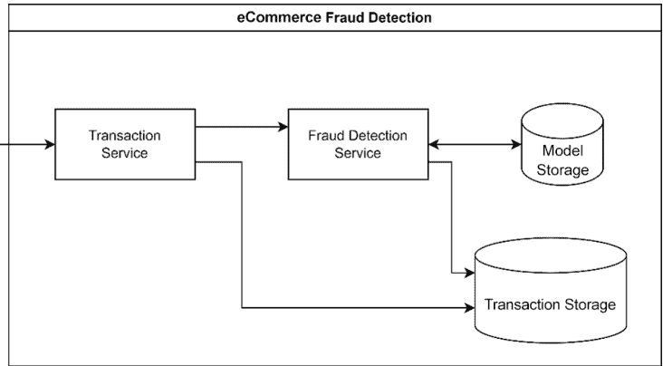
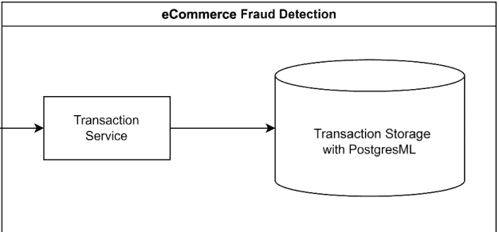
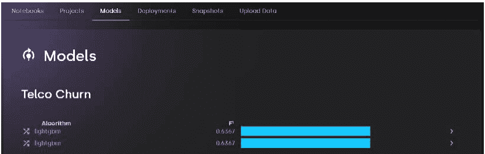
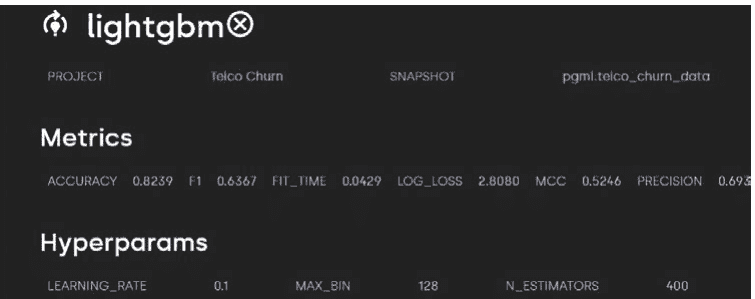

## 使用 PostgresML 的 LightGBM 模型

本章将介绍一个名为 **PostgresML** 的独特 MLOps 平台。PostgresML 是一个 Postgres 数据库扩展，允许使用 SQL 训练和部署 ML 模型。

PostgresML 和 SQL 与本书中一直使用的 scikit-learn 风格编程有显著不同。但是，如本章所示，在数据库级别执行 ML 模型开发和部署，在数据移动要求和推理延迟方面具有显著优势。

本章的主要主题如下：

- PostgresML 概述
- 开始使用 PostgresML
- 使用 PostgresML 和 LightGBM 的客户流失案例研究

### 技术要求

本章包含使用 PostgresML 的实际示例。将使用 Docker 设置 PostgresML 环境，并建议使用 Docker 运行示例。本章代码可在 https://github.com/PacktPublishing/Practical-Machine-Learning-with-LightGBM-and-Python/tree/main/chapter-10 获取。

### 介绍 PostgresML

PostgresML (https://postgresml.org/) 是 Postgres 的扩展，允许从业者在文本和表格数据之上基于 Postgres 数据库实现整个 ML 生命周期。


PostgresML 利用 SQL 作为训练模型、创建部署和进行预测的接口。使用 SQL 意味着模型和数据操作可以无缝结合，并自然融入 Postgres DB 数据工程环境。

拥有一个共享的数据和 ML 平台有很多好处。正如我们在前一章中所见，使用 SageMaker 时，将花费大量精力来移动数据。这是 ML 环境中的常见问题，数据（尤其是事务数据）存储在生产数据库中，需要创建复杂的数据工程工作流，从生产源提取数据，转换数据以供 ML 使用，并将数据加载到 ML 平台可访问的存储中（例如 SageMaker 的 S3）。

通过将数据存储与 ML 平台相结合，PostgresML 免除了将数据从一个平台移动到另一个平台的需要，节省了大量时间、精力、存储空间，并可能节省出口成本。

此外，基于实时事务数据进行建模意味着训练数据始终是最新的（直接从系统记录中读取），而不是受限于刷新操作。这消除了由于使用过时数据或 ETL 作业转换或加载数据不正确而产生的错误。

## 延迟和往返

模型部署的典型模式（我们在前面章节中已说明）是将模型部署在 Web API 后面。在微服务术语中，模型部署只是另一项服务，可以与其他服务组合以实现整体系统目标。

作为 Web 服务进行部署有多个优势。首先，使用 REST 等 Web 标准时，通过网络调用与其他系统的互操作性非常直接。其次，它允许您独立部署模型代码，与系统其他部分隔离，从而获得弹性和独立扩展。

但是，将模型作为独立服务部署也有一个显著的缺点：延迟和网络往返。

让我们考虑一个电子商务示例。在电子商务环境中，常见的 ML 问题是欺诈检测。下面是一个简单电子商务系统的系统架构图：



图 10.1 – 简化的电子商务系统架构，说明功能服务（交易）与 ML 驱动服务（欺诈检测）之间的交互

考虑图 10.1 中的架构，新交易的流程如下：

- 1. 交易被发送到事务服务。
- 2. 事务服务使用新交易的详细信息调用欺诈检测服务。
- 3. 欺诈检测服务接收新交易，从模型存储加载相关模型（如有需要），从事务存储加载历史数据，并将预测结果响应给事务服务。
- 4. 事务服务接收欺诈预测，并将带有相关分类的交易存储。

此工作流可能存在一些变体。然而，由于事务服务和欺诈检测服务的分离，处理新交易需要进行许多网络往返。进行欺诈预测还需要从事务存储获取历史数据来输入模型。

网络调用延迟和往返为交易增加了显著的开销。如果目标是实现低延迟或实时系统，则需要显著更复杂的架构组件——例如，模型和事务数据的缓存以及更高吞吐量的 Web 服务。

使用 PostgresML，架构可以简化为如下所示：



图 10.2 – 使用 PostgresML 将 ML 服务与数据存储相结合，允许更直接的系统设计

尽管此示例是一种过度简化，但重点在于，在具有独立模型服务的面向服务架构中利用 ML 模型的整体过程会增加显著的开销。

通过 PostgresML，我们可以消除对独立模型存储和加载模型开销的需求，更重要的是，将数据存储调用和预测合并为对数据存储层的单次调用，中间无网络开销。PostgresML 的基准测试发现，简化后的架构在云环境中将性能提高了 40 倍 [1]。

但是，此架构也存在缺点。首先，数据库现在是单点故障。如果数据库不可用，所有模型和预测功能也将不可用。其次，该架构混合了数据存储和 ML 建模与推理的关注点。取决于用例，训练和部署 ML 模型所需的服务器基础架构与处理 SQL 查询和存储数据不同。关注点的混合可能会迫使您在某一方面的责任上妥协，或显著增加数据库基础架构成本以支持所有用例。

在本节中，我们介绍了 PostgresML，并从概念层面解释了将我们的数据存储和 ML 服务相结合的优势。现在，我们将看看如何在实践中设置和开始使用 PostgresML，以及一些基本功能。

## 开始使用 PostgresML

当然，PostgresML 依赖于已安装 PostgreSQL。PostgresML 需要 PostgreSQL 11，也支持较新版本。PostgresML 还要求您的系统上安装了 Python 3.7+。ARM 和 Intel/AMD 架构均受支持。

### 注意

本节概述了开始使用 PostgresML 所需的步骤和依赖项，以及撰写时的功能。如需最新信息，请查看官方网站：https://postgresml.org/。运行 PostgresML 最简单的方法是使用 Docker。如需更多信息，请查看通过 Docker 快速入门文档：https://postgresml.org/docs/guides/setup/quick_start_with_docker。

该扩展可以使用官方包工具（如 APT）安装，或从源代码编译。一旦所有依赖项和扩展都已安装，必须更新 postgresql.conf 以加载 PostgresML 库，并重新启动数据库服务器：

```
shared_preload_libraries = 'pgml,pg_stat_statements'
sudo service postgresql restart
```

安装 PostgresML 后，必须在您计划使用的数据库中创建扩展。这可以通过 SQL 控制台以常规 PostgreSQL 方式完成：

```
CREATE EXTENSION pgml;
```

验证安装，如下所示：

```
SELECT pgml.version();
```

## 训练模型

现在，让我们看看 PostgresML 提供的功能。如前言所述，PostgresML 具有一个 SQL API。以下代码示例应在 SQL 控制台中运行。

训练模型的扩展函数如下：

```
pgml.train(
    project_name TEXT,
    task TEXT DEFAULT NULL,
    relation_name TEXT DEFAULT NULL,
    y_column_name TEXT DEFAULT NULL,
    algorithm TEXT DEFAULT 'linear',
    hyperparams JSONB DEFAULT '{}'::JSONB,
    search TEXT DEFAULT NULL,
    search_params JSONB DEFAULT '{}'::JSONB,
    search_args JSONB DEFAULT '{}'::JSONB,
    preprocess JSONB DEFAULT '{}'::JSONB,
    test_size REAL DEFAULT 0.25,
    test_sampling TEXT DEFAULT 'random'
)
```

我们需要将 `project_name` 作为第一个参数提供。PostgresML 将模型和部署组织为项目，项目由其名称唯一标识。

接下来，我们指定模型的 `task`：分类或回归。`relation_name` 和 `y_column_name` 设置训练运行的数据。关系是定义数据的表或视图，Y 列的名称指定关系中的目标列。

这些是训练所需的唯一参数。训练线性模型（默认）可以如下进行：

```sql
SELECT * FROM pgml.train(
    project_name => 'Regression Project',
    task => 'regression',
    relation_name => 'pgml.diabetes',
    y_column_name => 'target'
);
```

调用 `pgml.train` 时，PostgresML 会将数据复制到 `pgml` 架构中：这确保所有训练运行都是可复现的，并允许使用相同的数据但不同的算法或参数重新运行训练。`relation_name` 和 `task` 也仅在项目首次训练时需要。要为项目训练第二个模型，我们可以像这样简化训练调用：

```sql
SELECT * FROM pgml.train(
    'Regression Project',
    algorithm => 'lightgbm'
);
```

调用此代码时，将在相同数据上训练 LightGBM 回归模型。

algorithm 参数设置要使用的学习算法。PostgresML 支持多种算法，包括 LightGBM、XGBoost、scikit-learn 的随机森林和极端随机树、**支持向量机器（SVM）**、线性模型以及非监督算法（如 K-均值聚类）。

默认情况下，25% 的数据用作测试集，测试数据随机选择。这可以通过 `test_size` 和 `test_sampling` 参数控制。备选测试采样方法从第一行或最后一行选择数据。

### 超参数优化

PostgresML 支持在训练运行期间执行**超参数优化（HPO）**。搜索参数控制 HPO 过程。通过 `search` 支持两种搜索策略：网格搜索和随机搜索。要为 HPO 设置超参数范围，将使用 `search_params` 参数的 JSON 对象。HPO 参数使用 `search_args` 指定。这是一个示例：

```sql
SELECT * FROM pgml.train('Regression Project',


## Preprocessing

PostgresML 在训练模型时也支持执行某些类型的预处理。与训练数据和配置一样，预处理也与项目一起存储，因此在使用模型进行预测时可以应用相同的预处理。

关于预处理，PostgresML 支持对分类变量进行编码、对缺失值进行填补以及对数值进行缩放。预处理规则通过 preprocess 参数使用 JSON 对象进行设置，如下所示：

```
SELECT pgml.train(
...
preprocess => '{
	"model": {"encode": {"ordinal": ["Ford", "Kia",
	"Volkswagen"]}},
	"price": {"impute": "mean", scale: "standard"}
	"fuel_economy": {"scale": "standard"}
}',
);
```

在这里，我们为 model 特征应用了序数编码。或者，PostgresML 也支持独热编码和目标编码。我们还使用 price 的均值填补了缺失值（由列中的 NULL 指示），并对 price 和 fuel economy 特征应用了标准（正态）缩放。

## Deploying and prediction

训练后，PostgresML 会在测试集上自动计算适当的指标，包括 R²、F1 分数、精确率、召回率、ROC_AUC、准确率和对数损失。PostgresML 随后会在训练后自动部署模型，前提是模型的关键指标（回归任务为 R²，分类任务为 F1）优于当前部署的模型。

不过，也可以使用 pgml.deploy 函数手动管理项目的部署：

```
pgml.deploy(
project_name TEXT,
strategy TEXT DEFAULT 'best_score',
 algorithm TEXT DEFAULT NULL
 )
```

PostgresML 支持的部署策略包括：best_score（立即部署关键指标最佳的模型）；most_recent（部署最近训练的模型）；rollback（将当前部署回滚到先前部署的模型）。

部署模型后，可以使用 pgml.predict 函数进行预测：

```
pgml.predict (
 project_name TEXT,
 features REAL[]
 )
```

pgml.predict 函数接受项目名称和预测特征。特征可以是数组或复合类型。

## PostgresML 仪表板

PostgresML 提供了一个基于 Web 的仪表板，以便更易于访问 PostgresML 功能。仪表板与 PostgreSQL 分别部署，管理或充分利用 PostgresML 功能并不需要仪表板，因为所有功能也可以通过 SQL 查询访问。

仪表板提供对项目、模型、部署和数据快照列表的访问。还可以通过仪表板查看训练模型的更多详细信息，包括超参数设置和训练指标：



图 10.3 – 显示训练模型列表的 PostgresML 仪表板

除了提供对项目、模型和部署的视图外，仪表板还允许创建 SQL 笔记本，类似于 Jupyter Notebooks。如果无法轻松使用其他 SQL 控制台，这些 SQL 笔记本提供了一个简单的界面来与 PostgresML 交互。

至此，关于 PostgresML 入门的部分到此结束。接下来，我们将研究一个端到端的案例研究，介绍训练和部署 PostgresML 模型。

## Case study – customer churn with PostgresML

让我们重新审视电信提供商的客户流失问题。提醒一下，该数据集由客户及其与电信提供商相关的账户和费用信息组成。

## Data loading and preprocessing

在实际环境中，我们的数据通常已经可用于 PostgreSQL 数据库。但是，对于我们的示例，我们将从加载数据开始。首先，我们必须创建数据加载到的表：

```
CREATE TABLE pgml.telco_churn
(
    customerid   VARCHAR(100),
    gender       VARCHAR(100),
    seniorcitizen BOOLEAN,
    partner      VARCHAR(10),
    dependents   VARCHAR(10),
    tenure       REAL,
    ...
    monthlycharges VARCHAR(50),
    totalcharges   VARCHAR(50),
    churn         VARCHAR(10)
);
```

请注意，在我们的表结构中，少数列的类型与我们预期的不匹配：例如，每月和总费用应为实数值。我们将在预处理期间解决此问题。

接下来，我们可以将 CSV 数据加载到表中。PostgreSQL 提供了 COPY 语句来实现此目的：

```
COPY pgml.telco_churn (customerid,
                        gender,
                        seniorcitizen,
                        partner,
                        ...
                        streamingtv,
                        streamingmovies,
                        contract,
                        paperlessbilling,
                        paymentmethod,
                        monthlycharges,
                        totalcharges,
                        churn
) FROM '/tmp/telco-churn.csv'
DELIMITER ','
CSV HEADER;
```

运行此语句将读取 CSV 文件并将数据添加到我们的表中。

> **注意**
> 如果在 Docker 容器中运行 PostgresML（建议用于入门），则必须先将 CSV 文件复制到容器运行时。可以使用以下命令完成此操作（替换为您自己的容器名称）：
> `docker cp telco/telco-churn.csv postgresml-postgres-1:/tmp/telco-churn.csv.`

加载数据后，我们可以执行预处理。我们分三步完成此操作：直接在表中清理数据、创建将数据强制转换为适当类型的表视图，以及使用 PostgresML 的预处理功能：

```
UPDATE pgml.telco_churn
SET totalcharges = NULL
WHERE totalcharges = '';
```

我们必须将总费用中的空文本值替换为 NULL，以便稍后允许 PostgresML 填补这些值：

```
CREATE VIEW pgml.telco_churn_data AS
SELECT gender,
seniorcitizen,
CAST(CASE partner
WHEN 'Yes' THEN true
WHEN 'No' THEN false
END AS BOOLEAN) AS partner,
...
CAST(monthlycharges AS REAL),
CAST(totalcharges AS REAL),
CAST(CASE churn
WHEN 'Yes' THEN true
WHEN 'No' THEN false
END AS BOOLEAN) AS churn
FROM pgml.telco_churn;
```

然后我们创建一个视图以准备训练数据。值得注意的是，进行了两种类型转换：具有 Yes/No 值的特征映射为布尔值，并且我们将每月和总费用转换为 REAL 值（在将文本值映射为 NULL 之后）。我们还从视图中排除了 CustomerId，因为它无法用于训练。

## Training and hyperparameter optimization

我们可以按以下方式训练 LightGBM 模型：

```
SELECT *
FROM pgml.train('Telco Churn',
    task => 'classification',
    relation_name => 'pgml.telco_churn_data',
    y_column_name => 'churn',
    algorithm => 'lightgbm',
    preprocess => '{"totalcharges": {"impute": "mean"}}',
    search => 'random',
    search_args => '{"n_iter": 500 }',
    search_params => '{
        "num_leaves": [2, 4, 8, 16, 32, 64]
    }'
);
```

我们将视图设置为我们的关系，churn 列作为目标特征。对于预处理，我们使用均值请求 PostgresML 填补 totalcharges 特征的缺失值。

我们还使用指定搜索参数范围的随机搜索设置了超参数优化，共 500 次迭代。

训练完成后，我们将能够在仪表板中看到训练并部署的模型：



图 10.4 – PostgresML 仪表板中显示的训练过的 LightGBM 模型

仪表板显示我们模型的指标和表现最佳的超参数。我们的模型达到了 0.6367 的 F1 分数和 0.8239 的准确率。

如果仪表板不可用，也可以使用以下 SQL 查询检索相同信息：

```
SELECT metrics, hyperparams
FROM pgml.models m
LEFT OUTER JOIN pgml.projects p on p.id = m.project_id
WHERE p.name = 'Telco Churn';
```

我们的模型在训练时会自动部署，并准备好进行预测。

## Predictions

我们可以使用复合类型作为特征数据手动进行预测。具体操作如下：

```
SELECT pgml.predict(
    'Telco Churn',
    ROW (
        CAST('Male' AS VARCHAR(30)),
        1,
        ...
        CAST('Electronic check' AS VARCHAR(30)),
        CAST(20.25 AS REAL),
        CAST(4107.25 AS REAL)
    )
) AS prediction;
```

我们使用 PostgreSQL ROW 表达式设置数据，将文本转换为模型所需的正确类型。

但是，利用 PostgresML 模型更常见的方式是将预测纳入常规业务查询。例如，这里，我们从原始客户数据表中选择了所有数据，并使用 pgml.predict 函数为每一行添加了预测：

```
SELECT * ,
    pgml.predict (
        'Telco Churn',
        ROW (
            gender,
            seniorcitizen,
            ...
            paymentmethod,
```


```
CAST(monthlycharges AS REAL),
CAST(totalcharges AS REAL)
)
) AS prediction
FROM pgml.telco_churn;
```

与手动调用 predict 函数类似，我们使用 ROW 表达式将数据传递给 pgml.predict 函数，但从表中选择数据。

这也清楚地说明了使用 PostgresML 的优势：ML 模型的使用者可以以最小开销并在同一业务事务中通过单次网络调用，将新客户数据与预测结果一起查询。

## 摘要

本章介绍了 PostgresML，这是一个独特的 MLOps 平台，允许在现有 PostgreSQL 数据库之上通过 SQL 查询训练和调用模型。

我们讨论了该平台在简化机器学习环境、降低面向服务架构中的开销和网络延迟方面的优势。还介绍了核心功能和 API 的概述。

本章以利用 PostgresML 解决分类问题的实际示例结束，说明了如何训练 LightGBM 模型、执行超参数优化、部署它，并利用少量 SQL 查询进行预测。

在下一章中，我们将探讨使用 LightGBM 进行分布式和基于 GPU 的学习。

## 参考文献

- [1] PostgresML 比 Python HTTP 微服务快 8-40 倍，[在线]。可于 https://postgresml.org/blog/postgresml-is-8x-faster-than-python-http-microservices 查阅。
