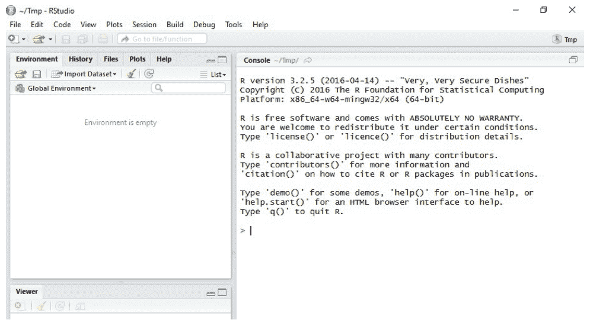
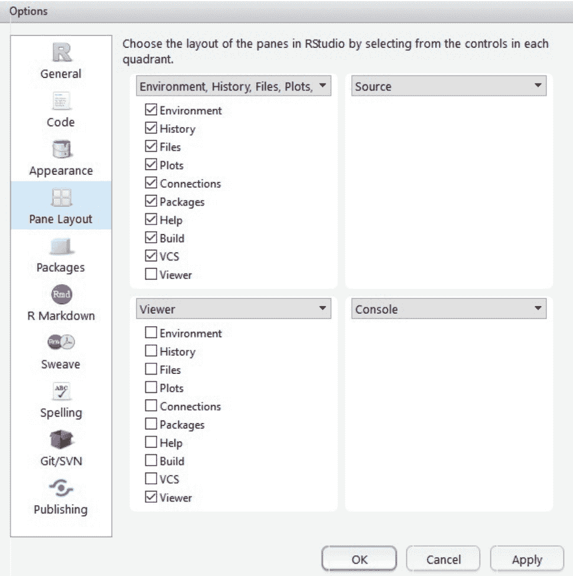
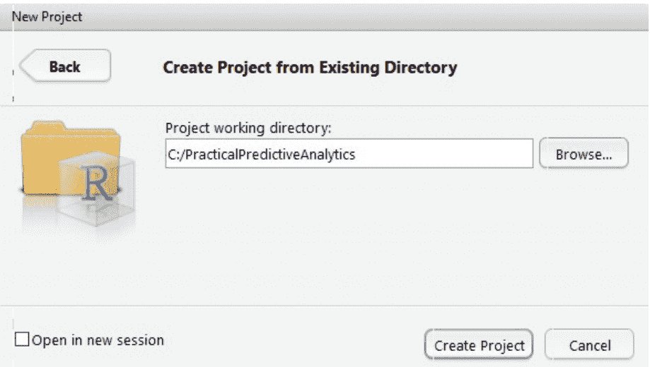
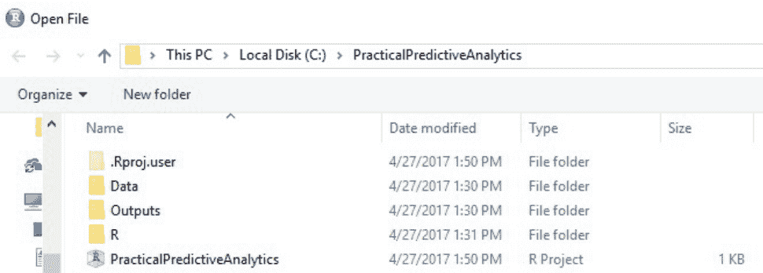
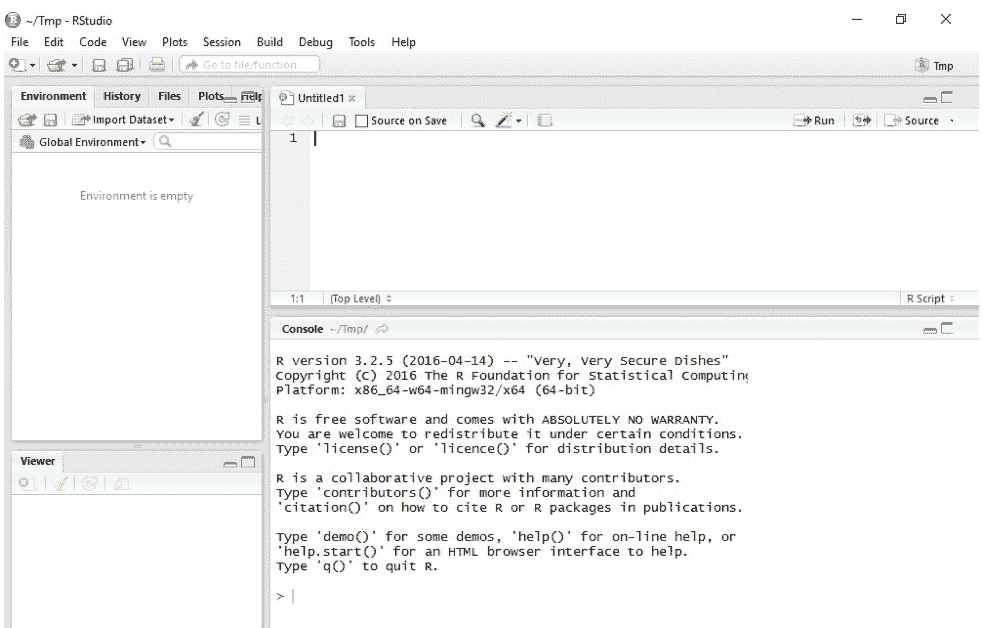
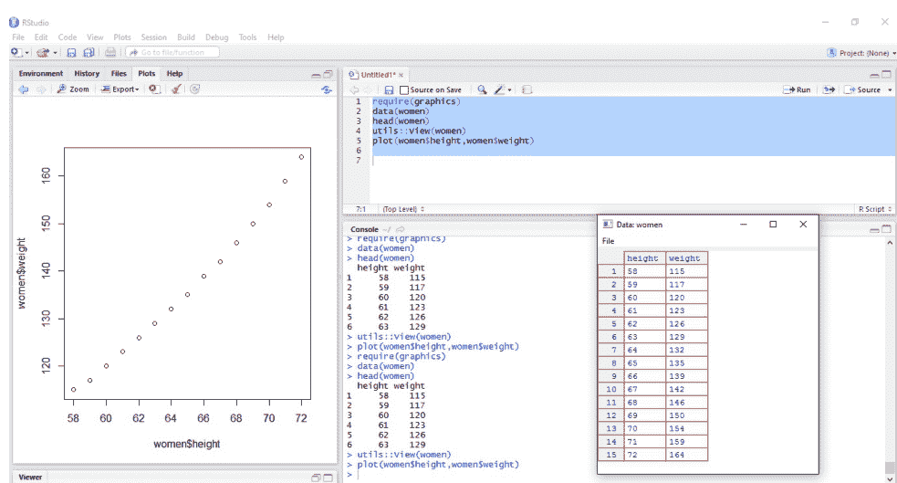
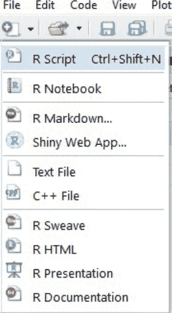
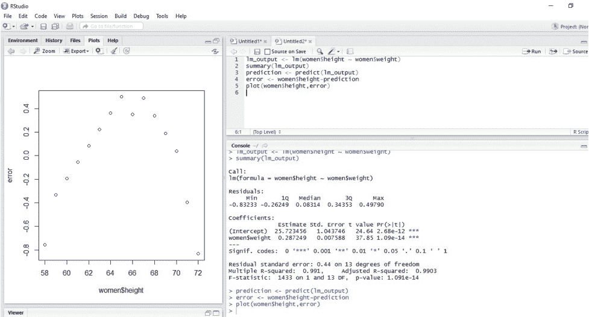

# 第 1 章. 预测分析入门

> "我们信赖上帝，其他人都必须带来数据"
> - 德明

我喜欢与人们一起工作并解释预测分析，因为它基于一个简单的概念：根据历史数据预测未来事件的概率。它的历史可以追溯到至少公元前 650 年。一些早期例子包括巴比伦人，他们试图根据云彩的出现和光环来预测短期天气变化：《穿越岁月的天气预报》，NASA。

医学也有长期需要对疾病进行分类的历史。巴比伦国王阿达德-阿普拉-伊迪纳颁布法令，收集医疗记录以形成《诊断手册》。该文集中的一些预测根据患者生病的天数和脉搏速率列出治疗方法（琳达·米纳等人，2014 年）。这是生物信息学的早期实例之一！

后来，在保险核保行业兴起之初，发展出了专门的预测分析。这被用作一种预测为海船投保所涉及风险的方法（https://www.lloyds.com/lloyds/about-us/history/corporate-history）。在差不多同一时期，人寿保险公司开始预测一个人能活到的年龄，以制定最合适的保费费率。

虽然预测的想法似乎始终根植于人类早期理解和分类的需求，但直到 20 世纪现代计算机的出现，它才真正流行起来。

除了在 20 世纪 40 年代帮助美国政府破译密码之外，艾伦·图灵还致力于最初的人机对弈计算机国际象棋算法。蒙特卡洛模拟方法起源于


曼哈顿计划中，大型机曾连续数日进行数值计算，以确定核攻击的概率（Computing and the Manhattan Project，无日期）。

20世纪50年代，**运筹学（OR）**理论得到发展，可用于优化两点之间的最短距离。至今，UPS和Amazon等公司的物流领域仍在使用这些技术。

非数学家也加入了这一行列。20世纪70年代，心脏病专家李·戈德曼（曾在潜艇上工作）花费数年时间开发出一棵高效的决策树。这帮助工作人员判断潜艇是否需要浮出水面，以帮助胸痛患者（Gladwell，2005）！

这些例子的共同点在于，人们首先对已经发生的事件进行观察，然后利用这些信息进行概括，进而对未来可能发生的事情做出决策。随之而来的还有对因果关系以及问题各部分相互关系的更深入理解。发现和洞察是通过方法论和遵循科学方法而产生的。

最重要的是，它们是为了解决当时重要且常常是实际问题的解决方案而产生的。这正是它们的独特之处。

## 预测分析应用于众多行业

自那时起，我们已经取得了长足进步，实用的分析解决方案推动了众多不同行业的发展。互联网对此产生了深远影响；它使每一次点击都能被存储和分析。收集和存储的数据比以往任何时候都多，其中有些只需付出很少的努力。这一点本身就使更多行业得以进入预测分析领域。

## 营销中的预测分析

营销是一个长期以来一直采用预测分析（PA）的行业。营销始终关注客户获取与保留，并开发了涉及各种促销方案和客户接触点的预测模型，旨在留住客户并获取新客户。在营销的某些细分领域，如无线通信和在线购物卡，这一点表现尤为明显，因为客户始终在寻找最佳交易。

具体来说，高级分析可以帮助回答诸如：如果我向客户提供10%的折扣并包邮，是否会比提供15%的折扣但不包邮产生更多收入？客户的360度视图扩大了与客户互动的方式，因此使营销组合和归因建模变得越来越重要。基于位置的设备使营销预测应用程序能够整合实时数据，在客户在店内时向其发送推荐。

## 医疗保健中的预测分析

医疗保健中的预测分析起源于临床试验，临床试验使用精心挑选的样本来测试药物和疗法的疗效。

然而，医疗保健已超越了这一范畴。随着传感器的出现，数据可以纳入预测分析，以监测危重病患者，并在患者处于风险中时向其发送警报。医疗保健公司现在可以预测哪些个体患者会遵守医疗服务提供者倡导的治疗方案。这将向各方发出早期预警信号，从而防止未来的并发症，并降低总治疗成本。

## 其他行业中的预测分析

其他行业中也有许多此类例子，以下仅列举几个：

- 金融：
  - 欺诈检测是一个巨大的领域。金融机构能够通过模式识别和其他机器学习算法监控客户的内部和外部交易以发现欺诈，然后就可疑活动向客户发出警报。分析通常实时进行。这是一个巨大的优势，因为罪犯可能非常老练，且往往比之前的分析快一步。
  - 华尔街程序化交易。交易算法将预测日内高低点，并决定何时买卖证券。
- 体育管理：
  - 体育管理分析能够预测哪些体育赛事将产生最大的观众人数，并根据观众兴趣实行变动票价。
  - 在棒球比赛中，投手的整场比赛可以被记录下来，然后进行数字分析。传感器也可以附着在他们的手臂上，以在可能发生未来损伤时发出警报。
- 高等教育：
  - 学院可以预测下学期可能有多少、哪种类型的学生入学，并据此规划资源。这是一个正在浮出水面的挑战，许多学校可能正在研究2016年SAT评分变化如何影响招生。
  - 基于时间的在线模块评估可以使教授识别学生的潜在问题领域，并提供个性化教学。
- 政府：
  - 联邦和州政府已接受开放数据理念，并向公众提供更多数据，这使公民数据科学家能够帮助解决关键的社会和政府问题。
  - 数据在紧急服务、交通安全和医疗保健方面的潜在用途是压倒性地积极的。

尽管这些行业可能截然不同，但预测分析的目标通常是为了增加收入、降低成本或改善结果。

## 预测分析中重要的技能和角色

那么，要在预测分析中取得成功，你需要具备哪些技能？我认为需要三项基本技能：

- 算法/统计/编程技能：这是实施技术解决方案解决问题所需的实际技术技能。我将这些都归为一类，因为这些技能通常是配合使用的。是纯粹的统计解决方案，还是需要加入一些编程来定制算法和清理数据？完成同一任务总有多种方法，这将取决于你，即预测建模者，来决定如何执行。

- 业务技能：这是与利益相关群体沟通想法和观点所需的技能。在某些行业工作长期、非常了解本行业的业务分析师和数据分析师，越来越多地被要求参与预测分析项目。数据科学正在成为一项团队运动，大多数项目包括与组织内其他人合作、总结发现，并且具备良好的演示和文档技能很重要。你经常会听到与之相关的术语“领域知识”。领域知识很重要，因为它让你能够将特定的分析技能应用于你所在（或希望所在）行业的特定分析问题。每个企业在解决分析问题时都有其自身的细微差别。如果你没有时间或意愿亲自深入了解当前问题的所有内部运作，请与了解的人合作。这将是组建一支优秀团队的开始！

- 数据存储/提取转换加载（ETL）技能：这可能涉及有关数据提取以及将其存储在关系型或非关系型NoSQL数据存储中的专业知识。历史上，这些任务仅在数据仓库内处理。但现在大数据时代已经来临，出现了了解数据存储复杂性以及组织数据最佳方式的专家。

## 相关工作技能和术语

除了预测分析一词外，以下是一些非常相关的术语：

- **预测建模**：这特指使用数学/统计模型来预测因变量或目标变量的可能性。你可能仍然可以进行预测；但是，如果没有底层模型，那就不是预测模型。

- **人工智能（AI）**：一个更广泛的术语，指机器如何能够进行理性思考并解决问题。AI的早期根植于神经网络。

- **机器学习**：AI的一个子集。具体涉及机器如何从数据中自动学习，通常是为了复制或超越人类决策。此时，每个人都知道Watson，它在《危险边缘》节目中击败了两位人类对手。

- **数据科学**：数据科学包含预测分析，但还通过编程增加了算法开发，并通过可视化增加了良好的演示技能。

- **数据工程**：数据工程专注于数据提取和数据准备过程，这些过程允许将原始数据转换为适合分析的形式。了解系统架构很重要。数据工程师通常会生成供预测分析师（或数据科学家）使用的数据。

- **数据分析师/业务分析师/领域专家**：这是一个统称，指对当前业务运作方式非常了解的人，在什么可能有意义、什么可能没有意义方面，是不可多得的学习对象。

- **统计学**：经典的推断形式，通常通过假设检验进行。统计学也是机器学习中使用的概率分布的基础，并与预测分析和数据科学密切相关。


## 预测分析软件

最初，预测分析是由统计学家在大型计算机上手动完成的，使用了诸如 FORTRAN 等一系列不同的语言。其中一些语言至今仍被广泛使用。例如，FORTRAN 仍然是运行速度最快的语言之一，且占用内存极少。因此，尽管它在预测模型开发中可能不再像其他语言那样普及，但它当然可以用于在生产环境中实现模型。

如今，关于使用哪种软件有很多选择，许多忠实用户仍坚持使用他们选定的软件。现实是，在解决特定类型的预测分析问题时，存在一定的重叠，而且目标当然是相同的。一旦你掌握了某个软件包中用于预测分析的方法论，将技能转移到另一个软件包应该相对容易。

### 开源软件

开源强调敏捷开发和社区共享。当然，开源软件是免费的，但免费也必须在总拥有成本（Total Cost Of Ownership，TCO）的背景下加以平衡。TCO 成本包括在一段时间内计入软件成本的所有内容：这不仅包括软件本身的成本，还包括培训、基础设施搭建、维护、人力成本，以及与某些产品中存在的快速升级和开发周期相关的其他费用。

### 闭源软件

闭源（或专有）软件，例如 SAS 和 SPSS，曾处于预测分析的前沿，并至今不断扩大其在传统统计和机器学习领域之外的影响力。闭源软件强调稳定性、更好的支持和安全性，以及更好的内存管理，这些对某些公司来说是重要因素。

### 和平共存

如今，关于哪种更好存在大量争论。我的预测是，两者将和平共存，互不取代。数据共享和通用 API 将变得更加普遍。各自在公司被认为正确的数据架构和生态系统中占有一席之地。每家公司都会强调某些因素，开源和闭源软件系统都在不断改进自身。因此，就学习其中一种而言，这不是二选一的决定。预测分析本身并不在乎你使用什么软件。请对开源和闭源软件提供的优势保持开放态度。如果你这样做，那当然会为在不同类型的公司和技术中工作打开可能性。

### 其他有用的工具

*人不能只靠面包活着，因此除了 R 之外，学习其他工具对你来说是有益的，以此提升你的分析技能：*

- **SQL**: 无论你选择使用哪种语言/包/环境，SQL 都是一款值得了解的宝贵工具。几乎每个分析工具都会有 SQL 接口，了解如何优化 SQL 查询肯定会加快你的生产力，尤其是当你直接从 SQL 数据库进行大量数据提取时。当今的常见做法是在数据库中尽可能多地进行预处理，因此如果你要从 MySQL、PostgreSQL、Oracle 或 Teradata 等数据库进行大量提取，学习如何在其原生框架内优化查询将是件好事。在 R 语言中，有几个 SQL 包可用于与各种外部数据库交互。我们将使用 `sqldf`，这是一个用于与 R 数据帧交互的流行 R 包。还有其他专门针对你将要使用的特定数据库定制的包。
- **Web 提取工具**: 并非每个数据源都来自数据仓库。了解从互联网提取数据的 API 将是有价值的。一些流行的工具包括 Curl 和 Jsonlite。
- **电子表格**: 尽管存在问题，电子表格通常是进行快速数据分析的最快方式，更重要的是，它们使你能够与他人共享结果！R 提供多个电子表格接口，但同样，学习独立的电子表格技能，例如数据透视表和 Visual Basic for Applications，如果你在大量使用这些技能的公司工作，将会给你带来优势。
- **数据可视化工具**: 数据可视化工具非常适合为分析增添冲击力，并以简洁的方式封装复杂信息。原生 R 可视化工具很出色，但并非每家公司都会使用 R。请学习一些第三方可视化工具，例如 D3.js、Google Charts、Qlikview 或 Tableau。
- **大数据、Spark、Hadoop、NoSQL 数据库**: 了解这些技术变得越来越重要，至少从需要提取和分析存储在这些框架内的数据的角度来看是这样。许多软件包都有可以直接与 Hadoop 通信的 API，可以在原生环境中直接运行预测分析，或者提取数据并在本地执行分析。

## 超越基础

鉴于预测分析领域非常广阔，一旦你超越了基础，就问问自己预测分析的哪个领域真正让你感兴趣，以及你想专精于什么。起初，尽可能多地了解预测分析的所有方面是好事，但归根结底，人们会寻求你的帮助，因为你是某些行业或技术方面的专家。这可能包括研究、算法开发，甚至是管理分析团队。

## 数据分析/研究

但是，作为一般指导，如果你参与或偏向于数据科学中的数据、分析或研究部分，我建议你专注于你感兴趣的特定行业中广泛采用的数据挖掘方法论和特定数据建模技术。

例如，逻辑回归在保险行业被大量使用，但社交网络分析则不然。经济研究侧重于时间序列分析，而不太侧重于聚类分析。推荐引擎在在线零售中很普遍。

## 数据工程

如果你更多地参与数据工程方面，应更专注于数据清洗、集成各种数据源的能力，以及完成此任务所需的工具。

## 管理

如果你是经理，应专注于模型开发、测试和控制、元数据，以及向高层管理人员展示结果，以证明价值或投资回报率。

## 团队数据科学

当然，预测分析正越来越成为一项团队运动，而非个人事业，数据科学团队也蓬勃发展。关于数据科学团队的组成部分已经有很多文章撰写，其中大部分可以归结为我之前概述的三项基本技能。

## 看待预测分析的两种不同方式

各个行业对预测分析的目标有不同的解读。例如，社会科学和营销喜欢了解模型中的因素，如果模型能够充分解释，他们可以牺牲一点准确性。另一方面，黑箱股票交易模型更感兴趣的是将糟糕交易的数量最小化，最终算算盈亏，并不太在意交易算法的哪些部分起作用。归根结底，准确性更重要。

取决于你打算如何处理特定问题，请看两种不同的分析思维如何影响预测分析过程：

- 1. 最小化预测错误目标：这是机器学习中非常常见的用例。最初的目标是使用适当的算法进行预测，以最小化预测错误。如果操作不当，算法最终会失败，并需要不断优化以得出新的最佳算法。如果机械地执行而不考虑对模型的理解，这肯定会导致失败的结果。某些模型，尤其是变量众多的过度优化模型，可能具有非常高的预测率，但以各种方式不稳定。如果一个人没有一个


understanding of the model, it can be difficult to react to changes in the data input.

- 2. Understanding model goal: This came out of the scientific method and is tied closely to the concept of hypothesis testing. This can be done in certain kinds of models, such as regression and decision trees, and is more difficult in other kinds of models such as Support Vector Machine (SVM) and neural networks. In the understanding model paradigm, understanding causation or impact becomes more important than optimizing correlations. Typically, understanding models has a lower prediction rate, but has the advantage of knowing more about the causations of the individual parts of the model, and how they are related. For example, industries that rely on understanding human behavior emphasize understanding model goals. A limitation to this orientation is that we might tend to discard results that are not immediately understood. It takes discipline to accept a model with lower prediction ability. However, you can also gain model stability

Of course, the previous examples illustrate two disparate approaches. Combination models, which use the best of both worlds, should be the ones we should strive for. Therefore, one goal for a final model is one which:

- Has an acceptable prediction error
- Is stable over time
- Needs a minimum of maintenance
- Is simple enough to understand and explain.

You will learn later that this is related to Bias/Variance tradeoff.

## R

Most of the code examples in this book are written in R. As a prerequisite to this book, it is presumed that you will have some basic R knowledge, as well as some exposure to statistics. If you already know about R, you may skip this section, but I wanted to discuss it a little bit for completeness.

The R language is derived from the S language which was developed in the 1970s. However, the R language has grown beyond the original core packages to become an extremely viable environment for predictive analytics.

Although R was developed by statisticians for statisticians, it has come a long way since its early days. The strength of R comes from its package system, which allows specialized or enhanced functionality to be developed and linked to the core system.

Although the original R system was sufficient for statistics and data mining, an important goal of R was to have its system enhanced via user-written contributed packages. At the time of writing, the R system contains more than 10,000 packages. Some are of excellent quality, and some are of dubious quality. Therefore, the goal is to find the truly useful packages that add the most value.

Most, if not all, R packages in use address most common predictive analytics tasks that you will encounter. If you come across a task that does not fit into any category, the chances are good that someone in the R community has done something similar. And of course, there is always a chance that someone is developing a package to do exactly what you want it to do. That person could eventually be you!

## CRAN

The Comprehensive R Archive Network (CRAN) is a go-to site which aggregates R distributions, binaries, documentation, and packages. To get a sense of the kind of packages that could be valuable to you, check out the Task Views section maintained by CRAN here: https://cran.r-project.org/web/views/

## R installation

R installation is typically done by downloading the software directly from the Comprehensive R Archive Network (CRAN) site:

- Navigate to https://cran.r-project.org/.
- Install the version of R appropriate for your operating system. Please read any notes regarding downloading specific versions. For example, if you are a Mac user may need to have XQuartz installed in addition to R, so that some graphics can render correctly.

## Alternate ways of exploring R

Although installing R directly from the CRAN site is the way most people will proceed, I wanted to mention some alternative R installation methods. These methods are often good in instances when you are not always at your computer:

- Virtual environment: Here are a few ways to install R in the virtual environment:
  - VirtualBox or VMware: Virtual environments are good for setting up protected environments and loading preinstalled operating systems and packages. Some advantages are that they are good for isolating testing areas, and when you do not wish to take up additional space on your own machine.
  - Docker: Docker resembles a virtual machine, but is a bit more lightweight since it does not emulate an entire operating system, but emulates only the needed processes.
- Cloud-based: Here are a few methods to install R in the cloud-based environment. Cloud based environments are perfect for working in situations when you are not working directly on your computer:

- AWS/Azure: These are three environments which are very popular. Reasons for using cloud based environments are similar to the reasons given for virtual environment, but also have some additional advantages: such as the additional capability to run with very large datasets and with more memory. All of the previously mentioned require a subscription service to use, however free tiers are offered to get started. We will explore Databricks in depth in later chapters, when we learn about predictive analytics using R and SparkR.
- Web-based: Web-based platforms are good for learning R and for trying out quick programs and analysis. R-Fiddle is a good choice, however there are other including: R-Web, Jupyter, Tutorialspoint, and Anaconda Cloud.
- Command line: R can be run purely from a command line. When R is run this way, it is usually coupled with other Linux tools such as curl, grep, awk, and various customized text editors, such as **Emacs Speaks Statistics (ESS)**. Often R is run this way in production mode, when processes need to be automated and scheduled directly via the operating system.

## How is a predictive analytics project organized?

After you install R on your own machine, I would give some thought to how you want to organize your data, code, documentation, and so on. There will probably be many different kinds of projects that you will need to set up, ranging from exploratory analysis to full production-grade implementations. However, most projects will be somewhere in the middle, that is, those projects that ask a specific question or a series of related questions. Whatever their purpose, each project you will work on will deserve its own project folder or directory.

Some important points to remember about constructing projects:

- It is never a good idea to boil the ocean, or try to answer too many questions at once. Remember, predictive analytics is an iterative process.
- Another trap that people fall into is not having their project reproducible. Nothing is worse than to develop some analytics on a set of data, and then backtrack, and oops! different results.
- When organizing code, try to write code as building block, which can be reusable. For R, write code liberally as functions.
- Assume that anything concerning requirements, data, and outputs will change, and be prepared.
- Considering the dynamic nature of the R language. Changes in versions, and packages could all change your analysis in various ways, so it is important to keep code and data in sync, by using separate folders for the different levels of code, data, and so on or by using version management packages such as subversion, git, or cvs.

Once you have considered all of the preceding points, physically set up your folder environment.

## Setting up your project and subfolders

We will start by creating folders for our environment. Often projects start with three subfolders which roughly correspond to:

- Data source
- Code-generated outputs
- The code itself (in this case, R)

There may be more in certain cases, but let's keep it simple:

- First, decide where you will be housing your projects. Then create a sub-directory and name it `PracticalPredictiveAnalytics`. For this example, we will create the directory under Windows drive C.
- Create three subdirectories under this project: `Data`, `Outputs`, and `R`:
  - The `R` directory will hold all of our data prep code, algorithms, and so on.
  - The `Data` directory will contain our raw data sources that will typically be read in by our programs.
  - The `Outputs` directory will contain anything generated by the code. That can include plots, tables, listings, and output from the log.

Here is an example of how the structure will look after you have created the folders:

| Name | Date modified | Type |
|---|---|---|
| Data | 4/27/2017 1:30 PM | File folder |
| Outputs | 4/27/2017 1:30 PM | File folder |
| R | 4/27/2017 1:31 PM | File folder |


## 图形用户界面（GUIs）

R，与许多语言和知识发现系统一样，起源于命令行。然而，预测分析师倾向于偏好图形用户界面（GUIs），对于 Mac、Windows 和 Linux 这三种不同的操作系统，都有多种选择可用。它们各有优劣，当然，始终存在个人偏好的问题。

内存在使用 R 时始终是一个需要考虑的因素，如果这对你至关重要，你可能会希望选择一个更简单的 GUI，例如 R 自带的那个。

如果你需要完全控制，并且想要添加一些生产力工具，可以选择 RStudio，它是一个功能齐全的 GUI，允许你实现版本控制仓库，并具有代码补全等良好功能。

R Commander (Rcmdr) 和 Rattle 的独特功能在于它们提供菜单，允许针对常见统计和数据挖掘任务进行引导式点击命令。它们都是代码生成器。这是学习 R 的一个起点，因为你可以使用菜单来完成任务，然后通过查看每个特定任务生成代码的方式来学习。如果你对使用 Rattle 进行预测分析感兴趣，我编写了一个关于将 R 与 Rattle 结合使用的优秀教程，可以在 *医学实用预测分析与决策系统* 的教程部分找到，该书在本章末尾有引用。

RCmdr 和 RStudio 都提供与 Windows、Apple 和 Linux 操作系统兼容的 GUI，因此我将在本书中使用它们来演示示例。但请记住，它们只是用户界面，而非 R 本身，因此将代码示例粘贴到其他 GUI 中并自行决定喜欢哪个应该足够简单。

## 开始使用 RStudio

R 安装完成后，将浏览器指向 RStudio 网站（https://www.rstudio.com/）上的下载部分，并安装适合你操作系统的 RStudio 可执行文件：

- 单击 **rStudio** 图标以启动程序。

程序最初以三个平铺窗格启动，如下截图所示。如果布局与所示不完全一致，下一节将向你展示如何重新排列布局以与本章中显示的示例相符：



## 重新排列布局以与示例相符

要重新排列布局，请参见以下步骤：

- 1. 从顶部导航栏选择 `Tools` | `Global Options` | `Pane Layout`。
- 2. 选择四个象限中每个的下拉箭头，并将每个窗格的标题更改为下图所示的内容。
  - 确保左上角窗格已选中 `Environment | History | Files | Plots` 和 `Help`
  - 确保左下角窗格已选中 `Viewer`。
  - 右下角窗格选择 `Console`
  - 右上角窗格选择 `Source`
- 3. 单击 OK。

应用更改后，布局应与先前显示的布局更加接近。但是，它可能不完全匹配。这很大程度上取决于你使用的 RStudio 版本以及你可能已经安装的包。



## 一些重要窗格的简要说明

- Source 窗格将用于编写和保存你的程序。创建代码后，可以使用 File | Save 将工作保存到外部文件，并使用 File | Open 检索保存的代码。

## 注意

如果你第一次安装 RStudio，第四个窗格可能什么也不显示。但是，当你创建新程序（如本章后面所述）时，它将出现在右上角象限。

- Console 窗格在程序运行后提供有关程序的重要反馈和信息。它会显示发生的任何语法或错误消息。始终是最佳实践，检查控制台以确保你获得预期的结果，并确保控制台没有错误。控制台也是你将看到程序生成的大量输出的地方。
- 我们将大量依赖 View 窗格。该窗格显示使用 R View 命令运行的格式化输出。
- Environment | History | Plots 窗格有点像是一个万能窗格，其功能取决于通过窗格布局对话框选择了哪些选项卡。例如，R 命令生成的所有图表都在 Plots 选项卡下显示。选择 Help 选项卡即可随时获得帮助。还有一个名为 Packages 的有用选项卡，当检查特定包时，它会自动加载该包。

## 创建新项目

布局设置好后，请按照以下步骤创建新项目：

按照以下步骤创建新项目：

- 1. 识别屏幕左上角图标上方的菜单栏。
- 2. 单击 File，然后单击 New Project
- 3. 在下一屏幕中选择 Existing Directory：

## 新项目

## 从以下方式创建项目：

- **新目录**
  在全新的工作目录中启动项目

- **现有目录**
  将项目与现有工作目录关联

- **版本控制**
  从版本控制仓库检出项目

取消

4. 将出现以下屏幕：

## 新项目

返回

## 从现有目录创建项目

项目工作目录：

~

浏览...

在新会话中打开

创建项目   取消

5. `Project working directory` 初始填充了波形符号 (~)。这意味着项目将在你当前所在的目录中创建。

6. 若要指定目录，请先选择 `Browse`，然后导航到你在之前步骤中创建的 `PracticalPredictiveAnalytics` 文件夹。

- 7. 当出现 `Choose Directory` 对话框时，请使用 `Select Folder` 按钮选择该目录。
- 8. 选择目录后，应出现以下内容（仅限 Windows）：



- 9. 要完成项目创建，请选择 `Create Project` 按钮。RStudio 将切换到你刚刚创建的新项目。

然后，所有屏幕窗格将显示为空白（日志除外），且屏幕左上角的标题栏将显示项目路径。

要验证 R、outputs 和 data 目录是否包含在项目中，请从顶部菜单栏选择 File，然后选择 File Open。应出现三个文件夹，如下所示：



验证此项后，取消 **打开文件** 对话框，并返回 RStudio 主屏幕。

## R 控制台

既然我们已经创建了项目，让我们来看看 R 控制台窗口。单击标记为 Console 的窗口。所有控制台命令都是在命令提示符 > 后输入命令，然后按 Enter 发出的。我将只演示三个命令，它们将帮助你回答“我正在哪个项目上？”和“我的文件夹中有哪些文件？”这两个问题。


- 1. `getwd()`：`getwd()` 命令非常重要，因为它始终会告诉你当前所在的目录。由于我们刚刚创建了一个新项目，我们预计它将指向我们刚刚创建的目录，对吧？为了双重检查，切换到控制台，发出 `getwd()` 命令，然后按 `Enter`。它应该会返回当前工作目录：

```
> getwd()
[1] "C:/PracticalPredictiveAnalytics"
> |
```

- 2. `dir()`：`dir()` 命令将列出当前工作目录中的所有文件。在我们的例子中，它只是你刚刚创建的三个目录的名称。但是，你通常可能会看到许多文件，这些文件通常对应于你所在目录的类型（`.R` 用于源文件，`.dat`、`.csv` 用于数据文件，等等）：

```
> dir()
[1] "Data" "Outputs"
[3] "PracticalPredictiveAnalytics.Rproj" "R"
> |
```


- 3. `setwd()`：有时您需要在同一项目中甚至在另一个项目之间切换目录。您将使用的命令是 `setwd()`。您需要提供要切换到的目录，并将其全部放在括号内。以下示例将切换到存放 R 代码的子目录。此特定示例将完整路径作为目标目录提供。由于您已位于 `PracticalPredictiveAnalytics` 目录中，也可以使用 `setwd("R")`，效果相同：

```
> setwd("C:/PracticalPredictiveAnalytics/R")
```

要验证目录是否已更改，请再次运行 `getwd()` 命令：

```
> getwd()
[1] "C:/PracticalPredictiveAnalytics/R"
```

我建议大胆使用 `getwd()` 和 `setwd()`，尤其是在您处理多个项目并希望避免读写错误文件时。

## 源代码窗口

源代码窗口是所有 R 代码显示的位置。您也可能大部分时间都会在这里度过。您可以同时打开多个脚本窗口。

## 创建新脚本

要创建新脚本，请从顶部导航栏选择 File | New File | R Script。将出现名为 Untitled1 的新空白脚本窗口。

出现后，您可以开始输入代码！



### 我们的第一个预测模型

现在所有准备工作已就绪，我们将编写第一个极其简单的预测模型。要完成此任务，需编写两个脚本。

我们的第一个 R 脚本目前尚不是预测模型，而是一个用于查看和绘制一些数据的初步程序。我们将使用的数据集已内置在 R 包系统中，无需从外部加载。为了快速演示技术，我有时会直接使用特定 R 包自身包含的示例数据来展示想法，而不是从外部文件中读取数据。

在此示例中，数据将从启动时默认加载的 `datasets` 包中获取。

- 将以下代码粘贴到刚才创建的 `Untitled1` 脚本中。暂时无需担心每行代码的含义。代码执行后，我将介绍具体的行：

```
require(graphics)
data(women)
head(women)
View(women)
plot(women$height, women$weight)
```

- 在代码窗格中，您会看到位于 `Untitled1` 选项卡正下方的菜单栏。它看起来应该类似于此：


- 要执行代码，请单击 `source` 图标。显示随后应更改为以下图表：



从前面的图片可以看出，有三个方面发生了变化：

- 1. 输出已写入 `Console` 窗格。
- 2. `View` 窗格已弹出，其中包含一个两列表格。
- 3. 此外，图表将出现在 `Plot` 窗格中。

## 代码说明

以下是代码完成工作的更多详细信息：

- 代码第 1 行包含函数 `require`，这只是表示 R 需要特定包才能运行的一种方式。在此示例中，`require(graphics)` 指定分析需要 `graphics` 包，并将其加载到内存中。如果不可用，您将收到一条错误消息。但是，`graphics` 是基础包，应该可用。
- 代码第 2 行使用 `data(women)` 函数将 `women` 数据对象加载到内存中。
- 代码第 3-5 行以三种不同的方式显示原始数据：
  - `View(women)`：这将以可视化方式显示 DataFrame。虽然这是实际 R 脚本的一部分，但查看 DataFrame 是一项非常常见的任务，通常可以直接通过 R 控制台作为命令发出。如您在前一张图中所见，Women 数据框架包含 15 行和 2 列，列名分别为 height 和 weight。
  - `plot(women$height, women$weight)`：这使用 R 原生的 plot 函数，将两个变量的值相互绘制。这通常是开始了解两个变量之间关系时的第一步。如您所见，该关系非常线性。
  - `head(women)`：这将 Women 数据框架的前 N 行显示到控制台。如果希望不超过特定数量的行，请将该数字作为函数的第二个参数添加。例如，`head(women, 99)` 将在控制台中显示最多 99 行。`tail()` 函数工作方式类似，但显示最后几行数据。

## 注意

函数 `utils::View(women)` 也可以简写为 `View(women)`。我添加了 `utils::` 前缀，以指示 `View()` 函数属于 `utils` 包。除非存在函数名称冲突，否则通常没有理由添加前缀。当内存中加载了来自两个不同包的同名函数时，就会发生这种情况。我们将在后面的章节中看到这类函数名称冲突。但是，始终可以安全地将函数名加上其所属包的名称作为前缀。

## 保存脚本

要保存此脚本，请导航到顶部导航菜单栏并选择 File | Save。当文件选择器出现时，导航到已创建的 PracticalPredictiveAnalytics/R 文件夹，并将文件命名为 Chapter1_DataSource。然后选择保存。

## 您的第二个脚本

我们的第二个 R 脚本是一个简单的双变量回归模型，用于根据体重预测女性的身高。

首先，从顶部导航栏选择 File | New File | R Script 创建另一个 R 脚本。如果您通过 File | New File | R Script 频繁创建新脚本，可能会产生“点击疲劳”（需要点击三次），因此您也可以选择左上角带 + 号的图标来节省一次点击：



无论选择哪种方式，都将出现名为 Untitled2 的新空白脚本窗口。

现在将以下代码粘贴到新脚本窗口中：

```
require(graphics)
data(women)
lm_output <- lm(women$height ~ women$weight)
summary(lm_output)
prediction <- predict(lm_output)
error <- women$height - prediction
plot(women$height, error)
```

按 **source** 图标运行整个代码。显示将更改为类似于以下所示的内容：



## 代码说明

以下是关于您刚刚运行的脚本代码的一些注释和说明：

- `lm()` 函数：该函数使用 `lm()` 函数运行简单的线性回归。该函数根据体重值预测女性的身高。在统计术语中，您将进行身高对体重的回归。完成此操作的代码行如下：

```
lm_output <- lm(women$height ~ women$weight)
```

- 在 R 中运行预测模型时，您将非常熟悉以下两种操作：

- `~` 运算符：也称为波浪号，这是一种简写方式，用于分隔您要预测的内容与用于预测的内容。这是公式语法中的表达式。您要预测的内容（因变量或目标变量）通常位于公式左侧，而预测变量（自变量、特征）位于右侧。为了提高可读性，自变量（`weight`）和因变量（`height`）使用 $ 表示法指定，即指定对象名称、$ 和数据框列。因此，女性身高引用为 `women$height`，女性体重引用为 `women$weight`。或者，您可以使用 `attach` 命令，然后仅通过指定名称 `height` 和 `weight` 来引用这些列。例如，以下代码将实现相同的结果：

```
attach(women)
lm_output <- lm(height ~ weight)
```

- `<-` 运算符：也称为赋值运算符。这种常见语句将赋值运算符右侧评估的任何表达式分配给运算符左侧指定的对象。这将始终创建或替换一个新对象，您可以对其进行进一步显示或操作。在此示例中，我们将创建一个名为 `lm_output` 的新对象，该对象使用函数 `lm()` 创建，该函数根据括号内包含的公式创建线性模型。

## 注意

请注意，执行此行不会产生任何显示输出。您可以通过检查控制台来查看该行是否已执行。如果运行该行（或任何行）出现问题，您将在控制台中看到错误消息。

- `summary(lm_output)`：以下语句显示关于对象 `lm_output` 的一些重要汇总信息，并将输出写入 R 控制台，如之前所示：


summary(lm_output)

- 结果将在控制台窗口中显示，如上图所示。为了暂时简化问题，我将只显示输出的前几行，并下划线标出你应该关注的内容。不要被产生的大量输出吓到。

- 查看控制台中 coefficients 行下方标记为 Intercept 和 women$weight 的行。

```
Coefficients:
                  Estimate Std. Error t value Pr(>|t|)
(Intercept) 25.723456   1.043746  24.64 2.68e-12 ***
women$weight  0.287249  0.007588  37.85 1.09e-14 ***
```

- Estimate 列说明了从体重推导身高所需的线性回归公式。我们实际上可以使用这些数字，配合计算器自己来确定预测值。在我们的示例中，输出告诉我们，为了获得身高的预测值，应该对数据框中的所有观测值执行以下步骤。显然，我们不想对所有观测值都这样做（R 将通过以下 predict() 函数来完成），但我们将为 1 个数据点演示计算过程。

- 获取每个观测值的体重值。让我们以第一位女性的体重为例，即 115 lbs。

- 然后，将体重乘以 0.2872。该数字列在 women$weight 的 Estimate 下方。115 lbs 乘以 0.2872 等于 33.028。

- 然后加上 25.7235，即 (intercept) 行的估计值。这样得到的身高预测值为 58.75 英寸。

- 如果你手边没有计算器，可以通过 R 控制台的计算器模式轻松完成计算，输入以下内容：

```
> 115 * .2872 + 25.7235
[1] 58.7515
```

## predict 函数

要预测所有值的预测值，我们将使用一个名为 `predict()` 的函数。该函数读取每个输入（自变量），然后基于线性回归方程预测目标（因变量）。在代码中，我们将该函数的输出分配给一个名为 `prediction` 的新对象。

切换到控制台区域，输入 `prediction`，然后按 Enter，即可查看 15 名女性的预测值。控制台中应出现以下内容。

```
> prediction
   1        2        3        4        5        6        7
58.75712 59.33162 60.19336 61.05511 61.91686 62.77861 63.64035
   8        9       10       11       12       13       14
64.50210 65.65110 66.51285 67.66184 68.81084 69.95984 71.39608
   15
72.83233
```

请注意，第一个预测值与你刚才手动计算的结果非常接近。差异是由舍入误差引起的。

## 检查预测误差

线性回归生成的另一个 R 对象是 `error` 对象。`error` 对象是一个向量，它是通过预测身高值与实际身高值的差值计算得出的。这些值也被称为残差误差，或简称残差。

```
error <- women$height-prediction
```

由于 `error` 对象是一个向量，不能使用 `nrow()` 函数来获取其大小。但可以使用 `length()` 函数：

```
> length(error)
```

```
[1] 15
```

在之前的所有情况中，计数都为 15，因此一切正常。如果我们想查看所有数据的原始数据、预测值和预测误差，可以使用 cbind() 函数（列绑定）将这三个值连接起来，并以简单表格形式显示。

在控制台中输入以下 cbind 命令：

```
> cbind(height=women$height, PredictedHeight=prediction, ErrorInPrediction)
```

| | height | PredictedHeight | ErrorInPrediction |
|---|---|---|---|
| 1 | 58 | 58.75712 | -0.75711680 |
| 2 | 59 | 59.33162 | -0.33161526 |
| 3 | 60 | 60.19336 | -0.19336294 |
| 4 | 61 | 61.05511 | -0.05511062 |
| 5 | 62 | 61.91686 | 0.08314170 |
| 6 | 63 | 62.77861 | 0.22139402 |
| 7 | 64 | 63.64035 | 0.35964634 |
| 8 | 65 | 64.50210 | 0.49789866 |
| 9 | 66 | 65.65110 | 0.34890175 |
| 10 | 67 | 66.51285 | 0.48715407 |
| 11 | 68 | 67.66184 | 0.33815716 |
| 12 | 69 | 68.81084 | 0.18916026 |
| 13 | 70 | 69.95984 | 0.04016335 |
| 14 | 71 | 71.39608 | -0.39608278 |
| 15 | 72 | 72.83233 | -0.83232892 |

从前面的输出可以看出，总共有 15 个预测值。如果将 ErrorInPrediction 与先前显示的误差图进行比较，你会发现，对于这个非常简单的模型，身高极端值（阴影值）的预测误差要大得多。

为了验证每个原始观测值都有一个对应值，我们将使用 nrow() 函数来计算行数。

在控制台区域的命令提示符处，输入以下命令：

```
nrow(women)
```

应出现以下内容：

```
>nrow(women)
[1] 15
```

请参考原始脚本中的第七行代码：plot(women$height,error) 将预测身高与误差进行绘图。它显示了预测值与原始值之间的偏差程度。你可以看到，误差呈现出非随机模式。

完成后，使用 File | File Save 保存文件，导航到创建的 PracticalPredictiveAnalytics/R 文件夹，并将其命名为 Chapter1_LinearRegression。

## R 包

R 包扩展了基础 R 的功能。Base R 本身功能非常强大，即使不添加任何额外包，你也能进行大量分析。不过，如果某个包添加了 Base R 中不存在的功能、改进或基于现有功能构建新功能，或者只是让你已能做到的事情变得更简单，那么添加该包可能是有益的。

例如，Base R 中没有内置包可以执行某些类型的机器学习（例如随机森林）。因此，你需要搜索执行此功能的附加包。幸运的是，有很多可用的包实现了此算法。

请记住，不断会有新包推出。我倾向于偏好那些在 CRAN 上已经存在较长时间且拥有大量用户群体的包。在安装新内容时，我会尝试将结果与其他功能类似的包进行对比。速度也是考虑采用新包的另一个原因。

### stargazer 包

作为一个能让生活更轻松的包的示例，我们先来看看之前对回归结果运行 summary 函数所产生的输出。如果你愿意，可以再次运行它。

```
summary(lm_output)
```

`summary()` 函数输出的统计信息量对初学者来说可能令人难以承受。这不仅与输出量有关，还与格式有关。这就是为什么我在之前的示例中没有显示完整输出的原因。

让输出更易于查看的一种方法是先减少呈现的输出量，然后重新格式化它，使其更易读。

为了实现这一目标，我们可以使用一个名为 `stargazer` 的包，它将重新格式化 `summary()` 函数产生的大量输出并简化呈现方式。Stargazer 擅长重新格式化许多回归模型的输出，并以 HTML、PDF、Latex 或简单格式化文本显示结果。默认情况下，它将显示各种模型最重要的统计输出，你也可以始终指定想要查看的统计输出类型。

要获取有关 `stargazer` 包的更多信息，可以先访问 CRAN 并搜索有关 `stargazer` 包的文档，或使用 R 帮助系统：

如果已经安装了 stargazer，可以使用以下命令：

```
packageDescription("stargazer")
```

如果尚未安装该包，有关 `stargazer`（或其他包）的信息也可以通过 R 特定的互联网搜索找到：

```
RSiteSearch("stargazer")
```

如果你喜欢在 R 中搜索文档，可以在以下网址获取有关 R 帮助系统的更多信息：

https://www.r-project.org/help.html

### 安装 stargazer 包

现在来安装 stargazer：

- 首先创建一个新的 R 脚本（File | New File | R Script）。
- 输入以下几行，然后在代码窗格的菜单栏中选择 Source，这将提交整个脚本：

```
install.packages("stargazer")
library(stargazer)
stargazer(lm_output, , type="text")
```


运行脚本后，`Console` 中应出现以下内容：

> stargazer(lm_output, title="Lm Regression on Height", type="text")

| | |
|---|---|
| **高度线性回归** | |
| 因变量： | 身高 |
| 体重 | 0.287*** (0.008) |
| 常数项 | 25.723*** (1.044) |
| 观察值 | 15 |
| R2 | 0.991 |
| 调整后的 R2 | 0.990 |
| 残差标准误 | 0.440 (df = 13) |
| F 统计量 | 1,433.024*** (df = 1; 13) |
| 注 | *p<0.1; **p<0.05; ***p<0.01* |

## 代码说明

以下是您刚刚运行的代码逐行说明：

- `install.packages("stargazer")`: 该行会将程序包安装到计算机上的默认程序包目录。如果您将再次运行此代码，可以注释掉此行，因为该程序包已安装在您的 R 存储库中。
- `library(stargazer)`: 安装程序包不会使程序包自动可用。您需要运行 library（或 `require()`）函数才能实际加载 `stargazer` 程序包。
- `stargazer(lm_output, , type="text")`: 该行将获取在第一个脚本中创建的输出对象 `lm_output`，压缩输出，并以更简单、更易读的格式将其写入控制台。`stargazer` 库中有许多其他选项，可将输出格式化为 HTML 或 LaTeX。

请参阅位于 https://cran.r-project.org/web/packages/stargazer/index.html 的参考手册以获取更多信息。

重新格式化后的结果将出现在 R 控制台中。正如您所看到，写入控制台的输出更加整洁，也更易于阅读。

### 保存您的工作

完成后，从菜单栏选择 `File | File Save`。

然后导航到已创建的 `PracticalPredictiveAnalytics/Outputs` 文件夹，将其命名为 `Chapter1_LinearRegressionOutput.R`。按 `Save`。

## 参考文献

- 《计算与曼哈顿计划》检索自 http://www.atomicheritage.org/history/computing-and-manhattan-project
- Gladwell, M. (2005). 《眨眼：无需思考的思考能力》. 纽约：Little, Brown and Co.
- Linda Miner 等人 (2014). 《医学实用预测分析与决策系统》. Elsevier.
- Watson（计算机）检索自 Wikipedia: https://en.wikipedia.org/wiki/Watson_(computer).
- 《历代天气预报》检索自 http://earthobservatory.nasa.gov/Features/WxForecasting/wx2.php.

## 摘要

本章我们初步了解了什么是预测分析以及它如何在各个行业中应用。我们了解了一些关于数据的知识，以及如何在项目中组织数据。最后，我们安装了 RStudio，运行了一个简单的线性回归，并安装和运行了我们的第一个程序包。我们了解到，在数据加载到内存后检查数据始终是良好的做法，仅通过显示和绘制数据就可以学到很多东西。

在下一章中，我们将讨论预测建模过程本身，介绍使用 R 的一些关键建模程序包，并提供关于避免一些预测建模陷阱的指导。
