# 第 2 章. 建模过程

> 请记住，所有模型都是错的；实际问题是它们必须有多错才无法被使用。
> - 乔治·爱德华·佩勒姆·博克斯

今天，我们正处于一个关键节点，参与预测分析项目需要多种不同类型的技能。曾经，这纯粹是统计学家、程序员和业务分析师的领域。现在，角色已扩展到包括可视化专家、数据存储专家及其他类型的专家。然而，许多人仍不了解如何构建预测分析项目。这种缺乏结构的情况可能受到多种因素的阻碍。通常，人们对业务问题的关键部分缺乏理解，模型被过早地开发出来。或者，正式的方法论可能被推迟到未来，以换取一个快速的解决方案。

本章将首先讨论使用结构化分析方法论的优势。方法论是向高层管理人员展示价值的绝佳方式，倡导结构化方法的团队或个人是获得管理层认可的一种方式。如果项目采用方法论获得接受，未来项目获得支持的可能性就很大。

本章将涵盖以下要点：

- 结构化方法的优势
- 分析流程方法论
- 分析流程方法论中使用的具体步骤概要
- 特定分析技术的简要描述，包含代码示例

## 结构化方法的优势

分析项目包含许多组件。结构化方法论正是能提供帮助的地方。如果在发现和分析（而非仅限于纯粹模型构建）上建立结构，可以获得诸多益处。所获得的发现和洞察肯定会超出问题的原始意图而得到应用。

> > 我们假设，思维敏捷的“兔子脑”会战胜反应较慢的“乌龟心智”的直觉。然而，认知科学的研究正在改变对人类心智的这种理解。它表明，耐心和困惑——而非严谨和确定性——才是智慧的必要前提。 - Guy Claxton

### 结构化方法论能提供帮助的方式

关于结构化方法论的优势，请牢记以下几点：

- 数据正以飞快的速度向我们涌来。我们需要跟踪众多数据来源，评估在任何给定时间哪些是最佳数据源，并持续监控其数据准确性。预计变化会比预期更快到来。预测建模者需要结构化方法论来跟踪事物；无论建模过程处于哪个阶段，变化都可能造成干扰。
- 有用数据与冒充有用数据之间的差异正在扩大。结构化方法论有助于维护信息元数据存储库，从而帮助确定哪些数据有用，哪些数据无用。
- 数据分析技术的数量在增加。知道选择哪些分析技术可能是一项艰巨的任务。专门开展项目以评估哪些数据技术对于特定业务问题比其他技术更有用，是一个值得称赞的目标。
- 结构化方法论有助于保持客观性。每个人都有自己带来的主观技术偏见。为共享代码和结果创建结构化方式可以鼓励不拘一格的思考。
- 渐进式改进：项目往往过大或过于雄心勃勃。可以以一种提供小型价值交付方式来组织项目。当项目被封装在结构化方法论中时，这更容易实现。
- 迭代分析开发使用结构化技术来强制执行良好的数据分析实践，例如能够以小步骤进行迭代。如果后来发现任何差异，通过逐步更新进行回溯相对容易。
- 分而治之有助于组织涉及多个团队成员的项目，他们负责项目的不同部分
- 可重复性帮助分析团队一次又一次地重现相同的结果。这在研究中一直很重要，但也对任何大规模数据项目有影响，在其中您可能需要处理众多原始数据源。通常，人们需要帮助来理解转换后的数据源，其中业务规则转换不清楚，并且可能在您不知情的情况下发生变化。当然，在实施版本控制时这一点也很重要，但在您升级程序包并需要重新生成结果时，这一点同样重要。当涉及数据采样时，生成样本的原始选择标准可能不再可用，并且可重复性可能会丢失。因此，以结构化方式开发采样策略至关重要，这些策略应当健壮且能够在未来的分析中重现。


## 分析流程方法论

目前正在使用多种分析流程方法论；但是，我将只讨论两种存在已久的方法论，即 CRISP-DM 和 SEMMA，它们可以帮助你从问题定义到洞察的整个过程中保持井井有条。

### CRISP-DM 和 SEMMA

**跨行业标准数据挖掘流程（CRISP-DM）和采样、探索、修改、建模与评估（SEMMA）是两种标准的数据挖掘方法论，已被使用多年，用于描述实施分析项目的一般方法论。方法论之间存在大量重叠，尽管各步骤的名称不同。所有列出的步骤对于预测分析项目的成功都至关重要。然而，并不要求严格按顺序执行这些步骤。所概括的概念或多或少是最佳实践的大纲。了解每个步骤的重要性，并理解每个步骤是在前一步骤知识的基础上构建的，这将很有帮助。**

虽然这些步骤是按顺序列出的供参考，但你会发现，在实践中，它们更具迭代性，你通常会回到之前的步骤。当你发现与先前发现的信息相冲突的信息时，这种情况经常发生。

例如，很多时候你认为数据准备阶段已经完成，却在建模阶段发现数据采集存在故障，并且需要进行更多数据准备以适应某些条件。一种解决方案可能是回到上一步，尝试纠正数据问题，同时查看如何继续建模。这通常涉及通过设置标志或维护不同的包含文件、版本等来“绕过问题进行编码”。在处理数据时，采取防御性编程总是有好处的。

### CRISP-DM 和 SEMMA 图表

如果你检查下图中 SEMMA 与 CRISP-DM 的差异，你会发现步骤 2-5 的方法相似。

### 注意

请注意，SEMMA 将采样作为初始阶段，而 CRISP-DM 以业务理解开始，并以模型部署结束。

| 步骤 # | CRISP-DM | SEMMA |
|---|---|---|
| 1 | 业务理解 | 采样 |
| 2 | 数据理解 | 探索 |
| 3 | 数据准备 | 修改 |
| 4 | 建模 | 建模 |
| 5 | 评估 | 评估 |
| 6 | 部署 | |

对两种流程都至关重要的概念是向利益相关者可视化并传达结果。请注意，可视化不被视为一个独立步骤。始终尝试在每个步骤中包含一个表现层（图表、图形和可视化），以便便利所有预测分析利益相关者之间的沟通。

### 敏捷流程

由于开发预测模型是迭代的，因此 Scrum 和 Kanban 等敏捷方法在结构化框架内效果良好，尤其是当它们与产品交付相关联时。但是，知识发现、概念验证和模型增量更改改进也受益于敏捷方法。在业务理解流程中使用这些技术时，它们还可以用于将问题列表分组到敏捷待办事项中，然后可以将其纳入迭代中。

### 六西格玛和根因

六西格玛已经存在很长时间，并与流程改进相关联。因此，它发展出了自己的一套方法论和技术，用于处理检查业务问题及其解决方案。了解基本统计技术很有用。通常会遵循根因分析步骤（这是六西格玛的重要组成部分），以了解为什么会发生数据质量问题。例如，数据可以通过多个内部和外部系统传递，并受到许多手动更新以及系统故障和失效的影响。在复杂系统中，错误发生的位置通常不明确。六西格玛还可以用于使用一些非常简单的技术（例如 5 Whys（_确定根因：5 Whys._））来检查某些因果关系。

### 采样还是不采样？

采样被指定为 SEMMA 流程的第 1 步（但不是 CRISP-DM 特有），因此我将单独介绍此内容。

传统上，预测分析是从采样开始的。采样在某些行业（如制药和医疗保健）中尤为重要，这些行业从实验研究开始。采样在长期跟踪人群（队列）的研究中也很重要。但是，其他类型的数据项目并非研究型项目，它们更偏向于机器学习。鉴于此，我认为许多算法如果数据遵循某些统计特性（例如，将原始数据转换为符合正态分布的数据，或者构建训练数据，使人口的各个子细分群体的观察数量相等），会更容易处理（并且功能更强大）。采样在为这些算法准备数据方面可能至关重要，以便数据更具代表性，能更好地代表更大的数据集。

采样还有其他一些优势：

- 使用较小的样本，你将有能力了解所有数据。如果必要，这意味着深入到记录级别。在非常大的数据集中，这将不切实际。这还使你能够提出更具体的详细级别后续问题，而在群组级问题之外。
- 采样让你能够思考人口的潜在有趣子集。你可以首先随机采样一个看起来有趣的较小子集，然后测试该组是否表现出异质性。
- 采样还能加快算法开发。在非常大的数据集上运行算法花费大量时间通常不高效，因为你会花费大量处理时间运行内存密集型算法。如果你预计算法未来会进行大量调整，我建议先在较小的代表性样本上测试算法，然后再扩展到更大的数据集。
- 使用采样，你对样本的最终数据质量掌控更多。之所以说这个，是因为你已经通过首先查看人口特征，然后设计能够最小化偏差的适当采样策略，完成了基础工作。
- 执行 Bootstrap（重复）采样可以帮助说明大数据样本中存在的任何偏差。如果你通过采样看到一些奇怪的东西出现，那么更大的数据中很可能存在更大的问题。

### 使用所有数据

然而，许多数据科学家会选择使用整个总体作为分析基础，而不是样本。我认为一个原因是，通常很难获得可靠的样本，尤其是当数据来自许多不同来源，且一些数据质量未知时。收集可靠的好数据需要成本。另一个原因是数据科学家可能不熟悉采样技术，或者认为多多益善。因此，了解关于使用所有数据的一些重要点很重要：

- 如果数据能准确代表底层总体，你可以使用所有数据。如果 *所有数据* 是底层总体，那就无法做得更好了，但要谨慎行事。你认为是总体的东西可能只是一个非常大的样本。未来数据可能会反映完全不同的现实。对于非常大的数据集，你永远无法完全确定我们正在查看的内容是否具有代表性，因为数据量可能令人难以承受，且底层数据采集方法可能未知或不可靠。对于长期收集的数据，要格外小心。通常数据采集方法会发生变化，或者计算方式会被更改。
- 当你使用大量数据时，你所测量的东西不一定代表驱动响应的因素。例如，点击流数据和在线调查数据并不总是能代表“为什么”。更深入的检查（通过较小的样本）始终可取，以审查动机。
- 如前所述，处理大量数据会消耗大量计算资源。处理准确的样本所需时间仅为其很小一部分
- 在大型数据集中，你几乎总会在某个地方发现相关性。与此相关的是显著相关性与效应量的概念。这意味着，即使你发现了统计上显著的相关性，差异也可能微乎其微，以至于


任何关联都无意义或无法采取行动。

所以解决这个问题的首要办法是尝试了解数据是如何收集的。数据可能偏向某些年龄组、性别、技术用户等。有一种被称为 **超采样** 的技术可以用来解决这个问题，即通过某种方式对某些代表性不足的群体加权，以更真实地反映其频率。

## 将样本与总体进行比较

为了说明抽样的一些好处，并了解如何使用样本得出与使用更大总体非常接近的结果，请复制以下代码并在 R 脚本中运行。该脚本将生成一个包含 15,000,000 行的总体，然后提取一个 100 行的随机样本。随后我们将比较结果：

```
large.df <- data.frame(
gender = c(rep(c("Male", "Female", "Female"), each = 5000000)),
purchases = c(0:9, 0:5, 0:7)
)
#take a small sample
y <- large.df[sample(nrow(large.df), 100), ]
mean(large.df$purchases)
mean(y$purchases)
#Render 2 plots side-by-side by setting the plot frame to 1 by 2
par(mfrow=c(1,2))
barplot(table(y$gender) /sum(table(y$gender)) )
barplot(table(large.df$gender) /sum(table(large.df$gender)))
#Return the plot window to a 1 by 1 plot frame
par(mfrow = c(1, 1))
```

切换到控制台，注意样本均值接近总体均值：

```
> mean(large.df$purchases)
[1] 3.666667
> mean(y$purchases)
[1] 3.64
```

现在，切换到图表区域，注意在比较样本（左图）和总体（右图）时，性别分布也相似：

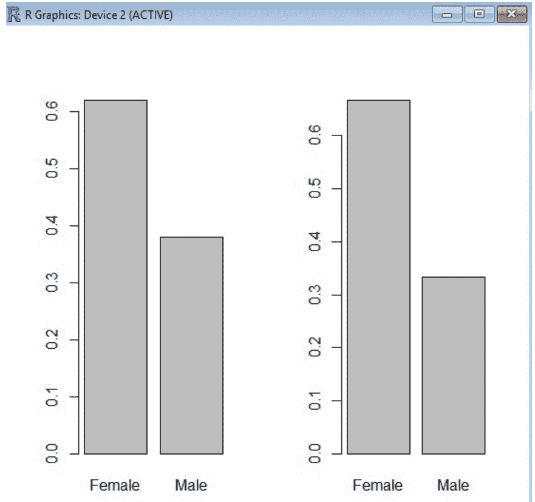

我鼓励你自行获取一些大型数据集，练习提取随机样本，看看结果与总体结果有多接近。这样可能会让你工作得更快、更高效。

## 带有特定步骤的分析方法概要

本节将逐一介绍分析方法的每个步骤。我将使用 CRISP-DM 作为模板，因为它涵盖模型部署，并且我们已经提到了抽样的好处（这是 SEMMA 的第一步）。

## 步骤 1 业务理解

许多预测建模人员认为，实际建模阶段才是最具洞察力的模型开发所在之处。然而，许多基础工作和洞察可以在早期发现，良好理解业务目标可以避免后来的陷阱。

## 传达业务目标与反馈循环

我必须承认，业务人员和技术人员之间的沟通可以做得更好。传达业务目标的方式千差万别。可能是业务合作伙伴说：“告诉我如何增加销售额”，或“告诉我一些我不知道的事情。”

因此，这实际上始于了解具体的业务目标。在此步骤中，你还将参与将废话和行业术语分解为具体内容，以便开始使用数据作为共同语言进行沟通。当领域专家和数据科学家开始交流时，会发现业务人员通常知道他们在结果方面想要什么，但不够理解分析建模过程，无法清晰表达自己的目标。对于技术人员来说，情况往往正好相反：他们不了解业务的细微差别。

理解阶段的特点是人们提出许多问题，并在各方之间建立分析对话。因此，即使是一个更精确的问题，例如，“我们的最佳客户是谁？”，对话也可以如下进行：

- 1. 你所说的“最佳”是什么意思？
- 2. 你是指当前的最佳，还是与一年前相比的最佳？
- 3. 你使用什么指标来定义最佳？是指收入方面的最佳，还是购买频率方面的最佳？
- 4. 我们将如何衡量成功？关键指标是什么？可能的结果是什么？

业务理解过程还包括了解你在何处、如何以及何时获取数据。

## 内部数据

你自己的内部数据是开始的首选且最佳场所。许多项目始于检查业务运营系统（如销售系统）中的数据。你可以从分析事务数据入手，例如查看客户的所有订单并分析售出单位数量、总销售价格等等。然而，仅事务数据本身无法告诉你任何关于客户的信息。你还需要通过将数据库事务中的共同元素（如客户 ID、产品键）与其他相关数据库中存在的有价值的数据相匹配来增加其他属性，从而丰富你的基础数据。例如，丰富的数据来源是人口统计和态度数据，这些数据可能存储在公司客户调查中。

除了客户调查之外，可能还有其他可用于获取洞察的内部存储库。Web 日志可能会揭示更多关于客户点击流购买模式的信息。数据可以从客户呼叫中心数据、HR 和其他行政系统中捕获。

寻找其他数据来源通常需要大量挖掘，因为在大型组织中，内部数据往往是孤立的。

## 外部数据

数据还可以通过将公司内部数据与从各种来源获取的数据（包括政府数据、社交媒体信息流和从供应商处购买的数据）相结合来丰富。通常，人口统计、行为和风险数据是分别购买的，然后在数据仓库中合并。

警惕数据集成这一艰巨任务。此任务中遇到的关键问题是能够将来自各种异构来源的数据相互关联。处理内部数据时，这问题较小，但处理外部数据时，你可能不得不使用可用的替代方法来执行匹配，例如使用模糊匹配（相似性）算法或执行实体提取方法（例如，可以提取客户姓名）。这只是两种可以帮助你将数据与外部来源关联的方法。

## 行业工具

在开始阶段定义目标可能比较困难，不建议在业务理解阶段就开始使用高级分析工具。此阶段最好使用的一些低技术工具包括重要概念，例如流程理解、数据字典、数据链接以及结构化查询语言 (SQL)。

## 流程理解

了解你所在领域的数据是如何生成的，以及过去是如何生成的，这一点很重要。这意味着要了解数据如何从其原始原始状态转变为数据最终用户所消费的形式。了解当前流程的不足之处，将使你能够判断哪些数据可以持续可靠。此外，尝试收集过去尝试过的数据更改和方法的历史。这一点很重要，因为数据的使用方式可能截然不同，目标也可能不同。了解过去哪些成功了、哪些失败了，可以防止你重复造轮子，避免重蹈同样的覆辙，并帮助你在之前尝试的基础上构建。

### 数据血缘

数据血缘工具对于文档记录以及跟踪数据从原始形式到数据存储再到最终定义过程中细微含义的变化非常有帮助。血缘工具处理的数据类型的通用术语称为 **元数据**（数据的数据）。

### 数据字典

数据字典作为了解正在分析的变量类型及其测量方法的来源非常有价值。以下是一些应保留在数据字典中的有用元数据项目：

- **变量名称**：命名约定的一致性有助于理解和可读性。一些分析人员喜欢使用 CamelCase，另一些人喜欢使用对象标点符号，如 `Variable.data.frame`，还有人坚持只使用小写字母。
- **测量数据**：这回答了诸如“数据是数值型还是类别型？”、“每个类别中包含多少个级别？”以及“每个变量的长度是多少？”等问题。
- **数据来源**：这涵盖了“数据最初来自哪里？”
- **转换**：这回答了“数据如何从其原始形式转换为当前形式？”
- **数据质量项目**：将频率分布和汇总统计信息附加到每个变量将非常有帮助，以及关于任何可疑数据质量的任何评论。

保持数据字典的最新状态很重要，因为变量或其值的含义会随时间而改变。例如，值为 A100 的营销优惠可能意味着我们现在向客户提供 15% 的折扣，但仔细检查后发现，相同的 A100 代码五年前曾在另一个营销应用中使用过，当时它意味着向客户提供 10% 的折扣。

以下是一个简单数据字典的示例：

- **变量名** 这是您程序中使用的数据元素的名称。
- **业务源元素** 这是变量与业务元素的映射。如果变量是新变量或转换变量，请列出用于创建或转换变量的逻辑。
- **变量类型** 这表示变量的类型：名义、区间、二元、连续等。
- **变量角色** 这表示它是潜在的因变量、自变量还是信息变量。

总销售额包括截至 2016 年的 Widget1。

**其他元数据** 2016 年 2 月由于系统故障，东北地区销售中有 10% 缺失值。

在开始探索数据集时，您还可以添加其他列，例如缺失值百分比、变量均值、极端值等。

## SQL

SQL 通常被称为通用查询语言。学习 SQL 的原因之一是，它具有相对通用的语法，可在多种操作系统上运行。最重要的是，掌握 SQL 对于与熟悉它的经理交流想法至关重要。虽然可以通过 R 的本机工具和包在 R 中本机执行查询，但我更倾向于将 SQL 作为第一门查询语言，因为在 R 中使用 SQL 执行的工作随后可以修改为在其他系统中本机运行，其中代码可以在其本机环境中进行优化，以使其运行更快。

## 示例：使用 SQL 按地区获取销售额

在本示例中，我们将使用 R 包 `sqldf` 来展示四个销售区域的销售额和单位数量之间的差异。请注意，这是一个人工示例，因为我们将首先为 `West` 区域生成单独的数据，其销售额高于其他三个区域：

```
install.packages("sqldf")
library(sqldf)
set.seed(10)
rows=100
y <- rbind(
data.frame(indv=factor(paste("TransId-", 1:100, sep = "")),
Sales=rnorm(rows, mean=150000, sd=100000),
Units=round(rnorm(rows,mean=10, sd=3)),
Region=sample(c("North","East","South"),rows, replace=TRUE),
data.frame(indv=factor(paste("TransId-", 101:200, sep = "")),
Sales=rnorm(rows, mean=2000000, sd=1000000),
Units=round(rnorm(rows,mean=10, sd=3)),
Region=sample(c("West"),rows, replace=TRUE))
)
query <- "select Region,avg(Sales),avg(Units) from y group by Region"
results <- sqldf(query,stringsAsFactors = FALSE)
results
```

结果将出现在控制台窗口中：

```
> results
Region avg(Sales) avg(Units)
1 East 1493504 9.333333
2 North 1487338 10.457143
3 South 1477877 9.250000
4 West 2016626 10.270000
```

## 注意

这是随机生成的数据。编写代码中的函数 `rnorm()` 和 `sample()` 是明显的迹象。生成随机数据是开始测试代码和算法的好方法，因为基于假设，您将始终更清楚地预期会得到什么样的结果。

## 图表和绘图

在业务理解阶段，无需让可视化过于复杂。我之所以说这是，因为在某些情况下，复杂的可视化可能会影响解释，而不是提供客观数据。显示变量之间关系的基本图表和绘图足以用于交流想法。

在此阶段来回传递图表和绘图时，最好包括分布和关联的基本统计度量。这将使管理层大致了解关系的重要性，而不仅仅依赖于可视化表示。

## 电子表格

将数据发送到电子表格并创建透视表是让管理层参与流程的另一种方式。电子表格确实有明显的缺点，但在行业中使用广泛，了解如何操作电子表格将是您与经理沟通的另一种方式。

## 模拟

**模拟** 是一种可用于演示假设情景的工具。如果没有太多历史数据可依据，并且需要对某些变量的行为做出假设，则此技术非常有用。通常，此时您没有太多数据，因此实际上是根据您认为的数据行为来构建自己的数据。

在本书的后续章节中，我将大量使用模拟技术来说明这一点。

## 模拟客户接触是否会产生销售的示例

这里有一个示例，基于业务估计：每三次客户接触中会有一次产生销售。另一个假设是，如果成交，每笔销售平均产生 100 美元，标准差为 5 美元。

ExpectedPayoff 要么产生 0 收入，要么产生围绕 100 美元的数值，如以下代码第 5 行所示：

```
library(ggplot2)
set.seed(123)
CustomerAcquired.Flag <- sample(c(0,0,1), 100, replace = TRUE)
Revenue <- sample(rnorm(100,100,5))
ExpectedPayoff <- CustomerAcquired.Flag*Revenue
head(ExpectedPayoff)
PayoffCompare = ggplot(data.frame(ExpectedPayoff), aes (x=Expected PayoffCompare
```

> head(ExpectedPayoff)
[1] 0.00000 101.26659 0.00000 100.58823 97.12327 0.00000

我们可以将这一有条件的客户获取问题视为包含在一个可视化中的两个独立图表。可视化的左侧是产生零收入的客户接触次数，右侧显示发生销售时的分箱销售直方图：

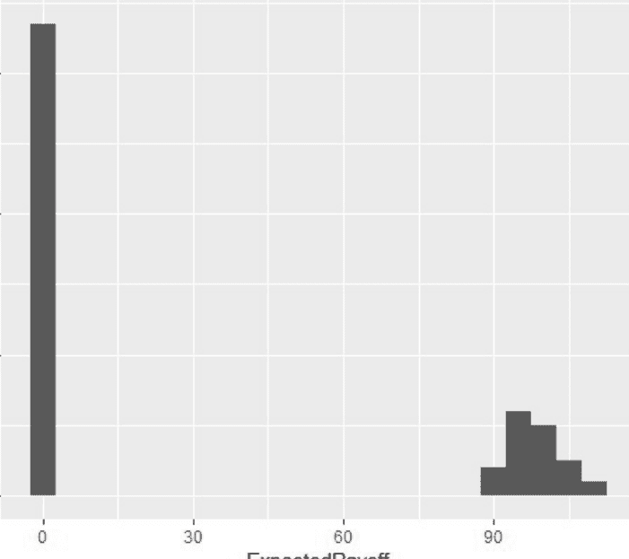

## 示例：模拟客户服务呼叫

在本示例中，我们可以模拟一周开始和结束时可能发生的客户服务呼叫。管理层预测周末通话量将很大，平均呼叫量为 1500000 次，平均周转时间为 4 分钟。周一至周四的客户服务呼叫量估计为处理 1000000 次呼叫，平均周转时间为 1 分钟。我们可以使用此模拟来构建模型，将周末与非周末作为新变量纳入预测模型：

```
library(ggplot2)
library(grid)
library(gridExtra)
set.seed(123)
MonTuesWedThurs=rnorm(1000000,1,1)
FriSatSun=rnorm(1500000,4,1)
weekly = c(MonTuesWedThurs,FriSatSun)
```

如果我们有兴趣查看呼叫量的差异，可以单独查看它们（如以下图表的顶行所示），或将其视为周末和非周末的合并分布。合并图表是说明周末和非周末之间差异的一种方法，并显示它们形状相似，但平均值不同：

```
p1 = ggplot(data.frame(FriSatSun), aes(x=FriSatSun)) + stat_bin(b
p2 = ggplot(data.frame(MonTuesWedThurs), aes(x=MonTuesWedThurs))
p3 = ggplot(data.frame(weekly), aes(x=weekly)) + stat_bin(binw
grid.arrange(p1, p2, p3, ncol = 2)
```

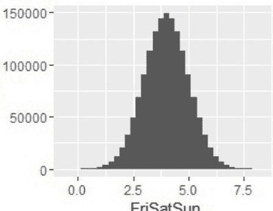

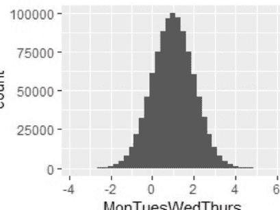

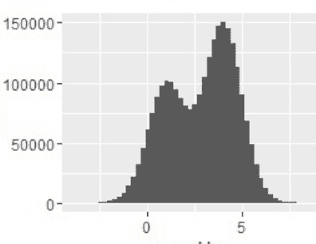

## 步骤 2：数据理解

一旦确定目标并确定数据源，您就可以开始查看数据，以了解每个数据元素如何单独行为，以及它如何与其他变量交互。但在开始查看变量值之前，了解不同的数据测量级别类型以及可以使用它们进行的分析类型非常重要。

## 测量级别

测量级别是一种将数据分类为 4 个不同类别的分类系统，如下所述（比率、顺序、区间和名义）。它是项目或研究元数据的重要方面。

测量级别在预测分析领域非常重要，因为特定的测量通常会决定可以应用哪种算法或技术。例如，如果您想包含名义数据，k-means 聚类确实可用，而逻辑回归不能将比率数据作为因变量（尽管可以将变量转换为较低规模）。

## 名义数据

名义数据（有时也称为类别数据）只是定义一个类或组，没有任何自然顺序。名义变量通常是字符数据，但并非总是如此。您的性别、您偏好的手机品牌以及您当前正在阅读的书籍类型都是名义变量的示例。有时这可能很棘手，因为标志上写的数字 1 和 2 也是名义变量，当它们用于指定您在机动车管理局可能需要前往的两个可能排队时。名义数据仅指定类，您无法对它们执行任何数学运算，例如加法或减法。


在描述名目数据时，唯一的集中趋势度量是 *众数*，即出现频率最高的值。无法计算均值或中位数。

在 R 语言中，我们可以将字符数据转换为因子，以便将其作为名目数据进行分析。这将是清理过程的重要部分，我们将在后面学习。分析名目数据时，出现频次（计数）是一个良好的起点。或者，你可以先按其他名目变量分组进行计算，以确定计数，或其他数值变量的平均值。

## 顺序数据

顺序数据只有排序顺序。可以做出 A>B 和 B < C 这样的陈述，但无法计算任何组之间的数值差异。前十名列表是顺序数据呈现的示例。通常，如果分类数据具有隐含顺序，则可将其归类为顺序数据，例如标记为 *更好* 和 *最好* 的两个类别。顺序数据的一个问题是，我们永远不知道每个排序数据点之间的精确差异。

## 间隔数据

这是一种数值数据，可以测量距离但不能计算比率。温度数据和日历数据是间隔数据的两个示例。数值刻度上两个连续数据点之间的所有算术差异都以完全相同的方式测量，因此你可以进行有意义的差值计算。

通常，间隔数据被视为比率数据。在对李克特量表进行平均值等计算时经常会出现这种情况（尽管这在技术上并不正确）。对于顺序数据，你可以计算频数、计算中位数并计算百分位数，但不能进行任何算术运算或计算均值。

## 比率数据

数值数据的最高级别是比率尺度。使用比率数据时，你可以利用除法和减法进行有意义的比较。如果说一个月内客户从 50 增加到 100，客户数量翻了一番，这是有意义的。比率数据还将 0 加入数值域（间隔数据不包含 0），因此说你有 0 个客户也是有意义的（尽管并非理想状态）。体重和收入是比率数据的其他示例。但是，华氏温度和摄氏温度标尺的 0 并不表示没有温度。如果你尝试进行温度比较，这会产生一些有趣的比较。例如，在华氏度中，温度 36/18 等于 2，但对应的摄氏度是 2.22/-7.78，等于 0.28，这表明比率比较是没有意义的，两者都应被视为间隔数据。

要了解更多关于刻度和测量理论的内容，请参阅 On the Theory of Scales and of Measurement (Stevens, 1946)。

## 不同测量层级之间的转换

一般来说，你始终可以将较高层级的测量转换为较低层级的测量，但不能逆转。这通常通过称为 **分箱** 的技术来完成，即将某个范围内的所有值放入一个箱中。你可能希望将不同的身高范围基于预定义范围分箱为 *高*、*矮* 或 *中等*。但是，通常你不会将分类变量映射为数值变量，除非你非常了解该类别是如何测量的，并且愿意做出大量假设。

## 因变量与自变量

**因变量**是你正在预测的变量。它也可以被称为目标变量、响应变量或结果变量。预测建模的一个目标是基于自变量的某个函数，为因变量推导出预测值。因变量通常是固定的，你无法操纵它。**自变量**是你选择的变量，你相信它们对于决定因变量的结果很重要，同样基于某个函数。此函数通常使用算法来应用。

## 转换变量

转换变量是你在原始数据中不存在而自行创建的变量。以下是创建转换变量的一些示例：

- 你可以将数值变量分箱为几个不同的类别，例如 High（所有数值大于 10）或 Low（任何小于 10 的值）。请注意，分箱会导致信息丢失，但通过命名事物并促进可理解性，为你提供了一些灵活性。
- 通过将单元格计数除以总体，将计数数据转换为百分比。
- 在建模阶段对数据进行标准化；使用标准化变量通常比直接使用原始数据更有用。标准化变量是一种强制均值为 0、标准差为 1 的转换。此转换保留了原始值的分布和结构，但使得将一组变量与另一个不同标度的变量进行比较变得更加容易。
- 在回归建模中，通常会用 `log()` 或 `exp()` 等转换替换或添加另一个变量，以便生成的模型具有更好的线性拟合度。

## 单变量分析

在清点所有潜在候选变量后，从单变量分析开始是合理的。何必一次性查看多个变量来使事情复杂化，而不可以一次查看一个呢？通常，建模结果会建议立即排除某个变量，例如缺失值比例较高的变量，或存在数据质量问题的变量。尽早排除变量往往是最佳方案，而不是将它们贯穿整个分析过程，只有在之后才丢弃它们。如果你发现两个变量测量的是同一件事，这一点尤其正确。

## 汇总统计量

通常，开始分析时查看每个可能出现在模型中的候选变量的汇总统计量是个好主意。均值、标准差、频数和偏度能够快速概括变量的预期行为。在检查任何被视为目标变量的变量时，也应给予特别考虑。

要显示单个变量的基本汇总统计量，请使用 R `Summary()` 函数。这可以作为 R 脚本的一部分发出，也可以直接从命令行发出。`Summary()` 函数的一般形式为：

```
#for a single variable
Summary(dataframe$variable)
#for all of the variables
Summary(dataframe)
```

另外两个典型的单变量分析汇总技术是：

- **分布**：分布图（直方图、概率密度图等）会让你了解变量与理论统计分布相比的情况。某些建模技术会对分布做出假设，而另一些则不会。如果你发现某个变量符合特定分布，那你就幸运了。这将使以后的建模更加容易。在 R 中，你可以使用 `hist()` 函数。

- **箱线图**：箱线图是分布的简单图形表示，始终包括分布的五个关键要素：最小值、第一四分位数、中位数、第三四分位数和最大值。（有关生成这五个关键要素的 R 函数 `boxplot()` 示例，请参阅下一节中的 *比较治疗*。）

  - 箱体的上边线和下边线分别表示第三四分位数和第一四分位数，中间是中位线。

  - 须线的顶部线表示最大值，底部线表示最小值。

## 双变量分析

双变量分析通常是在单变量分析后采取的下一步。双变量分析用于显示任意两个变量之间的关系。你进行双变量分析有两个原因：

- 在建模框架中，我们要寻找的一个关键结果是目标变量与任何自变量之间的关联。
- 另一个同样重要的结果是任何两个自变量之间可能存在的关联。这将帮助我们了解哪些自变量彼此相关，或帮助我们了解一个变量如何改变另一个变量的行为。

## 双变量分析可以回答的问题类型

在检查任意两个变量之间的关系时，请牢记以下几个要点：

- 当其中一个变量变化时，两个变量是同向变动还是反向变动？任一变量中是否有一个临界值会改变这种关系？
- 数值变化是剧烈的，还是缓慢而稳定的？
- 关系是否强烈，且是线性的还是存在曲率？
- 是否存在相关性比其他子集更有趣的特定数据子集？

用于显示这些关系的图表和图形的类型取决于变量的数据类型。对于间隔和比率标尺数据，我们将它们归为一类，并将其称为定量数据。

因此，在查看定量数据与名目数据之间的双变量关系时，可以有三种基本组合：

- 定量与定量
- 名目与名目


- 名义型与定量型

## 定量型与定量型变量

散点图常用于展示两个定量变量之间的关系。在下面的代码中，我们将使用 R pairs() 函数来绘制一些关联。如你所见，Petal.Width 与 Petal.Length 有很强的关系（第 3 行，第 4 列），而 Sepal.Width 与 Sepal.Length 之间的关系（第 1 行，第 2 列）则不那么强。

## 代码示例

```
pairs(iris[1:4], bg=c("green","blue","brown","yellow","black","or
```

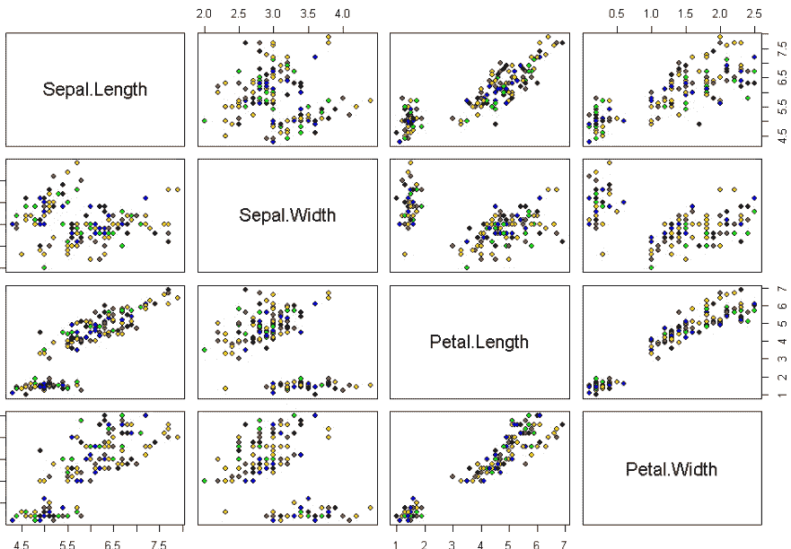

## 名义型与名义型变量

我们将从两种不同的方式来考察名义型与名义型变量。一种使用表格样式，另一种使用图形方法。

## 列联表

列联表是考察名义型变量之间关系的一个良好起点。在 R 中有许多方法可以实现这一点。我倾向于首先使用 gmodels 包中的 CrossTable() 函数，因为它不仅提供单元格计数，还提供行和列总计的频数，并提供卡方统计量来衡量统计显著性。它可能不太美观，但能很好地完成任务。

查看以下代码：

```
install.packages("gmodels")
library(gmodels)
CrossTable(mtcars$cyl, mtcars$gear, prop.t=TRUE, prop.r=TRUE, pro
```

```
> CrossTable(mtcars$cyl, mtcars$gear, prop.t=TRUE, prop.r=TRUE, p
```

| 单元格内容 |
|---|
| N |
| 卡方贡献 |
| N / 行总计 |
| N / 列总计 |
| N / 表格总计 |

表中的总观测值：32

| mtcars$cyl | mtcars$gear 3 | 4 | 5 | 行总计 |
|---|---|---|---|---|
| 4 | 1<br>3.350<br>0.091<br>0.067<br>0.031 | 8<br>3.640<br>0.727<br>0.667<br>0.250 | 2<br>0.046<br>0.182<br>0.400<br>0.062 | 11<br><br>0.344<br><br><br> |
| 6 | 2<br>0.500<br>0.286<br>0.133<br>0.062 | 4<br>0.720<br>0.571<br>0.333<br>0.125 | 1<br>0.008<br>0.143<br>0.200<br>0.031 | 7<br><br>0.219<br><br><br> |
| 8 | 12<br>4.505<br>0.857<br>0.800<br>0.375 | 0<br>5.250<br>0.000<br>0.000<br>0.000 | 2<br>0.016<br>0.143<br>0.400<br>0.062 | 14<br><br>0.438<br><br><br> |
| 列总计 | 15<br>0.469 | 12<br>0.375 | 5<br>0.156 | 32<br><br> |

## 马赛克图

马赛克图也会以图形方式显示列联表。你可以直观地看到，八缸和三档代表了最大的汽车缸数/档位组合（前一个列联表中有 37.5% 的汽车被阴影覆盖），而八缸和四档的组合似乎不存在。这也体现在前一个列联表的框选值中，以及下面马赛克图的虚线中。

## 缸数与档位马赛克图

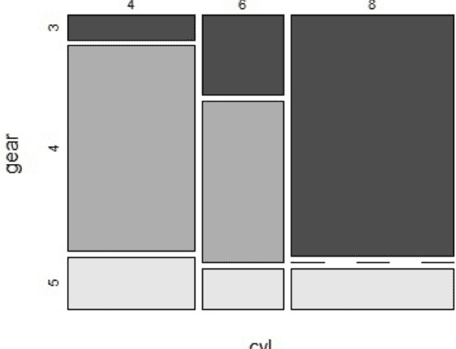

## 名义型与定量型变量

这些比较通常使用基本柱状图来考察，或者如下示例，使用并列箱线图。这些箱线图提供了非常清晰的比较。

下面的代码模拟了两个广告活动 A 和 B，具有两种不同的结果：

```
set.seed(123)
rows=100
a <- data.frame(Sales=rnorm(rows,mean=75,sd=5),
    Treatment=factor(c("Campaign A")))
b <- data.frame(Sales=rnorm(rows,mean=80,sd=5),
    Treatment=factor(c("Campaign B")))
combined=rbind(a,b)
#Boxplots which compare treatments
boxplot(Sales~Treatment,data=combined, main="Comparing Treatments
xlab="Treatment", ylab="Sales")
```

## 比较处理

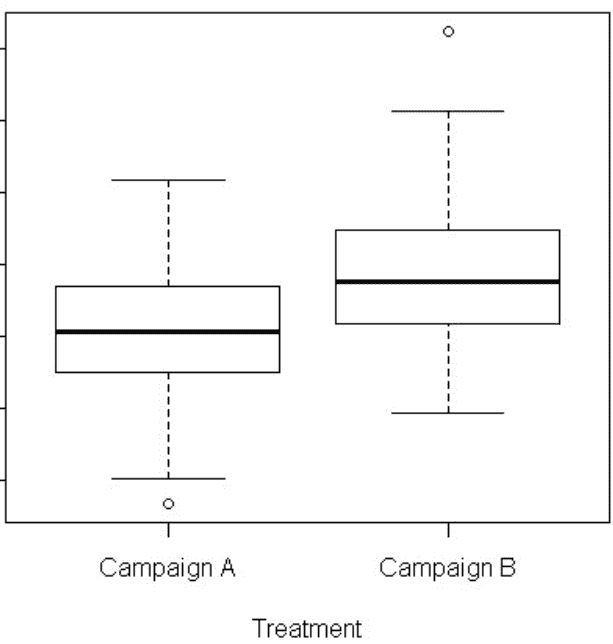

## 点双列相关

另一种基本技术是，如果一个类别是仅包含两个类别的名义型变量，而另一个变量是定量变量，则可以使用点双列相关。然而，由于该技术使用 Pearson 相关系数，你需要对数据的分布做出某些假设。例如，数据需要呈正态分布并具有相等的方差。这一假设适用于我们的模拟销售示例，因为每个类别都是使用 rnorm() 函数生成的，该函数模拟了两个随机分布的数据框，具有不同的均值，但相同的标准差（方差）。

展示点双列相关，我们可以使用之前的销售处理。首先，将每个销售处理映射到数值变量：

```
Treatment_num <- as.integer(combined$Treatment)
```

接下来，我们可以使用 R table 函数简单地查看两个营销活动是如何映射到数值的。活动 A 映射到数字 1，活动 B 映射到数字 2。

```
table(combined$Treatment,Treatment_num)
```

```
> table(combined$Treatment,Treatment_num)
```

| | Treatment_num |
|---|---|---|
| | 1 | 2 |
| 活动 A | 100 | 0 |
| 活动 B | 0 | 100 |

现在，运行一个双列图。你可以将 x 轴限制为 1 或 2 的值，因为你事先知道只有两个值：

```
ggplot (combined,aes(x=as.integer(Treatment_num), y=Sales))
+ geom_point(size=1.5,shape=1)
+ geom_smooth(method=lm)
+ scale_x_continuous (breaks=c(1,2))
+ ggtitle("Point BiSerial Correlation of Campaign with Sales")
+ labs (x="Campaign Number",y="Sales")
```

## 活动与销售的点双列相关

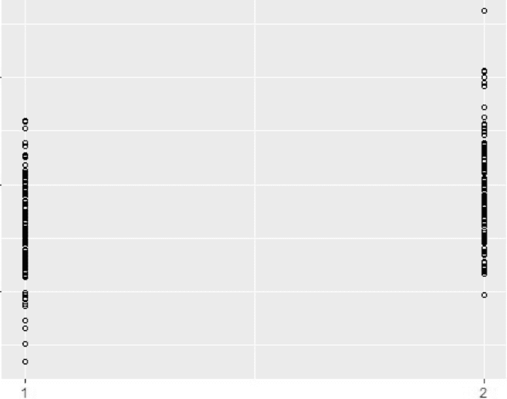

数值数据有其优势。既然数据现在是数值形式，我们也可以运行相关性检验。输出显示两个活动之间的销售相关性为 0.39：

```
cor.test(Treatment_num, combined$Sales)

Pearson's product-moment correlation

data:  Treatment_num and combined$Sales
t = 6.0315, df = 198, p-value = 7.843e-09
alternative hypothesis: true correlation is not equal to 0
95 percent confidence interval:
0.2699868 0.5051026
sample estimates:
cor
0.3939704
```

## 步骤 3 数据准备

如前面在第 1 章《预测分析入门》中提到的，数据准备的一个目的是准备输入数据建模文件，该文件可以直接输入到算法中。理论上，输入文件将涵盖步骤 1 和 2 中获得的所有知识。理想情况下，该文件将由目标变量、所有有意义的预测变量以及有助于建模过程的其他识别变量组成，以及基于原始数据源创建的任何其他变量。像前面概述的步骤那样，数据准备是一个迭代过程。准备数据时，你可以遵循以下一些典型步骤：

- 确定数据来源：这些是你需要读取和操作的关键数据输入。它们可以来自各种数据格式，例如 CSV 文件、数据库，或 XML 或 JSON 文件。它们可以是结构化格式或非结构化格式。

- 确定预期输入：读入一些测试样本并仔细检查输入，看它是否符合你的预期。大多数情况下，会有一些可以轻松修复的格式问题，你可能希望重命名变量并将某些数据类型从字符更改为数值，反之亦然。

- 执行进一步的数据质量和合理性检查：在执行完自己的内部检查后，将你观察到的数据与现有的元数据信息（如果可用，例如数据字典）、领域专家以及其他已存在的数据工件进行交叉引用，以查看你读取的内容是否符合你的预期。有时你需要将数据与其他查找或参考表连接，以获得你真正想要的内容。

- 扩大输入记录的数量：读入并获得测试样本后，你可能希望读入比初始阶段更大的记录和变量样本。在这个阶段读入多少数据是你需要做出的决定。如果读入所有变量，以后可能会遇到内存问题；如果只读入你需要的变量，以后可能不得不返回来添加更多数据或变量。尽量在开始时获取一个具有良好代表性的数据样本。以后，重写代码以仅读入你真正需要的变量子集可能是合理的。

- **执行一些基本的数据清洗**：虽然清洗数据是建模过程的重要组成部分，但重要的是不要过度清洗。过度清洗的一个例子是试图通过插值来修复每个缺失值。模型可以与合理数量的坏数据共存，如果包含一些变化，它们在长期运行中会表现得更好。

- **尝试一些聚合**：按一些基本类别聚合部分数据并观察结果。考虑是否使用聚合数据而非单个数据有助于加快模型开发，同时实现与使用单个观测值所获得的结果相似的模型结果。

- **创建新变量或转换**：分箱和标准化变量正是在此处发挥作用。

- **识别关键变量**：即使建模已经开始，你也应该能够使用双变量分析、SQL、相关性和其他探索性工具的组合，初步识别哪些变量很重要。识别最重要的变量并不关键，只需识别那些可能具有某些预测能力或已经知晓相关性的变量即可。

- 将你检查过的任何输入文件合并到一个单一的分析文件中。现在你已准备好进入建模阶段。


## 第 4 步 建模

在建模阶段，您将选择适合您问题的适当预测建模技术，并将其应用于您的数据。有多种因素会影响模型的选择：

- 1. 谁将使用该模型？
- 2. 该模型将如何使用？
- 3. 该模型的假设是什么？
- 4. 我有多少数据？
- 5. 我需要使用多少个变量？
- 6. 模型需要的准确性水平是什么？
- 7. 我是否愿意牺牲一些准确性来换取可解释性？

特别与最后一点相关的是 **偏差** 和 **方差** 的概念。

偏差与模型近似数据的能力有关。低偏差算法能够以极小误差拟合数据。虽然这看似始终是一种优势，但可能导致模型复杂、不稳定且难以解释。另一方面，高偏差模型相对简单易解释（如线性回归），但可能会为了可解释性和稳定性而牺牲一些准确性。您通常会先查看数据，并将其与潜在算法进行匹配。例如，线性回归试图拟合呈 U 型分布的数据，无论选择多少参数或如何调整系数，都不适合该问题。另一个例子是，5 星级评价通常偏向极高或极低评分，线性回归也不适用。

以下是一个示例，说明线性回归将是一种糟糕的选择：

```
set.seed(1010)
x <- sample(c(1,2,3,4,5),100,replace=TRUE,prob=(c(.25,.05,.05,.3,
y <- data.frame(rating=x,custid=seq(1:100))
hist(y$rating, prob=TRUE, main="Customer Ratings")
lines(density(y$rating))
```

如果回归问题涉及从库存预测销售，那么这种方法会更合适。低偏差模型往往会导致过拟合，而高偏差模型准确性较低，但更易于解释。

方差与模型在提供不同数据时的变化程度有关。低方差也是可取的。

决策树是一种算法示例，它往往具有低偏差（过拟合），但给定新训练样本时可能会产生完全不同的结果（高方差）。即使在现有决策树模型中添加一个额外观察，也可能导致完全不同的树。

要开发良好的预测模型，您需要承认偏差和方差之间最终存在妥协或权衡。要了解更多关于偏差-方差权衡的信息，请查看 *维基百科* 中的一些外部参考资料。

### 特定模型描述

以下是我们将要介绍的一些模型的简短描述，附带一些简短代码示例。

### 泊松（计数）

泊松模型用于建模事物的计数。例如，某个月提交的保险索赔数量、某个呼叫中心在特定分钟内接收的呼叫数量，或某特定商品的销售订单数量。泊松分布是建模计数数据的合适方法，因为所有数据均为正数，且分布范围由 0 和无限大界定。建模泊松模型的经典方法是通过 R 的 `glm()` 函数，使用 `poisson` 链接函数：

```
model.poisson <- glm(count ~ v1+v2+v3, data=inputdata, family=poi
```

请注意，上述模型仅以一般化形式展示模型。请勿尝试运行它，因为除了现有的 `v1`、`v2`、`v3` 或 `count` 外没有其他变量。不过，模型说明指出，您将通过以下一般步骤运行泊松模型：

- 该模型将通过 `glm()` 函数运行，波浪号左侧有一些因变量
- 自变量将提供在波浪号右侧
- `Data=` 参数将提供输入数据集
- `family=` 参数将指定您要运行的广义线性模型的类型，在此情况下，它将是泊松模型

要在真实数据上尝试泊松模型，可以使用 R 自带的 `warpbreaks` 数据。

- 首先在控制台中输入 `help (warpbreaks)` 以获取数据集的描述：

| [,1] | breaks | numeric | 这是断裂次数 |
|---|---|---|---|
| [,2] | wool | factor | 这是羊毛类型（A 或 B） |
| [,3] | tension | factor | 这是张力水平（L、M 或 H） |

然后，使用 `glm()` 函数设置并执行模型。我们使用羊毛类型和张力水平来预测断裂次数。请注意，需要在 `glm()` 函数后添加 `summary()` 函数才能查看输出，因为运行 `glm()` 函数仅将输出分配给名为 `model.poisson` 的对象。

```
model.poisson <-glm(breaks~wool+tension, data=warpbreaks, family=
summary(model.poisson)
```

### 逻辑回归

逻辑回归是可用于分类的最古老且稳定的技术之一。逻辑回归、线性回归和泊松回归都被视为 **广义线性模型（GLM）**。但是，在逻辑回归的情况下，预测值只能是 0 或 1。

幸运的是，这与许多用例相符，例如客户是否会流失，或飓风是否会出现。如果您已经熟悉多元线性回归，逻辑回归应该更容易理解，因为您应该已经熟悉指定多个自变量以及使用 log 和 exp 等数学函数的概念，这些函数可以平滑模型中的变量并强制其更加线性。

逻辑回归还很有用，因为它会产生一个比值比。比值比是事件发生的概率除以事件不发生的概率。

在 R 中，标准逻辑回归是通过 `glm()` 函数调用的。

### 注意

对 `glm()` 的调用包含一个 `link` 函数的规范。

`link` 函数指定用于线性模型的模型或分布类型。对于逻辑回归，使用 `family=binomial()` 来指定逻辑回归。

`glm()` 函数的最简单一般形式是：

```
Model.logistic <- glm(Target~v1+v2+v3,data=sourcedata,family=bino
```

### 支持向量机（SVM）

**支持向量机（SVM）** 也可用于预测二元类别。

SVM 将数据投影到更高维空间，以便使用超平面分隔分类器。SVM 可能非常准确，但难以解释且计算成本高昂。它们是低偏差算法的经典示例。

以下是使用 SVM 根据星期几和是否为发薪日来预测人是否满意的简单示例。

（`payday` 向量中的向量元素标记为 `1`，如果您从星期日开始计数，则可以将其解释为星期五。）

```
library(e1071)
satisfied = factor(c(F,F,F,F,F,T,F))
day = c(1,2,3,4,5,6,7)
payday = c(0,0,0,0,0,1,0)
satisfaction.df = data.frame(day=day, payday=payday, satisfied=sa
model.svm = svm(satisfied ~ day + payday, data = satisfaction.df)
plot(model.svm, satisfaction.df, main="", col=c('grey','black'))
```

从下图可以看出，决策线是象限右上部分附近的一条曲线，且 payday 接近 1（是）、星期几接近 4、5、6、7（周末）的区域。因此，我们可以将其解释为：人们在发薪日和周末感到满意。但是，这是一个非常低维度的示例（在两个轴上呈现），我们用来阐释概念。更高维度的示例不那么容易解释：

### SVM 分类图

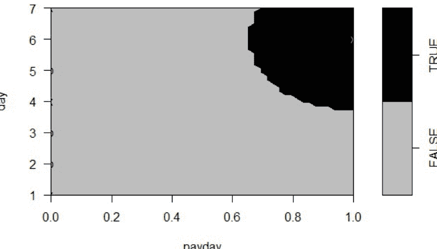

### 决策树


决策树很受欢迎，因为它们大致可以等同于某些业务场景中使用的 If/Then/Else 规则，并且相对容易向经理解释。决策树不仅用于分类。当它们用于预测数值结果时，被称为回归树。决策树使用的基本概念是，树的每个节点都基于最优分割点被分割为两部分。树通过添加更多叶节点继续生长，直到无法进行任何进一步的分割，这些分割可以改善区分任何决策的能力。

## 随机森林

请注意，Random Forests (tm) 是 Leo Breiman 和 Adele Cutler 的商标，并专门授权给 Salford Systems 用于软件的商业发布。

决策树的一个问题是，它们高度依赖最初选择的特定变量。可以生成一组略有不同的初始变量，并得出一个同样有效但不同的解决方案。

随机森林算法（该算法有几个不同的名称，请参阅本章末尾的注释）是改进决策树的一种尝试，因为随机森林会随机化变量和子样本的选择，以生成多个（甚至数千个）独立的决策树。生成所有决策树后，会确定一个共识预测，该预测对所有生成的不同树的影响进行平均。

为了确定共识，你可以指定算法实现简单多数投票方案。我们将先在 `titanic` 数据集上运行两个简单的决策树，然后将结果与使用随机森林获得的结果进行比较，以了解其工作原理。

## 示例 - 将单个决策树与随机森林进行比较

首先，安装 `titanic` 包并将训练数据集分配给数据框：

```
install.packages("titanic")
library(titanic)
titanic <- titanic_train[complete.cases(titanic_train), ]
```

## 一个年龄决策树

使用年龄作为自变量生长一个简单的决策树来预测乘客是否幸存，然后绘制树图：

```
library(rpart)
library(rpart.plot)
set.seed(123)
fit <- rpart(as.factor(Survived) ~ Age, data=titanic, method="
rpart.plot(fit,extra=102)
```

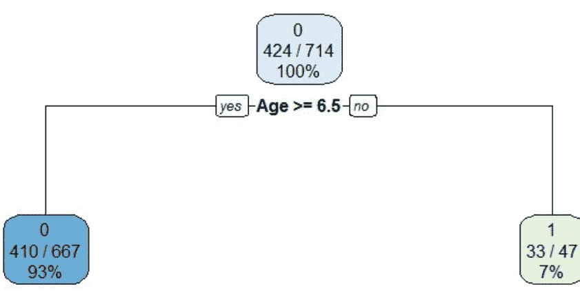

这个简单的树准确吗？为了动动脑筋，我们将手动计算这一点。

在控制台中，计算正确分类百分比。每个类别的正确预测数显示为前面图中每个节点的第一个数字。第二个数字是分配给该类别的总数。

通过将正确预测的总数相加并除以预测总数，通过控制台计算的数学结果显示，这个简单模型有 62% 的时间是正确的。然而，你可能会问树左侧节点给出的 93% 是什么。这将是该节点的正确分类，前提是乘客年龄小于 6.5：

```
> (410+33) / nrow(titanic)
```

这是以下输出：

```
[1] 0.6204482
```

## 另一个决策树

假设我们任意选择了另一个简单的决策树模型；这次我们将根据乘客类别变量来预测乘客是否幸存：

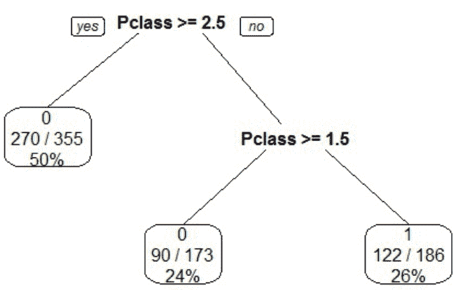

这是一个稍微复杂一些的树，因为它有四个分支和三个终端节点。现在，让我们通过将三个节点的正确分类数相加并除以总行数，来计算该模型的正确分类率，就像之前做的那样：

```
> (270+90+122) / nrow(titanic)
```

这是以下输出：

```
[1] 0.67507
>
```

这个简单模型更好，有 67% 的正确分类率。

## 随机森林模型

现在，让我们运行一个随机森林模型。我们将生长 2,000 棵树，并且仅为说明目的将 Age、Pclass（乘客等级）和 Fare 作为自变量包含在内。随机森林会随机化所选观测值以及所选观测值的样本数量，因此你永远无法确定会得到哪些特定树木。你甚至可能得到前面示例中刚刚生成的树之一！

```
library(randomForest)
set.seed(123)
fit <- randomForest(as.factor(Survived) ~ Age + Pclass + Fare,
                    data=titanic,
                    importance=TRUE,
                    ntree=2000)
```

随机森林还有一个 predict 函数，其语法与我们在第 1 章 "Getting Started with Predictive Analytics" 中使用的 predict 函数相似。我们将使用此函数生成预测：

```
prediction.rf <- predict(fit, titanic)
```

生成预测后，我们可以构建一个数据框，包含预测结果以及从原始数据中获得的实际生存结果：

```
x<-data.frame(predict.rf=as.factor(prediction.rf),survived=titanic)
```

现在我们可以运行一个简单的 `table()` 函数，它将按预测值对实际结果的数量进行计数。

```
table(x$predict.rf,x$survived)
```

这是以下输出：

| | 0 | 1 |
|---|---|---|
| 0 | 384 | 118 |
| 1 | 40 | 172 |

表中的数字反映了以下预测：

```
(Row 1,Column 1) Passenger predicted NOT to survive & DID NOT sur
(Row 1,Column 2) Passenger predicted NOT to survive DID survive
(Row 2,Column 1) Passenger predicted to survive and DID NOT survi
(Row 2,Column 2) Passenger predicted to survive and DID survive
```

基于此，我们可以看到，我们对 (Row 1,Column 1) 和 (Row 2,Column 2) 包含的计数进行了正确预测，因为我们的预测与结果一致。

为了获得预测总数，我们将加上正确计数的总数，然后除以行数。我们可以在控制台中进行数学计算：

```
(384+172) / nrow(titanic)
```

这是以下输出：

```
[1] 0.7787115
```

使用随机森林，正确预测率已提高到 77%。

## 随机森林与决策树对比

尽管随机森林可能比单一分区树更好的预测器，但可解释性问题随之而来。随机森林不会生成可视化决策树，而且在计算上，随机森林运行可能需要相当长的时间，因为它们要从许多变量中生长和优化多棵树。有些人觉得它们像一个黑箱，因为有太多优化方法，且底层方法不易透明。然而，它是一种优化方法，如果极端准确性是你的目标，它可以非常准确。

## 变量重要性图

除了预测准确性之外，随机森林的另一种常见用途是变量选择，使用 `varImp()` 函数。当有许多输入变量时，变量重要性图可能很有用，但我发现对于可管理数量的变量，其价值有限。

仅为了对我们的示例数据进行说明，这里是 `varImp()` 函数，它按重要性顺序显示 `Fare`、`Age` 和 `Pclass`。它可以做到这一点的有几种方法，但我将展示通过称为 **MeanDecreaseGini** 的统计量确定的结果。理解此统计量的计算方法并不关键，但此时可以肯定的是，重要性与变量出现在多少棵不同树中以及它在决定树分支能够多好地区分一个结果与另一个结果方面所起的作用有关。我们将在后面的章节中讨论决策树和 Gini。

```
varImpPlot(fit,type=2)
```

## fit

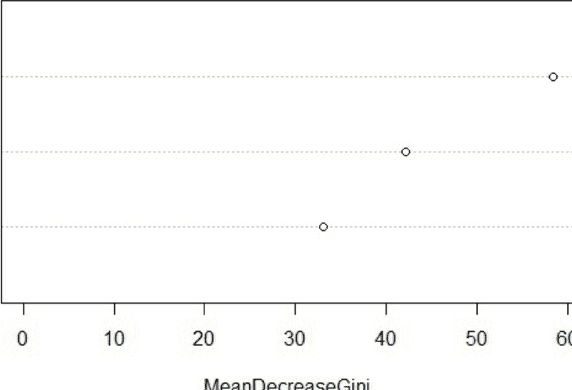

## 维度约减技术

你通常会检查数百甚至数千个变量，而维度约减是一种你可以使用的技术，可以大幅减少需要检查的行数或变量数量。维度约减背后的前提是重复性，即许多变量在测量同一事物。例如，阅读、写作、数学和音乐才能得分在预测大学 GPA 时都很重要，但如果你只将音乐才能得分与写作得分结合使用，就有可能获得与使用所有四项措施相同的预测准确性。这也可能更容易解释，这就是使用维度约减技术的一个例子。

当你希望减少实际变量数量时，请考虑主成分。你最终会得到相同数量的观测值，但会限制你查看的变量数量（主成分部分）。


当您考虑降低 *行* 的维度时，请使用聚类方法。

## 主成分

**主成分分析 (PCA)** 在变量过多且希望将数据的所有变化捕获到一个或两个变量中的情况下非常有用。主成分通过使用矩阵代数创建所有变量的线性组合来实现这一点。

PCA 还用于查看哪些变量在各个主成分中影响最大，因此当 PCA 分析表明某些变量对结果影响很小时，它通常是一种丢弃某些变量的方法。

使用身高和体重变量的示例是个很好的例子。由于身高和体重呈正相关，选择仅使用身高或仅使用体重作为自变量来预测体重指数可能差别不大。因此，我们可以创建一个身高和体重的线性组合作为新变量，并将其用作变量。

## 聚类

聚类是一种将数据分组到不同类别的方法，使得每个类别彼此相似。有各种方法可用于定义相似性。K-Means 聚类可能是最流行的聚类方法。该方法使用测量的距离将数据观测值分配给最近的类别。聚类常用于营销，以便开发不同的客户细分群体。

聚类是一种无监督算法，并且具有主观性。您可以预先指定希望聚类的组数。这个数字有些随意，如果目标是可解释性，它可能会产生不同的解释。

散点图常用于仅使用两个变量（一个在 $x$ 轴上，另一个在 $y$ 轴上）来显示数据聚类。

这里是一些散点图的示例，可以通过观察哪些数据点 *聚集* 在一起来识别聚类。

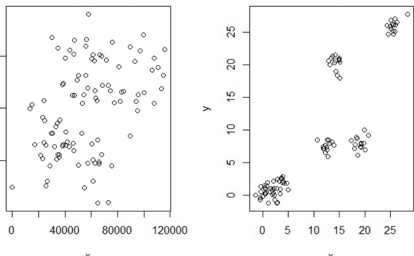

右侧图表显示了五个明显的聚类。您可以看到，变量 $x$ 的非常低值往往与变量 $y$ 的非常低值一起出现。但是，左侧图表的聚类应该是什么还不太清楚。有时 $x$ 的低值与 $y$ 的低值一起出现，但有时它们与 $y$ 的高值相关联。没有明显的不同分组。您看到什么？您看到两个聚类、三个或更多，还是没有聚类？这确实无法判断，主观性正是由此引入的。

## 时间序列模型

包含彼此不独立的数据观测值的问题（例如基于时间的数据）值得特殊处理，因为随时间发生的事件表现出一种称为 **自相关** 的属性。这意味着自变量都依赖于该变量的先前值。许多数据技术假设所有值都彼此独立发生，因此开发了特殊技术来处理基于时间的数据。

**指数平滑** 基于一个简单的概念：最近的数据是预测未来的最佳指标。指数平滑技术允许您调整参数，以便您可以决定最近数据与旧数据各占多少权重。它适用于许多时间序列问题。

时间序列模型也可以基于周期性、趋势、季节性、一次性发生或因果因素。更高级的时间序列方法之一被称为 **ARIMA** 或 **Box-Jenkins** 模型，它结合了时间序列和回归模型的元素。

## 朴素贝叶斯分类器

朴素贝叶斯最初作为一种垃圾邮件检测方法而流行起来。它快速高效。朴素贝叶斯假设所有变量都相互独立且不相关（这是一个糟糕的假设，但这正是它被称为“朴素”的原因！）。它还具有添加新数据时无需重新训练的优势。朴素贝叶斯源于贝叶斯定理。

这个简单的示例展示了朴素贝叶斯的实际应用。使用鸢尾花数据集，朴素贝叶斯将使用前四列作为自变量来对第五列进行预测：

```
#use 1st 4 columns to predict the fifth
library(e1071)
iris.nb<-naiveBayes(iris[,1:4], iris[,5])
table(predict(iris.nb, iris[,1:4]), iris[,5])
```

`table()` 函数的结果将输出到控制台。此输出是混淆矩阵，如下所示：

| | setosa | versicolor | virginica |
|---|---|---|---|
| setosa | 50 | 0 | 0 |
| versicolor | 0 | 47 | 3 |
| virginica | 0 | 3 | 47 |

该问题的正确分类率为 96%。这可以在控制台中通过将正确分类计数对应的值相加（即第 1 行/第 1 列、第 2 行/第 2 列和第 3 行/第 3 列），然后除以总行数来轻松验证。

以下是使用 R 计算器在控制台中执行此操作的方法：

```
> nrow(iris)
[1] 150
> (50+47+47)/nrow(iris)
[1] 0.96
```

混淆矩阵还告诉您哪些分类表现不佳。例如，如果您求和第 2 列的值，可以看到总共有 50 个 versicolor 物种。但是，versicolor/virginica 组合总共有三个误分类（见下文粗体下划线）：

| | setosa | versicolor | virginica |
|---|---|---|---|
| setosa | 50 | 0 | 0 |
| versicolor | 0 | 47 | 3 |
| virginica | 0 | 3 | 47 |

要识别哪些组合被误分类，我们可以编写一些代码，并使用 DataTable 对象检查错误分类的行。使用 DataTable 对象可以对数据进行排序、搜索和筛选。

将预测与原始数据合并。然后，向数据框分配一个“正确”或“错误”标志，以指示预测是否正确。

```
mrg <- cbind(pred,iris)
mrg$correct <- ifelse(mrg$pred==mrg$Species,"Correct","Wrong")
```

加载 DT 库并指定您希望在合并的数据上使用交互式数据表。您还需要一些交互式筛选功能，因此请将 filter='top' 作为参数指定。

```
library(DT)
```

```
datatable(mrg, filter='top')
```

交互式数据表将在 RStudio 查看器中打开：

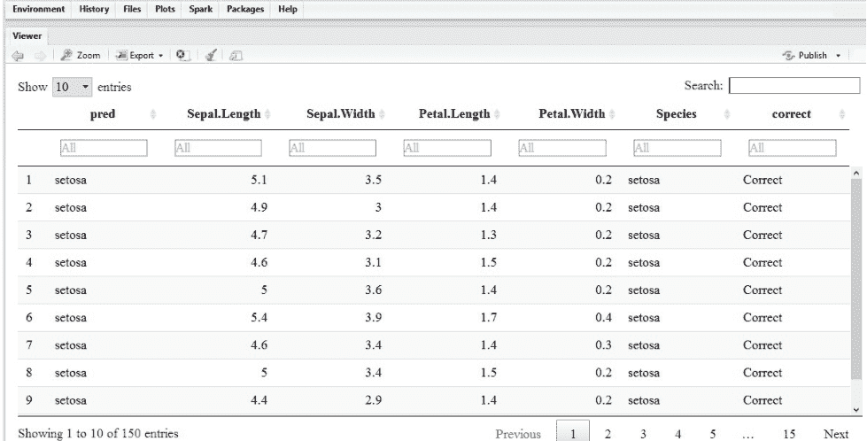

要查找被误分类的物种，请在搜索框中输入 `Wrong`。显示将自动更新以显示错误的预测：

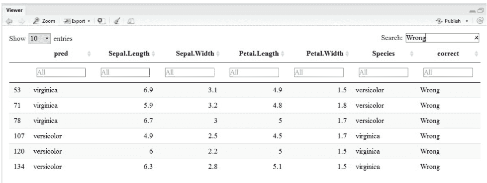

## 文本挖掘技术

大多数传统的预测分析技术最初是为处理结构化数据而设计的。然而，随着文本挖掘技术的出现，这一情况已经改变，文本挖掘技术能够处理和可视化非结构化数据。

一些更流行的工具包括：

- **词云**：词云是单词频率或概念的图形表示，是向管理层展示语料库（文本文档集合）中重要单词的简单工具。

这里是一个来自林肯《葛得斯堡演说》（Bliss 副本）（葛得斯堡演说，1863 年）的词云示例。要限制显示的单词数量，请设置 `min.freq=2`，这样只有出现至少两次的单词才会显示。请注意，输出还会消除一些常见单词（停用词），这些词通常不增加解释意义（a、and、it 等等）。

```
install.packages("wordcloud")
install.packages("RColorBrewer")
library("wordcloud")
lincoln <- "Four score and seven years ago our fathers brought forth
set.seed(123)
wordcloud(lincoln, min.freq=2, scale=c(3, .5), random.order = FALSE)
```

`wordcloud` 的输出使用单词的大小来表示其在文本中的频率：


- **二元语法分析**：词云通常显示段落或文档中单个单词的频率。它们通常不分析


周围的词语。Bigram 另一方面，将两个连续词语作为一个整体来查看其频率。通常，通过查看这些连续词语在正在分析的文档各个部分中出现的次数，可以得出更多洞察。这个bigram概念也可以扩展到一次三个词语、四个词语，以此类推。在这种情况下，它们被称为ngrams，即分析任意数量的连续出现的词语。

例如，下表显示前一段中出现两次的四个bigram和一个出现三次的bigram（连续词语）。请注意，这包括通常在确定频率计数之前删除的标点符号。标点符号、数字以及 the、them、a 或 an 等小词性通常在进行文本分析之前处理。这些统称为停用词（stopwords）。

| | ngrams | 频次 |
|---|---|---|
| 1 | consecutive words | 3 |
| 2 | appear together | 2 |
| 3 | a time, | 2 |
| 4 | at a | 2 |
| 5 | words at | 2 |
| 6 | parts of | 1 |
| 7 | time, etc. | 1 |

- 这里有一个示例，使用 `ngram` 包中的 `get.phrasetable` 提取所有可能的ngram。要指定bigram，我们将使用 `n=2`。

```
install.packages("ngram")
library(ngram)
df <-get.phrasetable ( ngram(lincoln, n=2) )
View(df)
```

从 View 命令的输出中，我们可以看到 "the people" 出现了三次：

| | ngrams | 频次 | 比例 |
|---|---|---|---|
| 1 | can not | 3 | 0.010830325 |
| 2 | the people, | 3 | 0.010830325 |
| 3 | to the | 3 | 0.010830325 |
| 4 | -- that | 3 | 0.010830325 |
| 5 | we can | 3 | 0.010830325 |

- 主题定义：使用主题定义时，您的目标是将文档分类为一组类别，就像处理非文本问题一样。例如，如果客户致电然后开始抱怨产品的可靠性，我们可能希望将客户引导至不同的呼叫中心区域，而不仅仅是为了获取产品信息。文本挖掘的关键组成部分是能够解析非结构化数据，并学习如何从这些数据中挖掘重要词汇。

- 聚类：聚类等其他传统技术也可用于自由形式文本。但是，在许多情况下，文本数据需要先进行改造并预处理为结构化格式，然后才能应用聚类等传统预测分析技术。您将学习如何将非结构化文本转换为称为术语频率矩阵的结构化形式，这将使您能够执行传统的预测分析技术。

- 情感分析是衡量个人或团体对产品、服务或政策意见（无论正面还是负面）的能力。

这里有一个示例，将对呼叫中心收到的各种简短评论进行情感分析预测。使用朴素贝叶斯模型，根据前10条已手动预分类为正面或负面的评论，来预测最后5条评论。

```
install.packages("RTextTools")
library(RTextTools)
library(e1071)

verbatim =
rbind(
c('Agent was very helpful', 'positive'),
c('Would buy the product again', 'positive'),
c('Satisfied with response', 'positive'),
c('Helped me to choose between the two offers', 'positive'),
c('Definitely would recommend to a friend', 'positive'),
c('Terrible customer service', 'negative'),
c('not recommended', 'negative'),
c('Agent took too much time', 'negative'),
c('Waiting a long time for customer service', 'negative'),
c('Not satisfied with response', 'negative'),
c('Not satisfied at all', 'negative'),
c('Would not recommend', 'negative'),
c('Helpful customer support', 'positive'),
c('Great product support', 'positive'),
c('excellent product', 'positive')
)

### build Term document matrix
TDM.mat= as.matrix(create_matrix(verbatim[,1],language="english",
classifier = naiveBayes(TDM.mat[1:10,], as.factor(verbatim[1:
### test the model
predicted = predict(classifier, TDM.mat[11:15,]);
```

table() 函数将告诉您最后五条客户评论的预测效果。五条评论中有三条分类正确（60%）。60%算好吗？这取决于您打算如何使用模型。如果您能识别出负面评论，可能需要通过各种渠道联系客户，试图挽回客户。另一方面，正面评论表明您对客户做得正确，或许应该考虑提供良好的客户折扣。

table(verbatim[11:15, 2], predicted)

| | 负面 | 正面 |
|---|---|---|
| 负面 | 1 | 1 |
| 正面 | 1 | 2 |

## 步骤 5 评估

模型评估涉及您刚刚开发的模型现在或将来有多准确或有用。模型评估可以采取不同的形式。有些更主观且面向领域，例如将其置于所在领域专家的审查之下，而有些则更侧重技术。有许多可用于评估模型的指标和程序。在基本层面上，您拥有许多统计量（其中一些以AIC、BIC和AUC等缩写词而知名），它们声称能以单一指标传达模型的优劣。然而，这些指标本身无法将预测模型的目的和应用传达给更广泛的受众，而且这些指标之间常常存在冲突。需要一些背景信息。有些人认为，一个人也可以开发出一个非常好的预测模型，却无法将其目的和应用传达给更广泛的受众。在我看来，那是一个糟糕的模型，无论评估指标多么契合。还有性能因素。模型在示例数据上可能表现良好，但在现实世界中可能太慢而无法付诸行动。简而言之，没有单一指标是您应该用于模型评估的。最好的方法是从所有角度审视，然后呈现客观结果。

## 模型验证

预测分析模型验证的基本前提是：在数据的一个子集（称为训练数据集）上开发模型，然后证明模型有能力在另一组数据上成功预测类似结果。首要重要的是，被称为测试集的数据集。测试数据集也称为保留样本。训练和测试数据集在任何模型构建开始之前随机确定，数据永远不会更改。验证数据是第三个数据集，有时用于进一步测试数据的有效性。它通常包含建模者从未见过的数据，并在开发出一个模型并确定其为冠军模型后引入。

以下代码将创建一个简单的朴素贝叶斯模型并创建一个 `confusionMatrix`（或分类错误表），它显示了有多少预测被正确分类。对于 `iris` 数据集，92% 的预测是正确的。请注意，在本示例中，我们使用的是 caret 包的一部分的混淆矩阵，而不是像之前的示例那样手动计算准确率：

```
require(caret)
require(e1071)
data(iris)
set.seed(123)
partition.index <- createDataPartition(iris$Species, p=.5, list=F
Training <- iris[ partition.index,]
test <- iris[-partition.index,]
model <- naiveBayes(Species~.,data = Training)
predictions <- predict(model, test[,1:4])
### summarize results
### confusionMatrix(predictions, test[,5])
```

> confusionMatrix(predictions, test[,5])

## 混淆矩阵和统计信息

| | 参考 setosa | versicolor | virginica |
|---|---|---|---|
| 预测 setosa | 25 | 0 | 0 |
| versicolor | 0 | 22 | 3 |
| virginica | 0 | 3 | 22 |

整体统计
准确率 : 0.92
95% 置信区间 : (0.834, 0.9701)
无信息率 : 0.3333
P 值 [准确率 > 无信息率] : < 2.2e-16
Kappa : 0.88
McNemar 检验 P 值 : NA

按类别统计：

| | 类别：setosa | 类别：versicolor | 类别：virginica |
|---|---|---|---|
| 灵敏度 | 1.0000 | 0.8800 | 0.8800 |
| 特异度 | 1.0000 | 0.9400 | 0.9400 |
| 阳性预测值 | 1.0000 | 0.8800 | 0.8800 |
| 阴性预测值 | 1.0000 | 0.9400 | 0.9400 |
| 患病率 | 0.3333 | 0.3333 | 0.3333 |
| 检测率 | 0.3333 | 0.2933 | 0.2933 |
| 检测患病率 | 0.3333 | 0.3333 | 0.3333 |
| 平衡准确率 | 1.0000 | 0.9100 | 0.9100 |

## 曲线下面积

曲线下面积 (AUC) 是评估模型优劣的另一种常用指标。从历史上看，这一度量是在第二次世界大战期间开发的。原始术语是 Receiver Operating Characteristic (ROC)，其原始目的是确定雷达屏幕上的一个光点是敌舰还是随机噪声。

AUC 告诉我们的事情之一是真阳性与假阳性的比率。AUC 通过数学公式确定，将是 0 到 1 之间的数字。AUC 为 0.5 被视为随机分类。查找悬停在左上角附近的点。This


将是有利条件汇聚的区域：高真阳性率与低假阳性率。

AUC是衡量分类错误中涉及权衡的良好指标。但是，不应将其视为绝对。在使用AUC时，应考虑误分类成本。

## 使用titanic数据集计算ROC曲线

下面是在`titanic`数据集上绘制ROC曲线的示例，使用简单的逻辑回归模型来预测生存情况：

```
install.packages("titanic")
install.packages("ROCR")

library(titanic)
library(ROCR)

titanic <- titanic_train[complete.cases(titanic_train), ]

model <- glm(as.factor(Survived) ~ Sex+Age+Pclass, data=titanic)
pred <- prediction(predict(model), titanic$Survived)
perf <- performance(pred,"tpr","fpr")
plot(perf)
abline(a=0,b=1)
```

AUC曲线与预测结果概率的各种截断值一起绘制。对角参考线代表随机模型。逻辑模型曲线下的面积看起来约占总面积的75%：

## 逻辑回归Titanic模型的AUC

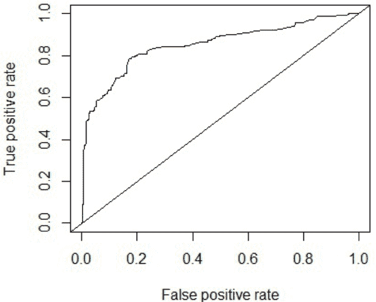

如前所述，AUC用于比较模型。下面是仅使用Age作为因素的逻辑模型的AUC：

```
model2 <- glm(as.factor(Survived) ~ Age, data=titanic, family="binomial")
pred <- prediction(predict(model2), titanic$Survived)
perf <- performance(pred,"tpr","fpr")
plot(perf,main="AUC for Logistic Regression Titanic Model - Age Only")
abline(a=0,b=1)
```

我们可以立即看到，这个单变量模型几乎没有预测能力。AUC曲线与前面的随机对角参考线类似，这表明没有预测能力。

## 逻辑回归Titanic模型的AUC-仅Age

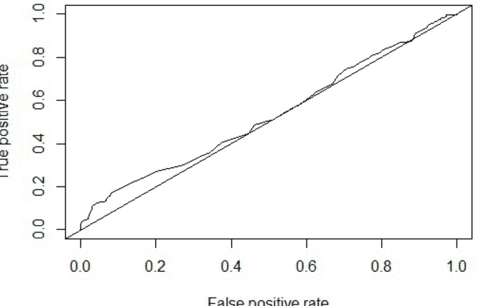

## 样本内/样本外测试，walk forward测试

模型开发完成后，最佳实践是使用其他数据验证结果。

## 训练/测试/验证数据集

训练数据是用于构建预测数据的数据。测试数据，也称为保留样本，是训练过程中未使用的数据。测试数据用于查看训练好的模型是否能够将其结果推广到未包含在模型训练中的另一个数据集。

但是，尽管测试数据集未用于模型训练，但在模型开发期间，建模人员通常可以查看其内容。

验证集是第三个数据集，有时用于进一步对模型结果进行基准测试。验证数据也是从未见过的数据，在模型通过测试数据集验证并在部署之前纳入。验证数据集通常来自与原始训练/测试数据源完全不同的源，目的是对模型结果提供第二个佐证或反驳。

除了训练、测试和验证数据外，你还会听到一些相关术语：

- 样本内数据是指用于拟合（建模）数据并在训练数据集上使用的数据
- 样本外数据是指未用于拟合数据的数据

这意味着样本外数据通常仅用于测试和验证数据集。另一种验证数据的技术称为**k折交叉验证**。该技术将使用多个折叠来定义不同的样本内和样本外数据子集，以执行多次模型测试迭代，从而随机化训练和测试数据的选择。

## 时间序列验证

当然，时间序列模型也使用这个概念；但是，仅凭时间段即可用于划分测试和训练数据，例如，模型可能基于之前五年的历史数据（训练）构建，然后对当前第六年的数据（测试或验证数据）进行预测。

这种变体很常见。一个*走样前向*测试建模人员将在1-5年上开发时间序列模型，在第6年上测试结果，然后在2-6年上开发类似模型，然后在第7年上测试结果。此过程将重复，直到没有更多数据可测试。在所有这些情况下，模型是在*样本内*数据上构建的，并在与k折验证类似的样本外数据上进行测试。

## 与最佳冠军模型进行基准测试

在冠军/挑战者模型开发中，你目前有一个已部署的稳定冠军模型，可以将任何未来结果与其进行基准比较。这使你可以丢弃任何远低于此基准的模型结果。如果你没有当前的冠军，可以使用随机森林或SVM等算法开发一个理论上的最佳模型，并将其作为可实现但（假设）不可操作的基准。查看你刚刚开发的模型结果，看看是否接近此类结果。如果是，这些结果可能无法实现，你可能需要考虑其他方案。

## 专家意见：人机对抗

这通常用于分类问题，本质上是人与机器的对抗。如果专家同意模型输出的大部分内容，那就是将其视为有效的另一个理由。

## 元分析

关于伪科学以及如何总有另一项研究产生与之前相反结果的文章已有大量论述。p值操纵是实现这一点的一种方式。我们已经提到过元数据，即关于数据的数据。

元分析是对研究的研究，研究人员将查看所有先前的分析并报告它们对总体结果的所有看法。如果你的分析与过去进行的其他类似分析一致，那将是支持你模型的更多证据。

## 飞镖板法

在某些情况下，你不必只有一个模型来预测结果。如果你接受“所有模型都有用”的观点，为什么不同时使用其中一些？这种方法在市场营销活动管理和金融投资组合管理中被广泛使用。有时候不要把所有鸡蛋放在一个篮子里是有好处的。一个模型在某个月可能无法工作，但可以用另一个模型的正面结果来抵消。集成建模与此类似，也可以同时包含多个不同的模型，但通常只有一个结果，并且可能会过拟合。

## 步骤 6：部署

模型部署是将模型投入实际生产环境的过程。这可能取决于许多因素，例如开发环境、所选算法、开发模型时对数据的假设，当然还有开发人员的水平。通常模型无法扩展以满足生产环境的需求，提前了解可能的生产环境将决定哪些问题或技术是可行的。

## 模型打分

模型打分使模型具有可操作性。如果你开发了一个模型但无法将结果应用于新数据，那么你将无法持续进行任何预测。新的模型打分通常涉及将开发模型的输出发送到实时打分引擎。该引擎通常是Java或C++。具体操作方式因建模技术而异。有时打分是单独进行的，以便可以针对效率进行优化。

回归类型的模型相对容易打分，因为只需要模型的系数和截距。其他类型的模型需要更多工作。例如，决策树软件应该能够输出一组决策规则，使生产语言能够使用一系列if/then/else规则对其进行重新编码。软件包通常会输出为每个节点确定的决策规则。

某些生产包将接受PMML输入。PMML是一种通用语言，用于促进将一种语言的模型规范翻译成通用格式。

对于更复杂的模型，可能需要在单独的生产机器上拥有模型的生产版本并运行模型


使用与开发中使用的类似代码。

## 参考文献

您可以参考以下文章：

- 确定根本原因：5 Whys。摘自 https://www.isixsigma.com/tools-templates/cause-effect/determine-root-cause-5-whys/
- 葛得斯堡演说，（1863年11月19日）。摘自 Abraham Lincoln Online: http://www.abrahamlincolnonline.org/lincoln/speeches/gettysburg.html
- Stevens, S. (1946). 测量尺度理论。Science
- Wikipedia. 偏差-方差权衡。摘自 Wikipedia: https://en.wikipedia.org/wiki/Bias%E2%80%93variance_tradeoff

## 注释

Random Forests ™ 是 Leo Breiman 和 Adele Cutler 的商标，并专门授权给 Salford Systems 用于软件的商业发布。

## 摘要

在本章中，我们了解了预测分析的各种结构化方法，以及如何通过协作和沟通以有条理的方式实施分析项目来提高分析项目的成功率。我们概述了 CRISP-DM 方法论的各个步骤，并演示了可用于帮助您沿这些步骤推进的工具。

我们讨论了采样的好处以及它如何加速您的项目。SQL 被用来演示基本图表和图形，以便您在创建第一个模型之前就可以开始获得洞察。我们展示了数据模拟也可在数据理解阶段作为初步建模工具进行"假设分析"，即使在获得实际公司数据之前也是如此。

我们了解了将遇到的各种数据类型，并展示了一些自变量和因变量的示例，以及作为建模前奏进行初步单因素和双因素变量分析的重要性。

最后，我们了解了以后将使用的一些基本预测模型，并讨论了在开始考虑可能要采用的预测模型类型时，偏差/方差权衡的重要性。

最后，我们讨论了评估模型的一些最佳实践，以及规划将模型最终部署到生产环境的重要性，以及这如何改变您的开发流程。

在下一章中，我们将更多地关注将数据整理成适合实际预测建模的形式，重点放在数据清洗、异常值、缺失值以及一些数据降维和转换技术上。
