# 第 3 章. 输入和探索数据

> "有人曾两次问我："天哪，巴贝奇先生，如果你把错误的数字输入机器，还能得到正确的答案吗？"……我无法正确理解会引发这种问题的那种思想混乱。"

- 查尔斯·巴贝奇

本章将介绍数据输入和探索。在前两章中，我们介绍了处理已经存在于 R 包中的一些数据集。我们有意避免读取任何外部数据源。然而，现在我们将这样做。数据输入部分将介绍将您自己的数据读入 R 的各种机制。

数据探索部分介绍了您可以用来成功完成上一章中介绍的 CRISP-DM 流程中数据理解和数据准备步骤的第二步和第三步的一些技术。

我们将介绍的主题包括以下内容：

- 将数据读入 R
- 生成您自己的数据
- 数据整理与合并
- 数据清洗技术
- 数据转换
- 分析缺失值和异常值
- 变量降维技术

## 数据输入

数据本身只是一串纯粹的数值流。是分析过程将其转化为知识，但在开始理解之前，我们必须能够获取数据。如今我们生成数据的方式已呈指数级增长。从定长格式，经过 HTML，再到自由形式的非结构化输入，再到今天的读取时模式技术，当今存在如此多种不同的数据格式，很有可能您没有接触过，并且永远也不会接触到其中的几种。读取数据并理解变量及其所代表的含义也可能极其令人沮丧。将数据与其他内部和外部来源集成，有时像拼图一样。有时，数据似乎并不像您希望的那样完美契合。

然而，就原始输入而言，大多数人在工作中会接触到几种常见格式，了解如何使用它们将非常有用。

### 文本文件输入

将数据读入预测分析项目最便捷的方式是通过输入文本文件。文本文件很方便，适用于中小型项目。您可以使用多种不同的程序以人类可读形式查看文本文件。然而，随着数据量增大，将数据存储在文本文件中可能变得有些难以管理，您可能不得不直接从数据仓库（包括 SQL 和 NoSQL 类型）检索数据，并可能融入 Spark 和 Hadoop 等生态系统，在那里您将开始使用并行处理和内存管理技术。

### read.table 函数

读取文本文件的基本函数是 `read.table`。向该函数提供的最重要信息是文件名、分隔符以及是否包含行标题。使用 `read.table` 函数读取文件时，还需考虑一些其他重要选项：

- `header`: 如果输入数据的第一行包含列标题信息，请设置为 `header=TRUE`。
- `col.names`: 如果您将提供自己的列名，请使用此选项以向量形式指定列名。
- `na.string`: 默认值为 NA；然而，输入数据包含各种可表示 NA 的代码，甚至可能包含多个 NA 值。有时，值 0、9 或其他字符（如 .）可用于表示缺失值。
- `ColClasses`: 如果您希望将输入数据项特定读取为某种数据类型（如字符串、int 或 factor），请使用此选项。以字符类型向量形式提供 `ColClasses`。此选项通常在初次读取数据后提供，当您发现默认数据类型不是您想要的类型时，您将强制使用指定的特定数据类型读取特定变量。
- `stringsAsFactors`: 如果此选项指定为 `TRUE`，它将强制将字符输入转换为 factor。因子是字符分类变量的一种特殊表示，在内部表示为整数。将字符变量设置为因子，使其作为分类变量进行分析更高效，但会使执行严格文本处理（例如字符串操作）稍微困难一些。但是，可以通过将数据类型转换为替代数据类型的函数来绕过这些问题。

### 注意

一般来说，如果您将进行大量字符串操作，最好将 `stringsAsFactors` 设置为 FALSE。然而，因子对分析包更有用，大多数时候变量都需要以因子格式存在。但是，有方法可以将变量从字符转换为因子，或反之亦然，这只有在代码进入生产环境或您希望节省内存时才变得重要。

- `sep`: 此分隔符值使函数能够将一个字段与另一个字段分开。它通常是逗号或制表符。

除了 `read.table` 函数外，还有其他一些专门用于特殊目的的函数，它们都源自 `read.table` 函数：

- `read.csv`: read.csv 用于逗号分隔且数值中使用句点的文件。CSV 数据是最常见的文本文件格式。几乎所有数据应用程序都能读取或写入这种格式，因此精通使用这种格式是一项固有优势。然而，CSV 输入可能较慢，对于格式规范的数据通常开箱即用。以后您可能想要使用具有更好输入性能的函数（例如 fread 或 scan 函数），但如果您只想快速上手，read.csv 是读取 csv 文件的一个良好起点。

- `read.csv2`: 这与 read.csv 类似，但使用分号分隔值，并使用逗号作为小数点占位符。例如，读取欧元时很有用，欧元使用逗号将整数部分与小数部分分开，如下列代码所示。

```
#Read in a single pencil costing $1.20
cat("Product,Cost",file="outfile.txt",sep="\n")
cat("Pencil,1.20",file="outfile.txt",
sep="\n",append=TRUE)
read.csv("outfile.txt")
```

```
#Read in a single pencil costing $1.20
cat("Product,Cost",file="outfile.txt",sep="\n")
cat("Pencil;1,20",file="outfile.txt",
sep="\n",append=TRUE)
read.csv2("outfile.txt", sep=";")
```

- `read.delim`: 此函数用于制表符分隔且使用句点作为小数占位符的文件。

- `read.delim2`: 这与 read.delim 相同，但使用逗号作为小数占位符。


- read.fwf: 此函数将按每列预设的字节数处理数据。这是一种较旧且低效的数据存储方式，不过某些旧版数据仍会以这种格式保留，因此如果你需要处理此类数据，了解如何使用此函数仍然很有用。

## 数据库表

数据库表位于企业数据仓库（EDW）中，如 MySQL、SQL Server 或 Oracle，也可以存储在本地 PC 上。只要提供正确的身份验证凭据，就可以使用 R 访问这些数据。企业数据包含你能接触到的最好的一些数据。它通常被视为公司范围内使用的官方数据源。此外，在功能完善的企业数据仓库系统中，数据已经过审核，因此省去了检查数据质量的工作。然而，从数据仓库中提取的数据也可能很复杂，通常需要一份好的数据字典和元数据作为伴随。

数据仓库表通常针对速度进行了优化。然而，有必要了解数据仓库的逻辑和物理数据结构，以及列索引结构。了解这些将提高你的查询性能。

在 EDW 中，数据通常按主题组织，每个目的都有单独的专用表。有时这会导致冗余，但优势是你需要的所有数据可能只位于几个表中。

直接从数据库表读取数据在一定程度上绕过了 R 的内存限制，因为部分处理是在本地 PC 之外完成的。在某些情况下，可以使用并行处理，这将允许你访问非常大的数据集。

访问存储在关系型数据库中的数据的常见方式是通过 SQL、ODBC 或 JDBC 连接。有些系统会接受直接连接。以下是一些用于连接数据库的特定包：

- `RODBC` 包为 SQL Server 提供一个接口
- `RMySQL` 包用于连接 MySQL 数据库
- `ROracle`、`RJDBC` 和 `RODBC` 包可用于连接 Oracle 数据库

企业数据库的通用连接器是 ODBC 连接器。由于它是通用的且为单线程，ODBC 往往较慢。RJDBC 通过 JDBC 接口提供访问。JDBC 比 ODBC 快，但需要更多调试。由于连接数据库比读取文本文件要复杂一些，因此处理登录 ID、密码和优化查询需要花更多时间和精力。但一旦你熟悉自己的环境，花时间优化访问是值得的，可以避免 DBA 打电话告诉你查询运行时间过长。

## 电子表格文件

R 通过 `XLConnect` 或 `xlsx` 包提供与 Excel 表格的直接接口。Excel 在企业世界中非常普遍，并可以包含大量有用的数据和元数据。因此，了解所有可以访问电子表格的工具是很有价值的。学习如何使用电子表格进行分析也很有价值，因为这能让你深入了解最初创建数据时的思考过程。

然而，由于 Excel 是专有产品且市场上有许多版本，使用某些这些包仍然可能很棘手。导入 Excel 数据最方便的方法是先在 Excel 本身中访问它，然后使用 Excel 命令将其另存为分隔文件，最后使用 `read.table` 或 `read.csv` 包将其读回 R 中。如果你自己无法完成，也可以要求电子表格的维护者为你写一个 CSV 文件。

## XML 和 JSON 数据

XML 数据用于金融和保险行业的数据交换，因此如果你在这些行业工作，很可能会遇到某种格式。XML 中不使用预定义的架构，但这也意味着读取数据后需要进行大量的数据解析才能提取数据本身。XML 包用于将 XML 数据读入 R。

JSON 是另一种源自 Web 技术的标准，最初用于在不同应用系统之间传输键值对集。jsonlite 包可用于解析 JSON 文件。

## 注意

仍然对所有不同的文件格式感到困惑吗？尝试使用输入文件的 Rio 包。Rio 是一个专门的包装器包，能够识别你想要读取的文件类型，然后调用相应的包。

## 生成你自己的数据

不确定在测试预测模型时使用哪个数据源？没问题。使用内置的 sample() 函数生成你自己的数据，以及根据 runif（均匀分布）、rnorm（正态分布）、mvnorm（多元正态分布）或 rpois（泊松计数）等分布生成随机观测值。我们还将使用一个名为 wakefield 的专用包，它生成许多数据源中常见的典型随机值，例如年龄、性别、教育程度和客户满意度评分，而无需担心底层分布。

## 处理大文件的技巧

某些输入文件可能非常大且读取效率低下。以下是一些加快过程的技巧：

- 使用外部 Unix 工具分割文件，以便可以分块读取。通常有一个字段可用于拆分出单独的文件。日期字段是很好的选择。
- 考虑使用外部工具将大字符串替换为数值或更短的字符串。这将节省宝贵的内存。
- 使用输入参数控制要读取的数据量。你可能希望从第 1,000,000 行开始读取输入文件来处理它。你不必始终从文件开头读取。
- 不必有义务始终读取所有列。一旦确定了真正需要的列，只读取这些列；这将加快处理速度。例如，如果你使用 read.table，可以在 colClasses 选项中指定 NULL 以指示跳过某一列。
- 使用 scan、fread 和 readlines 函数。它们将对输入提供更大的控制程度，并可以加快输入速度。

## 数据整理与清洗

为分析准备数据的很大一部分利用将分散的信息结合起来，以生成最终的分析数据集，该数据集将直接传递给算法。这个过程有许多不同的名称，例如数据整理、数据清洗、ETL 或简称数据准备。我们已经讨论过一些从单一来源读取数据的方法。如果你能使用一个包含所需所有信息的单个数据文件，那你将非常幸运。事实上，如果你能够使用已经整合的数据，就直接使用吧，因为另一个人已经完成了工作，没有必要自己试图弄清楚如何关联它们。然而，大多数时候你需要关联至少两个不同的来源，并根据某些共同的数据元素以某种方式将它们关联起来。

## 连接数据

如果你需要将不同的数据来源合并在一起，SQL 是一种将数据合并在一起的方法。如所述，SQL 语法在许多环境中都很常见，因此如果你在 R 中学习 SQL 语法，你就已经开始了解其他环境中如何处理数据了。但不要将自己限制在仅 SQL 上。连接数据还有其他选项，例如使用 merge 语句。Merge 是一个原生函数，实现相同的目标。一些其他包处理数据集成也相当不错。我还将使用 `dplyr` 包来执行一些可以在 SQL 中完成的相同任务。

`sqldf` 包是一个标准 R 包，使用标准 SQL 语法将两个表合并或连接在一起。对于关系数据，这是通过将一个表上的变量（主键）与另一个关联表上的类似变量关联来完成的。请注意，我在此使用的 table 术语是指关系型数据库环境中的表。在 R 环境中，SQL 表等同于 R dataframe。R table 是一个特定的 R 对象，指的是由交叉表或类似函数生成的列联表。

### 使用 sqldf 函数

此示例使用 `sqldf` 和 `RSQLite` 包来说明一些 SQL 连接，并用它来演示带过滤器读取 CSV 文件。此示例还使用 `wakefield` 包生成一个假设的成员文件以及一个购买交易文件。

### 加载必要的包

首先，清空工作区（在保存稍后需要的任何 R 对象之后）：

```
rm(list = ls())
```

然后，安装所需的包：


```
install.packages("dplyr")
install.packages("wakefield")
install.packages("sqldf")
install.packages("RSQLite")
```

本书的惯例是使用简单的 `install.packages("packagename")` 指令来安装所需的包，随后使用 `library("packagename")` 将其加载到内存中。安装所需的包后，你可以将其注释掉，或者用条件安装代码替换该行：

```
try(require(dplyr) || install.packages("dplyr"))
```

但这种语法可能无法在所有 R 安装和 GUI 中工作，因此我们将保持简单，并明确指定 `install.packages()`。

现在我们将所需的包加载到内存中：

```
library(dplyr)
library(wakefield)
library(sqldf)
library(RSQLite)
```

## 生成数据

接下来，生成包含 1,000 名成员的成员文件，并将其分配给 member 数据框。`wakefield` 包使用专门的函数为每个指定变量生成典型值：

- `gender` 函数将生成 `M` 或 `F`，每行有 50% 的概率为男性或女性
- `set.seed(1010)` 指令保证无论运行多少次代码，结果都将相同
- `r_sample_replace()` 函数将生成唯一的成员 ID，值范围为 1 到 1000
- `income`、`children`、`employment`、`level`、`grad`、`year`、`state` 和 `zip_code` 变量均随机生成，无需提供任何专用参数

打开一个新的脚本窗口，运行以下代码：

```
#GENERATE MEMBER
set.seed(1010)
member <- r_data_frame (
  n=1000,
  r_sample_replace(x = 1:1000,replace=FALSE,name="memberid"),
  age,
  gender(x = c("M","F"), prob = c(.5,.5),name="Gender"),
  dob,
  income,
  children,
  employment,
  level,
  grade,
  year,
  state,
  zip_code
)
```

同样，生成购买文件，并将其分配给 purchases 数据框。总购买金额将来自均值为 20,000、标准差为 1,000 的正态分布。Product 变量是来自字母 A-Z 的随机产品名称。

接下来的代码片段将生成购买记录：

```
#GENERATE PURCHASES
set.seed(1010)

purchases <- r_data_frame(
  n=1000,
  r_sample_replace(x = 1:1000,replace=TRUE,name="memberid2"),
  purch=rpois(lambda=1),
  normal(mean = 20000, sd = 1000, min = NULL, max = NULL, name =
  upper(x = LETTERS, k=3, prob = NULL, name = "Product")
)
purchases$purch <- purchases$purch + 1
str(purchases)
```

生成 purchases 数据框后，我们将其写入外部 CSV 文件。这样做的目的是演示如何使用 read.csv.sql 从外部文件中过滤行：

```
#WRITE PURCHASES TO FILE
write.csv(purchases, "purchases.csv", quote = FALSE, row.names =
```

现在我们将 `purchases.csv` 重新读入 R。但不是读取整个文件，我们只读取 `TotalAmount` > 20,000 的记录：

```
#read it back in
purchases_filtered <- read.csv.sql("purchases.csv", sql = "select
```

你可能会问，为什么不直接读取整个文件，然后稍后再过滤，而要这样做。答案是效率。让我们假设，在现实中，购买文件会比实际的 1,000 条记录大得多，并且会包含许多小额购买。我们不想花费处理时间来读取所有这些小额交易，因为我们只关心高价值会员。因此，你可以在读取文件时过滤数据，只读取购买金额大于 20,000 的会员。

## 检查元数据

读取任何文件后，验证行数并在创建数据框后查看元数据始终是良好的做法。我们可以轻松使用 `str()` 函数来完成此操作。`str()` 函数是一个非常有用的函数，包含了我们在第 2 章“建模过程中”讨论的大量元数据信息。每次读取、合并、连接或创建新文件时，运行 `str()` 函数始终是个好主意：

```
str(member)
str(purchases)
str(purchases_filtered)
```

```
> str(member)
Classes 'tbl_df', 'tbl' and 'data.frame':  1000 obs. of  12 variables:
 $ memberid : int  553 192 185 676 909 818 659 971 384 792 ...
 $ Age      : int  30 23 29 20 31 23 26 29 28 28 ...
 $ Gender   : Factor w/ 2 levels "M","F": 2 2 1 2 2 2 1 2 2 1 ...
 $ DOB      : Date, format: "2002-04-30" "2001-12-16" "2002-08-14" "2002-09-08" ...
 $ Income   : num  52826 53330 50949 31842 47418 ...
 $ Children : int  2 1 5 1 3 1 7 0 3 ...
 $ Employment: Factor w/ 5 levels "Full Time","Part Time",..: 4 5 1 1 1 1 1 1 1 4 ...
 $ Level    : int  1 4 4 4 2 3 2 3 1 3 ...
 $ Grade    : num  88.6 78.3 88.7 82.8 83.2 85.8 89.2 91.6 84.4 94.2 ...
 $ Year     : int  2009 1998 2010 2015 2013 1997 2012 1998 2015 2012 ...
 $ State    : Factor w/ 50 levels "Alabama","Alaska",...: 43 5 43 38 43 17 6 4 35 36 ...
 $ Zip      : chr  "82942" "37189" "89850" "49835" ...
```

```
> str(purchases)
Classes 'tbl_df', 'tbl' and 'data.frame':  1000 obs. of  4 variables:
 $ memberid2 : int  553 192 185 678 912 822 663 977 387 799 ...
 $ purch     : num  2 1 2 1 2 1 2 2 2 ...
 $ TotalAmount: num  19457 21222 19469 20331 19003 ...
 $ Product   : chr "B" "C" "C" "C" ...
```

```
> str(purchases_filtered)
'data.frame':   489 obs. of  4 variables:
 $ memberid2 : int  192 678 822 663 387 914 830 974 549 902 ...
 $ purch     : int  1 1 2 2 2 1 1 3 1 ...
 $ TotalAmount: num  21222 20331 21208 21151 21869 ...
 $ Product   : chr "C" "C" "C" "A" ...
```

如果你切换到控制台，可以看到 member 和 purchases 均有 1,000 行，而 purchases_filtered 数据框有 489 行。查看 str(purchases_filtered) 中的 TotalAmount 行表明，所有购买实际上都大于 20,000。

始终查看缺失值（NA）的数量，以及所有因子指定的级别。数据中没有缺失值。查找字符变量应被视为因子（反之亦然）的任何情况。例如，Product 变量列为字符型（chr），但可能应被视为因子。我们以后随时可以切换类型。

如果你只想查看创建的行数，可以使用 nrow 函数，而不是 str() 函数：

```
nrow(member) #1000 members
nrow(purchases_filtered) #489
```

## 使用内连接和外连接合并数据

现在让我们将成员文件与购买记录合并。在 SQL 中，关联两个数据框时可以考虑两种合并类型。

内连接将基于两个记录共有的单个或多个键的匹配来合并两条记录。外连接也会按键合并两个表，但还会包括任何未匹配的行。你可以通过观察任何匹配键中是否存在 NAs 来识别外连接。内连接通常更高效，但仅在你预期两个待合并文件都具有匹配键时才应使用。

join2 数据框是一个内连接，将仅包含有购买记录的会员。sqldf() 函数将按会员匹配所有观测值：

```
join2 <- sqldf("select * from 'member' inner join 'purchases_filtered' on member.memberid=purchases_filtered.memberid2")
```

连接后，立即对 join2 数据框执行 str() 函数：

```
str(join2)
```

str() 函数将显示有 489 个观测值，表明并非所有会员都有购买记录：

```
> str(join2)
'data.frame':	489 obs. of  16 variables:
 $ memberid : int  192 676 909 971 384 963 541 9 79 272 ...
 $ Age      : int  23 20 31 29 28 20 33 26 26 24 ...
 $ Gender   : Factor w/ 2 levels "M","F": 2 2 2 2 2 1 1 2 1 1 ...
 $ DOB      : Date, format: "2001-12-16" "2002-09-08" "2001-07-24" "2002-03-26" ...
 $ Income   : num  53330 31842 47418 30076 10282 ...
 $ Children : int  1 1 3 7 0 4 0 4 0 3 ...
 $ Employment: Factor w/ 5 levels "Full Time","Part Time",..: 5 1 1 1 1 3 1 5 1 1 ...
 $ Level    : int  4 4 2 3 1 4 1 3 4 ...
 $ Grade    : num  78.3 82.8 83.2 91.6 84.4 83.9 82.7 86.9 85.9 85.1 ...
 $ Year     : int  1998 2015 2013 1998 2015 1996 1999 1999 ...
 $ State    : Factor w/ 50 levels "Alabama","Alaska",..: 5 38 43 4 35 44 38 5 43 9 ...
 $ Zip      : chr "37189" "49835" "45727" "68914" ...
 $ memberid2 : int  192 676 909 971 384 963 541 9 79 272 ...
 $ purch    : int  1 1 2 1 1 2 4 1 2 ...
 $ TotalAmount: num  21222 20239 20118 20439 20874 ...
 $ Product  : chr "C" "C" "A" "C" ...
```

在不期望两个文件始终有匹配的情况下，外连接通常更好。join3 数据框将合并会员及其购买记录，但也会包括所有没有购买记录的会员。这是通过使用外连接子句来完成。连接数据框后，使用 str 和 nrow 函数来验证行数。数据框中应该有 1,105 行。这


超过成员的数量。这是因为成员进行了多次购买：

```
join3 <- sqldf("select * from member left outer join purchases_fi
str(join3)
nrow(join3)
```

```
#View the output from join 3 for columns 1, and 8-16 correspondin
View(join3[,c(1,8:16)])
```

`View()` 函数是浏览结果部分以尝试协调任何异常的便捷方式。在对 `join3` 数据框的选定列发出 `View` 命令后，我们可以看到 memberid 4 有多次购买。我们还可以快速查看哪些成员没有购买（成员 ID 7 和 8）。在成员没有购买的情况下，购买信息作为变量包含在内，但购买变量字段中填充了 NA：

| 成员ID | 级别 | 等级 | 年份 | 州 | 邮编 | 购买 | purch.f | 总金额 | 产品 |
| :--- | :--- | :--- | :--- | :--- | :--- | :--- | :--- | :--- | :--- |
| 1 | 4 | 93.2 | 2011 | 乔治亚州 | 49835 | NA | NA | NA | NA |
| 2 | 2 | 4 | 85.8 | 1999 | 内布拉斯加州 | 91960 | 3 | 3 | 21428.89 | C |
| 3 | 3 | 2 | 85.1 | 1998 | 麻萨诸塞州 | 45727 | 1 | 1 | 21493.89 | B |
| 4 | 4 | 1 | 90.1 | 1996 | 德克萨斯州 | 82942 | 2 | 2 | 20029.25 | C |
| 5 | 4 | 1 | 90.1 | 1996 | 德克萨斯州 | 82942 | 2 | 2 | 20153.52 | B |
| 6 | 5 | 1 | 86.7 | 2005 | 佛罗里达州 | 45727 | 2 | 2 | 20166.95 | B |
| 7 | 5 | 1 | 86.7 | 2005 | 佛罗里达州 | 45727 | 3 | 3 | 21016.57 | C |
| 8 | 6 | 1 | 81.8 | 2007 | 纽约州 | 22801 | 1 | 1 | 20394.55 | B |
| 9 | 7 | 3 | 85.1 | 2006 | 阿拉巴马州 | 49835 | NA | NA | NA | NA |
| 10 | 8 | 3 | 91.4 | 1997 | 犹他州 | 49835 | NA | NA | NA | NA |

这种连接称为一对多连接。在此示例中，只能有一条成员记录，但可以有多条购买记录。

## 识别有多次购买的成员

在新脚本中自行尝试此查询，以确定哪些成员有多次购买。应该有 89 个。在 SQL 查询术语中，多次购买子句在查询中由 `count(*) > 1` 指示：

```
dups <- sqldf("select member.memberid,count(*) from
member left outer join
purchases_filtered on
member.memberid=purchases_filtered.memberid2
group by member.memberid having count(*) > 1")
```

## 消除重复记录

在许多情况下，您可能只想保留连接产生的一条记录。假设我们只想为每个 memberid 保留一条记录，并且希望它是每个成员的最高 TotalPurchase。要消除重复项，我们可以先按 memberid 和 TotalPurchase 金额对数据框进行排序。然后我们将使用 rev 和 duplicated 函数仅保留每个 memberid 的最后一条购买记录。这样，原始 1,000 个成员各只剩下一条记录：

```
join3 <- join3[order(join3$memberid, join3$TotalAmount),]
View(join3)
dedup <- join3[!rev(duplicated(rev(join3$memberid))),]
nrow(join3)
nrow(dedup)
```

```
> nrow(join3)
[1] 1105
> nrow(dedup)
[1] 1000
```

## 探索医院数据集

探索性数据分析是在数据建模之前的一个初步步骤，您需要查看数据的所有特征，以了解数据分布、相关性、缺失值、异常值以及任何其他可能影响未来分析的因素。这是一个非常重要的步骤，如果认真执行，日后将为您节省大量时间。

对于以下示例，我们将读取纽约市医院出院数据集（住院患者出院（SPARCS 去标识化）：2012，n.d.）。本示例使用 `read.csv` 函数输入分隔文件，然后使用 `View` 函数以图形方式显示输出。然后使用 `str` 函数显示刚创建的 df 数据框的内容，最后，`summary()` 函数显示所有变量的所有相关统计信息。这些都是初次查看数据时的典型步骤：

```
df <-read.csv("C:/PracticalPredictiveAnalytics/Data/NYC Hospital str(df)
```

### str(df) 函数的输出

在创建新数据对象后，运行 `str()` 函数是一个重要的步骤。如果您在日志中查看 `str(df)` 函数的输出，会发现您刚刚运行的默认 `read.csv` 函数已将数据中的每个变量定义为数值型或因子型。目前保持原样也可以，但最终我们会希望更改这些变量的数据类型，因为 `Length.of.Stay` 不是因子，而是整数。或者，我们可以执行另一个指定所需精确数据类型的 `read.csv` 函数，指定 `ColClasses` 向量。我通常喜欢先查看一个小数据集样本，然后确定数据类型应该是什么，再重新输入数据。

关于 `read.csv` 语句需要注意的另一点是，缺失值通过 na.strings 选项指定为空值。

`str()` 函数在提示您哪些变量可以从分析中排除方面也很重要，即使在运行频率分布之前也是如此。

例如，APR.Severity.of.Illness. Description 和 Payment.Typology.1 变量只有一个级别，因此我们将从分析中排除它们，因为数据中将没有变异性：

```
'data.frame': 4052 obs. of 24 variables:
 $ Hospital.County : Factor w/ 5 levels "Bronx","Kings",...: 1 1 1 1 1 1 1 1 1 1 ...
 $ Facility.Name : Factor w/ 54 levels "Bellevue Hospital Center",...: 13 13 13 13 13 13 13 13 13 13 ...
 $ Age.Group : Factor w/ 5 levels "0 to 17","18 to 29",...: 4 4 4 3 4 5 3 4 4 4 ...
 $ Zip.Code...3.digits : Factor w/ 40 levels "100","101","103",...: 4 4 4 1 4 4 1 3 4 4 ...
 $ Gender : Factor w/ 2 levels "F","M": 1 2 2 2 2 2 2 1 2 2 ...
 $ Race : Factor w/ 6 levels "Asian","Black/African American",...: 1 4 4 2 2 2 2 2 2 2 ...
 $ Ethnicity : Factor w/ 3 levels "Not Span/Hispanic",...: 1 2 2 2 1 2 1 2 1 ...
 $ Length.of.Stay : Factor w/ 120 levels "1","10","100",...: 24 55 25 25 50 42 59 35 51 ...
 $ Admit.Day.of.Week : Factor w/ 7 levels "FRI","MON","SAT",...: 2 3 3 1 5 6 4 2 2 5 ...
 $ Patient.Disposition : Factor w/ 7 levels "Expired","Home or Self",...: 11 11 12 17 18 7 4 ...
 $ Discharge.Day.of.Week : Factor w/ 7 levels "FRI","MON","SAT",...: 3 7 6 6 5 6 2 1 1 ...
 $ CCS.Diagnosis.Description : Factor w/ 217 levels "ABDOMINAL HERNIA",...: 3 37 30 190 136 190 95 113 21 190 ...
 $ CCS.Procedure.Description : Factor w/ 192 levels "ABDOMINAL PARACENTESIS",...: 93 33 36 66 76 36 39 111 182 ...
 $ APR.MDR.Description : Factor w/ 260 levels "ABDOMINAL PAIN",...: 49 82 246 230 172 99 246 99 57 247 ...
 $ APR.MDC.Description : Factor w/ 20 levels "DRUGS/ALCOHOL/MENTAL HEALTH",...: 20 20 1 11 10 1 11 1 11 1 ...
 $ APR.Severity.of.Illness.Description : Factor w/ 1 level "Extreme": 1 1 1 1 1 1 1 1 1 1 ...
 $ APR.Risk.of.Mortality : Factor w/ 4 levels "Extreme","Major",...: 1 1 1 1 1 1 2 1 1 1 ...
 $ APR.Medical.Surgical.Description : Factor w/ 2 levels "Medical",Surgical: 1 1 2 1 1 2 1 1 2 2 ...
 $ APR.MDC.Code : Factor w/ 25 levels "01","03","04",...: 5 5 5 5 5 5 5 4 4 ...
 $ Payment.Typology.1 : Factor w/ 9 levels "Blue Cross/Blue Shield",...: 5 NA 5 5 5 5 5 5 4 4 ...
 $ Payment.Typology.2 : Factor w/ 9 levels "Blue Cross/Blue Shield",...: NA NA 4 4 4 4 4 NA NA ...
 $ Emergency.Department.Indicator : Factor w/ 2 levels "N","Y": 2 2 2 2 2 2 2 2 2 ...
```

### View 函数的输出

除了使用 head 和 tail 命令外，使用 View 命令快速查看数据也很有帮助。向上、向下、向左和向右滚动，检查具有代表性的值类型以及是否填充了数据。查看数据还可以让您了解数据可能如何排序或分组：

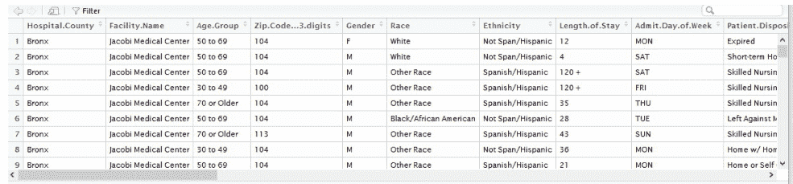

### colnames 函数

运行 `colnames()` 函数是获取每个变量索引编号的便捷方法。在 R 函数中使用索引编号是引用变量的便捷且快速的方式。

但是，文件格式的更改可能会改变顺序，因此仅建议在交互式使用中采用此方法：

```
> colnames(df)
 [1] "Hospital.County"                  "Facility.Name"                    "Age.Group"                        "zip.code...3.digits"
 [5] "Gender"                           "Race"                             "Ethnicity"                        "Length.of.Stay"
 [9] "Admit.Day.of.week"                "Patient.Disposition"              "Discharge.Day.of.week"            "CCS.Diagnosis.Description"
[13] "CCS.Procedure.Description"        "APR.DRG.Description"              "APR.MDC.Description"              "APR.Severity.of.Illness.Description"
[17] "APR.Risk.of.Mortality"            "Emergency.Department.Indicator"   "Total.Charges"                    "Total.Costs"
[21] "Payment.Typology.3"
```

为了简化示例，我们将从分析中排除变量 12、13、16、19、20 和 21。

### summary 函数

`summary()` 函数是获取变量分布快照的便捷方式。对于数值变量，它将提供六个重要的分布统计量（均值、最小值、最大值、第一四分位数、第五四分位数和第三四分位数）。该函数将快速返回大量信息。对于大量变量，`summary()` 函数的输出可能会让人不知所措（而且不好看！）。

为了限制输出，我们将使用之前获得的列号，运行一个排除列 12、13、16、19、20 和 21 的 `summary()` 函数：

```
summary(df[,-c(12, 13, 16, 19, 20, 21)],maxsum=7)
```

或者，如果您不想使用索引编号而更喜欢使用变量名，可以使用以下代码获得相同的结果，该代码使用非号（!）来排除向量中指定的变量：

```
exclude_vars <- names(df) %in% c('CCS.Diagnosis.Description','CCS
```

```
summary(df[!exclude_vars],maxsum=7)
```

查看 `summary()` 函数的输出，并观察变量的分布。查找似乎代表性不足或过度的变量。医院国家的分布是否反映了五个


纽约市自治市？年龄群体偏向老年人群，但0-17岁年龄段的五个病例是由什么引起的？

仅通过查看汇总统计数据就可以获得大量信息，此时应提出的问题正是这类问题：

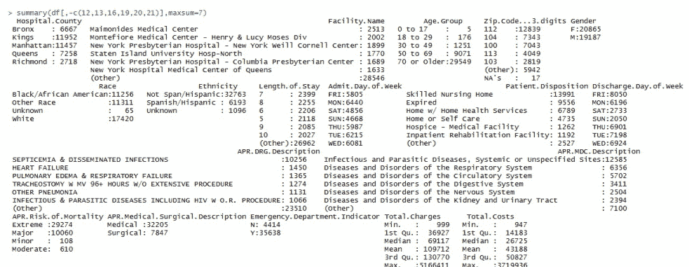

## 将输出发送到 HTML 文件

由于summary的输出对于大量变量来说不够美观，您也可以将输出格式化为 HTML 并发送到文件中，以便在浏览器中查看结果。我们将通过 R2HTML 包说明一种实现方法。

在以下代码中，从 HTMLStart 到 HTMLStop 的所有输出都将发送到指定的文件和目录：

```
install.packages("R2HTML")
library(R2HTML)
HTMLStart(outdir="C:/PracticalPredictiveAnalytics/Outputs",file="
summary (df[,-c(12, 13,16, 19, 20, 21) ],maxsum=7)
HTMLStop()
```

编写 HTMLStop() 命令后，日志显示输出已写入 HTML 文件：

```
HTML> HTMLStop()
[1] "C:/PracticalPredictiveAnalytics/Outputs/MedicareNYCInput.html">
>
```

## 在浏览器中打开文件

接下来，在您选择的浏览器中打开该文件。您将看到汇总统计数据以每个变量一列的形式显示，这应与之前 summary 生成的输出相对应。您可能需要上下或左右滚动以查看所有变量：

| Hospital_County | Facility_Name | Age_Group | Zip_Code...3.digit | Gender | Race | Ethnicity | Length.of.Stay | Admit.Day.of.Week | Patient.Disposition | Discharge.Day.of.Week | APR.DRG.Description | APR.MDC.Description | APR.Risk |
|---|---|---|---|---|---|---|---|---|---|---|---|---|---|
| 布朗克斯 : 6667 | 麦蒙尼德医学中心 : 2513 | 0 至 17 : 5 | 112 : 12839 | F: 20865 | 黑人/非裔美国人: 11256 | 非西班牙裔/拉丁裔: 23763 | 7 : 2399 | 周五:5805 | 专业护理院: 13991 | 周五:8050 | 脓毒症及播散性感染 : 10256 | 包括艾滋病在内的传染病和寄生虫病 | 极高 |
| 金斯: 11952 | 蒙特菲奥雷医学中心 - 莫西斯分院 : 2002 | 18 至 29 : 176 | 104 : 7343 | M: 19187 | 其他种族 : 11311 | 西班牙裔/拉丁裔: 6193 | 8 : 2255 | 周一:6440 | 已死亡: 9556 | 周一:6196 | 心力衰竭 : 1450 | 呼吸系统疾病和紊乱 | 重大: 10 |
| 曼哈顿:11457 | 纽约大学医疗中心 : 6199 | 30 至 49 : 1251 | 109 : 7943 | NA | 未知: 65 | 未知: 1096 | 6 : 2206 | 周六:4856 | 家庭或居家健康服务: 6789 | 周六:2733 | 肺水肿及呼吸衰竭 : 1365 | 循环系统疾病和紊乱 | 轻微: 10 |
| 皇后区 : 7256 | 史塔滕岛大学医院-北 : 8071 | 50 至 69 : 8071 | 113 : 4049 | NA | 白人 : 17420 | NA | 5 : 2118 | 周日:4668 | 家庭或自我护理: 4735 | 周日:2050 | 带有96小时以上机械通气的气管切开术并伴有广泛手术 : 1274 | 循环系统疾病和紊乱 | 中度 |
| 里士满 : 2718 | 纽约长老会医院 - 哥伦比亚大学医学中心 : 3896 | 70 岁及以上: 29549 | 103 : 2819 | NA | NA | NA | 9 : 2085 | 周四:5987 | 医疗机构临终关怀: 1262 | 周四:6901 | 其他肺炎 : 1131 | 神经系统疾病和紊乱: 2544 | NA |
| NA | 皇后区纽约医院医疗中心 : (其他) : 5942 | NA | (其他): 5942 | NA | NA | NA | 10 : 2027 | 周二:6215 | 住院康复机构: 1182 | 周二:7198 | 包括艾滋病并伴有手术室操作的传染病和寄生虫病 : 1486 | 肾脏和泌尿道疾病和紊乱: 2394 | NA |
| NA | (其他) : 28546 | NA | NA: 17 | NA | NA | NA | (其他):29682 | 周三:6081 | (其他) : 2527 | 周三:6824 | (其他) : 23510 | (其他) : 7109 | NA |

## 绘制分布图

创建变量矩阵图也是一个很好的初步步骤，因为它可以让您立即看到变量的形状和分布，并指出数据中的任何缺口。在从数据框中删除已知不再使用的某些列后，我们可以看到数据集相当干净，变量大致按预期排列。例如，Admit.Day.of.Week 大致呈正态分布，但我们可以看到 mid-week 出院人数中存在空值。Costs 呈偏态分布，极端值处有非常高的值（但出现次数较低）：

```
df <- df[,-c(12,13,16,19,20,21)]
```

## 变量的可视化绘图

有时您可能希望以矩阵形式为所有变量生成图表。虽然有许多可自动执行此操作的包，但您也可以像下面所示那样自行编写代码。我还将其限制为级别数小于或等于 20 的条形图。以后我可能想查看其他图表，并可能合并一些类别，但这足以让我入门：

```
colors = c("blue", "green3", "orange")
numcols <- length(names(df))
par(mfrow=c(3,5))
for(i in 1:numcols) {
  if(is.factor(df[,i])) {
    if ( as.integer(nlevels(df[,i]) <= 20 ) plot(df[,i],main=name
  }
  else{hist(df[,i],main=names(df)[i],xlim=c(0,300000),breaks=100,
  }
}
```

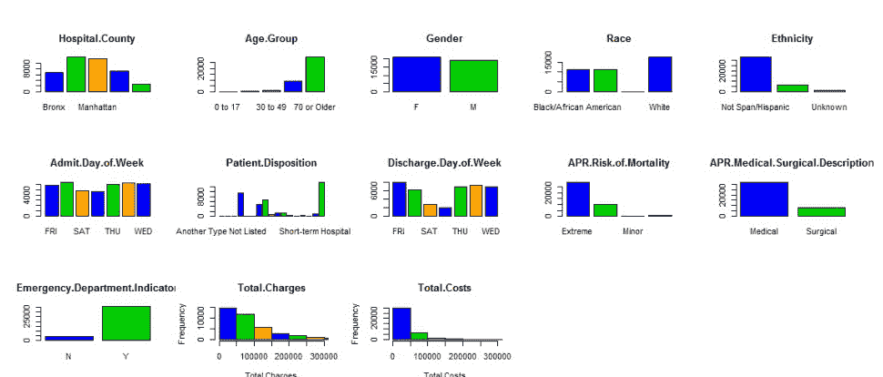

## 按组拆分汇总数据

对数据进行初步检查后，查看按某些类别（或因素）拆分的目标变量的各种汇总统计数据是个好主意。我们可以使用 SQL 来做到这一点；但是，在这个示例中，我们将使用一个名为 dplyr 的有用包，它的语法类似 SQL，任何熟悉 SQL 和/或 Linux 的人都应该能轻松上手。

我们的目标之一是按某些因素分解 `Total.Costs`，以查看各级别之间的成本是否存在差异。让我们先从简单的入手，按星期几拆分这些 `Total.Costs`。我们将通过将 `df` 数据框传输到 `dplyr` group by 命令来实现这一点，随后将其发送到 `summarize()` 函数，该函数将计算 `Total.Costs` 的计数、均值和总和。最后，`%>%` 算子将输出传输（或管道）到 `View` 函数：

```
library(dplyr)
df %>% group_by(Admit.Day.of.Week) %>% summarize(total.count=n()),
```

| | 入院星期 | 总计数 | Total.Costs 总和 | Total.Costs 平均值 |
|---|---|---|---|---|
| 1 | 周五 | 5805 | 258461087 | 44523.87 |
| 2 | 周一 | 6440 | 278940375 | 43313.72 |
| 3 | 周六 | 4856 | 197503874 | 40672.13 |
| 4 | 周日 | 4668 | 195987045 | 41985.23 |
| 5 | 周四 | 5987 | 262899265 | 43911.69 |
| 6 | 周二 | 6215 | 263160240 | 42342.76 |
| 7 | 周三 | 6081 | 272822899 | 44864.81 |

`Total.Costs` 变量在不同星期几之间大致相等。如果您现在正在使用特定方法学运行项目，这也可能是一个在结果文件夹中的某个位置跟踪结果的好时机，并请注意您需要执行统计检验（如 t 检验或方差分析），以检验星期几之间是否存在显著差异。

## 标准化数据

我们可以在医院数据集上执行几种其他转换。

我们希望对 `Total.Costs` 变量和 `Total.Charges` 变量都进行标准化，以便更轻松地比较它们。

预测模型倾向于看到标准化的变量，因为这会减少对任何特定变量的偏差，因为所有标准化变量的数量级均大致相同。

我们这样做的方法是将均值归一化为 0，标准差为 1。计算上意味着我们将取每个值，减去均值，然后将结果除以标准差。

在之前的示例中，我们使用全名明确引用变量（例如，`df$Total.Costs`，它指的是 `df` 数据框中的 `Total.Costs` 变量）。如果您将在单个数据框中引用许多变量，有时发出 `attach` 语句是有意义的，这将允许您在不使用美元符号的情况下使用变量，前提是您始终引用同一数据框。

首先发出 `attach(df)` 命令，以便我们可以使用这些简短名称应用到 `df` 数据框：

```
attach(df)
```

通过从每个 `Total.Costs` 变量值中减去 `Total.Costs` 变量的均值，然后除以 `Total.Costs` 的标准差来计算新的标准化变量：

```
Total.Costs.z <- (Total.Costs - mean(Total.Costs)) / sd(Total.Costs)
```

我们也可以使用 `scale()` 函数来完成同样的事情，这简化了计算：

```
Total.Costs.z <- scale(df$Total.Costs)
Total.Charges.z <- scale(df$Total.Charges)
```

为了验证转换的准确性，请分别打印新变量的 `mean` 和 `sd`，以验证均值为 0 且标准差为 1。请注意，结果中会有轻微的舍入误差：


```
mean(Total.Costs.z)
sd(Total.Costs.z)
mean(Total.Charges.z)
sd(Total.Charges.z)
```

## 将变量转换为另一种类型

如果您检查前面的 `str()` 输出，还会发现 `Length.of.Stay` 目前定义为因子。需要使用 `as.integer` 函数将其转换为新变量。将其转换为整数，并编写 `str()` 和 `summary()` 函数以确保转换正确：

```
los.int <- as.integer(Length.of.Stay)
head(los.int)
summary(los.int)
```

## 将变量追加到现有数据框中

我们将采用已创建的三个新变量，将新向量追加到现有数据框中，并为其命名：

```
df2 <- cbind(df, Total.Charges.z, Total.Costs.z, los.int)
str(df2)
```

## 提取子集

您可能想要执行的另一项典型任务是，首先提取数据的某个特定特征（例如患者 "Expired"），然后进行类似的分组以尝试了解差异所在。在下一个示例中，我们还将使用 `dplyr` 包先提取入院后死亡的患者，然后按主要诊断分类汇总 `TotalCosts`。最后，我们将按最昂贵的诊断对费用进行排序。从结果可以看出，传染病的相关费用最高：

```
df %>% filter(as.character(Patient.Disposition) == "Expired") %>%
  group_by(APR.MDC.Description) %>%
  summarize(total.count = n(), TotalCosts = sum(Total.Costs)) %>% arrange
```

| | APR.MDC.Description | total.count | TotalCosts |
|---|---|---|---|
| 1 | 传染性和寄生虫性疾病，全身性或未特指部位 | 4020 | 163413560 |
| 2 | 呼吸系统疾病和紊乱 | 1556 | 59766742 |
| 3 | 循环系统疾病和紊乱 | 1126 | 56659503 |
| 4 | 消化系统疾病和紊乱 | 635 | 37725309 |
| 5 | 神经系统疾病和紊乱 | 723 | 30941505 |
| 6 | 肾脏和泌尿道疾病和紊乱 | 351 | 17718863 |

## 转置数据框

您有时会遇到一种格式，其中数据垂直排列，您希望将其翻转以使变量水平排列。您也会听到这被称为长格式与宽格式。大多数预测分析包都设置为使用长格式，但有时您希望交换行和列。也许数据是以一组键值对的形式输入，您希望能够将它们映射到单个实体的特征上。此外，对于某些时间序列数据也可能需要这样做，其中以长格式传入的数据需要重新格式化，以便时间段水平出现。

下面是一个数据框，包含第一季度每个成员每个月的销售数据。我们将使用 `read.table()` 函数的 `text=` 选项来读取直接粘贴到代码中的表数据。例如，这是从直接从电子表格中粘贴的数据：

```
sales_vertical <- read.table(header = TRUE, text = '
memberid Month sales
1 1 17
1 2 15
1 3 11
2 1 6
2 2 20
2 3 11
3 1 9
3 2 33
3 3 43
4 1 11
4 3 13
4 4 12
')
```

运行前面的代码后，`sales_vertical` 命令会在控制台中显示数据，类似于在 `read.table()` 函数中编码的方式：

```
> sales_vertical
memberid Month sales
```

| | | | |
|---|---|---|---|
| 1 | 1 | 1 | 17 |
| 2 | 1 | 2 | 15 |
| 3 | 1 | 3 | 11 |
| 4 | 2 | 1 | 6 |
| 5 | 2 | 2 | 20 |
| 6 | 2 | 3 | 11 |
| 7 | 3 | 1 | 9 |
| 8 | 3 | 2 | 33 |
| 9 | 3 | 3 | 43 |
| 10 | 4 | 1 | 11 |
| 11 | 4 | 3 | 13 |
| 12 | 4 | 4 | 12 |

要交换行和列，可以使用 `tidyr` 包中的 `spread` 函数：

```
install.packages("tidyr")
library(tidyr)
sales_horizontal <- spread(sales_vertical, Month, sales)
sales_horizontal
```

最后一行将转置结果打印到控制台。查看控制台输出，以验证以前的行（memberids）现在已成为列。每个销售数字也作为列出现，列名指定特定月份。此外，对于特定月份没有销售数据的每个月份，将出现 `NA`。例如，在原始数据中，成员 12 是唯一拥有第 4 个月销售数据的成员。这将显示为月份 4 列中的 12，但由于其他成员该月份没有销售，他们将显示为 `NA`：

```
> sales_horizontal <- spread(sales_vertical, Month, sales)
> sales_horizontal
  memberid 1 2 3 4
1        1 17 15 11 NA
2        2 6 20 11 NA
3        3 9 33 43 NA
4        4 11 NA 13 12
```

## 虚拟变量编码

虚拟变量是一个二进制标志（0 或 1），用于指示特征的存在或缺失。如果使用虚拟变量，需要容纳与虚拟变量的级别数量减 1 相同的级别。例如，如果您有一个表示湿度的类别，仅包含两个级别（如 High 和 Low），则只需创建一个虚拟变量。假设它名为 `is.humid`。如果湿度值为 High，则 `is.humid = 1`。如果湿度为 Low，则 `is.humid = 0`。但是，许多预测分析函数在内部处理虚拟变量的创建，因此手动编码虚拟变量的用途不如以前那么广泛。但您可能仍希望创建指定分类变量级别的标志，这对于绘图、创建自定义转换以及在统计模型中手动创建交互项非常有用。有几种方法可以做到这一点；可以使用 `Dummies` 包，它会自动创建虚拟变量。但也可以通过使用模型矩阵函数通过代码来实现此目的。

这将 `Segment` 分类变量（包含五个级别 A–E）扩展为四个独立的虚拟变量：

```
set.seed(10)
model <- data.frame(y = runif(10), x = runif(10), segment = as.factor(sample(LETTERS[1:5], 10, replace = TRUE)))
head(model)
```

| | Y | x | segment |
|---|---|---|---|
| 1 | 0.50747820 | 0.6516557 | E |
| 2 | 0.30676851 | 0.5677378 | C |
| 3 | 0.42690767 | 0.1135090 | D |
| 4 | 0.69310208 | 0.5959253 | A |
| 5 | 0.08513597 | 0.3580500 | B |
| 6 | 0.22543662 | 0.4288094 | E |

```
> A <- model.matrix(y ~ x + segment, model)
```

| | (Intercept) | x | segmentB | segmentC | segmentD | segmentE |
|---|---|---|---|---|---|---|
| 1 | 1 | 0.6516557 | 0 | 0 | 0 | 1 |
| 2 | 1 | 0.5677378 | 0 | 1 | 0 | 0 |
| 3 | 1 | 0.1135090 | 0 | 0 | 1 | 0 |
| 4 | 1 | 0.5959253 | 0 | 0 | 0 | 0 |
| 5 | 1 | 0.3580500 | 1 | 0 | 0 | 0 |

## 分箱数值和字符

数值变量通常被分箱为高、低、中或高风险和低风险等类别。尽管这会导致信息损失，但这样可以在逻辑回归中使用变量，或者仅出于简单性的目的使用它。定义分割变量的切断点有不同的方法，但最简单的方法是将变量分成相等的部分。以我们的 `sales_horizontal` 数据为例，我们可以创建一个新的分类变量，将销售数据分为高和低两个类别。我们将创建一个名为 `sales_cat` 的新变量，使用 `cut()` 函数将销售数据分为两部分：

```
sales_vertical$sales_cat <- cut(sales_vertical$sales, 2, labels = c("L", "H"))
```

| | memberid | Month | sales | sales_cat |
|---|---|---|---|---|
| 1 | 1 | 1 | 17 | L |
| 2 | 1 | 2 | 15 | L |
| 3 | 1 | 3 | 11 | L |
| 4 | 2 | 1 | 6 | L |
| 5 | 2 | 2 | 20 | L |
| 6 | 2 | 3 | 11 | L |
| 7 | 3 | 1 | 9 | L |
| 8 | 3 | 2 | 33 | H |
| 9 | 3 | 3 | 43 | H |
| 10 | 4 | 1 | 11 | L |
| 11 | 4 | 3 | 13 | L |
| 12 | 4 | 4 | 12 | L |

## 分箱字符数据

字符数据通常根据某种层次结构进行分组。但偶尔您可能希望根据实际字符串中包含的文本模式对其进行分组。下面是根据年份（`cats` 的前四个字符）对字符数据进行分箱的示例：

```
cats <- as.factor(c('2016-1', '2016-2', '2016-3'))
sales <- c(10, 20, 30)
x <- cbind.data.frame(cats, sales)
```


x
str(x)
binned <- x
binned
levels(binned$cats) <- substring(levels(binned$cats), 1, 4)
binned
> cats <- as.factor(c('2016-1','2016-2','2016-3'))
> sales <- c(10,20,30)
> x <- cbind.data.frame(cats,sales)
> x

cats sales
1 2016-1 10
2 2016-2 20
3 2016-3 30
> str(x)
'data.frame':   3 obs. of  2 variables:
$ cats : Factor w/ 3 levels "2016-1","2016-2",...:  1 2 3
$ sales: num  10 20 30
> binned <- x
> binned

cats sales
1 2016-1 10
2 2016-2 20
3 2016-3 30
> levels(binned$cats) <- substring(levels(binned$cats), 1, 4)
> binned

cats sales
1 2016 10
2 2016 20
3 2016 30

现在，所有日期均已根据嵌入的文本字符串分箱到适当的年份：

```
aggregate(binned$sales, by=list(binned$cats), sum )
```

结果写入控制台：

```
> aggregate(binned$sales, by=list(binned$cats), sum)
  Group.1 x
1    2016 60
```

## 缺失值

缺失值表示变量没有值。由于数据永远无法以完美的方式收集，许多缺失值可能由于人为疏忽而出现，或可能通过任何接触数据元素的系统性过程引入。可能是由于调查受访者未完成某个问题，或者，如我们所见，它可能是由将成员文件与交易文件连接而创建。在这种情况下，如果会员在某一年没有购买，可能会以 NA 或缺失值的形式出现。

处理缺失值的第一步是了解它们出现的原因。在绘制缺失值图时，您不仅希望生成缺失值的计数，还希望确定哪些子群体可能对缺失值负责。

为此，请尝试使用之前提到的一些双变量分析技术，按时间段和其他属性拆分初始分析。这将帮助您确定缺失值可能隐藏在哪里。

### 设置缺失值测试数据集

我们将首先使用两组生成的数据。一组是男性，他们在调查中不回答年龄问题的概率为 3%，另一组是女性，她们在调查中不回答年龄问题的概率为 5%：

```r
library(wakefield)
library(dplyr)

#generate some data for Males with a 5% missing value for age

set.seed(10)
f.df <- r_data_frame(
 n = 1000,
 age,
gender(x = c("M", "F"), prob = c(0,1),name="Gender"),
education
) %>%
r_na(col=1,prob=.05)

#str(f.df)
summary(f.df)
set.seed(20)
#generate some data for Females with a 3% missing value for age

m.df <- r_data_frame(
  n = 1000,
  age,
  gender(x = c("M", "F"), prob = c(1,0),name="Gender"),
  education
) %>%
r_na(col=1,prob=.03)
summary(m.df)

all.df=rbind.data.frame (m.df,f.df)
```

请注意，我们通过将 `r_data_frame()` 函数的输出管道传输到 `r_na()` 函数来生成缺失值，该函数将生成指定百分比的缺失值。脚本完成后，请切换到控制台以验证年龄变量是否生成了 NA。共有 80 个：

| | 年龄 | 性别 | 教育 |
|---|---|---|---|
| 最小值 | :20.00 | M:1000 | 普通高中文凭 :522 |
| 下四分位数 | :23.00 | F:1000 | 学士学位 :323 |
| 中位数 | :28.00 | | 某些大学，1 年或以上，无学位:295 |
| 平均值 | :27.54 | | 9 年级至 12 年级，无文凭 :169 |
| 上四分位数 | :32.00 | | 硕士学位 :150 |
| 最大值 | :35.00 | | 副学士学位 :140 |
| NA's | :80 | | (其他) :401 |

## 缺失数据的各种类型

实际上，您应该熟悉三种不同类别的缺失值。了解缺失值的类型将帮助您确定如何处理它们。

## 完全随机缺失 (MCAR)

总会有百分比的缺失值自然发生。当这种情况发生时，缺失数据称为完全随机缺失 (MCAR)。一个示例是，如果由于调查响应系统故障，2% 的调查未被记录。如果是这种情况，可以假设它与数据中的任何其他变量无关。MCAR 变量也与其自身的数据值不相关，也就是说，它也与数据中出现的任何其他非缺失值无关。

### 测试 MCAR

当您怀疑数据为 MCAR 时，各种统计检验可以帮助您确定是否可能发生 MCAR。一个重要的检验是 Little 检验，我们将现在在测试缺失值数据集上运行该检验。

首先，安装包含 LittleMCAR 检验的 BaylorEdPsych 包：

```
try (require(BaylorEdPsych) || install.packages("BaylorEdPsych", de
library(BaylorEdPsych)
```

现在，运行 LittleMCAR 检验：

```
test_mcar<-LittleMCAR(all.df)
```

打印检验发现的缺失值。发现 4% 的数据缺失。这完全合理，因为 1,000 名男性中有 5% 和 1,000 名女性中有 3% 生成了 NA。

```
print(test_mcar$amount.missing)
print(test_mcar$p.value)
```

```
> print(test_mcar$amount.missing)
     Age Gender Education
Number Missing   80.00   0        0
Percent Missing  0.04    0        0
```

打印检验统计量的值。较高的 p 值意味着数据为 MCAR，而较低的值意味着存在某种模式。在 0.05 显著性水平下，它通过了 MCAR 检验（但勉强通过）。我们还知道，我们通过模拟生成了自己的 NA 模式，因此这肯定对 p 值 0.07 有所贡献：

```
> print(test_mcar$p.value)
[1] 0.06782777
```

或者，您可以使用卡方检验和回归检验来确定变量的缺失性是否与另一个变量相关。如果您发现缺失变量与任何其他变量之间没有统计学上的显著性，则可以将该变量视为 MCAR。这些检验可能很有价值，尽管方法并非万无一失。仍然需要对生成它们的过程做出一些假设。一如既往，最佳做法是调查生成这些值的过程，以查看它们是如何生成的。

## 随机缺失 (MAR)

随机缺失 (MAR) 意味着值的缺失性与分析中的另一个变量相关。这在某种程度上是一个误称，因为其中没有任何随机性。

因此，在处理缺失值时，要问的另一个问题是：“此变量中存在缺失值的事实是否与任何其他变量的动态相关？” 同样，以我们的调查类比为例，“您的预期薪资是多少？”的缺失值可能出现在未回答该问题的某些人口群体中。如果您在一个因素水平上发现了统计学上显著数量的缺失值，但在另一个水平上没有那么多，那将表明数据是随机缺失的。可以通过查看先前使用的一些相同技术（即卡方检验、回归和 Little 检验）来找到 MAR 变量，如果发现差异，则可以将该变量视为 MAR。对于我们的测试缺失数据集，我们可能会将其视为 MAR，因为男性和女性的缺失值数量存在差异。

## 非随机缺失 (NMAR)

既不是 MCAR 也不是 MAR 的变量可以被视为 **非随机缺失 (NMAR)**。这基本上意味着缺失值与缺失值本身的值相关，或与模型中不存在的变量相关。NMAR 值经常出现在调查研究和临床研究中，受试者会随时间进行测量。例如，一项研究开始时报告严重抑郁的调查受访者可能会在研究结束时退出，因此，如果他们在抑郁量表上的得分很高，那将与他们在稍后日期有缺失分数的事实相关，因为他们可能更倾向于退出。

NMAR 是最难检测的情况，因为变量看起来可能是 MAR 或 MCAR，但实际上是 NMAR。缺失值分析不是一种精确的方法，同样，理解领域知识和生成数据的基本方法非常重要。

## 纠正缺失值

虽然了解缺失值的来源始终很重要，但您最终如何处理它们取决于您用于分析数据集的技术。例如，决策树和随机森林等分类方法知道如何处理缺失值，因为它们可以将缺失值视为单独的类，您可以安全地将其留在模型中。但是，如果变量有大量缺失值，例如 > 20%，您可能需要查看插补技术，或尝试寻找衡量相同事物的更好变量。

### 列表删除

对于 MCAR，删除具有缺失值的行是可以接受的。在此示例（来自 [列表删除](https://en.wikipedia.org/wiki/Listwise_deletion)）中，观测值 3、4 和 8 将在分析之前从数据中删除：


| 受试者ID | 年龄 | 性别 | 收入 |
|---|---|---|---|
| 1 | 29 | 男 | $40,000 |
| 2 | 45 | 男 | $36,000 |
| 3 | 81 | 男 | --缺失-- |
| 4 | 22 | --缺失-- | $16,000 |
| 5 | 41 | 男 | $98,000 |
| 6 | 33 | 女 | $60,000 |
| 7 | 22 | 女 | $24,000 |
| 8 | --缺失-- | 女 | $81,000 |
| 9 | 33 | 女 | $55,000 |
| 10 | 45 | 女 | $80,000 |

但是，逐条删除法的副作用是，您可能最终会删除一些可能对模型产生重要影响的非缺失变量。但是，由于缺失数据被假定为随机，删除一些行不会产生重大影响，前提是您的假设是正确的。

另一个需要考虑的因素是您可用的数据量。您不希望因为某个缺失值而导致不得不丢弃绝大部分数据！如果您打算采用此方法，请看看是否可以从考虑中排除该变量，并从一份相当完整的变量列表开始。

例如，如果大部分记录都有邮政编码信息，但州变量仅有50%填充，那么您就不希望在执行逐条删除（例如回归分析）的算法中同时包含邮政编码和州，因为这至少会剔除50%的数据。因此，首要的解决办法是看这些变量是否一开始就有必要（可通过变量重要性度量来判断），或者是否存在填充情况更好的替代变量。主成分分析或基本的成对相关性可以帮助您识别这种情况。

## 插补方法

对缺失值进行插补，是指用另一个合理的值来替换缺失值。什么是合理的，可以从将缺失值替换为变量的均值、中位数或众数，到回归技术，再到涉及蒙特卡洛模拟的更高级技术，不等。

## 使用 'mice' 包对缺失值进行插补

在本示例中，我们将使用 `mice` 包对 `all.df` 数据框中 `age` 变量的某些缺失值进行插补。`age` 变量的值将由另外两个现有变量 `gender` 和 `education` 进行插补。

首先，安装并加载 `mice` 包：

```
install.packages("mice")
library(mice)
```

我们现在将运行 `md.pattern()` 函数，它将显示数据框中其他列上的缺失值分布。`md.pattern()` 函数的输出有助于推断哪些变量可能适合用于插补缺失值：

```
md.pattern(all.df)
```

`md.pattern()` 函数的输出如下所示。每一行显示观测值的计数，以及一个1或0标志，指示该计数是否包含完全填充的值：

- 第一行表示，有1,920个观测值中，**性别**、**教育** 和 **年龄** 均不缺失
- 第二行显示，其余的 **80** 个观测值也有 **性别** 和 **教育** 的填充值，但 **年龄** 没有

检查 `md.pattern()` 函数非常重要，以查看其他变量中是否有足够多的非缺失值来进行缺失值插补：

```
> md.pattern(all.df)
             Gender Education Age
1920           1        1      1  0
 80             1        1      0  1
               0        0     80 80
> |
```

要开始插补过程，请调用 mice() 函数并将其分配给一个新的R对象：

```
imp <- mice(all.df,m=5,maxit=50, seed=1010,printFlag = TRUE)
```

- 在函数调用中，请确保提供一个随机种子值，以便如果您再次运行，可以复现相同的结果
- m=5 参数指定您最终会得到该变量的五个合理的插补值
- maxit=50 参数指定算法在收敛到解之前最多进行50次迭代，此值可根据所需精度向上或向下调整

运行 mice() 函数后，您将实时看到插补过程，因此运行时间可能会较长，具体取决于您指定的迭代次数。

完成后，您可以使用 head() 函数查看 Age（或其他值）的一些插补值：

```
head(imp$imp$Age)
```

```
> head(imp$imp$Age)
             1   2   3   4   5
38   29  35  20  33  27
49   25  23  30  32  21
79   25  23  25  25  25
99   31  30  22  26  24
157  24  30  24  23  22
180  29  22  26  28  29
```

要实际完成插补，您需要运行 complete() 函数并将结果分配给一个新的数据框。该版本的 complete() 函数将通过 "long" 参数将所有插补收集到所分配的数据框中：

```
all_imputed_df <- complete(imp, "long", include=TRUE)
```

在新数据框上运行 `table()` 函数，以计算所有插补（加上原始值）的缺失值计数。包含 NAs 的原始数据框由 `imp=0` 表示。

年龄有另外五个插补，标记为 imp 1-6：

```
table(all_imputed_df$imp,is.na(all_imputed_df$Age))
```

```
> table(all_imputed_df$imp,is.na(all_imputed_df$Age))

FALSE TRUE
0 1920 80
1 2000 0
2 2000 0
3 2000 0
4 2000 0
5 2000 0
```

为了观察插补的实际效果，我们将筛选新数据框中包含缺失值的原始ID之一（#216）。

然后，我们可以查看每个年龄插补中年龄值如何变化。插补值可能存在一些变化。在本示例中，其范围可从25起始值一直到34：

```
all_imputed_df %>% filter(.id == 216)
>all_imputed_df %>% filter(.id == 216)

.imp .id Age Gender Education
1 0 216 NA M Some College, 1 or More Years, No Degree
2 1 216 25 M Some College, 1 or More Years, No Degree
3 2 216 29 M Some College, 1 or More Years, No Degree
4 3 216 22 M Some College, 1 or More Years, No Degree
5 4 216 34 M Some College, 1 or More Years, No Degree
6 5 216 34 M Some College, 1 or More Years, No Degree
```

当然，这只是针对单个观测值。如果您查看 imp=1-6 的均值，它们都非常相似：

```
all_imputed_df %>% group_by(.imp) %>% summarize(MeanAge=mean(Age)
> all_imputed_df %>% group_by(.imp) %>% summarize (MeanAge=mean(Ag
### A tibble: 6 × 2
.imp MeanAge
<fctr> <dbl>
1 0 NA
2 1 27.5300
3 2 27.5780
4 3 27.5230
5 4 27.5855
6 5 27.5325
```

## 使用插补值运行回归分析

现在您已为年龄插补了数值，就可以运行线性回归等模型，而无需丢弃缺失值。

让我们尝试使用插补 #2 进行回归分析。

首先，提取插补 #2：

```
impute.2 <- subset(all_imputed_df, .imp=='2')
```

接下来，在控制台运行 summary() 函数，确保不再存在 NAs：

```
> summary(impute.2)
.imp .id Age Gender
0: 0 1 : 1 Min. :20.00 M:1000
1: 0 10 : 1 1st Qu.:23.00 F:1000
2:2000 100 : 1 Median :28.00
3: 0 1000 : 1 Mean :27.58
4: 0 1001 : 1 3rd Qu.:32.00
5: 0 1002 : 1 Max. :35.00
(Other):1994
Education
Regular High School Diploma :522
Bachelor's Degree :323
Some College, 1 or More Years, No Degree:295
9th Grade to 12th Grade, No Diploma :169
Master's Degree :150
Associate's Degree :140
(Other) :401
```

最后，运行回归：

```
lm(Age ~ Education + Gender,data=impute.2)
```

```
> lm(Age ~ Education + Gender,data=impute.2)

Call:
lm(formula = Age ~ Education + Gender, data = impute.2)

Coefficients:
(Intercept)
26.85358
EducationNursery School to 8th Grade
0.86901
Education9th Grade to 12th Grade, No Diploma
1.02452
EducationRegular High School Diploma
0.33593
EducationGED or Alternative Credential
1.26967
EducationSome College, Less than 1 Year
1.53750
EducationSome College, 1 or More Years, No Degree
0.69232
EducationAssociate's Degree
0.95965
EducationBachelor's Degree
0.82072
EducationMaster's Degree
0.84928
EducationProfessional School Degree
0.11744
EducationDoctorate Degree
0.87017
GenderF
-0.03037
```


## 插补分类变量

插补分类变量可能比插补数值变量更棘手。数值插补基于随机变量，而分类变量的插补基于统计检验（其检验效力较低，如卡方检验），且可能基于规则，因此如果您最终需要插补分类变量，请谨慎使用，并让一些领域专家审查结果，看是否合理。您可以使用决策树或随机森林为缺失值生成预测路径，并使用树生成的实际决策规则将它们映射到合理的预测值。

## 异常值

异常值是数据中超出预期范围的值。“什么是预期之内？”当然是主观的。有些人会将异常值定义为正常分布中超过三个标准差的值，或超过四分位距1.5倍的值。当然，这可能是不错的起点，但现实数据中有很多例子违背任何统计解释。这些经验法则也高度依赖于数据的形式。对于正常分布可能被视为异常值的内容，对于对数正态分布或泊松分布可能并不成立。

除了潜在的单变量异常值外，异常值也可能以多变量形式存在，并且在高维空间中仔细检查数据时更为普遍。

无论何时出现，异常值都应仔细检查，因为它们可能是简单的错误，也可能提供有价值的洞察。同样，当您怀疑存在偏离常态的情况时，最好与其他合作者协商。

### 为什么异常值很重要

异常值检测之所以重要，有几个原因。首先，它可以让你深入了解数据中的极端值。典型数据通常容易解释。如果你有某个类别的许多值，通常很容易找到解释。正是极端值可以在典型值之外提供额外的洞察，或识别有缺陷的流程。

此外，异常值对某些算法有深远影响。特别是，回归方法可能会因异常值的存在而产生偏差，并因此失去效力。

### 检测异常值

图形方法最适合最初扫描异常值。箱线图、直方图和正态概率图是非常有用的工具。

在此代码示例中，销售数据的平均销售额为 $10,000，标准差为 $3,000。箱线图显示图表须线上方和下方有一些数据。此外，直方图显示最高柱状图与其下方柱状图之间存在间隙。这些迹象表明，潜在的异常值需要更仔细地检查：

```r
set.seed(4070)
#generate sales data
outlier.df <- data.frame(sales=rnorm(100,mean=10000,sd=3000))
#plot the data, to possible outliers
par(mfrow=c(1,2))
boxplot(outlier.df$sales, ylab="sales")
hist(outlier.df$sales)
```

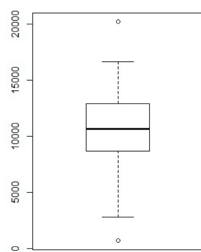

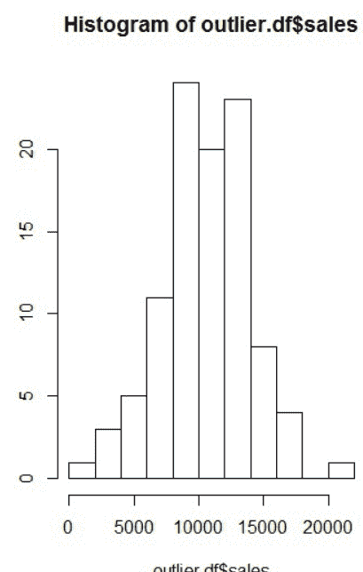

查找异常值的另一种方法是检查实际的四分位数、百分位数或十分位数。这些措施对于将数据分成相等的组并观察组间差异很有用。

这里我们可以使用 `quantile()` 函数查看数据的所有 `deciles`，并指定每个分隔点位于数据的每个 10% 处：

```r
deciles <- data.frame(quantile(outlier.df$sales,
                                 prob=c(0.1, 0.2, 0.3, 0.4, 0.5, 0.6, 0.7, 0.8, .9,1)))
deciles
```

| | quantile.outlier.df.sales |
|---|---|
| 10% | 5548.89 |
| 20% | 7409.26 |
| 30% | 8621.34 |
| 40% | 9090.79 |
| 50% | 9741.97 |
| 60% | 10364.65 |
| 70% | 11019.19 |
| 80% | 12175.63 |
| 90% | 13164.27 |
| 100% | 15363.60 |

### 转换数据

查看异常值的另一种方法是先将数据标准化为均值为0、标准差为1的正态分布。使用标准正态分布很方便，因为分布的特性永远不会改变，并且一些关键的截止点可以记在心里。例如，对于标准正态分布，四分位数1始终在-0.67，四分位数3始终在+0.67，因此很容易记住四分位距，即1.34。使用四分位距规则来识别异常值意味着我们将取这个量的1.5倍来推导出2.01的值，因此我们将把高于0.67+2.01=2.68或低于-0.67-2.01=-2.86的任何数据点视为可能的异常值。这是如何利用分布的统计特性来识别异常值的示例。你也可以使用诸如识别任何距离均值超过三个标准差的数据点的规则，或者使用卡方检验来确定你的分组数据与理论分布是否有显著差异。outliers 包还包含几种其他方法和用于检测异常值的统计检验，包括 Grubbs 检验。

这里我们将首先标准化数据，然后查找高于或低于正负2.68的数据：

- 1. 首先，使用 `scale()` 函数标准化销售向量，并创建一个新向量 `v1`，其中包含标准化的值（或 z 分数）：
  `outlier.df$v1 <- scale(outlier.df$sales)`

- 2. 接下来，我们将使用 `order()` 函数将 z 分数从低到高排序。这将使使用 `head()` 和 `tail()` 函数查看极端值变得容易。我们可以立即看到有两个值超出了 -2.68 到 +2.68 的范围：
  ```r
  #sort from lowest to highest
  outlier.df <- outlier.df[order(outlier.df$v1),]
  head(outlier.df)
  
  >head(outlier.df)
          sales        v1
  59  672.6731  -2.917263
  88  2776.8597  -2.295223
  39  3034.5596  -2.219042
  69  3041.7867  -2.216905
  63  4363.3742  -1.826217
  75  4894.2080  -1.669292
  
  tail(outlier.df)
  >tail(outlier.df)
          sales        v1
  77  15434.46   1.446619
  22  16286.14   1.698392
  71  16319.01   1.708109
  26  16455.81   1.748549
  66  16624.87   1.798528
  35  20176.17   2.848362
  ```

- 3. 最后，我们将检查转换后数据的 `boxplot()` 函数。请注意，分布的形状与原始数据完全相同。唯一的区别是数据沿 y 轴的比例发生了变化：
  `boxplot(outlier.df$v1, ylab="v1")`

我们仍然可以在 `boxplot` 的顶部看到潜在的异常值（小圆圈）：

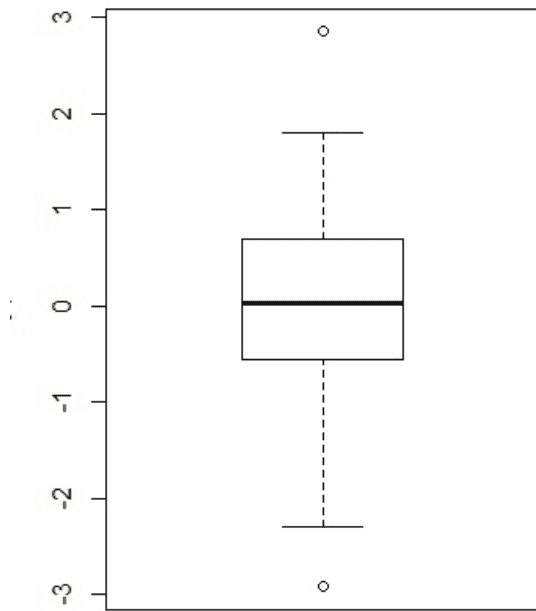

### 追踪异常值的原因

一旦你识别出可能的异常值，确定其发生原因始终是最佳行动方案。我们举例说明了出现在一个数据集中的异常值；然而，大多数情况下，你会将数据分成各种子集，以试图追踪异常值的原因。这是假设你有足够的数据可用。小样本的异常值检测要困难得多。

### 处理异常值的方法

以下是处理异常值的几种方法：

- 删除它们，或将它们设置为 NA。如果你没有太多异常值，这样做是合理的，并且会使你的模型更容易解释。权衡之处在于你可能会删除重要数据，因此请谨慎使用。

- 使用转换来减少变异性。根据数据的偏度选择适当的转换，或尝试 **Box-Cox 幂变换**。这样做的一个优点是，正确的转换可以减少极端观测值的影响。

- 将它们降低到预先控制的水平。这可以通过使用修剪均值或温莎化均值来完成。在精算专业中这样做，因为如果变量超过某个水平，某些风险可以被限制。

- 选择分类而非回归类型算法，该算法对异常值不那么敏感。对于决策树，异常值倾向于出现在计数较小的独立叶节点中。此时，你可以通过修剪树并将其合并到不同类别中来忽略异常值。

- 对于回归类型算法，你可以选择一种对大系数施加惩罚的算法，例如岭回归或 Lasso 回归，这些算法对异常值更具鲁棒性。

### 示例 — 将异常值设置为 NA

下一步当然是开始检查这些异常值。在我们的示例中，极值是随机数生成过程的一部分，因此它们并不是真正的异常值。但是，如果你在自己的数据中遇到这种情况，你将开始追踪这些极值发生的原因。首先尝试将这些极值与其他数据元素关联起来。也许这些异常值出现在某些年龄组中，而不在其他年龄组中。

在我们的示例中，我们将简单地将这些极值的值设置为 NA。我们还将创建一个新变量 vlx 来容纳新变量，并且不会覆盖原始变量的值。当你调查新的异常值检测方法时，可以将新值存储在其他变量中，并确信你可以随时参考原始变量：

```r
outlier.df$vlx<-ifelse( (outlier.df$v1 >= 2.68 | outlier.df$v1 <=
tail(outlier.df)
head(outlier.df)
```

参考控制台中 head() 和 tail() 命令的输出，以及


注意数据中的变化。以前被视为异常值（-2.917263）的现已映射为 NA：

```
>tail(outlier.df)

sales    vl    vlx
77 15434.46 1.446619 1.446619
22 16286.14 1.698392 1.698392
71 16319.01 1.708109 1.708109
26 16455.81 1.748549 1.748549
66 16624.87 1.798528 1.798528
35 20176.17 2.848362 NA
```

```
>head(outlier.df)

sales    vl    vlx
59 672.6731 -2.917263 NA
88 2776.8597 -2.295223 -2.295223
39 3034.5596 -2.219042 -2.219042
69 3041.7867 -2.216905 -2.216905
63 4363.3742 -1.826217 -1.826217
75 4894.2080 -1.669292 -1.669292
```

另外运行 boxplot() 函数，观察原始的上限异常值已被移除：

```
boxplot(outlier.df$vlx, ylab="vl new")
```

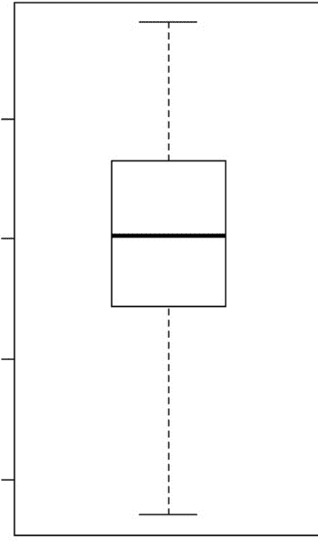

## 多变量异常值

前面的示例仅从单变量（即单一变量）的角度展示了如何查看异常值。然而，异常值也可以以多变量或组合形式出现。在这些情况下，以二维可视化异常值可以作为一个开始，但随着维度的增加，它们可能更难以隔离。对于多变量异常值，你可以使用 Cook's D 或 Mahalanobis 距离等距离和影响度量来衡量它们离回归线有多远。主成分分析也可以通过先降低维度，然后检查可能包含异常值的高阶主成分来提供帮助。

## 数据转换

在处理连续偏态数据时，考虑应用数据转换，它可以将数据符合具有特定属性的特定统计分布。一旦你将数据强制成某种形状，你会发现使用某些模型变得更加容易。简单的转换通常涉及向数据应用数学函数。

常用的数据转换包括 `log`、`exp` 和 `sqrt`。有些对不同类型的偏态数据效果更好，但它们并不总是保证有效，因此最佳实践是尝试几种基本转换，并确定转换在建模背景下是否可行。一如既往，最简单的转换是最好的转换，并研究转换的工作原理以及哪些转换最适合某些类型的数据。

为了说明转换的概念，我们将首先生成一个指数分布，这是非线性分布的一个示例。请参阅以下图表象限第一行中 *_X_* 的直方图和正态 Q-Q 图。这两个图都显示数据高度偏态。你可以看到直方图严重偏向 *_x_* 的较低范围，而 Q-Q 图并未显示为一条直线。因此，我们需要找到一种能平滑偏态的转换。我们将应用 Box-Cox 算法，它将确定要使用的最优转换。

### 生成测试数据

如果需要，安装包：

```
install.packages("car")
install.packages("MASS")
```

加载库：

```
library(car)
library(MASS)
```

生成偏态数据：

```
set.seed(1010)
x<-rexp(1000)   # exponential sample with parameter 1
par(mfrow=c(2,3) )
```

绘制直方图和正态概率图。par() 函数指定它们将是下一节中显示的第一行图的一部分：

```
hist(x)
qqnorm(x)
### Normal probability plot for original variable
```

## Box-Cox 转换

我们将现在说明 Box-Cox 幂变换（也称为幂变换）。这是一种通用变换，将搜索可应用于数据的最优变换。该变换优化一个称为 lambda 的指数，然后将其应用于数据。它通过迭代 -5 到 +5 之间的所有指数，直到找到最佳的一个来将数据转换为正态分布：

```
boxcox(x~1)
```

如 boxcox() 函数生成的图（第三个图）所示，应用于数据的最优指数将在 0 和 1 之间。

接下来，我们将应用幂函数。powerTransform() 函数将刚刚计算出的最优 lambda 应用到原始数据上：

```
p<-powerTransform(x)
```

你可以切换到控制台并查找 p$lambda 的值来查看该值是多少。控制台将显示该值为 0.2873638：

```
p$lambda
```

下一步是将幂变换应用到现有数据，并将结果赋给新向量 y：

```
y<-bcPower(x,p$lambda) # Box-Cox transformation
```

新数据的直方图（下图中 y 的直方图）显示数据已转换为正态分布，而用于衡量正态性的 QQ 图显示了一条漂亮的直线：

```
qqnorm(y)
### Normal probability plot for transformed variable
hist(y)
```

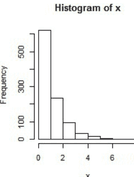

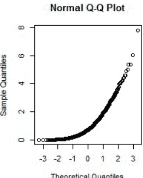

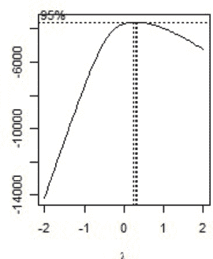

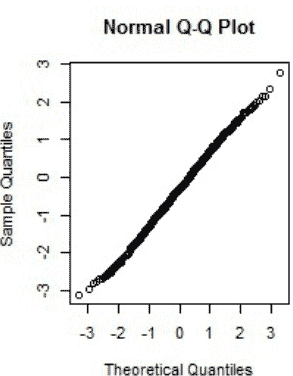

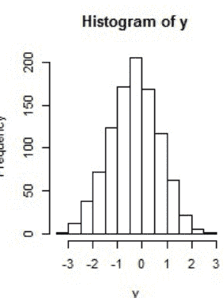

## 变量缩减/变量重要性

变量缩减技术允许你减少需要指定给模型的变量数量。我们将讨论三种不同的方法来实现这一点。

- 1. 主成分分析 (PCA)。
- 2. 所有子集回归。
- 3. 变量重要性。

### 主成分分析 (PCA)

主成分分析 (PCA) 是一种变量缩减技术，也可用于识别变量重要性。PCA 的一个有趣好处是，所有生成的新成分变量彼此之间都不相关。不相关的变量在预测模型中是可取的，因为过多的相关变量会混淆预测，并使得难以判断哪些自变量影响最大。因此，如果你先对数据进行探索性分析并发现存在大量相关性，那么这将是应用 PCA 的一个好机会。

### 注意

模型可以容忍一定程度的相关变量。我所说的情况是，你有大量变量需要考虑，并最终将它们全部扔进模型，希望算法能自行确定模型。大多数时候它不会。

在许多以大量变量开始的模型中，你会发现其中许多变量彼此相似，并且具有相同的预测能力。

一个经典例子是标准化考试分数的预测因子。虽然其中一些是专门为衡量特定事物（如阅读或数学能力）而设计的，但许多预测因子彼此之间高度相关。简而言之，在预测模型中使用其中一两个，与使用全部八九个可能并没有太大区别。

PCA 有能力识别数据中的冗余，可以被视为一种确定对模型变异贡献最大的最少变量数量的方法。如果你能将数据的可解释变异性减少到仅两三个主成分，那将有助于降低数据的维度。一旦确定了主成分，你可以以以下方式使用它们：

- - 用主成分替换原始变量。
- - 使用主成分分析仅识别并保留最有用的原始变量。在此情况下，有用可以指方差最高的变量、与目标变量相关性最高的变量、最有意义的变量等。

因此，主成分分析的一个目标是识别一小部分新变量，这些变量解释了原始数据绝大部分的方差。

### PCA 应用于哪里？

主成分在社会科学、营销和广告行业中被大量使用。与 PCA 相关的是因子分析，其中旋转主成分会产生潜变量。潜变量试图主观地描述数据的行为，而主成分只是原始变量的线性组合，或多或少是合成的线性方程。

### 美国逮捕数据的 PCA 示例

作为示例，以下是美国逮捕数据的相关矩阵图，对应于 1973 年每个 50 个美国州每 10 万居民的攻击、谋杀和强奸逮捕人数。还给出了


城市地区人口百分比。`USArrests` 数据集应作为 `datasets` 包的一部分自动加载。

您可以通过在控制台中输入 `USArrests` 数据集的帮助命令来获取 `USArrests` 数据集的描述。

要查看所有变量之间的相关性，请在控制台行中输入以下内容：

```
library(datasets)
pairs(USArrests)
```

输出如下所示：

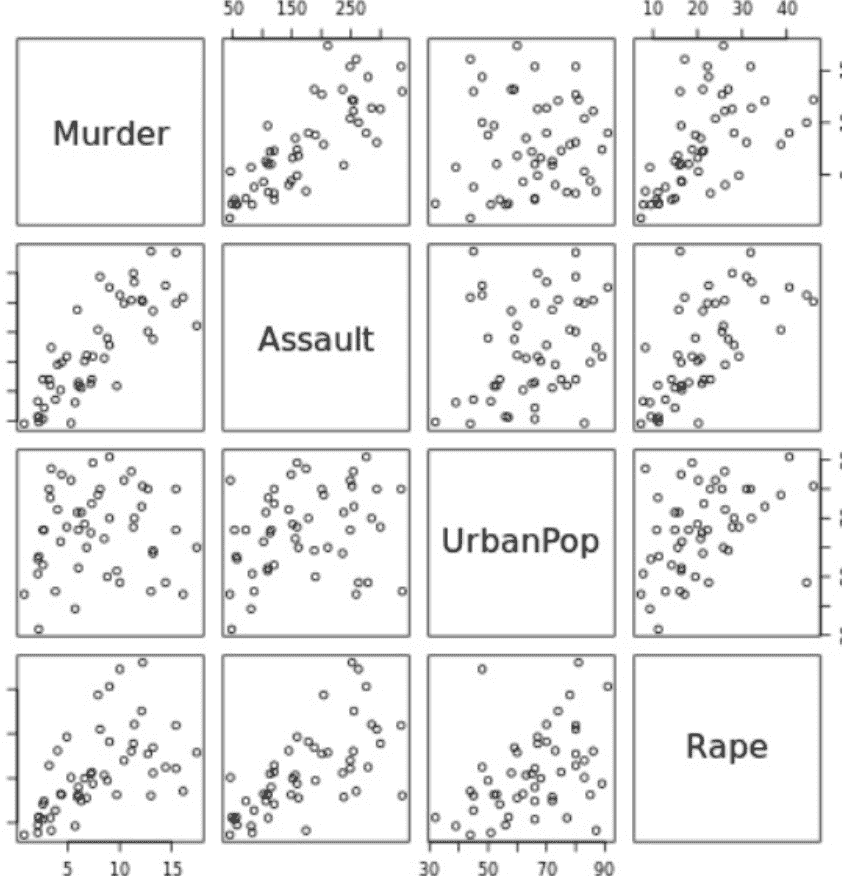

`pairs()` 函数为数据框中连续变量的所有不同组合创建微型散点图。要检查某一对，请查看变量适当行和列标签相交的单元格，这些标签显示在矩阵的对角线行中。
例如，**Murder** 与 **Assault** 的散点图通过定位这些标签相交的单元格来显示。这将出现在两个位置：矩阵的第 1 行第 2 列，以及第 2 行第 1 列。请注意，大多数变量似乎彼此强相关。城市人口变量 (UrbanPop) 似乎是相关性最小的变量，至少从视觉上表示的散点图来看。Murder 和 assault 似乎具有更强的相关性。这让我怀疑是否需要在预测模型中包含所有变量。

要在此数据上运行主成分分析，我们将使用 prcomp() 函数。请注意代码中的注释：由于变量具有不同的量级，因此进行缩放（归一化）是合适的：

```
require(graphics)
```

```
### the variances of the variables in the
### USArrests data vary by orders of magnitude, so scaling is appropriate
prcomp(USArrests, scale = TRUE)
```

prcomp() 函数的输出如下所示。此输出描述了每个变量在每个主成分上的载荷。原始变量显示为行，新变量（即主成分）显示为列。默认情况下，它们命名为 PC1、PC2、PC3 和 PC4：

```
Standard deviations: (1, .., p=4):
[1] 1.5748783 0.9948694 0.5971291 0.4164494
```

```
Rotation (n x k) = (4 x 4):
                PC1        PC2        PC3        PC4
Murder   -0.5358995  0.4181809 -0.3412327  0.64922780
Assault  -0.5831836  0.1879856 -0.2681484 -0.74340748
UrbanPop -0.2781909 -0.8728062 -0.3780158  0.13387773
Rape     -0.5434321 -0.1673186  0.8177779  0.08902432
```

每列下方给出的数字是实际使用的系数，用于确定线性组合。因此，我们可以按如下方式计算第一个（也是最重要的）主成分：

```
PC1=Murder * 0.5358995 + Assault*-0.5831836 + UrbanPop*-0.2781909
```

由于变量在一开始就已缩放（或标准化），系数的大小可以粗略估计一个变量对每个主成分的贡献程度。例如，PC1 可以描述为由谋杀、强奸和攻击引起的变化，而 PC2 更多地关于城市人口的变化。PC3 可能关于城市人口中强奸的影响，而 PC4 可能关于不涉及攻击时的谋杀。

以下图表可以显示 PC1 的压倒性主导地位。每个后续主成分都衡量先前组件未解释的剩余变化：

```
plot(prcomp(USArrests))
```

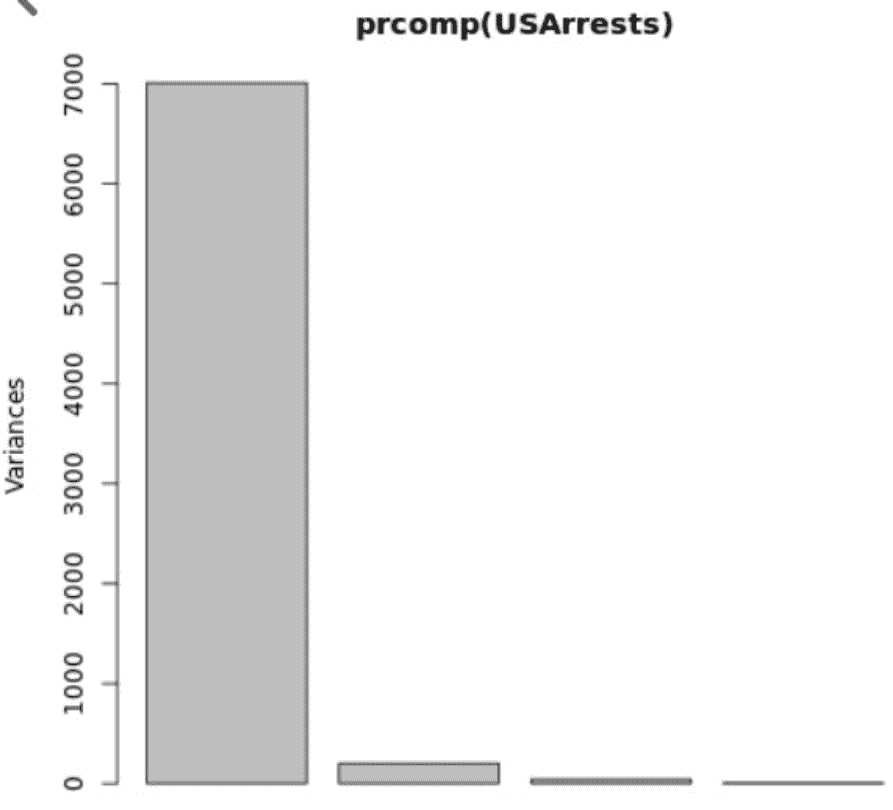

`prcomp summary` 函数显示解释变异的累计百分比：

```
summary(prcomp(USArrests, scale = TRUE))
```

以下是输出：

| | PC1 | PC2 | PC3 | PC4 |
|---|---|---|---|---|
| 标准差 | 1.5749 | 0.9949 | 0.59713 | 0.41645 |
| 方差占比 | 0.6201 | 0.2474 | 0.08914 | 0.04336 |
| 累计占比 | 0.6201 | 0.8675 | 0.95664 | 1.00000 |

在输出的最后一行 `Cumulative Proportion` 中，您可以看到第一个成分解释了 62% 的变化，而前两个主成分共同解释了数据中总共 87% 的变化。

这基于四个原始变量。主成分将变量数量减少了 50%。想想如果您从超过 100 个变量的特征集开始，可以减少多少变量！

## 全子集回归

全子集回归是您可用于变量选择的另一种方法。它通过一次运行一个变量、两个变量、三个变量等不同组合的单独回归来工作，直到使用了所有变量或达到指定的停止点。作为输出的一部分，然后会计算每个变量组合的最佳模型。这将让您了解哪个是最佳单变量模型、双变量模型等等，从而使您可以使用一些图表和输出统计信息将大量变量精简为少数重要的变量。

### 示例：airquality

在此示例中，我们将使用 `leaps` 包中包含的 `regsubsets()` 函数来确定预测温度哪些变量很重要：

```
install.packages("leaps")
library(leaps)
data(airquality)
str(airquality)
```

在以下 `regsubsets()` 函数调用中，我们指定要为每个组合（一个变量、两个变量和三个变量）获取最佳模型。默认情况下，该函数会计算模型中所有变量的最佳模型。在函数调用中，我演示了指定最大值，因为我希望在达到一定数量的变量后能够停止算法。当您使用包含大量变量的数据且不想占用宝贵内存时，这变得很重要：

```
out <- regsubsets(Temp ~ ., data = airquality, nbest = 1, nvmax = 99)
```

对输出运行 `summary()`：

```
summary(out)
```

以下输出显示最佳 1-5 变量模型中包含的变量。请注意，只有五个变量，因此您不能拥有超过五个变量的模型：

```
Subset selection object
Call: regsubsets.formula(Temp ~ ., data = airquality, nbest = 1,
5 Variables (and intercept)
     Forced in Forced out
Ozone             FALSE       FALSE
Solar.R           FALSE       FALSE
Wind              FALSE       FALSE
Month             FALSE       FALSE
Day               FALSE       FALSE
1 subsets of each size up to 5
Selection Algorithm: exhaustive
              Ozone Solar.R Wind Month Day
1  ( 1 ) "**"   " "   " "  " "   " "   " "
2  ( 1 ) "**"   " "   " "  "**"  " "   " "
3  ( 1 ) "**"   "**"  " "  " "  "**"  " "
4  ( 1 ) "**"   "**"  " "  " "  "**"  "* "
5  ( 1 ) "**"   "**"  "**" "**" "**" "**"
```

能够解释输出表中的星号很有用。行表示模型中变量的数量，列中的 * 表示该变量是该组合的一部分。因此我们可以看到，`Ozone` 是最佳单变量预测器，而 `Ozone` 与 `Month` 是最佳双变量预测器：

| # | 模型中的变量 | Ozone | Solar.R | Wind | Month | Day |
|---|---|---|---|---|---|---|
| 1 | Ozone | ** | " " | " " | " " | " " |
| 2 | Ozone, Month | ** | " " | " " | ** | " " |
| 3 | Ozone, Month, Solar.R | ** | ** | " " | ** | " " |
| 4 | Ozone, Month, Solar.R, Day | ** | ** | " " | ** | * |
| 5 | Ozone, Month, Solar.R, Day, Wind | ** | ** | ** | ** | ** |

要查看每个变量组合的调整 R 平方，请在命令行中运行以下内容：

```
summary(out)$adjr2
```

以下是输出：

```
[1] 0.4832625 0.5746686 0.5801736 0.5836452 0.5823619
```

您可以看到，单变量模型的调整 R 平方为 .48，而双变量模型的调整 R 平方为 .57。对于三个变量及以上，R 平方的增加似乎是递增的。因此，似乎臭氧和月份的双变量模型足以用于预测空气质量。

## 调整 R 平方图

调整 R 平方图在选择模型时也很有帮助。以下图表中的每一行代表一个单独的模型，截距和所有变量作为列。`plot` 函数显示模型中每个变量的调整 R 平方（y 轴）如何变化：

```
plot(out, scale = "adjr2")
```


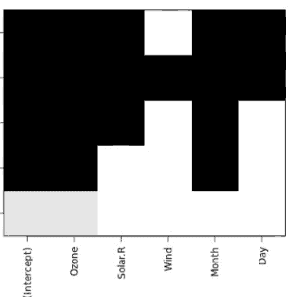

要选择最优模型，请关注变量在 y 轴范围顶部附近带有黑框的点。

以本示例为例，这意味着使用四变量模型 Ozone、Month、Solar.R 和 Day。不过，如前所述，两变量模型和四变量模型之间的差异似乎很小。不过，你可以看到如何使用此方法将变量从五个减少到两个，同时对回归模型造成最小的降级。

### 变量重要性

对于分类目标，可以使用随机森林算法来确定变量重要性。

在本示例中，生成了一个模拟样本，吸烟和家族病史是确定男性心脏病的关键因素：

```
set.seed(1020)
#construct a 50/50 sample of Males, and Females
gender <- sample(c("M","F"), 100, replace=T,prob=c(0.50,0.50))

#assign a higher probability of smoking to the Males (95%, WAY too
smokes <- ifelse(gender=="M",
                 sample(c("N","Y"), 100, replace=T,prob=c(0.05,0.95)),
                 sample(c("N","Y"), 100, replace=T,prob=c(0.45,0.55)))
```

```
#assume they also have a 60% chance of family history of heart disease
familyhistory <- ifelse(gender=="M",
                        sample(c("N","Y"), 100, replace=T,prob=c(0.40,0.60)),
                        sample(c("N","Y"), 100, replace=T,prob=c(0.50,0.50)))
```

```
HighChol <- sample(c("Y","N"), 100, replace=T,prob=c(0.50,0.50))
heartdisease <- sample(c("Y","N"), 100, replace=T,prob=c(0.05,0.95))

#bind all of the variables together
heart <- as.data.frame(cbind(smokes,HighChol,familyhistory,gender,heartdisease))
```

使用一些交叉表验证生成的表的一部分：

```
#row percentages for smoking by gender. Males who smoke came out
prop.table(table(heart$gender,heart$smokes),1)
```

以下是输出：

```
> prop.table(table(heart$gender,heart$smokes),1)
     N         Y
F 0.42592593 0.57407407
M 0.04347826 0.95652174
```

请参见以下代码：

```
#row percentage for family history by gender. Males with family history
prop.table(table(heart$gender,heart$familyhistory),1)
```

以下是输出：

```
> prop.table(table(heart$gender,heart$familyhistory),1)
```

| | N | Y |
|---|---|---|
| F | 0.5370370 | 0.4629630 |
| M | 0.3913043 | 0.6086957 |

最后，还可以查看按性别划分的心脏病发生情况：

```
> prop.table(table(heart$gender,heart$heartdisease),1)
```

| | N | Y |
|---|---|---|
| F | 0.96296296 | 0.03703704 |
| M | 0.93478261 | 0.06521739 |

### 变量影响图

现在我们可以运行变量影响图。下图显示高胆固醇和家族病史是最重要的变量：

```
require(randomForest)
fit <- randomForest(factor(heartdisease) ~., data=heart,ntree=1000)
(VI_F <- importance(fit))
varImpPlot(fit,type=2,main="Random Forest Variable Importance Plot")
```

### 随机森林变量重要性图 - 心脏病模拟

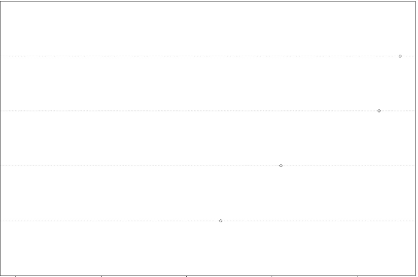

这种方法的一个缺点是它单独处理每个变量，而不考虑两个变量之间的任何相关性。

## 参考资料

Hospital Inpatient Discharges (SPARCS De-Identified): 2012. (n.d.). 检索自 https://health.data.ny.gov/Health/Hospital-Inpatient-Discharges-SPARCS-De-Identified/u4ud-w55t.

## 摘要

在本章中，我们学习了关于为分析准备数据的所有内容，以便您可以开始运行模型。它始于以原始形式输入外部数据，我们了解到有几种方法可以完成这些可用方法。您还学习了如何生成自己的数据，以及两种不同的方法可以用来连接或整理数据，一种使用 SQL，另一种使用 `dplyr` 函数。

随后，我们介绍了在数据输入后有时需要的一些基本数据清洗和数据探索技术，例如标准化和转置数据、更改变量类型、创建哑变量、分箱以及消除冗余数据。您现在了解了用于初步查看数据内容及其结构的关键 R 函数。

接着，我们介绍了分析缺失值和异常值的重要概念，以及如何处理它们。

我们了解了一些将变量数量减少到可管理水平的方法，例如使用主成分分析和全子集回归等技术。

最后，我们学习了如何使用随机森林算法来识别建模中最重要的变量。

数据准备部分到此结束，在为建模准备数据的方法方面，我们仅仅是初涉入门。

在下一章中，我们将更详细地介绍随机森林，以及回归、决策树、SVM 和一些其他内容，这些内容将使我们能够为构建核心模型打下基本算法的坚实基础。
