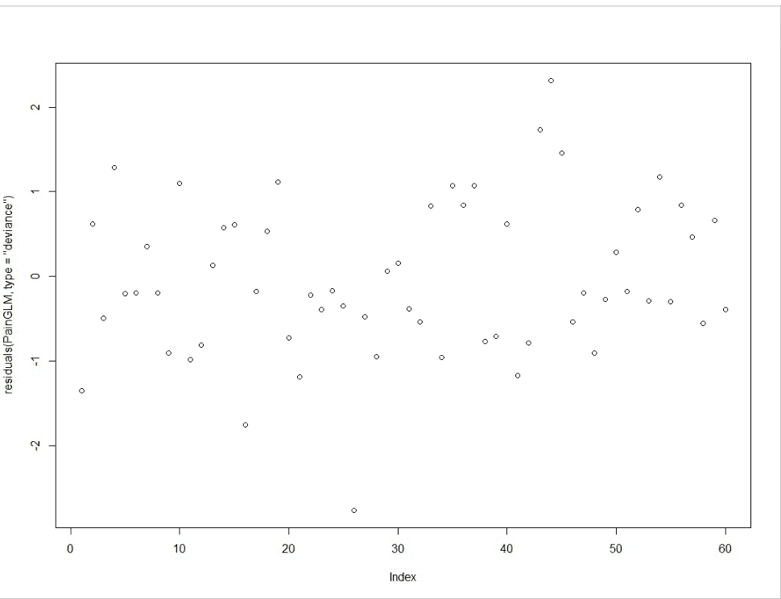
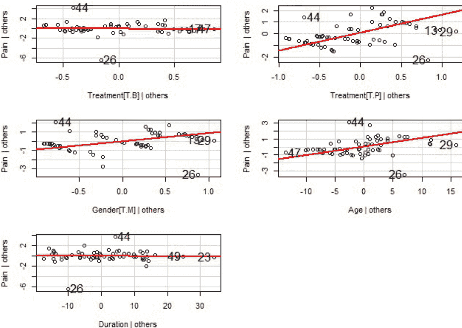
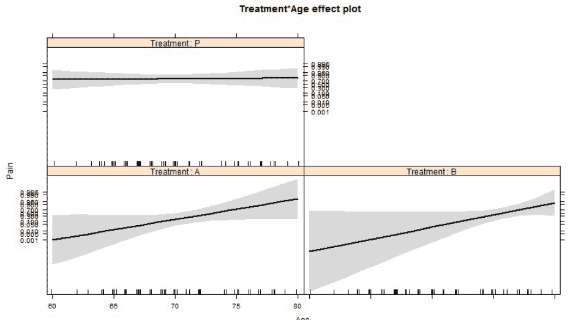
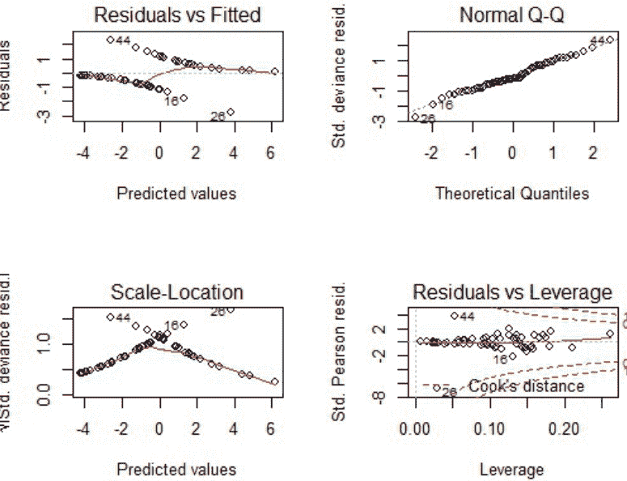
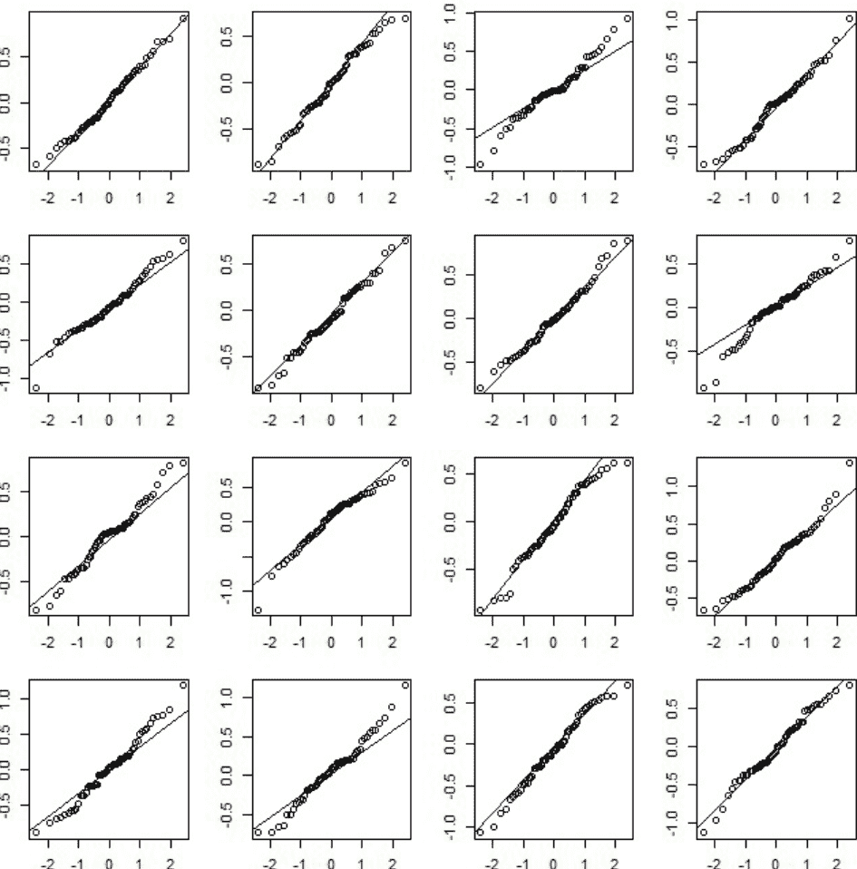
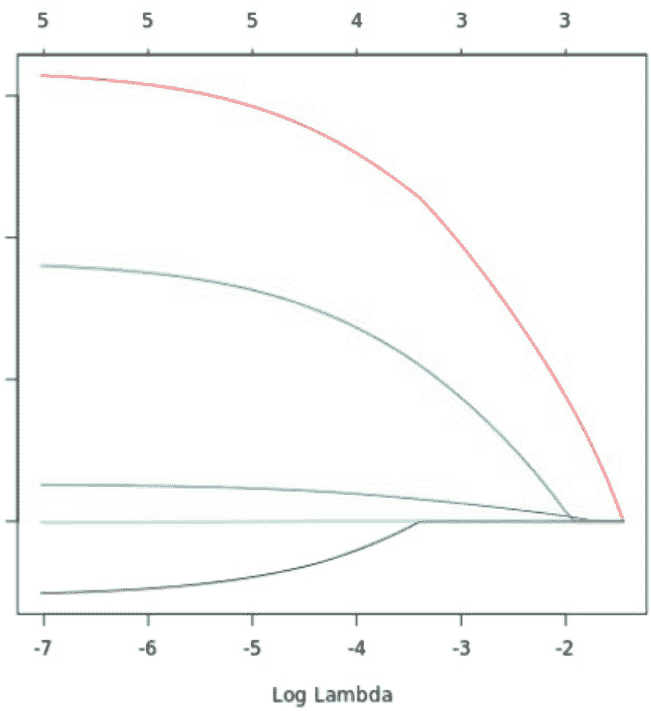

# 第 4 章. 回归算法简介

> "不是无知造成了那么多麻烦；是人们明明不知道的事情却自以为知道。" - Billings

每天，预测分析技术的数量似乎都在增加。关于我们是否需要更好的算法，还是需要更多或更好的数据来解决预测分析问题，一直存在持续的争论。

无论哪种情况，随时了解可用的所有算法总是有益的。同样重要的是，磨练您对前三四个可解决 90% 将面临问题的算法的技能，并能够理解在什么情况下使用它们是有意义的。

本章是两章中的第一章，将介绍四种基本算法，涵盖您将遇到的许多典型业务场景。事实上，许多对分析从业者进行调查的数据科学调查通常会将这些技术列为所有数据科学家都应该掌握的顶级技术。在这些技术中，我们将在本章详细讨论回归，并在后续章节中讨论其余三种核心算法。但让我们先介绍所有四种：

- 回归技术代表了一种标准参数化问题求解方法，为每个自变量分配一个系数或权重。变量通过 `linear` 函数与结果变量相关。
- 决策树是一种重要的算法类别，当变量之间的关系不一定是线性时，可以将其用作回归的替代方案。
- 聚类分析也被讨论为一种无监督学习形式，其性质更具探索性，但不一定是预测性的。
- 支持向量机在处理高维数据的场景中非常有用。当数据中出现大量变量，并且您选择在模型中使用其中全部或大部分变量，而未首先应用某种数据缩减技术时，高维数据就会发挥作用。在以原始形式对某些实时数据进行分析时，这种情况经常发生，此时模型需要在瞬间内应用。

## 受监督与无监督学习模型

我们已经讨论了目标（因变量）和自变量（或特征）的概念。特征（或自变量）用于描述与目标变量的关系，或预测目标变量的值。定义自变量和因变量后，您将制定模型。表征模型从数据中学习方式的一种方法是将其分类为受监督或无监督学习模型。

### 受监督学习模型

当目标变量的可能值被指定并标记时，模型被视为受监督的，也就是说，我们知道要预测什么，目标是找到最合适的预测模型来预测结果。

例如，如果我们要预测某产品的批准率，我们知道我们要预测什么（产品的批准率），而且我们通常也知道可能结果的范围。它可能是 0-100 的百分比，也可能是诸如高批准率或低批准率之类的类别。

当问题是受监督的时，使用哪些模型的选择通常取决于目标变量的类型，即它是连续型还是分类型。它还可能取决于偏差/方差（在第 2 章“建模过程中”讨论）等因素，以及我们愿意对模型做出的各种假设。回归和决策树算法被视为受监督算法，因为目标变量或目标类别（在决策树的情况下）在预测建模开始之前就已指定。


### 无监督学习模型

无监督问题本质上更具探索性。在无监督学习语境下，不需要指定目标变量，甚至对结果应是什么毫无头绪。数据科学家通常会得到一组属性，然后被要求推导出某些关系，或发现从数据表面看不出来的一些新属性。

例如，在探索性客户分析中，你可以查看客户的不同属性，例如年龄、性别和销售历史，这些属性可能会引导你创建新变量（之前并不存在），这些变量可以将每个客户描述为最佳、良好或平均。然后你可以为这个问题选择合适的算法，可能是聚类算法、决策树或支持向量机。

另一个例子是使用神经网络算法结合一些金融交易数据，以揭示潜在的欺诈或异常发现。

通常，你会将无监督算法（如神经网络）应用于无监督场景（发现欺诈），但情况并非总是如此。你可能会发现，可以结合传统的监督技术（如回归），利用后诊断工具（用于检查残差和异常值等）来发现完全出乎意料的结果。这可能会引导你进行其他探索，从而促使你重新表述问题。

最后，监督学习和无监督学习通常协同工作。你可能会发现自己在通过无监督过程创建一个新变量，进而将其作为潜在变量纳入传统的监督算法（如决策树）中。

## 回归技术

回归分析（被视为一种监督学习算法）可追溯到19世纪初，当时高斯和勒让德利用这些技术来测量行星绕太阳的轨迹（[回归分析](https://en.wikipedia.org/wiki/Regression_analysis)）。由于拥有庞大的文献基础以及适应多种问题的能力，回归算法在预测分析社区中仍然广泛使用。

当目标变量为连续变量时，线性回归是应使用的基本回归技术。线性回归建立在普通最小二乘法的概念之上，模型的函数形式为：

```
$$y_i = \beta_0 + \beta_1 x_{i1} + \beta_2 x_{i2} + \dots + \beta_p x_{ip} + \varepsilon_i$$
```

前面的公式说明线性回归模型是可加的，即预测结果是通过对所有自变量的交叉乘积值求和，然后加上截距（公式的第一项）和误差项（公式的最后一项）来计算的。该计算得到因变量或目标变量（y）的*预测*。

线性回归线是通过**普通最小二乘法**（OLS）拟合的，该方法最小化观察值与回归线上预测距离之间的平方（残差）差异。使用平方差异，而不是实际差异，因为我们真正关心的是差异的幅度，而不是方向。对结果求平方消除了负号或正号。残差常用于测试预测模型产生的误差。

### 回归的优势

使用线性回归的一个优势是，它有助于轻松解释归因于每个变量的线性系数。具体来说，回归模型中每个变量的斜率（回归各项前的 $\hat{\beta}$），将指示在模型中所有其他变量保持不变的情况下，相应自变量每变化1个单位时预测值的变化。

使用线性模型具有相当大的灵活性，你不仅可以建模名义（类别）自变量，还可以建模连续自变量，并通过变量转换和交互项来纳入相当程度的非线性关系。线性回归的知识体系非常庞大，且大量依赖概率论。

尽管线性回归在正确使用时非常强大，但以下是你应该注意的线性回归的一些主要假设：

- 独立性：观察值之间没有关系。处理时间序列数据时，此假设经常会被违反。了解数据的采样方式有助于理解数据是否独立且随机抽样。
- 线性关系：自变量和因变量之间存在线性关系。还可能存在其他类型的关系；例如，变量之间可能存在曲线关系。Anscombe's quartet的维基百科参考中第一行第二个图显示了这种情况如何发生。
- 正态性：回归模型中的误差项服从正态分布。直觉上，服从正态分布的残差是好的，因为它们意味着模型中已考虑所有正确的变量，没有剩下需要解释的内容。你只剩下随机误差。
- 误差方差相等：误差项也具有恒定方差。例如，方差不相等可能意味着预测误差随着自变量值变大或变小而增加或减少。

如果任何假设被严重违反，你可能就不应该使用线性回归。我说严重是因为任何模型对假设都有一定程度的容忍度，并且有统计检验可以用来衡量某些假设的这一程度。但是，如果你的数据符合线性回归的假设，预测可能会非常强大。

## 广义线性模型

广义线性模型（GLM）是指一个更大的预测技术框架，可以包括线性回归、逻辑回归（用于预测二元结果）和泊松回归（用于预测计数）。它们是线性回归技术的推广，允许你处理具有非正态误差项的其他分布。

可以在R中使用glm包实现GLM，在其中你提供链接函数来指定正在建模的分布。这使得在单个包中使用标准语法处理不同类型的模型变得更加容易。

### 使用GLM进行线性回归

在第1章“预测分析入门”中，我们最初用于根据女性体重预测女性身高的示例使用了lm包。我们也可以使用glm包，将family=Gaussian指定为链接函数：

```
lm_output <- lm(women$height ~ women$weight)
```

或：

```
glm_output <- glm(women$height ~ women$weight, family=gaussian)
```

## 逻辑回归

GLM的一个非常流行的用途是通过逻辑回归。当目标变量是二元值（即只能取两个值）时，应使用这种回归类型。这两个二元值通常采用以下形式：

- 发生了某事（二元值 = 1）
- 未发生某事（二元值 = 0）

这两个值通常因行业类型而异。以下是不同行业中二元响应的一些示例：

- **市场营销**：客户是否响应了特定优惠？
- **医疗保健**：特定药物治疗某种病症是否有效？
- **金融**：特定交易策略是否带来了利润？
- **Web跟踪**：客户是否在结账时放弃了购物车？

几乎每个行业都会有可以用二元结果来表述的问题。事实上，有时标准线性回归问题会被重新表述，因此不再预测目标值的具体数值，而是将问题重新表述为二元问题。这样做通常是为了利用逻辑回归的一些较宽松的假设。

你可能会问：“为什么不为这类问题使用普通线性回归？”遗憾的是，当存在二元结果变量时，线性回归本身由于多种原因将无法工作。以下是两个重要原因：

- 首先，如果使用普通回归，结果将远远超出0和1的有限范围，因为直线在两个方向上都是无限的。
- 第二，普通回归的要求之一是残差


误差通常服从正态分布，但在逻辑回归的情况下并非如此。误差项与条件伯努利分布相关。

然而，逻辑回归确实与回归模型共享许多特性：

- 它是一个低方差算法，因此实现和解释都相当简单，而且不像某些其他算法那样有那么多过拟合问题。
- 它还具有良好的特征选择能力，以及线性回归所共有的变换变量和交互项的添加。但是，它所*确实*预测的内容（事件发生的可能性）使其区别于标准回归技术。

### 比值比

虽然线性回归会为因变量预测实际结果，但逻辑回归不会预测实际结果或事件。它预测的是事件发生的可能性（或比值比）。这略有不同，因为它与事件发生的概率相关（而不是对事件本身的预测）。

比值比定义为事件 A 发生的概率与事件不发生的概率之比。在函数形式中，这个比率表示为自然对数：

```
ln\left( \frac{P}{1 - P} \right) = a + \beta_1X_1 + \beta_2X_2 + \dots \beta_1X_1
```

### 逻辑回归系数

逻辑回归返回的系数是标准化的，因为它们衡量的是自变量变化1个单位对比值比对数的影响，而不是对变量本身变化的影响。

该算法确定这些系数并非使用线性回归中使用的OLS方法，而是使用一种称为**最大似然估计**的方法来确定系数。简单来说，这意味着算法从任意值开始作为系数，然后提出一个初始模型。接着，算法测量模型中的误差，并将系数调整为新值，使得下一个模型的结果更符合数据中包含的值。这个过程会迭代进行，直到误差收敛到最优解。

由于线性模型的预测是通过求和模型中的交叉乘积和截距来确定的，因此可以将此结果与0.5的切断值进行比较，该值用作决策规则，将事件分类为目标变量的两个值之一。因此，虽然逻辑回归的输出本质上是比值比的一个函数，但逻辑回归本质上可以用作分类算法。

### 示例 - 在医疗保健中使用逻辑回归预测疼痛阈值

本示例使用一项研究的数据，该研究预测受试者在接受各种治疗后，是否报告经历了某种病症疼痛的减轻。`Gender`、`Age`和任何先前存在的疼痛的`Duration`列也被用作模型中的自变量。结果变量`Pain`编码为1（报告疼痛）或0（报告无疼痛）。`Treatment`列指2种治疗之一（A或B），以及一个对照组（P）。

### 读取数据

我们将使用带有`text=`选项的`read.table`来读取内联原始数据，即无需先创建外部文件。当您从另一源（例如电子表格）复制和粘贴数据时，此方法很有用：

```
df <- read.table(text = 'Treatment Gender Age Duration Pain
P F 68 1 0
P M 66 26 1
A F 71 12 0
A M 71 17 1
B F 66 12 0
A F 64 17 0
P M 70 1 1
A F 64 30 0
B F 78 1 0
B M 75 30 1
A M 70 12 0
B M 70 1 0
P M 78 12 1
P M 66 4 1
A M 78 15 1
P F 72 27 0
B F 65 7 0
P M 67 17 1
P F 67 1 1
A F 74 1 0
B M 74 16 0
B F 67 28 0
B F 72 50 0
A F 63 27 0
A M 62 42 0
P M 74 4 0
B M 66 19 0
A M 70 28 0
P M 83 1 1
P M 77 29 1
A F 69 12 0
B M 67 23 0
B M 77 1 1
P F 65 29 0
B M 75 21 1
P F 70 13 1
P F 68 27 1
B M 70 22 0
A M 67 10 0
B M 80 21 1
P F 67 30 0
B F 77 16 0
B F 76 9 1
A F 69 18 1
P F 64 1 1
A F 72 25 0
B M 59 29 0
```

| A | M | 69 | 1 | 0 |
|---|---|---|---|---|
| B | F | 69 | 42 | 0 |
| P | F | 79 | 20 | 1 |
| B | F | 65 | 14 | 0 |
| A | M | 76 | 25 | 1 |
| B | F | 69 | 24 | 0 |
| P | M | 60 | 26 | 1 |
| A | F | 67 | 11 | 0 |
| A | M | 75 | 6 | 1 |
| P | M | 68 | 11 | 1 |
| A | M | 65 | 15 | 0 |
| P | F | 72 | 11 | 1 |
| A | F | 69 | 3 | 0 |

### 获取一些基本计数

数据读取后，切换到控制台窗口。在控制台提示符处，输入命令`table(df$Pain)`。此函数将给出经历或未经历疼痛的患者原始计数：

```
> table(df$Pain)
```

控制台窗口中将出现以下输出：

```
   0   1
35  25
```

`prop.table`函数将提供报告疼痛的百分比：

```
> prop.table(table(df$Pain))
```

以下是输出：

```
          0         1
0.5833333 0.4166667
```

### 保存数据

在做其他任何事情之前，让我们将此数据框保存到磁盘，因为我们将在本章中再次使用它。在保存文件之前，请确保将工作目录设置为数据目录：

```
setwd("C:/PracticalPredictiveAnalytics/Data")
save(df,file="pain_raw.Rda")
```

### 拟合GLM模型

现在我们将使用glm包拟合一个逻辑模型。逻辑回归通常预测1事件的概率，因此请确保1事件对应您想要预测的内容。当变量编码为1表示不存在或不存在等负面条件时，常常会产生一些混淆。对于我们的模型，Pain=1表示疼痛减轻。请务必将family="binomial"指定为一个选项，因为这告诉GLM您将运行一个逻辑模型：

```
PainGLM <- glm(Pain ~ Treatment + Gender + Age + Duration, data=df)
```

summary函数将列出系数（Estimate），以及标准误、标准化z值和p值。p值（最后一列）中带有星号（*或**）的通常指定显著变量，通常也是您首先应该查看的变量。但是，请尽量不要自动只查看带有星号的变量。您应该查看所有变量的系数和统计量，因为p值不应被视为绝对数字，尤其是在涉及人们健康时：

```
summary(PainGLM)
```

这将生成以下输出：

```
Call:
glm(formula = Pain ~ Treatment + Gender + Age + Duration, family
data = df)
```

Deviance Residuals:
Min       1Q   Median       3Q      Max
-2.7638 -0.5904 -0.1952  0.6151  2.3153

Coefficients:

| | Estimate | Std. Error | z value | Pr(>|z|) |
|---|---|---|---|---|
| (Intercept) | -20.588282 | 7.102883 | -2.899 | 0.00375 ** |
| TreatmentB | -0.526853 | 0.937025 | -0.562 | 0.57394 |
| TreatmentP | 3.181690 | 1.016021 | 3.132 | 0.00174 ** |
| GenderM | 1.832202 | 0.796206 | 2.301 | 0.02138 * |
| Age | 0.262093 | 0.097012 | 2.702 | 0.00690 ** |
| Duration | -0.005859 | 0.032992 | -0.178 | 0.85905 |

---

Signif. codes: 0 '***' 0.001 '**' 0.01 '*' 0.05 '.' 0.1 ' ' 1
(Dispersion parameter for binomial family taken to be 1)
Null deviance: 81.503 on 59 degrees of freedom
Residual deviance: 48.736 on 54 degrees of freedom
AIC: 60.736
Number of Fisher Scoring iterations: 5

如前所述，输出系数表示为比值比的对数。要将系数表示为原始尺度，您需要应用`exp()`函数。另外，在以下代码中，我们将包括与指数化系数一起的置信区间，以了解范围。查找任何包含0的置信区间，因为这意味着效果可能不存在或微不足道。

在以下示例中，TreatmentB和Duration各自的置信区间均包含0：

```
cbind(exp(coef(PainGLM)), confint(PainGLM))
```

这将生成以下输出：

| | | 2.5 % | 97.5 % |
|---|---|---|---|
| (Intercept) | 0.000000001144518 | -36.68451736 | -8.30307052 |
| TreatmentB | 0.590460426864162 | -2.47589653 | 1.28411227 |
| TreatmentP | 24.087421759279735 | 1.38534008 | 5.45845778 |
| GenderM | 6.247629578965714 | 0.38227954 | 3.58627713 |
| Age | 1.299647808771851 | 0.09349231 | 0.48146218 |
| Duration | 0.994158449470197 | -0.07338820 | 0.05768555 |


exp() 函数将为每个变量提供实际的似然比。这使您可以观察每个变量对预测器发生可能性的影响。在我们之前的示例中，Age 每增加 1 年，Pain 的可能性会以 1.3 的因子增加。这很多吗？开始超越数字思考，并考虑如果您自己正在遭受慢性病困扰，您会如何看待那个结果。

### 检查残差

查看系数后，我首先做的事情之一就是查看残差。

可以使用 residuals() 函数查看所有残差：

```r
residuals(PainGLM, type="deviance") # residuals
```

对于许多好的模型，残差将围绕零点散布，并且在所有水平上都具有大致相同的方差。本模型的残差偏差列在先前显示的摘要部分中。我们可以看到分布是平衡的，因为最小值和最大值的绝对值大约相等，1Q（第 25 百分位数）与 3Q（第 75 百分位数）也是如此：

| | 最小值 | 1Q | 中位数 | 3Q | 最大值 |
|---|---|---|---|---|---|
| 偏差残差 | -2.7638 | -0.5904 | -0.1952 | 0.6151 | 2.3153 |

如果我们想查看均值，可以将 mean() 函数包装在 residuals() 函数周围。请注意，-0.04 的均值大于 -0.195 的中位数。这意味着残差具有轻微的正偏态：

```r
mean(residuals(PainGLM, type="deviance"))
```

控制台中将显示以下输出：

```
[1] -0.04269042
```

### 残差图

图表对展示残差非常有帮助，并且通常对于诊断模型问题至关重要：

```r
plot(residuals(PainGLM, type="deviance"))
```

输出的图表显示了残差分布整齐的良好示例。沿索引范围，残差看起来围绕 0 分布，并且沿范围似乎没有显著的上升或下降趋势，除了先前提到的轻微偏态：



### 添加变量图

添加变量图允许您在保持其他变量系数不变的情况下，检查特定变量的影响。换句话说，它从视觉上描述了向模型中添加另一个变量时会发生什么。它也可以被视为检查特定变量影响的一种方式，即将多元回归线投影到二维空间。通过这种方式，您可以检查与其他变量相比，哪些变量具有更大影响。

在以下图表中，我们将使用 `car` 包中的 `avPlots()` 函数。您可以看到 `Age` 具有强线性影响，而 `Duration` 的影响可忽略不计。这也反映在先前显示的逻辑回归模型的系数和显著性中：

```r
library(car)
avPlots(PainGLM, id.method="mahal", id.n=2)
```

### 添加变量图



### 回归中的异常值

请注意，每个图表前面还会识别数据集中可能影响回归线（穿过数据的线）的极端数据点。极端值在图本身中以粗体表示。

例如，在所有先前的图表中，您可以看到观测值 26 相对于其他协变量被视为异常值。

将此观测值及其一些邻居打印到控制台。您可以通过目视检查就看出这可能被视为异常值，因为两个变量（`Duration` 和 `Treatment`）立即显示出与周围观测值不同：

```r
df[c(26,27,28,25),]
```

发送到控制台的输出如下：

| | 治疗 | 性别 | 年龄 | 持续时间 | 疼痛 |
|---|---|---|---|---|---|
| 26 | P | M | 74 | 4 | 0 |
| 27 | B | M | 66 | 19 | 0 |
| 28 | A | M | 70 | 28 | 0 |
| 25 | A | M | 62 | 42 | 0 |

### P 值与效应量

P 值长期以来一直是对输出统计量进行假设检验的传统方法，但在许多情况下，近年来因不被视为适用的衡量标准而受到批评。

数据集现在比过去大得多。一个包含大量变量的超大型数据集总是可以显示显著的 p 值，即使实际上不存在显著性。

还有大量不同种类的算法可以生成 p 值，而且很有可能你可以选出一个能给你想要 p 值的算法。

分析师可以使用不同的 p 值截止水平来强制显著性。

更危险的情况是，您可以选择或更改数据以影响 p 值。这往往非常微妙，并可能通过非随机采样、从一个层级到另一个层级的数据转换、保留缺失值，或删除或填充缺失值来体现。模型者在应用统计检验之前所做的所有决定都会影响 p 值。

话虽如此，p 值仍然有助于识别可能的显著预测器，并了解数据是否符合模型。但它应被视为仅一项工具，就像您使用的每个算法只是众多用于揭示真相的工具之一一样。我们演示的其他工具（如置信区间、随机采样和变量影响图）应与 p 值的计算一起使用，以呈现数据的完整图景。

以下是美国统计协会关于 p 值使用的重要声明（AMERICAN STATISTICAL ASSOCIATION RELEASES STATEMENT ON, 2016）：

- P 值可以指示数据与指定统计模型的不兼容程度
- P 值不衡量所研究假设为真的概率，也不衡量数据仅由随机机会产生的概率
- 科学结论以及商业或政策决策不应仅基于 p 值是否通过特定阈值
- 正确的推断需要充分报告和透明度
- P 值或统计显著性不衡量效应的大小或结果的重要性
- 单凭 P 值无法提供关于模型或假设的良好证据度量

### P 值与效应大小

关于小样本 p 值一直存在这样的担忧，然而使用大样本数据也可能导致不良结果，即 p 值可能是正确的，但变化的幅度（效应）非常小。

请看这个示例：您正在衡量在彩票中平均奖金为 1,000,000 美元或 1,000,001 美元时获胜的效应。

我们将生成两个概率样本：

- X 包含 100 万个观测值，均值为 1,000,000
- Y 也包含 100 万个观测值，但均值为 1,000,001，且仅相差 1 个单位

使用 X 和 Y 生成一个数据框并打印一些汇总统计量：

```r
set.seed(1020)
lottery <- data.frame(
cbind(x=rnorm(n=1000000,1000000,100),y=rnorm(1000000,1000001,100)
)
summary(lottery)
```

输出显示模拟的 X 和 Y 完全如我们所预期。两者观测值数量相同，但均值仅相差 1 个单位：

| x | Y |
|---|---|
| 最小值 : 999503 | 最小值 : 999513 |
| 第 1 四分位数 : 999933 | 第 1 四分位数 : 999934 |
| 中位数 :1000000 | 中位数 :1000001 |
| 均值 :1000000 | 均值 :1000001 |
| 第 3 四分位数 :1000067 | 第 3 四分位数 :1000068 |
| 最大值 :1000526 | 最大值 :1000489 |

如果对均值差异运行统计 t 检验，p 值会显示出基于 p 值的非常显著差异。但是，仅相差 1 美元：

```r
t.test(lottery$x,lottery$y)
```

写入控制台的输出如下：

```
Welch Two Sample t-test

data:  lottery$x and lottery$y
t = -7.4518, df = 2000000, p-value = 9.209e-14
```


```
alternative hypothesis: true difference in means is not equal to
95 percent confidence interval:
-1.3303374 -0.7762632
sample estimates:
mean of x mean of y
999999.9 1000001.0
```

现在让我们重复这个模拟，但这次使用一个更小的 n 值来运行相同的代码，比如 n=100000：

```
set.seed(1020)
lottery <- data.frame(
cbind(x=rnorm(n=100000,1000000,100), y=rnorm(n=100000,1000001,100))
)
summary(lottery)
```

这是写入控制台的输出：

```
x                 y
Min.   : 999545   Min.   : 999590
1st Qu.: 999933   1st Qu.: 999934
Median :1000000   Median :1000000
Mean   :1000000   Mean   :1000001
3rd Qu.:1000068   3rd Qu.:1000068
Max.   :1000446   Max.   :1000450
```

现在重新运行 t 检验，注意我们得到一个更大的 p 值 0.2492：

```
t.test(lottery$x,lottery$y)
```

这是写入控制台的输出：

```
Welch Two Sample t-test

data:  lottery$x and lottery$y
t = -1.1522, df = 200000, p-value = 0.2492
alternative hypothesis: true difference in means is not equal to
95 percent confidence interval:
-1.3899758  0.3607735
sample estimates:
mean of x mean of y
1000000   1000001
```

这里是这个练习的要点。

如果这些是彩票中奖金额，大多数人不会在乎自己中了 $1,000,000 还是 $1,000,001（无论样本量大小），因此起作用的是效应大小，在此例中就是两个均值的差值（$1）。显然，对于大笔金额来说，$1 并无区别，但重要的是，你需要知道在分析工作中，大约多大的变化对你来说是有意义的。

### Variable selection

Stepwise regression can be used as a variable selection method in cases in which you have a large number of variables, and you need to define a starting point in which you can start looking at a limited set of variables. However, all of the caveats regarding p-values come into play here as well. Use this method only to look at a candidate list of variables for model testing. It is not a good idea to use stepwise regression to determine a final model, since there are several methods use to determine the best variables, the final model can yield artificially high and biased results.

However, let's just start with identifying a list of potential variables for our `PainGLM` model, which is small, but will be good to illustrate the process. In the following example, the `stepwise()` function is used to determine a maximum `AIC` using the stepwise regression `forward/backward` options.

The variable selection process starts by adding variables one at a time, and then implementing a form of variable swapping, that is, taking into account whether or not `AIC` would be improved by removing any variable which was already in the model. Once `AIC` cannot be improved, the selection process stops.

- In the `PainGLM` example, the algorithm is illustrated, listing all the steps it goes through to determine the final variables selected. It begins with an initial `AIC` statistic of 83.5 (intercept-only model). Adding all of the variables into the model produces an `AIC` of 73.48. However, the `AIC` can then be improved by removing Duration. Therefore, it ends with a `Treatment, Age, and Gender` model with an `AIC` of 58.77, since it can no longer improve the AIC:

```
install.packages("RcmdrMisc")
library(RcmdrMisc)
stepwise(PainGLM,
         direction='forward/backward',
         criterion='AIC')
```

The output of the stepwise function is written to the console:

```
Direction:  forward/backward-
Criterion:  AIC

Start:  AIC=83.5
Pain ~ 1

   Df Deviance    AIC
+ Treatment   2   67.480  73.480
+ Age         1   73.056  77.056
+ Gender      1   75.849  79.849
<none>            81.503  83.503
+ Duration    1   79.886  83.886

Step:  AIC=73.48
Pain ~ Treatment

   Df Deviance    AIC
+ Age         1   55.044  63.044
+ Gender      1   59.886  67.886
<none>            67.480  73.480
+ Duration    1   66.688  74.688
- Treatment   2   81.503  83.503

Step:  AIC=63.04
Pain ~ Treatment + Age

   Df Deviance    AIC
+ Gender      1   48.767  58.767
<none>            55.044  63.044
+ Duration    1   55.036  65.036
- Age         1   67.480  73.480
- Treatment   2   73.056  77.056

Step:  AIC=58.77
Pain ~ Treatment + Age + Gender

   Df Deviance    AIC
<none>            48.767  58.767
+ Duration    1   48.736  60.736
- Gender      1   55.044  63.044
- Age         1   59.886  67.886
- Treatment   2   68.900  74.900
```

```
Call: glm(formula = Pain ~ Treatment + Age + Gender, family = data = df)

Coefficients:
(Intercept) Treatment[T.B] Treatment[T.P] Age
-20.8694 -0.5474 3.1790 0.2650

Degrees of Freedom: 59 Total (i.e. Null); 55 Residual
Null Deviance: 81.5
Residual Deviance: 48.77 AIC: 58.77
```

### Interactions

We have seen that regression is additive, that is, the prediction is mostly calculated via adding crossproducts of the coefficients and independent single variables together. However, often single variables by themselves are not enough to adequately predict an outcome in a simple regression model. Often considering how say, predictor variable A affects predictor variable B can improve the outcome. This also goes a long way in terms of explaining the rationale behind using certain variables. The way two or more variables influence each other is referred to as *interaction*, and using an interaction in a model can produce an effect which is greater than the sum of their individual effects. Usually, two or more interaction variables are involved, and the way that one variable effects the dependent variable is conditional upon the different levels or ranges of the other variables.

In this example, we will take our original `Pain` model and determine if there is a separate effect for the different treatments by age. Interaction effects can be specified in the model by using the : separator (the colon). If we also want to include the individual variable effects as well as the interaction we would use the * separator.

First we will set up the model as we did before, but specify an `Age:Treatment` effect in the model. We will do this because we already know that Age and the Type of treatment independently can predict the Pain outcome to some degree, but we are interested to see if knowing the Age of the participant together with the type of treatment they received will improve the model. If so, we could research administrating different treatments to the various age groups, and as a result, affect the output variable (Pain):

```
install.packages("effects")
library(effects)
output <- glm(Pain ~ Treatment + Gender + Age + Duration + Age:Treatment, data=df, family="binomial")
summary(output)
```

The output of the summary function is written to the console:

```
glm(formula = Pain ~ Treatment + Gender + Age + Duration + Age:Treatment, family = "binomial", data = df)

Deviance Residuals:
    Min       1Q   Median       3Q      Max  
-2.21745  -0.38598  -0.05829   0.44605   2.53761  

Coefficients:
                Estimate Std. Error z value Pr(>|z|)    
(Intercept)   -39.420723  20.276062  -1.944  0.0519 .  
TreatmentB     -9.012876  31.965793  -0.282  0.7780    
TreatmentP     38.338070  21.827078   1.756  0.0790 .  
GenderM        1.957605   0.872107   2.245  0.0248 *  
Age            0.524314   0.283665   1.848  0.0646 .  
Duration       0.003562   0.036643   0.097  0.9226    
TreatmentB:Age  0.100597   0.433846   0.232  0.8166    
TreatmentP:Age -0.504315   0.307248  -1.641  0.1007    
---
Signif. codes:  0 '***' 0.001 '**' 0.01 '*' 0.05 '.' 0.1 ' ' 1

(Dispersion parameter for binomial family taken to be 1)

    Null deviance: 81.503  on 59  degrees of freedom
Residual deviance: 41.928  on 52  degrees of freedom
AIC: 57.928

Number of Fisher Scoring iterations: 7
```

In the output that appears preceding, note that instead of having one coefficient for Treatment, we have two separate coefficients for TreatmentB and TreatmentP, as well as the interaction of these levels versus Age. Note that none of the new interaction terms have significance codes in the last column.

### Interaction effects plot:


交互效果图可以使用 `effects()` 函数的 plot 来显示：

```
plot(effect("Treatment*Age", output, xlevels=list(age=0:99)),
ticks=list(at=c(.001, .005, .01, .05, seq(.1,.9,by=.2), .95, .99,
```

如图所示，TreatmentP（安慰剂）与 Age 之间没有交互作用，这符合对照研究的预期。图还显示了另外两种治疗中 Age 与 Pain 之间的关系，但差异不够显著（在 0.05 水平上），不足以证明将其作为个体化系数包含在内：



## 拟合优度统计量

拟合优度检验用于确定模型与数据的拟合程度。判断数据与逻辑回归模型拟合程度的方法有多种：

- **数据划分**：我们学习的一种方法是将数据分为训练集和测试集，并衡量它们产生相似结果的程度。该方法在第 2 章“建模过程”中进行了演示。

- **单一指标**：另一种方法是提出一个定量指标，在 0 到 1 的范围内衡量自变量预测因变量的效果，0 表示无预测能力，1 表示最佳预测能力。**曲线下面积 (AUC)** 和 R 平方是此类**拟合优度 (GOF)** 检验的示例。

- R 平方是评估拟合优度的常用方法，它大致衡量模型中解释变异量与总变异量之比。在线性回归中，它是通过先计算残差平方和与总平方和的比率，然后用 1 减去该结果来计算的。（决定系数）

```
R^2 \equiv 1 - \frac{SS_{res}}{SS_{tot}}.
```

- 有趣的是，逻辑回归没有 R 平方统计量。这是因为 R 平方基于这样一个假设：所拟合的模型是线性的，而正如我们所见，逻辑回归不做此假设。不过，已经开发出了伪 R 平方指标，它们采用相同的 0-1 量表。其中之一是 McFadden 统计量。

### McFadden 统计量

McFadden 统计量通过查看完整模型的对数似然（类似于先前定义的 OLS R 平方模型公式中的误差平方和之和）与仅截距模型的对数似然（类似于 R 平方总平方和分母）之比，近似一个 R 平方类型的指标。这近似了逻辑模型相对于仅截距零模型的改进程度。McFadden 统计量可被视为一种伪 R 平方，因为它试图衡量相同的内容，并在相同的 0-1 量表内产生类似的 R 平方结果。

以下是来自 UCLA 数字研究与教育研究所的 McFadden 公式。（常见问题解答：什么是伪 R 平方？）：

```
$R^2 \equiv 1 - \frac{ln \hat{L}(M_{Full})}{ln \hat{L}(M_{Intercept})}$
```

在以下代码中，0.40 的 McFadden 统计量表明该模型具有相当好的拟合度：

```
install.packages("pscl")
library(pscl)
pR2 (PainGLM)
```

pR2() 函数的输出写入控制台：

```
llh      llhNull       G2    McFadden      r2ML
-24.3678589 -40.7515960  32.7674742   0.4020392   0.4208099
              r2CU
              0.5664233
```

### 置信区间和 Wald 统计量

Wald 检验用于评估模型中每个系数的统计显著性，计算方法是取回归系数平方与系数标准误差平方的比率。其思路是检验模型中自变量系数与零之间是否没有显著差异的假设。

输出显示 95% 置信区间（下限为 2.5%，上限为 97.5%）。给出了两个区间，一个用于实际模型系数，另一个用于指数化系数。我们可以再次看到，0 包含在 `Duration` 的范围内，因此可以考虑从模型中移除该变量：

```
confint(output, level=0.95, type="Wald")
```

`confint()` 函数的输出写入控制台：

| | 估计值 | 2.5 % | 97.5 % | exp(估计值) |
|---|---|---|---|---|
| (截距) | -20.588282035 | -34.50967776 | -6.66688631 | 1.144518 |
| Treatment[T.B] | -0.526852662 | -2.36338765 | 1.30968232 | 5.904604 |
| Treatment[T.P] | 3.181689786 | 1.19032495 | 5.17305463 | 2.408742 |
| Gender[T.M] | 1.832202124 | 0.27166722 | 3.39273703 | 6.247630 |
| Age | 0.262093311 | 0.07195380 | 0.45223282 | 1.299648 |
| Duration | -0.005858679 | -0.07052171 | 0.05880435 | 9.941584 |

| | 2.5 % | 97.5 % |
|---|---|---|
| (截距) | 1.029526e-15 | 1.272354e-03 |
| Treatment[T.B] | 9.410090e-02 | 3.704997e+00 |
| Treatment[T.P] | 3.288150e+00 | 1.764530e+02 |
| Gender[T.M] | 1.312150e+00 | 2.974726e+01 |
| Age | 1.074606e+00 | 1.571818e+00 |
| Duration | 9.319075e-01 | 1.060568e+00 |

### 基础回归诊断图

图表对诊断拟合优度及回归模型相关的潜在问题至关重要。这四个图可帮助您识别与回归不太吻合的观测值，并应单独查看以了解它们是否有什么特别之处。这只是开发模型过程中迭代过程的一部分，其本身并不表明模型不好。

为 `PainGLM` 运行基本图。请注意，我们将在 2x2 四分图中绘制这四个图：

```
oldpar <- par(oma=c(0,0,3,0), mfrow=c(2,2))
plot (PainGLM)
par(oldpar)
```

### glm(Pain ~ Treatment + Gender + Age + Duration)



### 图表说明

残差与拟合值：残差与拟合值图有助于确定残差中是否存在任何模式。理想情况下，模式（或理想情况下无模式）应为残差围绕水平线的随机散点。

如果存在任何明显模式，最好重新检查一些双变量相关性或偏回归图，以尝试将该区域与原始散点图联系起来：

- **正态 Q-Q**：此图将指示残差是否服从正态分布。如果残差沿直线分布，则是一个好迹象。

- **尺度位置**：此图用于检查等方差假设。如果该图显示残差沿预测变量范围均匀分布，也是一个好迹象。这就是检查等方差假设（同方差性）的方法。如果看到水平（红色）参考线，且点随机等距分布在该线周围，则是好的迹象。

- **残差与杠杆值**：此图将有助于识别哪些异常值影响回归估计。并非所有异常值都会影响回归，即使它们远离回归线。虚线外的异常值是可能影响回归系数的异常值，如果将其从分析中移除，您的结果可能会发生变化。

### 交互式游戏：猜测残差是否随机

查看诊断图时，您只看到残差的一种可能分布。`TeachingDemos` 库有一个名为 `vis.test` 的有趣交互函数，它会挑战您从回归生成的残差中挑选出来，并与同一回归的另一组随机生成的残差进行对比。请记住，残差应该是随机的，因此该测试本质上对残差进行随机化。如果您能从生成的其他残差中辨别出自己的残差，则残差未通过测试，测试将得出结论（当然带有 p 值）称您的残差确实不是随机的，这将迫使您重新开始建模。

要运行测试并玩游戏，请运行以下代码：

```
install.packages("TeachingDemos")
library(TeachingDemos)
set.seed(1)
if (interactive()) {vis.test(residuals(PainGLM, type="response"),
```

出现以下图案后，单击您认为与先前第 1 行第 2 列的正态 Q-Q 图相匹配的图案：




After clicking your answer, the function will test if you matched correctly, and what the probability was. If you keep on getting it wrong, reduce the number of rows and columns until you are able to match the Q-Q plot.

### Goodness of fit — Hosmer-Lemeshow test

This goodness of fit test will look at subgroups of the predicted probabilities, for example, the probability ranges grouped into 10 (deciles), and measuring whether or not the prediction of the response variable is significantly different from what would be expected by chance.

First the data is grouped by their predicted probabilities from lowest to highest, and then binned into equally-sized groups.

Then a chi-square test is used to compare the predicted probability of each binned group to their expected probabilities. In a good model, predictions should do better than what is expected for most of the binned groups. If it does not, the groups which are problematic will be indicated in the predicted vs. expected plot, and you will be able to go back and attempt to identify any potential model problems.

#### Goodness of fit example on the PainGLM data

In the following example, we will apply the Hosmer-Lemeshow test to the PainGLM dataset. We will implement the Hosmer-Lemeshow test via the `hoslem.test()` function contained within the `ResourceSelection` package.

To set up the test, supply the observed values, with the fitted (predicted) values as part of the `hoslem.test()` function:

```
install.packages("ResourceSelection")
library(ResourceSelection)
hoslem.test(PainGLM$y, fitted(PainGLM))
```

The `hoslem.test` output is written to the console:

```
Hosmer and Lemeshow goodness of fit (GOF) test

data:  PainGLM$y, fitted(PainGLM)
X-squared = 8.4981, df = 8, p-value = 0.3864
```

From the p-value statistic (0.38) the test shows that there is no problem with the fit.

The following plot shows that some of the predicted probabilities are better than expected (above the line). Some of the bins do better than expected, and others do worse, relative to the ideal straight line.

We can see the bins, predicted, and observed values using a `cbind()` function:

`cbind(hoslem$observed,hoslem$expected)`

| 分组 | y0 | y1 | yhat0 | yhat1 |
|---|---|---|---|---|
| [0.0143,0.02] | 6 | 0 | 5.8984765 | 0.1015235 |
| (0.02,0.0668] | 6 | 0 | 5.7762161 | 0.2237839 |
| (0.0668,0.128] | 5 | 1 | 5.4894519 | 0.5105481 |
| (0.128,0.246] | 5 | 1 | 4.9134095 | 1.0865905 |
| (0.246,0.353] | 5 | 1 | 4.1805425 | 1.8194575 |
| (0.353,0.502] | 4 | 2 | 3.4564716 | 2.5435284 |
| (0.502,0.632] | 2 | 4 | 2.6816122 | 3.3183878 |
| (0.632,0.807] | 1 | 5 | 1.5600375 | 4.4399625 |
| (0.807,0.903] | 0 | 6 | 0.9008531 | 5.0991469 |
| (0.903,0.998] | 1 | 5 | 0.1429292 | 5.8570708 |

## Regularization

In certain cases in which you have a large number of variables, you can end up overfitting the model. This will result in a biased model with some variables having more of an influence on the prediction than is reasonable to expect.

One way to deal with this is to select a subset of the original variables. We demonstrated all subsets regression which only considers a reduced number of variables for a final model. However, in some cases you may want to keep all or most of the variables in your model. For example, if you know via past studies that particular variables should always be included, you would want to keep that in the model, even though it might drop out of contention after a variable selection procedure has been run.

Regularization in regression is a method by which certain coefficients are reduced or even set to 0 in an effort to reduce their influence. While I believe it is always the better course to simplify the model by reducing the model to the most important variables, regularization can also help to reduce multicollinearity, or correlation between the independent variables, along with some other techniques that we have discussed such as principal components.

If you do choose the regularization path, there are many regularization options. Some of the regularization methods are ridge regression, LASSO, or LARS.

### An example — ElasticNet

To illustrate regularization for our PainGLM data, we will use the ElasticNet regularization algorithm (contained within the glmnet package), which combines several different methods of regularization.

Start by creating some dummy variables using the model.matrix() function which we have used previously. Then, merge in the Duration variable to form a new matrix:

```
dummy.vars <- model.matrix(df$Pain ~ df$Treatment + df$Gender + d
x <- as.matrix(data.frame(df$Duration,dummy.vars))
head(x)
```

This is the following output:

| | df.Treatment.T.B | df.Treatment.T.P | df.Gender.T.M | df.Age | df.Duration |
|---|---|---|---|---|---|
| 1 | 0 | 1 | 0 | 68 | |
| 2 | 0 | 1 | 1 | 66 | |
| 3 | 0 | 0 | 0 | 71 | |
| 4 | 0 | 0 | 1 | 71 | |
| 5 | 1 | 0 | 0 | 66 | |
| 6 | 0 | 0 | 0 | 64 | |

Next, run Lasso regularization (alpha=1) on the model, using matrix x as input, and setting the Pain as the target variable. Note that the syntax for glmnet is similar to that of the glm function which we used earlier:

```
install.packages("glmnet")
library(glmnet)
options(scipen = 999)
mod.result<-glmnet(x, y=as.factor(df$Pain), alpha=1, family='binomial')
```

### Choosing a correct lambda

The model output will show the ranges of lambda (the regularization parameter), which will smooth out the effects of the various coefficients to different degrees.

A plot of `mod.result` will display the size of the coefficients as lambda changes:

```
plot(mod.result,xvar="lambda")
```

The parameter lambda controls the amount of shrinkage for the coefficients.

Notice that as lambda gets larger, more coefficients will be shrinking towards 0:



If you print some of the results you will see how many non-zero coefficients are included in the model for each lambda, as well as the percent deviation for each model. This will help you select an appropriate lambda for your model:

```
head(print(mod.result))
```

The table of Lambda's are written to the console:

| 索引 | 自由度 | 偏差百分比 | Lambda |
|---|---|---|---|
| [1,] | 0 | -0.0000000000000004904 | 0.2357 |
| [2,] | 1 | 0.028449999999999996 | 0.2148 |
| [3,] | 1 | 0.0519700000000000023 | 0.1957 |
| [4,] | 2 | 0.0739900000000000002 | 0.1783 |
| [5,] | 2 | 0.107100000000000008 | 0.1625 |
| [6,] | 2 | 0.1351999999999999869 | 0.1480 |

```
tail(print(mod.result))
```

| 索引 | 自由度 | 偏差百分比 | Lambda |
|---|---|---|---|
| [56,] | 5 | 0.4019 | 0.0014130 |
| [57,] | 5 | 0.4019 | 0.0012870 |
| [58,] | 5 | 0.4020 | 0.0011730 |
| [59,] | 5 | 0.4020 | 0.0010690 |
| [60,] | 5 | 0.4020 | 0.0009739 |
| [61,] | 5 | 0.4020 | 0.0008874 |

### Printing out the possible coefficients based on Lambda

Using some of the lambda values, you can print out the different coefficients for each model.

This will also help you choose a lambda value that is good for your model:

```
coef(mod.result,s=0.1957000)   #  4 of 5 coefficient are at 0,
coef(mod.result,s=0.0131800)   #    only 1 coefficient is set to
coef(mod.result,s=0.0120100)   #    All coefficients are include
coef(mod.result,s=0.01)
```

Using a lambda of .01 will use all of the variables, so let's print out the coefficients using that value:

```
coef(mod.result,s=0.01)
```

| | 1 |
|---|---|
| （截距） | -17.57297008856023268208 |
| df.Duration | -0.000962546 |
| df.TreatmentB | -0.33638216397784859168 |
| df.TreatmentP | 2.82134076268210698402 |
| df.GenderM | 1.54779351031200929079 |
| df.Age | 0.22139548722788335300 |
| df.Duration.1 | . |

Comparing the regularized coefficients with the original glm coefficients, you can observe that the magnitude of the coefficients has been reduced. As an exercise, try experimenting with different lambda values and observe how the coefficients change:

```
Coefficients:
```

| | 估计值 | 标准误 | z 值 | Pr(>|z|) |
|---|---|---|---|---|
| （截距） | -20.588282 | 7.102883 | -2.899 | 0.00375  ** |
| TreatmentB | -0.526853 | 0.937025 | -0.562 | 0.57394 |
| TreatmentP | 3.181690 | 1.016021 | 3.132 | 0.00174  ** |


| GenderM | 1.832202 | 0.796206 | 2.301 | 0.02138 | * |
| --- | --- | --- | --- | --- | --- |
| Age | 0.262093 | 0.097012 | 2.702 | 0.00690 | ** |
| Duration | -0.005859 | 0.032992 | -0.178 | 0.85905 | |

## 摘要

在本章中，我们首先讨论了监督学习和无监督学习，并强调了纯粹预测分析与探索性分析之间的区别。接着，我们介绍了核心算法中的第一种（广义线性模型），它们在预测分析领域非常重要。随后，我们讨论了各种回归方法及其优缺点，并指出回归是一种极其灵活且研究充分的统计建模工具。然后，我们使用疼痛阈值研究来展示逻辑回归和正则化回归的示例，同时讨论了交互作用、p值和效应量等重要回归概念。

在下一章中，我们将继续讨论核心预测分析算法，重点介绍另外三种算法，即决策树、聚类和支持向量机。
