# 第 5 章. 决策树、聚类和 SVM 简介

> 我的兴趣在于未来，因为我将把余生都度过在那里

> Charles F. Kettering

## 决策树算法

决策树被认为是一个很好的入门预测模型，并具有许多优势。可解释性、变量选择、变量交互，以及选择决策树复杂程度的灵活性，都发挥着作用。

决策树方法被视为分类方法，因此决策树的典型用例是预测类别或类别。但是，也存在某些类型的决策树，称为回归树，其中输出是连续变量。通过这种方式，我们可以开始开发混合数值变量和分类变量的模型。

决策树在营销和广告中大量使用，以及在任何需要将客户细分为不同群体的行业中。它们也用于医疗保健中的疾病和风险分类。

## 决策树的优势

决策树具有许多优势。技术人员和业务人员都能轻松理解它们，并且可以以极度简化或详细的方式呈现。

它们可以根据受众类型进行专门定制，具体取决于领域特定变量的包含或排除以及复杂程度。当变量数量较少到中等且通常被理解时，它们最有用，而目标是了解它们之间的交互。决策树也是讲故事的良好载体，因为树的自然表达及其分裂机制与业务规则决策非常契合，并且在必要时可以检查和质疑每个特定节点。

决策树可以处理分类变量和数值变量，并处理缺失值。无需丢弃或填补它们。

## 决策树的劣势

大多数决策树使用所谓的贪婪算法。对于贪婪的含义有许多定义，但我喜欢这样一种定义：它始终基于当时可用的任何信息做出最优选择。构建树时不使用后见之明。数据的轻微变化可能会改变结果，如果在后续样本上运行该算法，结果可能不会以完全相同的方式复制。在自动化运行时，也很难强制树按照你想要的方式分裂。如果你想精确控制分裂，最好使用交互式决策树，你可以通过点击来拆分节点。不幸的是，这方面的开源选项不多。

另外，决策树算法中存在内置偏差，即偏好具有大量类别的变量。这使得算法能够拆分大型类别，即使结果没有任何意义（我们将在示例中看到这一点）。大树可能会产生无效或荒谬的结果，尤其是当树的大小非常大时。过拟合很常见，但有一种称为剪枝的技术可用于减少这种情况。随机森林树在某种程度上可以帮助缓解这些劣势，因为并非所有变量都包含在每棵树中，并且它使用共识构建来生成结果。

尽管决策树存在这些劣势，我仍主张将其更多地作为探索性工具（无监督学习）来使用，当以有组织和有条理的方法进行分析时，你会发现它们非常擅长挖掘数据中存在的许多重要关系。这也是验证其他类型模型所获得结果的好方法。如果你发现其他模型获得的结果远好于你，而你无法在决策树模型中直观复现，那么很有可能，更复杂模型的结果在未来也无法复制。

## 基本决策树概念

决策树算法类似于 20 个问题游戏，或动物、植物、矿物游戏。基本决策树算法将从树的根开始，代表所有数据，并继续根据最优方法将每个类别拆分为两个单独的类别，以便能够猜测识别这两个类别的最佳特征。这称为**拆分节点**。然后，算法将继续拆分数据，直到无法再拆分为止，或者基于控制参数以其他方式停止。

例如，如果我们想根据骨质疏松、缺血性心脏病和平均处方数量来分类性别，我们可以开发一棵类似这样的树：

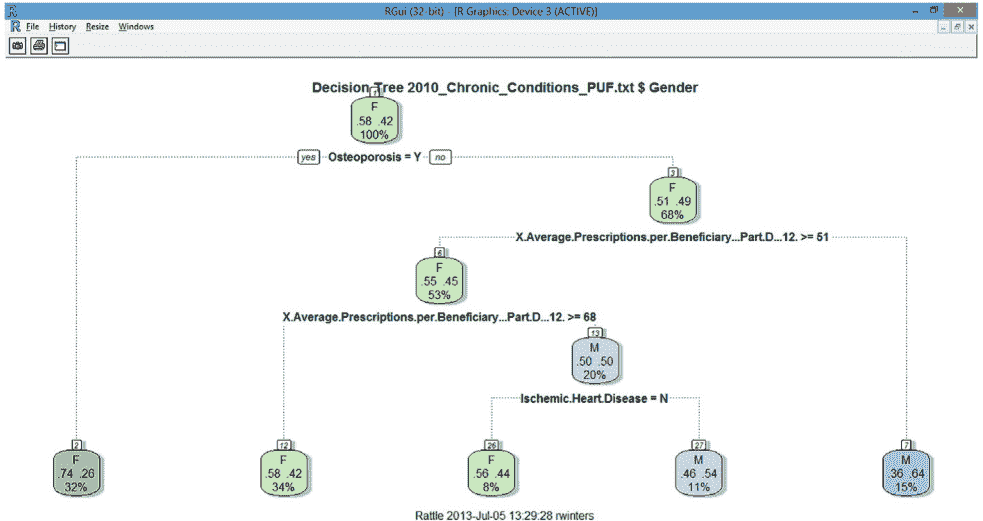

请注意，第一个问题是“患者是否患有骨质疏松？”。然后，基于答案，会问另一系列问题，最终将患者放置在树的终端节点中，在该节点中无法再提出能够改善结果的问题。

### 生长树

我们的原始节点始终从树的根开始。在前面的图表中，第一个节点仅从按性别划分的人群描述开始。在这种情况下，女性占多数类，占人口的 58%。决策树算法的目标是始终生长树并改进预测。因此，在这一点上，我们希望在性别预测上优于 58%。

在生长树时，始终需要考虑两个问题：

- 哪个变量能最好地改善目标变量每个类别的预测？
- 对于该变量，最佳分割点是什么，能够将分类变量分成两部分，或将连续变量分成两部分，并改善该类别的预测？

此决策的结果将是一个新的树节点或叶子节点。在经典决策树中，通常有两条路径（是或否，高或低），但根据算法，也可能有超过两条路径。

在前面的示例中，算法首先会遍历所有变量并确定哪个能改善预测。该变量恰好是骨质疏松的存在。如果存在骨质疏松，可以以 74% 的准确率预测患者是女性。但是，当不存在骨质疏松时，成为女性的概率实际上会降至 51%，这略低于研究中女性原来的 58% 占比。

等等。分区算法将继续尝试再次拆分数据。这次它将平均处方数量变量作为改善预测的方法。在这项分析中，每个受益人每年的平均处方数量大约从每年 15 个到约 200 个。算法将尝试此范围内的所有值，将数据拆分为两部分。例如，它可能首先尝试比较拥有 10 个或更多处方的患者与拥有 9 个或更少处方的患者。然后它将查看该切断点的预测。接着，它将继续更改切断值，直到找到优化两个类别之间分离的切断值。

在此示例中，它发现 51 个处方是优化的切断点


对于未患骨质疏松的患者进行分割。当处方数量大于 50 时，患者为男性的概率为 64%。

### 不纯度

当一个节点根据最佳标准分割后，会检查生成的节点的不纯度。不纯度衡量类别的分离程度，基于该点处应有的预期频率。对于二元分类，最不纯的情况是节点被 50/50 分割。这本质上指定了随机的类别分配。不纯度最低的情况是决策规则将所有观测值完全归入一个类别，而另一个类别中有 0 个观测值。这是更理想的情况，因为它允许我们对该节点做出完美预测。

计算出不纯度指标后，算法将计算信息增益指标，该指标计算通过分割每个变量使不纯度降低了多少，并接着计算连续变量的所有可能分割点。

### 控制树的生长

CART 的一个特点是（在 R 中作为 rpart 实现），它会尝试所有可能的变量和分割点，直到找到最佳的变量。具体取决于算法的配置方式，这可能是实现最高信息增益的变量。然而，在实际应用中，很少有树是在没有边界限制的情况下生长的。树是在约束条件下生长的。约束示例包括指定可以生长的最大分支数，或叶节点中包含的最小观测数量。因此，预测建模者可以构建出尽可能简单或尽可能复杂的树。

### 决策树算法的类型

在 R 中，将介绍两种决策树算法。我们将首先了解传统的算法，即 rpart，并分析 `state.x77` 数据，以基于多个属性确定预期寿命。

以下是 `state.x77` 数据的元数据描述。您也可以在 R 控制台中输入 `?x77.data` 以获取有关此表的更多信息。

| 变量 | 描述 |
| --- | --- |
| 人口 | 1975 年 7 月 1 日的人口估计值 |
| 收入 | 人均收入（1974 年） |
| 文盲率 | 文盲率（1970 年，人口百分比） |
| 预期寿命 | 预期寿命（年）（1969-71 年） |
| 谋杀率 | 每 10 万人口的谋杀及过失杀人率（1976 年） |
| 高中毕业生比例 | 高中毕业生百分比（1970 年） |
| 霜冻天数 | 首府或大城市最低温度低于冰点的天数平均值（1931-1960 年） |
| 面积 | 陆地面积（平方英里） |

首先，我们将此数据与另外两个参考数据集合并。使用 R 帮助系统获取关于附加表的更多信息：

- state.abb：获取州缩写
- state.region：获取州的地理区域

```
statedf <- as.data.frame(state.x77)
x <- data.frame(statedf, state.abb, state.region)
summary(x)
```

summary() 函数的输出将出现在控制台中：

```
> summary(x)
```

| 变量 | 最小值 | 下四分位数 | 中位数 | 均值 | 上四分位数 | 最大值 |
| --- | --- | --- | --- | --- | --- | --- |
| 人口 | 365 | 1080 | 2838 | 4246 | 4968 | 21198 |
| 收入 | 3098 | 3993 | 4519 | 4436 | 4814 | 6315 |
| 文盲率 | 0.500 | 0.625 | 0.950 | 1.170 | 1.575 | 2.800 |
| 预期寿命 | 67.96 | 70.12 | 70.67 | 70.88 | 71.89 | 73.60 |
| 谋杀率 | 1.400 | 4.350 | 6.850 | 7.378 | 10.675 | 15.100 |
| 高中毕业生比例 | 37.80 | 48.05 | 53.25 | 53.11 | 59.15 | 67.30 |
| 霜冻天数 | 0.00 | 66.25 | 114.50 | 104.46 | 139.75 | 188.00 |
| 面积 | 1049 | 36985 | 54277 | 70736 | 81163 | 566432 |

| 州缩写 | 计数 |
| --- | --- |
| AK | 1 |
| AL | 1 |
| AR | 1 |
| AZ | 1 |
| CA | 1 |
| CO | 1 |
| (其他) | 44 |

| 州区域 | 计数 |
| --- | --- |
| 东北部 | 9 |
| 东南部 | 16 |
| 北中部 | 12 |
| 西部 | 13 |

### 检查目标变量

对目标变量预期寿命绘制直方图可显示出相当大的变异。因此，它可以被视为一个良好的潜在目标变量。

```
hist(x$Life.Exp)
```

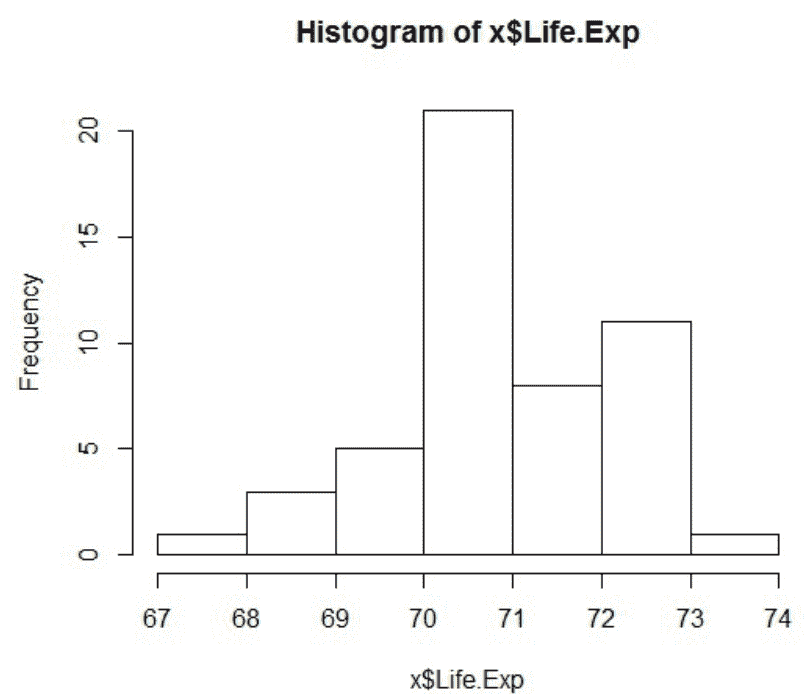

### 在 rpart 模型中使用公式表示法

我们已经了解了如何在 R 中使用公式表示法指定回归模型。例如，我们使用 `lm(women$height ~ women$weight)` 根据体重预测身高。

回归模型中公式表示法的一般形式为：

*因变量 ~ 自变量*

其中，因变量位于波浪号（~）左侧，自变量位于波浪号（~）右侧。

rpart 模型也可以使用公式表示法进行设置，只是术语略有变化。在 rpart 模型中，我们可以将目标变量（Life.Exp）指定在波浪号（~）左侧，将预测变量指定在波浪号（~）右侧。我们将使用点表示法（.）来指示将考虑 _所有_ 变量。

### 注意

点表示法是指定所有变量的一种便捷方式；不过，在构建模型时，您可能希望避免使用它，而是指定感兴趣的变量的具体列表。这将加快处理速度，并避免不必要的分割。

在以下示例中，您可以看到 rpart 将选择 `state` 作为最佳初始分割变量。虽然这最终可能会生长出一棵非常准确的树，但在预测能力方面，最初基于 state 等高维变量进行分割并不能提供关于导致预期寿命变化的原因的深入了解。州始终有可能被细分为地理区域。但通常您会得到一些毫无意义的州分割结果。

在以下示例中，我们将使用 `rpart()` 函数生成一个简单的决策树。我们还将使用程序包 `rpart.plot` 中的 `prp()` 函数来可视化树：

```
install.packages("rpart")
install.packages("rattle")
install.packages("rpart.plot")
install.packages("RColorBrewer")

library(rpart)
library(rattle)
library(rpart.plot)
library(RColorBrewer)
set.seed(1020)
y1 <- rpart(Life.Exp ~ .,data=x,cp=.01)
prp(y1, type=4, extra=1)
```

### 对图表的解读

在以下图表中，节点的分割完全基于 state，并未体现州是如何分组的。请注意，`state.region` 在分割算法中根本不起作用，因此可以合理推测，许多分割纯属机械操作，且从视觉上看，许多分割中并未反映出明显的分组：

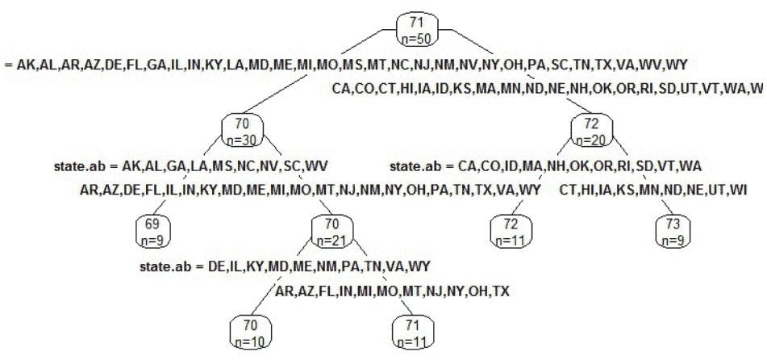

### 打印决策树的文本版本

打印 rpart 对象还会给出文本输出，显示每个分割点后各类别的成员。带有星号（*）的条目为终端节点。终端节点无法再进一步分割。通常，可以仅根据终端节点进行分段，假设其规模足够大，以便基于其做出的决策可付诸实施：

```
> print(y1)
```

此 print() 函数将输出发送到控制台：

```
n= 50
node), split, n, deviance, yval
* denotes terminal node
1) root 50 88.2990000 70.87860
2) state.abb=AK,AL,AR,AZ,DE,FL,GA,IL,IN,KY,LA,MD,ME,MI,MO,MS,MT,N
4) state.abb=AK,AL,GA,LA,MS,NC,NV,SC,WV 9 2.2790220 68.82556 *
5) state.abb=AR,AZ,DE,FL,IL,IN,KY,MD,ME,MI,MO,MT,NJ,NM,NY,OH,PA,T
10) state.abb=DE,IL,KY,MD,ME,NM,PA,TN,VA,WY 10 0.1656400 70.2140
11) state.abb=AR,AZ,FL,IN,MI,MO,MT,NJ,NY,OH,TX 11 0.2109636 70.7
3) state.abb=CA,CO,CT,HI,IA,ID,KS,MA,MN,ND,NE,NH,OK,OR,RI,SD,UT,V
6) state.abb=CA,CO,ID,MA,NH,OK,OR,RI,SD,VT,WA 11 0.7760909 71.78
7) state.abb=CT,HI,IA,KS,MN,ND,NE,UT,WI 9 1.0192890 72.77111 *
```

如果从模型中移除 state，我们将开始使用一个更易于理解的模型。在 prp() 函数绘制结果后，您可以看到树的左侧分支完全基于较高的谋杀率。
该分支的两个终端节点表明，谋杀率 >= 11% 的地区预期寿命比谋杀率 < 11% 的地区低一年。

树的右侧分支集中在较低的谋杀率上。对于这些分支，会考虑区域。北区和南区的预期寿命比西区或北中部地区低一年：

```
y2 <- rpart(Life.Exp ~ Population + Income + Illiteracy +
Murder +
HS.Grad +
Frost +
Area +
state.region,method='anova',
data=x
)
prp(y2, type=4, extra=1)
```


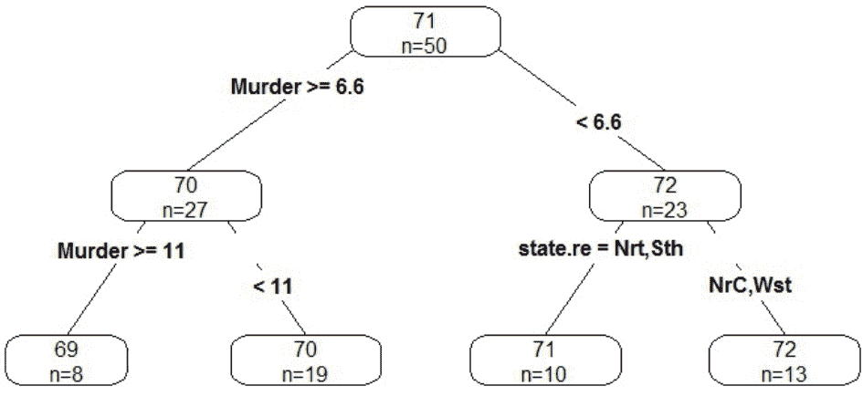

### ctree 算法

ctree 函数相对于 rpart 具有一些优势，因为它产生的结果可能更直观一些。与仅根据生成节点的纯度来优化结果节点不同，ctree 使用统计假设检验来确定分割的结果在统计上是否显著。它使用卡方检验统计量来检验关联，仅保留显著的关联，从而消除由于类别数量较多而产生的偏差。因此，虽然在某些情况下准确性可能会受影响，但通过使结果更具解释性获得了益处：

```
install.packages("partykit")
library(partykit)
y2 <- ctree(Life.Exp ~ .,data=x)
y2
plot(y2)
```

从下图可以看出，ctree 和 rpart 在第一个分割（murder）上达成一致，且切断点非常相似。由于该分割得到两种不同算法的验证，这可以增加对第一个分割的可信度：

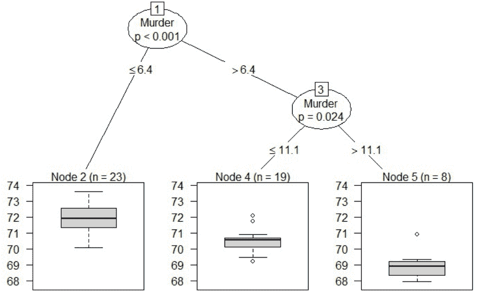

### 剪枝

剪枝是防止过拟合的另一种方法。如果您直观地检查一棵树，并希望在某个特定点停止分支的生长，则可以剪掉该节点下的所有分支，使该节点下的所有结果合并为一个节点。这可能会为该点显示的决策规则提供更具可解释性的结果。

rpart 具有一个独特的交互式剪枝功能，使用 prp() 函数可以帮助您完成此操作。

在前面的 states 示例中，您可能希望移除节点 70 下的所有节点，以平衡树并将其保持在两层深度。平衡树也可以被视为一种可取的特征：

```
PrunedTree <- prp(y1,type=4, extra=1,snip=TRUE)$obj
```

单击节点 70，并在控制台中观察“删除节点 5”的消息。看到该消息后，在图中单击退出：

```
> PrunedTree <- prp(y1,type=4, extra=1,snip=TRUE)$obj
Click to snip ...
Delete node 5 state.ab = DE,IL,KY,MD,ME,NM,PA,TN,VA,WY
```

| 节点 | 变量 | n | wt | dev | yval | 复杂度 | ncompete | nsurrogate |
|---|---|---|---|---|---|---|---|---|
| 5 | state.abb | 21 | 21 | 1.7 | 70 | 0.015 | 4 | 5 |

显示树的结果，并注意节点已被删除：

```
prp(PrunedTree, type=4, extra=1)
```

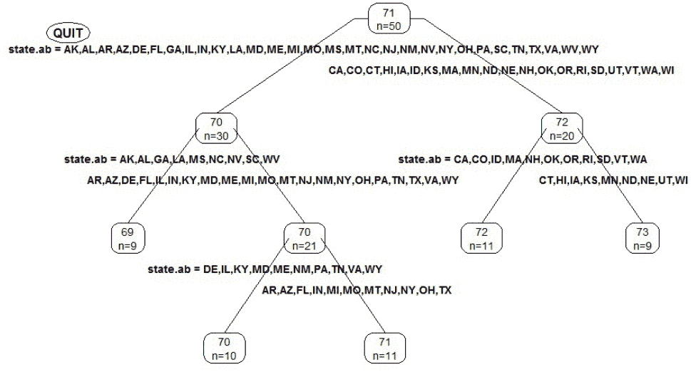

#### 其他用于渲染决策树的选项

这些是 rpart 用于生长树的重要控制参数。您通常可以调整这些值，以使树以合理的形式呈现，并控制其复杂度：

- cp 参数：cp（复杂度参数）是 rpart 中使用的一个选项，用于控制分割算法在决定是否分割节点时应有多“宽松”。使用较小的 cp 值（< 0.01）可以生成一棵巨大的树，该树可能包含无法解释的分割；而 cp 值较高（> 0.05）的树可能只产生包含明显信息的树。因此，将 cp 级别设置为一个既能生成合理数量节点、又保持可解释性的数值非常重要。

- 最大深度：如果您希望树的层数在某个级别停止，请在函数调用中将此数字指定为一个选项。有些人会在大约 10 层后停止决策树，假设在那之后将没有可解释的信息。但是，如果您怀疑可能会出现包含您要查找的信息的单个节点，请务必继续生长树。但是，请记住，随着层数的增加，所需的计算时间和内存也会增加。即使是一个较大的数字，对树的增长设置限制也是一个好主意。

- Minbucket：许多分析师喜欢关注终端节点。但是，终端节点需要达到最小大小才能具有统计意义。唯一的例外是您在寻找真正的异常值或离群点。但一般来说，对于分段，我们希望分组足够大以具有意义。

- Minsplit：此选项控制一个节点必须拥有多少个观测值才能被考虑进行分割。

## 聚类分析

聚类分析有很多用途。在最基本的层面上，簇是一群具有相似特征的人或对象。在营销和销售行业，聚类很重要，因为客户（或潜在客户）可以根据平均消费、购买频率和最近购买时间等特征进行分组，并被分配一个代表该簇中所有属性所包含的不同层级的单一指标的簇。因此，在我们的 RFM 示例中，簇 A 可能代表经常购买、花费很多钱且购买频繁的客户（每个营销人员的梦想）。簇 B 可能代表在那三个 RFM 指标上都只是平均消费者的人，甚至可能有一个簇 Z，代表看似不可能的事情，例如只在周二购买万圣节服装的客户。

数据分析师通常可以通过使用 SQL 等工具，或通过深入了解客户行为来获得良好的结果。因此，虽然聚类分析不一定是一种自娱自乐的手段，但聚类算法可以让您快速切入主题，并能够以不同的方式开始查看分组。

### 聚类在多种行业中的应用

聚类通常与您在不同行业中可能听到的其他术语相关：

- 在营销和销售中，您会听到“产品细分”这一术语，它是指我们根据人们在各个维度上的产品偏好对他们进行聚类的方式。它也可以指客户购买产品的意愿，其最终目的是能够将客户聚类为这两组（愿意和不愿意），并只向我们预测愿意购买的客户进行营销。
- 保险公司可能会根据客户提出索赔的频率对客户进行聚类，或者根据某个风险档案对客户进行聚类。

### 什么是簇？

簇可以定义为一组具有相似特征的对象。簇的大小可以不同。没有要求簇必须拥有特定数量的成员。它甚至可以只有一个成员。这在欺诈应用中可能很有用，您希望在其中识别数据中的异常值。在这种情况下，非常小的簇可以作为异常值。

簇通常被构建为每个组中拥有相同数量的成员，如分区聚类中所述。在这种情况下，每个簇中的所有成员在每个簇组内都是同质的。

此外，簇被构建为与其余簇具有明显差异。差异通常基于每个簇质心之间的测量值来计算，质心是每个簇的中间点，每个簇的质心可以被视为该簇所代表属性的平均代表值。

聚类通常只在数值变量上进行。这是因为聚类使用距离度量，而且如我们所见，类别变量之间没有度量。但是，有方法可以使用类别变量纳入相似性，我们稍后将看到。

### 聚类类型

常用的两种聚类类型是分区聚类和层次聚类：

### 分区聚类

这也被称为非层次聚类。在分区聚类中，每个对象被分成具有相似特征的较小的非重叠子集（分区）。一个观测值只能属于一个簇。

这是一个三簇分区模型的经典示例。但是，您可能会想知道为什么某些黄色观测值最终出现在黄色组簇中，而不是红色组中。这是因为 k-means 确定了每个簇的线性边界（右图），任何落在特定决策边界内的点都由该簇的边界定义：

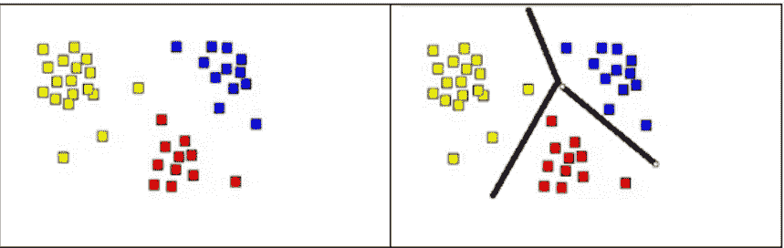

### K-means 聚类

K-means 聚类是用于分区聚类的最流行算法。在 K-means 聚类中，簇之间的相似性部分基于距离度量。通常，目标是将相似的簇分组在一起，使每个观测值与同一簇中其他观测值的距离相对较小。另一方面，另一个目标是使一个簇到下一个簇的距离最大，以便可以分辨距离。这本质上是一种权衡，即在组内定义相似性和组间定义相反的不相似性之间进行取舍。

### K-means 算法

K-means 算法基于迭代过程。

首先，我们决定希望有多少个簇。簇的数量可以通过多种方法确定，但请记住，实际上并没有正确的簇数量。通常，3 到 20 个簇可以作为一个范围。

作为初始步骤，簇成员被随机分配到三个中的一个


已指定的簇。在以下示例中，我们有 12 个观测值（灰色），以及三个随机生成的质心（实色）。在此示例中，假设我们只有两个变量，假设是 `age` 和 `height`。我们将它们表示在 x 轴和 y 轴上，但不会对它们进行标记：

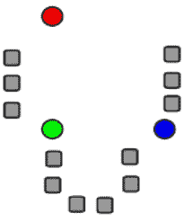

下一步是将每个观测值分配到最近的簇。各簇的近接性将在下一节中讨论，但目前，假设如下图所示，每个观测值已被随机分配给三个簇中的每一个。实线定义了簇的边界。从视觉上可以看出，一些调整可能有助于改进随机分配。例如，位于红色簇和绿色簇边界之间的绿色观测值，如果被分配到红色（顶部）簇，是否会更合适？这可能是正确的，因为看起来它可能比被随机分配到的簇更靠近顶部的簇：

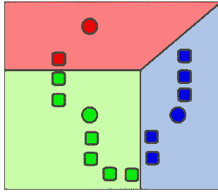

随机分配后，簇分配会被重新校准。这意味着每个簇的质心会被重新计算（稍后我们将看到具体做法），然后每个数据点会被移动到新的最近质心。下图展示了质心移动的过程：

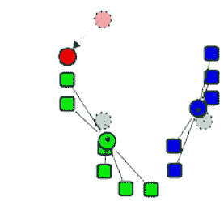

此过程会重复进行。质心会被重新计算，数据点再次移动到最近的质心，直到无法再有所改进。完成后，最终质心被计算出来，簇按如下图所示最终确定。可以看到，观测值的聚类效果略好于原始随机分配。请注意，每个簇内的数据点比原始随机分配更紧密，且至少两个簇（左侧的簇和中间的簇）之间有更大的分离：

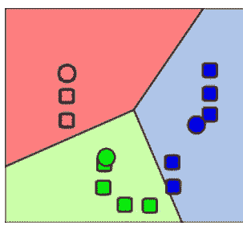

### 测量簇之间的距离

K-means 聚类使用欧氏距离来确定各簇之间的相距远近。对于只有一个变量的簇，计算非常简单。只需取任意两个簇的质心并相互相减即可。随着变量增加，计算变得稍微复杂一些，因为你需要对构成各簇的所有变量之间的平方差求和，并将它们全部相加以确定总距离。

下面是一个示例，说明如何为已分配到簇 1 的三个簇成员确定质心。质心 1 已计算得出，向量为 [186,45]，其中 186 是三个成员（1、2 和 3）的平均重量，45 是成员 1、2 和 3 的平均年龄。这些并不是最终的簇分配，而只是目前的最佳推测：

| 成员 | 重量 | 年龄 |
| --- | --- | --- |
| 1 | 146 | 25 |
| 2 | 175 | 43 |
| 3 | 236 | 68 |
| 质心 1 | 186 | 45 |

下一步是为每个簇分配获得更准确的估计。然后将每个成员的维度与所有簇的质心进行比较，并将其重新分配到最近的簇。这是使用欧氏距离的概念完成的。

欧氏距离的公式如下：

```
$$\sqrt{\sum_{i=1}^{n}(q_i - p_i)^2}$$
```

对于只包含两个变量的簇，这等同于：

```
$$\sqrt{(q_1 - p_1)^2 + (q_2 - p_2)^2}$$
```

在之前定义的年龄和体重示例中，已计算了成员 1 在簇 1（其当前所属的第一个簇分配）和备选簇 2 之间的欧氏距离。距离使用前面的公式计算，最终平方和的结果列在最后一列。如您所见，簇 2 被计算为离成员 1 更近，因为距离更小，因此，成员 1 被移入簇 2：

| | 重量 | 年龄 | | 重量平方 | 年龄平方 | 平方和的平方根 |
| --- | --- | --- | --- | --- | --- | --- |
| 成员 1 | 146 | 25 | 距离到簇 1 | 1600 | 400 | 45 |
| | 146 | 25 | 距离到簇 2 | 16 | 1225 | 35 |
| 簇 1 | 186 | 45 | | | | |
| 簇 2 | 150 | 60 | | | | |

在所有成员的距离都已计算完毕，并且每个成员都已移入最近的簇后，各簇的质心会发生变化，因为成员已被添加或移除。因此，此过程会重复进行，直到没有更多成员可以被移入更合适的簇。

### 使用 k-means 的聚类示例

本示例将说明一个简单的 RFM 聚类示例。RFM 分析是一种简单的数据库营销方法，可用于区分您最好（和最差）的客户。由于只有三个变量，并且理论上可以细分为更多数量的营销细分群体，因此这是一个很好的示例，用于演示聚类分析。

数据来自 `CDNOW` 数据库，其中包含了 23,570 名在 1997 年第一季度于 `CDNOW` 进行首次购买的个体群体截至 1998 年 6 月底的完整购买历史（Fader, 2001）。

我们将使用以下三个变量：

- **购买日期**：这是购买商品的日期，将用于确定 RFM 分析中的近期性部分。
- **购买数量**：这对应于购物车中购买的商品数量，大致对应于客户的购买频率。
- **已付总额**：这是购买的总金额。这反映了 RFM 中的货币部分。

作为第一步，我们将读取数据，将日期转换为日期值，然后计算购买以来的天数。

然后我们将为变量分配列名：

```
library(graphics)
library(dplyr)
x <- read.table("C:/PracticalPredictiveAnalytics/Data/CDNOW_maste
```

接下来，我们将购买日期转换为日期格式，并计算自该购买以来过了多长时间。使用 1998 年 7 月 1 日作为参考日期：

```
x$xd <- as.Date(as.character(x$V2), "%Y%m%d")
x$diffdate <- as.integer(as.Date("1998-07-01") - x$xd)
#rename the columns
```

```
colnames(x) <- c("id","orig.date","units.bought","TotalPaid","pur
str(x)
summary(x)
```

我们将说明 k-means 函数，以对变量 `units.bought`、`TotalPaid` 和 `Days.since` 执行 k-means 聚类。k-means 聚类的一个特点是，每个观测值只能被归类到一个且仅一个簇中。k-means 要求所有变量必须是数值型，您不能在 `kmeans` 函数中使用分类变量。

您需要做出的一个决定是希望 k-means 生成多少个簇。我通常喜欢设定在 5 到 15 个簇之间。比这更多会使得解释每个单独簇背后的含义变得困难，但您当然也可以这样做。增加簇数量的一个问题是，k-means 算法规定簇的大小应大致相等，因此随着簇数量的增加，一些离群簇的成员数量会更少。

k-means 的输出将让您大致了解聚类的拟合优度。簇内平方和表示各簇内个体数据点的分离程度。较小的数字表明簇更加同质。比率 `betweenss/totss` 是一个单一指标，可用于衡量所有簇作为一个整体的分离程度。较高的数字表明簇的分离效果更好。

在本示例中，我们将生成大小为 3、5 和 7 的簇：

```
attach(x)
#cluster on the RFM variables
y <- subset(x, select = c(units.bought, TotalPaid, Days.since))
#perform kmeans producing 3 and 5 clusters
```

#### 注意

k-means 依赖于随机种子来初始填充伪随机簇分配。更改种子可能会更改您的结果。由于聚类涉及一定程度的人类解释，因此通常使用不同种子多次运行该算法，并观察它们之间的一致性（或不一致性）。


创建三个聚类后，打印聚类间平方和与聚类总平方和的比率。这将为您提供一个起始指标，以便开始比较聚类。较高的数字意味着聚类之间的分离度更好：

```
#always set seed before clustering
set.seed(1020)
clust3 <- kmeans( y,3)
clust3$betweenss/clust3$totss
clust5 <- kmeans( y,5)
clust5$betweenss/clust5$totss
clust7 <- kmeans( y,7)
clust7$betweenss/clust7$totss
```

```
> set.seed(1020)
> clust3 <- kmeans( y,3)
> clust3$betweenss/clust3$totss
[1] 0.8706681
> clust5 <- kmeans( y,5)
> clust5$betweenss/clust5$totss
[1] 0.9178001
> clust7 <- kmeans( y,7)
> clust7$betweenss/clust7$totss
[1] 0.9381889
```

基于以上输出，聚类 7 具有最高的 betweenss/totss 比率，七个聚类将被视为最佳聚类数量。但是，如果您运行分析，每次增加聚类数量，您始终会看到比率增加。因此，我们需要确定边际效益递减定律在何处开始发挥作用。

### 聚类肘部图

确定这一点的一种方法是使用一种称为“肘部法”的自动化方法，即对范围内的所有值绘制簇内平方和总计，并在图中找到出现肘部的位置：

```
#elbow method
set.seed(1020)
### Compute and plot wss for k = 3 to k = 15
df <- sapply(3:15,function(k){kmeans(y,k)$tot.withinss})
plot(3:15, df,type='b',xlab="# of clusters",ylab="Total Within Clusters Sum of Squares")
```

在以下图中，您可能会看到两个肘部，一个在 5-6 个聚类处，另一个在 8-9 处。我们暂时假设五个是最佳数量，仅仅是因为该区域有一个肘部，而且给聚类命名会更容易解释：

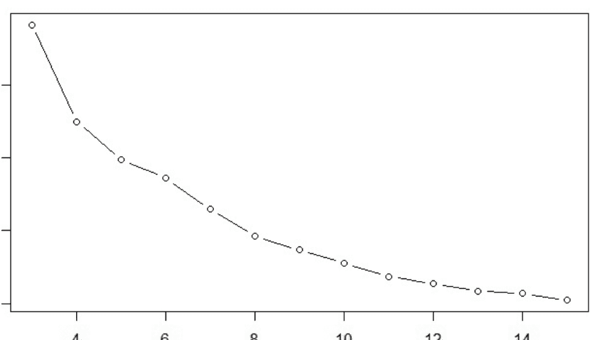

### 提取聚类分配

让我们从 `clust` 对象中提取聚类分配，然后比较每个聚类的计数，与大小为 3、4 和 7 的聚类进行比较：

```
#cluster assignments
clusters3 <- clust3$cluster
clusters5 <- clust5$cluster
clusters7 <- clust7$cluster
```

### 以图形方式显示聚类

我们可以以多种不同的方式绘制聚类。首先要查看的是聚类段的直方图。请记住，k-means 希望看到大小大约相等的聚类：

```
#usually but now always the middle cluster is the average cluster
par(mfrow=c(1,3))
hist(clusters3)
hist(clusters5)
hist(clusters7)
```

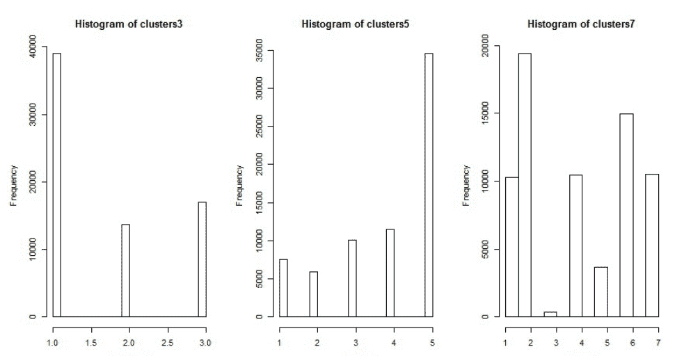

### 聚类图

我们还可以将分配的聚类与原始数据一起绘制，以查看聚类分配是否存在任何问题。

首先，我们需要将聚类分配追加到原始数据集中：

```
#append the clusters the original data
append.clust <- data.frame(x, clusters3,clusters5,clusters7)
```

为进行说明，让我们从 append.clust 数据集中抽样。我们将样本大小设置为 100，但您可以将其设置为任何使图表可读的数字：

```
library(cluster)
set.seed(1020)
sampleit <- append.clust[sample(nrow(append.clust), 100), ]
```

### 生成聚类图

我们将使用 cluster 库中的 clusplot 包，根据前两个主成分绘制聚类分配。如果您记得，主成分是一种将本练习中的变量数量减少到两个的方法，主要是为了在二维 x 和 y 轴上绘制它。

### 注意

如果您运行以下命令，将看到第一个成分是价格和购买单位数量的度量，第二个成分是自上次购买以来的时间的度量。这就是在 x 和 y 轴上表示的内容。在这种情况下这很琐碎，因为聚类模型只有三个输入变量，但随着您使用的变量数量增加，这会变得更加重要：prcomp(append.clust[, c(3, 4, 6)], scale = TRUE)

```
par(mfrow=c(1,3))
clusplot(sampleit[,c(3,4,6)], sampleit$clusters3, color=TRUE, shade=TRUE)
clusplot(sampleit[,c(3,4,6)], sampleit$clusters5, color=TRUE, shade=TRUE)
clusplot(sampleit[,c(3,4,6)], sampleit$clusters7, color=TRUE, shade=TRUE)
```

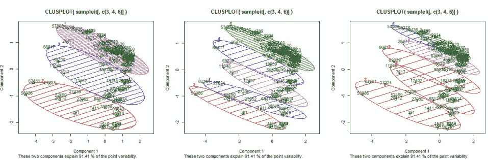

基于前面的图，我会排除 `clusters7`，因为第三个质心似乎具有较小的 `count.p`。

让我们来看看每个聚类的构成，并看看它们如何与原始变量相关。

查看 `head()` 函数的输出。请注意，每一行包含三个不同的聚类分配。让我们按每个聚类分组查看原始变量的均值和计数：

```
head(append.clust)
```

| | id | orig.date | units.bought | TotalPaid | purch.date | Days.since | clusters3 | clusters5 | clusters7 |
|---|---|---|---|---|---|---|---|---|---|
| 1 | 1 | 19970101 | 1 | 11.77 | 1997-01-01 | 546 | 1 | 5 | 2 |
| 2 | 2 | 19970112 | 1 | 12.00 | 1997-01-12 | 535 | 1 | 5 | 2 |
| 3 | 2 | 19970112 | 5 | 77.00 | 1997-01-12 | 535 | 1 | 5 | 5 |
| 4 | 3 | 19970102 | 2 | 20.76 | 1997-01-02 | 545 | 1 | 5 | 2 |
| 5 | 3 | 19970330 | 2 | 20.76 | 1997-03-30 | 458 | 1 | 5 | 6 |
| 6 | 3 | 19970402 | 2 | 19.54 | 1997-04-02 | 455 | 1 | 5 | 6 |

我们将使用 `dplyr` 获取每个聚类的平均值和计数：

```
library(dplyr)
attach(append.clust)
append.clust %>% select(units.bought, TotalPaid, Days.since, clusters3) %>%
  group_by(clusters3) %>%
  summarise_each(funs(n(), mean))
append.clust %>% select(units.bought, TotalPaid, Days.since, clusters5) %>%
  group_by(clusters5) %>%
  summarise_each(funs(n(), mean))
append.clust %>% select(units.bought, TotalPaid, Days.since, clusters7) %>%
  group_by(clusters7) %>%
  summarise_each(funs(n(), mean))
```

```
> append.clust %>% select(units.bought, TotalPaid, Days.since, clusters3) %>%
+   group_by(clusters3) %>%
+   summarise_each(funs(n(),mean))
Source: local data frame [3 x 7]

clusters3 units.bought_n TotalPaid_n Days.since_n units.bought_mean TotalPaid_mean Days.since_mean
(int)       (int)          (int)         (int)          (dbl)         (dbl)         (dbl)
1           1            39001         39001          39001        2.273942      34.36202     485.85334
2           2            13657         13657          13657        2.558102      37.02813     98.91748
3           3            17001         17001          17001        2.603317      38.49593     293.54491
```

```
> append.clust %>% select(units.bought, TotalPaid, Days.since, clusters5) %>%
+   group_by(clusters5) %>%
+   summarise_each(funs(n(),mean))
Source: local data frame [5 x 7]

clusters5 units.bought_n TotalPaid_n Days.since_n units.bought_mean TotalPaid_mean Days.since_mean
(int)       (int)          (int)         (int)          (dbl)         (dbl)         (dbl)
1           1            7561          7561           7561         2.608121      38.06974     138.7954
2           2            5948          5948           5948         2.505884      35.89042     45.8228
3           3            10089         10089          10089        2.587075      37.91040     250.6387
4           4            11521         11521          11521        2.619651      39.12428     376.5500
5           5            34540         34540          34540        2.228547      33.75117     495.1166
```

```
> append.clust %>% select(units.bought, TotalPaid, Days.since, clusters7) %>%
+   group_by(clusters7) %>%
+   summarise_each(funs(n(),mean))
Source: local data frame [7 x 7]

clusters7 units.bought_n TotalPaid_n Days.since_n units.bought_mean TotalPaid_mean Days.since_mean
(int)       (int)          (int)         (int)          (dbl)         (dbl)         (dbl)
1           1            10298         10298          10298        2.391532      35.17277     342.13138
2           2            19416         19416         19416        1.748146      25.58429     512.46127
3           3            330           330            330          18.075758     305.69979    371.37273
4           4            10461         10461          10461        2.522417      36.73229     216.94523
5           5            3668          3668           3668         6.151854      101.58269    485.78190
6           6            14969         14969          14969        1.843142      26.49776     456.32394
7           7            10517         10517          10517        2.548636      36.79511     77.25055
```

我们可以用原始变量来解释这些聚类：

对于三聚类分配：

- 聚类 1 具有所有三个聚类中最低的平均购买单位数量，以及最低的 TotalPaid 金额。它还拥有相对于其他客户很久以前购买过商品的客户。


- 集群 2 按最近购买的客户进行分类，因为它们的 Day.since 均值统计量最低。
- 集群 3 按购买数量相对较多、总发票金额较高，但不一定是最近购买者的客户进行分类。

基于这些集群定义，营销部门可以为每个客户群定制不同的产品或服务。

### 层次聚类

作为 k-means 的一种替代方案，你可以执行层次聚类，无需事先指定集群数量。在层次聚类中，你可以从一个集群开始，每次继续细分两个集群；也可以从每条记录各自作为一个集群开始，然后将它们合并成更大的集群。无论如何，都可以轻松扫描树（称为树状图）的上下，找出适合你需求的集群分组，而不必逐次运行聚类。但是，对于大规模计算处理，分区聚类（k-means）绝对具有性能优势，这也是它在工业界备受青睐的原因。

我们将使用 hclust R 函数和 Pain 数据框来演示层次聚类。读取数据后，我们将通过将均值中心化到 0 来对数据进行缩放或标准化。这样做的原因是，我们不希望聚类过程仅因变量的大小或方差而偏爱某个变量，因此我们尽可能使其量级相等。

首先，我们将之前保存的 pain_raw 数据加载到一个数据框对象中：

```
require(graphics)
setwd("C:/PracticalPredictiveAnalytics/Data")
load("pain_raw.Rda")

df2 <- subset(df, select=c(Age,Duration,Pain))
df2 <- scale(df2)
head(df2)
```

接下来，我们将计算距离矩阵，并使用平均连接法运行层次聚类算法：

```
fit <- hclust(dist(df2), "average")
```

在绘制树状图之前，我们将指定要在最相似的三个集群组周围显示红色边框：

```
groups <- cutree(fit, k=3)
rect.hclust(fit, k=3, border="red")
```

树状图已绘制，其外观应与以下图表类似。垂直线末端显示观察编号，因此可以轻松从原始数据框中提取子集并检查数据：

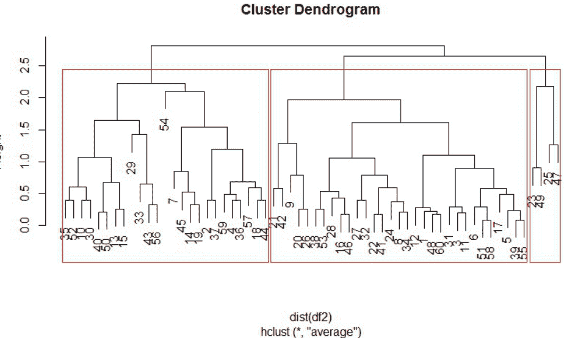

### 检查集群 1 中的一些示例

从树状图底部，我们可以看到与 cluster1 关联的一些观察结果。从原始数据框 (df) 中提取它们：

```
cluster1 <- df[c(35, 52, 10, 30), ]
```

使用 `View` 命令检查输出。输出显示 `cluster1` 可能与 70 岁左右的男性相关，他们报告的疼痛持续时间在 21 到 29 天之间：

```
View(cluster1)
```

| | 治疗 | 性别 | 年龄 | 持续时间 | 疼痛 |
|---|---|---|---|---|---|
| 35 | B | M | 75 | 21 | 1 |
| 52 | A | M | 76 | 25 | 1 |
| 10 | B | M | 75 | 30 | 1 |
| 30 | P | M | 77 | 29 | 1 |

### 检查集群 2 中的一些示例

同样，从集群 2 中提取一些观察结果并查看：

```
cluster2 <- df[c(23, 49, 25, 47), ]
View(cluster2)
```

这个集群看起来可能与接受过 A 和 B 治疗、报告无疼痛、年龄在 59-72 岁之间的人有关：

| | 治疗 | 性别 | 年龄 | 持续时间 | 疼痛 |
|---|---|---|---|---|---|
| 23 | B | F | 72 | 50 | 0 |
| 49 | B | F | 69 | 42 | 0 |
| 25 | A | M | 62 | 42 | 0 |
| 47 | B | M | 59 | 29 | 0 |

### 检查集群 3 中的一些示例

从 `cluster3` 中提取并查看一些示例：

```
cluster3 <- df[c(20, 26, 38, 53), ]
View(cluster3)
```

集群 3 可能是报告无疼痛的患者。然而，其特征是持续时间比 `cluster2` 短得多：

| | 治疗 | 性别 | 年龄 | 持续时间 | 疼痛 |
|---|---|---|---|---|---|
| 20 | A | F | 74 | 1 | 0 |
| 26 | P | M | 74 | 4 | 0 |
| 38 | B | M | 70 | 22 | 0 |
| 53 | B | F | 69 | 24 | 0 |

请注意，在前面的示例中，我们从每个集群中只提取了四个观察结果。然而，你不必只提取四个。按需要提取尽可能多的，并尝试为其命名以对集群特征进行分类。

## 支持向量机

我们已经看过一些示例，其中使用直线来分隔类别。

随着模型维度（或特征空间）的增加，可能有多种不同的方式以线性或非线性方式分隔类别。

在支持向量机的情况中，数据首先使用称为内核的映射函数转换到更高维空间，并使用最优超平面对更高维空间进行分段。超平面使用比其试图测量的空间少一维的维度，因此使用直线来分段二维空间，并使用二维纸张来分段三维空间。超平面可以是线性或非线性的。

超平面使用支持向量，这些是重要的训练元组，用于定义每个类别的边界。它们是数据中最关键的点，也是用于支持超平面定义的最重要点。超平面用于定义不同类别之间的边界。类别通常是二进制类别，例如 0 或 1。类别之间的边界也可以宽或窄。该特征由边距来衡量，边距定义了类别之间可优化的最大分离度。

以下是一个具有两个特征 x 和 y 的数据集示例。线条 A 和 B 可以被视为两个独立的线性分类器，用于将红色观察值与蓝色观察值分开的决策规则。A 线更可取，因为它在决策线与最近观察值之间具有更大的边距（分离值）。靠近该线的观察值称为支持向量：

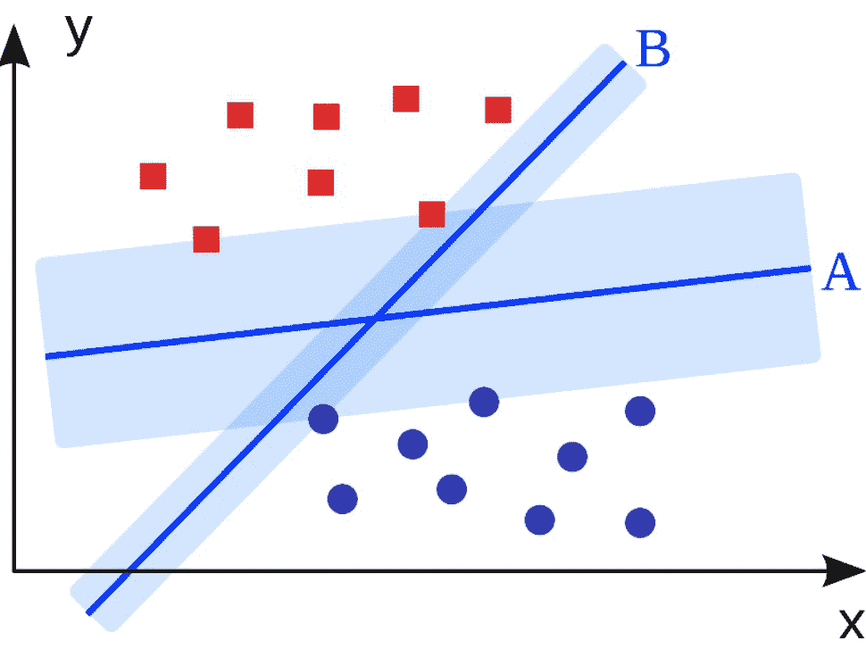

### 映射函数的简单示例

为了说明内核映射函数如何帮助定义线性边界，请查看以下图表，看看创建新变量 z 如何帮助区分由多项式函数 t2$Latitude^2*t2$High.Low.Temp^2 在二维空间中映射的新转换点。然而，内核映射将在更高维度中进行，映射结果将反向映射回原始空间：

```
#generate a non-linear circle of point

radius <- 2
t2 <- data.frame(x=radius * cos(seq(0,6,length = 20)),y = radius
names(t2) <- c("Latitude","High.Low.Temp")
plot(t2$Latitude,t2$High.Low.Temp)
```

```
### create a new variable and plot it against on the original point
t2$z = (t2$Latitude^2*t2$High.Low.Temp^2)
plot(t2$High.Low.Temp,t2$z)
```

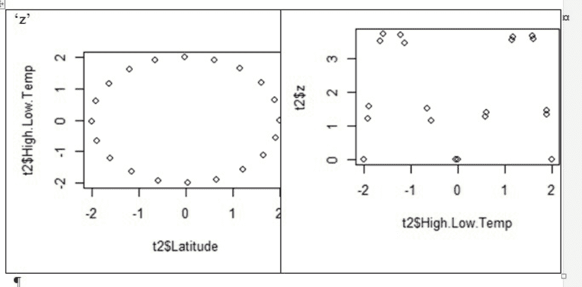

通常，SVM 用于维度非常高的数据。这可能涉及物体和面部识别等应用。SVM 可以非常准确，但其缺点包括可解释性和性能。SVM 也可能过度拟合数据，因为决策边界高度依赖于用于执行映射的内核选择。有大量内核选择可供使用，内核选择不应基于最佳模型拟合。这与使用高阶多项式函数来过度拟合回归模型并无不同。

### 使用 SVM 分析消费者投诉数据

在本示例中，我们将使用文本分类模型来定义线性 SVM 模型。非结构化文本数据是说明 SVM 的完美方式，因为数据维度非常高。

为了说明 SVM 分类器，我们将首先读取一些关于学生贷款的消费者投诉数据。我们将使用两个包，


### e1071 和 RTextTools：

```r
install.packages("e1071")
install.packages("RTextTools")
library(e1071)
library(RTextTools)
```

首先从 CSV 文件加载数据。该数据框简单地包含一些关于学生贷款的消费者叙述，以及投诉的分类情况。目标是开发一个 SVM 模型，用于将未来的客户投诉分类到各种问题类别中：

```r
data <- read.csv("C:\\PracticalPredictiveAnalytics\\Data\\Consumer Complaint Database.csv", stringsAsFactors=FALSE)
str(data)
```

对数据进行子集化，只保留我们需要的列：

```r
data <- subset(data, select=c(Issue, Consumer.complaint.narrative))
```

抽取前 50 条记录的样本并查看：

```r
data.samp <- subset(data[1:50,], select=c(Issue, Consumer.complaint.narrative))
View(data.samp)
```

|    | 问题                      | 消费者投诉叙述                                       |
|---:|:---------------------------|:-------------------------------------------------------------------|
|  1 | 与我的贷款人或服务商打交道 | 四年后未就某些私人贷... (收到) 联系                                  |
|  2 | 无法偿还我的贷款        | 这是与花旗银行...之前问题的延续                                      |
|  3 | 无法偿还我的贷款        | Navient 告诉我，我几乎能负担 {$150.0...                              |
|  8 | 与我的贷款人或服务商打交道 | 我丈夫在 XX/XX/XXXX 失业，且失...                                    |
|  9 | 与我的贷款人或服务商打交道 | Mohela 在 XXXX/XXXX/15 给我打电话，我告诉代表我 ...                  |
|  4 | 与我的贷款人或服务商打交道 | 2008 年，我在 XXXX 的 XXXX 大学就读，位于 XXXX 外 ...                |
|  7 | 与我的贷款人或服务商打交道 | 我的贷款已逾期，我大约两个月前打电话...                              |
|  5 | 与我的贷款人或服务商打交道 | 我从 XXXX XXXX (...获得了一笔私人学生贷款                            |
|  6 | 无法偿还我的贷款        | 我有一笔与 Sallie Mae 的私人贷款。我给他们打电话以 ...               |
| 10 | 无法偿还我的贷款        | 我无法支付我的私人学生贷款。他们已 ...                               |

### 将非结构化数据转换为结构化数据

请注意，投诉数据采用非结构化格式。某些文本挖掘算法将非结构化文本视为 *词袋*，这意味着在分析文档时，人们不顾语义和语法，最终将每个词视为自身的特征或变量。

文本挖掘中的一个重要数据结构是 **术语文档矩阵**（TDM），它仅指示哪些词出现在每个文档中。

`create_matrix()` 函数将为我们完成此操作。但是，在执行此操作之前，我们将希望清理数据，并对术语文档矩阵的创建施加一些限制。

首先，我们不想包含任何诸如 *the*、*an* 或 *it* 之类的词，因为这些词不会为 TDM 增加任何价值，并会迫使其变得非常大。这些词被称为 **停用词**。因此，我们将使用选项 `removeStopwords=TRUE` 过滤这些词。同样，我们还将消除所有数字和标点符号，并且只考虑长度至少为四个字符的词。这些选项并非随意设定。文本挖掘人员需要将这些选项设置在最佳值，以兼顾从数据中获取最大价值的需求，同时将数据大小降至最低。在设置这些选项时，对领域知识的了解非常有帮助。例如，如果我将 `minwordLength=5` 设置为 5，我就不会包含诸如 Paid 之类的词：

```r
### Create the document term matrix
dtMatrix <- create_matrix(data.samp["Consumer.complaint.narrative"],
                          minWordLength=4, removeStopwords=TRUE, re
```

TDM 是一种针对文本挖掘优化的数据结构。随着文档和词汇数量的增加，它可能难以查看。但是，在我们的示例中，我们只有 50 个文档，并且由于我们最初只对数据进行了抽样，因此只有有限数量的词汇，所以我们可以使用 `transpose()` 函数查看一个小的 TDM：

```r
xx = as.data.frame( t(as.matrix( dtMatrix ) ) )
head(xx)
```

请注意，即使在这个小样本中，我们也可以看到文档多次提及 access、able 和 ability。列指示单词出现的文档，以及引用次数。

每个文档都有一列，即使某个特定词（作为行列出）在文档中未出现：

```r
> head(xx)
ability   1 2 3 4 5 6 7 8 9 10 11 12 13 14 15 16 17 18 19 20 21 22 23 24 25 26 27 28 29 30 31 32 33 34 35 36 37 38 39 40 41 42 43 44 45 46 47 48 49 50
able      0 0 0 0 0 0 0 0 0 0  0  0  0  0  0  0  0  0  0  0  0  0  0  1  0  0  0  0  0  0  0  0  0  0  0  0  0  0  0  0  0  0  0  0  0  0  0  0  0
about     0 0 0 0 0 0 0 0 0 0  0  0  0  0  0  0  0  0  0  0  0  0  0  0  0  0  0  0  0  0  0  0  0  0  0  1  1  0  0  0  1  0  1  0  0  0  0  1  0  0
abbreviationed 0 0 0 0 0 0 0 0 0 0  0  0  0  0  0  0  0  0  0  0  0  0  0  0  0  0  0  3  0  0  0  0  0  0  0  0  0  0  0  0  1  0  0  0  0  0  0  0
accept    0 0 0 0 0 0 0 0 0 0  0  0  0  0  0  0  0  0  0  0  0  0  0  0  0  0  0  0  0  0  0  0  0  0  0  0  0  0  0  0  0  0  0  0  0  0  0  0  0  0  0
access    0 0 0 0 0 0 0 0 0 0  0  0  0  0  0  0  0  0  0  0  0  0  0  0  0  0  0  0  0  0  0  0  0  0  0  0  0  1  0  0  0  5  0  0  0  0  0  0  0  0  0
accomplish.. 0 0 0 0 0 0 0 0 0 0  0  0  0  0  0  0  0  0  0  0  0  0  0  0  0  0  0  0  0  0  0  0  0  0  0  0  0  0  0  0  1  0  0  0  0  0  0  1  0
```

现在我们已经查看了样本的 TDM，让我们在整个数据框上运行它。

```r
dtMatrix <- create_matrix(data["Consumer.complaint.narrative"],
                          minWordLength=4, removeStopwords=TRUE, re
```

与其查看 TDM（在这种情况下会非常大），不如通过对词条出现次数求和来执行频率分析。通过浏览数据框，您将很好地了解频繁出现的单个词条。您可能还希望计算这些词条的组合（双词组和 N-词组），这将让您了解客户投诉的主要内容：

```r
freq <- colSums(as.matrix(dtMatrix))
length(freq)
head(freq)
freq.df <- as.data.frame(freq)
View(freq.df)
```

`View` 命令的输出将按字母顺序显示 TDM 中的以下术语。使用滚动条浏览列表：

| | 频率 |
|---|---|
| aaron | 1 |
| abhorrent | 1 |
| abide | 2 |
| abided | 2 |
| abiding | 2 |
| abilities | 1 |
| ability | 82 |
| able | 771 |
| ablethe | 1 |
| ableye | 1 |

RTextTools 包使用容器来保存不同类型的 R 对象。我们将创建一个容器，用作持有对象，以训练前 500 条客户评论：

```r
container <- create_container(dtMatrix, data$Issue, trainSize=1:500)
str(container)
```

创建容器后，我们可以使用它来训练多种不同类型的模型。我们将使用带线性核的 SVM。

这意味着我们将使用线性超平面将高维文本空间中的数据分隔为不同段：

```r
### train a SVM Model
model <- train_model(container, "SVM", kernel="linear", cost=
str (model)
head (model)
summary (model)
```

summary 模型的输出如下；创建了 349 个支持向量，用于将数据分为三个类：

```
Call:
svm.default(x = container@training_matrix, y = container@training
    method = method)

Parameters:
    SVM-Type:  C-classification
    SVM-Kernel:  linear
        cost:  1
        gamma:  9.832842e-05

Number of Support Vectors:  349

 ( 189 143 17 )

Number of Classes:  3

Levels:
Can't repay my loan Dealing with my lender or servicer Getting
```

现在数据已经训练完毕，我们将使用接下来的 500 条观测值进行测试，以查看模型的表现。与我们对训练数据所做的类似，我们将为测试数据创建一个 TDM，但使用与训练数据相同的标签或术语：

```r
predictionData <- data$Consumer.complaint.narrative[501:1000]

### create a prediction document term matrix
predMatrix <- create_matrix(predictionData, originalMatrix=dtMatrix)

### create the corresponding container

plength = length(predictionData);
predictionContainer <- create_container(predMatrix, labels=rep(0,
```

为了查看模型的表现，我们将使用分类模型函数根据模型对测试数据集进行评分。然后，我们将根据问题类型和平均 SVM 概率对数据进行汇总。如输出所示，模型在对“与我的贷款人或服务商打交道”进行分类时表现最佳，而对“获得贷款”的识别效果不佳。所有这些都为贷款人提供了有价值的信息，因为我们现在可以看到来电者讨论了哪些类型的主题：

```r
### predict
results <- classify_model(predictionContainer, model)
head(results)
aggregate(results$SVM_PROB, by=list(results$SVM_LABEL), FUN=mean,
> head(results)
```

输出在控制台中显示如下：

```
     SVM_LABEL SVM_PROB
1 Dealing with my lender or servicer 0.5436438
2 Dealing with my lender or servicer 0.7521835
3 Dealing with my lender or servicer 0.5153998
4 Dealing with my lender or servicer 0.7611152
5 Dealing with my lender or servicer 0.7225702
6 Dealing with my lender or servicer 0.7590674
> head(results)
```

```
Group.1 x
1 Can't repay my loan 0.6211851
```


- 2 与我的贷款方或服务商打交道 0.6967735
- 3 获得贷款 0.4779246

## 参考文献

- 美国统计协会发布关于统计显著性和P值的声明。(2016年3月7日)。从ASA新闻检索：http://www.amstat.org/asa/files/pdfs/P-ValueStatement.pdf

- Anscombe四重奏。从维基百科检索：https://en.wikipedia.org/wiki/Anscombe%27s_quartet

- 决定系数。从维基百科检索：https://en.wikipedia.org/wiki/Coefficient_of_determination

- Fader, P. S. (2001年5-6月)。预测CDNOW的重复销售。Interfaces，31（5-6月），第2部分（共2部分），S94-S107。

- 常见问题：什么是伪R平方？从加州大学洛杉矶分校数字研究与教育学院检索：http://stats.idre.ucla.edu/other/mult-pkg/faq/general/faq-what-are-pseudo-r-squareds/

## 摘要

在本章中，我们向工具箱中添加了三种更多算法，这3种算法连同回归构成了核心基础算法，可以覆盖预测分析师将面临的典型问题的大部分方面。我们了解到，良好的决策树方法知识可以让你快速开始开发模型，它们易于解释，并且是随机森林等更高级技术的基础。接着我们转向聚类。聚类让你开始掌握相似性和不相似性的概念，我们还介绍了距离度量。最后，我们对支持向量机进行了基本介绍，在文本挖掘的语境中进行了演示。

下一章中，我们将开始探讨一些创建模型的示例，这些模型可以预测客户与公司保持关系的时间，或者预测患者患上某种疾病还需要多长时间。
