# 第 6 章. 使用生存分析预测和分析客户流失

> "在无限的宇宙里，任何事情都可能发生，"福特说，“甚至生存。奇怪但真实。”

- 道格拉斯·亚当斯 《宇宙尽头的餐馆》(1980)

## 什么是生存分析？

生存分析涵盖广泛的主题。本章将涵盖以下主题：

- 生存分析
- 基于时间的变量和回归
- R生存对象
- 客户流失或流失
- 生存曲线
- Cox回归
- 绘图方法
- 变量选择
- 模型一致性

通常，预测分析问题涉及跟踪客户旅程中重要事件并预测这些事件发生时间的各种情况。生存分析是一种基于“时间到事件”概念的分析形式。时间到事件仅仅是直到某事发生之前所经过的时间单位数量。事件可以是几乎任何事情；车祸、股市崩盘或毁灭性现象。

生存分析起源于对患癌症等绝症患者的研究，因此称为“生存”。但是，从概念上讲，它甚至可以应用于营销应用，即在客户生命周期内跟踪事件的发生。在这种情况下，时间到事件可以指客户响应或购买。

在我们的示例中，我们将使用客户流失示例。客户流失是你在公司如何留住客户的语境中经常会听到的术语。流失非常重要，因为获取新客户的成本通常高于向现有客户提供折扣或促销，以保持他们的满意度，防止他们离开。

你可以为流失分析选择许多不同的统计建模技术，包括回归、决策树、随机森林、朴素贝叶斯和神经网络。

生存分析是处理客户流失问题的一种好技术，因为它能够专门处理其他技术难以处理的营销数据的两个方面。这些涉及时间相关数据和删失的概念。

### 基于时间的数据

在许多分析技术中，所有数据在分析时都被视为静态，这些技术不擅长处理随时间变化的数据。任何随时间测量变量变化的事件，例如年龄或通过调查测量的态度变化，都可以视为时间相关变量，并且生存技术能够很好地处理它们。这在营销概念中效果良好，因为不同客户细分群体的处理方式可能会发生变化，我们需要一种机制来衡量促销和广告等干预措施的影响，这些措施可以随时间改变客户行为。

### 删失

通常，删失是一个用于描述仅部分已知的数据的术语。之所以被视为部分已知，是因为所有数据都受限于观察性研究的开始和结束期间。这可能是在研究开始之前或结束之后发生的信息。如果所有信息都包含在研究期间内，则数据未被删失。然而，这种情况很少发生。

删失数据可以是左删失或右删失。

### 左删失

在营销语境中，研究通常始于已有客户，而不知晓他们是如何被获取的。

此外，并非所有客户都同时开始。当客户在研究或分析开始之前就已经开始时，某些客户属性可以被称为左删失。如果你开始一项包含所有客户的分析，你将不会了解研究开始之前发生的一些事件。这些知识可能包括非常重要的信息，例如客户对研究开始前很久实施的先前客户政策的不满，但如果我们没有信息，也无能为力。在生存分析中，每个人都从同等的起点开始。

### 右删失

研究也有结束期间，客户可能在研究结束后一天离开，但仍被视为活跃。这是另一个不会被记录的数据示例。因此，如果研究在客户终止之前结束，则该客户被视为右删失。然而，它还包括一些其他特殊情况，例如客户在研究结束时仍处于活跃状态，或因与研究变量无关的事件而丢失。

例如，如果客户只活跃了10天，而研究恰好在不久之后结束，则仍预计该客户会保持活跃；或者，如果客户因地址变更未回复跟进问卷，他们可能会被排除在研究之外。这些都是自然发生的事件。

在下图中，黑色垂直线表示假设流失研究的开始日期和结束日期。每行的第一个点表示客户被获取的时间点，最后一个点表示客户离开的时间点。只有在开始和结束日期期间内可用的数据才可用于分析。图表显示了在客户可能被视为左删失或右删失的位置的垂直线：

- 如顶部栏所示，我们看到一名客户在研究开始后被获取，并在研究结束前离开。因此，我们拥有关于该客户任期的完整信息，该客户被视为未删失。
- 中间栏显示了一名在研究开始后被获取的客户；但是，该客户在研究结束时仍处于活跃状态，右垂直线稍后一点的点显示客户在研究结束后不久离开。但是，这种流失活动不会在数据中反映，因此这是右删失数据的示例。
- 底部栏显示了一名在研究开始前就被获取、开始日期未知的客户。这是左删失观测值的示例：

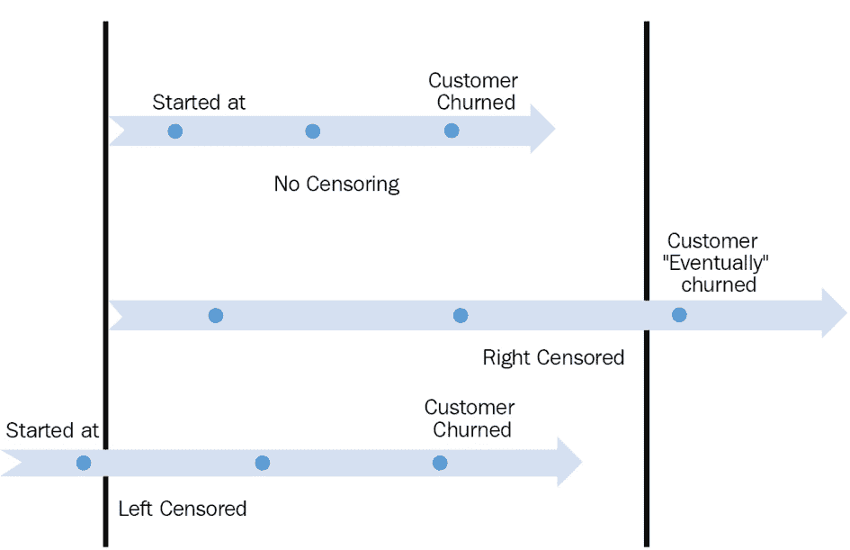


## 我们的客户满意度数据集

在本章中，我们将查看一个由假设客户组成的数据集，这些客户订阅了一项在线服务，并在研究开始前完成了一份客户满意度调查。随后，该调查与事务数据以及人口统计数据相匹配，生成了这个简单的分析数据集。该数据集包含一个事件变量（流失），用于表示客户是否取消了服务订阅。我们还将包括一些事务数据（上月购买次数）、一些人口统计数据（性别、教育程度），以及研究开始前实施的总体满意度调查：

| 变量 | 描述 |
|---|---|
| Monthly.Charges | 以前购买的平均美元金额 |
| Purch.last.Month | 研究开始前一个月的购买次数 |
| Satisfaction | 基于李克特量表的服务总体满意度 |
| Satisfaction2 | 后续满意度评分 |
| Gender | 男性或女性 |
| Education Level | 学士/硕士/博士 |

## 使用概率函数生成数据

与其使用现有数据集，不如我们使用一些内置的采样和概率函数来生成自己的数据。这将是学习如何执行分析的一种宝贵方式，因为它能让您修改自己的数据构成，并观察这如何改变生成的模型。您将看到的一些代码还包含了我们在第 1 章“使用预测分析入门”中讨论过的某些可重复性研究概念。

为确保这些示例能正确运行，请确保 `setwd()` 已设置为计算机上的正确文件夹。以下代码的前几行演示了此函数。除 `setwd()` 之外，您还将在给定的代码示例中看到一些其他函数，这些函数有助于促进可重复性：

- `set.seed()`：始终提供一个常量。这保证任何采样数据都可以在使用相同种子的不同计算机上精确复制。在本示例中，我将使用数字 1 作为种子。
- `dev.copy()`：这会将屏幕上显示的图表复制到 `setwd()` 设置的目录中指定的文件名。这样，您就可以将所有图像保存在适用于您正在进行的项目或子项目的相应目录中。完成 `dev.copy()` 后，使用 `dev.off()` 重置图表。注意：您可能需要指定两次 `dev.off()` 才能完成。
- `clearhistory()`、`savehistory()`：这两个函数之间包含的所有代码都会被复制到 `savehistory()` 中指定的文件名。这样，您就可以保留代码的永久记录，与代码编辑器分开。如果您手动跟踪版本，或将其用于包含在其他文字处理程序中，这很重要。
- 代码标签：您将看到一些以 `#` 开头并以 `====`（四个等号）结尾的代码标签。虽然它们在技术上是注释，但它们也充当标签或书签，用于标识代码的特定部分。例如，我们的第一部分代码将开始使用 `#simulate churn===` 标签，如下图所示：

### 注意

在 RStudio 中，使用源代码窗格底部的上/下箭头跳转到带有定义标签的代码区域。

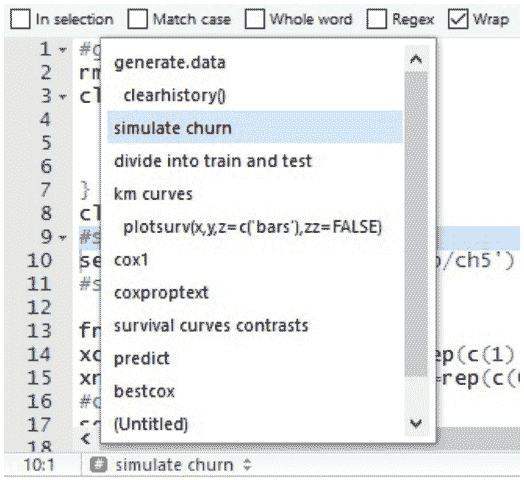

定位下一节中的代码后，选择并运行它。以下是按标记部分划分的代码功能简要概述。对于每个项目，请跳转到指示的代码标签。

### 创建流失和未流失数据框

代码首先模拟响应变量（xchurn）的数据。请记住，该变量只能取两个值：0 和 1。由于我们希望这些组表现不同，我们将分别为每个组（即流失者（xchurn）和在 12 个月期结束时仍保持活跃的人员（xnochurn））单独模拟数据：

```
#simulate churn data===
setwd('C:/PracticalPredictiveAnalytics/Outputs')
frame.size <- 1000
xchurn <- data.frame(Churn=rep(c(1),frame.size))
xnochurn <- data.frame(Churn=rep(c(0),frame.size))
```

### 创建和验证新的模拟变量

本节模拟自变量 Xeducation、Xgender、Xsatisfaction、Xpurch.last.month 和 Xmonthly.charges。代码使用 sample() 函数根据概率向量，为这两个数据框中的每一个生成略有不同的数据。生成的某些数据分布在流失者和非流失者之间只有微小差异（例如教育程度），而其他变量则专门生成，以显示留下的成员和离开的成员之间的差异（tenure2 和上月购买次数）：

```
#create new vars===
### set the seed for reproducibility
set.seed(1)

#set the gender and Education Vectors.
ed.vector <- c("Bachelor's Degree", "Master's Degree", "Doctorate")
gen.vector <- c("M", "F")

#sample from each of the vector elements with the associated prob
xchurn$Xeducation <- sample(ed.vector, nrow(xchurn), replace = TRUE)
xnochurn$Xeducation <- sample(ed.vector, nrow(xnochurn), replace = TRUE)
xchurn$Xgender <- sample(gen.vector, nrow(xchurn), replace = TRUE)
xnochurn$Xgender <- sample(gen.vector, nrow(xnochurn), replace = TRUE)

#do the same for the service vector. 1=not at all satisfied, 5=very
serv.vector <- c("1","2","3","4","5",NA)
#make the churners not very satisfied. Note that the probability

xchurn$Xsatisfaction <- sample(serv.vector, nrow(xchurn), replace = TRUE)
#non churners get an increased probability of a higher satisfaction
xnochurn$Xsatisfaction <- sample(serv.vector, nrow(xnochurn), replace = TRUE)

### simulate incremental increase in satisfaction after the 2nd survey
xchurn$Xsatisfaction2 <- as.integer(xchurn$Xsatisfaction) + 1
#For the 2nd survey, keep the satisfaction level the same for the non-churners
xnochurn$Xsatisfaction2 <- sample(serv.vector, nrow(xnochurn), replace = TRUE)
#simulate a higher increase in calls to customer service for the churners
xchurn$Xservice.calls <- sample(c(0,1,2,3,4,5), nrow(xchurn), replace = TRUE)
xnochurn$Xservice.calls <- sample(c(0,1,2,3,4,5), nrow(xnochurn), replace = TRUE)
#Simulate tenure of 12 months to 1 month. Notice, for example, the
xchurn$Xtenure2 <- sample(c(12:1), nrow(xchurn), replace = TRUE)
xnochurn$Xtenure2 <- sample(c(12:1), nrow(xnochurn), replace = TRUE)
#simulate the number of purchases last month. We do the simulation
xchurn$Xpurch.last.month <- sample(c(rep(10,5),rep(1,150),rep(3,1)), replace = TRUE)
xnochurn$Xpurch.last.month <- sample(c(rep(0,5),rep(1,20),rep(3,1)), replace = TRUE)
#monthly charges are selected via a normal distribution. Churners
xchurn$Xmonthly.charges <- rnorm(nrow(xchurn), mean=215, sd=70)
xnochurn$Xmonthly.charges <- rnorm(nrow(xnochurn), mean=75, sd=50)
#also convert to a list
xchurn.list <- lapply(xchurn, function(x) sample(x, replace=TRUE))
xnochurn.list <- lapply(xnochurn, function(x) sample(x, replace=TRUE))
```

数据生成后，您可以使用一些其他 R 函数来验证数据是否按预期生成。例如，在命令行中，您可以使用 prop.table() 函数来验证百分比是否生成正确：

```
> prop.table(table(xchurn$Xeducation))
```

以下是输出：

| 学士学位 | 博士学位 | 硕士学位 |
|---|---|---|
| 0.802 | 0.053 | 0.145 |

检查以下代码：

```
> prop.table(table(xnochurn$Xeducation))
```

以下是输出：

| 学士学位 | 博士学位 | 硕士学位 |
|---|---|---|
| 0.819 | 0.060 | 0.121 |

这表明流失者的数据是根据 `sample(ed.vector)` 代码行中指定的原始参数正确生成的。两个流失/未流失组之间只有微小差异。

但是请注意，由于这是模拟数据，您可以更改 `sample()` 函数中的 `prob=` 选项，以使其与适用于您所在行业的任何场景相对应。这是可取的，因为它最终会向您表明当假设发生变化时，您的模型有多稳健。如果您愿意，可以通过更改概率向量来尝试一些不同的场景。

例如，如果我们希望通过增加博士学位的出现频率来大幅改变教育程度的组成，我们将再次增加概率向量中第三个槽的概率：

```
Xeducation_PHD <- sample(ed.vector, 1000, replace = TRUE, prob = c
```

然后我们可以通过绘制百分比来查看差异：

```r
par(mfrow=c(1,3))
barplot(table(xchurn$Xeducation), names.arg=c('B.A','Ph.D','Master'))
barplot(table(xnochurn$Xeducation), names.arg=c('B.A','Ph.D','Mast'))
barplot(table(Xeducation_PHD), names.arg=c('B.A','Ph.D','Masters'))
```

以下是输出：

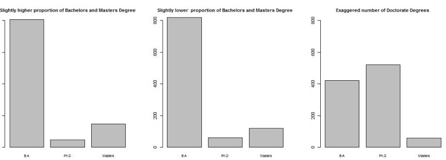

### 重新组合流失者和非流失者


既然我们已经分别为两组模拟了变量，现在将重新组合它们，然后删除一些NA值：

```
### bind them back together ===
d1 <- data.frame(xchurn.list)
d2 <- data.frame(xnochurn.list)
ChurnStudy <- rbind(d1,d2)
ChurnStudy <- na.omit(ChurnStudy)
summary(ChurnStudy)
nrow(ChurnStudy)
savehistory(file="ch5 generate churn data")
```

`str`、`summary`和`nrow`函数将输出到控制台，而`savehistory()`函数将保存运行的所有命令到外部文件：

```
'data.frame': 1984 obs. of 9 variables:
 $ Churn : num 1 1 1 1 1 1 1 1 1 1 ...
 $ xeducation : Factor w/ 3 levels "Bachelor's Degree",...: 1 3 3 1 3 2 1 3 1 3 ...
 $ xgender : Factor w/ 2 levels "F","M": 2 2 1 1 2 2 2 2 2 ...
 $ xatisfaction : chr "3" "4" "2" "4" ...
 $ xatisfaction2 : chr "3" "4" "2" "4" ...
 $ xservice.calls : num 0 0 0 0 1 0 0 0 ...
 $ Xtenure2 : int 12 5 13 2 6 7 6 1 10 ...
 $ xpurch.last.month: int 11 11 13 1 11 3 ...
 $ xmonthly.charges : num 107.91 69.98 74.66 100.68 87.39 ...
 - attr(*, "na.action")=Class 'omit' Named int [1:16] 186 38 98 544 564 676 743 993 996 1207 ...
  ..- attr(*, "names")= chr [1:16] "98" "86" "308" "554" ...
 > summary(xchurn3)
     Churn           xeducation    xgender    xatisfaction    xsatisfaction2   xservice.calls   xtenure2       xpurch.last.month  xmonthly.charges
 Min. :0.0   Bachelor's Degree:1593 F: 4519    1:419       Length:1984        Min. :0.0000   Min. : 1.000   Min. : 0.000   Min. :97.53
 1st Qu.:0.0   Doctorate degree : 122 M:1532     2:448       Class :character   1st Qu.:0.0000   1st Qu.: 7.000   1st Qu.: 1.000   1st Qu.: 67.80
 Median :0.5   Master's Degree : 269            3:1304       Mode :character   Median :0.0000   Median : 9.000   Median : 1.000   Median:131.48
 Mean :0.3                      Mean   : 4.458                  Mean   :0.4718   Mean   : 8.449   Mean   : 1.479   Mean   :127.44
 3rd Qu.:1.0                      4:457                  Median :0.0000   Mean   : 8.449   Median : 1.000   Median :131.48
 Max. :1.0                      3rd Qu.:1.0000   Max. : 10.000   Max. : 381.82
 > nrow(xchurn3)
[1] 1984
 > savehistory(file="ch5 generate churn data")
 > 
```

请注意，summary输出将satisfaction显示为因子，将`satisfaction2`显示为字符变量。本章稍后在讨论后续调查时，我们将更改`satisfaction2`的格式和值。

尝试绘制一些直方图，以显示两组（流失用户和活跃用户）在tenure和上月购买次数方面的差异：

```
par(mfrow=c(2,2))
hist(xchurn$Xtenure2,main="Churners Tenure")
hist(xnochurn$Xtenure2,main="Non-Churners Tenure")
hist(xchurn$Xpurch.last.month, col = "grey", labels = FALSE,main=
hist(xnochurn$Xpurch.last.month, col = "black", labels = FALSE,ma
dev.copy(jpeg,'Ch5 - Plots after dataset creation.jpg'); dev.off()
```

按tenure和上月购买次数比较流失用户和非流失用户：

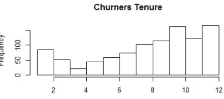

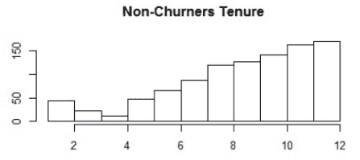

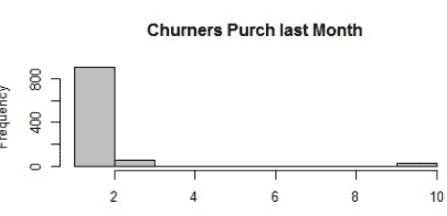

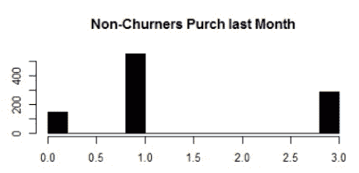

从前面的图表可以看出，流失用户上月购买次数通常低于活跃用户。对于流失用户，1或2个月后似乎存在一些流失活动，但这是一种过早的评估，因为我们不知道客户是在什么时间点加入的。

## 创建矩阵图

如果我们想进一步探索流失用户的tenure，也可以生成一个矩阵图，显示tenure与我们选择的任何其他变量之间的关联。在本示例中，我们将使用`ggpairs()`函数绘制`tenure`、`gender`、`satisfaction`和`monthly charges`的矩阵图：

```
str(xchurn)
install.packages("GGally")
library(GGally)
library(ggplot2)
ggpairs(xchurn,c(3,4,7,8),lower=list(combo=wrap("facethist",binwi
```

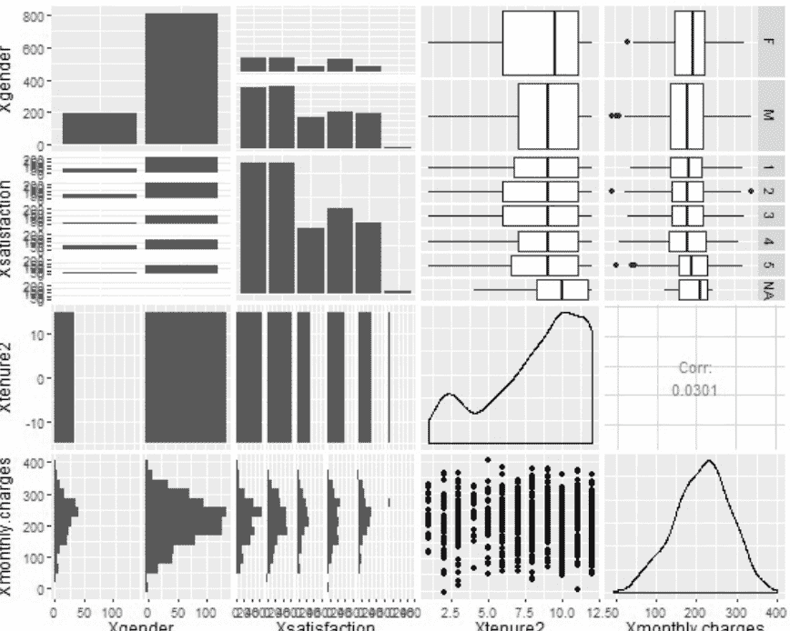

## 划分训练数据和测试数据

接下来，我们将生成测试和训练数据集，以便验证所构建的任何模型。生成测试和训练集的方法有很多种。

在前面的章节中，我们使用了createDataPartition函数。在本示例中，我们将使用本地R函数生成测试和训练数据。请参阅此处的代码大纲，然后运行以下代码：

- 设置一个变量，对应指定为训练数据的数据百分比（TrainingRows）。在本示例中，我们将使用75%。
- 使用sample()函数随机化行，并分配给名为ChurnStudy的新数据框。
- 然后选择前TrainingRows行。由于df数据框已经过采样，从随机样本中按顺序选择一定百分比的行是一种方便且有效的选择训练样本的方法。
- 剩余的行（TrainingRows+1到结束）将是测试数据集。将其分配给ChurnStudy.test。

生成测试和训练验证数据集后，我们将使用stargazer包（我们在第1章“预测分析入门”中使用过）为原始ChurnStudy数据集生成HTML输出，如下所示：

```
#divide into train and test===
TrainingRows <- round(.75 * nrow(ChurnStudy))
TrainingRows
set.seed(1020)
#randomize rows
df <- ChurnStudy[sample(nrow(ChurnStudy)), ]
rows <- nrow(df)
ChurnStudy <- df[1:TrainingRows, ] #training set
ChurnStudy.test <- df[(TrainingRows+1):rows, ] #test set
nrow(ChurnStudy)
nrow(ChurnStudy.test)
```

```
str(ChurnStudy)
str(ChurnStudy.test)
library(stargazer)
stargazer(ChurnStudy[1:10,1:9], out = c("ch 5 AnalysisDataFrame.html"))
browseURL("ch 5 AnalysisDataFrame.html")
savehistory(file="ch5 generate test and train")
```

| Churn | Xeducation | Xgender | Xsatisfaction | Xsatisfaction2 | Xservice.calls | Xtenure2 | Xpurch.last.month | Xmonthly.charges | SurvObj |
|---|---|---|---|---|---|---|---|---|---|
| 1 | 学士学位 | F | 1 | 5 | 0 | 7 | 1 | 295.502908 | 7 |
| 1 | 学士学位 | F | 3 | 5 | 0 | 9 | 1 | 215.769268 | 9 |
| 1 | 学士学位 | M | 4 | 5 | 0 | 6 | 1 | 230.142292 | 6 |
| 0 | 学士学位 | M | 3 | 2 | 4 | 11 | 1 | 84.775160 | 11+ |
| 1 | 学士学位 | F | 4 | 3 | 1 | 11 | 1 | 167.735122 | 11 |
| 0 | 学士学位 | M | 3 | 1 | 0 | 1 | 0 | 174.883747 | 1+ |
| 1 | 学士学位 | M | 1 | 5 | 0 | 4 | 1 | 154.264568 | 4 |
| 1 | 博士学位 | M | 4 | 3 | 0 | 12 | 1 | 212.801643 | 12 |
| 1 | 学士学位 | M | 4 | 2 | 0 | 12 | 1 | 291.822605 | 12 |
| 1 | 学士学位 | M | 4 | 2 | 1 | 3 | 10 | 318.343811 | 3 |
| 0 | 学士学位 | M | 2 | 4 | 0 | 12 | 3 | 71.934505 | 12+ |

## 通过创建生存对象来设置阶段

在R中编写生存分析代码通常从使用`Surv()`函数创建所谓的生存对象开始。`survival`对象包含比常规数据框更多的信息。`survival`对象的目的是跟踪每个观察的时间和事件状态（0或1）。它还用于指定什么是响应（因变量）。

至少，在定义`survival`对象时，需要提供一个时间变量和一个事件。在本例中，我们将使用tenure时间（`Xtenure2`）作为时间变量，以及指定定义事件的公式。在本例中，这将是`Churn == 1`，因为这意味着客户在该月流失：

```
install.packages("survival")
library(survival)
ChurnStudy$SurvObj <- with(ChurnStudy, Surv(Xtenure2, Churn == 1))
```

如前几章所述，我在创建新数据框后总是喜欢发出`str()`命令，以确保结果符合预期：

```
> str(ChurnStudy$SurvObj)
Surv [1:1488, 1:2] 7 9 6 11+ 11 1+ 4 12 12 3 ...
 - attr(*, "dimnames")=List of 2
  ..$ : NULL
  ..$ : chr [1:2] "time" "status"
 - attr(*, "type")= chr "right"
```

从前面的输出可以看出，创建的`survival`对象包含1488行，列名为time和status。请注意，月份数后面的`+`符号表示成员在研究期结束时被删失，即订阅者保持活跃且未流失。`attr(*, "type")`行显示模型正在采用右删失。

一旦创建了`survival`对象，我们就可以进行一些初步的


对其进行操作。在控制台中键入以下命令以查看前几个元素：

```
> head(ChurnStudy$SurvObj)
[1] 7 9 6 11+ 11 1+
```

您还可以将生存对象视为矩阵并显示数据子集。此处将显示前 10 个观测值：

```
> ChurnStudy$SurvObj[1:10,1:2]
 time status
[1,] 7 1
[2,] 9 1
[3,] 6 1
[4,] 11 0
[5,] 11 1
[6,] 1 0
[7,] 4 1
[8,] 12 1
[9,] 12 1
[10,] 3 1
```

您还可以按时间和事件对数据进行列联。可以看出，在研究期结束时，约 50% 的成员已流失：

```
> table(ChurnStudy$SurvObj[,1],ChurnStudy$SurvObj[,2])
    0   1
1 18 15
2 10 52
3 17 34
4 7 20
5 31 39
6 47 42
7 76 60
8 102 68
9 96 89
10 115 115
11 105 105
12 113 112
```

如果您更喜欢使用列名而不是列号，请先尝试将生存对象转换为数据框。这将产生与这里相同的结果，但允许使用列名而不是索引。这是引用大量列的更便捷方式：

```
Surv.df <- data.frame(ChurnStudy$SurvObj[,1:2])
table(Surv.df$time,Surv.df$status)
```

让我们尝试一下摘要。summary 函数显示平均任期约为 8.5 个月：

```
> summary(ChurnStudy$SurvObj)
time           status
Min.   : 1.000   Min.   :0.000
1st Qu.: 7.000   1st Qu.:0.000
Median : 9.000   Median :0.000
Mean   : 8.474   Mean   :0.495
3rd Qu.:11.000   3rd Qu.:1.000
Max.   :12.000   Max.   :1.000
```

创建 `survival` 对象时，我们将其作为原始 `ChurnStudy` 数据框的一部分创建。要查看附加了 `survival` 数据的完整数据框，请使用 `View(ChurnStudy)` 命令。

请注意，`SurvObj` 时间对应 `Xtenure2` 时间。但是，数字后面的 `+` 标记表示客户在研究期结束时仍然活跃。

## 检查生存曲线

Kaplan-Meier 生存曲线通常是考察不同单因素对生存率影响的一个很好的起点，因为它们易于构建和可视化。稍后，我们将考察 Cox 回归，它可以考察多个因素。

**Kaplan-Meier (KM) 曲线实际上是阶梯函数，在每个离散时间点上估计** `survival` **对象（或风险率）。该生存率通过计算已存活（仍然活跃）的客户数除以有风险的客户数来计算。有风险的客户数（即分母）排除了所有已经流失或在任何特定时间点未达到指定任期的客户。**

为了说明，如果我们按活跃月数（`Xtenure2`）对 `ChurnStudy` 进行列联，可以看到第 1 个月有 44 名成员，其生存率计算为 (1984 - 19)（第 1 个月结束后剩余的数量 / 1984）：

```
table(ChurnStudy$Xtenure2, ChurnStudy$Churn)
    0   1
1   25  19
2   12  69
3   24  45
4    9  29
5   50  50
6   63  61
7  100  73
8  124  98
9  132 114
10 150 159
11 144 129
12 159 146
```

构建 KM 曲线需要三个要素：

- 一个序列时间，即从研究开始起的时间间隔（月、天、年）。就客户留存而言，这意味着如果研究开始时间是一个月前，那么与公司合作五年的订阅者与一个月前加入的人受到同等对待。之前的五年被视为删失信息。
- 一个事件标志，通常为 0 或 1，用于指示该时间段内是否发生了事件。客户将有与研究中每个月对应的多个事件标志。
- 一个分类或分组变量。这通常是一个单一变量。

然后通过使用 `survfit()` 函数生成 KM 生存曲线，该函数包含在 survival 包中。

我们可以先考察整个数据集的生存曲线，不进行分组。在此情况下，我们使用一元运算符（即公式表示法中的 1）来指定整个数据集为单一组：

```
km <- survfit(SurvObj ~ 1, data = ChurnStudy, conf.type = "log-log")
plot(km,col='red')
title(main = "Survival Curve Baseline")
dev.copy(jpeg,'Ch5 - Survival Plot Baseline.jpeg'); dev.off()
```

曲线显示所有成员在研究开始时均处于活跃状态。随着成员离开，图表值单调递减。可以看到，每个估计值的方差（估计值上下出现的虚线）随时间延长而显著增大。这是因为随着客户数量减少，样本量变小，估计值的准确性也随之降低。对于基准估计，可以看到在 6 个月时，（理论）估计显示约 86% 的客户仍然留存：

## 生存曲线基准

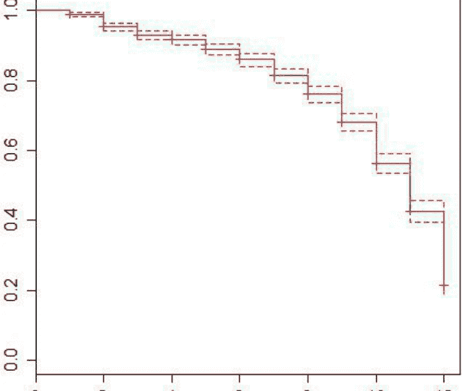

图表非常适合直观地观察主要流失发生的位置，但您还需要查看底层数据。

首先，看看 `summary(km)` 如何描述 `survival` 对象。输出与 `summary` 对象通常描述普通 R 数据框的方式略有不同：

- 输出首先会列出用于生成 km 生存对象的函数调用：

```
> summary(km)
Call: survfit(formula = SurvObj ~ 1, data = ChurnStudy, conf.type = "log-log")
```

- 接下来，输出列出了绘制的数据点，以及该点的生存概率和 95% 置信区间：

| 时间 | 有风险数 | 事件数 | 生存率 | 标准误 | 95% 置信区间下限 | 95% 置信区间上限 |
|---|---|---|---|---|---|---|
| 1 | 1488 | 15 | 0.990 | 0.00259 | 0.983 | 0.994 |
| 2 | 1455 | 52 | 0.955 | 0.00543 | 0.943 | 0.964 |
| 3 | 1393 | 34 | 0.931 | 0.00660 | 0.917 | 0.943 |
| 4 | 1342 | 20 | 0.917 | 0.00720 | 0.902 | 0.930 |
| 5 | 1315 | 39 | 0.890 | 0.00820 | 0.873 | 0.905 |
| 6 | 1245 | 42 | 0.860 | 0.00914 | 0.841 | 0.877 |
| 7 | 1156 | 60 | 0.815 | 0.01032 | 0.794 | 0.835 |
| 8 | 1020 | 68 | 0.761 | 0.01155 | 0.738 | 0.783 |
| 9 | 850 | 89 | 0.681 | 0.01307 | 0.655 | 0.706 |
| 10 | 665 | 115 | 0.564 | 0.01472 | 0.534 | 0.592 |
| 11 | 435 | 105 | 0.428 | 0.01608 | 0.396 | 0.459 |
| 12 | 225 | 112 | 0.215 | 0.01638 | 0.184 | 0.248 |

通过查看生存百分比可以看出，生存率是累积且单调递减的。这意味着每个后续时间间隔的生存概率都低于上一期间。

您还可以计算在客户已留存的情况下，特定月份的生存率。例如，第 12 个月的生存率将为 48%（146 名流失客户 / 305 名面临流失风险的客户）

## 更好的图表

还有一个函数可供使用，它提供的图形更好，比通用 plot 函数更具可定制性。它是 `rms` 库中包含的 `survplot()` 函数。由于我们想以不同参数以几种不同的方式演示此函数，我们将几个原生函数封装到一个名为 `Plotsurv()` 的新函数中，这将允许我们自定义一些图表。

首先，定义该函数：

```
library (rms)
plotsurv <- function(x,y,z=c ('bars'),zz=FALSE) {
objNpsurv <- npsurv(formula = Surv(Xtenure2,Churn ==1) ~ x, dat
class (objNpsurv)
survplot(objNpsurv,col=c('green','red','blue','yellow','orange'),label.curves=list(keys=y),xlab='Months',conf=z,conf.int)
mtext(date(),side=3,line=0,adj=1,cex=.5)
}
```

我们将再次调用基准图，但这次将包含有风险的成员数，这些数字可以在水平时间轴顶部找到。您可以验证这些数字与先前运行的 summary(km) 函数一致。这些数字对应于在指定时间段结束时仍然活跃的订阅者数量。置信区间也已被每个标记点处的短误差栏所取代：

```
#baseline plot again
par (mfrow=c(1,1))
ChurnStudy$Unity <- 1
plotsurv(ChurnStudy$Unity,c(1),c('bars'),TRUE)
title(main = "1 KM Curve with Bands and number at risk")
dev.copy(jpeg,'Ch5 - baseline again.jpg');
dev.off()
```

现在生成了一个更简单的图表，它包含更多数据且更易于观看：


## 对比生存曲线

单独的基线生存曲线很有用，但最有意义的分析来自查看不同群体细分所生成的不同曲线。这样，你可以看到哪里可能需要干预。要为性别生成此曲线，我们将再次使用 survfit() 函数，并在 ~ 运算符的右侧指定 XGender。此代码将为男性和女性提供单独的生存曲线：

```
km.gender <- survfit(SurvObj ~ Xgender, data = ChurnStudy, conf.t
km.gender
plot(km.gender,col=c('red','blue') ,lty=1:2)
legend('left', col=c('red','blue') ,c('F', 'M'), lty=1:2)
title(main = "Survival Curves by Gender")
dev.copy(jpeg,'Ch5 - Survival Plot by Gender.jpg'); dev.off()
```

此处绘制的两条曲线表明，女性在所有时间段内更有可能被留住，并表明有用的营销激励措施可以早期针对男性：

## 按性别划分的生存曲线

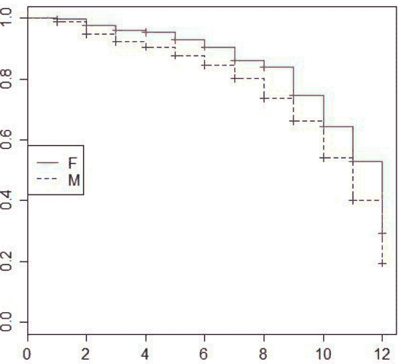

## 检验生存曲线之间的性别差异

检查生存曲线后，很明显女性在每个时间段都比男性存活时间更长。然而，我们仅根据目视检查来判断。通常，结果并不那么明显。即使很明显，构建统计假设检验也是良好的统计实践。我们将使用 log-rank 检验，该检验在 R 中使用 `survdiff()` 函数实现。

函数输出将打印与检验相关的卡方统计量，这将显示两条曲线之间任何显著差异，以及相关的 p 值。

对于性别，在 .01 水平上存在显著差异，如低 p 值所示，该值远小于此截止值：

```
> survdiff(SurvObj ~ Xgender, data = ChurnStudy)
Call:
survdiff(formula = SurvObj ~ Xgender, data = ChurnStudy)
```

| | N | 观察值 | 期望值 | (O-E)^2/E | (O-E)^2/V |
|---|---|---|---|---|---|
| Xgender=F | 341 | 137 | 177 | 9.24 | 14.5 |
| Xgender=M | 1147 | 614 | 574 | 2.86 | 14.5 |

Chisq= 14.5，自由度为 1，p= 0.000143

## 检验生存曲线之间的教育差异

现在为教育差异运行 survdiff 函数：

```
> survdiff(SurvObj ~ Xeducation, data = ChurnStudy)
Call:
survdiff(formula = SurvObj ~ Xeducation, data = ChurnStudy)
```

| | N | 观察值 | 期望值 | (O-E)^2/E | (O-E)^2/V |
|---|---|---|---|---|---|
| Xeducation=Bachelor's Degree | 1186 | 592 | 594.8 | 0.01291 | 0 |
| Xeducation=Doctorate Degree | 88 | 45 | 45.4 | 0.00301 | 0 |
| Xeducation=Master's Degree | 214 | 114 | 110.9 | 0.08896 | 0 |

Chisq= 0.1，自由度为 2，p= 0.94

现在查看 p 值。卡方检验的 p 值为 0.94。这意味着我们无法得出教育生存曲线存在显著差异的结论。

这也建议更仔细地查看以下图表。我们可以看到，通常，三个教育水平在点估计的一个标准差内聚集。置信区间内重叠的数据点表明，均值之间没有足够的分离以达到显著性：

```
#
plotsurv(ChurnStudy$Xeducation,c(1:3),c('bars'))
title(main = "3 KM Curve Education")
dev.copy(jpeg,'Ch5 - 3 KM Curve Education.jpg'); dev.off()
```

时间 12（研究结束）是说明这一点的完美示例。三个置信区间涵盖了三个教育水平的大量生存概率，因此难以分辨任何差异。作为后续步骤，将硕士和博士学位合并为高级学位类别，然后测量两个类别而不是三个类别之间的差异是有意义的：

## 3 条 KM 曲线 - 教育

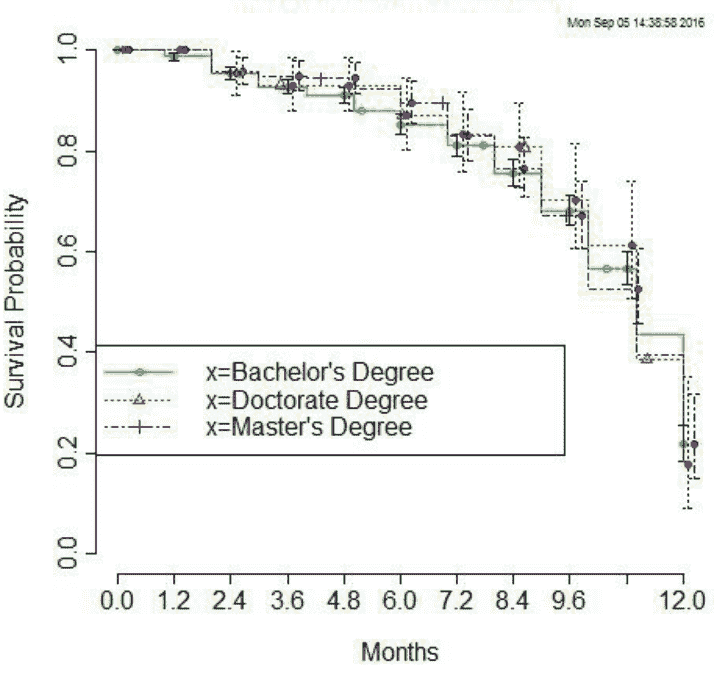

## 绘制客户满意度和服务呼叫次数曲线

我们还将生成另外两条曲线，分别对应满意度和服务呼叫次数变量：

```
par(mfrow=c(1,1))
plotsurv(ChurnStudy$Xsatisfaction,c(1:5),c('bars'))
title(main = "2 KM Curve Satisfaction")
dev.copy(jpeg,'Ch5 - 2 KM Curve Satisfaction.jpg'); dev.off()
plotsurv(as.factor(ChurnStudy$Xservice.calls),c(1:6),c('none'))
dev.copy(jpeg,'Ch5 - 4 KM Curve Service Calls.jpg');
title(main = "4 KM Curve Service Calls")

dev.off()
```

这些曲线图被发送到输出窗口，并复制到前面代码中指定的文件：

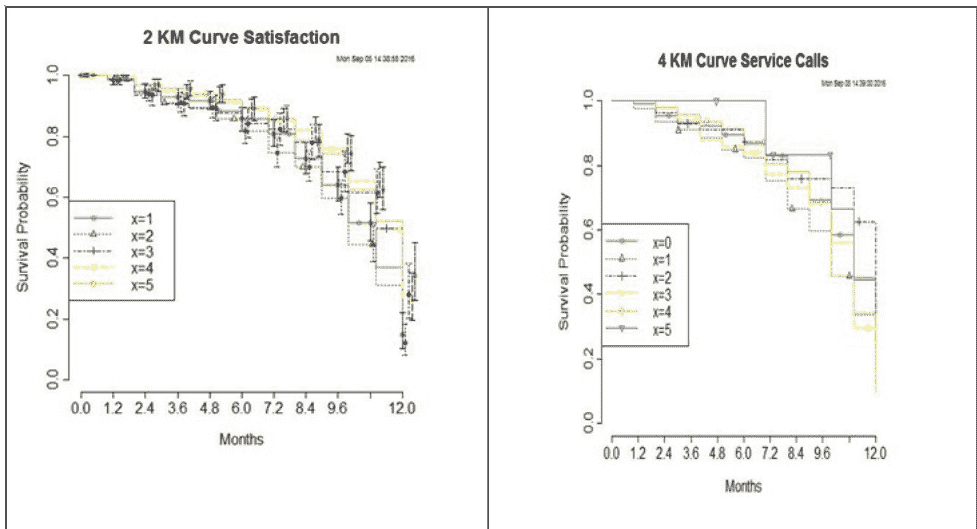

## 用户练习：

绘制前面的生存曲线，并使用 survdiff() 运行 log-rank 检验，以查看是否存在显著差异。

```
survdiff(SurvObj ~ Xsatisfaction, data = ChurnStudy)
survdiff(SurvObj ~ Xpurch.last.month, data = ChurnStudy)
survdiff(SurvObj ~ Xservice.calls, data = ChurnStudy)
```

## 通过添加性别改进教育生存曲线

正如我们所见，我们无法得出教育水平之间存在显著差异的结论。通常，在添加其他协变量时，分析交互作用效果可以揭示显著性。如果我们有兴趣查看教育水平的差异是否取决于性别，我们可以创建一个新变量，其中包含每个教育和性别组合的虚拟变量：

- 我们将首先使用 interaction() 函数创建此新变量 (factorC)。然后，我们将使用新的 plotsurv() 函数，根据教育和性别的所有交互作用绘制曲线。
- 接下来，我们将使用 survdiff() 函数来检验这些效应的显著性：

```
#create a new factor with interaction between education and gender
#first check the number of satisfaction levels
#
levels(ChurnStudy$Xsatisfaction)
#
#create and store it in the data frame
#
ChurnStudy$factorC <- with(ChurnStudy,   interaction(Xeducation, Xgender))
#
```

现在为每个教育水平（三个级别）和性别（两个级别）绘制生存曲线。总共将有六个图。然而，并非所有组合都能存活到第 12 个月，因为最后只有五个级别：

```
plotsurv(ChurnStudy$factorC,c(1:6),c('none'))
title(main = "4 KM Curve Gender*Education")
#
dev.copy(jpeg,'Ch5 - 4 KM Curve Gender Education.jpg');
dev.off()
```

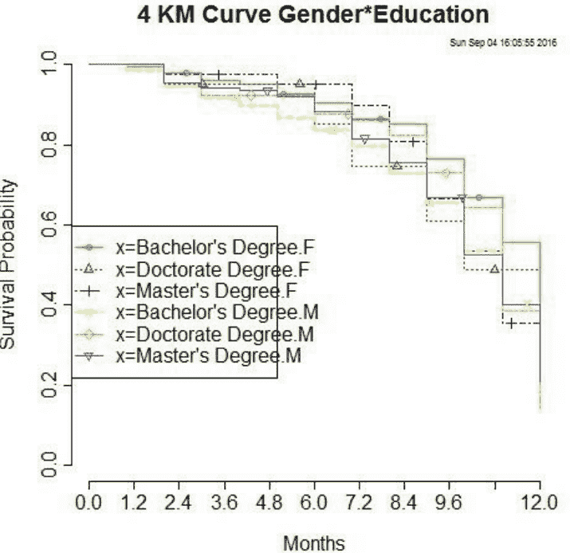

调用 survdiff() 函数以查看曲线之间是否存在显著差异。survdiff() 函数的输出如下所示：

```
options(scipen=3)
survdiff(SurvObj ~ ChurnStudy$factorC, data = ChurnStudy)
#
#
> survdiff(SurvObj ~ ChurnStudy$factorC, data = ChurnStudy)
Call:
survdiff(formula = SurvObj ~ ChurnStudy$factorC, data = ChurnStudy)
```

| 类别 | N | 观察值 | 期望值 | (O-E)^2/E |
|---|---|---|---|---|
| ChurnStudy$factorC=Bachelor's Degree.F | 279 | 111 | 150.49 | 10.3 |
| ChurnStudy$factorC=Doctorate Degree.F | 22 | 8 | 8.21 | 0.0 |
| ChurnStudy$factorC=Master's Degree.F | 40 | 18 | 18.81 | 0.0 |
| ChurnStudy$factorC=Bachelor's Degree.M | 907 | 481 | 444.28 | 3.0 |
| ChurnStudy$factorC=Doctorate Degree.M | 66 | 37 | 37.16 | 0.0 |
| ChurnStudy$factorC=Master's Degree.M | 174 | 96 | 92.05 | 0.1 |

Chisq= 16.3，自由度为 5，p= 0.00597

卡方检验综合考察所有组别，如果任何一组与其他组有显著差异，将显示出显著性。要查看哪个特定组别表现不同，你需要检查观察值和期望值列，以及最后两列中的平方误差项。较高的值表示与期望值的偏离。检查输出后，我们发现有两个效应似乎是显著组别：

- 拥有学士学位的女性。我们预期 150 名流失客户，但观察到 111 名。这是一个相对流失率较低的群体。
- 拥有博士学位的男性。观察到的生存率高于预期值。

此前，我们看到仅凭大学学位本身并没有太大区别。但加入性别因素可以识别出可针对性开展营销的特定群体。

保存历史记录：

```
savehistory(file="ch5 interaction plot km curves.log")
```

## 将服务呼叫次数转换为二元变量

级别较多的变量通常难以管理，即使曲线中可能显示出统计学上的显著差异。这可能是由于组别规模较小所致。与其试图一次性分析所有组别，不如先寻找一个切断点，将变量合并为二元结果，这样通常更有意义。

例如，对服务呼叫次数（范围为 0 到 5）运行 survdiff() 函数，显示单个生存曲线之间存在显著差异：

```
> survdiff(SurvObj ~ Xservice.calls, data = ChurnStudy)
```


调用：
survdiff(formula = SurvObj ~ Xservice.calls, data = ChurnStudy)

  N Observed Expected (O-E)^2/E (O-E)^2/V
Xservice.calls=0 1103 507 542.87 2.371 10.322
Xservice.calls=1 222 154 116.77 11.873 16.992
Xservice.calls=2 58 23 32.72 2.888 3.711
Xservice.calls=3 51 33 28.43 0.734 0.923
Xservice.calls=4 47 31 25.95 0.985 1.215
Xservice.calls=5 7 3 4.26 0.373 0.448

卡方 = 23.3，自由度 = 5，p = 0.000301

最后两列给出卡方值，可以看到，大多数较高的值对应较少的服务呼叫次数。Xservice.calls 1 和 2 之间似乎存在一个断点。因此，我们可以将其视为自然断点。

或者，我们可以制定一个假设，即低服务呼叫和高服务呼叫之间存在差异；我们可以创建一个新的二元变量，仅用于指示是否有任何服务呼叫。

然后我们可以绘制结果，并再次使用 log-rank 检验来检验差异：

```
ChurnStudy$called.binary <- as.factor(ifelse(ChurnStudy$Xservice.calls=
survdiff(SurvObj ~ ChurnStudy$called.binary, data = ChurnStudy)
plotsurv(ChurnStudy$called.binary,c(1:2),c('none'))
title(main = "5 KM Curve Called")
dev.copy(jpeg,'Ch5 - 5 KM Curve Called.jpg'); dev.off()

survdiff(SurvObj ~ ChurnStudy$called.binary, data = ChurnStudy)
```

此处指定的 plotsurv 调用生成以下图表：

## 5 KM 曲线：已呼叫

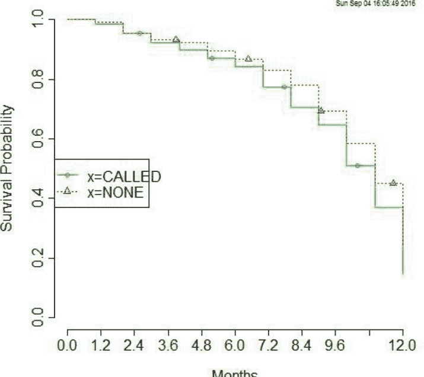

## 检验呼叫客户与未呼叫客户之间的差异

调用 survdiff() 函数生成卡方检验：

```
> survdiff(SurvObj ~ ChurnStudy$called.binary, data = ChurnStudy)
Call:
survdiff(formula = SurvObj ~ ChurnStudy$called.binary, data = ChurnStudy)

                    N Observed Expected (O-E)^2/E (O-E)^2/V
ChurnStudy$called.binary=CALLED   385    244     208     6.18
ChurnStudy$called.binary=NONE    1103    507     543     2.37

Chisq= 10.3  on 1 degrees of freedom, p= 0.00131
```

这显示了客户是否呼叫之间存在明显的断点，并表明客户呼叫可能需要干预计划，以便解决任何潜在的流失问题。

## Cox 回归建模

KM 检验在许多情况下都可以令人满意，尤其是在初步分析期间；然而，KM 检验是非参数的，通常不如参数等价方法功效强大。Cox 回归将生存分析扩展到参数回归类型框架下，从而假设更大的功效。如果有几个自变量需要纳入模型，并且其中一些是连续的，那么执行 Cox 比例风险建模比 KM 更有优势。

### 我们的第一个模型

Cox 建模也始于创建生存对象，就像我们在之前的示例中所做的那样。除此之外，Cox 模型与标准回归模型非常相似，响应变量指定在 ~ 的左侧，自变量指定在右侧。

在 Cox 回归建模中，我们使用 coxph() 函数而不是 surv() 函数来指定因变量。可以直接在公式中完成，也可以将其分配给新变量并将新变量指定在 ~ 的左侧。

请回顾，在定义我们最初的生存对象时，我们将 Xtenure2 定义为时间变量，将 Churn 定义为感兴趣的结局。在我们的示例中，我们将指定 coxph(Surv(Xtenure2, Churn) 作为预测模型的左侧。

继续进行本练习的下一部分，运行以下代码，该代码将运行一个 Cox 回归模型，使用教育、性别、客户满意度、服务呼叫次数、月费和上月购买次数作为自变量来预测流失：

```
clearhistory()
#start CoxModel.1====
rm(CoxModel.1)
```

```
ChurnStudy$SurvObj <- with(ChurnStudy, Surv(Xtenure2, Churn == 1))
CoxModel.1 <- coxph(Surv(Xtenure2, Churn) ~
    Xeducation + Xgender + Xsatisfaction + Xservice.calls +
    Xpurch.last.month + Xmonthly.charges,
    data=ChurnStudy)
```

要查看结果，我们将使用 stargazer 库：

```
library(stargazer)
stargazer(CoxModel.1,single.row=TRUE,multicolumn=TRUE,font.size='
no.space = TRUE,column.separate = c(1,2,3),
out=c("CoxModel.html"),type='html')
browseURL("CoxModel.html")
```

browseURL 命令将在浏览器中显示从 stargazer 写入的输出：

| 因变量： | |
|---|---|
| | Xtenure2 |
| XeducationDoctorate Degree | -0.007 (0.157) |
| XeducationMaster's Degree | -0.041 (0.103) |
| XgenderM | 0.281*** (0.095) |
| Xsatisfaction2 | -0.003 (0.101) |
| Xsatisfaction3 | -0.231* (0.124) |
| Xsatisfaction4 | -0.250** (0.111) |
| Xsatisfaction5 | -0.188 (0.125) |
| Xservice.calls | 0.030 (0.034) |
| Xpurch.last.month | -0.016 (0.024) |
| Xmonthly.charges | 0.008*** (0.0004) |
| Observations | 1,488 |
| R² | 0.298 |
| Max. Possible R² | 0.999 |
| Log Likelihood | -4,611.885 |
| Wald Test | 494.750*** (df = 10) |
| LR Test | 526.196*** (df = 10) |
| Score (Logrank) Test | 551.558*** (df = 10) |
| 注： | * p<0.1; ** p<0.05; *** p<0.01 |

或者，你可以运行 `summary(CoxModel.1)` 命令在控制台中打印更详细的版本：

```
> summary(CoxModel.1)
Call:
coxph(formula = Surv(Xtenure2, Churn) ~ Xeducation + Xgender +
              Xsatisfaction + Xservice.calls + Xpurch.last.month + Xmonthly.charges,
          data = ChurnStudy)

n= 1488, number of events= 751

             coef exp(coef) se(coef)
XeducationDoctorate Degree -0.0067422  0.9932804 0.1568365 -0.04
XeducationMaster's Degree -0.0411774  0.9596589 0.1031115 -0.39
XgenderM                   0.2809885  1.3244384 0.0954112  2.94
Xsatisfaction2            -0.0031029  0.9969019 0.1010203 -0.03
Xsatisfaction3            -0.2305492  0.7940974 0.1240880 -1.85
Xsatisfaction4            -0.2503191  0.7785523 0.1105464 -2.26
Xsatisfaction5            -0.1879801  0.8286312 0.1247098 -1.50
Xservice.calls             0.0303329  1.0307976 0.0336934  0.90
Xpurch.last.month         -0.0160869  0.9840418 0.0243041 -0.66
Xmonthly.charges           0.0082750  1.0083093 0.0003928 21.06
---
Signif. codes:  0 '***' 0.001 '**' 0.01 '*' 0.05 '.' 0.1 ' ' 1
```

### 检查 Cox 回归输出

由于我们本质上是在运行一个改进的逻辑回归，Cox 模型中的系数始终以对数形式表示。要将其转换为似然比，需要取指数。这也是摘要输出的一部分。

首先，查看列在 `exp(coef)` 列下的指数化系数的值。任何显著大于 1 的系数表明客户更有可能流失而非不流失。另一方面，`exp(coef)` < 1 表明该变量流失的可能性较低。与 1 的差异幅度将指示某一方向的更高概率。

模型结果表明，`gender (males)`、`satisfaction` 和 `monthly charges` 是显著变量。

男性以及月费较高的客户流失倾向更高，这由其高于 1 且 p 值较低的可能性得分所表明。

满意度得分为 4 的客户流失倾向较低，这由低于 1 且 p 值较低的可能性得分所表明。尽管满意度得分为 5 的客户未被发现显著，但将其也纳入是有意义的，因为他们的系数表明他们可能会留下，并且他们的 p 值相当低（但在 .05 水平上不显著）。单独提取这些客户并查看是否有其他因素导致其中一些人流失也会很有趣。我们指出模型中可能需要交互项。

### 比例风险检验

运行 Cox 回归后，需要进行一些后续检验。Cox 回归需要检验的一个假设是，事件的风险仅取决于变量，而不取决于时间。如果是这样，时间就不能被视为自变量。因此，我们需要检验所谓的比例风险。这可以使用 cox.zph 函数来完成。

运行以下代码部分，该代码列在标签 #coxproptext=== 下：

它将执行以下操作：
- 将比例风险检验的输出分配给 `temp` 对象
- 将检验结果打印到控制台
- 遍历 `temp` 对象中包含的所有模型变量并绘制比例风险：

```
#coxproptext===
#test for proportional hazards
temp <- cox.zph(CoxModel.1, transform = 'log')
print(temp)
par(mfrow=c(2,5))
for (i in 1:10) {
plot(temp[i])
}
```


```
}
dev.copy(jpeg,'Ch5 - Coxmodel1 zph.jpg');
dev.off()
savehistory (file="Ch5 CoxModel zph.txt")
```

### 首先，查看 `print(temp)` 命令的输出：

```
> print(temp)
```

| 变量 | rho | chisq | p |
|---|---|---|---|
| Xeducation博士学位 | 0.02283 | 0.40067 | 0.5267 |
| Xeducation硕士学位 | 0.06161 | 2.88733 | 0.0893 |
| Xgender男性 | -0.05593 | 2.36508 | 0.1241 |
| Xsatisfaction2 | -0.01517 | 0.17429 | 0.6763 |
| Xsatisfaction3 | -0.06778 | 3.47926 | 0.0621 |
| Xsatisfaction4 | 0.01274 | 0.12252 | 0.7263 |
| Xsatisfaction5 | -0.00120 | 0.00111 | 0.9735 |
| Xservice.calls | 0.02364 | 0.41897 | 0.5175 |
| Xpurch.last.month | 0.00987 | 0.10354 | 0.7476 |
| Xmonthly.charges | 0.01265 | 0.07633 | 0.7823 |
| GLOBAL | NA | 11.43649 | 0.3245 |

对于打印输出，您会注意到卡方检验值（第4列）及其关联的p值（第5列），它们用于检验每个回归协变量是否随时间变化的假设。为了使模型通过该假设，您希望看到较高的p值，且所有p值均高于关键显著性水平。在此例中，它们均高于 p=.05，因此所有变量均通过比例风险假设的检验。

### 比例风险图

生成的图表还显示，随着时间增加，所有变量都呈均匀分散状态。任何因时间引起的变化都会由一条明显向上或向下倾斜的直线指示：

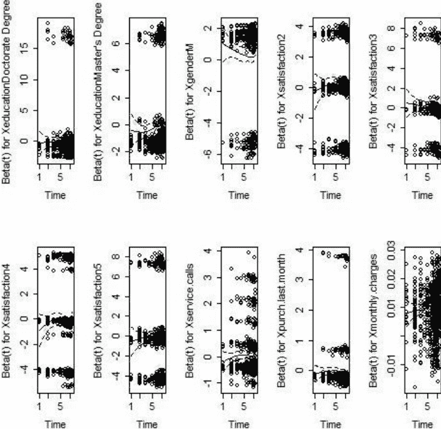

### 获取Cox生存曲线

我们可以以与KM模型类似的方式获取Cox模型的生存曲线。要获取曲线的数据点，请使用 `summary(survfit(CoxModel.1))`，它还将显示置信区间、流失成员数 `churned (n.event)`，以及处于风险中的成员数 `(n.risk)`：

```
> summary(survfit(CoxModel.1))
Call: survfit(formula = CoxModel.1)
```

| 时间 | n.risk | n.event | 生存率 | 标准误 | 95%置信区间下限 | 95%置信区间上限 |
|---|---|---|---|---|---|---|
| 1 | 1488 | 15 | 0.993 | 0.00185 | 0.989 | 0.996 |
| 2 | 1455 | 52 | 0.967 | 0.00404 | 0.960 | 0.975 |
| 3 | 1393 | 34 | 0.950 | 0.00505 | 0.940 | 0.960 |
| 4 | 1342 | 20 | 0.940 | 0.00559 | 0.929 | 0.951 |
| 5 | 1315 | 39 | 0.919 | 0.00655 | 0.906 | 0.932 |
| 6 | 1245 | 42 | 0.896 | 0.00752 | 0.881 | 0.911 |
| 7 | 1156 | 60 | 0.861 | 0.00884 | 0.844 | 0.879 |
| 8 | 1020 | 68 | 0.818 | 0.01033 | 0.798 | 0.838 |
| 9 | 850 | 89 | 0.754 | 0.01233 | 0.731 | 0.779 |
| 10 | 665 | 115 | 0.657 | 0.01500 | 0.628 | 0.687 |
| 11 | 435 | 105 | 0.536 | 0.01789 | 0.502 | 0.572 |
| 12 | 225 | 112 | 0.278 | 0.02226 | 0.237 | 0.325 |

### 绘制曲线

可以使用通用绘图函数绘制曲线：

```
plot(survfit(CoxModel.1),col=c('red','blue') ,lty=1,xlab="Months"
title(main = "Model Survival Curve")
dev.copy(jpeg,'Ch5 - Coxmodel1 plot.jpg'); dev.off()
```

也可以使用ggplot和ggfortify绘制更美观的曲线版本：

```
library(ggplot2)
library(ggfortify)

autoplot(survfit(CoxModel.1), surv.linetype = 'dashed', surv.colo
conf.int.fill = 'dodgerblue3', conf.int.alpha = 0.5, cen
```

下面是原生绘图函数（左图）和autoplot函数（右图）生成的曲线并排比较。主要区别在于阴影带替换了置信区间虚线：

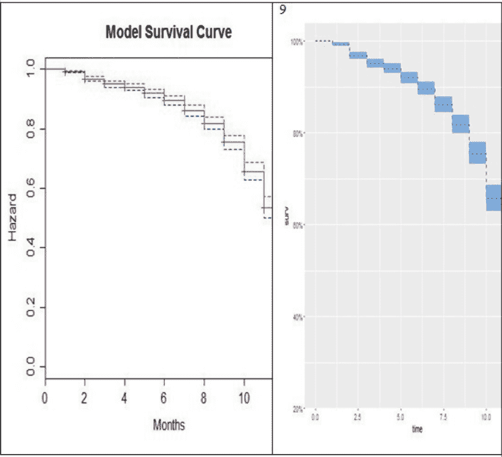

### 偏回归图

偏回归图在回归分析中很有用，可用于观察单个变量不受其他变量影响的效应。使用 `termplot()` 函数分别查看模型中的变量。termplot曲线大致对应回归线的斜率，因此您可以直观地观察每个变量在水平或连续值变化时的效应。

对于刚刚运行的回归，男性、满意度等级3和4以及月费均在回归输出中标记为显著，因此我们可以通过查看图表来观察它们各自的斜率。

以下代码将遍历模型中的所有变量并生成以下图表。第六项（月费）是一个连续变量，带有标准误差棒生成。请注意，随着月费增加，方差也在增加：

```
par(mfrow=c(3,3))
for(i in 1:5) termplot(CoxModel.1,term=i,col.se='grey',se=TRUE,pa
termplot(CoxModel.1,term=6,col.se='grey',se=TRUE,partial.resid =T
dev.copy(jpeg,'Ch5 - Coxmodell termplot.jpg');
dev.off()
```

每次 `termplot()` 调用都会按照提供的 `mfrow` 规范，在3*3矩阵格式中生成以下三个图表：

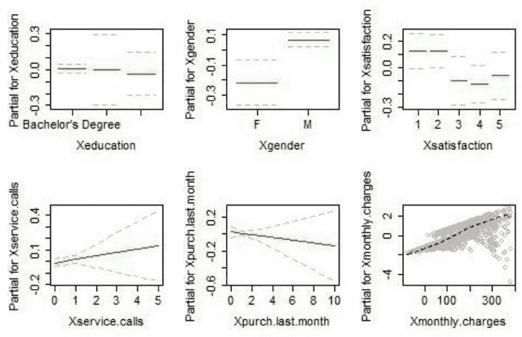

### 检查子集生存曲线

与KM曲线一样，我们也可以为数据的子集生成单独的图表。我们将通过将先前获得的回归系数应用于数据的子集来实现这一点，每个子集包含大约相同数量的行。这样，我们就可以跨组比较密度：

- 在以下代码中，我们将首先按性别对原始数据集（ChurnStudy）进行子集划分
- 然后通过应用CoxModel.1的系数对新子集进行评分
- 然后，我们将通过从男性和女性子集中各抽取300个观测值来降低图表的密度
- 最后，我们将绘制结果

### CoxModel.1

运行以下代码以生成一些有趣的生存曲线子集：

```
par(mfrow=c(1,2))
#
males <-subset(ChurnStudy,Xgender=='M')
males.nrow <- nrow(males)
females <-subset(ChurnStudy,Xgender=='F')
nrow(females)
females.fit <- survfit(CoxModel.1, newdata=females)
plot(females.fit,col=c('blue') ,lty=1,xlab="Months", ylab="Hazard
title(main = "Females Survival Curve")
mtext(paste("Observations=",nrow(females)),side=3,line=0,adj=1,ce
#
males.fit <- survfit(CoxModel.1, newdata=males)
plot(males.fit,col=c('red') ,lty=1,xlab="Months", ylab="Hazard")
title(main = "Males Survival Curve")
mtext(paste("Observations=",nrow(males)),side=3,line=0,adj=1,cex=
#
par(mfrow=c(1,2))
#
#sample the males population
#
males.sample <- sample(males)[1:300,]
males.sample.fit <- survfit(CoxModel.1, newdata=males.sample)
plot(males.sample.fit,col=c('orange') ,lty=1,xlab="Months", ylab=
title(main = "Males (Sample) Survival Curve")
mtext(paste("Observations=",nrow(males.sample.fit)),side=3,line=0
#
#sample the females population
#
females.sample <- sample(females)[1:300,]
females.sample.fit <- survfit(CoxModel.1, newdata=females.sample)
plot(females.sample.fit,col=c('red') ,lty=1,xlab="Months", ylab="
title(main = "Females (Sample) Survival Curve")
mtext(paste("Observations=",nrow(females.sample.fit)),side=3,line
#
dev.copy(jpeg,'Ch5 - CoxModell Gender.jpg'); dev.off()
sat.fit.low <- survfit(CoxModel.1, newdata=subset(ChurnStudy[1:30
plot(sat.fit.low,col=c('red') ,lty=1,xlab="Months", ylab="Hazard"
title(main = "Sat (Lowest) Survival")
#
sat.fit.high <- survfit(CoxModel.1, newdata=subset(ChurnStudy[1:3
plot(sat.fit.high,col=c('blue') ,lty=1,xlab="Months", ylab="Hazar
title(main = "sat (Highest) Survival")
dev.copy(jpeg,'Ch5 - CoxModell sat.jpg'); dev.off()
savehistory (file="Ch5 CoxModel Contrast Curves.txt")
```

### 比较性别差异

在男性（左图）与女性（右图）的比较中，我们可以看到男性在左上角象限的密度略高于女性。这支持男性会更早流失的假设：

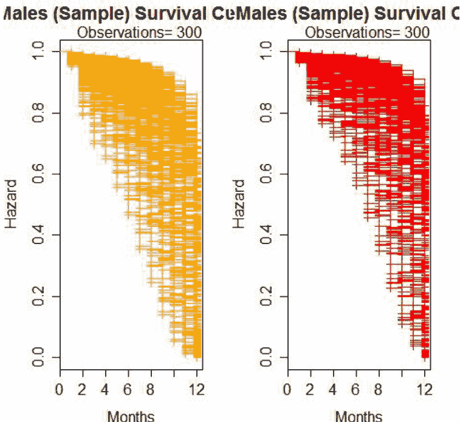

### 比较客户满意度差异

首先，提取最高和最低满意度分数的样本，满意度=1表示比满意度=5有更多的早期流失者，这是因为点的密度：

```
sat.fit.low <- survfit(CoxModel.1, newdata=subset(ChurnStudy[1:30
plot(sat.fit.low,col=c('red') ,lty=1,xlab="Months", ylab="Hazard"
title(main = "Sat (Lowest) Survival")
#
sat.fit.high <- survfit(CoxModel.1, newdata=subset(ChurnStudy[1:3
plot(sat.fit.high,col=c('blue') ,lty=1,xlab="Months", ylab="Hazar
title(main = "sat (Highest) Survival")
dev.copy(jpeg,'Ch5 - CoxModell sat.jpg'); dev.off()
```

以下是最高和最低满意度分数的并排比较：

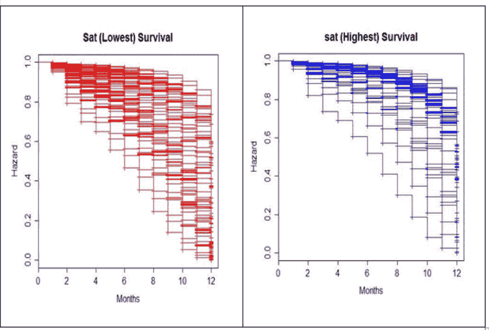

### 验证模型

此前，我们创建了 `ChurnStudy.test` 测试数据集，但未将其用于


训练我们的Cox回归模型。创建后，我们就将其搁置一旁。我们将演示一种使用此保留数据集来验证CoxModel获得的训练结果的方法。

找到 #predict=== 标签并运行以下代码：

```
#predict===
par(mfrow=c(1,1))
#
```

### 计算基准估计值

我们将首先使用basehaz()函数，为我们刚刚运行的回归模型确定基准（或平均）估计值。我们将其分配给名为base的对象，然后打印并绘制它。

```
#### Let's start by looking at the baseline estimates for each time period.
#
base <- basehaz(CoxModel.1)
print(base)
> print(base)
     hazard time
1  0.007174321  1
2  0.033151848  2
3  0.051088747  3
4  0.062057960  4
5  0.084305023  5
6  0.109773610  6
7  0.149493300  7
8  0.200891166  8
9  0.281904190  9
10 0.420681696  10
11 0.623702585  11
12 1.281690658  12
```

请回顾，风险（hazard）是指在事件（流失）尚未发生的前提下，该事件发生的可能性。此术语与我们最初讨论的生存率（survival rate）略有不同，生存率是指事件未发生的人口百分比。

我们可以看到，随着时间推移，流失的可能性始终在增加。流失似乎在第7或第8个月前呈线性增长，然后开始呈指数增长，并在12个月末达到最高流失率。这可能发生在客户开始接近任何现有合同结束时。

为每个时间段绘制基准风险：

```
ggplot(base, aes(base$time, base$hazard)) + geom_bar(stat = "identity") +
ggtitle("Churn Baseline Hazard by Time") +
labs(x="Month", y="Hazard")
dev.copy(jpeg,'Ch5 - baseline hazard.jpeg');
dev.off()
```

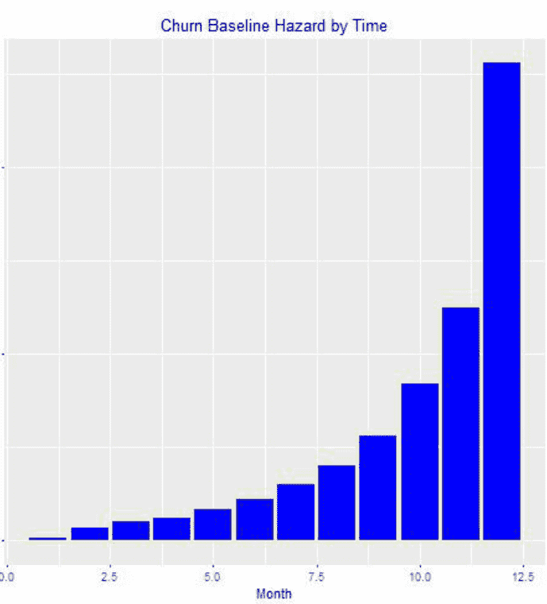

#### 运行predict()函数

接下来，我们将使用predict()函数，基于在ChurnStudy上训练的预测模型，对ChurnStudy.test中的测试数据进行打分。

newdata=标签指定要存储的新数据集。lp类型是用于预测的几种类型之一，此方法使用线性预测器：

```
pred_validation <- predict(CoxModel.1, newdata=ChurnStudy.test, type = "lp")
```

生成的预测将以对数形式呈现。

#### 预测时间点6的结果

预测值为对数形式。取指数并乘以基准风险估计值，以获得6个月时的预测值：

```
#
head(pred_validation)
#
pred.val <- base[6,1]*exp(pred_validation)
```

假设我们想预测分析期间（time=6）中途发生的流失风险：

首先，我们将对预测取指数，并将其乘以time=6时hazard列中显示的基准风险估计值。这种方法实际上将系数的预测能力添加到基准风险率中：

```
pred.val <- base[6,1]*exp(pred_validation)
```

我们现在将预测值与测试数据集中的原始值合并，并在验证行数符合预期后查看结果：

```
combine <- cbind(ChurnStudy.test,pred_validation,pred.val)
> nrow(combine)
[1] 496
View(combine)
```

View函数打开数据框以便进行检查：

| ID | Churn | Xeducation | Xgender | Xsatisfaction | Xsatisfaction2 | Xservice.calls | Xtenure2 | Xpurch.last.month | Xmonthly.charges | pred_validation | pred_val |
|---|---|---|---|---|---|---|---|---|---|---|---|
| 1081 | 0 | 硕士学位 | 男 | 3 | 3 | 0 | 9 | 1 | 115.098475 | -0.326359648 | 0.07920067 |
| 691 | 1 | 硕士学位 | 男 | 4 | 2 | 0 | 9 | 1 | 372.688733 | 1.785420280 | 0.65447961 |
| 1413 | 0 | 学士学位 | 女 | 3 | 5 | 0 | 10 | 0 | 120.539268 | -0.505061482 | 0.06624491 |
| 1699 | 0 | 学士学位 | 男 | 3 | 1 | 1 | 7 | 1 | | -2.017806 | 0.03227968 |
| 1111 | 0 | 学士学位 | 男 | 5 | 3 | 3 | 7 | 1 | 67.455601 | -0.545857524 | 0.06359677 |
| 1962 | 0 | 学士学位 | 男 | 1 | 5 | 0 | 9 | 1 | 31.944160 | -0.742731950 | 0.05223163 |

查看最后一列，其中包含预测值。预测值本质上是一个介于0到1之间的风险评分。

将预测值（pred_val）与实际流失输出（Churn）进行比较，以了解预测值如何随结果变化。同时检查自变量与预测值之间的关系。例如，您可以在前几行中看到，churn=1事件的月费远高于周围其他行。

要查看流失客户和非流失客户之间平均分数的差异，我们可以使用一些聚合均值函数并打印结果。运行以下代码后，我们可以看到流失客户（风险评分较高）与非流失客户之间的差异：

```
y <- aggregate(combine$pred.val, by=list(combine$Churn), FUN=mean)
print (y)
> print (y)
  Group.1        x
1       0 0.0646759
2       1 0.2326843
```

#### 确定一致性指数

一致性指数是生存分析中使用的另一种衡量指标，用于确定模型在区分观测值和预测值方面的效果。在我们的流失示例中，我们预期流失客户的风险率高于保持活跃的客户。如果一致性指数大于0.5，则表明模型具有一定的预测能力。要计算该指数，我们将使用survcomp包中的concordance.index()函数，以衡量pred_validation统计量与实际流失结果之间的一致性。与之前的示例一样，需要将预测值、时间变量和事件变量作为参数提供给该函数。我们还将打印相关的置信区间：

```
library(survcomp)
cindex_validation = concordance.index(pred_validation, surv.time,
                                      surv.event=ChurnStudy.test)
print(cindex_validation$c.index)
print(cindex_validation$upper)
print(cindex_validation$lower)
```

在我们的示例中，计算出的指数为70%，置信区间显示其范围在60%到77%之间：

```
> print(cindex_validation$c.index)
[1] 0.6973212
> print(cindex_validation$upper)
[1] 0.7736508
> print(cindex_validation$lower)
[1] 0.6082843
```

## 基于时间的变量

到目前为止，我们已将所有变量视为静态变量，即它们保持了从测量期开始时测得的原始值。

在现实中，年龄和婚姻状态等值会随时间变化，模型可以考虑这些变化。在营销背景下，调查可能在研究开始后发放。根据这些变量的变化，可能会提供优惠券和其他激励措施（干预），目的是改变客户行为。在模型中，这些干预也可以予以考虑。

在我们的示例中，我们将引入一个假设的第二次调查，该调查在测量期开始6个月后引入，并衡量对部分不满意客户进行处理的效果。

#### 更改数据以反映第二次调查

以下代码使用survSplit函数在时间段6创建一条新记录，以反映在那时实施的第二次假设客户调查的响应。

复制以下代码并在新的脚本窗口中运行：

```
library(survival)
SURV2 <- survSplit(data = ChurnStudy, id="ID.char", cut = 6, end="time")
SURV2$CustomerID <- as.integer(SURV2$ID.char)
SURV2 <- SURV2[order(SURV2$CustomerID), ]
```

在R控制台中，执行以下命令以查看数据框如何变大。由于我们在中点（6个月）拆分记录，记录数几乎是原始记录的两倍：

```
> nrow(ChurnStudy)
[1] 1984
> nrow(SURV2)
[1] 3512
```

#### survSplit的工作原理

我们将更仔细地了解survSplit函数及其对满意度变量的影响。由于我们需要跟踪时间段6客户满意度的变化，survSplit函数将通过创建新行并调整时间段来修改数据框，以反映客户满意度的变化。在我们的示例中，这意味着该函数将在6个月的截止点（cut=6）之后根据Xtenure2的值创建额外行。

为了了解此工作原理，首先查看原始ChurnStudy数据框，并观察第一条记录的任职期为7个月。该客户的存留时间足够长，可以进行第二次调查：

```
ChurnStudy$seqid <- seq(1:nrow(ChurnStudy))
View(subset(ChurnStudy, select = c(seqid,Xtenure2,Xsatisfaction,
```

| | seqid | Xtenure2 | Xsatisfaction | Xsatisfaction2 | Churn |
|---|---|---|---|---|---|
| 43 | 1 | 7 | 1 | 5 | 1 |
| 219 | 2 | 9 | 3 | 6 | 1 |
| 44 | 3 | 6 | 4 | 6 | 1 |
| 1412 | 4 | 11 | 3 | 2 | 0 |
| 12 | 5 | 11 | 4 | 3 | 1 |
| 1458 | 6 | 1 | 3 | 1 | 0 |
| 519 | 7 | 4 | 1 | 5 | 1 |
| 562 | 8 | 12 | 4 | 3 | 1 |
| 668 | 9 | 12 | 4 | 2 | 1 |
| 135 | 10 | 3 | 4 | 2 | 1 |

现在查看survSplit()函数生成的输出。您可以看到第一条记录（CustomerID=1）已被拆分为两条记录，一条记录从成员活跃的第一个月开始（time0=0），另一条记录从第6个月开始（time0=6）。


另一方面，CustomerID=2 只有一条记录，因为该会员仅存在了 5 个月，低于 cut=6 的截止值：

```
View(subset(SURV2, select = c(CustomerID,time0,period, Xsatisfaction
```

|    | CustomerID | time0 | period | Xsatisfaction | Xsatisfaction2 | Xtenure2 | Xmonthly.charges | Churn |
|---|---|---|---|---|---|---|---|---|
| 1174 | 1 | 0 | 0 | 1 | 3 | 6 | 233 | 0 |
| 2662 | 1 | 6 | 1 | 1 | 3 | 12 | 233 | 1 |
| 213 | 2 | 0 | 0 | 1 | 6 | 5 | 217 | 1 |
| 1307 | 3 | 0 | 0 | 4 | 2 | 6 | 269 | 0 |
| 2795 | 3 | 6 | 1 | 4 | 2 | 11 | 269 | 1 |
| 1266 | 4 | 0 | 0 | 1 | 2 | 6 | 168 | 0 |
| 2754 | 4 | 6 | 1 | 1 | 2 | 12 | 168 | 1 |
| 1268 | 6 | 0 | 0 | 5 | 3 | 6 | 164 | 0 |
| 2756 | 6 | 6 | 1 | 5 | 3 | 7 | 164 | 1 |
| 1372 | 7 | 0 | 0 | 1 | 2 | 6 | 89 | 1 |
| 681 | 8 | 0 | 0 | 1 | 5 | 6 | 175 | 0 |
| 2169 | 8 | 6 | 1 | 1 | 5 | 11 | 175 | 1 |
| 45 | 9 | 0 | 0 | 5 | 3 | 6 | 106 | 1 |

从分析角度来看，此时实际上并未发生任何变化。已创建两条信息完全相同的记录，只是其中一条记录显示的是第 6 期结束时的信息，另一条显示的是第 12 期结束时的信息。

我们可以通过运行一个简单的交叉表来查看第 1-12 个月与各期的对应关系：

```
> table(SURV2$period,SURV2$Xtenure2)
```

| | 1 | 2 | 3 | 4 | 5 | 6 | 7 | 8 | 9 | 10 | 11 | 12 |
|---|---|---|---|---|---|---|---|---|---|---|---|---|
| 0 | 33 | 62 | 51 | 27 | 70 | 1245 | 0 | 0 | 0 | 0 | 0 | 0 |
| 1 | 0 | 0 | 0 | 0 | 0 | 0 | 136 | 170 | 185 | 230 | 210 | 225 |

### 调整记录以模拟干预

既然我们有了多条记录，就可以对第 6 个月后发生变化的新调查信息进行调整，并将其作为时间相关变量纳入模型。

请回顾，我们最初是通过将流失客户的满意度评分加 1（Xsatisfaction2）来模拟第二次调查数据的。这导致部分成员的满意度评分出现 6 分，这是不可能的。因此，我们将首先将评分为 6 的记录清理为 5 分：

```
#fix up some "6" satisfaction scores, that are not possible, and
SURV2$Xsatisfaction2 <- as.factor(ifelse(SURV2$Xsatisfaction2=="6
```

假设在第 5 个月，有一项针对初始调查中给出低满意度评分（1 分或 2 分）的成员开展的促销活动。这导致部分原本可能流失的成员的满意度评分提高了。

我们将通过将那些流失客户的满意度评分（Xsatisfaction2）从 1 分或 2 分提升至 3 分，来模拟对调查的积极回应。这是为了模拟满意度的略微提升。此操作仅针对 period=1（即调查后的期间）执行。从技术上讲，这是 survSplit() 函数在 cut 点之后分配的期间（第 1 期）。第 0 期是 cut 点之前的期间：

```
#an intervention increased low satisfaction scores to "Average".
SURV2$Xsatisfaction2 <- ifelse(SURV2$period==1 & SURV2$Churn==1 &
```

我们还将通过将这些第二次调查客户的 Churn 状态从 1（流失）改为 0（保留），来模拟其留存状态的变化，这表明促销活动产生了足够的效果，使他们没有离开：

```
#Simulate retaining these customers by changing their status to a
#change is detected when the new score is higher than the old score
SURV2$Churn2 <- ifelse(SURV2$period==1 & SURV2$Churn==1 &
       (as.integer(SURV2$Xsatisfaction2) > as.integer(
       0, SURV2$Churn)
SURV2$ChurnChanged <- ifelse(SURV2$Churn==SURV2$Churn2, "N", "Y")
```

现在，按 ID 对数据框进行排序并查看结果。拥有多个 ID 的记录已被算法拆分：

```
attach(SURV2)
tmp <- SURV2[order(CustomerID),]
str(tmp)
```

```
tmp2 <- subset(tmp, select = c(CustomerID,ChurnChanged,time0,period
```

```
View(tmp2)
```

|    | CustomerID | ChurnChanged | time0 | period | Xsatisfaction | Xsatisfaction2 | Churn | Churn2 |
|---|---|---|---|---|---|---|---|---|
| 1174 | 1 | N | 0 | 0 | 1 | 1 | 0 | 0 |
| 2662 | 1 | Y | 6 | 1 | 1 | 3 | 1 | 0 |
| 213 | 2 | N | 0 | 0 | 1 | 1 | 1 | 1 |
| 1307 | 3 | N | 0 | 0 | 4 | 4 | 0 | 0 |
| 2795 | 3 | N | 6 | 1 | 4 | 4 | 1 | 1 |
| 1266 | 4 | N | 0 | 0 | 1 | 1 | 0 | 0 |
| 2754 | 4 | Y | 6 | 1 | 1 | 3 | 1 | 0 |
| 1268 | 6 | N | 0 | 0 | 5 | 5 | 0 | 0 |
| 2756 | 6 | N | 6 | 1 | 5 | 5 | 1 | 1 |
| 1372 | 7 | N | 0 | 0 | 1 | 1 | 1 | 1 |
| 681 | 8 | N | 0 | 0 | 1 | 1 | 0 | 0 |
| 2169 | 8 | Y | 6 | 1 | 1 | 3 | 1 | 0 |
| 45 | 9 | N | 0 | 0 | 5 | 5 | 1 | 1 |

请注意，任何任职时间超过 6 个月的客户都会添加一条额外记录。这条额外记录反映了客户的最新状态，并更新了发生变化的变量值。

在此示例中，我们在 6 个月处执行了一次切分。数据还包含两个新变量：`time0`，表示起始期间；以及一个我们命名为 period 的事件变量，每当某个基于时间的变量发生变化时，它就会按顺序递增。我们仅展示了一个基于时间变量发生一次变化的示例。对于更长的观察期，可能会出现更多变化。

### 运行基于时间的模型

既然我们已重新格式化数据，现在可以运行第二个基于时间的模型了。

`CoxModel.2` 变量的创建方式与 `CoxModel.1` 类似，但使用 Xsatisfaction2 替代了 Xsatisfaction，以反映追踪研究中满意度的变化。新的 time0 变量也替换了原始的任期变量，Churn2 替换了原始的流失响应变量：

```
CoxModel.2 <- coxph(Surv(time0,Xtenure2, Churn2) ~
 Xeducation + Xgender + Xsatisfaction2 + Xservice.calls + Xpurch.last.month + Xmonthly.charges,
 data=SURV2)
```

避免覆盖现有变量名。请在现有数据框中创建新变量，或者保留原有数据框并新建一个数据框。

运行模型后，可以使用 `stargazer` 命令（或 `summary(CoxModel.2)`）来查看模型输出。

性别、满意度和月费后面的星号表明它们是模型中最显著的变量。

.13 的 R-square 不是标准线性回归类型的度量，而是我们之前讨论过的伪 R-square 度量，它是 0 到 1 之间的一个数值，用于衡量拟合模型与零模型之间的差异。如果你想了解针对 Cox 回归计算此特定伪 R-square 的方法，可以运行以下命令：

```
getS3method("summary", "coxph")
```

然而，它不如原始 `CoxModel.1` 高。这可能是由于对数据进行了人为修改。无论如何，依赖单一指标并非良好做法，我们将很快看到该模型如何改善留存率。

```
library(stargazer)
stargazer(CoxModel.2,single.row=TRUE,type="text")
```

```
> stargazer(CoxModel.2,single.row=TRUE,type="text")
```

| | time0 |
|---|---|
| XeducationDoctorate Degree | -0.160 (0.210) |
| XeducationMaster's Degree | -0.200 (0.140) |
| XgenderM | 0.091 (0.120) |
| Xsatisfaction22 | 0.160 (0.200) |
| Xsatisfaction23 | -0.600*** (0.200) |
| Xsatisfaction24 | 0.520*** (0.180) |
| Xsatisfaction25 | 0.580*** (0.180) |
| Xservice.calls | 0.013 (0.044) |
| Xpurch.last.month | -0.007 (0.029) |
| Xmonthly.charges | 0.009*** (0.001) |
| Observations | 2,644 |
| R2 | 0.130 |
| Max. Possible R2 | 0.900 |
| Log Likelihood | -2,869.000 |
| Wald Test | 370.000*** (df = 10) |
| LR Test | 380.000*** (df = 10) |
| Score (Logrank) Test | 399.000*** (df = 10) |
| 注： | *p<0.1; **p<0.05; ***p<0.01 |

### 让我们先生成另一条生存曲线：

```
par(mfrow=c(1,1))
autoplot(survfit(CoxModel.1), surv.linetype = 'dashed', surv.color
conf.int.fill = 'dodgerblue3', conf.int.alpha = 0.5, censor
dev.copy(jpeg,'Ch5 - time based variable 1.jpg');
dev.off()

autoplot(survfit(CoxModel.2), surv.linetype = 'dashed', surv.color
conf.int.fill = 'orange', conf.int.alpha = 0.5, censor =
dev.copy(jpeg,'Ch5 - time based variable 2.jpg');
dev.off()
savehistory (file="Ch5 time based variable.txt")
```

以下是原始图（左侧）与基于时间的生存图并排显示：


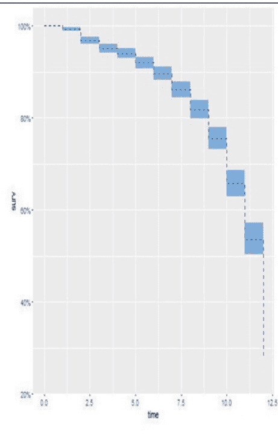

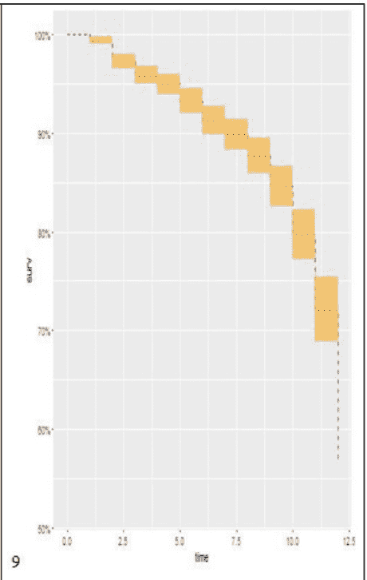

### 模型比较

尽管生存曲线相似，但我们可以看到，在12个月结束时，56%的客户被保留下来，而原来的比例为27%。我们可以将此归因于在第6个月进行的干预。

使用`summary(survfit)`函数来比较模型：

| 时间 | 风险数 | 事件数 | 生存率 | 标准误 | 95% CI下限 | 95% CI上限 | 时间 | 风险数 | 事件数 | 生存率 | 标准误 | 95% CI下限 | 95% CI上限 |
|------|--------|---------|----------|---------|--------------|--------------|------|--------|---------|----------|---------|--------------|--------------|
| 1 | 1488 | ... | 0.994 | 0.00157 | 0.991 | 0.997 | 1 | 1488 | ... | 0.993 | 0.00185 | 0.989 | 0.996 |
| 2 | 1455 | ... | 0.973 | 0.00359 | 0.966 | 0.980 | 2 | 1455 | ... | 0.967 | 0.00404 | 0.960 | 0.975 |
| 3 | 1393 | ... | 0.958 | 0.00461 | 0.949 | 0.967 | 3 | 1393 | ... | 0.950 | 0.00505 | 0.940 | 0.960 |
| 4 | 1342 | ... | 0.950 | 0.00518 | 0.940 | 0.960 | 4 | 1342 | ... | 0.940 | 0.00559 | 0.929 | 0.951 |
| 5 | 1315 | 39 | 0.932 | 0.00624 | 0.920 | 0.945 | 5 | 1315 | 39 | 0.919 | 0.00655 | 0.906 | 0.932 |
| 6 | 1245 | 42 | 0.913 | 0.00736 | 0.898 | 0.927 | 6 | 1245 | 42 | 0.896 | 0.00752 | 0.881 | 0.911 |
| 7 | 1156 | 24 | 0.898 | 0.00801 | 0.883 | 0.914 | 7 | 1156 | 60 | 0.861 | 0.00884 | 0.844 | 0.879 |
| 8 | 1020 | 32 | 0.877 | 0.00902 | 0.859 | 0.895 | 8 | 1020 | 68 | 0.818 | 0.01033 | 0.798 | 0.838 |
| 9 | 850 | 40 | 0.846 | 0.01052 | 0.825 | 0.866 | 9 | 850 | 89 | 0.754 | 0.01233 | 0.731 | 0.779 |
| 10 | 665 | 51 | 0.797 | 0.01293 | 0.772 | 0.822 | 10 | 665 | 115 | 0.657 | 0.01500 | 0.628 | 0.687 |
| 11 | 435 | 54 | 0.721 | 0.01688 | 0.688 | 0.755 | 11 | 435 | 105 | 0.536 | 0.01789 | 0.502 | 0.572 |
| 12 | 225 | 55 | 0.569 | 0.02518 | 0.522 | 0.621 | 12 | 225 | 112 | 0.278 | 0.02226 | 0.237 | 0.325 |

### 变量选择

我们刚才使用的模型变量数量有限，因此在处理大量变量时，机械式变量选择方法并不十分适用。我们能够通过回归模型找出重要的变量。然而，对于变量数量庞大的模型，我们可以使用`glmulti`包来进行变量选择。

对于生成的流失示例，我们的变量数量较少，因此演示变量选择变得容易，也不太耗时。

在以下代码中，我们将最佳回归中包含的项的最大数量设置为10，以限制执行穷举搜索所需的计算时间。我们还将使用遗传算法选项（`method = "g"`），在处理较大数据集时速度可能快得多，因为它只考虑所有组合中的最佳子集。

如果您希望执行穷举搜索，请使用`method = "h"`。但是，需要提前警告，这可能会占用您的机器很长时间：

- 运行以下代码以开始变量选择过程：

```
library(glmulti)
glmulti.coxph.out <-
  glmulti(Surv(Xtenure2, Churn) ~ Xeducation + Xgender +
    Xsatisfaction + Xservice.calls +
    Xpurch.last.month + Xmonthly.charges, data =
    ChurnStudy,
    maxsize=10,
    level = 2,
    method = "g",
    crit = "aic",
    confsetsize = 5,
    plotty = T, report = F,
    fitfunction = "coxph")
```

- 当算法完成时，您将在控制台中收到以下消息。它应该在5分钟或更短时间内完成：

```
TASK: Genetic algorithm in the candidate set.
Initialization...
Algorithm started...
Improvements in best and average IC have been below specified goals.
Algorithm is declared to have converged.
Completed.
```

- 打印输出对象的摘要。摘要包括候选集中找到的最佳模型。请注意，最佳模型不包含教育变量：

```
> print(glmulti.coxph.out)
glmulti.analysis
Method: g / Fitting: coxph / IC used: aic
Level: 2 / Marginality: FALSE
From 5 models:
Best IC: 9214.89853563887
Best model:
[1] "Surv(Xtenure2, Churn) ~ 1 + Xgender + Xsatisfaction + Xservice.calls + "
[2] " Xmonthly.charges + Xpurch.last.month:Xservice.calls + Xmonthly.charges:Xservice.calls + "
[3] " Xgender:Xmonthly.charges + Xsatisfaction:Xmonthly.charges"
Evidence weight: 0.257101917192717
Worst IC: 9216.1617086134
5 models within 2 IC units.
4 models to reach 95% of evidence weight.
Convergence after 120 generations.
Time elapsed: 55.2994699478149 minutes.
```

- 由于我们指定模型中应考虑交互作用，算法已找到几个交互作用，以便进一步改进模型：

```
Xpurch.last.month:Xservice.calls
Xmonthly.charges:Xservice.calls
Xmonthly.charges:Xpurch.last.month
Xgender:Xpurch.last.month
Xsatisfaction:Xpurch.last.month
Xsatisfaction:Xmonthly.charges
```

- 其中两个重要的交互作用是：性别与上月购买次数的交互作用，以及满意度与月度费用的交互作用。这两个交互作用均在最佳模型中指定。

### 合并交互项

要将这些交互项纳入未来的模型，我们可以直接在模型公式的右侧指定它们。例如，此规范将服务呼叫，以及服务呼叫与上月购买次数之间的交互作用作为模型项：

```
CoxModel.2 <- coxph(Surv(time0,Xtenure2, Churn2) ~
Xeducation + Xgender + Xsatisfaction2 + Xservice.calls +
Xpurch.last.month + Xmonthly.charges,
data=SURV2)
```

#### 显示公式子列表

如果您不想输入所有项，可以显示一个公式子列表，它将列出前5个模型的所有公式。这有助于剪切和粘贴：

```
> glmulti.coxph.out@formulas
[[1]]
Surv(Xtenure2, Churn) ~ 1 + Xgender + Xsatisfaction + Xservice.calls + Xmonthly.charges + Xpurch.last.month:Xservice.calls + Xmonthly.charges:Xservice.calls + Xgender:Xmonthly.charges + Xsatisfaction:Xmonthly.charges
<environment: 0x0000000034599328>

[[2]]
Surv(Xtenure2, Churn) ~ 1 + Xgender + Xsatisfaction + Xservice.calls + Xmonthly.charges + Xpurch.last.month:Xservice.calls + Xmonthly.charges:Xpurch.last.month + Xgender:Xmonthly.charges + Xsatisfaction:Xmonthly.charges
<environment: 0x0000000034599328>

[[3]]
Surv(Xtenure2, Churn) ~ 1 + Xgender + Xsatisfaction + Xservice.calls + Xmonthly.charges + Xpurch.last.month:Xservice.calls + Xmonthly.charges:Xpurch.last.month + Xsatisfaction:Xmonthly.charges
<environment: 0x0000000034599328>

[[4]]
Surv(Xtenure2, Churn) ~ 1 + Xgender + Xsatisfaction + Xservice.calls + Xpurch.last.month + Xmonthly.charges + Xpurch.last.month:Xservice.calls + Xmonthly.charges:Xservice.calls + Xgender:Xmonthly.charges + Xsatisfaction:Xmonthly.charges
<environment: 0x0000000034599328>

[[5]]
Surv(Xtenure2, Churn) ~ 1 + Xgender + Xsatisfaction + Xservice.calls + Xpurch.last.month + Xmonthly.charges + Xpurch.last.month:Xservice.calls + Xmonthly.charges:Xservice.calls + Xmonthly.charges:Xpurch.last.month + Xgender:Xmonthly.charges + Xsatisfaction:Xmonthly.charges
<environment: 0x0000000034599328>
```

### 比较候选模型中的AIC

如前几章所述，AIC是一个可帮助您选择模型的度量指标。`plotty='T'`选项还生成了所找到的顶级模型的AIC图。在函数调用中，我们表明希望查看最多五个模型。

根据该包作者的说法，一个合理的经验法则是考虑低于水平红线的模型。

根据该定义，将排除模型4和5，保留模型1、2和3供考虑。

以下是前五个模型的AIC图：


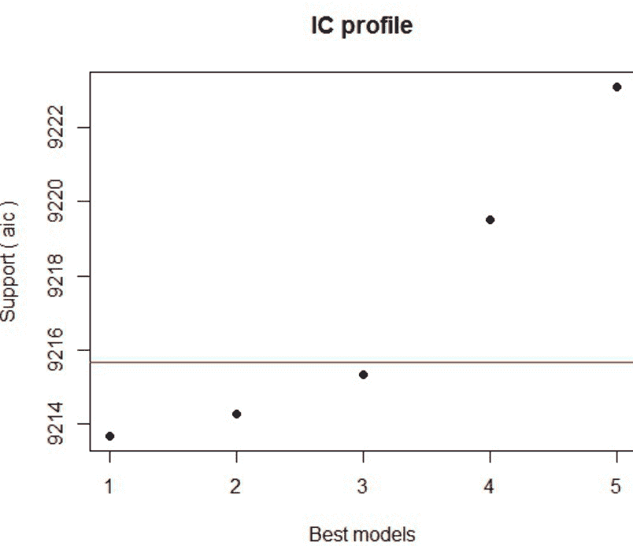

我们还可以通过使用 plot 语句并指定 `type='s'` 来绘制变量重要性图：

```
plot(glmulti.coxph.out,type = "s")
```

此图按最重要的特征排序，生成一个简洁的横向条形图：

### 术语的模型平均重要性

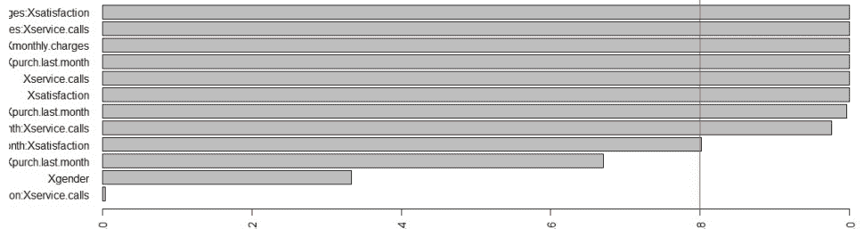

## 总结

在本章中，我们学习了什么是生存分析，以及如何使用两种主要技术——卡普兰-梅耶（Kaplan-Meier）和 COX 回归（Cox Regression）——来解释和预测客户流失。

我们还学习了如何生成自己的数据来检验假设并检验模型的稳健性。

最后，我们还介绍了一些编码技术，帮助我们复现和保存生成的代码和图像。

在下一章中，我们将不再关注客户流失问题，而是将介绍如何通过预测客户下一步会购买什么来让客户保持满意，所使用的技术被称为**市场篮分析**。
