# 第 7 章. 使用市场篮分析作为推荐引擎

> "在了解如何遵守规则之前，违反规则是不明智的。"

- T.S. 艾略特

在本章中，我们将介绍以下主题：

- 使用 arules 包进行市场篮分析
- 使用半结构化市场篮交易数据的数据转换和清洗技术
- 学习如何将交易对象转换为数据框
- 使用 flexclus 包进行基于聚类分析的预测
- 利用 RTextTools 和 tm 包进行一些文本挖掘

## 什么是市场篮分析？

如果你已经读完上一章，那么现在将被带入**市场篮分析（MBA）**的世界中。市场篮分析（有时也称为**关联分析**），是一种在零售行业中广泛使用的预测分析技术，用于识别被一起购买的商品篮。典型的用例是超市购物车，购物者通常会购买牛奶、面包、奶酪等各种商品，算法将预测一起购买某些商品会如何影响其他商品的购买。这是零售商用来决定何时开始向你发送你甚至不知道自己需要的商品的优惠券和电子邮件的方法之一！

MBA 一个常被引用的例子是尿布与啤酒之间的关系：

> "一家超市连锁店在其分析中发现，购买尿布的顾客通常也会购买啤酒，于是将尿布放在啤酒冷藏柜附近，销量大幅增加" - http://en.wikipedia.org/wiki/Market_basket

然而，这不仅局限于零售行业。MBA 还可以应用于保险行业，查看投保人目前拥有的各种产品，如汽车、房屋等，并推荐其他可能的产品，如人寿、残疾或投资产品。

MBA 通常被认为是一种无监督学习算法，因为目标变量通常未指定。然而，正如你将在后面看到的那样，可以细化关联规则，以便将特定项目指定为目标变量。

MBA 也被视为一种推荐引擎，其中一组商品的购买暗示其他商品的购买。当然，MBA 和其他推荐引擎可以共享相同类型的输入数据。然而，MBA 是在亚马逊率先开发协同过滤技术之前开发的，它更多暗示了收集的 Web 数据的集成，而 MBA 更多与扫描仪中发现的 RFID 条码技术相关联。然而，在两种情况下，基于过去购买行为推荐未来购买行为都是目标。

## 检查杂货交易文件

理解 MBA 至关重要的概念是支持度、置信度和提升度。这些是用于评估一组关联规则的 _拟合优度_ 的指标。你还将学习 MBA 中使用的一些特定定义，例如后件、前件和项集。

为了介绍这些概念，我们将首先通过一个非常简单的例子来阐述这些术语。我们将只使用包含在 `arules` 包中的 Groceries 交易文件中包含的前 10 笔交易：

```
library(arules)
```

加载 `arules` 库后，您可以在命令行中输入 `?Groceries` 以查看 Groceries 数据集的简短描述。以下描述出现在 `help` 窗口中：

> "Groceries 数据集包含来自典型本地杂货店的 1 个月（30 天）真实世界销售点交易数据。该数据集包含 9835 笔交易，项目被汇总为 169 个类别。"

有关此数据集收集方式的更多信息，请参阅原始出版物（Michael Hahsler, 2006）。

加载 `arules` 包后，将 `Groceries` 数据集加载到内存中：

```
data(Groceries)
```

## 杂货交易文件的格式

`Groceries` 是一个交易类对象，而不是数据框。这个 R 对象表示用于挖掘项集或规则的交易数据。从逻辑上讲，它被组织为杂货收据列表及其一起购买的商品。每一行都称为一笔交易，交易中的每一列都代表购买的特定商品。

例如，这里有三个包含不同数量购买的交易：

交易 1 牛奶 谷物

交易 2 牛肉

交易 3 黄油 糖 奶油

然而，交易对象在物理上并未按照严格的数据库表格式组织。它采用一种称为 transactions 的特殊 R 对象格式。

你也可以运行 `summary(Groceries)`，这将提供关于交易文件结构的高级别信息，以及市场篮中最常见的单个商品：

```
> summary(Groceries)
transactions as itemMatrix in sparse format with
9835 rows (elements/itemsets/transactions) and
169 columns (items) and a density of 0.026

most frequent items:
whole milk other vegetables rolls/buns soda yogurt (Other)
2513 1903 1809 1715 | 1372 34055
```

稍后你将看到如何将数据框转换为交易对象，反之亦然。有关此对象的更多信息，你可以在控制台行输入 ?transactionInfo。

要查看 `Groceries` 文件的简单市场篮示例，请运行以下代码：

检查 `inspect()` 函数生成的输出，它将打印市场篮中的第 10-19 笔交易。请注意，每笔交易可以包含单个交易 ID 以及购买商品列表。它可以是单个购买的商品（交易 #4，单独购买牛肉），也可以包含多个购买（交易 #1，牛奶和谷物）：

```
inspect(Groceries[10:19])
```

以下是输出：

```
items
[1] {whole milk,cereals}
[2] {tropical fruit,other vegetables,white bread,bottled water,ch
[3] {citrus fruit,tropical fruit,whole milk,butter,curd,yogurt,flour,bottled water,dishes}
[4] {beef}
[5] {frankfurter,rolls/buns,soda}
[6] {chicken,tropical fruit}
[7] {butter,sugar,fruit/vegetable juice,newspapers}
[8] {fruit/vegetable juice}
[9] {packaged fruit/vegetables}
[10]{chocolate}
```

## 示例市场篮

先前列出的编号 1-10 的每笔交易都代表购物者购买的一篮商品。这些通常是与特定交易或发票相关的所有商品。每个篮子都用大括号 {} 括起来，称为项集。项集是一起出现的一组商品。

市场篮算法以以下形式构建规则：

```
Itemset{x1,x2,x3 ...} --> Itemset{y1,y2,y3...}.
```

此表示法指出，购买公式左侧（lhs）商品的买家倾向于购买右侧（rhs）的商品。关联使用 => 符号表示，可解释为暗示。

### 注意

表示法的 lhs 也称为前件，rhs 称为后件。如果左侧或右侧都没有内容，则这些项目没有特定的关联规则；然而，这也意味着这些项目已经出现在篮子中。


## 关联规则算法

没有关联规则算法，你将不得不完成生成所有可能的项集对并自行挖掘数据以找出最佳项集这一计算成本极高的任务。关联规则算法有助于过滤这些内容。

MBA 中最流行的算法是 Apriori 算法，它包含在 `arules` 包中（另一个流行的算法是 Eclat 算法）。

运行 Apriori 非常简单。我们将使用刚刚打印的演示 10 笔交易的项集来演示这一点。

Apriori 算法基于以下原理：如果某个项集是频繁的，那么它的所有子集也必须是频繁的。这一原理本身有助于减少需要评估的项集数量，因为它只需要先查看最大的项集，然后能够逐层筛选：

- 首先，进行一些前期准备。将打印数字的位数固定为 2：

```
options(digits = 2)
```

- 接下来，运行 Apriori 算法。不过，仅在 `Groceries` 数据集的第 10 至 19 行上运行，因为目前我们希望保持输出较小。我们还将调整 `supp = 0.1,` 和 `conf =` 参数，以生成足够的输出，以便我们在后续章节中说明一些要点：

```
rules <- apriori(Groceries[10:19], parameter = list(supp = 0.1, conf = 0.6))
```

- 输出显示创建了 2351 条规则。相对于我们正在检查的 10 笔交易来说，这是一个规则数量庞大的结果。规则数量庞大是由于我们指定的支持度较低（0.10）。这会产生只包含单一组合的交易。这也由日志生成的警告消息所表明：

```
> Apriori
>
> Parameter specification:
> confidence minval smax arem aval originalSupport support m
>     0.6   0.1    1 none FALSE  TRUE       0.1 1 10
> target ext
> rules FALSE
>
> Algorithmic control:
> filter tree heap memopt load sort verbose
>     0.1 TRUE TRUE FALSE TRUE        2    TRUE
>
> Absolute minimum support count: 1
> Warning in apriori(Groceries[10:19], parameter = list(supp = 0.1, conf = 0.6)): You chose a very low absolute support count of 1. of memory! Increase minimum support.
> set item appearances ...[0 item(s)] done [0.00s].
> set transactions ...[22 item(s), 10 transaction(s)] done [0.00s].
> sorting and recoding items ... [22 item(s)] done [0.00s].
> creating transaction tree ... done [0.00s].
> checking subsets of size 1 2 3 4 5 6 7 8 9 done [0.00s].
> writing ... [2351 rule(s)] done [0.00s].
> creating S4 object ... done [0.00s].
```

- 按支持度对规则进行排序，支持度是衡量不同项目共同出现频率的重要评价指标之一。
- 我们将在下一节中进一步讨论这一点：

```
rules <- sort(rules, by = "support", decreasing = TRUE)
```

- 使用 `arules` 的 `inspect` 函数查看前五条规则。输出列分别为：序号（无表头）、lhs（左侧项集）、rhs（右侧项集）、支持度、置信度和提升度。请注意，每个支持度和置信度的度量值至少等于先前调用 `apriori` 函数时指定的参数：

```
inspect(head(rules, 5))
```

输出如下：

| | lhs | rhs | 支持度 | 置信度 | 提升度 |
|---|---|---|---|---|---|
| [1] | {瓶装水} | {热带水果} | 0.2 | 1.00 | 3.3 |
| [2] | {热带水果} | {瓶装水} | 0.2 | 0.67 | 3.3 |
| [3] | {谷物} | {全脂牛奶} | 0.1 | 1.00 | 5.0 |
| [4] | {鸡肉} | {热带水果} | 0.1 | 1.00 | 3.3 |
| [5] | {汽水} | {面包卷/小圆面包} | 0.1 | 1.00 | 10.0 |

### 前件与后件

此前展示的规则表达为前件（左侧项集）与后件（右侧项集）之间的蕴含关系。

第一条规则描述购买一瓶水的客户还会购买热带水果。第三条规则指出，购买谷物的客户倾向于购买全脂牛奶。

### 评估规则的准确性

已开发出三个主要指标来衡量关联规则的重要性或准确性：支持度、置信度和提升度。

### 支持度

支持度衡量项目共同出现的频率。想象一个购物车，其中可能包含大量项目组合。某些出现频率低的项目可以从分析中排除。当某个项目出现频率较高时，你会对项目之间的关联更有信心，因为它是一个更受欢迎的项目。通常，你的分析将围绕支持度高的项目展开。

### 计算支持度

计算支持度很简单。首先，通过统计规则中项目在购物篮中出现的次数除以项集中的总出现次数，来计算一个比例：

### 示例

- 我们可以看到，对于第一条规则（索引 #63），{瓶装水} 和 {热带水果} 在两个不同的交易（2 和 3）中同时出现，因此该规则的支持度为 2/10 或 20%
- 显示的最后一条规则（索引 #3）的支持度为 0.10，因为汽水与面包卷/小圆面包在 10 笔交易中只出现一次（1/10）

### 置信度

置信度是在左侧项集（前件）已发生的条件下，右侧项集（后件）发生的条件概率。这可以通过手动统计交易中的出现次数来计算。

例如，让我们更仔细地查看以下规则：

- `{tropical fruit} => {bottled water}`
- 我们可以看到，热带水果出现在三个不同的交易项集中，即项集 2、3 和 6，因此公式的分母是 3
- 在这三个项集中，瓶装水出现在其中两个（仅项集 2 和 3，但不包括 6），因此置信度为 2/3 或 67%。同时请注意，反向项集 `{bottled water} => {tropical fruit}` 的置信度更高，因为每次购买瓶装水时，都会购买热带水果，你可以通过手动检查和计数元素轻松验证这一点。

### 提升度

提升度是通过将刚刚计算的置信度除以后件的独立概率来确定的。提升度可以比支持度或置信度更好的度量指标，因为它结合了两者的特点。

要计算第二条规则（索引 #64）的提升度，我们只需确定刚刚计算的后件的无条件概率。由于 `{bottled water}` 作为后件出现了 10 次中的 2 次（20%），我们将 .67 除以 .20 得到 3.4，即规则 64 的提升度。

#### 评估提升度

- 评估提升度指标时，使用 1 作为基准提升度，因为提升度为 1 意味着前件与后件之间没有关系。
- 随着提升度值的增加，它将帮助你锁定更有趣的规则。如果你能识别出置信度较高且出现频率高于预期的规则，这可能会通过制定客户激励措施来购买相同或类似产品，从而增加收入。

## 准备用于分析的原始数据文件

在简要介绍关联规则算法后，我们将通过一个更有意义的示例来说明如何应用关联规则。

我们将使用在线零售数据集，该数据集可从 UCI 机器学习库获得，网址为：

https://archive.ics.uci.edu/ml/datasets/Online+Retail.

如源所述，数据如下：

> "这是一个跨国数据集，包含 2010 年 12 月 1 日至 2011 年 12 月 9 日期间一家英国本土注册的非店铺式在线零售商发生的所有交易。该公司主要销售独特的各类礼品。该公司许多客户是批发商"。

有关数据集创建方式的更多信息，请参阅原始期刊文章（Daqing Chen, 2012）。

### 读取交易文件

我们将使用 read.csv() 函数输入 Groceries 数据。

如有需要，可以使用 file.show() 函数直接检查输入文件。如果发现输入中存在错误，有时需要这样做。代码中已将其注释掉，但我们鼓励你亲自尝试一下。

knitr 库将主要用于通过 kable 函数显示格式化的文本输出。如果需要，你可以将 kable 函数调用替换为 head 或 print 函数：

```
rm(list = ls())
library(sqldf)
```


library(knitr)

setwd("C:/PracticalPredictiveAnalytics/Data")

将 stringsAsFactors 设置为 FALSE，因为我们之后会将变量操作为字符串：

```
options(stringsAsFactors = F)
OnlineRetail <- read.csv("Online Retail.csv", strip.white = TRUE)
#we are done reading, so set the output directory
setwd("C:/PracticalPredictiveAnalytics/Outputs")
```

### capture.output 函数

此代码还演示了 capture.output() 函数。capture.output 函数将保存原始输入文件的元数据。这样做是因为我们想要跟踪对输入所做的更改，并且想要捕获不同时间点的同一数据框的内容。这将使我们能够保存元数据的值并在不同时间点进行比较：

```
#### Save it in case we need to look at the metadata later on.
OnlineRetail.Metadata <- capture.output(str(OnlineRetail))
```

```
#### print it now. We can see that the capture.output contains the
```

```
> cat(OnlineRetail.Metadata, sep = "\n")
'data.frame': 541909 obs. of 8 variables:
 $ InvoiceNo : chr "536365" "536365" "536365" ...
 $ StockCode : chr "85123A" "71053" "84406B" "84029G" ...
 $ Description : chr "WHITE METAL LANTERN" "WHITE METAL LANTERN" ...
 $ Quantity : int 6 6 6 6 6 6 6 32 ...
 $ InvoiceDate : chr "12/1/2010 8:26" ...
 $ UnitPrice : num 2.55 3.39 2.75 3.39 ...
 $ CustomerID : int 17850 17850 17850 ...
 $ Country : chr "United Kingdom" "United Kingdom" ...
```

将 stringsAsFactors 重新设置为 TRUE：

```
options(stringsAsFactors = T)
```

### 分析输入文件

读取文件后，`nrow()` 函数显示事务文件包含 541909 行：

```
nrow(OnlineRetail)
```

以下是输出：

```
> [1] 541909
```

我们可以使用方便的 `View()` 函数来浏览内容。或者，您可以使用 `knitr` 库中的 `kable()` 函数在控制台中显示数据框的简单表格显示，如稍后所示。

查看前几条记录。`kable()` 函数将尝试在提供的空间中放入简单的表格，并且还将截断任何长字符串：

```
kable(head(OnlineRetail))
```

我们仍然可以看到最后一列被截断（英国），但所有列都适合而不会换行到下一行：

|InvoiceNo|StockCode|Description|Quantity|InvoiceDate|UnitPrice|CustomerID|Country|
|:--|:--|:--|--:|:--|--:|:--|:--|
|536365|85123A|WHITE HANGING HEART T-LIGHT HOLDER|6|12/1/2010 8:26|2.55|17850|United Kingdom|
|536365|71053|WHITE METAL LANTERN|6|12/1/2010 8:26|3.39|17850|United Kingdom|
|536365|84406B|CREAM CUPID HEARTS COAT HANGER|8|12/1/2010 8:26|2.41|17850|United Kingdom|
|536365|84029G|KNITTED UNION FLAG HOT WATER BOTTLE|6|12/1/2010 8:26|3.41|17850|United Kingdom|
|536365|84029E|RED WOOLLY HOTTIE WHITE HEART.|6|12/1/2010 8:26|3.41|17850|United Kingdom|
|536365|22752|SET 7 BABUSHKA NESTING BOXES|2|12/1/2010 8:26|7.61|17850|United Kingdom|

### 注意

将 `kable()` 函数与 R Notebook 一起使用。请注意，在使用 `Rmarkdown` 包或 RStudio 中的 R Notebook 时，`kable()` 函数的输出可以格式化为 markdown 文件中的 HTML 表。否则，它将显示为纯 ASCII 文本。例如，您可以选择在 RStudio 中使用 R Notebook 运行代码。如果您选择以这种方式运行代码，请执行以下步骤来试用 `kable()` 命令并查看结果如何格式化为 HTML。从 RStudio 菜单打开一个新的 R Notebook，使用菜单序列 `File/New File/R Notebook`。

将出现一个骨架 R Notebook，而不是 R 脚本：代码组织在代码块中。这意味着所有 R 代码都必须出现在 ...{r} 和 ... shaded 行之间。在代码块中插入以下 `kable()` 函数将输出与之前相同的数据，但是它将嵌入在您刚刚编写的代码之后的 R Notebook 中，并格式化为 HTML。将以下行插入第一个代码块：

`kable(head(OnlineRetail), format='html')`

`kable()` 函数的输出将嵌入在 R Notebook 代码中，紧跟在代码块之后：

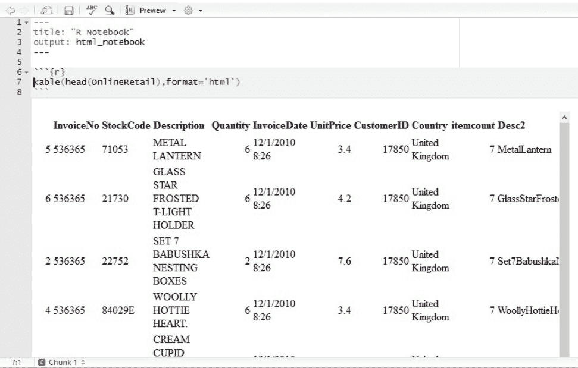

### 分析发票日期

我们也可以查看 InvoiceDate 的分布图。但是首先，日期需要转换为日期格式（Capture.output 将其显示为字符串），并先进行排序：

```
InvoiceDate <- gsub( " .*$", "", OnlineRetail$InvoiceDate)
InvoiceDate <- (as.Date(InvoiceDate, format = "%m/%d/%Y"))
InvoiceDate <- sort(InvoiceDate, decreasing = FALSE)
```

首先，从 str() 函数的输出中观察到，InvoiceDate 现在确实是日期格式：

```
> str(InvoiceDate)
```

以下是输出：

```
Date[1:541909], format: "2010-12-01" "2010-12-01" "2010-12-01" "2
```

我们可以从 head 和 tail 命令以及图中看到，发票涵盖的时期从 2011 年 12 月 1 日到 2011 年 12 月 9 日。我们还可以看到 12 月假期季节左右的订单出现几个高峰：

```
> head(as.data.frame(InvoiceDate))
```

以下是输出：

```
InvoiceDate
1 2010-12-01
2 2010-12-01
3 2010-12-01
4 2010-12-01
5 2010-12-01
6 2010-12-01
```

同样，这些是文件中的最后六条记录。这些记录包含最近的日期：

```
> tail(as.data.frame(InvoiceDate))
```

以下是生成的输出：

```
InvoiceDate
541904 2011-12-09
541905 2011-12-09
541906 2011-12-09
541907 2011-12-09
541908 2011-12-09
541909 2011-12-09
```

### 绘制日期

单个日期和标签将太过密集而无法绘图，因此我们将日期缩减为 月/年：

首先，从发票日期中提取年份和月份（YYYY-MM-DD 的前七个字符），然后使用 table() 函数获取计数。然后绘制结果。您可以看到，最后一个月的交易量低于前一个月，因为数据仅到 12 月 9 日：

```
par(las = 2)
barplot(table(substr(InvoiceDate,1,7)), cex.lab = 1, cex.main = 1
col = c("blue")),main="Invoices by Year/Month")
```

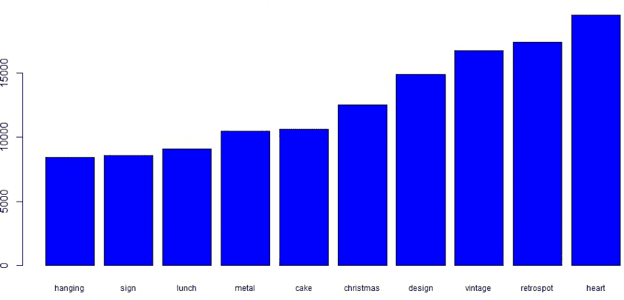

### 在线零售 - 常见术语

### 数据清洗与整理

清洗环节来了！

打印 OnlineRetail 中 description 字段内的一些杂货：

|杂货项描述|
|:---------------------------------------------|
|WHITE HANGING HEART T-LIGHT HOLDER|
|WHITE METAL LANTERN|
|CREAM CUPID HEARTS COAT HANGER|
|KNITTED UNION FLAG HOT WATER BOTTLE|
|RED WOOLLY HOTTIE WHITE HEART.|

尽管每行包含一个独立的杂货项，但这些项的格式统一，即描述每个项的单词数量可变，有些单词是形容词，有些是名词。此外，零售商可能认为某些单词与特定营销活动无关（例如颜色或尺寸，这些可能在所有产品中都是标准的）。这种类型的数据可称为半结构化数据，因为它包含结构化数据的某些定义（主题仅限杂货、全大写、产品是预先已知的等等），以及非结构化数据的某些元素（产品长度不同、文本字符串有差异）。为了获得最佳结果，文本等非结构化数据通常需要在适合分析的形式之前进行清洗和整理。幸运的是，有多个可用的 R 函数可以帮助您完成此任务。

### 删除不需要的字符空格

我们可以先删除每个产品描述中的前导和尾随空格，因为它们对分析没有增加任何价值，只会占用额外空间。trimws 是一个方便的函数，可用于完成此任务，因为它同时删除前导和尾随空格。nchar() 函数将计算字符数


字符串中的字节数，因此我们可以在执行字符串修剪前后对 OnlineRetail$Description 运行此函数，以查看实际将节省多少空间：

```r
sum(nchar(OnlineRetail$Description))
```

以下是输出结果：

```
> [1] 14284888
```

继续以下代码：

```r
OnlineRetail$Description <- trimws(OnlineRetail$Description)
sum(nchar(OnlineRetail$Description))
```

以下是输出结果：

```
> [1] 14283213
```

我们可以看到 trimws 减小了 Description 的大小。如果使用该函数后数字反而增加，那将是检查代码的线索！

### 简化描述

基于颜色选择分析的市场篮子分析本身就是一个有趣的课题。但是，为了进行此分析，我们将删除某些颜色以简化部分描述。我们将使用 gsub() 函数删除产品描述中出现的某些特定颜色。由于 gsub() 函数一次只能处理单个字符串或模式，因此请创建一个函数，将多个字符串传递给 gsub() 函数。

此 gsub_multiple 函数将接受一个字符向量 (x)，并将 from 中提供的所有字符串更改为 to 中的相应值。在本例中，我们希望从文本中删除它们，因此我们的 to 字符串始终为 ""：

```r
gsub_multiple <- function(from, to, x) {
  updated <- x
  for (i in 1:length(from)) {
    updated <- gsub(from[i], to[i], updated)
  }
  return(updated)
}
```

```r
OnlineRetail$Description <- gsub_multiple(c("RED", "PINK", "GREEN",
```

### 自动删除颜色

如果您不想指定颜色，而希望自动删除颜色，也可以实现这一点。

### colors() 函数

`colors()` 函数返回当前调色板中使用的颜色列表。然后，我们可以结合刚才使用的 `gsub()` 函数进行少量代码操作，将 `OnlineRetail$Description` 中的所有指定颜色替换为空白。

我们还将使用 `knitr` 包中包含的 `kable()` 函数，以生成结果的简单 HTML 表格：

```r
#### compute the length of the field before changes
before <- sum(nchar(OnlineRetail$Description))

#### get the unique colors returned from the colors function, and r
#### get the unique colors
col2 <- unique(gsub("[0-9]+", "", colors(TRUE)))

#### Now we will filter out any colors with a length > 7. This number
for (i in 1:length(col2)) {
  col2[i] <- ifelse(nchar(col2[i]) > 7, "", col2[i])
}

col2 <- unique(col2)
```

运行代码后，请再次检查输出，以确保颜色是您想要的：

```r
cat("Unique Colors\n")
> Unique Colors
kable(head(data.frame(col2), 10))
```

以下是输出结果：

| col2       |
| :--------- |
| white      |
| azure      |
| beige      |
| bisque     |
| black      |
| blue       |
| brown      |
| coral      |
| cyan       |

### 清理颜色

通过将所有颜色大写并插入分隔符，进一步清理颜色：

```r
col <- toupper(paste0(col2, collapse = "|"))
```

现在将结果传递给 gsub()：

```r
cat("Pass to gsub\n", head(col, 9))
> Pass to gsub
> WHITE||AZURE|BEIGE|BISQUE|BLACK|BLUE|BROWN|CORAL|CYAN|DARKRED
```

例如，要将数据框中的颜色替换为空白：

```r
OnlineRetail$Description <- gsub(col, "", OnlineRetail$Description)
```

检查长度以查看删除了多少内容。与之前一样，打印前后的字符计数，以确保 Description 的大小已减小：

```r
after <- sum(nchar(OnlineRetail$Description))
print(before)
```

```
> [1] 13682222
print(after)
> [1] 13341097
```

通过检查验证是否不再包含颜色。我们将查看前五个，尽管您可能希望查看更多，且均来自数据集的不同部分。我们暂时保留 "Cream"，但如果认为它对分析无帮助，也会将其删除：

```r
kable(OnlineRetail$Description[1:5], col.names = c("Grocery Item Description"))
```

此处显示前五行：

| Grocery Item Description |
| :----------------------- |
| WHITE HANGING HANGING HEART T-LIGHT HOLDER           |
| WHITE METAL LANTERN                                  |
| CREAM CUPID HEARTS COAT HANGER                       |
| KNITTED UNION FLAG HOT WATER BOTTLE                  |
| WOOLLY HOTTIE WHITE HEART.                           |

### 过滤掉单品交易

由于我们希望拥有一组物品来执行某些关联规则分析，因此我们希望过滤掉每张发票中只包含一个物品的交易。这可能对只购买了一件商品的客户进行单独分析很有用，但对于查找多个物品之间的关联（本练习的目标）没有帮助。

- 让我们使用 `sqldf` 查找所有单品交易，然后创建一个单独的数据框，其中包含每张客户发票的物品数量：

```r
library(sqldf)
```

- 首先构建查询：有多少张不同的发票？我们看到共有 25900 张单独的发票：

```r
sqldf("select count(distinct InvoiceNo) from OnlineRetail")
```
> Loading required package: tcltk
> count(distinct InvoiceNo)
> 1        25900

- 有多少张发票只包含单笔交易？首先，提取单品发票：

```r
single.trans <- sqldf("select InvoiceNo, count(*) as itemcount from OnlineRetail group by InvoiceNo having count(*)=1")
```

- 接下来，将它们加总。这表明单笔交易物品不多（5841 件）：

```r
sum(single.trans$itemcount)
> [1] 5841
```

- SQL 查询：有多少张包含多笔交易？与使用 count(*) == 1 不同，请使用 count(*) > 1 来获取多笔交易。共有 536068 笔：

```r
x2 <- sqldf("select InvoiceNo, count(*) as itemcount from OnlineRetail group by InvoiceNo having count(*) > 1")
sum(x2$itemcount)
> [1] 536068
```

- 显示 x2 中每张发票的物品数量汇总表，以验证它们都至少包含两个物品：

```r
kable(head(x2))
```

| InvoiceNo | itemcount |
| :-------- | :-------: |
| 536365    | 7         |
| 536366    | 2         |
| 536367    | 12        |
| 536368    | 4         |
| 536370    | 20        |
| 536372    | 2         |

### 查看分布情况

现在我们可以查看物品数量的分布情况。通过使用 mean() 函数可以看到，平均每张发票约有 27 个物品。这足以进行有意义的分析：

```r
mean(x2$itemcount)
```

以下是输出：

```
> [1] 27
```

我们也可以绘制直方图：

```r
hist(x2$itemcount, breaks = 500, xlim = c(0, 50))
```

接下来显示的直方图在低端显示出明显的尖峰。我们知道数据中不可能包含单张发票（count=1），因为我们已经将其过滤掉了：

### x2$itemcount 的直方图

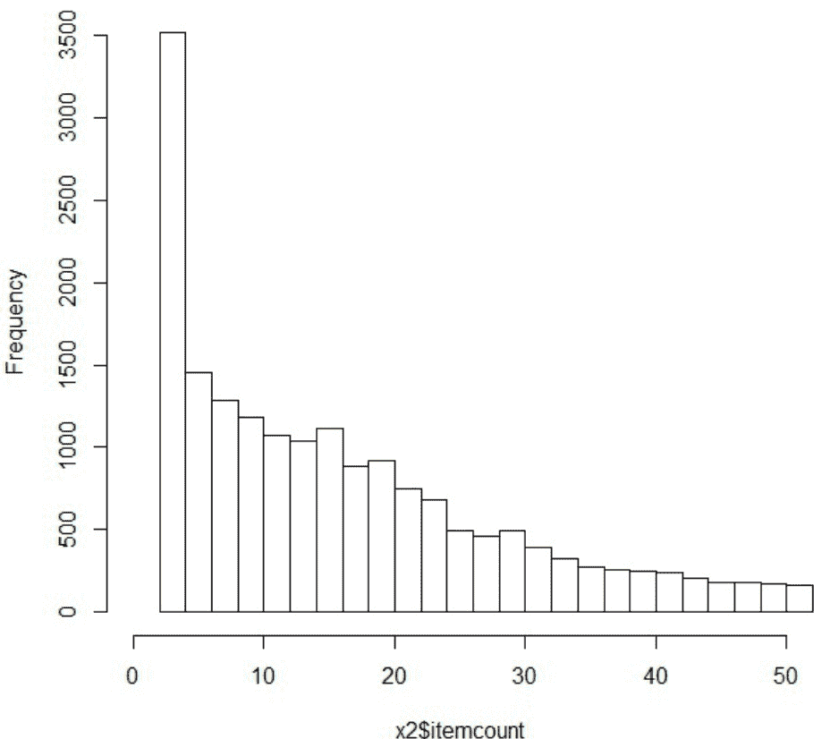

为验证这一点，我们可以通过表格检查 itemcount 频率。在控制台中运行以下 `table()` 命令：

```r
head(table(x2$itemcount), 20)
```

我们可以验证单品计数不再出现：

```
> head(table(x2$itemcount), 20)
```

| | 2 | 3 | 4 | 5 | 6 | 7 | 8 | 9 | 10 | 11 | 12 | 13 | 14 | 15 | 16 | 17 | 18 | 19 | 20 | 21 |
|---|---|---|---|---|---|---|---|---|---|---|---|---|---|---|---|---|---|---|---|---|
| | 1612 | 1095 | 815 | 788 | 670 | 652 | 631 | 629 | 553 | 573 | 496 | 519 | 521 | 548 | 569 | 454 | 434 | 481 | 438 | 408 |

### 将结果合并回原始数据

我们希望在原始数据框中保留每张发票的物品总数。这涉及使用 `merge()` 函数并将 `InvoiceNo` 指定为键，以将每张发票中包含的物品数量重新连接到原始交易中。

如果在合并前后统计不同发票的数量，可以看到合并后的发票数量低于合并前：

```r
#### first take a 'before' snapshot
nrow(OnlineRetail)
> [1] 541909
```

```r
#### count the number of distinct invoices
sqldf("select count(distinct InvoiceNo) from OnlineRetail")
```

输出显示共有 25900 张不同的发票：

```
> count(distinct InvoiceNo)
> 1           25900
```

现在将计数合并回原始数据：

```r
OnlineRetail <- merge(OnlineRetail, x2, by = "InvoiceNo")
```

检查新的行数和不同发票的新计数（20059 对比 25900）。与原始计数相比，请注意这些数字。减少的原因是消除了每张发票只有一项物品的成员：

```
> nrow(OnlineRetail)
[1] 536068
> sqldf("select count(distinct InvoiceNo) from OnlineRetail")
count(distinct InvoiceNo)
```


打印 OnlineRetail 表格以及合并后的物品计数：

```
kable(OnlineRetail [1:5, 1:9], col.names=c("Inv#","StockCode","Desc","Quant","InvDate"))
```

项目计数出现在该表格的最后一列：

| 发票号 | 商品代码 | 描述 | 数量 | 发票日期 |
| :--- | :--- | :--- | :--- | :--- |
| 536365 | 84406B | CREAM CUPID HEARTS COAT HANGER | 8 | 12/1/201 |
| 536365 | 22752 | SET 7 BABUSHKA NESTING BOXES | 2 | 12/1/201 |
| 536365 | 85123A | HANGING HEART T-LIGHT HOLDER | 6 | 12/1/201 |
| 536365 | 84029E | WOOLLY HOTTIE HEART. | 6 | 12/1/201 |
| 536365 | 71053 | METAL LANTERN | 6 | 12/1/201 |

### 使用驼峰式压缩描述

对于长描述，有时将其压缩为驼峰式以提高可读性是有益的。这在查看作为 _x_ 或 _y_ 轴标签的描述时尤其有价值。

驼峰式是一些程序员用于编写复合词的方法，即先删除空格，然后每个单词的首字母大写。这也是一种节省空间的方式。

为了实现这一点，我们可以编写一个名为 `.simpleCap` 的函数，它执行此功能。为了说明其工作原理，我们将向其传递一个两元素字符向量 c("A certain good book","A very easy book")，并观察结果。

### 将描述映射到驼峰式的自定义函数

这是使用此函数的一个简单示例，它将两个字符向量 c("A certain good book", "A very easy book") 映射为驼峰式。该向量映射为两个新元素：

```
[1] "ACertainGoodBook", and [2] "AVeryEasyBook"
```

```
#### change descriptions to camelcase maybe append to itemnumber for
.simpleCap <- function(x) {
  # s <- strsplit(x, ' ')[[1]]
  s <- strsplit(tolower(x), " ")[[1]]

  aa <- paste(toupper(substring(s, 1, 1)), substring(s, 2), sep = "")
  gsub(" ", "", aa, fixed = TRUE)
}

a <- c("A certain good book", "A very easy book")
a4 <- gsub(" ", "", .simpleCap(a), fixed = TRUE)
a4
```

```
> [1] "ACertainGoodBook"
lapply(a, .simpleCap)
> [[1]]
> [1] "ACertainGoodBook"
>
> [[2]]
> [1] "AVeryEasyBook"
```

让我们使用 .simpleCap 函数从我们的 OnlineRetail 数据集中创建描述的新版本，并将其称为 Desc2，它删除空格并将每个单词的首字母大写：

```
OnlineRetail$Desc2 <- lapply(as.character(OnlineRetail$Description), .simpleCap)
kable(OnlineRetail[1:5, c(3, 10)], padding = 0)
```

| 描述 | Desc2 |
|:---|:---|
| CREAM CUPID HEARTS COAT HANGER | CreamCupidHeartsCoatHanger |
| SET 7 BABUSHKA NESTING BOXES | Set7BabushkaNestingBoxes |
| WHITE HANGING HEART T-LIGHT HOLDER | WhiteHangingHeartT-lightHolder |
| WOOLLY HOTTIE WHITE HEART. | WoollyHottieWhiteHeart. |
| WHITE METAL LANTERN | WhiteMetalLantern |

### 提取最后一个单词

产品描述的第一个和最后一个单词通常包含有用信息，有时可以用单个单词或短语替代原始的较长描述。虽然这并不总是成立，但值得一试。为了从描述中提取最后一个单词，我们可以使用 stringr 包中的 word 函数：

```
library(stringr)
OnlineRetail$lastword <- word(OnlineRetail$Description, -1) #sup
OnlineRetail$Description <- trimws(OnlineRetail$Description, "1")
OnlineRetail$firstword <- word(OnlineRetail$Description, 1)
```

```
#### use head(OnlineRetail) if you are not using Rmarkdown
kable(OnlineRetail[1:5, c(3, 10:12)], padding = 0)
```

第一个单词出现在以下输出的最后一列：

| 描述 | Desc2 | 最后一个单词 | 第一个单词 |
|:---|:---|:---|:---|
| CREAM CUPID HEARTS COAT HANGER | CreamCupidHeartsCoatHanger | HANGER | CREAM |
| SET 7 BABUSHKA NESTING BOXES | Set7BabushkaNestingBoxes | BOXES | SET |
| WHITE HANGING HEART T-LIGHT HOLDER | WhiteHangingHeartT-lightHolder | HOLDER | WHITE |
| WOOLLY HOTTIE WHITE HEART. | WoollyHottieWhiteHeart. | HEART. | WOOLLY |
| WHITE METAL LANTERN | WhiteMetalLantern | LANTERN | WHITE |

为了查看此 lastword 映射是否有意义，我们将对结果进行排序，以便可以看到出现频率最高的结尾单词。我们最终可以使用这些信息来创建类别子产品，例如箱子、袋子、牌子等等：

```
kable(head(as.data.frame(sort(table(OnlineRetail$lastword[]), decreasing = TRUE)))
```

排序后的结果如下。请注意，这被格式化为表格，尽管 kable() 函数的默认输出在控制台中将显示为纯文本。

lastword 描述看起来可用（除了大量的 NA 之外），但我们仍将保留这些列作为分析数据集的一部分：

| 变量 | 频率 |
|:------------|----------|
| DESIGN | 25557 |
| | 24321 |
| HOLDER | 13528 |
| RETROSPOT | 13013 |
| BOX | 12939 |
| SIGN | 12210 |
| CASES | 10888 |
| BAG | 9723 |
| SET | 9056 |
| CHRISTMAS | 7868 |

### 创建测试和训练数据集

现在我们已完成转换，将创建训练和测试数据框。我们将在训练集和测试集之间进行 50/50 划分：

```
#### Take a sample of full vector
nrow(OnlineRetail)
> [1] 536068
pctx <- round(0.5 * nrow(OnlineRetail))
set.seed(1)

#### randomize rows
df <- OnlineRetail[sample(nrow(OnlineRetail)), ]
rows <- nrow(df)
OnlineRetail <- df[1:pctx, ] #training set
OnlineRetail.test <- df[(pctx + 1):rows, ] #test set
rm(df)

#### Display the number of rows in the training and test datasets.
nrow(OnlineRetail)
> [1] 268034
nrow(OnlineRetail.test)
> [1] 268034
```

### 保存结果

定期保存数据框是个好主意，这样您可以从各种检查点恢复分析。

在本示例中，我将首先按 `InvoiceNo` 对两者进行排序，然后将测试集和训练集保存到磁盘，以便需要时随时将其重新加载到内存中：

```
setwd("C:/PracticalPredictiveAnalytics/Data")
OnlineRetail <- OnlineRetail[order(OnlineRetail$InvoiceNo), ]
```

```
OnlineRetail.test <- OnlineRetail.test[order(OnlineRetail.test$InvoiceNo), ]
save(OnlineRetail,file='OnlineRetail.full.Rda')
save(OnlineRetail.test,file='OnlineRetail.test.Rda')
load('OnlineRetail.full.Rda') load('OnlineRetail.test.Rda')
nrow(OnlineRetail)
> [1] 268034
nrow(OnlineRetail.test)
> [1] 268034
nrow(OnlineRetail)
> [1] 268034
```

至此，我们已准备好分析数据集，并准备进行实际分析。

如果愿意，您可以按以下方式将整个工作区保存到磁盘：

```
save.image(file = "ch6 part 1.Rdata")
```

### 加载分析文件

如果您仍在 OnlineRetail 仍在内存中的会话中，则没问题！但是，如果您是从我们上次结束的地方继续，则需要加载上次会话中保存的数据。首先设置工作目录，然后加载 OnlineRetail 训练数据集：

```
rm(list = ls())
setwd("C:/PracticalPredictiveAnalytics/Data")
load("OnlineRetail.full.Rda")
#### works for small data
OnlineRetail <- OnlineRetail[1:10000,]
cat (nrow(OnlineRetail), "rows loaded\n")
> 10000 rows loaded
```

上一步中的 cat 函数应反映训练数据集的行数，即 268034。

### 确定后继规则

在数据准备阶段，我们已经看到每张发票都生成了大量的项集。为了开始演示算法，我们将从每个产品描述中提取一个代表性单词，并使用该单词作为后继（或 rhs）来构建一些关联规则。我们已经保存了每个产品描述的第一个和最后一个单词。我们将更仔细地检查这些单词，看看是否可以对它们进行过滤，以得到一组可管理的事务。

让我们先按降序预览描述中第一个和最后一个单词的频率。这应该能让我们了解哪些是热门产品：

```
library(arules)
> Loading required package: Matrix
>
> Attaching package: 'arules'
>
> The following objects are masked from 'package:base':
>
>     abbreviate, write
library(arulesViz)
> Loading required package: grid
```

打印描述中流行的第一个单词。我们将按降序对第一个单词的频率进行排序来实现：

```
kable(head(as.data.frame(sort(table(OnlineRetail$firstword[]), decreasing = TRUE)))
```

| | |
|---|---|
| 套装 | 17381 |
| 袋子 | 8720 |
| 午餐 | 7692 |


| 单词 | 计数 |
|---|---|
| RETROSPOT | 7155 |
| PACK | 6861 |
| VINTAGE | 6204 |
| HEART | 4799 |
| HANGING | 4457 |
| DOORMAT | 4175 |
| REGENCY | 3452 |

同样，打印描述中常见的最后几个词：

```
kable(head(as.data.frame(sort(table(OnlineRetail$lastword[]), decreasing = TRUE)), 10))
sort(table(OnlineRetail$lastword[]), decreasing = TRUE)
```

18376

| 单词 | 计数 |
|---|---|
| DESIGN | 12713 |
| HOLDER | 6792 |

- BOX 6528
- RETROSPOT 6517
- SIGN 6184
- CASES 5465
- BAG 4826
- SET 4418
- CHRISTMAS 3963

查看常见术语表明，许多交易涉及购买盒子、箱子、标志、袋子等。

### 替换缺失值

我们从 `lastword` 的频率中看出存在一些空白值。`lastword` 似乎主要包含名词，而 `firstword` 似乎也是形容词和名词的混合体（bag、heart）。如果将文本字符串视为词袋（Bag of Words），我们可以合理地将两者合并为一个标记。但是，我们将优先使用 `lastword`，仅在其缺失时才用 `firstword` 的值填充它：

```
#### replace blank values in lastword, with first word.
OnlineRetail$lastword <- ifelse(OnlineRetail$lastword == "", OnlineRetail$firstword, OnlineRetail$lastword)
```

完成此步骤后，我们将再次查看频率，并观察到空白值已消失：

```
head(as.data.frame(sort(table(OnlineRetail$lastword[]), decreasing = TRUE)), 10)
> sort(table(OnlineRetail$lastword[]), decreasing = TRUE)
> DESIGN 12
> HOLDER 6
> RETROSPOT 6
> BOX 6
> SIGN 6
> BAG 5
> CASES 5
> SET 4
> HEART 4
> CHRISTMAS 4
```

### 创建最终子集

基于这些频率，我们将过滤数据，仅包含顶级类别的子集。我们将排除不适用于实物产品的一些术语，例如 design、set 及任何相关颜色：

```
#### Testing OnlineRetail2 <- OnlineRetail
OnlineRetail2 <- subset(OnlineRetail, lastword %in% c("BAG", "CASES", "BOX", "SIGN", "CHRISTMAS", "BOTTLE", "BUNTING", "MUG", "BOWL", "COVER", "HEART", "MUG", "BOWL"))
```

再次对结果运行 table() 函数以查看新频率：

```
head(as.data.frame(sort(table(OnlineRetail2$lastword[]), decreasing = TRUE)), 10)
> sort(table(OnlineRetail2$lastword[]), decreasing = TRUE)
> HOLDER 6792
> BOX 6528
> SIGN 6184
> BAG 5761
> CASES 5465
> HEART 4027
> CHRISTMAS 4005
> BOTTLE 3795
> BUNTING 3066
> MUG 2900
```

使用 nrow() 函数查看从原始数据中过滤掉了多少数据：

```
cat(nrow(OnlineRetail), "Original before subsetting\n")
> 268034 Original before subsetting
cat(nrow(OnlineRetail2), "After Subsetting\n")
> 55609 After Subsetting
```

### 创建市场篮子交易文件

我们快成功了！还需要额外的一步来为市场篮子分析准备数据。

关联规则包要求数据采用事务格式。事务可以采用两种不同的格式指定：

- 每个项集一条事务，带有标识符，并以一行显示整个篮子，就像我们在 Groceries 数据中看到的那样。
- 每行一项，带有标识符。

此外，可以通过以下两种方式之一来创建实际的事务文件：

- 实际写入事务文件。
- 将数据框强制转换为事务格式。

对于较小的数据量，将数据框强制转换为事务文件更简单，但对于较大的事务文件，最好先写入事务文件，因为追加文件可以从大型操作事务系统中读取。我们将说明这两种方式。

### 方法一：将数据框强制转换为事务文件

现在我们准备好强制转换数据框了。我们将创建一个临时数据框，仅包含事务 ID（InvoiceNo）和描述符（lastword）。

首先，我们将验证这两个变量的列名和列号。我们可以先对 OnlineRetail2 运行 colnames 函数，查看它们对应数据框的第 1 列和第 12 列：

```
colnames(OnlineRetail2)
> [1] "InvoiceNo" "StockCode" "Description" "Quantity" "I
> [6] "UnitPrice" "CustomerID" "Country" "itemcount" "D
> [11] "lastword" "firstword"
```

为了再次确认，请显示前 25 行，指定先前找到的索引：

```
kable(head(OnlineRetail2[, c(1, 11)], 5))
```

| | 发票号 | 最后一个词 |
| :-- | :-------- | :------- |
| 6 | 536365 | HOLDER |
| 45 | 536370 | BOX |
| 39 | 536370 | BOX |
| 57 | 536373 | HOLDER |
| 59 | 536373 | BOTTLE |

首先，创建仅包含两个列的数据框，分别命名为 TransactionID 和 Items：

```
tmp <- data.frame(OnlineRetail2[, 1], OnlineRetail2[, 11])
names(tmp)[1] <- "TransactionID"
names(tmp)[2] <- "Items"

tmp <- unique(tmp)
nrow(tmp)
> [1] 33182
```

验证结果：

```
kable(head(tmp))
```

以下是输出：

| | 事务 ID | 项目 |
|:-:|:------|:----|
| 1 | 536365 | HOLDER |
| 2 | 536370 | BOX |
| 4 | 536373 | HOLDER |
| 5 | 536373 | BOTTLE |
| 7 | 536373 | MUG |
| 9 | 536375 | HOLDER |

我们将使用 `split()` 函数按 `InvoiceID`（第 1 列）对描述（`lastword`，即第 2 列）进行分组。`as()` 函数是关键字，因为它将拆分结果转换为事务形式：

```
trans4 <- as(split(tmp[, 2], tmp[, 1]), "transactions")
```

### 检查事务文件

数据强制转换为事务形式后，可以使用 inspect 函数来检查数据。

### 注意

检查事务文件时，不能直接使用常规 print 或 head 函数，因为这些对象是稀疏格式。应改用 `inspect()` 函数。

如果恰好加载了 `tm` 包（我们稍后将使用它），则必须在 `inspect` 前加上 `arules::inspect` 前缀，因为 `tm` 包中也有一个用途不同的 inspect 函数。

如果在前五条记录上运行 `inspect` 命令，可以看到数据采用篮子格式，即每张发票显示由 `{}` 分隔的与该发票关联的项集：

```
arules::inspect(trans4[1:5])
>  items       transactionID
> 1 {HOLDER}    536365
> 2 {BOX}       536370
> 3 {BOTTLE,HOLDER,MUG} 536373
> 4 {BOTTLE,HOLDER}       536375
> 5 {HOLDER}              536376
```

除使用 inspect 之外，显示事务的另一种方法是先将其强制转换为矩阵，然后以布尔值显示项目。如果项目较多，需要对列向量进行子集化，以便适应屏幕：

```
as(trans4, "matrix")[1:5, 1:5]
>        BAG BOTTLE BOWL BOX BUNTING
> 536365 FALSE FALSE FALSE FALSE FALSE
> 536370 FALSE FALSE FALSE TRUE  FALSE
> 536373 FALSE TRUE  FALSE FALSE FALSE
> 536375 FALSE TRUE  FALSE FALSE FALSE
> 536376 FALSE FALSE FALSE FALSE FALSE
as(trans4, "matrix")[1:5, 6:ncol(trans4)]
>          CANDLES CASES CHRISTMAS COVER HEART HOLDER  MUG SIGN
> 536365 FALSE FALSE       FALSE FALSE FALSE TRUE  FALSE FALSE
> 536370 FALSE FALSE       FALSE FALSE FALSE FALSE FALSE FALSE
> 536373 FALSE FALSE       FALSE FALSE FALSE TRUE  TRUE  FALSE
> 536375 FALSE FALSE       FALSE FALSE FALSE TRUE  FALSE FALSE
> 536376 FALSE FALSE       FALSE FALSE FALSE TRUE  FALSE FALSE
```

在运行任何关联规则之前，我们可以获取前 N 个项目的计数，如第一个图所示。

如果我们要查找具有指定支持度的项目，也可以将其作为参数传递给函数。

第二个图是另一种绘制项目的方式，它将支持度作为筛选条件，并表明袋子、盒子、箱子和支架的支持度较高：

```
par(mfrow = c(1, 2), bg = "white", col = c("blue"))
itemFrequencyPlot(trans4, topN = 10, type = "absolute", cex.names = 0.7)
itemFrequencyPlot(trans4, support = 0.2, cex.names = 0.75)
```


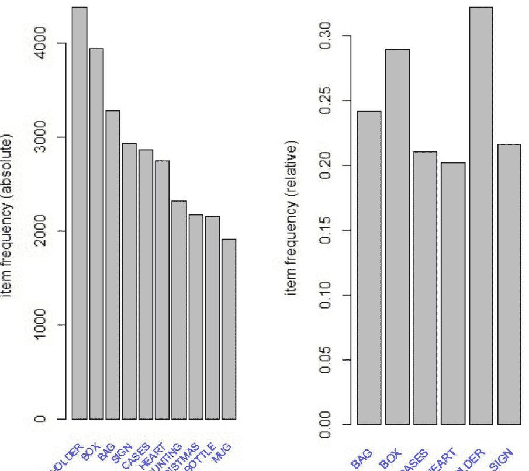

重置 `graphics` 参数。输出将显示 `null device`，指示其已重置：

```
dev.off()
> null device
> 1
```

### 查找关联规则

如前所示，关联规则是使用 `apriori()` 函数运行的。

`apriori()` 函数具有多个筛选参数，用于控制生成的规则数量。在我们的示例中，我们将指定规则要被考虑所需通过的最小支持度和置信度阈值。

传递给 apriori 的数字取决于你想如何查看规则。它可以是初步筛选，也可以在进行多轮之后进行深入分析。但通常，如果我们想要更多规则，可以减小 `support` 和 `confidence` 参数。如果我们想关注出现频繁的项目，则提高支持度阈值。如果我们想专注于更高质量、更准确的规则，则会提高置信度水平。

这些数字不是绝对的。它们是你可以调整的数字，以限制你将要查看的规则数量，与它们的质量相权衡。

通常会指定 `minlen = 2` 参数，以保证规则左侧包含项集：

```
rulesx <- apriori(trans4, parameter = list(minlen = 2, support =
> Apriori
> Parameter specification:
> confidence minval smax arem aval originalSupport support min
> 0.01 0.1 1 none FALSE TRUE 0.02
> target ext
> rules FALSE
> Algorithmic control:
> filter tree heap memopt load sort verbose
> 0.1 TRUE TRUE FALSE TRUE 2 TRUE
> Absolute minimum support count: 272
> set item appearances ...[0 item(s)] done [0.00s].
> set transactions ...[13 item(s), 13617 transaction(s)] done [0
> sorting and recoding items ... [13 item(s)] done [0.00s].
> creating transaction tree ... done [0.00s].
> checking subsets of size 1 2 3 4 5 done [0.00s].
> writing ... [829 rule(s)] done [0.00s].
> creating S4 object ... done [0.00s].
```

apriori 算法的输出将告诉我们生成了多少条规则。如果你还对 rulesx 执行 str() 函数，它将显示 rulesx 对象中包含的所有子列表，这可能会变得复杂。通常，输出足以分析规则，但这些子列表可以在循环中变化参数时以编程方式用于打印生成的规则数量。在我们的示例中，打印其中一个子列表的第二列 (rulesx@lhs@data@Dim[2]) 显示此处已生成 829 条规则。这是一个可以管理的规则数量，可以查看：

```
str(rulesx)
> Formal class 'rules' [package "arules"] with 4 slots
>   ..@ lhs    :Formal class 'itemMatrix' [package "arules"] with
>   .. .. ..@ data  :Formal class 'ngCMatrix' [package "Matrix"]
>   .. .. .. .. ..@ i      : int [1:1752] 8 5 8 7 8 11 8 2 8 4
>   .. .. .. .. ..@ p      : int [1:830] 0 1 2 3 4 5 6 7 8 9 ..
>   .. .. .. .. ..@ Dim    : int [1:2] 13 829
>   .. .. .. .. ..@ Dimnames:List of 2
>   .. .. .. .. .. ..$ : NULL
>   .. .. .. .. .. ..$ : NULL
>   .. .. ..@ factors : list()
>   .. .. ..@ itemInfo :'data.frame': 13 obs. of  1 variable:
>   .. .. .. .. ..$ labels: chr [1:13] "BAG" "BOTTLE" "BOWL" "BOX"
>   .. .. ..@ itemsetInfo:'data.frame': 0 obs. of  0 variables
>   ..@ rhs    :Formal class 'itemMatrix' [package "arules"] with
>   .. .. ..@ data  :Formal class 'ngCMatrix' [package "Matrix"]
>   .. .. .. .. ..@ i      : int [1:829] 5 8 7 8 11 8 2 8 4 8 .
>   .. .. .. .. ..@ p      : int [1:830] 0 1 2 3 4 5 6 7 8 9 ..
>   .. .. .. .. ..@ Dim    : int [1:2] 13 829
>   .. .. .. .. ..@ Dimnames:List of 2
>   .. .. .. .. .. ..$ : NULL
>   .. .. .. .. .. ..$ : NULL
>   .. .. ..@ factors : list()
>   .. .. ..@ itemInfo :'data.frame': 13 obs. of  1 variable:
>   .. .. .. .. ..$ labels: chr [1:13] "BAG" "BOTTLE" "BOWL" "BOX"
>   .. .. ..@ itemsetInfo:'data.frame': 0 obs. of  0 variables
>   ..@ quality:'data.frame':   829 obs. of  3 variables:
>   .. ..$ support : num [1:829] 0.0239 0.0239 0.0206 0.0206 0
>   .. ..$ confidence: num [1:829] 0.278 0.21 0.24 0.129 0.285 .
>   .. ..$ lift    : num [1:829] 2.43 2.43 1.5 1.5 2.03 ...
>   ..@ info   :List of 4
>   .. ..$ data          : symbol trans4
>   .. ..$ ntransactions: int 13617
>   .. ..$ support      : num 0.02
>   .. ..$ confidence   : num 0.01
rulesx@lhs@data@Dim[2]
```

### 检查规则摘要

规则长度分布指示出现在关联左侧和右侧的项集数量。最常见的项目数是 3，这要么意味着购买两件商品一起购买暗示购买单个商品，也可能意味着购买单个商品暗示购买两件额外商品。

### 检查规则质量并观察最高支持度

质量度量会告诉你关于支持度、置信度和提升度分布的信息。quality 函数将为每条规则提供支持度、提升度和置信度。你还可以按每个重要度量对规则进行排序，并观察哪些规则具有最高度量。

从低支持度分布可以看出，没有特定的项集比其他项集出现得更频繁。如果你检查按支持度排序的规则，你会看到最高支持度为 0.046。请注意，这与摘要中给出的最大支持度一致。前三个最高支持度适用于购买支架、盒子或标志牌的客户：

```
summary(rulesx)
> set of 829 rules
>
> rule length distribution (lhs + rhs):sizes
>   2   3   4   5
> 156 438 220  15
>
>   Min. 1st Qu.  Median    Mean 3rd Qu.    Max.
> 2.000 3.000 3.000 3.113 4.000 5.000
>
> summary of quality measures:
>
>         support confidence     lift
> Min.   :0.02005   Min.   :0.1293   Min.   :1.000
> 1st Qu.:0.02210   1st Qu.:0.3672   1st Qu.:1.948
> Median :0.02512   Median :0.5110   Median :2.393
> Mean   :0.02987   Mean   :0.5068   Mean   :2.444
> 3rd Qu.:0.03202   3rd Qu.:0.6533   3rd Qu.:2.899
> Max.   :0.09885   Max.   :0.8571   Max.   :5.419
>
>
> mining info:
>   data ntransactions support confidence
> trans4    13617    0.02    0.01
head(quality(rulesx)) #also look at the quality measures for each
>   support confidence   lift
> 1 0.02394066 0.2779199 2.432156
> 2 0.02394066 0.2095116 2.432156
> 3 0.02063597 0.2395567 1.500480
> 4 0.02063597 0.1292548 1.500480
> 5 0.02452816 0.2847400 2.026819
> 6 0.02452816 0.1745949 2.026819
```

```
tmp <- as.data.frame(inspect(head(sort(rulesx, by = "support"), 1
>   lhs            rhs             support confidence lift
> 155 {BOX}      => {HOLDER}    0.09884703 0.3417111 1.063075
> 156 {HOLDER}   => {BOX}       0.09884703 0.3075166 1.063075
> 135 {HEART}    => {HOLDER}    0.09620328 0.4768839 1.483602
> 136 {HOLDER}   => {HEART}     0.09620328 0.2992918 1.483602
> 151 {BAG}      => {BOX}       0.09304546 0.3859275 1.334139
> 152 {BOX}      => {BAG}       0.09304546 0.3216552 1.334139
> 149 {SIGN}     => {HOLDER}    0.09069545 0.4203540 1.307736
> 150 {HOLDER}   => {SIGN}      0.09069545 0.2821567 1.307736
> 141 {CASES}    => {BOX}       0.08511420 0.4048201 1.399451
> 142 {BOX}      => {CASES}     0.08511420 0.2942371 1.399451
```

### 置信度和提升度度量

与之前类似，对规则进行排序并检查最高置信度和提升度度量：

```
tmp <- as.data.frame(arules::inspect(head(sort(rulesx, by = "confidence"),
>   lhs                       rhs             support confidence lift
> 815 {BAG,BOWL,BOX,SIGN}   => {HOLDER}    0.02070941 0.8571429  2
> 631 {BAG,BOTTLE,BOWL}     => {BOX}       0.02181097 0.8510029  2
> 643 {BOWL,HEART,SIGN}     => {HOLDER}    0.02151722 0.8492754  2
> 820 {BAG,BOX,HEART,SIGN}  => {HOLDER}    0.02137035 0.8434783  2
> 632 {BOTTLE,BOWL,BOX}     => {BAG}       0.02181097 0.8413598  3
> 816 {BAG,BOWL,HOLDER,SIGN} => {BOX}      0.02070941 0.8392857  2
> 817 {BOWL,BOX,HOLDER,SIGN} => {BAG}      0.02070941 0.8392857  3
> 707 {BOTTLE,HEART,SIGN}   => {HOLDER}    0.02144378 0.8366762  2
> 651 {BAG,BOWL,HEART}      => {HOLDER}    0.02115003 0.8347826  2
> 719 {BOTTLE,CASES,SIGN}   => {BAG}       0.02063597 0.8289086  3
```

```
tmp <- as.data.frame(arules::inspect(head(sort(rulesx, by = "lift"),
>   lhs            rhs            support confidence lift
```


> 602 {BAG,HOLDER,SIGN}   => {COVER}   0.02012191 0.4667802   5.4
> 598 {BAG,BOX,SIGN}      => {COVER}   0.02019534 0.4661017   5.4
> 819 {BAG,BOX,HOLDER,SIGN} => {BOWL}   0.02070941 0.6698337   5.2
> 610 {BAG,BOX,HOLDER}    => {COVER}   0.02070941 0.4483307   5.2
> 606 {BOX,HOLDER,SIGN}   => {COVER}   0.02004847 0.4333333   5.0
> 634 {BAG,BOTTLE,BOX}    => {BOWL}    0.02181097 0.6279070   4.9
> 638 {BAG,HEART,SIGN}    => {BOWL}    0.02034222 0.6141907   4.8
> 662 {BAG,CASES,SIGN}    => {BOWL}    0.02144378 0.6134454   4.8
> 159 {BAG,BOWL}          => {COVER}   0.02092972 0.4025424   4.6
> 670 {CASES,HOLDER,SIGN} => {BOWL}    0.02078284 0.5811088   4.5

### 筛选大量规则

一旦规则构建完成，我们可以使用特殊的子集函数来过滤关联规则左侧（lhs）或右侧（rhs）项集中的项目。如果你在项集中查找特定项目，这很有价值。

使用 %in% 运算符进行精确匹配，或使用 %pin% 进行部分匹配：

```
#### to see what 'Christmas' purchases imply.

lhs.rules <- subset(rulesx, subset = lhs %pin% "CHRISTMAS")
lhs.rules
```

```
> set of 44 rules
inspect (lhs.rules)
>      lhs             rhs             support confidence lift
>  4   {CHRISTMAS}     => {COVER}      0.02063597 0.1292548   1.50
>  26  {CHRISTMAS}     => {CANDLES}    0.02702504 0.1692732   1.48
>  47  {CHRISTMAS}     => {MUG}        0.02379379 0.1490340   1.06
>  49  {CHRISTMAS}     => {BOWL}       0.02680473 0.1678933   1.31
>  51  {CHRISTMAS}     => {BUNTING}    0.03018286 0.1890524   1.10
>  53  {CHRISTMAS}     => {BOTTLE}     0.04553132 0.2851886   1.79
>  55  {CHRISTMAS}     => {HEART}      0.03708600 0.2322907   1.15
>  57  {CHRISTMAS}     => {CASES}      0.04751414 0.2976081   1.41
>  59  {CHRISTMAS}     => {SIGN}       0.03547037 0.2221711   1.02
>  61  {CHRISTMAS}     => {BAG}        0.04663289 0.2920883   1.21
>  63  {CHRISTMAS}     => {BOX}        0.05500477 0.3445262   1.19
>  65  {CHRISTMAS}     => {HOLDER}     0.05133289 0.3215271   1.00
>  253 {BOTTLE,CHRISTMAS} => {CASES}    0.02210472 0.4854839   2.30
>  254 {CASES,CHRISTMAS} => {BOTTLE}    0.02210472 0.4652241   2.93
>  256 {BOTTLE,CHRISTMAS} => {BAG}      0.02283910 0.5016129   2.08
>  257 {BAG,CHRISTMAS}  => {BOTTLE}     0.02283910 0.4897638   3.08
>  259 {BOTTLE,CHRISTMAS} => {BOX} 0.02489535 0.5467742 1.89
>  260 {BOX,CHRISTMAS} => {BOTTLE} 0.02489535 0.4526035 2.85
>  262 {BOTTLE,CHRISTMAS} => {HOLDER} 0.02504223 0.5500000 1.71
>  263 {CHRISTMAS,HOLDER} => {BOTTLE} 0.02504223 0.4878398 3.07
>  265 {CHRISTMAS,HEART} => {BAG} 0.02004847 0.5405941 2.24
>  266 {BAG,CHRISTMAS} => {HEART} 0.02004847 0.4299213 2.13
>  268 {CHRISTMAS,HEART} => {BOX} 0.02203128 0.5940594 2.05
>  269 {BOX,CHRISTMAS} => {HEART} 0.02203128 0.4005340 1.98
>  271 {CHRISTMAS,HEART} => {HOLDER} 0.02247191 0.6059406 1.88
>  272 {CHRISTMAS,HOLDER} => {HEART} 0.02247191 0.4377682 2.17
>  274 {CASES,CHRISTMAS} => {BAG} 0.02291254 0.4822257 2.00
>  275 {BAG,CHRISTMAS} => {CASES} 0.02291254 0.4913386 2.33
>  277 {CASES,CHRISTMAS} => {BOX} 0.02548285 0.5363215 1.85
>  278 {BOX,CHRISTMAS} => {CASES} 0.02548285 0.4632844 2.20
>  280 {CASES,CHRISTMAS} => {HOLDER} 0.02283910 0.4806801 1.49
>  281 {CHRISTMAS,HOLDER} => {CASES} 0.02283910 0.4449213 2.11
>  283 {CHRISTMAS,SIGN} => {BAG} 0.02137035 0.6024845 2.49
>  284 {BAG,CHRISTMAS} => {SIGN} 0.02137035 0.4582677 2.12
>  286 {CHRISTMAS,SIGN} => {BOX} 0.02342660 0.6604555 2.28
>  287 {BOX,CHRISTMAS} => {SIGN} 0.02342660 0.4259012 1.97
>  289 {CHRISTMAS,SIGN} => {HOLDER} 0.02276566 0.6418219 1.99
>  290 {CHRISTMAS,HOLDER} => {SIGN} 0.02276566 0.4434907 2.05
>  292 {BAG,CHRISTMAS} => {BOX} 0.02687817 0.5763780 1.99
>  293 {BOX,CHRISTMAS} => {BAG} 0.02687817 0.4886515 2.02
>  295 {BAG,CHRISTMAS} => {HOLDER} 0.02460160 0.5275591 1.64
>  296 {CHRISTMAS,HOLDER} => {BAG} 0.02460160 0.4792561 1.98
>  298 {BOX,CHRISTMAS} => {HOLDER} 0.02812661 0.5113485 1.59
>  299 {CHRISTMAS,HOLDER} => {BOX} 0.02812661 0.5479256 1.89
```

### 哪些购买会导致购买蜡烛？

```
rhs.rules <- subset(rulesx, subset = rhs %pin% c("CANDLES"))
```

```
rhs.rules
> set of 26 rules
```

```
tmp <- as.data.frame(arules::inspect(head(sort(rhs.rules, by = "s
> lhs rhs support confidence lift
> 46 {HOLDER} => {CANDLES} 0.04920320 0.1530729 1.339584
> 44 {BOX} => {CANDLES} 0.04714695 0.1629855 1.426333
> 38 {CASES} => {CANDLES} 0.03958287 0.1882641 1.647552
> 42 {BAG} => {CANDLES} 0.03789381 0.1571733 1.375469
> 36 {HEART} => {CANDLES} 0.03473599 0.1721878 1.506865
> 40 {SIGN} => {CANDLES} 0.03429537 0.1589517 1.391031
> 34 {BOTTLE} => {CANDLES} 0.02908130 0.1833333 1.604402
> 30 {BOWL} => {CANDLES} 0.02805317 0.2200461 1.925686
> 252 {BOX,HOLDER} => {CANDLES} 0.02768598 0.2800892 2.451140
> 32 {BUNTING} => {CANDLES} 0.02739223 0.1605682 1.405178
```

```
inspect(head(sort(rhs.rules, by = "confidence")))
```

| 索引 | lhs | rhs | 支持度 | 置信度 | 提升度 |
|---|---|---|---|---|---|
| 219 | {BAG,HEART} | {CANDLES} | 0.02056253 | 0.3517588 | 3.07834 |
| 213 | {BOWL,BOX} | {CANDLES} | 0.02019534 | 0.3467844 | 3.03480 |
| 216 | {BOTTLE,HOLDER} | {CANDLES} | 0.02026878 | 0.3183391 | 2.78587 |
| 222 | {BOX,HEART} | {CANDLES} | 0.02247191 | 0.3122449 | 2.73254 |
| 237 | {BAG,SIGN} | {CANDLES} | 0.02232503 | 0.3111566 | 2.72302 |
| 234 | {CASES,HOLDER} | {CANDLES} | 0.02232503 | 0.3095723 | 2.70915 |

`arules` 包中的 `plot()` 函数也非常灵活。你可以查看各种指标的散点图，甚至可以统计和分组少量规则，并将指标显示为气泡：

```
plot(rhs.rules, method = "scatterplot")
```

下面是 26 条规则的散点图，每个点根据该规则的提升度进行颜色编码：

### 26 条规则的散点图

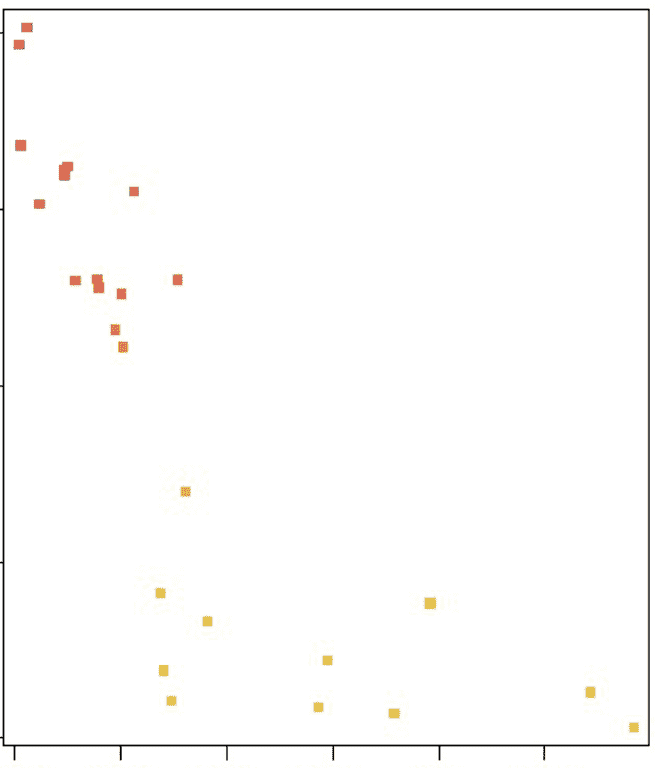

```
set.seed(1)
high_lift <- subset(rules,lift >= 1)
plot(high_lift, method = "grouped",control=list(col=grey.colors(1
```

### 2351 条规则的分组矩阵

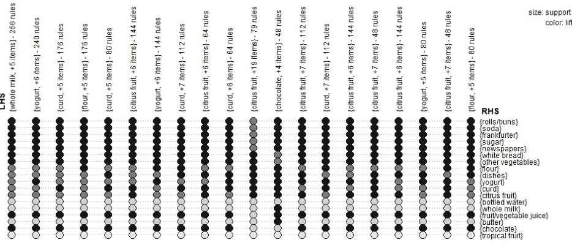

### 生成大量规则

如果你希望生成尽可能多的规则，请将支持度和置信度设置为非常低的数值：

```
many_rules <- apriori(trans4, parameter = list(minlen = 1, suppor
>
> Parameter specification:
> confidence minval smax arem aval originalSupport support minle
> 0.01 0.1 1 none FALSE TRUE 0.01 1 10
> target ext
> rules FALSE
>
> Algorithmic control:
> filter tree heap memopt load sort verbose
> 0.1 TRUE TRUE FALSE TRUE 2 TRUE
>
> Absolute minimum support count: 136
>
> set item appearances ...[0 item(s)] done [0.00s].
> set transactions ...[13 item(s), 13617 transaction(s)] done [0
> sorting and recoding items ... [13 item(s)] done [0.00s].
> creating transaction tree ... done [0.00s].
> checking subsets of size 1 2 3 4 5 6 7 8 done [0.00s].
> writing ... [8898 rule(s)] done [0.00s].
> creating S4 object ... done [0.00s]. many_rules > set of 8898
```

### 绘制大量规则的图表

当生成大量规则并且需要按特定的支持度和置信度范围进行筛选时，图表尤其有帮助。

下面的图表显示了三个指标中的两个，沿着 x 轴和 y 轴，第三个指标（提升度、支持度或置信度）作为阴影显示：

```
sel <- plot(many_rules, measure = c("support", "confidence"), shading
interactive = FALSE)
```

如下图所示，存在一组具有高提升度（>8）、高置信度（> 0.6）但均具有低支持度的规则：

### 8898 条规则的散点图

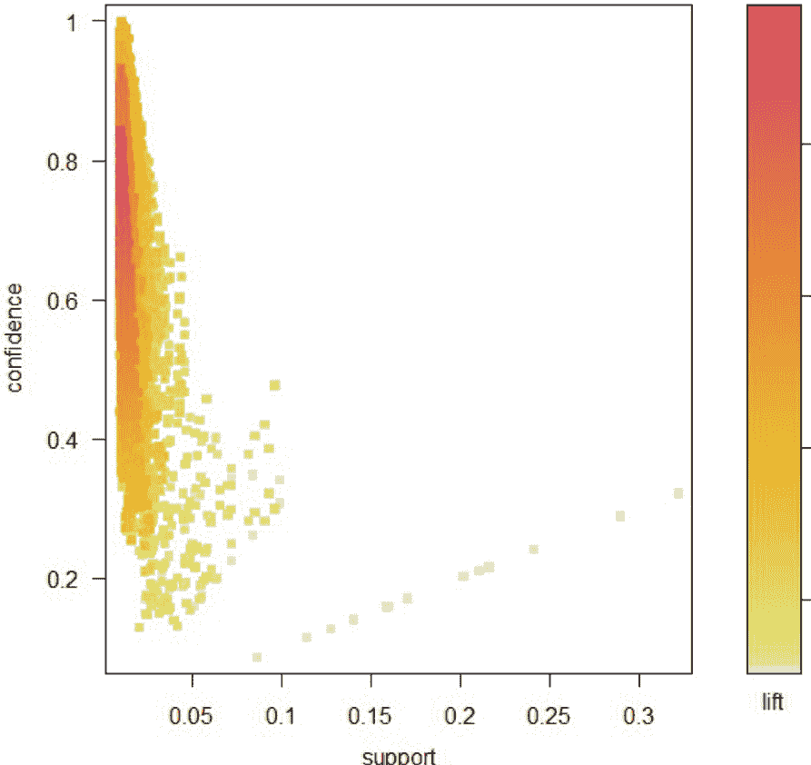

### 方法二 - 创建物理事务文件

现在你知道如何使用 `coerce to dataframe` 方法运行关联规则了，我们将演示 `write to file` 方法：

- 在 `write to file` 方法中，每个项目都写入单独的一行，并附带标识键，在本例中为 `InvoiceId`
- `write to file` 方法的优点是，非常大的数据文件可以分别累积，然后在需要时合并在一起
- 你可以使用 `file.show` 函数显示将作为关联规则算法输入的文件内容：

```r
setwd("C:/PracticalPredictiveAnalytics/Data")
load("OnlineRetail.full.Rda")
OnlineRetail <- OnlineRetail[1:100,]
nrow(OnlineRetail)
> [1] 268034
head(OnlineRetail)
> InvoiceNo StockCode Description Quantity
> 5 6365 71053 METAL LANTERN 6
> 6 536365 21730 GLASS STAR FROSTED T-LIGHT HOLDER 6
> 2 536365 22752 SET 7 BABUSHKA NESTING BOXES 2
> 4 536365 84029E WOOLLY HOTTIE HEART.
> 1 536365 84406B CREAM CUPID HEARTS COAT HANGER 8
> 8 536366 22632 HAND WARMER POLKA DOT 6
> InvoiceDate UnitPrice CustomerID Country itemcount
> 5 12/1/2010 8:26 3.39 17850 United Kingdom 7
> 6 12/1/2010 8:26 4.25 17850 United Kingdom 7
> 2 12/1/2010 8:26 7.65 17850 United Kingdom 7
> 4 12/1/2010 8:26 3.39 17850 United Kingdom 7
> 1 12/1/2010 8:26 2.75 17850 United Kingdom 7
> 8 536366 22632 HAND WARMER POLKA DOT 6
> InvoiceDate UnitPrice CustomerID Country itemcount
> 5 12/1/2010 8:28 1.85 17850 United Kingdom 2
> Desc2 lastname firstname
> 5 MetalLantern LANTERN METAL
> 6 GlassStarFrostedT-lightHolder HOLDER GLASS
> 2 Set7BabushkaNestingBoxes BOXES SET
```


```
> 4 WoollyHottieHeart. HEART. WOOLLY
> 1 CreamCupidHeartsCoatHanger HANGER CREAM
> 8 HandWarmerPolkaDot DOT HAND # concatenate the Invoice Number
data2 <- paste(OnlineRetail$InvoiceNo, OnlineRetail$Desc2, sep =

#### eliminate duplicates
data2 <- unique(data2)
#

write(data2, file = "demo_single")
file.show('demo_single') #not run
```

### 将事务文件读回内存

使用 read.transaction 文件将分隔文件读回内存，格式化为事务文件。这与我们之前将数据框强制转换为事务文件的结果相同。

不同之处在于，事务按每行一个事务的格式排列，由 format='single' 选项指定。我们还通过 cols 选项指定 TransactionID 和物品描述的位置。可以有多个描述符和事务 ID，并通过 cols 选项对其进行标识。sep 关键字指定分隔符，在此情况下为 ! 字符。还有一个删除重复事务的选项，这是一个逻辑值，用于确定是否要消除重复项。

返回的对象 trans 是一个 itemMatrix。你可以输入 trans 查看维度，或运行 dim(trans) 查看维度。这将告诉你 itemMatrix 基于多少个事务。

与之前一样，要查看 trans 对象中的物品，请使用 inspect() 函数：

```
library(arules)
library(arulesViz)
setwd("C:/Users/randy/Desktop/ch6")

file.show('demo_single')
trans <- read.transactions("demo_single", format = "single", sep = "!", rm.duplicates = FALSE, quote = "")
trans
transactions in sparse format with
> 19403 transactions (rows) and
> 3462 items (columns)
dim(trans)
> [1] 19403 3462
inspect(trans
```

```
> 1 {CreamCupidHeartsCoatHanger,
> GlassStarFrostedT-lightHolder,
> MetalLantern,
> Set7BabushkaNestingBoxes,
> WoollyHottieHeart.} 536365
> 2 {HandWarmerPolkaDot} 536366
> 3 {FeltcraftPrincessCharlotteDoll,
> KnittedMugCosy,
> LoveBuildingBlockWord,
> Poppy'sPlayhouseKitchen} 536367
> 4 {CoatRackParisFashion} 536368
> 5 {CircusParadeLunchBox,
> LunchBoxILoveLondon,
> MiniJigsawSpaceboy,
> PandaAndBunniesStickerSheet,
> Postage,
> RoundSnackBoxesSetOf4Woodland,
> SpaceboyLunchBox,
> ToadstoolLedNightLight} 536370
dim(trans) > [1] 19403 3462
#### look up any item in labels to see if it is there.
```

查看一些购买频率较高的物品。使用 itemFrequencyPlot() 函数查看热门物品购买的简单条形图：

```
itemFrequencyPlot(trans, topN = 10, cex.names = 1)
```

以下图表显示热门购买物品中有两个心形物品：

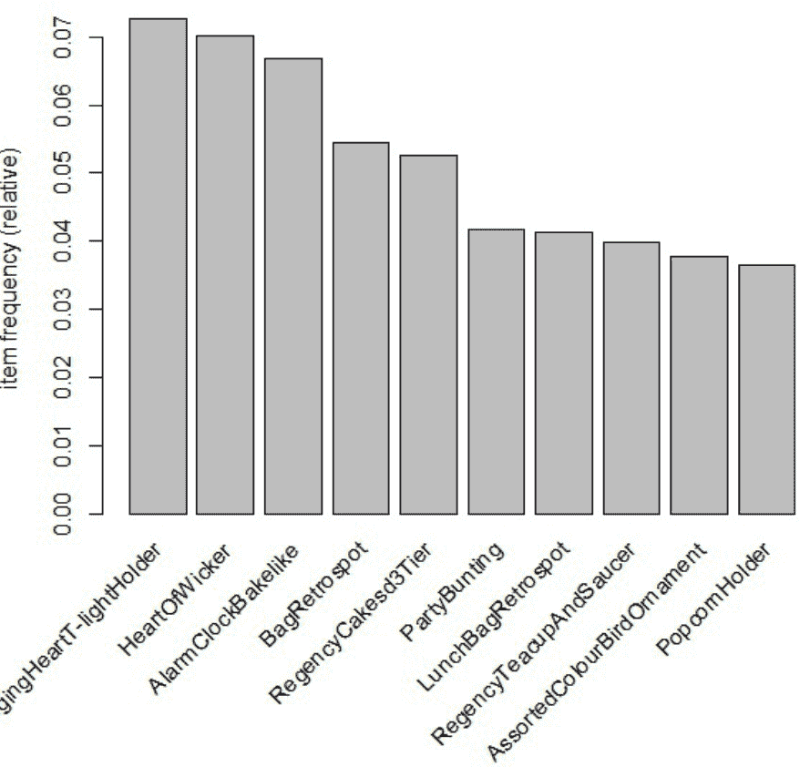

`itemLabels()` 函数列出与项集关联的所有标签。由于排名最高的物品中包含一个不寻常的缩写（T-light），你可以检查是否有其他物品包含该术语。为实现此目的，请使用 `grep()` 函数：

```
result <- grep("T-light", itemLabels(trans), value = TRUE)
str(result)
> chr [1:96] "6ChocolateLoveHeartT-lights" ... head(result)
> [1] "6ChocolateLoveHeartT-lights" "AgedGlassSilverT-lightHolder"
> [3] "AntiqueSilverT-lightGlass" "AssortedColourT-lightHolder"
> [5] "BeadedChandelierT-lightHolder" "BonneJamJarT-lightHolder"
```

再次应用规则引擎。我们将使用较小的支持度和置信度来生成许多规则：

```
rules1 <- apriori(trans, parameter = list(minlen = 1, support = 0.001)
> Apriori
>
> Parameter specification:
> confidence minval smax arem aval originalSupport support minlen
> 0.001 0.1 1 none FALSE TRUE 0.001 1 10
> target ext
> rules FALSE
>
> Algorithmic control:
> filter tree heap memopt load sort verbose
> 0.1 TRUE TRUE FALSE TRUE 2 TRUE
>
> Absolute minimum support count: 19
>
> set item appearances ...[0 item(s)] done [0.00s].
> set transactions ...[3462 item(s), 19403 transaction(s)] done
> sorting and recoding items ... [2209 item(s)] done [0.01s].
> creating transaction tree ... done [0.01s].
> checking subsets of size 1 2 3 4 done [0.20s].
> writing ... [63121 rule(s)] done [0.02s].
> creating S4 object ... done [0.02s]. rules1 > set of 63121 rules
```

按支持度、置信度和提升度这三个指标对规则进行排序，以了解一些更有价值的规则。按置信度、支持度和提升度排序，以查看每个类别中得分最高的规则：

```
tmp <- as.data.frame(inspect(tail(sort(rules1, by = "lift"))))
> 38860 {AssortedColourBirdOrnament} => {StorageBagSuki}
> 38861 {StorageBagSuki} => {AssortedColourBirdOrnament}
> 38893 {BagRetrospot} => {AssortedColourBirdOrnament}
> 38892 {AssortedColourBirdOrnament} => {BagRetrospot}
> 11539 {AlarmClockBakelike} => {RexCash+carryShopper}
> 11538 {RexCash+carryShopper} => {AlarmClockBakelike}
> support confidence lift
> 38860 0.001030768 0.02724796 0.8976097
> 38861 0.001030768 0.03395586 0.8976097
> 38893 0.001700768 0.03122044 0.8252999
> 38892 0.001700768 0.04495913 0.8252999
> 11539 0.001082307 0.01621622 0.7183636
> 11538 0.001082307 0.04794521 0.7183636
> 2207 {} => {HangingHeartT-lightHolder} 0.07256610 0.07256610 1
> 2208 {} => {HeartOfWicker} 0.07004072 0.07004072 1
> 2209 {} => {AlarmClockBakelike} 0.06674226 0.06674226 1
> 2205 {} => {BagRetrospot} 0.05447611 0.05447611 1
> 2201 {} => {RegencyCakesd3Tier} 0.05251765 0.05251765 1
> 2190 {} => {PartyBunting} 0.04184920 0.04184920 1
```

```
tmp <- as.data.frame(inspect(head(sort(rules1, by = "lift"))))
> 1 {PolkadotCup,
> RetrospotCharlotteBag,
> SpotCeramicDrawerKnob} => {AlarmClockBakelike} 0.001082307 1.0
> 2 {AlarmClockBakelike,
> Charlie+lolaHotWaterBottle,
> ChristmasGinghamTree} => {BabushkaNotebook} 0.001185384 0.9200
> 3 {ChristmasHangingStarWithBell,
> RegencyTeacupAndSaucer} => {AlarmClockBakelike} 0.001133845 0.
> 4 {PolkadotBowl,
> RetrospotCharlotteBag,
> SpotCeramicDrawerKnob} => {AlarmClockBakelike} 0.001133845 0.9
> 5 {AlarmClockBakelikeChocolate,
> PolkadotCup} => {AlarmClockBakelike} 0.001030768 0.9090909 13.
> 6 {BabushkaNotebook,
> Charlie+lolaHotWaterBottle,
> HeartMeasuringSpoons} => {AlarmClockBakelike} 0.001339999 0.89
```

你还可以将规则强制转换为数据框，并使用 kable() 函数打印前 10 行，或按需选择子集：

```
rules1 <- sort(rules1, by = "confidence")
rules1.df <- as(rules1, "data.frame")
cat("using kable to print rules")
> using kable to print rules
library(knitr)
kable(rules1.df[1:10,],digits=6,col.names=c("Rules","Supp","Conf","Lift"))
```

| | 规则 | 支持度 | 置信度 | 提升度 |
|---|---|---|---|---|
| 62966 | {PolkadotCup,RetrospotCharlotteBag,SpotCeramicDrawerKnob} => {AlarmClockBakelike} | 0.0011 | 1.00 | 15 |
| 62971 | {AlarmClockBakelike,Charlie+lolaHotWaterBottle,ChristmasGinghamTree} => {BabushkaNotebook} | 0.0012 | 0.92 | 48 |
| 51467 | {ChristmasHangingStarWithBell,RegencyTeacupAndSaucer} => {AlarmClockBakelike} | 0.0011 | 0.92 | 14 |
| 62982 | {PolkadotBowl,RetrospotCharlotteBag,SpotCeramicDrawerKnob} => {AlarmClockBakelike} | 0.0011 | 0.92 | 14 |
| 51338 | {AlarmClockBakelikeChocolate,PolkadotCup} => {AlarmClockBakelike} | 0.0010 | 0.91 | 14 |
| 63058 | {BabushkaNotebook,Charlie+lolaHotWaterBottle,HeartMeasuringSpoons} => {AlarmClockBakelike} | 0.0013 | 0.90 | 13 |
| 62970 | {BabushkaNotebook,Charlie+lolaHotWaterBottle,ChristmasGinghamTree} => {AlarmClockBakelike} | 0.0012 | 0.88 | 13 |
| 62972 | {AlarmClockBakelike,BabushkaNotebook,ChristmasGinghamTree} => {Charlie+lolaHotWaterBottle} | 0.0012 | 0.88 | 77 |
| 51347 | {AlarmClockBakelikeChocolate,DinerwallClock} => {AlarmClockBakelike} | 0.0011 | 0.88 | 13 |
| 51356 | {AlarmClockBakelikeChocolate,Boxof24CocktailParasols} => {AlarmClockBakelike} | 0.0011 | 0.88 | 13 |

### 绘制规则图

规则的默认图将为你提供所有规则的散点图，x 轴显示支持度，y 轴显示置信度。从密度可以看出，置信度可以从高到低变化，大部分密度出现在 0.5 级别。支持度往往较低，最高支持度约为 0.07：

```
plot(rules1)
```

### 63121 规则的散点图

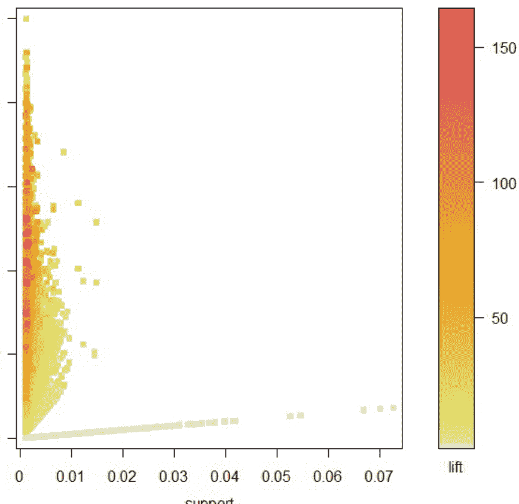

### 创建规则子集

与之前一样，我们可以通过解析左侧或右侧来查看一些子集。


例如，我们可能想查看哪些商品购买带来了巧克力相关商品：

- 使用 `%pin%` 运算子（部分匹配）对规则集进行子集筛选，并查找右侧包含巧克力的任意事项：

```
purchased.this <- "Chocolate"
lhs.rules <- subset(rules1, subset = rhs %pin% purchased.this)
```

- 打印 lhs.rules 显示共有 487 条规则：

```
print(lhs.rules) > set of 487 rules
```

- 按 lift 排序，检查它们，并将前 15 条作为图形绘制：

```
lhs.rules <- sort(lhs.rules, by = "lift")
```

```
inspect(head(sort(lhs.rules, by = "lift"))) > lhs rhs support confidence
> 1 {CakeTowelSpots} => {CakeTowelChocolateSpots} 0.001185384 0.
> 2 {BiscuitsBowlLight,
> DollyMixDesignBowl} => {ChocolatesBowl} 0.001030768 0.4444444
> 3 {BakingMouldHeartChocolate} => {BakingMouldHeartMilkChocolate}
> 4 {BakingMouldHeartMilkChocolate} => {BakingMouldHeartChocolate}
> 5 {BiscuitsBowlLight} => {ChocolatesBowl} 0.001700768 0.358695
> 6 {MarshmallowsBowl} => {ChocolatesBowl} 0.002422306 0.2397959
```

- 当项目集数量缩小到少量时，有向图是说明哪些购买会影响其他购买的好方法：

```
plot(lhs.rules[1:15], method = "graph", control = list(type = "items", cex = 0.5))
```

- 以下图表显示 DollyMixDesignBowl 和 MarshmallowsBowl 出现为更大更深的气泡，表明相对于支持度、置信度和提升度，它们是巧克力购买更好的预测指标：

### 15 条规则的图表

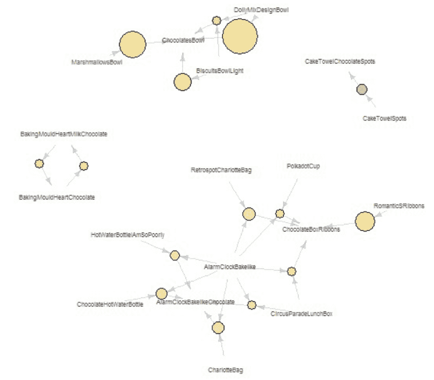

- 最后，如果你希望保存工作区，请使用 `save.image` 命令：

```
save.image(file = "ch6 part 2.Rdata")
```

### 文本聚类

在前面的章节中，我们使用了 `lastword` 技术通过简单关键词对购买类型进行分类。我们也可以使用更高级的技术（如单词聚类）来尝试识别出现的购买聚类类型，然后用其对关联规则进行子集筛选。为了在我们的 `OnlineRetail` 数据集上演示文本聚类，我们首先需要加载先前保存的训练和测试数据框。另外，请发出 `set.seed` 命令，因为我们稍后将进行一些采样：

```
setwd("C:/Users/randy/Desktop/ch6")
### load the training data
load("OnlineRetail.full.Rda")
set.seed(1)
```

我们先前使用名为 `RTextTools` 的包演示了一些文本挖掘示例。另一个流行的文本挖掘包是 `tm`。`tm` 包已经存在很长时间，了解该包的工作原理很有用。`tm` 要求所有文本数据首先转换为语料库。这可以使用 `VCorpus()` 函数完成。我们可以使用向量输入，因为数据已经在现有数据框中可用，无需读取额外的外部数据：

```
library(tm)
> Loading required package: NLP
attach(OnlineRetail)
nrow(OnlineRetail)
> [1] 268034
corp <- VCorpus(VectorSource(OnlineRetail$Description))
```

显示 `corp` 对象会向你展示一些关于元数据的信息：

```
head(corp) > <<VCorpus>>
> Metadata: corpus specific: 0, document level (indexed): 0
> Content: documents: 6
```

### 转换为文档术语矩阵

一旦拥有语料库，我们就可以将其转换为文档术语矩阵。构建 DTM 时，必须注意限制处理的数据量和生成的术语数量。如果参数化不正确，运行可能需要很长时间。参数化通过选项来完成。我们将删除任何停用词、标点符号和数字。此外，我们将只包含最小单词长度为四的词：

```
library(tm)
dtm <- DocumentTermMatrix(corp, control = list(removePunctuation = TRUE, stopwords = TRUE, removeNumbers = TRUE, stemming = FALSE, minWordLength = 4))
```

我们可以开始使用 `inspect()` 函数来查看数据。

这与 arules 包中的 `inspect()` 函数不同，如果加载了 `arules` 包，则需要在此 inspect 前加上 `tm::inspect` 前缀：

```
inspect(dtm[1:10, 1:10]) > <<DocumentTermMatrix (documents: 10, terms: 10)
> Non-/sparse entries: 0/100
> Sparsity : 100%
> Maximal term length: 8
> Weighting : term frequency (tf)
>
> Terms
> Docs abstract acapulco account acrylic address adult advent af
> 1 0 0 0 0 0 0 0 0 0 0
> 2 0 0 0 0 0 0 0 0 0 0
> 3 0 0 0 0 0 0 0 0 0 0
> 4 0 0 0 0 0 0 0 0 0 0
> 5 0 0 0 0 0 0 0 0 0 0
> 6 0 0 0 0 0 0 0 0 0 0
> 7 0 0 0 0 0 0 0 0 0 0
> 8 0 0 0 0 0 0 0 0 0 0
> 9 0 0 0 0 0 0 0 0 0 0
> 10 0 0 0 0 0 0 0 0 0 0
> Terms
> Docs ahoy
```

```
> 1 0
> 2 0
> 3 0
> 4 0
> 5 0
> 6 0
> 7 0
> 8 0
> 9 0
> 10 0
```

创建 DTM 后，我们可以通过发出 `print(dtm)` 命令来查看生成的元数据。我们可以通过查看第一行来了解文档和术语的数量：

```
print(dtm) <<DocumentTermMatrix (documents: 268034, terms: 1675
> Non-/sparse entries: 826898/448130052
> Sparsity : 100%
> Maximal term length: 20
> Weighting : term frequency (tf)
```

### 删除稀疏术语

大多数 TDM 最初充满了大量空白区域。这是因为语料库中的每个单词都被索引，而且有许多单词出现频率极低，从分析角度来看并不重要。删除稀疏术语是一种方法，可以将术语数量减少到可管理的大小，同时节省空间。

`removeSparseTerms()` 函数将把 DTM 中的术语数量从 268034 减少到 62：

```
dtms <- removeSparseTerms(dtm, 0.99)
dim(dtms) > [1] 268034 62
```

作为 inspect 的替代方案，我们还可以以矩阵形式 `View()` 它：

```
View(as.matrix(dtms))
```

以下是 `View` 命令的输出。1 表示该术语出现，0 表示未出现：

| antique | assorted | bird | birthday | bottle | bowl | bunting | cake | card | cases | ceramic | charlotte | childrens | christmas |
|---|---|---|---|---|---|---|---|---|---|---|---|---|---|
| 0 | 0 | 0 | 0 | 0 | 0 | 0 | 0 | 0 | 0 | 0 | 0 | 0 | 0 |
| 0 | 0 | 0 | 0 | 0 | 0 | 0 | 0 | 0 | 0 | 0 | 0 | 0 | 0 |
| 0 | 0 | 0 | 0 | 0 | 0 | 0 | 0 | 0 | 0 | 0 | 0 | 0 | 0 |
| 0 | 0 | 0 | 0 | 0 | 0 | 0 | 0 | 0 | 0 | 0 | 0 | 0 | 0 |
| 0 | 0 | 0 | 0 | 0 | 0 | 0 | 0 | 0 | 0 | 0 | 0 | 0 | 0 |
| 0 | 0 | 0 | 0 | 0 | 0 | 0 | 0 | 0 | 0 | 0 | 0 | 0 | 0 |
| 0 | 0 | 0 | 0 | 0 | 0 | 0 | 0 | 0 | 0 | 0 | 1 | 0 | 0 |
| 0 | 0 | 0 | 0 | 0 | 0 | 0 | 0 | 0 | 0 | 0 | 0 | 0 | 0 |
| 0 | 0 | 0 | 0 | 0 | 0 | 0 | 0 | 0 | 0 | 0 | 0 | 0 | 0 |
| 0 | 0 | 0 | 0 | 0 | 0 | 0 | 0 | 0 | 0 | 0 | 0 | 0 | 0 |
| 0 | 0 | 0 | 0 | 0 | 0 | 0 | 0 | 0 | 0 | 0 | 0 | 0 | 0 |
| 0 | 0 | 0 | 0 | 0 | 0 | 0 | 0 | 0 | 0 | 0 | 0 | 0 | 0 |

### 查找频繁术语

tm 包有一个名为 findFreqTerms 的有用函数，可用于查找常用术语的频率。函数的第二个参数将结果限制为具有指定最小频率的术语。我们还可以通过对 TDM 中每个术语的 1 和 0 求和来计算出现次数。然后，我们可以对列表进行排序，并显示最高和最低频率的出现情况：

```
data.frame(findFreqTerms(dtms, 10000, Inf))
> findFreqTerms.dtms.
> 1 cake
> 2 christmas
> 3 design
> 4 heart
> 4 metal
> 5 metal
> 6 retrospot
> 7 vintage
freq <- colSums(as.matrix(dtms))
#### there are xx terms
length(freq)
> [1] 62
ord <- order(freq)
#### look at the top and bottom number of terms
freq[head(ord, 12)]
> union skill zinc bird wood wall birthday
> 2752 2770 2837 2974 2993 3042 3069
> colour charlotte star antique silver
> 3089 3114 3121 3155 3175
freq[tail(ord, 10)]
> hanging sign lu
> 8437 8580 9107 10478 10623 12534 14884
> vintage retrospot heart
> 16755 17445 19520
```

为了演示目的，条形图也有助于显示相对频率：

```
barplot(freq[tail(ord, 10)], cex.names = 0.75, col = c("blue"))
```

最流行的术语是 heart：

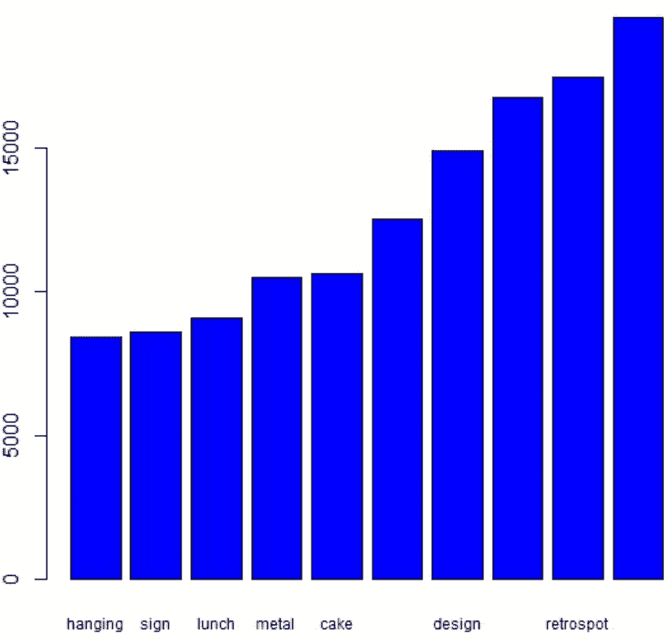

我们还可以稍微操纵一下代码，只显示 topN 个最频繁的术语：

```
dtmx <- dtms[, names(tail(sort(colSums(as.matrix(dtms))), 12))]
inspect(dtmx[1:10, ]) > <<DocumentTermMatrix (documents: 10, terms: 10)
> Non-/sparse entries: 3/117
> Sparsity : 98%
```


> 最大术语长度：9
> 加权：术语频率 (tf)
>
> 术语
> 文档 包装 支架 悬挂牌 午餐 金属 蛋糕 圣诞节 设计
> 1 0 0 0 0 0 1 0 0 0 0
> 2 0 1 0 0 0 0 0 0 0 0
> 3 0 0 0 0 0 0 0 0 0 0
> 4 0 0 0 0 0 0 0 0 0 0
> 5 0 0 0 0 0 0 0 0 0 0
> 6 0 0 0 0 0 0 0 0 0 0
> 7 0 0 0 0 0 0 0 0 0 0
> 8 0 0 0 0 0 0 0 0 0 0
> 9 0 0 0 0 0 0 0 0 0 0
> 10 0 0 0 0 0 0 0 0 0 0
> 术语
> 文档 回顾 心形
> 1 0 0
> 2 0 0
> 3 0 0
> 4 0 1
> 5 0 0
> 6 0 0
> 7 0 0
> 8 0 0
> 9 0 0
> 10 0 0

### k-means 术语聚类

现在我们可以使用 k-means 对术语-文档矩阵进行聚类。为说明目的，我们将指定生成五个簇：

```
kmeans5 <- kmeans(dtms, 5)
```

k-means 完成后，我们将簇编号附加到原始数据，然后根据簇创建五个子集：

```
kw_with_cluster <- as.data.frame(cbind(OnlineRetail, Cluster = km
#### subset the five clusters
cluster1 <- subset(kw_with_cluster, subset = Cluster == 1)
cluster2 <- subset(kw_with_cluster, subset = Cluster == 2)
cluster3 <- subset(kw_with_cluster, subset = Cluster == 3)
cluster4 <- subset(kw_with_cluster, subset = Cluster == 4)
cluster5 <- subset(kw_with_cluster, subset = Cluster == 5)
```

### 检查簇 1

打印数据样本：

```
> head(cluster1[10:13])
Desc2 lastword firstword Cluster
50 VintageBillboardLove/hateMug MUG VINTAGE 1
86 BagVintagePaisley PAISLEY BAG 1
113 ShopperVintagePaisley PAISLEY SHOPPER 1
145 ShopperVintagePaisley PAISLEY SHOPPER 1
200 VintageHeadsAndTailsCardGame GAME VINTAGE 1
210 PaperChainKitVintageChristmas CHRISTMAS PAPER 1
```

列出频率并打印簇中最流行的术语。观察到许多这些项目与圣诞节和花边物品有关，似乎经常一起出现：

```
tail(sort(table(cluster1$lastword)), 10) MUG GAME BUNTING CARDS D
427 431 456 482 535 717 911
```

### 检查簇 2

对簇 2 进行汇总后，查看文件的一部分。综合来看首词和末词，这个簇似乎与悬挂式支架有关：

```
> head(cluster2[10:13]) Desc2 lastword firstword Cluster 6 GlassS
```

与其只看记录，不如看最流行单词的频率。心形、悬挂和文件夹是簇 2 中出现频率最高的三个词：

```
tail(sort(table(cluster2$lastword)), 10)
```

| 古董 | 灯笼 | 支架 | 装饰品 | 玻璃 | T- | 灯光 | 悬挂 |
|---|---|---|---|---|---|---|---|
| 167 | 181 | 226 | 260 | 319 | 361 | 531 | 639 |

### 检查簇 3

簇 3 可能与客户购买不同标志的套装有关。套装、标志、盒子和设计是四个最常见的单词：

```
head(cluster3[10:13]) Desc2 lastword firstword Cluster 5 MetalLan
> tail(sort(table(cluster3$lastword)),10)
```

| 蜡烛 | 波点 | 三角旗 | 袋子 | 装饰品 | 套装 | 标志 | 盒子 | 设计 | |
|---|---|---|---|---|---|---|---|---|---|
| 2307 | 2539 | 2610 | 3084 | 3156 | 3844 | 6184 | 6277 | 10975 | 16627 |

### 检查簇 4

簇 4 可以看作购买复古斑点产品的客户：

```
> head(cluster4[10:13]) Desc2 lastword firstword Cluster 100 Lunc
tail(sort(table(cluster4$lastword)), 10) APRON NAPKINS BANK PC TI
486 511 512 514 531 664 1203
BAG CASES RETROSPOT
1395 4318 6485
```

### 检查簇 5

最后，簇 5 似乎与瓶子的购买有关，可能与香水、精华液和滋补品有关：

```
head(cluster5)
```

```
> head(cluster5[10:13])
 Desc2 lastword firstword Cluster
59 KnittedUnionFlagHotWaterBottle BOTTLE KNITTED 5
68 KnittedUnionFlagHotWaterBottle BOTTLE KNITTED 5
181 AssortedBottleTopMagnets MAGNETS ASSORTED 5
206 EnglishRoseHotWaterBottle BOTTLE ENGLISH 5
229 RetrospotHeartHotWaterBottle BOTTLE RETROSPOT 5
261 HotWaterBottleTeaAndSympathy SYMPATHY HOT 5
```

```
tail(sort(table(cluster5$lastword)), 10)
```

| 巴布什卡 | 磁铁 | 通感剂 | 灵丹妙药 | 香水 | 开瓶器 | 同情 |
|---|---|---|---|---|---|---|
| 87 | 95 | 108 | 112 | 132 | 149 | 318 |

### 预测簇分配

本练习的目标是对测试数据集打分，通过基于训练数据集的 predict 方法分配簇。

### 使用 flexclust 预测簇分配

标准 kmeans 函数没有预测方法。然而，我们可以使用 flexclust 包，它具有此方法。由于预测方法运行可能耗时较长，我们将仅对样本行和列进行说明。为了比较测试和训练结果，它们还需要具有相同数量的列。为说明目的，我们将数量设置为 10。

首先，从 OnlineRetail 训练数据中取样：

```
set.seed(1)
sample.size <- 10000
max.cols <- 10
library("flexclust") OnlineRetail <- OnlineRetail[1:sample.size,
```

接下来，从采样数据集的 description 列创建文档-术语矩阵。我们将使用 RTextTools 包的 create_matrix 函数，它可以在不单独创建语料库的步骤下先创建 TDM：

```
require(tm)
library(RTextTools) #Create the DTM for the training data
```

```
dtMatrix <- create_matrix(OnlineRetail$Description, minDocFreq =
minWordLength = 4, removeStopwords = TRUE, removePunctuation = T
weighting = weightTf)
```

接下来，检查数据的维度。可以看到有 1300 个术语。几乎所有这些都是稀疏术语，因此我们将从矩阵中删除它们：

```
dim(dtMatrix)
> [1] 10000 1300 dtMatrix <- removeSparseTerms(dtMatrix, 0.99)
```

删除稀疏术语将列数从 1300 减少到 62！

```
dim(dtMatrix) > [1] 10000 62
```

我们将只在测试和训练中保留相同数量的术语（max.cols）：

```
dtMatrix <- dtMatrix[, 1:max.cols]
```

为了查看 dtMatrix 中前 10 个术语至少出现两次的行，我们可以使用 rowSums 函数将每个术语的 1 和 0 指示符相加：

```
tmp <- rowSums(as.matrix(dtMatrix)) tmp3 <- data.frame(tmp[tmp>1]
```

然后我们将提取 >1 条件的行索引：

```
selected <- as.numeric(rownames(tmp3)) head(selected) > head(sele
```

打印满足此条件的前 10 个术语的 DTM 的前 10 行：

```
kable(tm::inspect(dtMatrix[selected[1:10], ]))
```

| | 报警 | 古董 | 各式各样 | 巴布什卡 | 烘焙类 | 鸟 | 瓶子 | 盒子 | 蛋糕 | 蜡烛 |
|---|---|---|---|---|---|---|---|---|---|---|
| 3 | 0 | 0 | 0 | 1 | 0 | 0 | 0 | 1 | 0 | 0 |
| 38 | 0 | 0 | 0 | 1 | 0 | 0 | 0 | 1 | 0 | 0 |
| 68 | 1 | 0 | 0 | 0 | 1 | 0 | 0 | 0 | 0 | 0 |
| 83 | 0 | 0 | 1 | 0 | 0 | 0 | 1 | 0 | 0 | 0 |
| 92 | 1 | 0 | 0 | 0 | 1 | 0 | 0 | 0 | 0 | 0 |
| 111 | 1 | 0 | 0 | 0 | 1 | 0 | 0 | 0 | 0 | 0 |
| 113 | 1 | 0 | 0 | 0 | 1 | 0 | 0 | 0 | 0 | 0 |
| 115 | 0 | 0 | 1 | 0 | 0 | 1 | 0 | 0 | 0 | 0 |
| 121 | 0 | 0 | 0 | 1 | 0 | 0 | 0 | 1 | 0 | 0 |
| 155 | 0 | 0 | 1 | 0 | 0 | 0 | 0 | 0 | 1 | 0 |

### 运行 k-means 生成簇

### 使用 kcca 包运行 kmeans 函数生成五个簇分配：

```
#### repeat kmeans using the kcca function. Clusters=5

clust1 = kcca(dtMatrix, k = 5, kccaFamily("kmeans"))
clust1 > kcca object of family 'kmeans'
>
> call:
> kcca(x = dtMatrix, k = 5, family = kccaFamily("kmeans"))
> cluster sizes:
>
> 1 2 3 4 5
> 360 120 152 387 8981
```

### 打印每个簇的分类数量：

```
table(clust1@cluster) >
> 1 2 3 4 5
> 360 120 152 387 8981
```

| | 1 | 2 | 3 | 4 | 5 |
|---|---|---|---|---|---|
| | 360 | 120 | 152 | 387 | 8981 |

### 将簇与训练数据合并，并显示一些分配给每个记录的簇的示例记录：

```
kw_with_cluster2 <- as.data.frame(cbind(OnlineRetail, Cluster =
head(kw_with_cluster2) > InvoiceNo StockCode Description Quantit
> 5 536365 71053 METAL LANTERN 6
> 6 536365 21730 GLASS STAR FROSTED T-LIGHT HOLDER 6
> 2 536365 22752 SET 7 BABUSHKA NESTING BOXES 2
> 4 536365 84029E WOOLLY HOTTIE HEART. 6
> 1 536365 84406B CREAM CUPID HEARTS COAT HANGER 8
> 8 536366 22632 HAND WARMER POLKA DOT 6
> InvoiceDate UnitPrice CustomerID Country itemcount
> 5 12/1/2010 8:26 3.39 17850 United Kingdom 7
> 6 12/1/2010 8:26 4.25 17850 United Kingdom 7
> 2 12/1/2010 8:26 7.65 17850 United Kingdom 7
> 4 12/1/2010 8:26 3.39 17850 United Kingdom 7
> 1 12/1/2010 8:26 2.75 17850 United Kingdom 7
> 8 12/1/2010 8:28 1.85 17850 United Kingdom 2
> Desc2 lastword firstword Cluster
> 5 MetalLantern LANTERN METAL 5
> 6 GlassStarFrostedT-lightHolder HOLDER GLASS 5
> 2 Set7BabushkaNestingBoxes BOXES SET 5
> 4 WoollyHottieHeart. HEART. WOOLLY 5
```


> 1 CreamCupidHeartsCoatHanger HANGER CREAM 5
> 8 HandWarmerPolkaDot DOT HAND 5

在训练集上运行 predict 方法。我们最终将把它应用到测试数据上：

```
pred_train <- predict(clust1)
```

### 创建测试 DTM

现在让我们切换到测试数据集。首先，获取与训练数据相同的样本大小，并从在样本上创建术语文档矩阵开始重复该过程：

```
OnlineRetail.test <- OnlineRetail.test[1:sample.size, ]
dtMatrix.test <- create_matrix(OnlineRetail.test$Description, mi
removeNumbers = TRUE, minWordLength = 4, removeStopwords = TRUE,
stemWords = FALSE, weighting = weightTf)
```

和以前一样，从矩阵中移除稀疏项。然后，使用 dim() 函数查看还剩下多少个非稀疏项：

```
dtMatrix.test <- removeSparseTerms(dtMatrix.test, 0.99)
```

```
dim(dtMatrix.test) # reduced to 61 terms
```

```
> [1] 10000 61
```

取前 max.col (10) 个术语：

```
dtMatrix.test <- dtMatrix.test[, 1:max.cols]
```

```
> dtMatrix.test
DocumentTermMatrix (documents: 10000, terms: 10)
Non-/sparse entries: 2072/97928
Sparsity : 98%
Maximal term length: 8
Weighting : term frequency (tf)
```

显示术语出现至少两次的文件部分。请注意，测试 DTM 的前 10 个术语与训练集的 DTM 不同，尽管有些术语在两者中都出现。由于我们仅为了说明技术而取前 10 个术语，这是正常且预期的：

```
tmp <- rowSums(as.matrix(dtMatrix.test))
tmp3 <- data.frame(tmp[tmp>1])
selected <- as.numeric(rownames(tmp3))
head(selected)
#library(knitr)
kable(tm::inspect(dtMatrix.test[selected[1:10], ]))
```

| | 古董 | 杂项 | 套娃 | 鸟 | 瓶子 | 蛋糕 | 蜡烛 | 卡片 | 盒子 | 陶瓷 |
|---|---|---|---|---|---|---|---|---|---|---|
| 9 | 0 | 1 | 0 | 1 | 0 | 0 | 0 | 0 | 0 | 0 |
| 44 | 0 | 0 | 0 | 0 | 0 | 1 | 0 | 0 | 1 | 0 |
| 45 | 0 | 0 | 0 | 0 | 0 | 1 | 0 | 0 | 1 | 0 |
| 136 | 0 | 1 | 0 | 1 | 0 | 0 | 0 | 0 | 0 | 0 |
| 144 | 0 | 0 | 0 | 0 | 0 | 1 | 0 | 0 | 1 | 0 |
| 177 | 0 | 0 | 0 | 1 | 1 | 0 | 0 | 0 | 0 | 0 |
| 202 | 0 | 0 | 1 | 0 | 1 | 0 | 0 | 0 | 0 | 0 |
| 209 | 0 | 0 | 0 | 0 | 0 | 1 | 0 | 0 | 1 | 0 |
| 209 | 0 | 0 | 0 | 0 | 0 | 1 | 0 | 0 | 1 | 0 |
| 210 | 0 | 0 | 0 | 0 | 0 | 1 | 0 | 0 | 1 | 0 |
| 219 | 0 | 0 | 0 | 0 | 0 | 1 | 0 | 0 | 1 | 0 |

验证测试数据和训练数据具有相同的维度数。这一点很重要，因为如果列数不同，predict 方法将会失败：

```
dim(dtMatrix)
> [1] 10000 10
dim(dtMatrix.test)
> [1] 10000 10
```

在训练数据上运行预测函数，并将其应用到测试数据：

```
pred_test <- predict(clust1, newdata = dtMatrix.test)
```

首先，查看测试数据的聚类分配表：

```
table(pred_test)
> pred_test
> 1 2 3 4 5
> 171 113 201 146 9369
```

最后，将聚类与测试数据合并，并显示分配给每个数据点的聚类类别。为了演示，显示每个聚类的两个事务：

```
kw_with_cluster2_score <- as.data.frame(cbind(OnlineRetail.test,
head(kw_with_cluster2_score)
clust1.score=head(subset(kw_with_cluster2_score,Cluster==1),2)
clust2.score=head(subset(kw_with_cluster2_score,Cluster==2),2)
clust3.score=head(subset(kw_with_cluster2_score,Cluster==3),2)
clust4.score=head(subset(kw_with_cluster2_score,Cluster==4),2)
clust5.score=head(subset(kw_with_cluster2_score,Cluster==5),2)
head(clust1.score[ ,10:13])
head(clust2.score[ ,10:13])
head(clust3.score[ ,10:13])
head(clust4.score[ ,10:13])
head(clust5.score[ ,10:13])
```

```
> head(clust1.score[ ,10:13])
       Desc2 lastname firstname Cluster
89   PackOf60PaisleyCakeCases   CASES   PACK   1
96   PackOf60DinosaurCakeCases   CASES   PACK   1
```

```
> head(clust2.score[ ,10:13])
       Desc2 lastname firstname Cluster
61   WoodenFrameAntique   WOODEN   2
140 AntiqueGlassDressingTablePot   POT   ANTIQUE   2
```

```
> head(clust3.score[ ,10:13])
       Desc2 lastname firstname Cluster
148 3TierCakeTinAndCream   CREAM   3   3
143 3TierCakeTinAndCream   CREAM   3   3
```

```
> head(clust4.score[ ,10:13])
       Desc2 lastname firstname Cluster
126 ZincWillieWinkieCandleStick   STICK   ZINC   4
488 LoveBirdCandle   CANDLE   LOVE   4
```

```
> head(clust5.score[ ,10:13])
       Desc2 lastname firstname Cluster
3   HangingHeartT-lightHolder   HOLDER   HANGING   5
7 KnittedUnionFlagHotWaterBottle   BOTTLE   KNITTED   5
```

### 在聚类上运行 apriori 算法

回到 apriori 算法，我们可以使用生成的预测聚类来代替 lastword，以便制定一些规则：

- 我们将使用强制转换为数据框的方法来生成事务文件，与之前生成的方式相同
- 创建一个 rules_clust 对象，该对象基于聚类项集 {1,2,3,4,5} 构建关联规则
- 按提升度（lift）检查一些生成的规则：

```
library(arules)
colnames(kw_with_cluster2_score)
kable(head(kw_with_cluster2_score[, c(1,13) ],5))
tmp <-
data.frame(kw_with_cluster2_score[,1],
kw_with_cluster2_score[,13])
names(tmp)[1] <- "TransactionID"
names(tmp)[2] <- "Items"
tmp <- unique(tmp)
trans4 <- as(split(tmp[,2], tmp[,1]), "transactions")
rules_clust <- apriori(trans4, parameter = list(minlen=2,support = 0.02,confidence = 0.01))
summary(rules_clust)
tmp <- as.data.frame(inspect(head(sort(rules_clust, by="lift"),10)))
```

| | 左项集 | 右项集 | 支持度 | 置信度 | 提升度 |
|---|-----|-----|---------|------------|------|
| 22 | {2,5} | {4} | 0.03065693 | 0.3088235 | 3.022059 |
| 1 | {2} | {4} | 0.03065693 | 0.3043478 | 2.978261 |
| 2 | {4} | {2} | 0.03065693 | 0.3000000 | 2.978261 |
| 23 | {4,5} | {2} | 0.03065693 | 0.3000000 | 2.978261 |
| 32 | {1,5} | {4} | 0.02773723 | 0.2087912 | 2.043171 |
| 9 | {4} | {1} | 0.02773723 | 0.2714286 | 2.020963 |
| 10 | {1} | {4} | 0.02773723 | 0.2065217 | 2.020963 |
| 31 | {4,5} | {1} | 0.02773723 | 0.2714286 | 2.020963 |
| 35 | {3,5} | {4} | 0.03357664 | 0.1965812 | 1.923687 |
| 11 | {4} | {3} | 0.03357664 | 0.3285714 | 1.891357 |

### 汇总指标

对 rules_clust 对象运行摘要显示平均支持度为 0.05，平均置信度为 0.43。

这表明使用聚类可以是一种可行的方法来开发关联规则，同时减少资源和维度数量：

| 支持度 | 置信度 | 提升度 |
|---------|------------|------|
| 最小值 :0.02044 | 最小值 :0.09985 | 最小值 :0.989 |
| 下四分位数 :0.02664 | 下四分位数 :0.19816 | 下四分位数 :1.006 |
| 中位数 :0.03066 | 中位数 :0.27143 | 中位数 :1.526 |
| 平均值 :0.05040 | 平均值 :0.43040 | 平均值 :1.608 |
| 上四分位数 :0.04234 | 上四分位数 :0.81954 | 上四分位数 :1.891 |
| 最大值 :0.17080 | 最大值 :1.00000 | 最大值 :3.022 |

## 参考文献

- Daqing Chen, S. L. (2012). 针对在线零售行业的数据挖掘：基于数据挖掘的 RFM 模型客户细分案例研究。数据库营销与客户战略管理杂志，第 19 卷，第 3 期。
- Michael Hahsler, K. H. (2006). 概率性数据建模对关联规则挖掘的影响。载于 R. K. M. Spiliopoulou, 《从数据和信息分析到知识工程：分类、数据分析和知识组织研究》（第 598-605 页）。Springer-Verlag。

## 总结

在本章中，我们了解了一种特定的推荐引擎，其统称是购物篮分析。

我们看到，购物篮分析使您能够挖掘大量包含半结构化数据的事务，以推导每个购物篮中所含项集之间的关联规则。

对购物篮数据使用了一些额外的数据清洗技术，目的是标准化和整合购买商品的一些描述。我们还学习了如何利用绘图技术，结合提升度、支持度和置信度等指标，筛选出最强有力的规则。

最后，我们展示了如何从购物篮训练数据生成聚类，并基于测试数据集预测聚类分配。


# 第 8 章. 探索医疗保健注册数据的时间序列

> "我已看到未来，它与现在非常相似，只是更长。"
>
> - Kehlog Alban, 《利润》

## 时间序列数据

时间序列数据通常是一组在等间隔时间点上收集的有序数据。时间序列数据出现在大多数商业和科学学科中，该数据与预测概念密切相关，预测基于特定统计模型，利用先前测量的数据点来预测未来数据点。

时间序列数据与我们先前查看的数据类型不同；因为它是一组有序数据点，可以包含趋势、季节性和自相关等组件，这些组件在其他类型的分析（如"横截面"分析，即查看在静态时间点收集的数据）中意义不大。

通常，时间序列数据以等间隔收集，例如天、周、季度或年份，但并非总是如此。对自然灾害等事件的测量就是一个典型示例。在某些情况下，您可以将不均匀数据转换为等间隔数据。在其他情况下，您可以使用Croston's method等专业技术，在某些情况下预测商品和服务的间歇性或意外需求。

## 探索时间序列数据

许多时间序列研究始于探索在等间隔时间点上测量的一个数据指标。从数据科学角度来看，我们可能有兴趣识别时间序列中可能呈现有趣趋势、周期性或季节性模式的各个片段。因此，我们在进行建模之前，总是先以图形方式查看数据并生成汇总指标。

## 健康保险覆盖数据集

我们将首先读入一个数据集，该数据集包含一段时间内多个类别的医疗保健注册数据。该数据来源于表HIB-2，即按年龄和性别划分的所有人的健康保险覆盖状态和覆盖类型：1999年至2012年，可从CMS网站 http://www.census.gov/data/tables/time-series/demo/health-insurance/historical-series/hib.html 获取。

此表显示了由政府和私人保险覆盖的人数，以及未被覆盖的人数。

此表在所代表的全部14年中包含多个嵌入式时间序列。14个数据点不被视为极长的时间序列；然而，我们将使用此数据来演示如何一次筛查许多时间序列。由于数据量较小，通过目视检查和打印数据子集来验证结果将足够容易。随着您熟悉该方法论，这将使您能够扩展到包含更多数据点的更大、更复杂的数据集，以隔离最显著的趋势。

## 清理工作

与其他章节一样，我们将首先清除工作区，并设置工作目录。显然，将setwd()函数更改为您用于存储文件的路径：

```
rm(list = ls())
setwd("C:/PracticalPredictiveAnalytics/Data")
```

## 读取数据

接下来，我们将读取文件的几行（使用nrow参数），然后对输入运行str()函数以查看文件中包含哪些变量。文件中有几个与medicare注册相关的指标。本章我们将仅关注总注册指标，而不使用一些其他子细分（例如军事和私人保险）：

```
x <- read.csv("hihist2bedit.csv")
```

## 列子集选择

对于此练习，我们将使用CSV文件中受限的一组列。我们可以从刚刚读取的数据框中选择特定列（如果我们刚刚读取了整个文件），或者使用`colClasses`参数重新读取CSV文件，仅读取所需的列。通常，在读取大文件时，这种方法更可取，这将指示`read.csv`仅保留前三列和最后两列，并忽略`priemp`至`govmilitary`的列。

在使用列子集重新读取文件后，我们将打印文件开头和结尾的几条记录。我们可以通过组合使用`rbind()`、`head()`和`tail()`函数来完成此操作。这将为我们提供本章将使用的所有列，除了下一节中将派生的一些列：

```
x <- read.csv("hihist2bedit.csv", colClasses = c(NA, NA, NA, NA, r
rbind(head(x), tail(x))
> 	 Year Year.1 Total.People Total Not.Covered
> 1 			 2012 2012 311116.15 263165.47 47950.6840
> 2 			 2011 2011 308827.25 260213.79 48613.4625
> 3 	 2010 (10) 2010 306553.20 256602.70 49950.5004
> 4 			 2009 2009 304279.92 255295.10 48984.8204
> 5 			 2008 2008 301482.82 256702.42 44780.4031
> 6 			 2007 2007 299105.71 255017.52 44088.1840
> 331 	 2004 (4) 2004 20062.67 19804.54 258.1313
> 332 			 2003 2003 19862.49 19615.92 246.5703
> 333 			 2002 2002 19705.99 19484.01 221.9879
> 334 			 2001 2001 19533.99 19354.19 179.8033
> 335 	 2000 (3) 2000 19450.52 19250.63 199.8871
> 336 	 1999 (2) 1999 19378.56 19189.17 189.3922
>
> 1 			 ALL AGES
> 2 			 ALL AGES
> 3 			 ALL AGES
> 4 			 ALL AGES
> 5 			 ALL AGES
> 6
> 331 FEMALE 65 YEARS AND OVER
> 332 FEMALE 65 YEARS AND OVER
> 333 FEMALE 65 YEARS AND OVER
> 334 FEMALE 65 YEARS AND OVER
> 335 FEMALE 65 YEARS AND OVER
> 336 FEMALE 65 YEARS AND OVER
```

## 数据描述

Year和Year.1（第1列和第2列）：Year是获取年度注册数据的年份。您会注意到年份出现了两次，在第1列（作为因子）中，然后在第2列（整数）中再次出现。这是因为数据已预先预处理，仅出于便利而出现两次，因为在某些情况下我们更倾向于使用因子，而在其他情况下我们更倾向于使用整数。Year中的括号内的数字指原始数据源中的脚注。有关数据收集方式的完整说明，请参阅CMS网站上的参考注释。虽然您始终可以在代码中从因子创建整数，反之亦然，如果某些转换可以预先完成，这将节省宝贵的处理时间。

总人口数（第3列）：总人口数是该类别的人口规模。他们可能已注册健康保险（总计），也可能未注册（Not.Covered）。

总计（第4列）：总计是指该年份和cat类别中已注册健康保险的人数。

未覆盖（第5列）：Not.Covered列是指在指定年份和类别中未注册的人数。

Cat（第6列）：Cat是时间序列子集。该列连同Year共同定义特定行。它定义了该年份的特定注册人口统计数据。

ALL AGES类别代表指定年份的总人口。文件中的所有其他子集在汇总时都应汇总到此类别。

例如，最后一个类别（作为tail()的一部分打印）表示65岁以上的女性，这是ALL AGES类别的一个子集。

## 目标时间序列变量

我们最初将开始查看的变量是`Not.Covered`。我们将有兴趣使用此变量来检查任何可能的注册趋势。由于人口规模取决于类别，我们将通过将对应于该变量的原始数字除以该类别的人口总数，来计算给定年份未被覆盖的人数百分比。这将给我们一个名为`Not.Covered.Pct`的新变量。这也将在不同大小（大和小）的类别之间标准化指标，并使我们能够进行比较。

计算该变量后，我们可以打印前几条记录，还可以打印该单个变量的一些汇总统计信息：

### 注意

请注意，所有年份的未覆盖平均百分比为14.5%，但您可以通过观察第一四分位数和第三四分位数之间的差异（.15 - .11）= .04，就可以看出存在相当大的变化。这可能转化为大量人口。

```
x$Not.Covered.Pct <- x$Not.Covered/x$Total.People
head(x)
```

| | Year | Year.1 | Total.People | Total | Not.Covered | cat |
|---|---|---|---|---|---|---|
| 1 | 2012 | 2012 | 311116.2 | 263165.5 | 47950.68 | ALL AGES |
| 2 | 2011 | 2011 | 308827.2 | 260213.8 | 48613.46 | ALL AGES |
| 3 | 2010 (10) | 2010 | 306553.2 | 256602.7 | 49950.50 | ALL AGES |
| 4 | 2009 | 2009 | 304279.9 | 255295.1 | 48984.82 | ALL AGES |
| 5 | 2008 | 2008 | 301482.8 | 256702.4 | 44780.40 | ALL AGES |
| 6 | 2007 | 2007 | 299105.7 | 255017.5 | 44088.18 | ALL AGES |

| | Not.Covered.Pct |
|---|---|
| 1 | 0.1541247 |
| 2 | 0.1574131 |
| 3 | 0.1629424 |
| 4 | 0.1609860 |
| 5 | 0.1485338 |
| 6 | 0.1474000 |


```
summary(x$Not.Covered.Pct)
Min. 1st Qu. Median Mean 3rd Qu. Max.
0.009205 0.109400 0.145300 0.154200 0.210400 0.325200
```

与目标变量通常的情况一样，我们也希望查看显示变量分布的基本图表：

```
hist(x$Not.Covered.Pct)
```

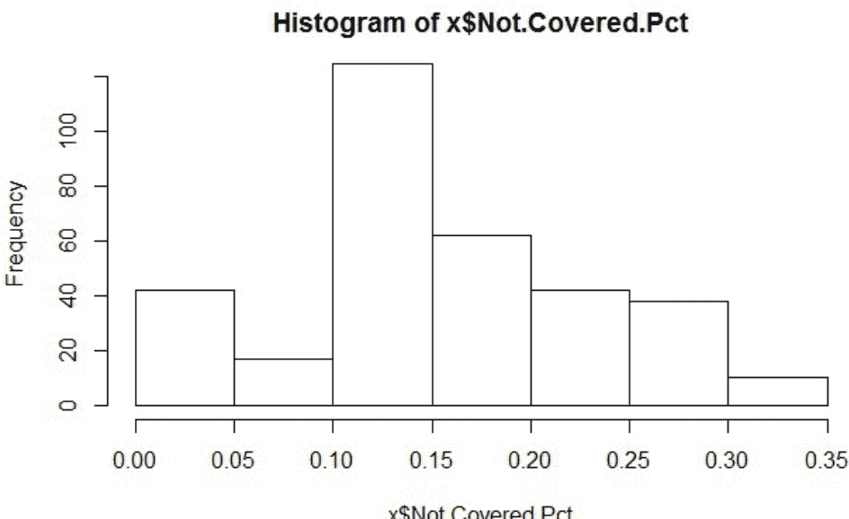

## 保存数据

现在可能是将当前数据保存到文件的好时机，因为我们可能希望稍后从分析阶段重新读取它。这样可以避免再次读取同一文件，除非，当然，源数据发生了变化：

```
save(x, file = "x.RData")
```

## 确定所有子集组

由于我们仅查看了文件的部分内容（通过 `head()` 或 `tail()` 函数），因此不知道有多少个类别，以及它们在医疗保障方面有何差异。因此，我们将首先查看一些分组。

在以前的章节中，我们使用过 `sql()` 和 `aggregate()` 函数来分组数据。对于本示例，我们将使用 `dplyr` 包。`dplyr` 包的一个优势是它也可以与管道语法一起使用，这允许将一个函数的结果传递给下一个函数，而无需中间赋值：

```
library(dplyr)
>
> Attaching package: 'dplyr'
> The following objects are masked from 'package:stats':
>
>     filter, lag
> The following objects are masked from 'package:base':
>
>     intersect, setdiff, setequal, union
### str(x)
```

`by.cat` 对象将显示每个类别的平均参保人数和平均总人口。请记住，此数据也按年份分组；不过，我们目前只想了解所有年份的平均值。由于 arrange 函数将按总人口规模从大到小对数据进行排序，我们可以看到数字按预期排列：

- ALL AGES 是最大的类别
- 接下来是 FEMALE ALL AGES
- 然后是 MALE ALL AGES

```
by.cat <- x %>% select(cat, Total, Total.People) %>%
group_by(cat) %>%
summarise(Avg.Total.Insured = mean(Total), Avg.People = mean(Total.People)) %>%
arrange(desc(Avg.People))
by.cat
```

作为合理性检查，如果你将后两个类别的总计相加，可以看到它们加起来等于 ALL AGES 类别。

从控制台，我们可以通过 `str(by.cat)` 函数看到有 24 个类别：

```
str(by.cat)
> Classes 'tbl_df', 'tbl' and 'data.frame': 24 obs. of  3 variables
> $ cat : Factor w/ 24 levels "18 to 24 YEARS",...:
> $ Avg.Total.Insured: num 251243 130201 121042 66200 34762 ..
> $ Avg.People : num 294700 150330 144371 73752 42433 ..
by.cat
> Source: local data frame [24 x 3]
>
>
> cat Avg.Total.Insured Avg.People
> (fctr) (dbl) (dbl)
> 1 ALL AGES 251242.96 294700.47
> 2 FEMALE ALL AGES 130200.90 150329.73
> 3 MALE ALL AGES 121042.06 144370.74
> 4 UNDER 18 YEARS 66200.46 73752.50
> 5 35 to 44 YEARS 34761.74 42433.12
> 6 45 to 54 YEARS 35911.82 42100.20
> 7 25 to 34 YEARS 29973.91 39942.64
> 8 MALE UNDER 18 YEARS 33832.87 37700.70
> 9 65 YEARS AND OVER 36199.32 36722.61
> 10 FEMALE UNDER 18 YEARS 32367.59 36051.79
> .. ... ... ...
```

## 将汇总数据合并回原始数据

通常，你会希望使用之前计算得到的一些数据来增强原始数据。在这种情况下，可以使用公共键将数据合并回原始数据。同样，我们将使用 `dplyr` 包，将刚刚获得的结果（`by.cat`）连接回原始数据（`x`），使用公共键 `cat`。

我们将使用 `left_join` 仅作为示例；不过，我们也可以使用右连接来获得相同的结果，因为 `by.cat` 完全由 `x` 派生而来。连接两个数据框后，我们将得到一个名为 `x2` 的新数据框：

```
### Merge the summary measures back into the original data. Merge
x2 <- by.cat %>% left_join(x, by = "cat")
head(x2)
```

```
> Source: local data frame [6 x 9]
>
>      cat Avg.Total.Insured Avg.People   Year Year.1 Total
>    (fctr)           (dbl)     (dbl)  (fctr)  (int)
> 1  ALL AGES        251243   294700.5    2012   2012     3
> 2  ALL AGES        251243   294700.5    2011   2011     3
> 3  ALL AGES        251243   294700.5   2010   2010     3
> 4  ALL AGES        251243   294700.5    2009   2009     3
> 5  ALL AGES        251243   294700.5    2008   2008     3
> 6  ALL AGES        251243   294700.5    2007   2007     2
> Variables not shown: Total (dbl), Not.Covered (dbl), Not.Cover
```

## 检查时间间隔

前面，我们提到需要有等大小的时间间隔。此外，在执行任何时间序列分析之前，我们需要检查非缺失时间间隔的数量。那么，让我们检查每个类别的注册年份数量。

使用 dplyr 包，我们可以使用 summarize (n()) 来计算每个类别的条目数量：

```
### -- summarize and sort by the number of years
yr.count <- x2 %>% group_by(cat) %>% summarise(n = n()) %>% arrange
### - we can see that there are 14 years for all of the groups. Th
print(yr.count, 10)
```

| cat | n |
|:---|---:|
| 18 to 24 YEARS | 14 |
| 25 to 34 YEARS | 14 |
| 35 to 44 YEARS | 14 |
| 45 to 54 YEARS | 14 |
| 55 to 64 YEARS | 14 |
| 65 YEARS AND OVER | 14 |
| ALL AGES | 14 |
| FEMALE 18 to 24 YEARS | 14 |
| FEMALE 25 to 34 YEARS | 14 |
| FEMALE 35 to 44 YEARS | 14 |

从上面可以看到，每个类别都有 14 年的数据。

因此，我们不必担心每个子集都有统一的时间段。然而，情况往往并非如此，如果你遇到这种情况，可能需要执行以下操作：

- 为缺失年份填补数据。
- 尝试转换为等间距时间序列。也许可以将时间段转换为更高的尺度。例如，对于间歇性的每日数据，尝试转换为每周、每月或每季度。
- 使用专门的时间序列技术来处理不等间距的时间序列。

## 按平均人口规模选出顶部组

在许多情况下，我们只想查看顶部类别，尤其是当有许多已细分的人口统计类别时。在本示例中，只有 24 个类别，但在其他示例中，类别数量可能要多得多。

数据框 x2 已按 Avg.People 排序。由于我们知道每个类别有 14 条注册记录，我们可以通过选择前 14*10（即 140）行来获取基于最高基础人口的前 10 个类别。我们将把这些数据存储在一个名为 x3 的新数据框中，并将其保存到磁盘。

由于我们知道每个组有 14 年，因此提取前 10 个组很容易计算。在赋值 x2 后，打印前 15 条记录，并观察类别在前 14 条记录后中断：

```
x3 <- x2[1:(14 * 10), ]
head(x3, 15)
```

```
cat Avg.Total.Insured Avg.People Total Year Year.1 Total.People Total
<fctr> <dbl> <dbl> <dbl> <fctr> <int> <dbl> <dbl> <dbl>
1 ALL AGES 251243.0 294700.5 2012 2012 311116.2 263165.5 47950.68
2 ALL AGES 251243.0 294700.5 2011 2011 308827.2 260213.8 48613.46
3 ALL AGES 251243.0 294700.5 2010 2010 306553.2 256602.7 499
4 ALL AGES 251243.0 294700.5 2009 2009 304279.9 255295.1 48984.82
5 ALL AGES 251243.0 294700.5 2008 2008 301482.8 256702.4 44780.40
6 ALL AGES 251243.0 294700.5 2007 2007 299105.7 255017.5 44088.18
7 ALL AGES 251243.0 294700.5 2006 2006 296824.0 251609.6 45214.35
8 ALL AGES 251243.0 294700.5 2005 2005 293834.4 250799.4 43034.92
9 ALL AGES 251243.0 294700.5 2004 2004 291166.2 249413.9 4175
10 ALL AGES 251243.0 294700.5 2003 2003 288280.5 246331.7 41948.7
11 ALL AGES 251243.0 294700.5 2002 2002 285933.4 246157.5 39775.9
12 ALL AGES 251243.0 294700.5 2001 2001 282082.0 244058.6 38023.3
13 ALL AGES 251243.0 294700.5 2000 2000 279517.4 242931.5 365
14 ALL AGES 251243.0 294700.5 1999 1999 276803.8 239102.0 377
15 FEMALE ALL AGES 130200.9 150329.7 2012 2012 158780.9 136315.1
#
save(x3, file = "x3.RData")
```


## 使用 lattice 绘制数据

`lattice` 包是一个值得学习的有用包，尤其是喜欢使用公式表示法（y~x）的分析师。

在此示例中，我们将运行一个 lattice 图，以便在 `y-axis` 上绘制 `Not.Covered.Pct`，在 `x-axis` 上绘制 `Year`，并按类别生成单独的图表。

主调用如下所示：

```
xyplot(Not.Covered.Pct ~ Year | cat, data = x3)
```

由于我们要绘制前 10 个组，可以指定 `layout=c(5, 2)` 表示我们希望将 10 个图表排列成 5×2 矩阵。`Not.Covered.Pct` 将排列在 `y axis` 上（~ 符号的左侧），`Year` 将沿 `x-axis` 排列（~ 符号的右侧）。竖线（`|`）表示数据将按每个类别单独绘制：

```
library(lattice)
x.tick.number <- 14
at <- seq(1, nrow(x3), length.out = x.tick.number)
labels <- round(seq(1999, 2012, length.out = x.tick.number))

p <- xyplot(Not.Covered.Pct ~ Year | cat, data = x3, type = "l",
    cex = 1, par.strip.text = list(cex = 0.5), scales = list(x = list(cex = 0.4, rot = 45)), layout = c(5, 2))

trellis.device()

print(p)
```

## 按类别划分的参保人数

未覆盖百分比

年份

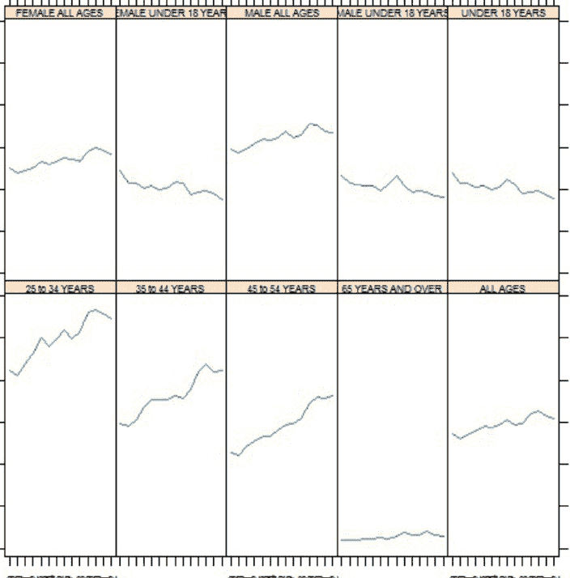

## 使用 ggplot 绘制数据

如果您喜欢使用 ggplot，可以使用 facets 渲染一组类似的图表：

```
require("ggplot2")

.df <- data.frame(x = x3$Year.1, y = x3$Not.Covered.Pct, z = x3$cat)
df <- .df[order(.df$x), ]
.plot <- ggplot(data = .df, aes(x = x, y = y, colour = z, shape = z))
+ geom_point()
+ geom_line(size = 1)
+ scale_shape_manual(values = seq(0, 15))
+ scale_y_continuous(expand = c(0.01, 0))
+ facet_wrap(~z)
+ xlab("Year.1")
+ ylab("Not.Covered.Pct")
+ labs(colour = "cat", shape = "cat")
+ theme(panel.margin = unit(0.3, "lines"), legend.position = "none")
print(.plot)
```

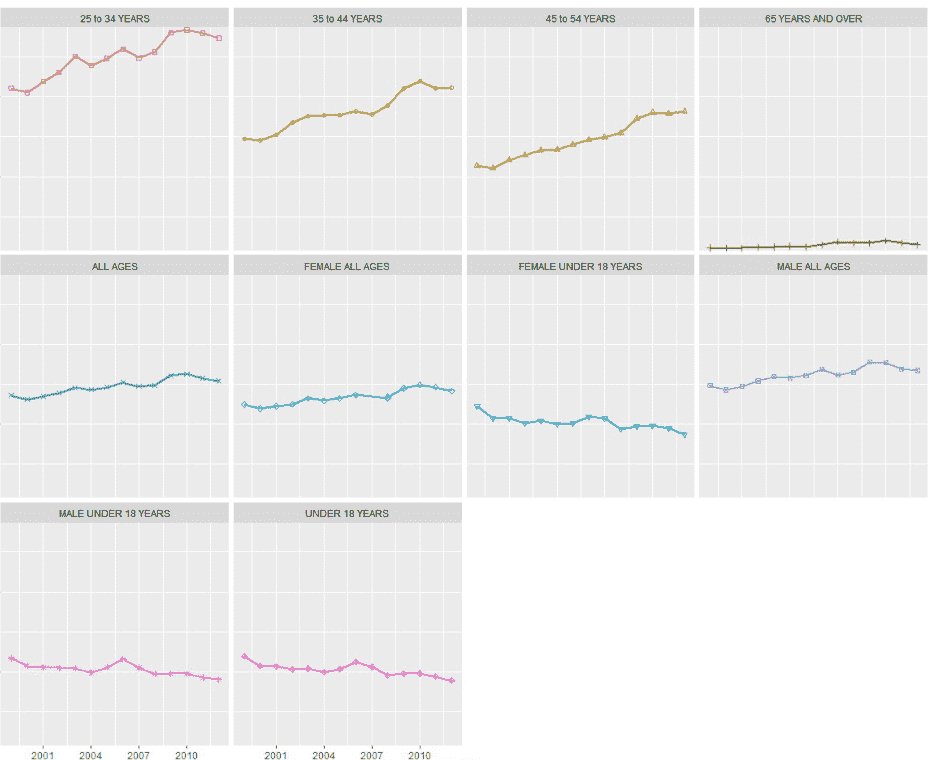

## 将输出发送到外部文件

将图表分配给图表对象的一个好处是，您可以稍后将图表发送到外部文件（例如 PDF），在外部查看，甚至可以直接从 R 在浏览器中查看。例如，对于 lattice 图示例，您可以使用 `trellis.device` 并指定输出参数，然后打印该对象。如前一章所示，您可以使用 `browseURL` 在浏览器中打开 PDF：

```
### send to pdf
setwd("C:/PracticalPredictiveAnalytics/Outputs")
trellis.device(pdf, file = "x3.pdf")
print(p)
dev.off()
#NOT run
#browseURL('file:///c:///PracticalPredictiveAnalytics/Outputs//x3.pdf')
```

## 检查输出

如果我们检查前面的图表，可以发现有些群体的趋势比其他群体更明显。例如，18 岁以下年龄组显示出下降的入学趋势，而 25-54 岁年龄组则呈上升趋势。

## 检测线性趋势

在线性趋势模型中，通过对数据点运行 `lm()` 回归来构建线性回归最小二乘线。这些模型适合最初直观地探索趋势。我们可以利用 base R 中提供的 `lm()` 函数，专门计算趋势线的斜率。

例如，前 14 行显示整个总体组（ALL AGES）的数据。我们可以针对编号为 1-14 的每一年对 Not.Covered.Pct 运行回归，并看到 Year.1 变量的系数为正，表明随着时间推移，未覆盖百分比呈线性增加。我们还可以将 lm() 函数包装在 coef() 函数中，从而单独查看系数输出。

使用 `lm()` 函数运行回归后，我们可以随后使用 `coef` 函数从 `lm` 模型中专门提取斜率和截距。

由于这是一个只有一个自变量（`Time`）的回归，因此只会有一个系数：

```
lm(Not.Covered.Pct ~ Year.1, data = x2[1:14, ])
>
> Call:
> lm(formula = Not.Covered.Pct ~ Year.1, data = x2[1:14, ])
>
> Coefficients:
> (Intercept)      Year.1
>  -4.102621    0.002119
coef(lm(Not.Covered.Pct ~ Year.1, data = x2[1:14, ]))
> (Intercept)      Year.1
> -4.102621443  0.002119058
```

## 自动化回归

现在我们已经了解了如何运行单个时间序列回归，可以继续实现对所有类别的单独回归进行自动化，并提取系数。

实现此目的有多种方法。一种方法是使用 `dplyr` 包中的 `do()` 函数。事件顺序如下：

- 数据首先按类别分组。
- 然后，针对每个类别运行线性回归（`lm()` 函数），以 `Year` 作为自变量，`Not.Covered.Pct` 作为因变量。这一切都包装在 `do()` 函数中。
- 从模型中提取系数。系数将充当趋势方向和幅度的代理。
- 最后，创建一个列表数据框（`fitted.models`），用于存储每个类别回归运行的系数和截距。系数最高为正的类别表现出最大的线性上升趋势，而下降趋势则由负系数表示：

```
library(dplyr)
fitted_models = x2 %>%
  group_by(cat) %>%
  do(model = coef(lm(Not.Covered.Pct ~ Year.1, data = .)))
```

所有生成的模型现在都位于 `fitted_models` 对象中。

`knitr` 包中的 `kable` 函数提供简单输出，将截距显示为第一个数字，并将模型列中的系数显示出来。作为检查，我们可以看到，ALL AGES 模型中的系数与前一部分推导出的系数相同：

```
library(knitr)
kable(fitted_models)
```

| 类别 | 模型 |
| --- | --- |
| 18 至 24 岁 | -0.4061834427, 0.0003367988 |
| 25 至 34 岁 | -11.375187597, 0.005796182 |
| 35 至 44 岁 | -10.916822084, 0.005534037 |
| 45 至 54 岁 | -11.544566448, 0.005829194 |
| 55 至 64 岁 | -4.709612146, 0.002409908 |
| 65 岁及以上 | -1.2562375095, 0.0006334125 |
| 所有年龄 | -4.102621443, 0.002119058 |
| 女性 18 至 24 岁 | -2.677300003, 0.001455388 |
| 女性 25 至 34 岁 | -9.990978769, 0.005088009 |
| 女性 35 至 44 岁 | -9.564724041, 0.004850188 |
| 女性 45 至 54 岁 | -10.36336551, 0.00523537 |
| 女性 55 至 64 岁 | -4.102774957, 0.002108343 |
| 女性 65 岁及以上 | -1.3674510779, 0.0006887743 |
| 女性 所有年龄 | -3.817483824, 0.001970059 |
| 女性 18 岁以下 | 3.267593386, -0.001578328 |
| 男性 18 至 24 岁 | 4.036127727, -0.001862991 |
| 男性 25 至 34 岁 | -9.715950286, 0.004983621 |
| 男性 35 至 44 岁 | -7.706624821, 0.003941543 |
| 男性 45 至 54 岁 | -10.975387917, 0.005549255 |
| 男性 55 至 64 岁 | -5.370380544, 0.002738269 |
| 男性 65 岁及以上 | -0.4834523450, 0.0002479691 |
| 男性 所有年龄 | -4.315036958, 0.002232003 |
| 男性 18 岁以下 | 2.914343264, -0.001401998 |
| 18 岁以下 | 3.086509947, -0.001487938 |

## 对系数进行排名

现在我们有了系数，可以开始按递增趋势对每个类别进行排名。由于迄今获得的结果包含在嵌入列表中，有点难以处理，我们可以进行一些代码操作，将其转换为常规数据框，每个类别一行，包含类别名称、系数和系数排名：

```r
library(dplyr)
### extract the coefficients part from the model list, and then transform
### data frame so that the coefficient appear one per row, rather than
### column.

xx <- as.data.frame(fitted_models$model)
xx2 <- as.data.frame(t(xx[2, ]))

### The output does not contain the category name, so we will merge
### from the original data frame.

xx4 <- cbind(xx2, as.data.frame(fitted_models))[, c(1, 2)] #only

### rank the coefficients from lowest to highest. Force the format
### as length 2, with leading zero's

tmp <- sprintf("%02d", rank(xx4[, 1]))

### Finally prepend the rank to the actual category
xx4$rankcat <- as.factor(paste(tmp, "-", as.character(xx4$cat)))

### name the columns
names(xx4) <- c("lm.coef", "cat", "coef.rank")
### and View the results
View(xx4)
```

如您所见，第 2、3、4 列现在包含了整齐排列的 `coefficients`、`category` 和 `coef.rank` 的表示，这些是通过将 `lm.coef` 从小到大排名，然后将排名顺序添加到类别名前面得出的：


| | lm.coef | cat | coef.rank |
|---|---|---|---|
| structure.c..0.406183442737828..0.0003367987... | 0.0003367988 | 18 至 24 岁 | 06 - 18 至 24 岁 |
| structure.c..11.3751875969696..0.00579618220... | 0.0057961822 | 25 至 34 岁 | 23 - 25 至 34 岁 |
| structure.c..10.9168220838485..0.00553403690... | 0.0055340369 | 35 至 44 岁 | 21 - 35 至 44 岁 |
| structure.c..11.5445664482143..0.00582919407... | 0.0058291941 | 45 至 54 岁 | 24 - 45 至 54 岁 |
| structure.c..4.70961214602917..0.00240990753... | 0.0024099075 | 55 至 64 岁 | 14 - 55 至 64 岁 |
| structure.c..1.25623750951236..0.00063341249... | 0.0006334125 | 65 岁及以上 | 07 - 65 岁及以上 |
| structure.c..4.10262144273963..0.00211905813... | 0.0021190581 | 所有年龄段 | 12 - 所有年龄段 |
| structure.c..2.67730000270634..0.00145538791... | 0.0014553879 | 女性 18 至 24 岁 | 09 - 女性 18 至 24 岁 |
| structure.c..9.99097876897398..0.00508800858... | 0.0050880086 | 女性 25 至 34 岁 | 19 - 女性 25 至 34 岁 |
| structure.c..9.5647240414497..0.004850187645... | 0.0048501876 | 女性 35 至 44 岁 | 17 - 女性 35 至 44 岁 |
| structure.c..10.3633655124299..0.00523536960... | 0.0052353696 | 女性 45 至 54 岁 | 20 - 女性 45 至 54 岁 |
| structure.c..4.10277495735534..0.00210834349... | 0.0021083435 | 女性 55 至 64 岁 | 11 - 女性 55 至 64 岁 |
| structure.c..1.36745107793605..0.00068877425... | 0.0006887743 | 女性 65 岁及以上 | 08 - 女性 65 岁及以上 |
| structure.c..3.81748382391257..0.00197005880... | 0.0019700588 | 女性所有年龄段 | 10 - 女性所有年龄段 |
| structure.c..3.26759338613744..0.00157832779... | -0.0015783278 | 女性 18 岁以下 | 02 - 女性 18 岁以下 |
| structure.c..4.03612772673809..0.00186299125... | -0.0018629913 | 男性 18 至 24 岁 | 01 - 男性 18 至 24 岁 |
| structure.c..9.71595028579057..0.00498362081... | 0.0049836208 | 男性 25 至 34 岁 | 18 - 男性 25 至 34 岁 |
| structure.c..7.70662482144783..0.00394154306... | 0.0039415431 | 男性 35 至 44 岁 | 16 - 男性 35 至 44 岁 |
| structure.c..10.9753879171274..0.00554925524... | 0.0055492552 | 男性 45 至 54 岁 | 22 - 男性 45 至 54 岁 |
| structure.c..5.37038054369785..0.00273826914... | 0.0027382691 | 男性 55 至 64 岁 | 15 - 男性 55 至 64 岁 |

## 将分数合并回原始数据框

我们将通过按类别合并，然后按系数排名对数据框进行排序，将此新信息合并回原始 x2 数据框。这样我们就可以将其用作趋势的代理：

```
x2x <- x2 %>% left_join(xx4, by = "cat") %>% arrange(coef.rank, c
```

```
### exclude some columns so as to fit on one page
head(x2x[, c(-2, -3, -4, -8)])
> Source: local data frame [6 x 7]
>
> cat Year.1 Total.People Total Not.Covered.
> (fctr) (int) (dbl) (dbl) (d
> 1 MALE 18 to 24 YEARS 2012 15142.04 11091.86 0.2674
> 2 MALE 18 to 24 YEARS 2011 15159.87 11028.75 0.2725
> 3 MALE 18 to 24 YEARS 2010 14986.02 10646.88 0.2895
> 4 MALE 18 to 24 YEARS 2010 14837.14 10109.82 0.3186
> 5 MALE 18 to 24 YEARS 2008 14508.04 10021.66 0.3092
> 6 MALE 18 to 24 YEARS 2007 14391.92 10230.61 0.2891
> Variables not shown: lm.coef (dbl), coef.rank (fctr)
```

## 使用趋势线绘制数据

现在我们已拥有趋势系数，将首先使用 ggplot 绘制所有 24 个类别的参保人数，然后创建第二组图表，添加基于刚才计算的线性系数的趋势线。

代码说明：facet_wrap 将按变量 z 的值对图表进行排序，该变量被分配为系数排名。因此，我们可以先看到参保人数下降的类别，最后看到 1999-2012 期间参保趋势最高的类别。

### 注意

我喜欢将即将更改的变量分配给标准变量名，例如 x、y 和 z，以便记住它们的用途（例如，变量 x 始终是 x 变量，而 y 始终是 x 变量）。但你也可以直接在 ggplot 调用中提供变量名，或设置自己的函数来完成相同的事情：

```
library(ggplot2)
.df <- data.frame(x = x2x$Year.1, y = x2x$Not.Covered.Pct, z = x2
#use ggplot to layer the different components of the visualization
.plot <- ggplot(data = .df, aes(x = x, y = y, colour = 1, shape =
+ geom_point()
+ scale_shape_manual(values = seq(0, 24))
+ scale_y_continuous(expand = c(0.1,0))
+ scale_x_continuous(expand = c(0.1, 1))
+ facet_wrap(~z) + xlab("Year.1")
+ ylab("Not.Covered.Pct")
+ labs(colour = "cat", shape = "cat")
+ theme(panel.margin = unit(0.3,"points"), legend.position = "non
+ theme(strip.text.x = element_text(size = 6))
print(.plot)
```

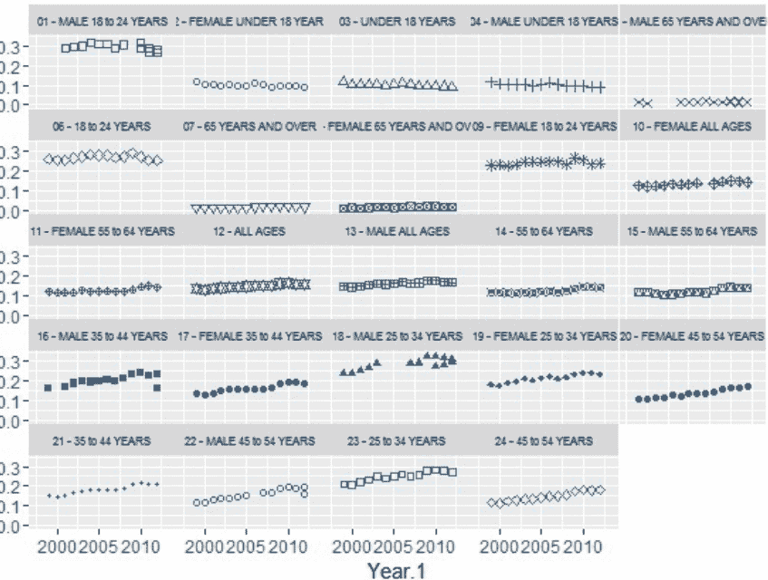

如你所见，对于“所有年龄段”类别，未投保百分比在整个时间段内呈上升趋势，直至 2010 年（《平价医疗法案》颁布之年），之后百分比开始下降。然而，在同一时间段内，18 岁以下年龄组的未投保人口比例相对于人口规模呈下降趋势。

我们可以更仔细地查看前四名和后四名类别，以及“所有年龄段”类别，以更深入地研究这一点。这次，我们将使用 geom_smooth 参数添加自己的趋势线，它将添加线性回归趋势线：

```
### declining enrollment
.df2 <- rbind(head(.df, (4*14)) , tail(.df, (4*14)) , .df[.df$z == "1
.plot2 <- ggplot(data = .df2, aes(x = x, y = y, colour = 1, shape
+ geom_point()
+ scale_shape_manual(values = seq(0, nrow(.df2)))
+ scale_y_continuous(expand = c(0.1, 0))
+ scale_x_continuous(expand = c(0.1, 1))
+ facet_wrap(~z)
+ xlab("Year.1")
+ ylab("Not.Covered.Pct")
+ labs(colour = "cat", shape = "cat")
+ theme(panel.margin = unit(0.3,"points"),legend.position = "none
+ geom_smooth(method = "lm", se = FALSE,colour = "red")
.plot2 <- ggplot(data = .df2, aes(x = x, y = y, colour = 1, shape
+ geom_point()
+ scale_shape_manual(values = seq(0, nrow(.df2)))
+ scale_y_continuous(expand = c(0.1,0))
+ scale_x_continuous(expand = c(0.1, 1))
+ facet_wrap(~z)
+ xlab("Year.1")
+ ylab("Not.Covered.Pct")
+ labs(colour = "cat", shape = "cat")
+ theme(panel.margin = unit(0.3,"points"),legend.position = "none
+ geom_smooth(method = "lm", se = FALSE,colour = "red")
print(.plot2)
```

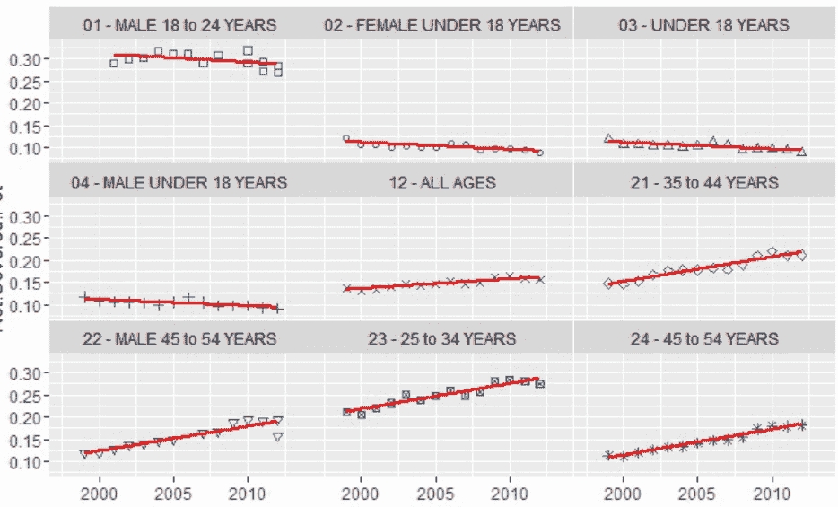

## 将所有类别绘制在同一图表上

有时，将所有线条绘制在同一图表上而不是分开的图表会更好。为此，我们会稍微修改语法，使类别显示为堆叠线。同样，我们可以看到不同年龄段的未投保百分比是一致的，其中 18 岁以下组的未投保率最低，而 25-54 岁组的未投保率最高：

```
library(ggplot2)
### plot all on one graph

.df <- x3[order(x3$Year.1), ]
.plot <- ggplot(data = .df, aes(x = Year.1, y = Not.Covered.Pct,
+ geom_point()
+ geom_line(size = 1)
+ scale_shape_manual(values = seq(0,15))
+ ylab("Not.Covered.Pct")
+ labs(colour = "cat", shape = "cat")
+ theme_bw(base_size = 14,base_family = "serif")
print(.plot)
```

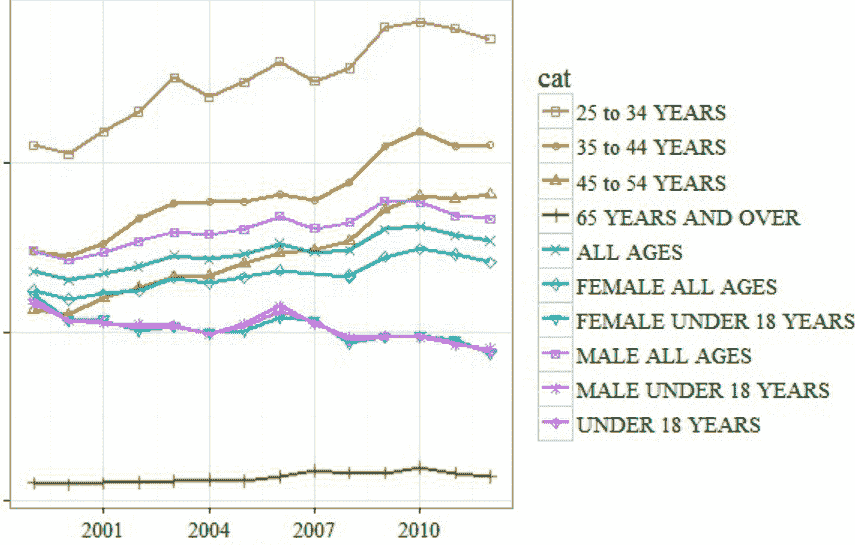

## 添加标签

有时，根据图例辨别类别之间的差异可能有些困难，尤其是类别数量增加时，因此我们可以使用 directlabels 库为每条线标记类别名称。现在我们可以看到，例如，所有男性类别在所有时间段的未投保率均高于所有女性类别：

```
#install.packages("directlabels")
library(directlabels)
direct.label(.plot, list(last.points, hjust = 0.75, cex = 0.75, v
```

Not.Covered.Pct

Year.1

- 25 至 34 岁
- 35 至 44 岁
- 45 至 54 岁
- 男性所有年龄段
- 所有年龄段
- 女性所有年龄段
- 女性 19 岁以下
- 65 岁及以上

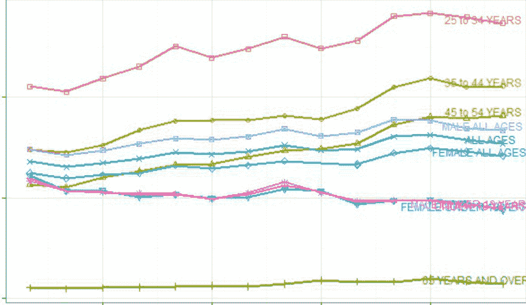


## 使用 ets 函数进行自动化预测

到目前为止，我们已经探讨了如何探索数据中可能固有的任何线性趋势。这为下一步（预测）奠定了坚实基础。现在，我们将开始探讨如何进行实际预测。

### 将数据框转换为时间序列对象

作为准备步骤，我们将使用 ts 函数将数据框转换为时间序列对象。在转换为 ts 对象之前，确保时间序列间距相等很重要。至少，你需要将时间序列变量、开始日期和结束日期作为参数提供给 ts 函数。

创建新对象 x 后，运行 str() 函数以验证 1999 年至 2012 年的全部 14 个时间序列是否已创建：

```
#### only extract the 'ALL' timeseries
x <- ts(x2$Not.Covered.Pct[1:14], start = c(1999), end = c(2012),

str(x)
> Time-Series [1:14] from 1999 to 2012: 0.154 0.157 0.163 0.161
```

## 使用移动平均平滑数据

分析时间序列的一种简单技术涉及简单移动平均和指数移动平均。简单移动平均和指数移动平均都是用于平滑系列中的随机噪声并观察周期和趋势的方法。

### 简单移动平均

简单移动平均将简单地取过去 k 个周期时间序列变量的总和，然后除以周期数。从这个意义上说，它与均值计算相同。然而，使其与简单平均值不同的是以下几点：

- 平均值会随着每增加一个时间段而移动。移动平均是向后看的，每当时间段移动时，平均值也会随之移动。这就是它们被称为“移动”的原因。移动平均有时也称为滚动平均。
- 回顾期可以移动。这是移动平均的第二个特征。10 周期移动平均将取最后 10 个数据元素的平均值，而 20 周期移动平均将取最后 20 个数据点的总和，然后除以 20。

### 使用函数计算 SMA

为了计算我们数据的五周期滚动移动平均值，我们将使用 TTR 包中的简单移动平均（SMA）函数，然后显示前几行：

```
#install.packages("TTR")
library(TTR)
MA <- SMA(x, n = 5)
cbind(head(x, 14), head(MA, 14) )
>           [,1]         [,2]
> [1,] 0.1541247         NA
> [2,] 0.1574131         NA
> [3,] 0.1629424         NA
> [4,] 0.1609860         NA
> [5,] 0.1485338 0.1568000
> [6,] 0.1474000 0.1554551
> [7,] 0.1523271 0.1544379
> [8,] 0.1464598 0.1511414
> [9,] 0.1433967 0.1476235
> [10,] 0.1455136 0.1470194
> [11,] 0.1391090 0.1453612
> [12,] 0.1347953 0.1418549
> [13,] 0.1308892 0.1387408
> [14,] 0.1362041 0.1373023
```

有多种方法可以将移动平均值与原始数据一起绘图。使用基础 R，使用 `ts.plot()` 函数来实现这一点，该函数将原始系列和系列的移动平均值作为参数：

```
ts.plot(x, MA, gpars = list(xlab = "year", ylab = "Percentage of
lty = c(1:2)))
title("Percentage of Non-Insured 1999-2012 - With SMA")
```

以下图表以实线显示原始数据，以虚线显示计算出的移动平均值：

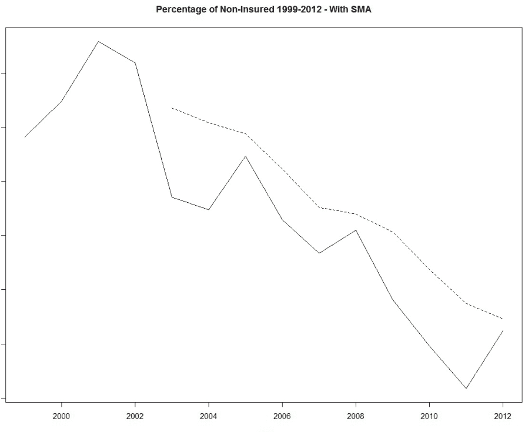

你可以看到移动平均值如何有助于显示数据的上升和下降趋势，同时也有助于平滑数据以消除一些噪声。还要注意，移动平均需要一些初始数据才能开始计算，这就是为什么图表中前四个时间段的虚线移动平均线缺失的原因。只有在第五个周期，它才能通过对应时间段 1999-2003 的数值求和然后除以五来确定计算结果。下一个点是通过对应时间段 2000-2004 的数值求和，然后再除以五来得出的。

### 验证 SMA 计算

始终验证计算很重要，以确保值计算正确，并促进理解。

对于 `SMA` 函数，我们可以切换到控制台，计算最后五个数据点的 `SMA` 函数值。

首先，计算元素的总和，然后除以移动平均中的数据点数（5）：

```
sum(x[10:14])/5
> [1] 0.1373023
```

这与时间段 14 的 SMA 列完全一致。

### 指数移动平均

对于简单移动平均（SMA），所有数据点均等权重，无论其数据有多旧或出现多近。指数移动平均（EMA）对近期数据赋予更多权重，基于未来更可能类似于近期过去而非久远过去的假设。

实际上，EMA 是一个更简单的计算。EMA 首先计算一个简单移动平均。当它达到指定的回顾期数（n）时，它通过给当前值和前一个值分配不同的权重来计算当前值。

这种权重由平滑（或比率）因子指定。当 ratio=1 时，预测值完全基于最后一个时间值。对于 ratio=0，预测基于整个回顾期的平均值。因此，平滑因子越接近 1，对近期数据赋予的权重就越大。如果你想给较旧数据更多权重，请将平滑因子降低到接近 0。

一般来说，EMA 的公式如下：

{Current Data Point - EMA(previous)} x smoothing factor + EMA(previous day)

要计算 EMA，可以使用 `EMA()` 函数（来自 `TTR` 包）。你需要指定一个平滑常数（比率）以及一个回顾期（n）。

### 使用函数计算 EMA

以下代码将使用回顾期为 5、比率为 .8 计算 EMA。比率 .8 会给最近周期赋予最大权重，同时仍允许过去影响预测。

然后我们将使用 cbind() 显示数据点，以及简单移动平均和指数移动平均：

```
ExpMA <- EMA(x, n = 5, ratio = 0.8)
cbind(head(x, 15), head(MA, 15), head(ExpMA, 15))
> [,1] [,2] [,3]
> [1,] 0.1541247 NA NA
> [2,] 0.1574131 NA NA
> [3,] 0.1629424 NA NA
> [4,] 0.1609860 NA NA
> [5,] 0.1485338 0.1568000 0.1568000
> [6,] 0.1474000 0.1554551 0.1492800
> [7,] 0.1523271 0.1544379 0.1517177
> [8,] 0.1464598 0.1511414 0.1475114
> [9,] 0.1433967 0.1476235 0.1442196
> [10,] 0.1455136 0.1470194 0.1452548
> [11,] 0.1391090 0.1453612 0.1403382
> [12,] 0.1347953 0.1418549 0.1359039
> [13,] 0.1308892 0.1387408 0.1318922
> [14,] 0.1362041 0.1373023 0.1353417
ts.plot(x, ExpMA, gpars = list(xlab = "year", ylab = "Percentage
lty = c(1:2)))
title("Percentage of Non-Insured 1999-2012 - With EMA")
```

以下图表以图形形式显示数据。你可以看到每个数据点比 SMA 更接近其 EMA，如前所述，SMA 在回顾期内对所有先前数据点赋予相等权重。在这方面，EMA 对近期数据反应更快，而 SMA 移动较慢且变异性较小。当然，两者都受参数影响，尤其是回顾期。在两种情况下，更长的回顾期都会导致移动平均更慢：

### 1999-2012 年未投保百分比 - 带 EMA

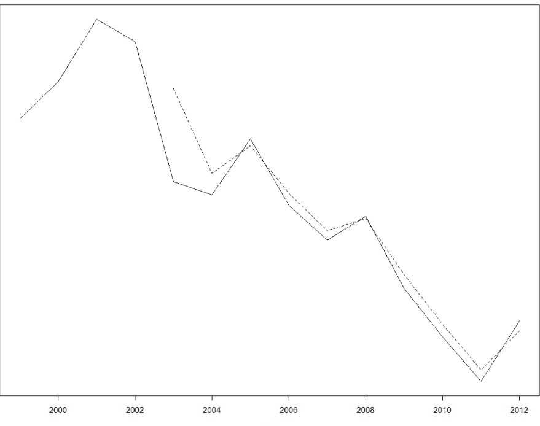

### 选择平滑因子

有时，选择合适的平滑因子是基于你对数据的自身经验，让你能够表达自己对未来表现的看法。例如，如果你认为数据最近已发生变化以反映新模式，你可能希望假设近期数据更重要，并使用接近 1 的平滑因子。另一方面，如果你认为近期活动仅由随机波动引起，你可能希望选择较低的平滑因子，以给过去更多权重。将近期过去与远古过去同等对待的平滑因子可能是类似 0.5 的值。重点是，不一定总是需要自动优化平滑因子（我们将在下一节看到）。


### 使用 ets 函数

虽然移动平均非常有用，但它们仅是所谓的指数平滑状态空间模型的一个组成部分，该模型有许多选项来定义最佳平滑因子，并允许您通过参数定义趋势和季节性的类型。要实现此模型，我们将使用 forecast 包中的 ets() 函数来对"ALL AGES"类别的 Not-Covered Percent 变量进行建模。

ets() 函数很灵活，因为它还可以在预测中纳入趋势以及季节性。

我们将仅演示一个简单的指数平滑模型（ANN）。然而，为了完整起见，您应该知道在调用 ets() 函数时需要指定三个字母，并且应该了解每个字母代表的含义。否则，它将基于默认参数进行建模。

以下是包作者 Hyndman 指定的描述：

- 第一个字母表示误差类型（“A”、“M”或“Z”）
- 第二个字母表示趋势类型（“N”、“A”、“M”或“Z”）
- 第三个字母表示季节类型（“N”、“A”、“M”或“Z”）

在所有情况下，N=无，A=加法，M=乘法，Z=自动选择。

因此，对于我们的示例，如果我们想要像手动计算中所做的那样建立一个简单的指数平滑模型，我们将指定 model=ANN。

### 使用 ALL AGES 进行预测

以下代码将执行以下步骤：

- 首先，它将过滤数据，使其仅包含 `ALL AGES` 类别。
- 然后，它创建一个时间序列对象。
- 最后，它使用 `ets()` 函数运行一个简单的指数模型。

请注意，我们没有指定平滑因子。`ets()` 函数计算最佳平滑因子（alpha，通过下面粗体显示的 `summary()` 函数显示），在此例中为 .99，这意味着模型时间序列将约 99% 的前一值纳入下一个时间序列预测中：

```
library(dplyr)
>
> Attaching package: 'dplyr'
> The following objects are masked from 'package:stats':
>
>     filter, lag
> The following objects are masked from 'package:base':
>
>     intersect, setdiff, setequal, union
library(forecast)
> Loading required package: zoo
>
> Attaching package: 'zoo'
> The following objects are masked from 'package:base':
>
>     as.Date, as.Date.numeric
> Loading required package: timeDate
> This is forecast 7.1
x4 <- x2[x2$cat == "ALL AGES", ]

#### set up as a time series object
x <- ts(x4$Not.Covered.Pct, start = c(1999), end = c(2012), frequency = 1)

fit <- ets(x, model = "ANN")
```

```
summary(fit)
> ETS(A,N,N)
>
> Call:
> ets(y = x, model = "ANN")
>
> Smoothing parameters:
> alpha = 0.9999
>
> Initial states:
> l = 0.1541
>
> sigma: 0.0052
>
> AIC   AICc   BIC
> -106.3560 -105.2651 -105.0779
>
> Training set error measures:
>           ME      RMSE      MAE       MPE      MAPE
> Training set -0.001279923 0.005191075 0.00430566 -0.9445532 2.9
>           MASE    ACF1
> Training set 0.9286549 0.004655079
```

### 绘制预测值和实际值

接下来，我们可以绘制预测值与实际值的对比图。请注意，预测值几乎与实际值相同；然而，它们总是领先一步：

```
plot(x)
lines(fit$fitted, col = "red")
```

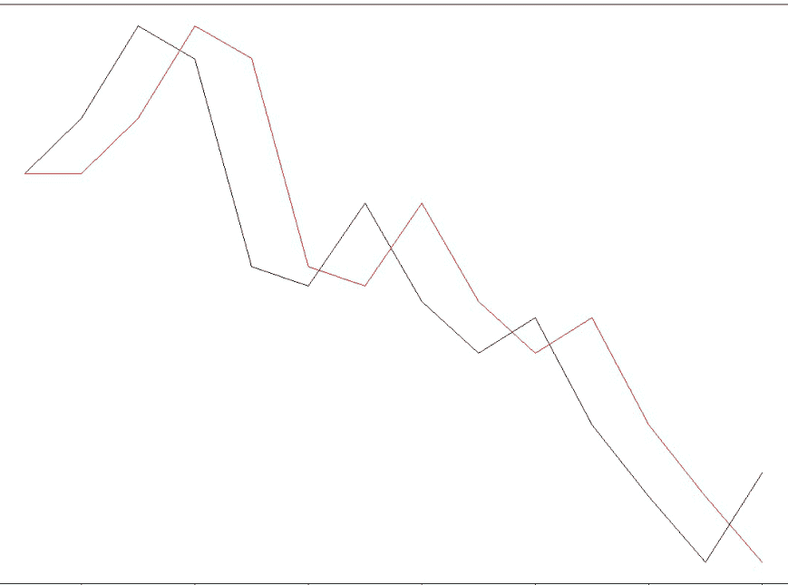

### forecast（fit）方法

forecast 方法包含许多可显示的对象，例如拟合值、原始值、置信区间和残差。使用 str(forecast(fit)) 来查看可用的对象。

我们将使用 cbind 打印原始数据点、拟合数据点和模型拟合方法。

```
cbind(forecast(fit)$method,forecast(fit)$x,forecast(fit)$fitted)
Time Series:
Start = 1999
End = 2012
Frequency = 1
forecast(fit)$method forecast(fit)$x forecast(fit)$fitted
1999 ETS(A,N,N) 0.15412470117969 0.154120663632029
2000 ETS(A,N,N) 0.157413125646824 0.154124700770241
2001 ETS(A,N,N) 0.162942355969924 0.157412792166205
2002 ETS(A,N,N) 0.160986044554207 0.162941795214416
2003 ETS(A,N,N) 0.148533847659868 0.160986242887746
2004 ETS(A,N,N) 0.147400008880004 0.148535110462768
2005 ETS(A,N,N) 0.152327126236553 0.147400123991157
2006 ETS(A,N,N) 0.146459794092561 0.152326626587079
2007 ETS(A,N,N) 0.14339666192983 0.146460389050636
2008 ETS(A,N,N) 0.145513631588618 0.143396972623751
2009 ETS(A,N,N) 0.139109023459534 0.145513416937297
2010 ETS(A,N,N) 0.134795323545856 0.139109672931905
2011 ETS(A,N,N) 0.130889234985064 0.134795761065932
2012 ETS(A,N,N) 0.136204104247743 0.130889631147599
```

我们还可以使用 View 以矩阵形式显示 forecast 对象的部分内容：

| | 点预测 | 80% 下限 | 80% 上限 | 95% 下限 | 95% 上限 |
|---|---|---|---|---|---|
| 2013 | 0.1362036 | 0.1295509 | 0.1428562 | 0.1260292 | 0.1463779 |
| 2014 | 0.1362036 | 0.1267958 | 0.1456113 | 0.1218156 | 0.1505915 |
| 2015 | 0.1362036 | 0.1246817 | 0.1477255 | 0.1185823 | 0.1538248 |
| 2016 | 0.1362036 | 0.1228993 | 0.1495078 | 0.1158565 | 0.1565507 |
| 2017 | 0.1362036 | 0.1213290 | 0.1510781 | 0.1134549 | 0.1589522 |
| 2018 | 0.1362036 | 0.1199094 | 0.1524977 | 0.1112838 | 0.1611233 |
| 2019 | 0.1362036 | 0.1186039 | 0.1538032 | 0.1092872 | 0.1631199 |
| 2020 | 0.1362036 | 0.1173888 | 0.1550184 | 0.1074288 | 0.1649783 |
| 2021 | 0.1362036 | 0.1162475 | 0.1561597 | 0.1056834 | 0.1667238 |
| 2022 | 0.1362036 | 0.1151680 | 0.1572391 | 0.1040325 | 0.1683747 |

### 绘制带置信带的未来值

使用 `plot` 函数绘制未来预测。请注意，最后一个值的预测包围了围绕水平预测线的上下置信带。但为什么是水平预测线？这表明指数模型没有趋势或季节性，且最佳预测基于平滑平均值的最后一个值。然而，我们可以看到，基于置信带，预测存在显著变化。随着预测期的增加，置信带也会增大，以反映预测相关的不确定性：

```
plot(forecast(fit))
```

### ETS(A,N,N) 的预测

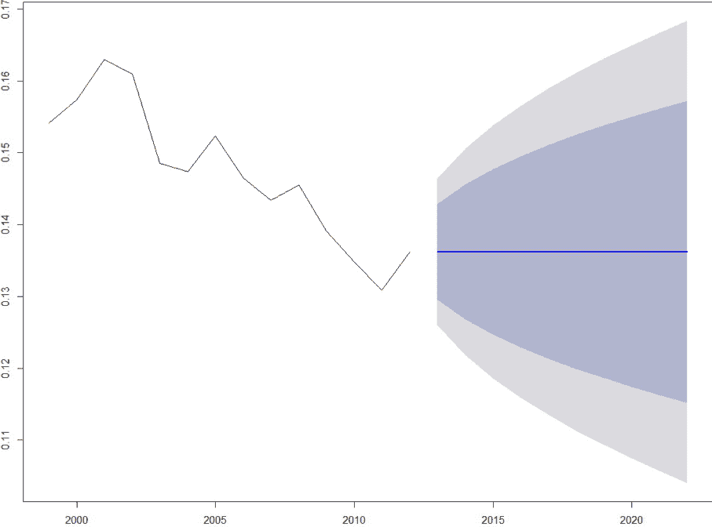

### 修改模型以包含趋势分量

此前，我们向数据添加了线性趋势线。如果我们还希望将线性趋势纳入预测，可以将第二个参数（趋势参数）替换为 A，从而得到一个 "AAN" 模型（Holt 线性趋势）。这种方法允许带有趋势的指数平滑：

```
fit <- ets(x, model = "AAN")
summary(fit)
> ETS(A,A,N)
>
> Call:
>  ets(y = x, model = "AAN")
>
>  Smoothing parameters:
>   alpha = 0.0312
>   beta = 0.0312
>
>  Initial states:
>   l = 0.1641
>   b = -0.0021
>
>  sigma: 0.0042
>
>      AIC     AICc      BIC
> -108.5711 -104.1267 -106.0149
>
>   Training set error measures:
>                   ME      RMSE        MAE         MPE      MAPE
> Training set -0.000290753 0.004157744 0.003574276 -0.2632899 2.
>   MASE      ACF1
> Training set 0.7709083 0.05003007
```

绘制预测会产生下面的图表：

```
plot(forecast(fit))
```

### ETS(A,A,N) 的预测

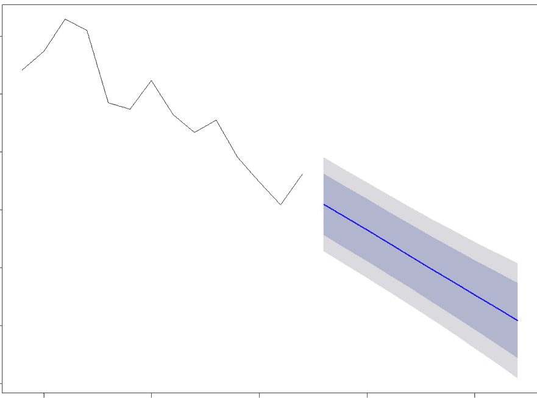

#### 在所有类别上迭代运行 ets 函数

现在我们已经在一个类别上运行了 ets 模型，可以构建一些代码来自动化所有类别的模型构建过程。

在此过程中，我们还将保存一些精度指标，以便查看我们的模型表现如何：

- 首先，按类别对数据帧进行排序，然后按年份排序。
- 然后，初始化一个新数据帧（onestep.df），我们将使用它来存储测试和训练数据每个移动窗口预测的准确性结果。
- 然后，将每个组（均包含 14 个时间周期）作为 for 循环中的一次迭代进行处理。
- 对于每次迭代，提取一个测试和训练数据帧。
- 为训练数据集拟合一个简单的指数平滑模型。
- 将模型拟合应用于测试数据集。
- 应用 accuracy 函数以提取验证统计信息。
- 将每个结果存储在前一步中初始化的 onestep.df 数据帧中：

```
df <- x2 %>% arrange(cat, Year.1)

#### create results data frame
onestep.df <- data.frame(cat = character(), rmse = numeric(), mape = numeric(), acf1 = numeric(), stringsAsFactors = FALSE)

#
```


```
#### library(forecast)
iterations <- 0
for (i in seq(from = 1, to = 999, by = 14)) {
j <- i + 13
#### pull out the next category. It will always be 14 records.
x4 <- df[i:j, ]
x <- ts(x4$Not.Covered.Pct, start = c(1999), end = c(2012), frequency = 1)

#### assign the first 10 records to the training data, and the next
#### test data.
```

```
trainingdata <- window(x, start = c(1999), end = c(2008))
testdata <- window(x, start = c(2009), end = c(2012))
```

```
par(mfrow = c(2, 2))

#### first fit the training data, then the test data.
#### Use simple exponential smoothing
fit <- ets(trainingdata, model = "ANN")
#### summary(fit)
fit2 <- ets(testdata, model = fit)
onestep <- fitted(fit2)
```

```
iterations <- iterations + 1
onestep.df[iterations, 1] <- paste(x4$cat[1])
onestep.df[iterations, 2] <- accuracy(onestep, testdata)[, 2] #RMSE
onestep.df[iterations, 3] <- accuracy(onestep, testdata)[, 3] #MAE
onestep.df[iterations, 4] <- accuracy(onestep, testdata)[, 5] #MAPE
onestep.df[iterations, 5] <- accuracy(onestep, testdata)[, 7] #ACF1

if (iterations == 24)
break
}
```

查看 for 循环中提取的某个类别的一些行。由于循环中创建的所有中间对象都仍然完整，因此查看最后处理的组很容易。

首先，让我们来看看原始组的实际数据：

```
tail(x4)
```

这显示了最后一个组“UNDER 18 YEARS”的部分输出。注意：要查看所有年份，您需要在控制台中运行命令 `tail(x4,14)` 而不是此命令：

```
> Source: local data frame [6 x 9]
>
> cat Avg.Total.Insured Avg.People Year Year.1
> (fctr) (dbl) (dbl) (fctr) (int)
> 1 UNDER 18 YEARS 66200.46 73752.5 2007 2007
> 2 UNDER 18 YEARS 66200.46 73752.5 2008 2008
> 3 UNDER 18 YEARS 66200.46 73752.5 2009 2009
> 4 UNDER 18 YEARS 66200.46 73752.5 2010 2010
> 5 UNDER 18 YEARS 66200.46 73752.5 2011 2011
> 6 UNDER 18 YEARS 66200.46 73752.5 2012 2012
> Variables not shown: Total.People (dbl), Total (dbl), Not.Covered, Not.Covered.Pct (dbl)
```

### onestep 生成的准确度指标

从 for 循环生成的 onestep.df 对象包含所有组的所有准确度指标。让我们看看前 6 个。您可以看到，每个类别都捕获了准确度指标 rmse、mae 和 mape：

```
head(onestep.df)
> cat rmse mae mape acf1
> 1 18 to 24 YEARS 0.013772470 0.009869590 3.752381 1.0000552
> 2 25 to 34 YEARS 0.004036661 0.003380938 1.217612 1.0150588
> 3 35 to 44 YEARS 0.006441549 0.004790155 2.231886 0.9999469
> 4 45 to 54 YEARS 0.004261185 0.003129072 1.734022 0.9999750
> 5 55 to 64 YEARS 0.005160212 0.004988592 3.534093 0.7878765
> 6 65 YEARS AND OVER 0.002487451 0.002096323 12.156875 0.9999937
cbind(fit$x, fit$fitted, fit$residuals)
> Time Series:
> Start = 1999
> End = 2008
> Frequency = 1
> fit$x fit$fitted fit$residuals
> 1999 0.11954420 0.1056241 0.0139200744
> 2000 0.10725759 0.1056255 0.0016320737
> 2001 0.10649619 0.1056257 0.0008705016
> 2002 0.10291788 0.1056258 -0.0027078918
> 2003 0.10393522 0.1056255 -0.0016902769
> 2004 0.09942592 0.1056253 -0.0061994140
> 2005 0.10320781 0.1056247 -0.0024169001
> 2006 0.11231138 0.1056245 0.0066869135
> 2007 0.10587369 0.1056251 0.0002485556
> 2008 0.09527547 0.1056252 -0.0103496921
```

```
mean(fit$residuals)
> [1] -6.056125e-07
```

查看测试数据集中“UNDER 18 YEARS”类别产生的残差。残差似乎在 2011 年发生了变化，但绝对值总体上仍然很小。

```
absresid <- abs(fit2$residuals)
plot(absresid)
```

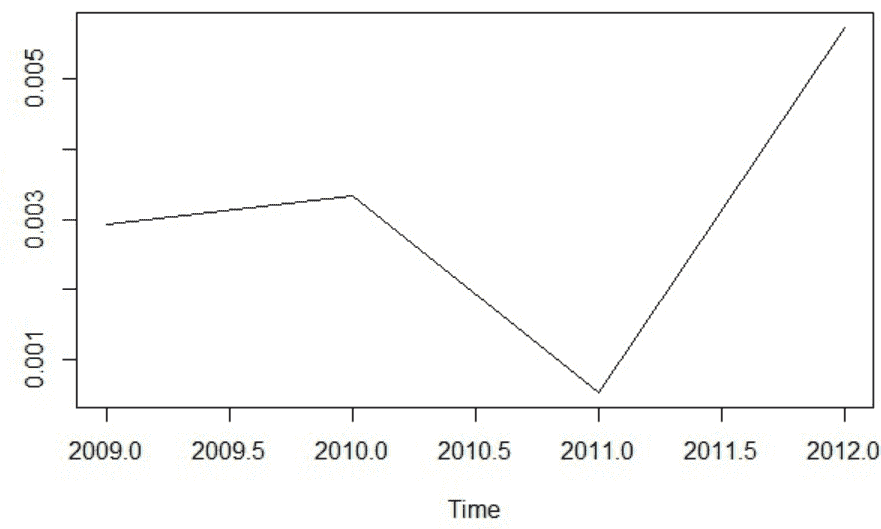

fit2 是测试数据，以及从训练数据（fit）开发的模型中得到的拟合值：

```
cbind(fit2$x, fit2$fitted, fit2$residuals)
> Time Series:
> Start = 2009
> End = 2012
> Frequency = 1
>
    fit2$x fit2$fitted fit2$residuals
> 2009 0.09745024 0.09451361 0.0029366252
> 2010 0.09785322 0.09451391 0.0033393083
> 2011 0.09397731 0.09451424 -0.0005369347
> 2012 0.08877369 0.09451419 -0.0057404940
```

```
mean(fit2$residuals)
> [1] -3.738216e-07
```

### 比较“UNDER 18 YEARS”组的测试和训练

我们还可以检查此子段的训练和测试组的图表，以查看是否真的有什么情况：

```
par(mfrow = c(1, 2))
plot(forecast(fit))
plot(forecast(fit2))
```

从以下图表可以看出，尽管该组的未覆盖百分比有所下降，但可能没有足够的数据来辨别趋势，因此预测被设置为平均值。

对于测试数据图，我们也可以看到为什么绝对残差图在 2011 年下降，因为它从 2010 年的局部峰值（《平价医疗法案》颁布时）过渡到 2011 年下降的开始：

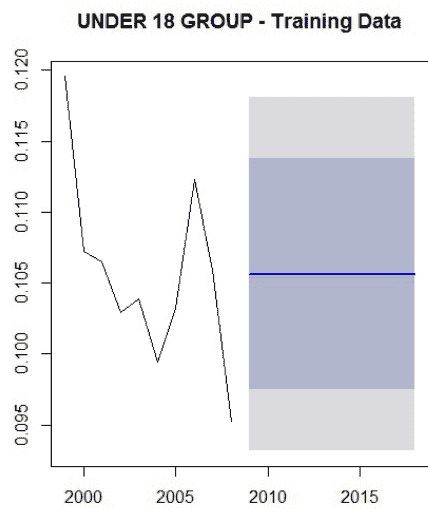

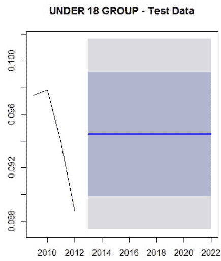

### 准确度指标

使用残差，我们可以根据三个流行的准确度指标来衡量预测值和实际值之间的误差：

- 平均绝对误差 (MAE)：该指标计算所有误差（残差）绝对值的平均值
- 均方根误差 (RMSE)：均方根误差首先计算所有平方误差的平均值，然后对平均值开方，以便恢复到原始尺度。这是衡量误差的标准统计方法。

### 注意

MAE 和 RMSE 都是依赖尺度的指标，这意味着它们可用于比较尺度相似的问题。在比较不同尺度的模型的准确度时，应使用其他与尺度无关的指标，例如 MAPE。

- 平均百分比误差 (MAPE)：这是实际值和预测值之间的绝对差值，以实际值的百分比表示。这在直观上易于理解，是一种非常流行的指标：

```
M = \frac{100}{n} \sum_{t=1}^n \left| \frac{A_t - F_t}{A_t} \right|,
```

其中 $A_t$ 是实际值，$F_t$ 是预测值。

我们可以通过简单地按 MAPE 列对 `onestep.df` 对象进行排序，来查看在 MAPE 等指标方面表现最差的模型：

```
onestep.df %>% arrange(., desc(mape)) %>% head()
>
> cat rmse mae mape
> 1 MALE 65 YEARS AND OVER 0.002647903 0.002226841 17.440671 0.57
> 2 MALE 35 to 44 YEARS 0.039044319 0.024111701 14.218445 0.99
> 3 65 YEARS AND OVER 0.002487451 0.002096323 12.156875 0.99
> 4 MALE 25 to 34 YEARS 0.024195057 0.019901117 6.748294 0.99
> 5 MALE 45 to 54 YEARS 0.017711280 0.010388681 6.380865 0.99
> 6 FEMALE 55 to 64 YEARS 0.006749771 0.005610275 4.021224 0.50
```

一次性绘制所有 MAPE 显示，指数模型对年轻群体效果更好，并且似乎对老年群体效果变差，尤其是男性：

```
lattice::barchart(cat ~ mape, data = onestep.df)
```

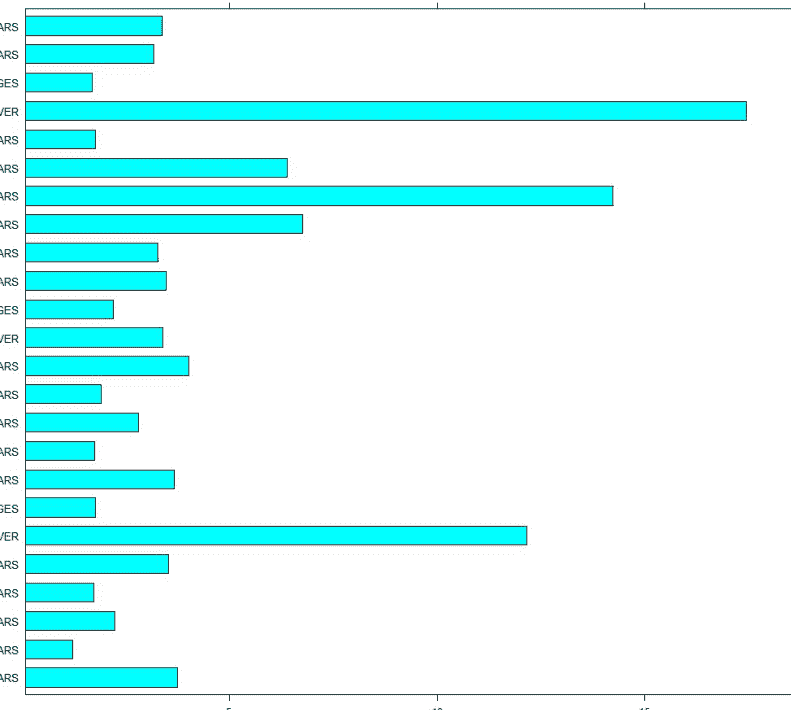

## 参考资料

http://www.census.gov/data/tables/time-series/demo/health-insurance/historical-series/hib.html

## 摘要

本章通过读取和探索 CMS 网站上的医疗保健登记数据，介绍了时间序列分析。接着，我们定义了一些基本的时间序列概念，例如简单移动平均和指数移动平均。最后，我们使用 R 的 "forecast" 包处理了一些指数平滑状态空间模型，并展示了一种为您的数据生成自动预测的方法。我们还展示了使用 ggplot、lattice 包以及原生 R 图形的各种绘图方法。
