# 第 9 章. 使用 R 进行 Spark 入门

> *数据！数据！数据！没有粘土，我无法制砖！*
>
> - 阿瑟·柯南·道尔爵士

迄今为止，我们已学习如何对所谓的“小数据”进行分析。然而，随着数据量的增加，数据的规模以及如何分析产生的海量数据的问题也随之增加。当这种情况发生时，我们开始接近“大数据”，解决问题的新方法不断涌现，有时还需要新的工具。

在某种程度上，一切都未改变。您仍然需要高质量的数据。您仍然希望能够考察关系，并将问题放在预测分析框架内。

发生变化的是实现该目标所需的步骤，请记住数据更难管理，因此已经发展出新的工具来帮助您完成这项工作。

近年来发展起来的工具之一是 Apache Spark。

在本章中，我们将介绍 Spark 的一些基础知识。我们将从一个已知的小数据集开始，进行一些数据清理，然后将此数据集转换为更大的数据，以便带入 Apache Spark 环境。我们还将学习如何调整我们熟悉的工具，以便与 Spark 一起使用，并在过程中学习一些新工具。


## 关于 Spark

撰写本文时，Spark 可能是用于预测分析的最流行的超大规模数据集架构。Spark 是一种分布式架构，可帮助您管理大数据并使其更易于分析。Spark 构建于 Hadoop 之上，两者共享同一文件系统。

但是，Spark 不基于 MapReduce 范式，而是使用弹性分布式数据集（RDD）结构，以实现内存分析并管理环境中所有节点的并行处理集群。这对分析人员来说意味着查询速度非常快，因为数据从内存中检索，其检索速度远快于磁盘访问。访问速度更快意味着更多的分析时间，以及更少的等待结果时间。

Spark 的一些优势如下：

- Spark 克服了内存受限分析的一些局限性，因为它管理内存，并能够优化数据访问和查询。
- Spark 有自己的机器学习库，称为 MLlib，它实现了多种预测模型技术，并优化了涉及大型数据集的算法的计算速度。
- Spark 现在包含数据框的概念，这使得使用 R 或 Python 的分析人员更容易上手。
- Spark 利用了 Hadoop 的冗余和容错特性。如果某个节点因任何原因失败，另一个节点将接替其位置，因此分析不会失败。在生产环境中工作时，这一点非常重要。
- Spark 还支持其他语言，例如 Java 和 Scala。语言可以在分析流水线中混合使用，分析人员可以共享相同的数据。这可以改善团队协作并提高效率。

## Spark 环境

Spark 以三种不同的模式运行：

- Standalone
- YARN
- MESOS

对于初始部署（以及学习），最好从独立模式开始，该模式专门为 Spark 分配集群。此外，您可以在本地模式（您的计算机）或通过云计算（例如使用 Amazon AWS）中运行独立模式。

## 集群计算

集群计算允许 Spark 同时在多台计算机上并行处理和分发数据。集群管理器根据用户请求为集群分配资源。Spark 的一个重要方面是，它会尽可能在内存中保留所需的数据，以便数据能够尽快用于各种分析，而不是每次指定查询或模型时都要等待从存储中检索数据。

Spark 数据以 RDD 的形式存储，允许将不同类型的对象分布在整个集群中。

## 并行计算

并行计算是指同时执行独立计算任务的能力。它通过分配工作负载来实现这一点。例如，如果一个数据框需要按姓氏简单排序，集群管理器可以将以字母表中 26 个字母开头的各种名称分发到 26 个不同的节点，让每个节点排序自己的字母，然后要求将所有结果返回到一个位置，在那里执行 1 次最终排序。这比只由 1 台机器执行排序要快。

## SparkR

Spark 本身使用名为 Scala 的编程语言编写，并在 Java 环境中运行。但是，您不局限于使用 Scala。Spark 有几个通过 API 暴露的接口，允许使用这些其他语言编写 Spark 程序：

- R
- Scala
- Java
- Python
- Clojure

我们将在本章中使用 SparkR 演示一些示例。SparkR 是一个 R 包，提供了从 R 使用 Apache Spark 的前端。这使得 SparkR 允许数据科学家在集群上从 R 交互式运行作业。对于传统的 R 程序员来说，使用 SparkR 的一个巨大优势是，它使用了一些他们已经熟悉的技术，例如数据框的概念在 SparkR 中也可用。

### 数据框

Spark RDD 使用起来可能有点困难，因此在最近的 Spark 版本中，数据框抽象被构建在 RDD 之上，这使分析人员能够以他们习惯的方式查看数据，例如，能够将其视为表格和列表。这使得许多高级语言（例如 R 和 Python）能够使用对它们来说熟悉的语法，并能够集成与原生 Scala 或 Spark SQL 相当的优化代码。

Databricks 是由 Apache Spark 的创始人创立的公司，提供了一个免费环境，可在云中使用 R、Java、Scala 或 Python 运行 Spark 程序。

我将使用 Databricks 环境来演示运行本章示例所需的代码。这些示例使用 Databricks 笔记本的概念。Databricks 笔记本类似于 Jupyter 或 Zeppelin 笔记本。笔记本比喻允许您在一个地方显示代码和结果。

以下是一个简单的 Databricks 笔记本示例，它计算鸢尾花萼片长度的直方图，并使用 ggplot 绘制图表。

[插入 Databricks 模拟图 1 和 Databricks 模拟图 2 图片]

如我们将看到的，Databricks 笔记本还允许您在一个笔记本中混合使用不同的语言；例如，您可以使用 R、Python 和 SQL 代码的组合构建一个分析。

要开始使用：

- 1. 在 databricks.com 注册免费的 Databricks 账户。
- 2. 导入本章中使用的笔记本。
- 3. 启动集群。
- 4. 开始跟随学习！

## 构建我们的第一个 Spark 数据框

使用 Spark 时的挑战之一是在处理非常大的数据集时寻找分析解决方案。作为准备步骤，在本章中，我们将构建我们自己的大型 Spark 数据框。

另请注意，大型数据框的概念显然是相对的。由于免费的 Databricks 会限制所创建的任何数据框的大小，我们最终将构建一个约 11 个变量的 100 万行数据框。

我还将向您展示如何在基础 R 中构建类似的数据集，以便您可以自行测试，并能够判断在 Spark 上执行分析所带来的性能收益。

## 模拟

我们最终将通过模拟构建这个 Spark 数据框。这将占用本章的大部分内容。我认为这比导入现有的公共数据集要好，因为在现有数据集中您无法控制数据的构成。使用模拟数据集，您可以随心所欲地调整其大小（受账户限制）。

但是，您始终可以自由导入任何想要的数据集，随后的分析概念将是相同的。

- 1. 首先，您需要注册并登录您的 Databricks 账户。
- 2. 接下来，创建一个集群。为其命名，例如 MyCluster。
- 3. 为了与本章中的示例保持一致，请确保选择 Spark 2.1。这非常重要。由于 Spark 是 Apache 开源产品，功能可能会演变，因此我们希望确保您可以复现代码。
- 4. 选择 `Create Cluster`。
- 5. 留出一些时间来创建集群。当它完成时，您将收到运行中状态，如以下屏幕截图所示：


| 名称 | 内存 | 类型 | 状态 | 节点 | Spark |
|---|---|---|---|---|---|
| MyClust | 6 GB | 社区优化版, Spark 2.0 (自动更新, Scala 2.10) | 运行中 | > 1 按需 | Spark UI 日志 |

## 导入示例笔记本

运行本章中示例的最佳方式是从外部网站导入笔记本。具体操作如下：

- 1. 单击 **工作区**。
- 2. 右键单击 **培训与教程**（或备用文件夹）并选择 **导入**。
- 3. 将从出版社网站下载的文件拖放到放置区，然后单击 **导入**。

请参阅以下屏幕截图：


导入笔记本后，所有代码和输出都会出现，您可以自由地跟随剩余的代码示例进行学习。

### 笔记本格式


Databricks 笔记本将上方窗格单元格中编写的代码，后跟下方单元格中的任何输出，类似于旁边显示的“diamonds”数据教程代码。

要运行当前单元格，只需单击右侧的三角形图标即可。

- 单元格运行后，您将能够在代码下方查看输出。这可能是一个图表或控制台输出。始终检查错误消息和警告，尤其是当输出不是您预期的结果时。

- 另请注意，有些情况下根本不会产生任何输出。这可能没问题，但请务必检查输出单元格上的时间戳，以确保单元格确实已运行：

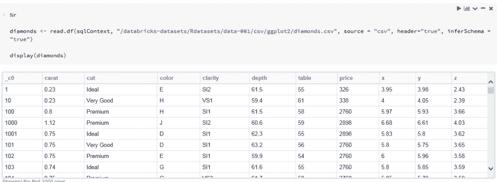

## 创建新笔记本

作为导入笔记本的替代方案，您可以从 Databricks 主屏幕创建新笔记本，并将本章中的代码复制/粘贴到笔记本单元格中。如果您希望将本章的某些部分用作模板并添加自己的代码，可能需要这样做。

### 注意

您可以使用以下键盘快捷键序列

```
<Ctrl> + <Alt> + N
```

以创建新笔记本。

## 从小处着手，逐步壮大

本章将采用的策略是先检索一个现有的公开小数据集（Pima Indians diabetes，皮马印第安人糖尿病）。然后我们将进行一些基本的探索性分析，计算一些关键统计属性，并利用这些属性模拟一个更大的数据集，用于输入到 Spark 中。我们将用于生成该“大数据”的关键特征如下：

- 变量的均值/标准差：目标是为大数据集生成均值和标准差，使其与小数据集的相应均值和标准差接近。
- 变量的相关性：由于统计建模和分析在很大程度上基于变量之间的关联，模拟的目标是保留小数据集中存在的所有大数据集的双向相关性数值。
- 变量的底层分布：我们将假设所有变量均服从正态分布，但结果变量（Diabetes 与 NonDiabetes 除外。不过，我们将模拟结果以使其与样本数据集中反映的比例相符。

### 皮马印第安人糖尿病数据集

要构建 Spark DataFrame 的特征，我们将首先获取一个小数据集，确定该数据集的基本统计属性，然后基于这些属性构建 Spark DataFrame。

皮马印第安人糖尿病数据集包含以下属性：

- 怀孕次数
- 口服葡萄糖耐量试验两小时血浆葡萄糖浓度
- 舒张压（mm Hg）
- 三头肌皮皱厚度（mm）
- 2小时血清胰岛素（mu U/ml）
- 体重指数（体重 kg/(身高 m)^2）
- 糖尿病谱系函数
- 年龄（岁）
- 是否患糖尿病（是或否）

该数据是公开可用的数据集。实际上，该数据集有多个版本可用。我们将使用 `mlbench` 包中包含的数据集，并将其加载到 R 工作区中。

## 运行代码

加载笔记本后，将出现一系列代码“块”。此特定笔记本是 R 类型笔记本，即默认情况下，代码行可以是 R 命令、SparkR 命令或特殊的 Databricks 命令（例如 display）。

稍后我们将看到，可以为 SQL 命令（以 %sql 开头的笔记本）设置不同的单元格，甚至可以混合 Python（%python）或 Scala 代码（%scala）。

要运行任何特定代码块的内容，可以使用以下键盘序列：

```
<Shift> + <Enter> : Run command and move to next cell
```

或者，您可以使用运行单元格图标（第一个三角形图标）：


既然我们知道如何运行单个代码块，我们将首先运行初始化代码，该代码仅用于测试 Databricks 系统是否正常运行，并设置一些选项。

### 运行初始化代码

初始化代码仅为后续使用设置一些选项，没有实际输出。我们将只打印 "Hello World" 以确保其正常工作：

```
options(digits=3)
options(repr.plot.width = 1000, repr.plot.height = 500, repr.plot
rep_times=1000
cat("Hello World")
```

输出单元格将打印 Hello World，同时给出运行耗时、用户名、日期和时间以及运行所在的集群。请密切关注每个代码块的运行时长，这日后对代码性能基准测试将很有用。

```
Hello World
Command took 0.00 seconds -- by r_wintersat 2/27/2017, 6:20:39 PM on MyCluster
```

## 提取皮马印第安人糖尿病数据集

运行以下代码后，我们将加载 `PimaIndiansDiabetes` R 数据帧，并运行通常的 `str()` 和 `summary()` 函数。请注意，我们需要先安装 `mlbench` 包以检索包中包含的数据。

此时，尚未引入任何 Spark 指令。尽管我们在 Databricks 环境中运行，但代码是纯 R 代码，您也可以在常规 R 环境中复制此代码。

```
### load the library
devtools::install_github("cran/mlbench")
library(mlbench)
data(PimaIndiansDiabetes)
str(PimaIndiansDiabetes)
summary(PimaIndiansDiabetes)
```

### 检查输出

如常，`str()` 和 `summary()` 函数将让您初步了解数据。输出将出现在控制台窗格中，通常位于代码窗格正下方。

注意：未显示所有输出。

### str() 函数的输出

- `str()` 函数告诉我们，共有 768 个观测值和 9 个变量。所有变量均已加载为数值型，除了目标变量 diabetes，它已编码为具有两个级别的因子。
- `neg` 表示不存在糖尿病状况。
- pos 表示存在糖尿病状况。

同样，str() 是快速获取见解的好方法。始终扫描前几行中的 0 和 NA，并开始自问期望这些值是否合理。

请参考下图：

```
'data.frame': 768 obs. of 9 variables:
$ pregnant: num 6 1 8 1 0 5 3 10 2 8 ...
$ glucose : num 148 85 183 89 137 116 78 115 197 125 ...
$ pressure: num 72 66 64 66 40 74 50 0 70 96 ...
$ triceps : num 35 29 0 23 35 0 32 0 45 0 ...
$ insulin : num 0 0 0 94 168 0 88 0 543 0 ...
$ mass : num 33.6 26.6 23.3 28.1 43.1 25.6 31 35.3 30.5 0 ...
$ pedigree: num 0.627 0.351 0.672 0.167 2.288 ...
$ age : num 50 31 32 21 33 30 26 29 53 54 ...
$ diabetes: Factor w/ 2 levels "neg","pos": 2 1 2 1 2 1 2 1 2 2 ...
```

### summary() 函数的输出

summary() 函数将 diabetes 变量细分为计数。在 768 个观测值中，有 500 个阴性和 268 个阳性观测值。

请注意，summary 输出未检测到缺失值；但是，如果您仔细查看，会发现某些本应有测量值的变量（glucose、pressure、insulin 和 mass）中存在零值。怀孕次数为零是可以接受的。

我们将在进行一些绘图后处理这些零值：

| pregnant | glucose | pressure | triceps |
|---|---|---|---|
| 最小值 : 0.000 | 最小值 : 0.0 | 最小值 : 0.00 | 最小值 : 0.00 |
| 下四分位数 : 1.000 | 下四分位数 : 99.0 | 下四分位数 : 62.00 | 下四分位数 : 0.00 |
| 中位数 : 3.000 | 中位数 :117.0 | 中位数 : 72.00 | 中位数 :23.00 |
| 均值 : 3.845 | 均值 :120.9 | 均值 : 69.11 | 均值 :20.54 |
| 上四分位数 : 6.000 | 上四分位数 :140.2 | 上四分位数 : 80.00 | 上四分位数 :32.00 |
| 最大值 :17.000 | 最大值 :199.0 | 最大值 :122.00 | 最大值 :99.00 |

| insulin | mass | pedigree | age | diabetes |
|---|---|---|---|---|
| 最小值 : 0.0 | 最小值 : 0.00 | 最小值 :0.0780 | 最小值 :21.00 | neg:500 |
| 下四分位数 : 0.0 | 下四分位数 :27.30 | 下四分位数 :0.2437 | 下四分位数 :24.00 | pos:268 |
| 中位数 : 30.5 | 中位数 :32.00 | 中位数 :0.3725 | 中位数 :29.00 | |
| 均值 : 79.8 | 均值 :31.99 | 均值 :0.4719 | 均值 :33.24 | |
| 上四分位数 :127.2 | 上四分位数 :36.60 | 上四分位数 :0.6262 | 上四分位数 :41.00 | |
| 最大值 :846.0 | 最大值 :67.10 | 最大值 :2.4200 | 最大值 :81.00 | |

## 比较结果

如前一章所述，箱线图是比较两个数值变量的好方法。我们将比较 Diabetes='neg' 与 Diabetes='pos'。

将光标定位在下一个单元格中并运行以下代码块。此代码针对变量 1-7 运行 boxplot() 函数，并按糖尿病结果进行细分：

```
#some basic exploratory analysis.  Box plots by outcome
par(mfrow=c(2,4))
for (i in 1:7) {
  boxplot(PimaIndiansDiabetes[,i] ~ PimaIndiansDiabetes$diabetes,
}
```

运行完成后（应该只需一秒钟），以下箱线图将出现在刚刚运行的代码下方：


### 怀孕次数
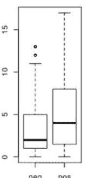

### 葡萄糖
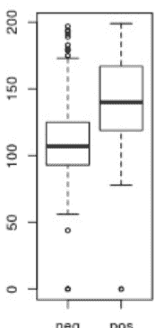

### 血压
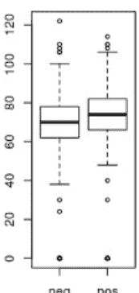

### 三头肌
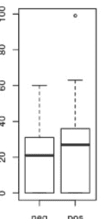

### 胰岛素
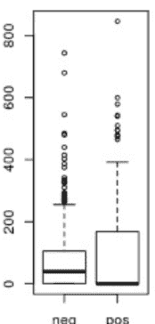

### 体重
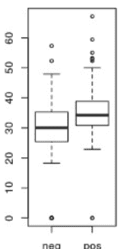

### 谱系
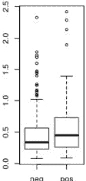

在生成的箱线图中，您可以看到，除了胰岛素变量较低外，所有变量的中位数在 `Diabetes='pos '` 类中始终较高。这表明这些变量在预测糖尿病方面可能有一定作用，但预测因子之间也可能存在一些相关性。

### 检查缺失值

从先前的摘要可以看出，我们没有缺失值；然而，可以看到有不少变量的值为零，这毫无意义。例如，血压读数不可能为零，但怀孕月数为 0 是可以接受的。因此，对于大多数这些变量，我们将假设零记录为 NAs，并相应地映射数据：

- 首先，我们将数据复制到一个新的数据框中
- 然后，我们将代码中列出的五个变量的零更改为 NAs

```
#### we see that there are 0's which are really NA's
#some 0's are really NA's, we will change them in Spark
#### keep pregnant = 0
PimaIndians <- PimaIndiansDiabetes
PimaIndians$glucose[PimaIndians$glucose ==0] <- NA
PimaIndians$pressure[PimaIndians$pressure ==0] <- NA
PimaIndians$triceps[PimaIndians$triceps ==0] <- NA
PimaIndians$insulin[PimaIndians$insulin ==0] <- NA
PimaIndians$mass[PimaIndians$mass ==0] <- NA
summary(PimaIndians)
```

运行另一个摘要以确保零已变成缺失值（NAs）：

| 怀孕次数 | 葡萄糖 | 血压 | 三头肌 |
|---|---|---|---|
| 最小值 : 0.000 | 最小值 : 44.0 | 最小值 : 24.00 | 最小值 : 7.00 |
| 第1四分位数 : 1.000 | 第1四分位数 : 99.0 | 第1四分位数 : 64.00 | 第1四分位数 : 22.00 |
| 中位数 : 3.000 | 中位数 :117.0 | 中位数 : 72.00 | 中位数 :29.00 |
| 均值 : 3.845 | 均值 :121.7 | 均值 : 72.41 | 均值 :29.15 |
| 第3四分位数 : 6.000 | 第3四分位数 :141.0 | 第3四分位数 : 80.00 | 第3四分位数 :36.00 |
| 最大值 :17.000 | 最大值 :199.0 | 最大值 :122.00 | 最大值 :99.00 |
| | 缺失值 :5 | 缺失值 :35 | 缺失值 :227 |

| 胰岛素 | 体重 | 谱系 | 年龄 | 糖尿病 |
|---|---|---|---|---|
| 最小值 : 14.00 | 最小值 :18.20 | 最小值 :0.0780 | 最小值 :21.00 | 阴性:500 |
| 第1四分位数 : 76.25 | 第1四分位数 :27.50 | 第1四分位数 :0.2437 | 第1四分位数 :24.00 | 阳性:268 |
| 中位数 :125.00 | 中位数 :32.30 | 中位数 :0.3725 | 中位数 :29.00 | |
| 均值 :155.55 | 均值 :32.46 | 均值 :0.4719 | 均值 :33.24 | |
| 第3四分位数 :190.00 | 第3四分位数 :36.60 | 第3四分位数 :0.6262 | 第3四分位数 :41.00 | |
| 最大值 :846.00 | 最大值 :67.10 | 最大值 :2.4200 | 最大值 :81.00 | |
| 缺失值 :374 | 缺失值 :11 | | | |

### 填充缺失值

我们现在将执行简单的均值填充。但是，我们将不使用单一均值数字进行替换，而是根据以下四组的成员资格，用均值替换 NAs：

- 糖尿病=阳性/较年轻年龄范围
- 糖尿病=阴性/较年轻年龄范围
- 糖尿病=阴性/较年长年龄范围
- 糖尿病=阳性/较年长年龄范围

我们已经有了糖尿病=阴性/阳性类别，那么如何将年龄分为年轻/较年长组？

我们将通过自动计算切点来实现这一点。为确定切点，我们将对年龄变量使用 cut 函数将其分为两个级别。然后，我们将使用 dplyr 根据年龄组的切分方式，计算五个变量的均值。

- 1. 首先，让我们看看有多少个观测值落入这四个组中：

```
library(dplyr)
PimaIndians$agegrp <- as.numeric(cut(PimaIndians$age, bre
PimaIndians %>%
group_by(diabetes,agegrp) %>% count()
```

- 2. 输出显示了创建的四个组及其计数。

```
Source: local data frame [4 x 3]
Groups: diabetes [?]

diabetes agegrp   n
1   neg      1 460
2   neg      2  40
3   pos      1 235
4   pos      2  33
```

- 3. 接下来，我们将为每个组替换一个填充的均值。

- 4. 请注意，只替换 NA 值。如果不是 NA，我们将保留原始值。这一点需要始终注意。您通常不想用填充值覆盖有效的接受值！

```
library(dplyr)
df <- PimaIndians %>%
  group_by(diabetes,agegrp) %>%
  mutate(
    insulin.imp = mean(insulin,na.rm=TRUE),
    glucose.imp = mean(glucose,na.rm=TRUE),
    pressure.imp = mean(pressure,na.rm=TRUE),
    triceps.imp = mean(triceps,na.rm=TRUE),
    mass.imp    = mean(mass,na.rm=TRUE)
  )
```

```
df$insulin <- ifelse(is.na(df$insulin), df$insulin.imp, d
df$glucose <- ifelse(is.na(df$glucose), df$glucose.imp, d
df$pressure <- ifelse(is.na(df$pressure), df$pressure.imp
df$pressure)
df$triceps <- ifelse(is.na(df$triceps), df$triceps.imp, d
df$mass <- ifelse(is.na(df$mass), df$mass.imp, df$mass)
```

### 检查填充情况（读者练习）

在替换 NAs 后，打印结果数据框，并比较分配的值与填充的值。这只是一个检查点，以确保您的填充顺利进行，且结果合理。始终查找填充中的极端值，这些值可以告诉您是否有问题。

```
print.data.frame(head(df[ , c(
  "insulin", "insulin.imp",
  "glucose", "glucose.imp",
  "pressure", "pressure.imp",
  "triceps", "triceps.imp",
  "mass", "mass.imp")],10))
```

| 胰岛素 | 胰岛素填充 | 葡萄糖 | 葡萄糖填充 | 血压 | 血压填充 | 三头肌 | 三头肌填充 | 体重 | 体重填充 |
|---|---|---|---|---|---|---|---|---|---|
| 191 | 191 | 148 | 141 | 72.0 | 74.4 | 35.0 | 32.8 | 33.6 | 35.7 |
| 129 | 129 | 85 | 109 | 66.0 | 70.4 | 29.0 | 27.2 | 26.6 | 31.0 |
| 191 | 191 | 183 | 141 | 64.0 | 74.4 | 32.8 | 32.8 | 23.3 | 35.7 |
| 94 | 129 | 89 | 109 | 66.0 | 70.4 | 23.0 | 27.2 | 28.1 | 31.0 |
| 168 | 191 | 137 | 141 | 40.0 | 74.4 | 35.0 | 32.8 | 43.1 | 35.7 |
| 129 | 129 | 116 | 109 | 74.0 | 70.4 | 27.2 | 27.2 | 25.6 | 31.0 |
| 88 | 191 | 78 | 141 | 58.0 | 74.4 | 32.0 | 32.8 | 31.0 | 35.7 |
| 129 | 129 | 115 | 109 | 70.4 | 70.4 | 27.2 | 27.2 | 35.3 | 31.0 |
| 543 | 328 | 197 | 153 | 70.0 | 81.4 | 45.0 | 34.3 | 30.5 | 33.0 |
| 328 | 328 | 125 | 153 | 96.0 | 81.4 | 34.3 | 34.3 | 33.0 | 33.0 |

### 缺失值已完成！

当您确信填充已正确执行时：

- 将临时数据框重新赋值给 PimaIndians 数据框
- 统计每行中 NAs 的数量

head 函数的输出显示不再存在 NAs。如果仍有 NAs，将打印一行：

```
PimaIndians <- df
head(PimaIndians[rowSums(is.na(PimaIndians)) > 0, ])
```

```
Source: local data frame [0 x 15]
Groups: diabetes, agegrp [0]
#### ... with 15 variables: pregnant , glucose , pressure ,
####   triceps , insulin , mass , pedigree , age ,
####   diabetes , agegrp , insulin.imp , glucose.imp ,
####   pressure.imp , triceps.imp , mass.imp
```

### 计算相关系数矩阵

现在，我们将计算相关系数矩阵和协方差矩阵。这将让我们了解预测变量之间如何相互关联。之后，我们还将使用这些信息来构建更大的数据集：

```
#### calculate correlation matrix and exclude NA's
correlationMatrix <- cor(PimaIndians[, 1:8])

covarianceMatrix <- stats::cov(PimaIndians[, 1:8])

#### summarize the correlation matrix
print(correlationMatrix,digits=3)
```

相关系数矩阵以 n*n 表格形式呈现，变量沿矩阵的顶部和侧面指定。要获取任何变量与另一个变量的相关系数，请沿矩阵顶部和底部查找任何变量对，并查看交叉点的数字。这就是计算出的相关系数：

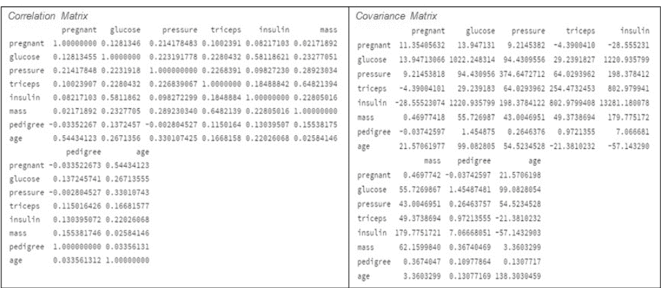

对于少量变量，扫描矩阵并挑出显著相关性就足够容易了。对于大量变量，使用类似以下代码挑出较大的相关性（> .5）会更合理：

```
df <- as.data.frame(as.table(correlationMatrix))
subset(df, abs(Freq) > 0.5 & abs(Freq) <1)
```

我们可以看到某些变量之间存在高度相关性——年龄、怀孕次数


怀孕次数、胰岛素和葡萄糖水平的相关性最高：

```
> subset(df, abs(Freq) > 0.5 & abs(Freq) <1)
           Var1    Var2      Freq
8     age   pregnant 0.5443412
13 insulin   glucose 0.5811862
30    mass   triceps 0.6482139
34 glucose   insulin 0.5811862
44 triceps     mass 0.6482139
```

你也可以用多种不同的方式创建这些变量的散点图。

使用 pairs() 函数，仅使用基础 R 即可实现这一点：

```
pairs(PimaIndians[c(1, 2, 4, 5, 6, 8)], pch=21)
```

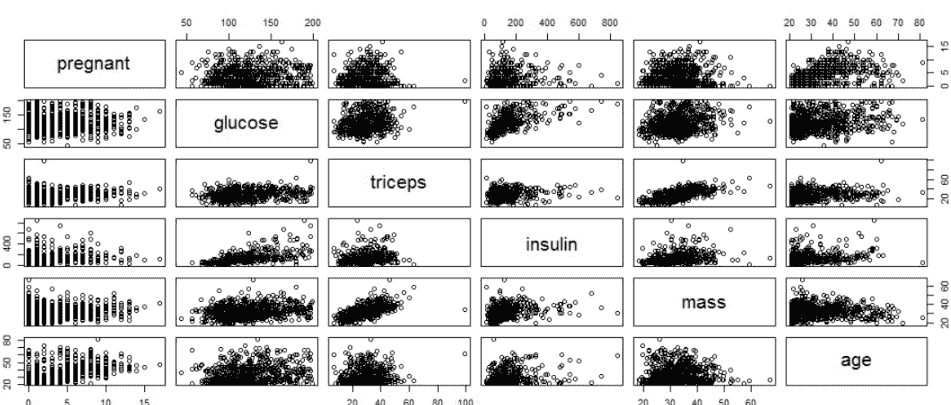

### 计算列均值

在接下来的模拟部分，我们需要通过向量提供列均值，因此现在让我们计算它们，并将其显示为水平条形图。我们将首先为糖尿病阳性组计算列均值，然后为糖尿病阴性组计算列均值。最后，我们将计算总体的均值，尽管我们不会在下一部分中使用它们：

```
means.pos = colMeans(PimaIndians[PimaIndians$diabetes =='pos',1:8]
means.neg = colMeans(PimaIndians[PimaIndians$diabetes =='neg',1:8]
means.all = colMeans(PimaIndians[,1:8],na.rm=TRUE)
barplot(means.all[c(1, 2,3,4,5,6,7,8)],cex.axis=.75,cex.names=.70,
```

下方的条形图仅供参考，显示计算出的均值。由于它们的量级各不相同，我们不进行比较。

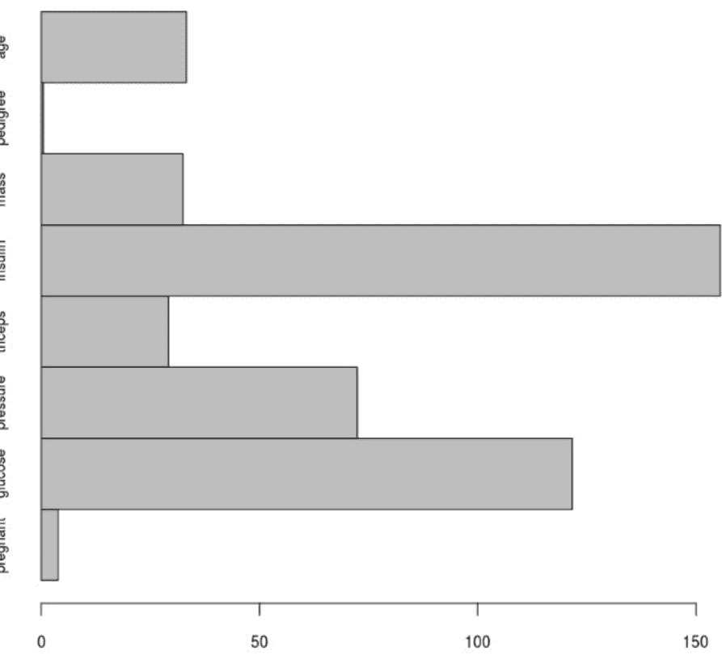

### 模拟数据

一旦我们计算了所有列的均值和协方差矩阵，我们就可以模拟任何我们想要的观测数量的大型数据集了。

### 使用哪些相关性？

对于协方差矩阵，我们可以针对两种糖尿病结果（1,0）使用单独的矩阵，也可以使用汇总协方差矩阵，后者显示变量之间的相关性，与结果无关。

我们将使用单独的相关性或协方差矩阵，因为每种结果都有足够的观测值（n=500 和 n=268）。如果其中任何一个类别相对于另一个类别要小得多，我们可以改用汇总（或总体）协方差矩阵，因为这将涵盖更大的观测值集合。

关于以下代码的一些注意事项：

- 提醒一下，在模拟之前始终先设置随机种子。这将确保每次运行代码时都能获得相同的随机结果。
- `cor()` 函数将计算所有变量之间的相关矩阵，而 `cov()` 函数计算协方差矩阵。相关矩阵与协方差矩阵的主要区别在于，协方差的单位与变量相同，而相关性将关系标准化为 0 到 1 之间的值。然而，它们本质上衡量的是同一事物。
- `nbins` 变量将数据分成每个包含 400 个观测值的单独 bin。这对于提取较小的数据样本（而不是对整个数据集进行分析）非常有用。同样，这是另一种表明抽样是你朋友的方式。
- 数据集是使用 `mvrnorm` 函数生成的，该函数接受均值输入（列 1-8 的均值），以及我们刚刚生成的协方差矩阵。注意：要获取有关此函数的更多信息，你可以在本 notebook 中的任何位置创建一个新单元格并运行此命令，这将调用 R 帮助系统：help(mvrnorm, package="MASS")
- 要增加数据框的大小，我们生成包含 n1 个观测值的数据框，然后由 rep_times 变量指定重复指定次数。如果你觉得模拟耗时太长，可以将此变量降低到更小的数字，模拟将快得多完成。
- 最后，我们需要区分 data.frame 和 as.DataFrame 函数：
- data.frame 是一个普通的 R 函数，用于从函数内的参数创建数据框。
- as.DataFrame 是一个 SparkR 函数，用于将结果转换为 Spark 数据框。
- 如果不确定，请在函数前加上 base:: 或 SparkR:: 前缀，以明确指定其来源的包。否则，你可能会收到难以调试的警告或错误消息。
- 最后一行代码使用 nrow() 函数打印 Spark 数据框的行数。

运行下一代码块：

```
#generate spark dataframe
set.seed(123)
n1=28
n2=500
#data loaded into spark
#use separate correlation matrix for now. May want to use 1 pooled
correlationMatrix <- cor(PimaIndians[PimaIndians$diabetes =='pos'
covarianceMatrix <- stats::cov(PimaIndians[PimaIndians$diabetes =
require(MASS)
nbins1=base::round(n1/400,0)
out_sd1 <- as.DataFrame(data.frame(data.frame(data.frame(
sample.bin=base::sample(1:nbins1,n1,replace=TRUE) * (+1),
outcome=1,
mvrnorm(n1, mu = means.pos, Sigma = matrix(covarianceMatrix, ncol))[rep(1:n1, times=200), ])

nrow(out_sd1)
```

```
(1)Spark Jobs
Loading required package: MASS
Attaching package: 'MASS'
The following object is masked from 'package:SparkR':
    select
[1] 536000
Command took 2.88 minutes -- by r_winters at 2/13/2017, 3:15:24 PM
```

### 检查对象类型

你可以通过发出 str() 函数来查看生成的对象是 Spark 数据框。输出将明确说明 SparkDataFrame，后跟变量和数据类型的描述。但是，它不会列出行数：

```
str (out_sd1)
```

```
> (1) Spark Jobs
'Spark DataFrame': 10 variables:
 $ sample_bin : num 78 212 110 237 253 13
 $ outcome : num 1 1 1 1 1
 $ pregnant : num 1.94252031814449 4.36423863864429 0.858675776495492 1.855456883345 9.17100400066027 1.1186379328449
 $ glucose : num 157.123189654394 148.943347099497 172.842735207286 107.366227123907 105.302689867468 188.881198462925
 $ pressure : num 61.5029879083116 71.69507301027 74.4269535626088 74.3844944342854 78.1355932536701 61.884344482885
 $ triceps : num 15.6917644205514 41.5591691064547 30.0192322177519 34.9364879662772 33.0035759583851 28.1923108753192
 $ insulin : num 129.597011349131 240.029631091656 379.471775333015 86.1971329956682 -67.8238532621351 181.68231106527
 $ mass : num 29.4401765315476 24.953572101178 32.846294484615 42.3403328136571 35.6341563357795 42.5202651318031
 $ pedigree : num 1.22263036150258 0.313509501680247 0.445328027648939 0.52963571807743 0.385501592130751 0.25120511045
 $ age : num 25.8341329573308 19.4383095827238 46.3093049981371 16.6689622302294 26.5530890692054 26.1512830183403
```

### 模拟阴性病例

我们刚刚模拟了阳性病例。现在，让我们设置一些类似的代码来模拟非糖尿病患者（outcome=0）。

对于阴性病例，我们还将 `sample.bin` 乘以 -1，以便在将来，我们知道所有正的 `sample.bin` 实例都对应阳性病例，而所有负的 `sample.bin` 实例都对应阴性病例：

```
set.seed(123)
nbins2=base::round(n2/400,0)
correlationMatrix <- cor(PimaIndians[PimaIndians$diabetes =='neg'
covarianceMatrix <- stats::cov(PimaIndians[PimaIndians$diabetes =
out_sd2 <- as.DataFrame(data.frame(data.frame(
   sample.bin=base::sample(1:nbins2,n2,replace=TRUE) * (-1),
   outcome=0,
   mvrnorm(n2, mu = means.neg, Sigma = matrix(covarianceMatrix, ncol))[rep (1:n2, times=2000), ]]))
nrow(out_sd2)
```

输出表明生成了 500,000 行。请注意，它还表明运行了两个 Spark 作业才能获得结果。对于好奇者，你还可以点击三角形图标，从处理角度显示有关 Spark 作业的详细信息，（尽管它不包含任何结果输出）。

- > (2) Spark 作业

[1] 5e+05

### 将阳性和阴性病例合并为单个 Spark 数据框

我们现在有两个分别对应阳性和阴性病例的独立 Spark 数据框。对于某些类型的分析，保持结果分开是合理的；但是，为了说明目的，我们将使用 unionAll() 函数将它们合并为一个单一数据集。

```
out_sd <- unionAll(out_sd1, out_sd2)
nrow(out_sd)
```

nrow 的输出表明总共有 768,000 行。这个数字代表我们原来的 768 行，已乘以 1000 的因子：

```
(1) Spark Jobs

[1] 768000
```


### 运行汇总统计

创建新数据对象后，我首先要做的事情之一就是运行汇总统计。R 的 summary 函数有一个 Spark 特有的函数，称为 describe()。你可以使用特定的 summary() 函数；不过，如果你这样做而不是使用 describe()，我建议在其前加上 SparkR::，以指定你使用的是哪个版本的 summary：

```
head(SparkR::summary(out_sd))
```

输出的格式与在原生 R 数据框上运行 summary 略有不同，但包含你想要的基本指标：count、mean、stddev、min 和 max：

- (1) Spark 作业

| 统计量 | 样本箱 | 结果 | 怀孕 | 血糖 | 血压 | 三头肌皮褶 | 胰岛素 | 体重指数 | 糖尿病谱系函数 | 年龄 |
|:---|:---|:---|:---|:---|:---|:---|:---|:---|:---|:---|
| 计数 | 768000 | 768000 | 768000 | 768000 | 768000 | 768000 | 768000 | 768000 | 768000 | 768000 |
| 均值 | -113.6731770833333 | 0.3489583333333333 | 3.845052083332693 | 121.68778671732643 | 72.40477794289117 | 29.24877013964472 | 159.46377333976378 | 32.442846279285206 | 0.4718763020832466 | 33.24088541667883 |
| 标准差 | 220.73245049349478 | 0.476641071119150484 | 3.3673858047181646 | 30.441771824780293 | 12.09690590416991 | 8.923478186809195 | 91.29942740927545 | 6.874557449376662 | 0.33111303159707445 | 11.752580297416275 |
| 最小值 | -500.0 | 0.0 | -5.2678366327379748 | 39.06326135657574 | 35.40654724700748 | 0.7607894364323116 | -148.15344457408253 | 9.969765765918051 | -0.5461478239604021 | -1.469171542253246 |
| 最大值 | 267.0 | 1.0 | 13.798168411407868 | 219.71433564781285 | 112.13158466413095 | 58.23733534004559 | 456.09990684013997 | 54.28623709953233 | 1.687677997650607 | 73.95268273579066 |

我们还可以将此汇总与原始 Pima Indians 数据框的汇总进行比较，并发现该模拟对均值的估计工作做得相当出色。观察值数量大约是原始大小的 1,000 倍，糖尿病患者与非糖尿病患者的比例已保留：

```
#compare with original dataset
summary(PimaIndiansDiabetes[,])
```

| 怀孕 | 血糖 | 血压 | 三头肌皮褶 | 胰岛素 |
|:---|:---|:---|:---|:---|
| 最小值 : 0.00 | 最小值 : 0 | 最小值 : 0.0 | 最小值 : 0.0 | 最小值 : 0 |
| 下四分位数 : 1.00 | 下四分位数 : 99 | 下四分位数 : 62.0 | 下四分位数 : 0.0 | 下四分位数 : 0 |
| 中位数 : 3.00 | 中位数 :117 | 中位数 : 72.0 | 中位数 :23.0 | 中位数 : 30 |
| 平均值 : 3.85 | 平均值 :121 | 平均值 : 69.1 | 平均值 :20.5 | 平均值 : 80 |
| 上四分位数 : 6.00 | 上四分位数 :140 | 上四分位数 : 80.0 | 上四分位数 :32.0 | 上四分位数 :127 |
| 最大值 :17.00 | 最大值 :199 | 最大值 :122.0 | 最大值 :99.0 | 最大值 :846 |

| 体重指数 | 糖尿病谱系函数 | 年龄 | 糖尿病 |
|:---|:---|:---|:---|
| 最小值 : 0.0 | 最小值 :0.078 | 最小值 :21.0 | 阴性:500 |
| 下四分位数 :27.3 | 下四分位数 :0.244 | 下四分位数 :24.0 | 阳性:268 |
| 中位数 :32.0 | 中位数 :0.372 | 中位数 :29.0 | |
| 平均值 :32.0 | 平均值 :0.472 | 平均值 :33.2 | |
| 上四分位数 :36.6 | 上四分位数 :0.626 | 上四分位数 :41.0 | |
| 最大值 :67.1 | 最大值 :2.420 | 最大值 :81.0 | |

### 保存你的工作

现在我们已经生成了最终的 Spark 数据框，可以将其写入磁盘。从下一章开始，我们会将其读回工作区，而无需从头重新创建。如果你直接继续下一章，现在可以跳过此步骤：

- 我们将以 Parquet 文件格式保存，这是一种对 Spark 和 SQL 非常高效的格式。%fs（文件系统）指令允许你使用 `ls` 操作系统命令发出目录（或文件列表）命令。
- 文件保存后，你可以通过将其读回并再次分配给 `out_sd` 数据框来验证文件的完整性。
- 使用 `head` 命令验证数据是否已读回：

```
saveAsParquetFile(out_sd, "/tmp/temp.parquet")
%fs ls
out_sd <- parquetFile(sqlContext, "/tmp/temp.parquet")
head(out_sd)
```

## 总结

在本章中，我们了解了 Spark 是什么以及其一些优势。我们开始编写将数据加载到 Spark 集群并保存到其中的程序。我们学习了几种方法，可以根据小型数据集的特征构建我们自己的超大型 Spark 数据框。

我们还学习了如何在 Databricks 中编写 Spark 程序以及如何运行标准 R 分析和安装包。我们还通过替换原始数据中的一些缺失值，巩固了关于缺失值填充的知识。

在下一章中，我们将利用已构建的内容开始探索数据。
