# 第 10 章. 使用 Spark 探索大型数据集

> "我从不猜测。在拥有数据之前进行理论推测是一个严重的错误。人们会不自觉地开始扭曲事实以迎合理论，而不是让理论符合事实。"
>
> - 阿瑟·柯南·道尔爵士

在本章中，我们将开始对在上一章中创建的 Spark 数据框进行一些探索性数据分析。我们将学习一些有助于你分析的特定 Spark 命令，并讨论几种绘图和作图方法。

在学习这些示例时，请记住，驻留在 Spark 中的数据可能比你习惯的要大得多，并且在不首先考虑数据如何组织以及使用标准技术会如何影响性能的情况下，应用一些快速分析技术可能不切实际。

如果你是从上一章中断的地方继续，那么在开始之前需要加载保存的 Spark 数据框。请记住，我们将糖尿病数据集的结果保存为 parquet 文件，因此可以使用 parquetFile() 函数将数据读回内存。然后筛选出阳性糖尿病病例，因为我们将在下一部分探索它们：

```
out_sd <- parquetFile(sqlContext, "/tmp/temp.parquet")
out_sd1 = SparkR::filter(out_sd,out_sd$outcome == 1)
```

## 对阳性病例进行探索性分析

在探索整个 Spark 数据框之前，我们可以查看已为阳性病例生成的一些数据。如你可能从上一章中记得，这些数据存储在 Spark 数据框 out_sd1 中。

我们专门生成了一些随机样本箱，以便进行探索性分析。

我们可以使用 filter 命令提取随机样本 1，并获取前 1,000 条记录：

- `filter` 是一个 SparkR 命令，允许你对 Spark 数据框进行子集提取
- `display` 是一个 Databricks 命令，相当于我们之前使用过的 `View` 命令，你也可以使用 `head` 函数来限制显示的行数：

这段代码从阳性病例中提取 1000 条记录并显示它们：

```
small_pos <- head(SparkR::filter (out_sd1, out_sd1$sample_bin)
nrow (small_pos)
display (small_pos)
```

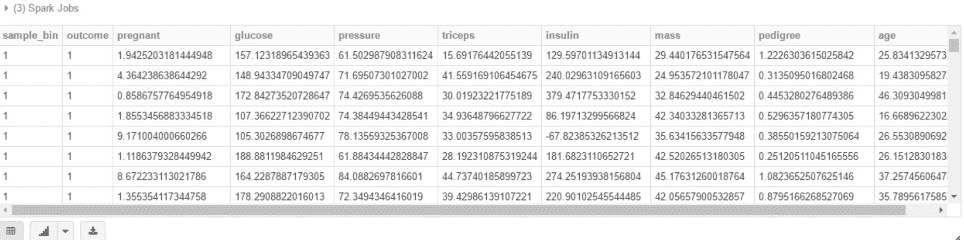

数据以表格形式显示，你可以上下或左右滚动以查找缺失值、极端值等。

filter 命令具有两个功能：

- 为你的分析提取感兴趣的片段。
- 提取样本，这有助于调试你的 Spark 数据流。这可以帮助后续步骤更快运行，并避免不必要地运行大型作业，尤其是当样本反映总体构成时。

## 显示 Spark 数据框的内容

显示 Spark 数据框子集有多种方法。可选项如下：

- `showDF`：这是一个 Spark 命令，以紧凑的方式显示数据框的内容。
- `head`：这是正常的 R 函数，可用于 Spark 数据框；它遵循与基础 R 相同的语法。
- `take`：该命令也会打印一些行，但会从底层 RDD 中收集行。
- `display`：这是一个特殊的 Databricks 命令，大致相当于基础 R 的 `View` 命令，但还允许你通过数据下方横向滚动条下方的控制图标绘制输出的子集。使用 display 还允许你切换到绘图模式。

## 使用原生图表功能进行绘图

点击第二个图标：


你将进入一个图表对话框，在其中可以绘制变量之间的各种关系。要绘制这些关系，首先将一个变量从 `All fields` 列拖动到 `Values` 列：


- 例如，图 1 显示 diabetes=1 的胰岛素水平箱线图
- 图 2 显示带有 20 个定义箱的胰岛素水平直方图
- 图 3 显示年龄与胰岛素水平之间的散点图
- 图 4 显示年龄、胰岛素和怀孕月数的相关矩阵：

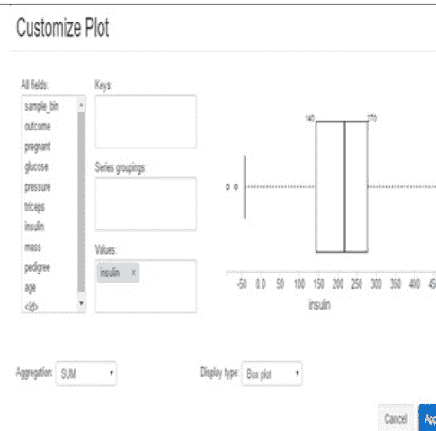

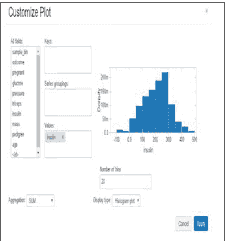

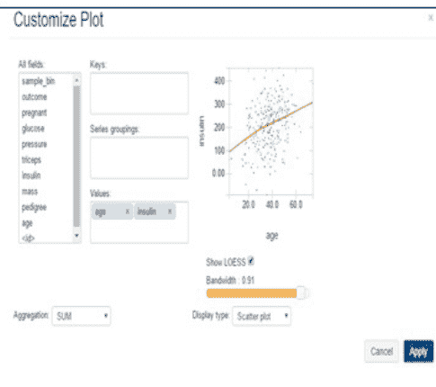

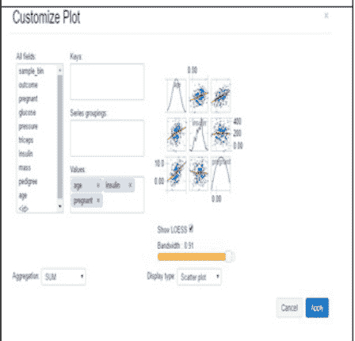

## 直接在 Spark DataFrame 上运行成对相关性分析

提供可直接在 Spark DataFrame 上运行的相关性和协方差函数。以下示例表明，对于糖尿病患者，年龄与血糖水平之间存在 11% 的相关性：

```
corr <- corr(out_sd1, "glucose", "age", method = "pearson")
corr
```

- (1) Spark 作业

[1] 0.1130607

## 清理并将表缓存到内存中

由于 Spark 擅长处理内存中数据，我们将首先删除中间数据，然后缓存 out_sd DataFrame，以便后续查询运行速度快得多。当重复执行相似类型的查询时，内存中缓存数据效果最好。这样，Spark 就能知道如何平衡内存，使大部分所需数据都驻留在内存中。

不过，这并非万无一失。良好的 Spark 查询和表设计有助于优化，但开箱即用的缓存通常也能带来一些好处。通常，最初的查询不会从内存缓存中受益，但后续查询将运行快得多。

由于我们不再使用创建的中间 DataFrame，将使用 rm 函数删除它们，然后在完整 DataFrame 上使用 cache() 函数：

```
#cleanup and cache df
rm(out_sd1)
rm(out_sd2)
cache(out_sd)
```

## 探索数据的一些有用 Spark 函数

### Count 和 groupby

还可以使用 `Count` 和 `groupby` 函数来汇总单个变量。

以下是按结果统计观测值数量的示例。由于结果是另一个 DataFrame，可以使用 `head` 函数将结果写入控制台。

### 注意

如果更改查询，可能需要更改 head 返回的行数。使用 `head` 等函数过滤结果始终是个好主意，以确保不会打印数百行（或更多）。

但同时也需要确保不会截断所有输出。如果不确定行数，请先将结果分配给 DataFrame，然后再使用 `nrow` 检查行数：

此代码行按结果统计行数。我知道应该只有 2 个结果，但我将 count 函数放在 head 语句中，只是为了采取防御性编程。

```
head(SparkR::count(groupBy(out_sd, "outcome")))
```

### (5) Spark 作业

| | 结果 | 计数 |
|---|---|---|
| 1 | 0 | 500000 |
| 2 | 1 | 268000 |

从 Spark DataFrame 打印值非常快。以下是每个结果组中的一些值。请注意，当 outcome == 0 时 sample_bin 为负值，当 outcome == 1 时为正值：

首先打印一些负值。可以看到一些怀孕数值为负，表明模拟并不完美。

```
head(SparkR::filter(out_sd,out_sd$outcome == 0),5)
```

### (2) Spark 作业

| 样本箱 | 结果 | 怀孕次数 | 血糖 | 血压 | 肱三头肌皮褶 | 胰岛素 | 质量 | 谱系函数 |
|---|---|---|---|---|---|---|---|---|
| -144 | 0 | -1.481 | 73.4 | 66.6 | 19.8 | 104 | 23.9 | 0.112 |
| -395 | 0 | 1.105 | 105.6 | 71.0 | 22.3 | 115 | 30.5 | 0.948 |
| -205 | 0 | -0.376 | 132.1 | 65.9 | 17.5 | 117 | 25.8 | 0.283 |
| -442 | 0 | 0.853 | 149.1 | 68.0 | 18.4 | 164 | 25.7 | -0.196 |
| -471 | 0 | 3.480 | 115.2 | 58.5 | 32.2 | 239 | 31.6 | 0.754 |

| | 年龄 |
|---|---|
| 1 | 33.2 |
| 2 | 26.0 |
| 3 | 25.3 |
| 4 | 34.3 |
| 5 | 32.6 |

现在打印一些正值。

```
head(SparkR::filter(out_sd,out_sd$outcome == 1),5)
```

| | 样本箱 | 结果 | 怀孕次数 | 血糖 | 血压 | 肱三头肌皮褶 | 胰岛素 | 质量 | 谱系函数 |
|---|---|---|---|---|---|---|---|---|---|
| 1 | 78 | 1 | 1.943 | 157 | 61.5 | 15.7 | 129.6 | 29.4 | 1.223 |
| 2 | 212 | 1 | 4.364 | 149 | 71.7 | 41.6 | 240.0 | 25.0 | 0.314 |
| 3 | 110 | 1 | 0.859 | 173 | 74.4 | 30.0 | 379.5 | 32.8 | 0.445 |
| 4 | 237 | 1 | 1.855 | 107 | 74.4 | 34.9 | 86.2 | 42.3 | 0.530 |
| 5 | 253 | 1 | 9.171 | 105 | 78.1 | 33.0 | -67.8 | 35.6 | 0.386 |

| | 年龄 |
|---|---|
| 1 | 25.8 |
| 2 | 19.4 |
| 3 | 46.3 |
| 4 | 16.7 |
| 5 | 26.6 |

### 协方差和相关性函数

相关性和协方差也可以直接从 Spark DataFrame 计算。在我们的示例中，可以看到非糖尿病患者的年龄与血糖之间存在更大的相关性：

首先是糖尿病结果。相关性为 .113：

```
> corr(SparkR::filter(out_sd,out_sd$outcome==1), "glucose", "age", method = "pearson")
```

[1] 0.113

现在，非糖尿病结果。相关性为 .22：

```
> corr(SparkR::filter(out_sd,out_sd$outcome==0), "glucose", "age", method = "pearson")
```

[1] 0.22

对于整个总体，相关性为 0.26：

```
> corr(out_sd, "glucose", "age", method = "pearson")
```

- (1) Spark 作业
- 作业 295 视图（阶段：1/1）

[1] 0.269

## 创建新列

通常有必要根据现有变量创建一些新的转换，以改进预测。我们已经看到，将变量分箱通常用于从定量变量创建名义变量。

让我们创建一个名为 agecat 的新列，将年龄分为两个部分。为简单起见，我们将首先将年龄四舍五入到最近的整数。

```
filtered <- SparkR::filter(out_sd, "age > 0 AND insulin > 0")
filtered$age <- round(filtered$age,0)
filtered$agecat <- ifelse(filtered$age <= 35,"<= 35","35 Or Older")
SparkR::head(SparkR::select(filtered, "age","agecat"))
```

(1) Spark 作业

| | 年龄 | 年龄类别 |
|---|---|---|
| 1 | 26 | <= 35 |
| 2 | 19 | <= 35 |
| 3 | 46 | 35 岁及以上 |
| 4 | 17 | <= 35 |
| 5 | 26 | <= 35 |
| 6 | 37 | 35 岁及以上 |

在刚才运行的代码中，你可能会注意到某些命令前面加有 SparkR:: 前缀。

这样做是为了让程序知道我们希望应用哪个版本的函数，以这种方式加前缀命令始终是良好的做法，以避免语法错误以及在 SparkR 和普通 R 之间出现同名函数时误用。

### 构建交叉表

既然已经对年龄进行了分类，就可以运行交叉表来按年龄类别统计结果。

由于只有两个结果和两个年龄类别，因此得到一个四单元格交叉表：

- 1. 首先，使用特殊的 Databricks `display` 命令显示结果。
- 2. 结果显示如下表格后，可以单击绘图按钮（左下角第 2 个图标），此时将出现自定义绘图对话框，允许将结果绘制为柱状图。图表显示，较高年龄组中糖尿病发病率高于较低年龄组，而非糖尿病组则相反：

```
table <- crosstab(filtered, "outcome", "agecat")
display(as.data.frame(table))
```

| 结果_年龄类别 | 35 岁及以上 | <= 35 |
|---|---|---|
| 1.0 | 156000 | 109000 |
| 0.0 | 179000 | 297000 |

### 自定义绘图

- 所有字段：
  - 结果_年龄类别
  - 35 岁及以上
  - <= 35
  - <id>

键：
结果_年龄类别

系列分组：

值：
35 岁及以上   <= 35

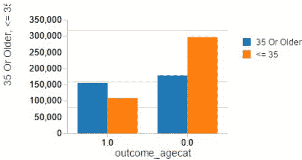

选项：
( ) 分组（已选中）
( ) 堆叠
( ) 100% 堆叠

聚合：求和
显示类型：柱状图

[取消] [应用]

## 对比直方图

直方图也是直观检查和比较结果变量的快速方法。

以下是使用 Spark 直方图函数对比研究中糖尿病患者与非糖尿病患者体重指数平均值的另一个示例。对于第一个柱状图，可以看到约 38.9 BMI 的峰值柱，而非糖尿病患者的峰值柱为 29.8。这表明 BMI 将是我们开发的任何模型中的重要变量：

此代码使用 SparkR 直方图函数计算带有 10 个箱的直方图。质心给出每个 10 个箱的中心值。出现频率最高的柱是中心值为 38.9、计数约为 50,000 的柱。这种直方图有助于快速了解变量分布，但在标签和控制各种元素（如刻度和范围）方面略有欠缺。如果希望微调某些元素，可以先使用 `collect()` 函数将样本下载到本地 R 机器。我们将在后面讨论此功能。


> tmp <- SparkR::filter(out_sd,out_sd$outcome ==1)
masshist_low <- histogram(tmp , tmp$mass, nbins = 10)
display(masshist_low)

(4) Spark 作业

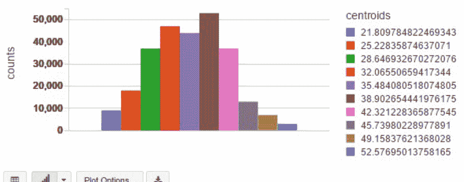

> tmp <- SparkR::filter(out_sd,out_sd$outcome ==0)
masshist_low <- histogram(tmp , tmp$mass, nbins = 10)
display(masshist_low)

(4) Spark 作业

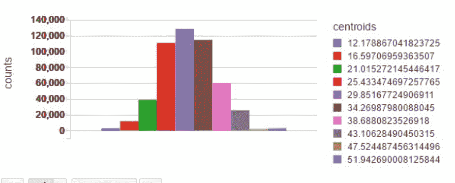

## 使用 ggplot 绘图

如果您偏好使用 ggplot 来绘制结果，请加载 ggplot2 包以直接针对 Spark 数据帧运行绘图。您将有更多机会进行进一步的自定义：

下面是一个与上文所示 histogram() 函数相对应的基本 ggplot：

```r
require(ggplot2)
plot <- ggplot(age_hist, aes(x = centroids, y = counts)) +
geom_bar(stat = "identity") +
xlab("mass") + ylab("Frequency")
plot
```

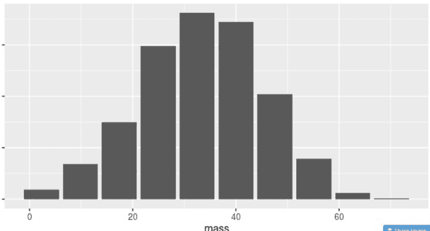

## Spark SQL

在 Spark 中探索数据的另一种方法是使用 Spark SQL。这样，那些可能不精通特定于语言的 API（例如 SparkR、PySpark（用于 Python）和 Scala）的分析师也能探索 Spark 数据。

我将介绍通过 SQL 访问 Spark 数据的两种不同方式：

- 通过 R 接口发出 SQL 命令：

这样做的优点是将结果作为 R 数据帧返回，从而可以对其进行进一步处理

- 通过 Databricks SQL `magic` 指令发出 SQL 查询

这种方法允许分析师发出直接的 SQL 命令，而无需考虑任何特定的语言环境

在将对象作为 SQL 处理之前，需要先将其注册为 SQL 表或视图。注册后，可以通过任何语言 API 的 SQL 接口访问它。

注册后，可以使用 show tables SparkR 命令获取会话中已注册表的列表。

### 注册表格

```r
#register out_sd as a table

SparkR::registerTempTable(out_sd,"out_tbl")
SparkR::cacheTable(sqlContext,"out_tbl")

head(SparkR::sql(sqlContext, "SHOW tables"))
```

## 通过 R 接口发出 SQL

以这种方式编写 SQL 包括通过 `sql` 函数构建有效的 SQL 字符串查询：

- 查询必须引用已注册的表

- 可以将查询结果分配给数据帧：

下面是从已注册对象 out_table 获取可用样本频率计数的示例。请注意，代码以 %r 命令开头，这是一个特殊的 Databricks 指令，用于指示后续代码适用于 R。但是，在某些情况下（即使在 R 笔记本中）也需要指定此项，特别是当先前的代码块使用了其他语言指令（例如 %sql 或 %python）时。

```r
%r
rm(tmp)
tmp <- SparkR::sql(sqlContext, "SELECT sample_bin, count(*) FROM out_tbl group by sample_bin")
```

- 此外，在 Databricks 中，sqlContext 已预先分配，因此可以在代码中省略，如下所示。

```r
tmp <- SparkR::sql("SELECT sample_bin , count(*) FROM out_tbl GROUP BY sample_bin")
```

- 将数据提取到 tmp 数据帧后，可以显示每个样本的计数。在后续查询中，可以选择与您感兴趣的结果的大小和比例相对应的样本：

```r
head(tmp, 1000)
```

| | sample_bin | count(*) |
|---|---|---|
| 1 | -142 | 4000 |
| 2 | 184 | 1000 |
| 3 | 147 | 1000 |
| 4 | 170 | 1000 |
| 5 | -305 | 1000 |
| 6 | -492 | 2000 |
| 7 | 160 | 2000 |
| 8 | 169 | 2000 |
| 9 | 67 | 1000 |
| 10 | 70 | 1000 |
| 11 | -335 | 3000 |
| 12 | -500 | 1000 |
| 13 | -282 | 1000 |
| 14 | 69 | 1000 |
| 15 | -74 | 4000 |
| 16 | -81 | 2000 |
| 17 | -58 | 1000 |
| 18 | -52 | 4000 |

## 使用 SQL 检查潜在异常值

基于先前的 sample_bin 计数，我们可能决定提取一些负例和正例的样本。已知正 sample_bin 表示结果为 1，负 sample_bin 表示结果为 0。我们还可以选择一个截断值，以适应所需的任何样本大小。我们打算提取 10,000 行的样本，因此将边界设置为 +10 和 -10。

```r
bin_extract <- SparkR::sql("SELECT * from out_tbl where sample_bin")
nrow(bin_extract)
#nrow should be 10,000 in the output
```

接下来，我们将注册 bin_extract，以便可以执行一些 SQL 操作

```r
SparkR::registerTempTable(bin_extract,"bin_extract")
```

## 创建一些聚合

如果我们有兴趣将血压数值与平均年龄进行比较，那么可以构建一个查询，在较大的 Spark 表（out_tbl）上计算一些均值和标准差，然后按结果对结果进行分组。输出还表明，糖尿病患者年龄更大：

```r
bin_agg <- SparkR::sql ("SELECT outcome,
mean (pressure) as mean_pressure,
std(pressure) as std_pressure,
mean(age) as mean_age,
std(age) as std_age
from out_tbl group by 1")
#register the table
SparkR::registerTempTable(bin_agg,"bin_agg")
#print a few records
head(bin_agg)
```

```text
» (5) Spark Jobs
outcome mean_pressure std_pressure mean_age std_age
1 0 71.60760 7.454448 32.55031 9.274967
2 1 71.17571 9.905474 39.88985 2.276876
```

## 使用第三个查询选取一些潜在异常值

现在将构建第三个查询，以提取可能被视为异常值的所有记录。在本示例中，我们将异常值定义为年龄或压力高于或低于其结果类别均值 1.5 个标准差的任何记录。这是通过将我们的明细数据与年龄和压力的汇总均值连接来实现的：

- 还可以计算一个新列 agediff，即年龄与平均年龄之间的差值。

- 我们添加 limit=1000 作为保护性过滤器，以便检索的结果数量不会超过指定数量。对 SQL 查询设置限制倾向于加快结果处理速度。在此示例中，返回了一条记录：

```r
anomalies <- SparkR::sql("select distinct
a.outcome,pressure,mean_pressure,age,b.mean_age,
(age- b.mean_age) as agediff
from bin_extract a inner join bin_agg b
on a.outcome=b.outcome
AND
(a.pressure > mean_pressure + (1.5*std_pressure))
OR
(a.pressure < mean_pressure - (1.5*std_pressure))
OR
(a.age < b.mean_age - (1.5*std_age))
OR
(a.age > mean_age + (1.5*std_age))
order by agediff desc
limit 1000")
head(anomalies)
```

输出仅显示一条记录，其年龄比平均年龄高出 1.5 个标准差。您可以自定义截止标准差，以便为异常值检查目的增加或减少返回的行数。

| outcome | pressure | mean_pressure | age | mean_age | agediff |
|---|---|---|---|---|---|
| 1 | 0 | 75.93101 | 70.87059 | 51.63939 | 31.19 |
| | | | | | 20.44939 |

## 切换到 SQL API

可以通过在第一行编写 %sql 来切换到 SQL 接口。这样，该笔记本单元中所有后续代码语句都将仅被解释为 SQL。

如果希望在后续单元中返回到其他语言，请在单元的第一行输入 %r、%python、%scala 等等。如果未输入这些魔法指令之一，则将按默认笔记本类型（在此例中为 R）的语法进行解释。

下面是我们之前在 R 中执行的 sample_bin 计数查询的 SQL 接口版本，现在完全使用 SQL 接口。结果显示为透视表。如果需要，可以通过选择原始数据图标（数据下方最左侧的第一个图标），或者选择图表图标（其后的第二个图标）并选择特定图表来操作格式：

```sql
%sql
SELECT sample_bin , count(*) as k FROM out_tbl group by sample_bin
```

| sample_bin | k |
|---|---|
| -305 | 1000 |
| -361 | 1000 |
| 64 | 1000 |
| 191 | 1000 |
| 35 | 1000 |
| 161 | 1000 |
| -450 | 1000 |
| -328 | 1000 |
| 251 | 1000 |

## SQL - 使用 Case 语句计算新列

SQL 窗口使我们能够利用标准 SQL 的所有优势。其中包括创建新列的功能。在此示例中，我们查询整个表，并按高质量（>30）和低质量（<-30）计算平均质量。

这样，我们可以看到糖尿病患者的上限平均质量高于非糖尿病患者。下限似乎也是如此：

```sql
%sql
select case when mass > 30 then "BMI_HIGH" else "BMI_LOW" end as outcome,avg(mass) from out_tbl
group by 1,2
```

| BMICAT | outcome | avg(mass) |
|---|---|---|
| BMI_HIGH | 1 | 37.88309305496696 |
| BMI_LOW | 0 | 25.469591340978635 |
| BMI_LOW | 1 | 26.599527908424488 |
| BMI_HIGH | 0 | 35.79285447090313 |


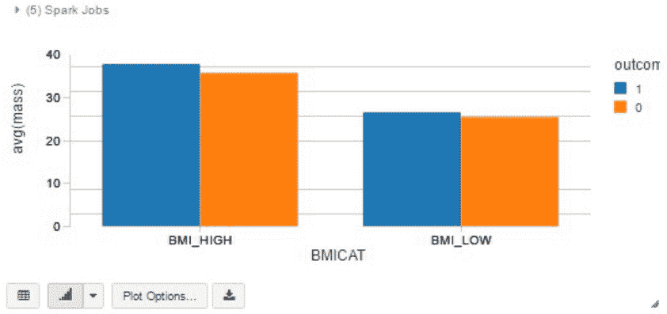

## 基于年龄段评估结果

在 30 岁断点处拆分年龄也显示，较高年龄段的结果比较低年龄段多得多：

```sql
%sql
select CASE WHEN age < 30 THEN 'YOUNG' ELSE 'OLD' END AS agecat,
sum(outcome)
from out_tbl
group by 1
```

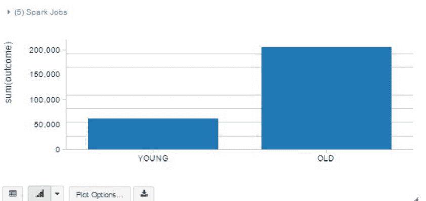

## 计算所有变量的平均值

仅使用 SQL 即可做出有趣的比较，方法是计算所有变量的变异系数，并按结果分组。变异系数是一种标准化变量均值和方差的方法，因此在进行比较时可以忽略量纲：

```sql
%sql
select outcome,
   mean(pregnant)/std(pregnant) ,
   mean(glucose)/std(glucose) ,
   mean(pressure)/std(pressure) ,
   mean(triceps)/std(triceps) ,
   mean(insulin)/std(insulin) ,
   mean(mass)/std(mass) ,
   mean(pedigree)/std(pedigree) ,
   mean(age)/std(age)
from out_tbl
group by 1
```

- 查询完成后，切换到绘图窗口，并将图表类型更改为折线图。
- 然后将 outcome 拖到 *键* 窗格中。
- 然后将所有其他变量拖到 *值* 窗格中。

将出现一个简单的折线图，使您能够比较两种结果之间这些变量的平均值。

我们可以看到，糖尿病患者的变量均值在增加，尽管某些变量的变化幅度比其他变量大：

## 自定义图表

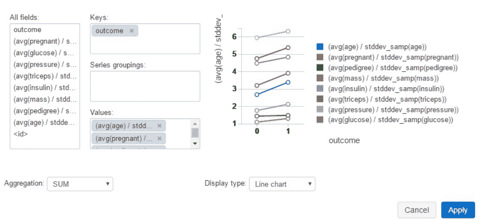

我们还可以演示类似于上一节中异常值查询的查询。这次，我们将查询年龄或压力记录高于均值两个标准差的所有记录：

```sql
%sql
select distinct a.outcome, pressure, mean_pressure, age, mean_age from
a.outcome=b.outcome
AND
(a.pressure > mean_pressure + (2*std_pressure))
OR
(a.age > mean_age + (2*std_age))
limit 100
```

| outcome | pressure | mean_pressure | age | mean_age |
|---|---|---|---|---|
| 0 | 75.93100817427452 | 71.607060161398534 | 51.63938860382109 | 32.55030965046543 |
| 0 | 75.93100817427452 | 71.17571330678416 | 51.63938860382109 | 39.889849391046326 |

## 将数据从 Spark 导出回 R

您经常会遇到这种情况：希望进行的某些分析在 SparkR 中不可用，您需要从 Spark 对象中提取部分数据，并将其返回到基础 R 中。

例如，我们之前可以直接在 Spark 数据帧上运行相关性和协方差函数，方法是指定特定的变量对。
但是，我们未针对整个数据帧生成相关性矩阵，原因有二：

- 执行此操作的功能可能未内置在您当前运行的 Spark 版本中
- 即使可用，这类计算的计算开销也可能非常大

您可能想采用的一种策略是使用 Spark 函数探索数据的基本特征，和/或使用为 Spark 编写的专用包（例如 MLlib）来执行此操作。

对于其他情况，即您想要进行更深入的分析，只需从 Spark 数据帧中提取一个样本，并使用常规 R 数据帧执行分析。这样做时，良好做法是不要返回整个总体，而只返回一个样本或子分段。毕竟，如果您从 Spark 提取整个数据帧，那么您根本不需要首先使用 Spark，还不如使用本地 R 进行整个分析！

我们可以使用 collect() 函数执行此操作，先按 sample_bin 过滤，然后将结果返回到名为 samp 的本地数据帧。如果您对 samp 运行 str() 函数，可以看到输出的第一行指示该对象是常规 R 数据帧，而非 Spark 数据帧：

```r
### bring a sample back to R and visualize
samp <- SparkR::collect(SparkR::filter(out_sd, "sample_bin >= -50"))
str(samp)
```

> (1) Spark 作业

```
'data.frame': 77000 obs. of 10 variables:
$ sample_bin: num 13 28 12 40 7 39 41 38 13 33 ...
$ outcome : num 1 1 1 1 1 1 1 1 1 ...
$ pregnant : num 1.12 7.73 6.61 6.31 5.2 ...
$ glucose : num 189 143 146 167 189 ...
$ pressure : num 61.9 84.1 91.2 92.3 84.7 ...
$ triceps : num 28.2 57 29.4 58.2 41.5 ...
$ insulin : num 181.682 269.068 63.504 0.372 180.244 ...
$ mass : num 42.5 49.3 34.9 51.1 47.5 ...
$ pedigree : num 0.251 0.68 0.622 0.822 0.355 ...
$ age : num 26.2 41.8 31.6 37.8 37.5 ...
```

## 运行本地 R 包

提取样本后，您可以运行常规 R 函数（如 pairs）生成相关性矩阵，或使用 `reshape2` 包配合 `ggplot` 生成相关性图。

## 使用 pairs 函数（位于 base 包中）

```r
### this takes our "collect()" data frame which we exported from Spark
pairs(samp[,3:8], col=samp$outcome)
```

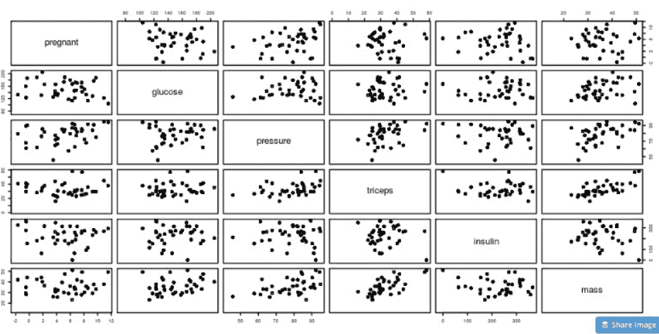

## 生成相关性图

这是一个更高级的可视化示例，使用 ggplot 说明如何通过阴影表示相交变量之间的相关程度来生成相关性矩阵。同样，重点是强调，如果样本量合理且您运行的 Spark 版本中没有所需的精确功能，则可以在 Spark 外部执行分析。

```r
require(ggplot2)
library(reshape2)
cormatrix <- round(cor(samp),2)
cormatrix_melt <- melt(cormatrix)
head(cormatrix_melt)
ggplot(data = cormatrix_melt, aes(x=Var1, y=Var2, fill=value)) +
```

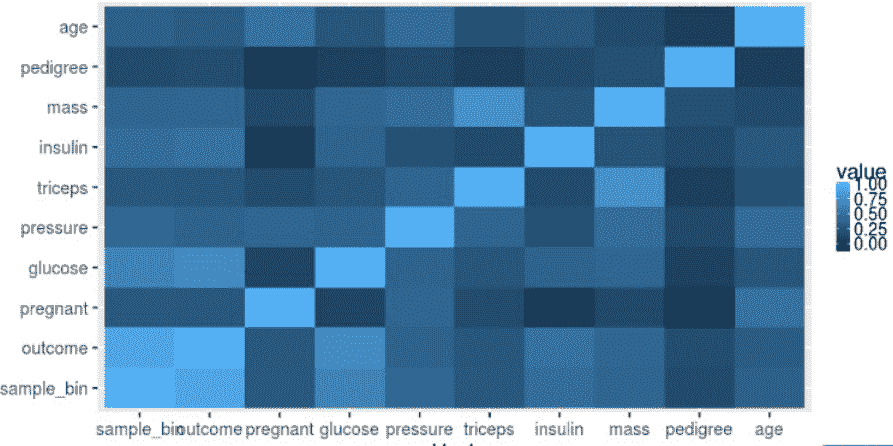

## 使用 Spark 的一些技巧

请查看以下技巧：

- 尽可能采样。大胆使用 `sample_bin` 方法和 filter 命令。采样将加快分析阶段和开发/测试阶段的分析速度。
- 在较小分段上完成测试后，可以放心地将其扩展到更大的总体。
- 预处理数据，以便可以子选择潜在的有趣子分段。
- 在有意义时缓存分析。
- 如果性能成为因素，请尝试在数据中使用更多分区数。
- 对于大规模数值计算，将具有代表性的样本带回本地 R。

## 摘要

本章中，我们学习了探索 Spark 数据的基础知识，使用了一些特定于 Spark 的命令，使我们能够过滤、分组和汇总 Spark 数据。

我们还了解了如何直接在 Spark 中可视化数据，以及学习如何在数据上运行 ggplot 等 R 函数。

我们了解了处理 Spark 数据的一些策略，例如执行智能过滤和采样。

最后，我们演示了，如果我们想使用 Spark 环境中可能不原生提供的常用工具的灵活性，通常需要将部分 Spark 数据提取回本地 R。

在下一章中，我们将深入探讨可用于大型数据集的各种预测模型。
