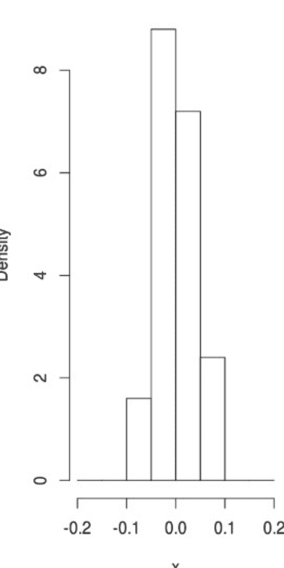
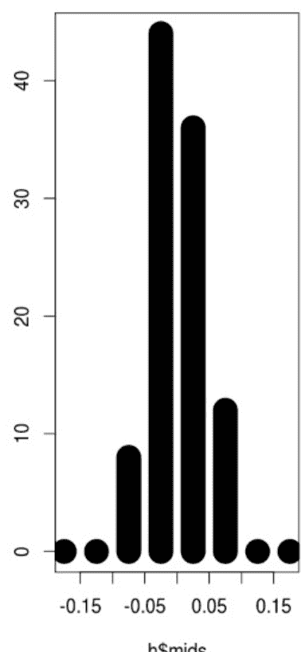
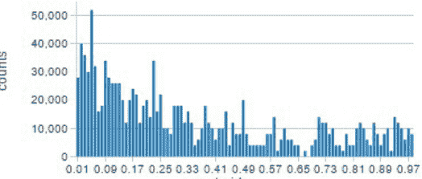
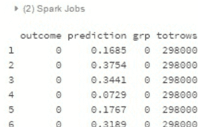
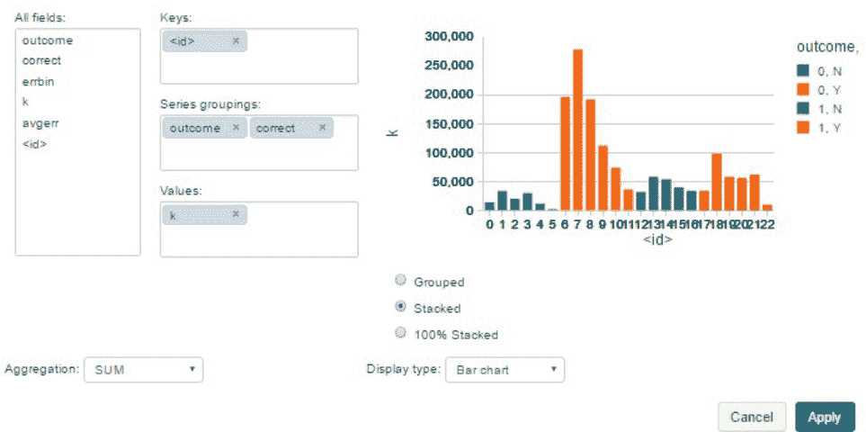
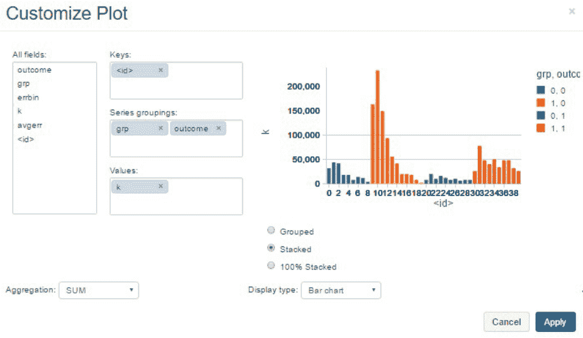
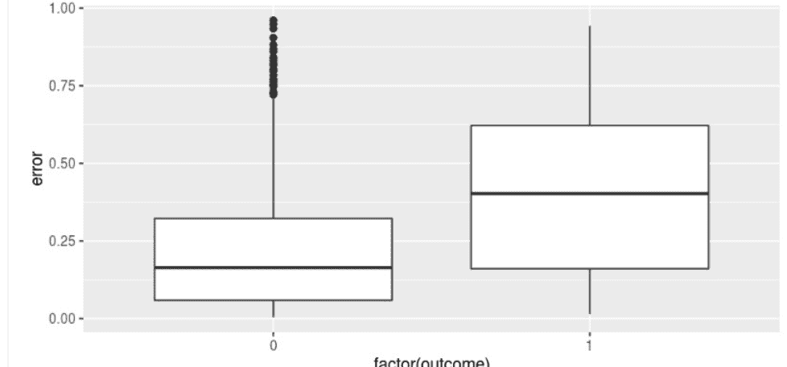
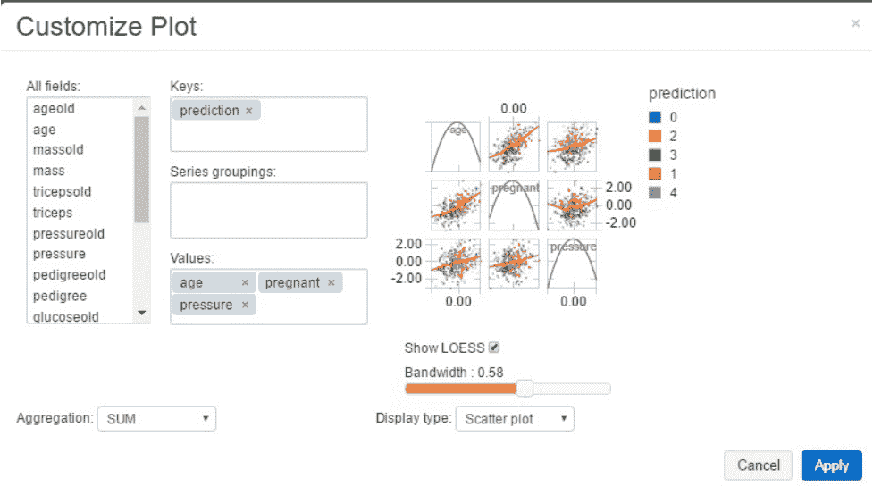
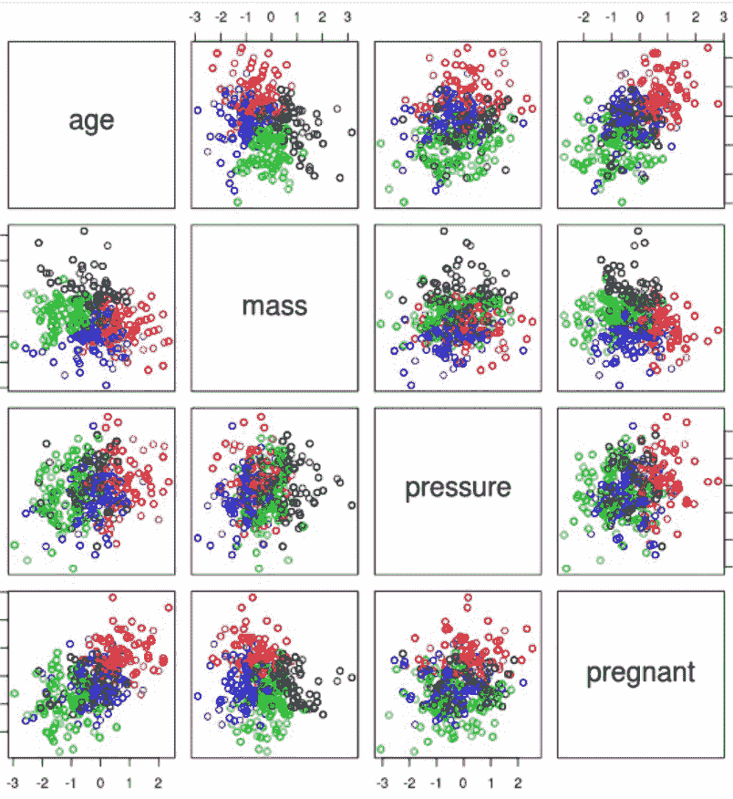

# 第 11 章. Spark 机器学习 - 回归和聚类模型

> “研究思维机器让我们对大脑的了解，超越了内省方法所能教导我们的。西方人正以小玩意的形式外化自己。”

- 威廉·S·伯勒斯（《裸体午餐》）

## 关于本章/您将学到的内容

在前几章中，我们介绍了 Spark 和 SparkR，重点是使用 SQL 探索数据。在本章中，我们将开始探讨 Spark 的机器学习功能，使用 MLlib（即随 Spark 一起打包的原生机器学习库）。

本章将介绍逻辑回归和聚类算法。在下一章中，我们将介绍基于规则的算法（包括决策树）。部分材料已在之前的章节中使用 PC 版 R 进行过讨论。在本章及下一章中，我们将主要关注如何准备数据，并使用 Spark 中存在的 MLlib 算法应用这些技术。

## 读取数据

上一章中，我们将 `out_sd` 保存到了外部 parquet 文件中。
在现实世界中，您将面临分析多个数据源的情况。
通常，这些数据源具有类似的架构，但按写入的时间段有所不同。

例如，日志文件可以按日期归档到不同的目录中，作为分析师的您需要读取多个文件并将它们连接在一起。

因此，虽然每个单独的文件可能很小，但汇总后将生成一个大得多的文件。

让我们假设将在过去两天内写入的多个文件上进行一些机器学习操作。为了说明目的，我们将对两个输入使用相同的文件。但是，在实际操作中，您可能正在连接多天的交易：

- 1. 首先，重新读取数据。请回顾，文件保存在了


parquet 格式的前一章：

```
todays_file <- parquetFile(sqlContext,
"/tmp/temp.parquet")
yesterdays_file <- parquetFile(sqlContext,
"/tmp/temp.parquet")
```

- 2. 使用 Spark unionAll() 函数将两天的数据合并到一个文件中：

```
out_sd <- unionAll(todays_file,yesterdays_file)
```

- 3. 读取文件后，可以缓存 out_sd 文件，以便在会话余下时间中对其进行最优查询：

```
cache(out_sd)
```

接下来，使用 SparkR mean() 和 count() 函数验证文件的完整性。例如，根据原始数据，我们知道约 34% 的结果为阳性，因此可以使用这些函数作为计算器来确定文件中包含 536,000 个阳性病例。何必这样做？在处理大型数据集时，在开始操作记录之前先验证文件内容通常值得付出努力。通过执行数据准备来节省时间至关重要：

```
head(SparkR::select(out_sd,
count(out_sd$outcome), mean(out_sd$outcome), mean(out_sd$outcome) * count(out_sd$outcome))
```

| | count(outcome) | avg(outcome) | (avg(outcome) * count(outcome)) |
|---|---|---|---|
| 1 | 1536000 | 0.3489583 | 536000 |

## 对数据框运行摘要并保存对象

接下来，我们将创建数据框的摘要。但是，我们不仅像过去那样打印摘要，还会将摘要结果保存到对象中，因为稍后将使用汇总信息将其重新连接到原始数据。同样，如果您要操作大型数据集，则无需对同一数据多次运行 summary() 函数：

- 1. 设置一些全局选项，例如有效数字的数量、绘图宽度和高度等。
- 2. 将摘要输出分配给一个数据框。
- 3. 使用 databricks display() 函数（或 head() 函数）打印文件的一部分：

```
options(digits=3)
options(repr.plot.width = 1000, repr.plot.height = 500,
repr.plot.res = 144, repr.plot.pointsize = 5)
sumdf = summary(out_sd)
display(sumdf)
```

| 摘要 | 样本箱 | 结果 | 怀孕 | 葡萄糖 | 血压 | 三头肌 | 胰岛素 | 质量 | 谱系 |
| :--- | :--- | :--- | :--- | :--- | :--- | :--- | :--- | :--- | :--- |
| 计数 | 1536000 | 1536000 | 1536000 | 1536000 | 1536000 | 1536000 | 1536000 | 1536000 | 1536000 |
| 平均值 | -113.6731770833333 | 0.348958333333333 | 3.84050283332693 | 121.68778671732643 | 72.40477794289117 | 29.24877013964472 | 159.46377333976378 | 32.424846279285206 | 0.4718763020832466 |
| 标准误 | 220.7323786442508 | 0.4766409160347798 | 3.3673847085630393 | 30.441761915341296 | 12.09691906371815 | 8.92347528022873 | 91.29939768938557 | 6.874555211563171 | 0.331129238127968 |
| 最小值 | -500.0 | 0.0 | -2.678363622739748 | 39.06326135657754 | 35.40654724700478 | 0.7607894364232116 | -148.15344547408253 | 9.969765765951805 | -0.5461478239604021 |
| 最大值 | 267.0 | 1.0 | 13.798168411407868 | 219.71433564781285 | 112.13158466413095 | 58.23733534004559 | 456.09990684013997 | 54.286237099532233 | 1.687877997650607 |

## 将数据拆分为训练集和测试集

继续创建我们的测试集和训练集。目标是将 80% 的数据用于训练集，20% 的数据用于测试集。

为加快采样速度，我们可以按顺序采样 `sample_bin` 范围的两端作为测试数据集，然后使用中间部分作为训练数据。这仍然是随机采样，因为 `sample_bin` 最初是随机生成的，数字的序列或范围不影响随机性。

## 生成训练数据集

由于我们希望 80% 的数据为训练数据，首先获取所有介于高截止值和低截止值之间的 `sample_bin` 数字。我们可以将截止范围定义为 `sample_bin` 最高值和最低值之差的 20%。

将低截止值设置为先前定义的最低值加上截止范围，将高截止值设置为最高值减去截止范围：

```
#compute the minimum and maximum values of sample bin
set.seed(123)
sample_bin_min <- as.integer(collect(select(out_sd, min(out_sd$sample_bin))))
sample_bin_max <- as.integer(collect(select(out_sd, max(out_sd$sample_bin))))
Cutoff <- .20*(sample_bin_max - sample_bin_min)
Cutoff_low <- sample_bin_min + Cutoff
Cutoff_high <- sample_bin_max - Cutoff
rm(df)
#take 80% of the training samples. These happens to be the ones
df <- filter(out_sd, out_sd$sample_bin > Cutoff_low & out_sd$sample_bin < Cutoff_high)
```

```
train_sumdf = summary(df)
```

使用 databricks `display` 命令中的 Spark `select()` 函数打印一些关键字段。请注意，以这种方式打印摘要对象时，始终会有五行（`count`、`mean`、`sdev`、`min` 和 `max`）以及每个变量的一列：

```
display(select(train_sumdf, "summary", "outcome", "pregnant", "age", "
```

| 摘要 | 结果 | 怀孕 | 年龄 | 质量 | 葡萄糖 | 三头肌 |
|---|---|---|---|---|---|---|
| 计数 | 1238000 | 1238000 | 1238000 | 1238000 | 1238000 | 1238000 |
| 平均值 | 0.473334103392569 | 3.8393078551561945 | 33.1010706771893 | 32.38097983343372 | 121.13880674688428 | 29.0263560575717 |
| 标准差 | 0.4761233042460107 | 3.4609137686182487 | 11.840237146098062 | 6.738535508915995 | 30.58392015453745 | 8.83891870375425 |
| 最小值 | 0.0 | -5.267836523739748 | -1.469171542253246 | 12.476112430010328 | 30.05328135657574 | 0.7607894364232118 |
| 最大值 | 1.0 | 13.798188411407868 | 73.95268273570966 | 54.15179128403151 | 219.71433564781285 | 58.2373353404559 |

## 生成测试数据集

为生成测试数据，我们将仅选择落在截止点之外的行。这将产生 20% 的样本。请注意，SparkR describe 函数是 `summary()` 函数的别名。当您希望避免 Spark 和基础 R 函数之间的名称冲突时，请使用此函数。

```
#set the test data set to include the rest of the population
set.seed(123)
test <- filter(out_sd, out_sd$sample_bin <= Cutoff_low | out_sd$sample_bin >= Cutoff_high)
test_sumdf = describe(test)
```

```
display(select(test_sumdf,"summary","outcome","pregnant","age","m
```

| 摘要 | 结果 | 怀孕 | 年龄 | 质量 | 葡萄糖 | 三头肌 |
|---|---|---|---|---|---|---|
| 计数 | 298000 | 298000 | 298000 | 298000 | 298000 | 298000 |
| 平均值 | 0.35570469798657717 | 3.8689156889824896 | 33.82172904758105 | 32.69986191673218 | 123.96844847374449 | 30.172758871343312 |
| 标准差 | 0.47872709853948375 | 2.947107815841375 | 11.36279505675114 | 7.40700808651703 | 29.73566072935832 | 9.20917898210801 |
| 最小值 | 0.0 | -2.7745181707450337 | 0.3325954628676797 | 9.969756765918051 | 49.71976008885286 | 5.837573202896575 |
| 最大值 | 1.0 | 11.726947624108954 | 55.30614098944598 | 54.28823709953233 | 194.24078387540534 | 51.93047275913541 |

## 关于并行处理的说明

Spark 将尽可能充分利用并行处理算法。提取训练和测试数据样本就是这种情况的典型示例，因为提取训练数据集可以独立于训练数据执行。

因此，在 Databricks 中，您将能够通过进度条直观地看到它们同时运行。在代码块依赖于另一块代码的情况下，您将看到执行开始，但它将处于等待状态，直到所需的前置块完成。

其启示是，您应始终尝试以利用并行处理的方式开发分析代码，以便充分利用并行处理。

## 将错误引入测试数据集

由于测试数据集和训练数据集均由模拟随机正态分布生成，因此数据几乎过于完美。为了补偿这一点，并使数据更具现实感并帮助您培养更多模拟技能，我们可以向测试数据集中引入一些随机错误。例如，我们可能希望向测试数据变量中添加最多正负 10% 的变化。

要实现此目的，我们将首先生成可应用于原始数据的误差分布。为了简单起见，我们可以推导出四个离散误差箱，每个箱表示对数据的不同百分比调整。-10% 到 +10% 之间的百分比错误是合理的限制。

我们将使用以下 rnorm 函数生成此分布，然后将任何超出 +/- 10% 的值设置为 0。这将成为我们用于选择错误概率的自定义分布：

```
#set the random seed
set.seed(123)
#set the bins
x <- rnorm(n=25,mean=0,sd=4) /100
#assign errors conditionally
x <- ifelse(abs(x) > .10,0,x)
```

## 生成分布的直方图


与其简单地绘制分布，不如绘制分布的直方图，这样我们可以看到近似误差箱的样子。事实上，让我们生成两个不同的直方图，一个包含实际计数，另一个包含百分比：

```
par(mfrow=c(1,2))
h <- hist(x,freq=FALSE,right=FALSE,breaks=c(-.20, -.15,-.10,-.05,
print(h)

plot(h$mids,100*h$counts/sum(h$counts),type="h",lwd=25, lty=1, ma
```

在下面的图表中，你可以从左侧的直方图中看到，没有数值超出指定的限制。事实上，由于分布是以均值=0 生成的，许多测试元素将不会添加任何错误。这是设计如此。

右侧的条形图只是为了显示每个条形的相对百分比（而非直接频率）。由此，我们可以看到，例如，调整幅度为 5-10% 的概率约为 12%：

## x 的直方图



## 引入错误的概率



## 生成带有错误的新测试数据

现在我们可以通过将每个变量的一个随机百分比添加到其自身来为数据集引入一些变化。这是通过首先从误差分布（x）中采样来完成的。

请注意，我们需要为 sample 函数加上 base:: 前缀，因为 base 样本函数的语法与 Spark 样本函数不同。如果不这样做，将会报错：

```
### alter the test data set by sampling from the 'x' distribution a
test$age = test$age + test$age*base::sample(x, 1, replace = FALSE
test$pregnant = test$pregnant + test$pregnant*base::sample(x, 1,
test$glucose = test$glucose + test$glucose*base::sample (x, 1, rep
test$pressure = test$pressure + test$pressure*base::sample(x, 1,
test$triceps = test$triceps + test$triceps*base::sample (x, 1, rep
test$insulin = test$insulin + test$insulin*base::sample (x, 1, rep
test$mass = test$mass + test$mass*base::sample(x, 1, replace = FA
test$pedigree = test$pedigree + test$pedigree*base::sample(x, 1,
### calculating the number of rows again, to make sure they are the
nrow(test)
```

- (1) Spark 作业
[1] 298000

## 使用逻辑回归进行 Spark 机器学习

现在我们已经构建了测试和训练数据集，将首先构建一个逻辑回归模型来预测结果 1 或 0。如您所记得，1 表示检测到糖尿病，而 0 表示未检测到糖尿病。

Spark glm 的语法与普通 glm 非常相似。使用公式表示法指定模型。请务必指定 family = "binomial" 以指示结果变量只有两个结果：

```
### run glm model on Training dataset and assign it to object named
model <- spark.glm(outcome ~ pregnant + glucose + pressure + tric
summary(model)
```

### 检查输出：

你可以在 Estimate 列中观察模型的系数。你还可以看到残差范围从 -2.54 到 +2.40，涵盖了大约 2.5 个标准差，并且提供的是中位数（而非均值），值为 -.326。另请注意，此版本的 spark.glm 未提供 p 值，因为它们都显示为 0。

此模型的 AIC 列在底部；但是，除非与另一个模型进行比较，否则它没有意义。

(15) Spark 作业

### 偏差残差：

（注：这些是相对误差 <= 0.01 的近似分位数）

| 最小值 | 下四分位数 | 中位数 | 上四分位数 | 最大值 |
|-------|-----------|--------|-----------|-------|
| -2.54350 | -0.68582 | -0.32635 | 0.60581 | 2.39782 |

### 系数：

| | 估计值 | 标准误差 | t 值 | Pr(>|t|) |
|---|--------|----------|-------|----------|
| (Intercept) | -9.3308 | 0.021087 | -442.49 | 0 |
| pregnant | 0.14879 | 0.00086434 | 172.15 | 0 |
| glucose | 0.0368 | 0.00010225 | 359.89 | 0 |
| pressure | 0.0098552 | 0.00021764 | 45.282 | 0 |
| triceps | 0.061359 | 0.0002994 | 204.94 | 0 |
| insulin | 0.0051072 | 3.0915e-05 | 165.2 | 0 |
| pedigree | 0.77574 | 0.0073594 | 105.41 | 0 |
| age | -0.0085463 | 0.00026756 | -31.942 | 0 |

（二项分布的离散参数取为 1）

空偏差：1598954（自由度 1237999）
残差偏差：1091651（自由度 1237992）
AIC：1091667

## 正则化模型

正则化模型是 `spark.glm` 的一种替代方案；你也可以运行 `spark.logit` 并向自变量提供正则化参数。

默认情况下，`spark.logit` 将产生与没有正则化参数的 `spark.glm` 相同的结果：

```
model2 <- spark.logit(df, outcome ~ pregnant + glucose + pressure
```

为了验证这一点，同时运行 `spark.logit` 和 `spark.glm` 并验证结果是否相同。

验证这一点后，如果希望通过拉平系数或将某些系数设为 0 来平滑模型，可以添加正则化参数。

下面运行的模型仅将 glucose、insulin 和 pressure 作为预测变量。由于 elasticnetparam (.8) 介于 0 和 1 之间（0 使用 L2，1 使用 L1），它将使用 L1 和 L2 正则化的组合。因此，你会看到一些系数收缩到 0：

```
### Fit an binomial logistic regression model with spark.logit
model2 <- spark.logit(df, outcome ~ pregnant + glucose + pressure
summary(model2)
```

```
(18) Spark Jobs
```

```
$coefficients
Estimate
(Intercept) -0.864
pregnant 0
glucose 0.00356
pressure -0.00751
triceps 0
insulin 0.00216
pedigree 0
age 0
```

```
(1) Spark Jobs
```

### 偏差残差：

（注：这些是相对误差 <= 0.01 的近似分位数）

| 最小值 | 下四分位数 | 中位数 | 上四分位数 | 最大值 |
|-------|-----------|--------|-----------|-------|
| -2.19723 | -0.78663 | -0.46373 | 0.73562 | 2.11291 |

### 系数：

| | 估计值 | 标准误差 | t 值 | Pr(>|t|) |
|---|--------|----------|-------|----------|
| (Intercept) | -6.8738 | 0.01376 | -499.54 | 0 |
| pregnant | 0.10571 | 0.00066769 | 158.32 | 0 |
| glucose | 0.027519 | 7.4042e-05 | 371.67 | 0 |
| pressure | 0.0061251 | 0.00017208 | 35.593 | 0 |
| triceps | 0.044508 | 0.00022808 | 195.14 | 0 |
| insulin | 0.0037124 | 2.4464e-05 | 151.75 | 0 |
| pedigree | 0.56068 | 0.0058485 | 95.868 | 0 |
| age | -0.0048355 | 0.00021013 | -23.012 | 0 |

（二项分布的离散参数取为 1）

空偏差：1598954（自由度 1237999）
残差偏差：1116432（自由度 1237992）
AIC：1116448

```
Number of Fisher Scoring iterations: 1
```

## 预测结果

SparkR 确实有一个名为 `predict()` 的预测方法，因此我们可以在训练集上运行预测：

- 运行以下代码后，你会观察到生成的对象包含一个名为 `prediction` 的新列
- 我们还可以向结果 (grp) 添加一个单一标志 (1) 以指示输出来自训练数据
- 我们还将把总行数附加到每条记录，因为稍后计算时需要它们：

```
#look at the predictions vs. the training dataset
preds_train <- predict(model, df)
preds_train$grp <- 1
preds_train$totrows = nrow(preds_train)
```

预测变量是事件（糖尿病）发生的概率：

```
head (preds_train)
```

```
(2) Spark Jobs
```

| | sample_bin | outcome | pregnant | glucose | pressure | triceps | insulin | mass | pedigree |
|---|------------|---------|----------|---------|----------|---------|---------|------|----------|
| 1 | -144 | 0 | -1.4808 | 73.4 | 66.6 | 19.8 | 104.1 | 23.9 | 0.112 |
| 2 | -395 | 0 | 1.1046 | 105.6 | 71.0 | 22.3 | 114.7 | 30.5 | 0.948 |
| 3 | -205 | 0 | -0.3764 | 132.1 | 65.9 | 17.5 | 117.3 | 25.8 | 0.283 |
| 4 | -23 | 0 | -0.0204 | 111.9 | 64.6 | 34.0 | 106.4 | 44.0 | 0.520 |
| 5 | -265 | 0 | 1.7489 | 83.4 | 48.4 | 15.1 | 55.3 | 29.1 | 0.298 |
| 6 | -276 | 0 | 6.7640 | 157.6 | 82.2 | 15.4 | 187.0 | 29.9 | 0.582 |

| | age | label | prediction | grp | totrows |
|---|-----|-------|------------|-----|---------|
| 1 | 33.20 | 0 | 0.0313 | 1 | 12380000 |
| 2 | 26.04 | 0 | 0.1690 | 1 | 12380000 |
| 3 | 25.33 | 0 | 0.1648 | 1 | 12380000 |
| 4 | 9.12 | 0 | 0.2240 | 1 | 12380000 |
| 5 | 16.81 | 0 | 0.0418 | 1 | 12380000 |
| 6 | 40.24 | 0 | 0.5483 | 1 | 12380000 |

## 绘制结果

在 Spark 中绘制结果的一种方法是构建概率直方图，使用分箱范围的中点（中心值）作为 x 轴，以及原始


y 轴上每个 bin 的计数。

```
x=SparkR::histogram(preds_train,preds_train$prediction, nbins = 1)
x$centroids=round (x$centroids,2)
display (x)
```

显示命令运行后，单击左下角的图表图标（第 2 个图标），然后单击“图表选项”。此时将显示自定义图表屏幕：

- 1. 将显示类型设置为分组柱状图，使用下拉选择和单选按钮的组合。
- 2. 将 counts 从“所有字段”拖动到“值”。
- 3. 将 centroids 拖动到“键”。

Centroids 表示柱状图的中点。在上面的代码中，我们将它们四舍五入到两位小数，以便在生成的图表上更易读。如果图表渲染得太小，您需要再次打开“自定义图表”才能再次查看更大的图表。

输出显示了逻辑模型的典型密度，大部分权重用于预测非事件。右侧的较高概率将预测 outcome=1 的概率的频率分桶。

## 自定义图表

- 所有字段：
  - bins
  - counts
  - centroids
  - <id>

键：
centroids

系列分组：

值：
counts



分组
堆叠
100% 堆叠

聚合：SUM
显示类型：柱状图
取消 应用

## 为测试数据运行预测

接下来，我们有类似于测试数据组的代码。将 grp 标志设置为 0 以指定这是来自测试组：

```
#run predictions on test dataset based on training model
preds_test <- predict(model, test)
preds_test$grp <- 0
preds_test$totrows = nrow(preds_test)
```

使用 SparkR select 函数从结果中打印几行以提取几个关键列：

```
head(SparkR::select(preds_test,preds_test$outcome,preds_test$prediction)
```



## 合并训练数据集和测试数据集

接下来，我们将把训练（grp=1）和测试（grp=0）数据集合并到一个数据框中，并手动计算一些准确性统计数据：

- `preds$error`: 这是结果（0,1）与预测之间的绝对差值。请回顾，对于二元回归模型，预测表示事件（糖尿病）发生的概率。
- `preds$errorsqr`: 这是计算出的平方误差。这样做是为了去除符号。
- `preds$correct`: 为了将概率分类为正确或不正确，我们将误差与 0.5 阈值进行比较。如果误差较小（<= 0.5），我们将其称为正确，否则将被视为不正确。这是一个有些随意的阈值，用于确定将预测归入哪个类别。

作为最后一步，我们将再次根据 `grp` 标志将数据分回测试和训练：

```
#classify 'correct' prediction if error is less than or equal to
preds <- rbind(preds_train,preds_test)
preds$error = abs(preds$prediction-preds$outcome)
#square the error to get the absolute squared error
preds$errorsqr = (preds$prediction-preds$outcome) ^ 2
#assign correct=Yes, or correct=No
preds$correct = ifelse(preds$error <= .5, "Y","N")
preds$errbin = round( (preds$error*10),0)
#separate the data again, including the new columns
preds_train = filter(preds, preds$grp==1)
preds_test = filter(preds, preds$grp==0)
```

接下来，打印一些结果。您可以从输出中看到，第一个观测值被分类为正确，因为模型概率为 .03 且更接近实际结果（0）。另一方面，第六个观测值被（勉强）分类为预测 outcome=1，但这是错误的，因此 correct 设置为 N：

```
head (preds)
```

| # | sample_bin | outcome | pregnant | glucose | pressure | triceps | insulin | mass | pedigree |
|---|---|---|---|---|---|---|---|---|---|
| 1 | -144 | 0 | -1.4808 | 73.4 | 66.6 | 19.8 | 104.1 | 23.9 | 0.112 |
| 2 | -395 | 0 | 1.1046 | 105.6 | 71.0 | 22.3 | 114.7 | 30.5 | 0.948 |
| 3 | -205 | 0 | -0.3764 | 132.1 | 65.9 | 17.5 | 117.3 | 25.8 | 0.283 |
| 4 | -23 | 0 | -0.0204 | 111.9 | 64.6 | 34.0 | 106.4 | 44.0 | 0.520 |
| 5 | -265 | 0 | 1.7489 | 83.4 | 48.4 | 15.1 | 55.3 | 29.1 | 0.298 |
| 6 | -276 | 0 | 6.7640 | 157.6 | 82.2 | 15.4 | 187.0 | 29.9 | 0.582 |

| # | age | label | prediction | grp | totrows | error | errorsqr | correct | errbin |
|---|---|---|---|---|---|---|---|---|---|
| 1 | 33.20 | 0 | 0.0313 | 1 | 1238000 | 0.0313 | 0.000979 | Y | 0 |
| 2 | 26.04 | 0 | 0.1690 | 1 | 1238000 | 0.1690 | 0.028549 | Y | 2 |
| 3 | 25.33 | 0 | 0.1648 | 1 | 1238000 | 0.1648 | 0.027152 | Y | 2 |
| 4 | 9.12 | 0 | 0.2240 | 1 | 1238000 | 0.2240 | 0.050170 | Y | 2 |
| 5 | 16.81 | 0 | 0.0418 | 1 | 1238000 | 0.0418 | 0.001744 | Y | 0 |
| 6 | 40.24 | 0 | 0.5483 | 1 | 1238000 | 0.5483 | 0.300668 | N | 5 |

## 将三个表暴露给 SQL

现在我们可以注册三个关键表，以便运行一些 SQL 代码来获取其他诊断信息：

```
registerTempTable(preds,"preds_tbl")
registerTempTable(preds_train,"preds_train")
registerTempTable(preds_test,"preds_test")
```

## 验证回归结果

SparkR 中的逻辑回归缺少一些您可能在基础 R 中习惯的交叉验证和其他功能。但是，它是一个起点，可让您开始运行大规模模型。如果需要使用已经介绍过的一些交叉验证技术，您当然可以提取数据样本（通过 collect）并在基础 R 中运行回归。

但是，有一些技术可让您在继续在 Spark 中工作的同时生成伪 R-平方和其他诊断信息，我们将演示这些技术。

## 计算优拟度指标

### 混淆矩阵

我们可以计算混淆矩阵或误差矩阵，以确定我们在将预测结果分类为正确或不正确时，手动计算的表现如何：

```
#Confusion matrix
result <- sql("select outcome,correct, count(*) as k, avg(totrows)")
result$classify_pct <- result$k/result$totrows

display(result)
```

| outcome | correct | k | totrows | classify_pct |
|---|---|---|---|---|
| 0 | N | 76000 | 1238000 | 0.061389337641357025 |
| 0 | Y | 732000 | 1238000 | 0.5912762520193862 |
| 1 | N | 178000 | 1238000 | 0.14378029078159935 |
| 1 | Y | 252000 | 1238000 | 0.2035541195476575 |

要确定模型预测的总正确数，请先求和之前 correct=Y 的列：

### 训练组正确预测摘要：

正确预测 outcome=1 20%

正确预测 outcome=0 59%

总正确百分比 79%

您可以看出，预测 outcome=0 的预测能力远强于预测 outcome=1。

### 测试组混淆矩阵

测试组的结果与训练组的结果相似。测试和训练之间的任何差异都值得更仔细地查看模型，并观察数据是如何采样或分割的：

```
#Confusion matrix for TEST group
result <- sql("select outcome,correct, count(*) as k, avg(totrows)")
result$classify_pct <- result$k/result$totrows
display(result)
```

| outcome | correct | k | totrows | classify_pct |
|---|---|---|---|---|
| 0 | N | 360000 | 298000 | 0.12080536912751678 |
| 0 | Y | 1560000 | 298000 | 0.5234899328859061 |
| 1 | N | 400000 | 298000 | 0.1342281879194631 |
| 1 | Y | 660000 | 298000 | 0.2214765100671141 |

以与训练组类似的方式汇总正确计算。结果稍低，这在将测试与训练结果进行比较时是正常的：

### 测试组正确预测摘要：

正确预测 outcome=1 22%

正确预测 outcome=0 52%

总正确百分比 74%

### 按组分布的平均误差

误差分布是另一种可以查看模型拟合数据效果的方法。在此分析中，我们查看了以下变量的所有四种组合的误差分布：

- 结果
- 正确预测标志
- 通过 errbin 变量分类的平均误差：

```
result2 <- sql("select outcome,correct,errbin, count(*) as k, avg
```

## 绘制数据

查询完成后，发出显示命令以便我们可以执行一些可视化。

```
display(result2)
```

- 1. 显示运行后，选择“图表选项”图标（左下角第 3 个图标），并从图表菜单中选择堆叠柱状图。
- 2. 将 k（counts）拖动到“值”框。
- 3. 将 outcome 和 correct 拖动到“系列分组”框。
- 4. 单击“应用”以更新可视化：
- 如下图所示，预测类别中最低（也是最佳）的误差适用于非糖尿病患者（柱状图 1-5，结果 0，预测 N）。
- 最高误差出现在预测患有糖尿病，但患者实际上并非糖尿病患者的病例中（柱状图 6-11，结果 0，预测 Y）。
- 一个关键类别是未检测到的糖尿病（柱状图 12-16，outcome=1，预测 N），其误差也相对较低：


## 自定义图表



本图中，我们可以查看测试数据和训练数据以及结果的平均误差。在“系列分组”框中同时包含 grp 和 outcome。可以看到，对于 outcome=1 和 outcome=0，测试数据集的平均误差均有所增加。

在测试数据上进行度量时，误差略有增加是正常的：

```
#distribution of error bin
result2 <- sql("select outcome,grp,errbin, count(*) as k, avg(err
display(result2)
```

## 伪R平方



请回顾，真正的R平方度量并非逻辑回归的标准输出统计量，但我们可以使用其他拟优度量，例如McFadden伪R平方。

我们在代码中计算此值，首先获取残差偏差和空偏差。残差偏差衡量包含所有因变量的模型中的偏差。空偏差衡量仅包含截距的残差。对于良好的模型，你希望偏差/空偏差的比率尽可能小。用1减去此值即可得到伪R平方。

所有这些度量均可通过model_summary对象获得：

```
#mc fadden pseudo Rsquare
```

```
1-(model_summary$deviance/model_summary$null.deviance)
```

计算结果会自动打印：

## 均方根误差（RMSE）

我们已经从数据中计算了平方误差，因此要计算均方根误差（RMSE），只需调用SQL来获取每个结果的平均平方误差即可。可以看到，预测outcome=1（糖尿病）的变异远大于预测outcome=0：

```
result <- sql("select outcome, avg(errorsqr) from preds_tbl group
display(result)
```

| 结果 | 平均平方误差 |
|---|---|
| 0 | 0.097733492044389497 |
| 1 | 0.24074876875407308 |

## Spark外绘图

如果希望使用其他工具绘制数据，可以先对Spark数据进行抽样，然后使用ggplot等其他包进行绘图。请注意，某些版本的Spark可能已集成ggplot并可在Spark中使用。不过，此示例将展示另一种提取数据的示例，该数据可供其他包使用。

## 收集结果样本

我们将对所有预测进行2%抽样，然后打印部分结果。请注意，Spark的sample函数与之前使用的基础R sample函数语法不同。也可以将其指定为SparkR::sample，以确保调用正确的函数：

```
local = collect(sample(preds, F, .02))
head(local)
```

```
sample_bin outcome pregnant glucose pressure triceps insulin mass pedigree
1 -265 0 1.75 83.4 48.4 15.1 55.3 29.1 0.298
2 -339 0 2.28 75.3 67.4 25.4 86.0 31.8 0.166
3 -367 0 4.21 87.6 72.2 31.6 73.8 33.3 0.701
4 -109 0 1.32 83.6 60.5 25.8 84.8 35.6 0.801
5 -239 0 2.08 110.9 60.4 33.6 269.4 39.9 0.459
6 -111 0 6.89 115.9 87.4 29.5 108.9 32.3 0.839

age label prediction grp totrows error errorsqr correct errbin
1 16.8 0 0.0144 1 1238000 0.0144 0.000207 Y 0
2 36.5 0 0.0232 1 1238000 0.0232 0.000538 Y 0
3 26.9 0 0.1055 1 1238000 0.1055 0.011136 Y 1
4 21.3 0 0.0473 1 1238000 0.0473 0.002234 Y 0
5 36.0 0 0.2974 1 1238000 0.2974 0.088423 Y 3
6 38.8 0 0.3789 1 1238000 0.3789 0.143568 Y 4
```

## 按结果检查分布

接下来，可以运行ggplot以按结果分组以图形方式显示误差。生成的箱线图显示，糖尿病患者的四分位数高于非糖尿病患者。这表明，在预测实际患上糖尿病的患者时，模型的预测误差较高。这无疑意味着模型需要改进：

```
library(ggplot2)
ggplot(local, aes(factor(outcome),error)) + geom_boxplot()
```



## 注册一些附加表

使用逻辑回归进行机器学习的部分现已结束。对于下一部分（k-means），我们需要为已经生成的数据帧注册一些附加表：

```
registerTempTable(sumdf,"sumdf")
registerTempTable(out_sd,"out_sd")
registerTempTable(df,"df")
registerTempTable(test,"test")
```

## 创建一些全局视图

创建全局视图还允许我们在不同的Databricks笔记本之间传递数据。这些视图将在下一部分中引用。在Databricks笔记本的第一行使用`%sql`魔术命令，以表明这些是SQL语句：

```
%sql
CREATE GLOBAL TEMPORARY VIEW df_view AS SELECT * FROM df
```

```
%sql
CREATE GLOBAL TEMPORARY VIEW test_view AS SELECT * FROM test
```

```
%sql
CREATE GLOBAL TEMPORARY VIEW out_sd_view AS SELECT * FROM out_sd
```

```
%sql
CREATE GLOBAL TEMPORARY VIEW sumdf_view AS SELECT * FROM sumdf
```

## 用户练习

创建视图后，使用SQL读回计数，并与原始数据帧生成的行计数进行核对：

```
%sql
select count(*) from global_temp.df_view union all
select count(*) from global_temp.test_view union all
select count(*) from global_temp.sumdf_view union all
select count(*) from global_temp.out_sd_view
```

| 计数(1) |
|---|
| 12380000 |
| 298000 |
| 5 |
| 1536000 |

## 聚类分析

在本节中，我们将说明如何使用k-means在Spark中直接实现聚类分析。k-means是一种无监督学习，是开始探索大数据的绝佳起点，尤其是当您的数据量很大且没有明确的目标变量定义时。

## 准备分析数据

我们将首先进行一些数据准备，以便为k-means归一化数据。归一化几乎是k-means的要求，因为它迫使每个变量具有尺度独立性，从而使k-means集群之间的距离测量也具有尺度独立性。

请回顾，归一化变量的一种方法是首先获取变量的均值，然后除以其标准差。

## 从全局视图读取数据

我们在上一部分将糖尿病数据集保存为表和全局视图，因此现在可以使用SQL将其读回。我们将首先读取训练表(`temp.df_view`)，然后读取测试表(`test_view`)。生成的对象都是Spark数据帧。

读取表后，打印行计数。如果希望将计数作为一个结果查看，可以使用cat()等函数将结果打印在一行上：

```
df = sql("select age,
				pregnant,
				glucose,
				pressure,
				insulin,
				pedigree,
				triceps,
				mass
from global_temp.df_view")
```

```
test = sql("select age ,
pregnant,
glucose,
pressure,
insulin,
pedigree,
triceps,
mass
from global_temp.test_view")
cat(count(df),count(test))
```

```
▶ (2) Spark Jobs
1238000 298000
```

## 输入先前计算的均值和标准差

为了归一化数据，我们需要每个列的均值和标准差。如果纯粹在基础R中进行此操作，有许多方法可以使用内置函数和包来完成。但是，使用SparkR可能会限制我们通常的操作方式，并迫使我们更高效地以不同方式处理数据。

请回顾，我们已将此数据存储在汇总对象（sumdf_view等等）中，因此为了节省处理时间，我们将直接读回汇总统计量，避免重新计算汇总统计量。

首先，我们将读入均值行，然后是`stddev`行：

```
means = sql("select age as age_mean,
pregnant as pregnant_mean,
glucose as glucose_mean,
pressure as pressure_mean,
insulin as insulin_mean,
pedigree as pedigree_mean,
triceps as triceps_mean,
mass as mass_mean
from global_temp.sumdf_view where summary='mean'")
stds = sql("select age as age_std,
```


```
pregnant as pregnant_std,
glucose as glucose_std,
pressure as pressure_std,
insulin as insulin_std,
pedigree as pedigree_std,
triceps as triceps_std,
mass as mass_std
from global_temp.sumdf_view where summary='stddev'")
```

## 将均值和标准差与训练数据连接

现在我们可以使用 crossJoin 将汇总均值和标准差连接在一起。由于表格具有相同数量的行并且彼此一一对应，因此不需要键。

然后将汇总数据与原始数据连接。生成的对象是另一个 Spark 数据框 (df_means)，其中所有变量的均值和标准差已连接到每一行：

```
#join the means and standard deviations
both <- crossJoin(means,stds)
#join with the original data
df_means <- crossJoin(df,both)
nrow(df_means)
```

(8) Spark Jobs
[1] 1238000

打印结果对象的一部分。所有原始变量都显示出来，并附带其对应的均值和标准差：

```
print(head(select(df_means,
"age","age_mean","age_std",
"mass","mass_mean","mass_std"
))))
```

| age | age_mean | age_std | mass | mass_mean | mass_std |
|---|---|---|---|---|---|
| 33.201751 | 33.24088541667883 | 11.75257647170343 | 23.91985 | 32.442846279285206 | 6.874555211563171 |
| 26.037762 | 33.24088541667883 | 11.75257647170343 | 30.46985 | 32.442846279285206 | 6.874555211563171 |
| 25.330797 | 33.24088541667883 | 11.75257647170343 | 25.78872 | 32.442846279285206 | 6.874555211563171 |
| 9.115341 | 33.24088541667883 | 11.75257647170343 | 44.01366 | 32.442846279285206 | 6.874555211563171 |
| 16.805305 | 33.24088541667883 | 11.75257647170343 | 29.11407 | 32.442846279285206 | 6.874555211563171 |
| 40.243232 | 33.24088541667883 | 11.75257647170343 | 29.93310 | 32.442846279285206 | 6.874555211563171 |

### 将均值和标准差与测试数据连接

与前面的代码类似，我们分别将均值和标准差连接到测试数据集。

检查创建的行数。如果要查看实际结果，请像上面使用训练数据一样打印部分数据：

```
test_means <- crossJoin(test,both)
nrow(test_means)
```

> (3) Spark 作业

[1] 298000

### 数据标准化

我们现在拥有标准化数据所需的所有统计量。回顾一下，标准化变量 x 的公式如下：

(x - mean(x)) / std(x)

为了实现这一点，我们将所需的计算封装到一个函数中，并对训练数据集和测试数据集都调用它：

- 使用 SparkR `selectExpr` 表达式根据上述公式计算每个变量的标准化版本。
- 另外，创建一个在名称中附加 old 的新变量，以保留变量的原始值。测试后，应删除这些额外变量以节省空间，但在调试时保留它们是有好处的：

```
normalize_it <- function (x) {
selectExpr(x,
"age as ageold","(age-age_mean) / age_std as age",
"mass as massold","(mass-mass_mean) / mass_std as mass",
"triceps as tricepsold","(triceps-triceps_mean) / triceps_std as triceps",
"pressure as pressureold","(pressure-pressure_mean) / pressure_std as pressure",
"pedigree as pedigreeold","(pedigree-pedigree_mean) / pedigree_std as pedigree",
"glucose as glucoseold","(glucose-glucose_mean) / glucose_std as glucose",
"pregnant as pregnantold","(pregnant-pregnant_mean) / pregnant_std as pregnant",
"insulin as insulinold","(insulin-insulin_mean) / insulin_std as insulin"
)
}
```

首先，为 `test` 数据集调用该函数：

```
test_normal <- normalize_it(test_means)
```

接下来，为训练数据集进行标准化：

```
df_normal <- normalize_it(df_means)
```

## 显示输出

打印标准化训练数据的部分输出。

```
head(df_normal)
```

从下面的输出中可以看到，标准化值似乎介于 -2 和 +2 之间，均值为 0。任何接近这些极值的值都落在变量的极端范围内。

例如，观测值 4 显示标准化年龄小于 -2，这对应原始年龄 9，而观测值 4 还显示标准化体重指数为 1.68，这对应原始体重指数 44。

这对于 9 岁儿童来说属于上限范围，我们能够仅通过查看一些标准化值之间的关系，快速识别出一些极端值：

| | ageold | age | massold | mass | tricepsold | triceps | pressureold |
|---|---|---|---|---|---|---|---|
| 1 | 33.201751 | -0.003329854 | 23.91985 | -1.2397891 | 19.80557 | -1.0582419 | 66.59577 |
| 2 | 26.037762 | -0.612897400 | 30.46985 | -0.2870003 | 22.31758 | -0.7767366 | 70.97826 |
| 3 | 25.330797 | -0.673051430 | 25.78872 | -0.9679359 | 17.54818 | -1.3112141 | 65.89486 |
| 4 | 9.115341 | -2.052787712 | 44.01366 | 1.6831360 | 34.03530 | 0.5363971 | 64.62639 |
| 5 | 16.805305 | -1.398466149 | 29.11407 | -0.4842170 | 15.08383 | -1.5873794 | 48.44238 |
| 6 | 40.243232 | 0.595813771 | 29.93310 | -0.3650773 | 15.41831 | -1.5498966 | 82.24149 |

| | pressure | pedigreeold | pedigree | glucoseold | glucose | pregnantold |
|---|---|---|---|---|---|---|
| 1 | -0.4802065 | 0.1122226 | -1.0861966 | 73.38202 | -1.5868256 | -1.48080805 |
| 2 | -0.1179241 | 0.9477453 | 1.4371804 | 105.55782 | -0.5298630 | 1.10456706 |
| 3 | -0.5381479 | 0.2829579 | -0.5705558 | 132.05748 | 0.3406405 | -0.37639825 |
| 4 | -0.6430063 | 0.5199817 | 0.1452839 | 111.93177 | -0.3204812 | -0.02039326 |
| 5 | -1.9808706 | 0.2984521 | -0.5237616 | 83.44548 | -1.2562449 | 1.74893121 |
| 6 | 0.8131598 | 0.5824100 | 0.3338248 | 157.58550 | 1.1792259 | 6.76401329 |

| | pregnant | insulinold | insulin |
|---|---|---|---|
| 1 | -1.5816013 | 104.09869 | -0.6064124 |
| 2 | -0.8138319 | 114.65470 | -0.4907926 |
| 3 | -1.2536288 | 117.33043 | -0.4614855 |
| 4 | -1.1479073 | 106.38615 | -0.5813578 |
| 5 | -0.6224774 | 55.32411 | -1.1406391 |
| 6 | 0.8668333 | 186.98714 | 0.3014627 |

## 运行 k-means 模型

现在数据已标准化，我们可以进行模型构建。

SparkR 包含一个 k-means 模型，其语法与基本 k-means 模型非常相似。还有一个额外参数 `InitMode`，您可以在其中指定为生成起始集群而生成随机种子。就此版本的 SparkR 而言，您无法手动设置种子。因此，请注意，每次运行模型时生成的集群可能会略有不同。

此外，您可以指定结果变量（glucose）以及要集群的变量，以便您可以评估集群模型的拟合度。

为了说明，我们将生成一个包含五个集群的模型。

使用 `summary(model)` 显示生成预测所需的系数以及每个集群的大小，如下所示。

```
model <- spark.kmeans(df_normal, glucose ~ age + mass + triceps +
k = 5, initMode = "random")
summary(model)
```

您可以从大小中看到，每个集群的大小都大约相等，也许集群 1 除外：

以下是 summary 函数的输出：

```
$k
[1] 5

$coefficients
 age mass triceps pregnant
1 0.974506 0.871064 1.096543 0.9835401
2 -0.2056799 0.9210847 0.666911 -0.432624
3 0.7791526 -0.4984192 -0.2448071 0.8973491
4 -1.092614 -0.1553198 -0.1833185 -0.9076226
5 -0.2380403 -1.001556 -1.246133 -0.2903638

$size
$size[[1]]
[1] 170000

$size[[2]]
[1] 276000

$size[[3]]
[1] 298000

$size[[4]]
[1] 274000

$size[[5]]
[1] 220000
```

## 将模型拟合到训练数据

由于您拥有系数，实际上可以通过代码手动预测集群成员身份。如果您要在生产环境中实现集群分配，您可能需要这样做。但是，使用 `predict` 方法更简单。

首先让我们将模型拟合到训练数据。我们可以打印一些拟合值以查看生成的内容。最后一列指示该观测值的集群分配：

```
fitted <- predict(model, df_normal)
SparkR::registerTempTable(fitted,"fitted_tbl")
head(fitted)
```

| ageold | age | massold | mass | tricepsold | triceps | pressureold |
|---|---|---|---|---|---|---|
| 33.201751 | -0.003329854 | 23.91985 | -1.2397891 | 19.80557 | -1.0582419 | 66.59577 |
| 26.037762 | -0.612897400 | 30.46985 | -0.2870003 | 22.31758 | -0.7767366 | 70.97826 |
| 25.330797 | -0.673051430 | 25.78872 | -0.9679359 | 17.54818 | -1.3112141 | 65.89486 |
| 9.115341 | -2.052787712 | 44.01366 | 1.6831360 | 34.03530 | 0.5363971 | 64.62639 |
| 16.805305 | -1.398466149 | 29.11407 | -0.4842170 | 15.08383 | -1.5873794 | 48.44238 |
| 40.243232 | 0.595813771 | 29.93310 | -0.3650773 | 15.41831 | -1.5498966 | 82.24149 |

| pressureold | pedigreeold | pedigree | glucoseold | glucose | lipoproteinold | pregnantold |
|---|---|---|---|---|---|---|
| -0.4802065 | 0.1122226 | -1.0861966 | 73.38202 | -1.5868256 | -1.4808080 | |
| -0.1179241 | 0.9477453 | 1.4371804 | 105.55782 | -0.5298630 | 1.10456706 | |
| -0.5381479 | 0.2829579 | -0.5705558 | 132.05748 | 0.3406405 | -0.37639825 | |
| -0.6430063 | 0.5199817 | 0.1452839 | 111.93177 | -0.3204812 | -0.02039326 | |
| -1.9808706 | 0.2984521 | -0.5237616 | 83.44548 | -1.2562449 | 1.74893121 | |
| 0.8131598 | 0.5824100 | 0.3338248 | 157.58550 | 1.1792259 | 6.76401329 | |

| pregnant | insulinold | insulin | label | prediction |
|---|---|---|---|---|
| -1.5816013 | 104.09869 | -0.6064124 | -1.5868256 | 4 |
| -0.8138319 | 114.65470 | -0.4907926 | -0.5298630 | 3 |
| -1.2536288 | 117.33043 | -0.4614855 | 0.3406405 | 4 |
| -1.1479073 | 106.38615 | -0.5813578 | -0.3204812 | 1 |
| -0.6224774 | 55.32411 | -1.1406391 | -1.2562449 | 4 |
| 0.8668333 | 186.98714 | 0.3014627 | 1.1792259 | 2 |

## 将模型拟合到测试数据

在测试数据上拟合模型并打印针对测试数据获得的一些结果：

```
fitted_test <- predict(model, test_normal)
SparkR::registerTempTable(fitted_test,"fitted_tbl_test")
head(fitted_test)
```


ageold       age   massold      mass tricepsold   triceps pressureold
1 33.96803 0.06187131 25.76803 -0.9709453  17.95158 -1.2660084  68.22192
2 32.27039 -0.08257709 31.69610 -0.1086242  31.44270  0.2458600  58.71235
3 36.56022  0.28243450 38.02934  0.8126340  35.80103  0.7342718  67.02700
4 47.25603  1.19251664 27.24542 -0.7560381  31.15899  0.2140669  82.06206
5 38.87426  0.47933086 26.24070 -0.9021892  34.23827  0.5591432  62.02162
6 38.18221  0.42044636 22.36163 -1.4664538  37.76050  0.9538583  66.80120
pressure   pedigreeold   pedigree  glucoseold   glucose pregnantold
1 -0.3457796 -0.201075157 -2.0323926 146.27194   0.80757994  0.8654326
2 -1.1318950  0.775602983  0.9172903 113.02193  -0.28467005  3.5297374
3 -0.4445586  0.048089812 -1.2798851 130.18584   0.27915780  1.1619962
4  0.7983271  0.155334447 -0.9559937  81.40550  -1.32325727  4.0704518
5 -0.8583318 -0.001603494 -1.4299647  96.97609  -0.81176945  4.1809552
6 -0.4632242  0.365889384 -0.3200930 120.42013  -0.04164209  3.2398957
pregnant insulinold   insulin label prediction
1 -0.88484678 175.2965 0.1734150  0.80757994        4
2 -0.09363786 255.2023 1.0486217 -0.28467005        1
3 -0.79677737 223.1728 0.6978036  0.27915780        1
4  0.06693614 146.7867 -0.1388513 -1.32325727        2
5  0.09975193 239.4030 0.8755728 -0.81176945        2
6 -0.17971108 142.0769 -0.1904382 -0.04164209        2

## 以图形方式显示聚类分配

双变量聚类图通常很有助于查看聚类分配如何与两个变量的 x-y 图相关联。每个集群都以不同的颜色绘制。

在 Databricks 中，您可以轻松完成此操作：

首先，在一些拟合数据上运行 display 命令。在下面的代码中，我首先提取了一个 1,000 行的样本。您希望样本足够小，以使图上的点不会太稠密。

```
tmp <- head(sample(fitted, F, .01), 1000)
display(tmp)

#show cluster assignment by 2 variable matrix
```

接下来，切换到绘图对话框，打开“自定义绘图”对话框，并执行以下图形设置：

1. 将图表类型更改为散点图。
2. 将 prediction 拖到 keys 区域。
3. 将所有可能的 x-y 绘图变量拖到 values 区域：
4. 如果向图中添加 LOESS 线，您将能够识别出一些容易通过两个变量组合分离的集群。

单击 **应用** 以更新图表。在以下图表中，`age` 和 `pregnant` 交叉点处的上升趋势线显示，随着年龄和怀孕月数的变化，集群分离明显：



## 通过 Pairs 函数绘图

要获得更大、更详细的图表，您还可以使用 pairs 函数在所需变量上生成散点矩阵，并使用颜色勾勒各个集群。

我们可以看到，在某些情况下，集群与其余部分是分开的，而在其他情况下，可能会有轻微或重大的重叠：

```r
pairs(tmp[c("age", "mass", "pressure", "pregnant") ],
col=tmp$prediction)
```



要开始分析集群的组成部分，可以查看变量沿每个轴的绘制方式。

例如，红色集群显示年长患者与怀孕月数之间存在关系。这似乎表明糖尿病呈阳性。为了再次确认，可以查看身体质量，并且还会看到其他所有变量的较高值也出现在红色集群中。

另一方面，血压与身体质量之间的关系不那么清晰，可能是因为其他因素在起作用，而这些因素在二维图中不明显。

## 按均值表征集群

查看集群的另一种方法是直接查看其均值。可以直接使用 SQL 来完成：

- 首先，查看任何具有归一化值 >1 或 <-1，或该变量最高绝对值的变量。这将为您开始对集群进行分类提供一些线索。
- 还要查看系数的大小和符号。绝对值较大的系数可能表明该变量对特定集群具有重要影响。符号相反的变量在表征或命名集群方面很重要。

```
tmp_agg <- SparkR::sql("SELECT prediction, mean(age),
mean(triceps),
mean(pregnant),mean(pressure),mean(insulin),
mean(glucose),
mean(pedigree) from fitted_tbl group by 1")
head(tmp_agg)
```

| prediction | avg(age) | avg(triceps) | avg(pregnant) | count(age) |
|---|---|---|---|---|
| 1 | -0.2056799 | 0.6669110 | -0.4326240 | 276000 |
| 3 | -1.0926137 | -0.1833185 | -0.9076226 | 274000 |
| 4 | -0.2453393 | -1.2575343 | -0.3066965 | 220000 |
| 2 | 0.7708876 | -0.2498310 | 0.8934643 | 298000 |
| 0 | 0.9745060 | 1.0965432 | 0.9835401 | 170000 |

浏览生成的五个集群，您可能会将集群 2 归类为一群年轻人且怀孕率较低的群体，因为两个变量的均值都接近负 -1 值。请记住，这些都是标准化值，因此您可以进行比较，并使用 +1/-1 标准差水平作为截止值。因此，将其作为截止值，您还可以假设集群 3 可能是身体质量较低的人，因为三头肌水平也接近 -1。接近 0 的值意味着该变量对集群的影响可忽略不计。

## 计算测试数据的均值

此数据集的结果与训练数据相似：

```
tmp_agg <- SparkR::sql("SELECT prediction, mean(age), mean(triceps), mean(pregnant), mean(pressure), mean(insulin), mean(glucose), mean(pedigree) from fitted_tbl group by 1")
head(tmp_agg)
```

| prediction | avg(age) | avg(triceps) | avg(pregnant) | avg(pressure) | avg(insulin) |
|---|---|---|---|---|---|
| 1 | -0.1460594 | 0.7038619 | -0.4245266 | 0.1764655 | 0.4348044 |
| 3 | -1.2141664 | -0.2855458 | -0.8130297 | -0.5550104 | -0.2377346 |
| 4 | -0.1562988 | -1.2265138 | -0.2037147 | -0.3655402 | -0.2354299 |
| 2 | 0.7498264 | -0.2324546 | 0.5918927 | 0.2299495 | 0.3695036 |
| 0 | 0.6292312 | 1.0599987 | 0.8521112 | 0.2851198 | 0.5954573 |

| avg(glucose) | avg(pedigree) |
|---|---|
| 0.10083870 | 0.29937091 |
| -0.51709496 | 0.13754498 |
| -0.16160085 | 0.19409315 |
| 0.09277286 | -0.06523912 |
| 0.37704262 | 0.45119753 |

## 摘要

在本章中，我们超越了 SQL，开始探索 Spark 的机器学习功能。我们使用糖尿病数据集介绍了回归和 kmeans 聚类。我们构建了训练和测试数据集，并了解了如何通过模拟向数据中引入一些变化。还介绍了大量 Databricks 可视化，以及使用 collect() 函数将数据导出到基础 R 以便使用 ggplot 的某些可视化。我们还学习了如何使用代码手动执行一些回归诊断。随后，我们学习了如何通过代码标准化数据集，并利用结果使用 Spark 说明了一个 kmeans 示例。最后，我们查看了生成的集群，并检查了一些简单的解释。
