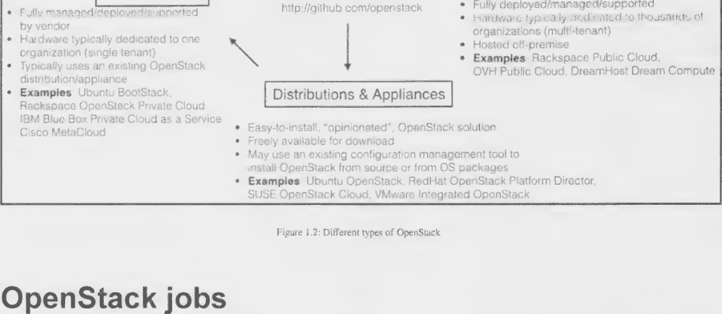
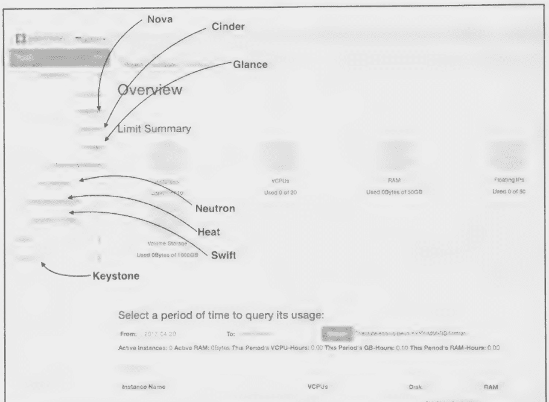
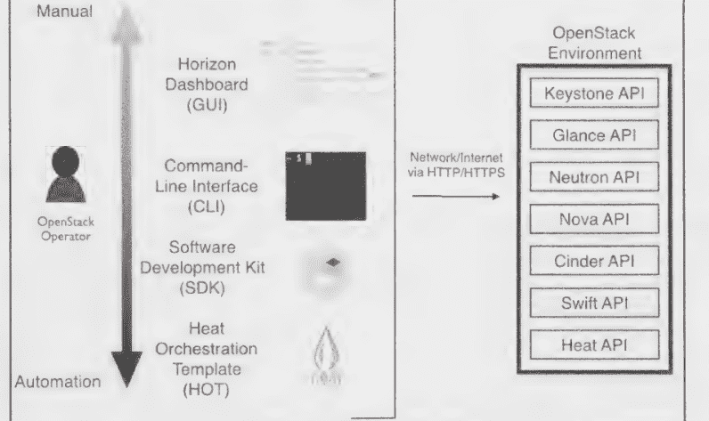
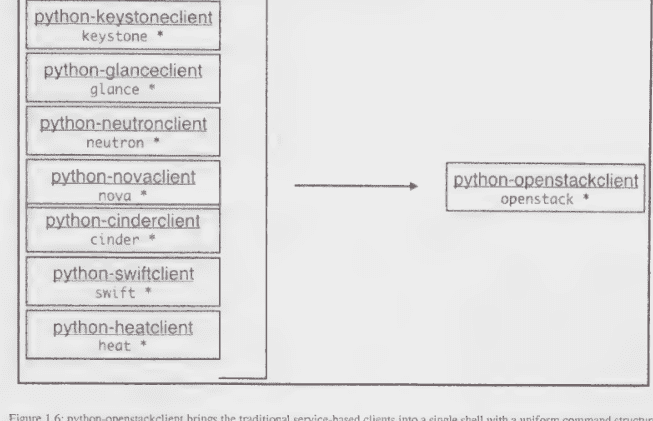
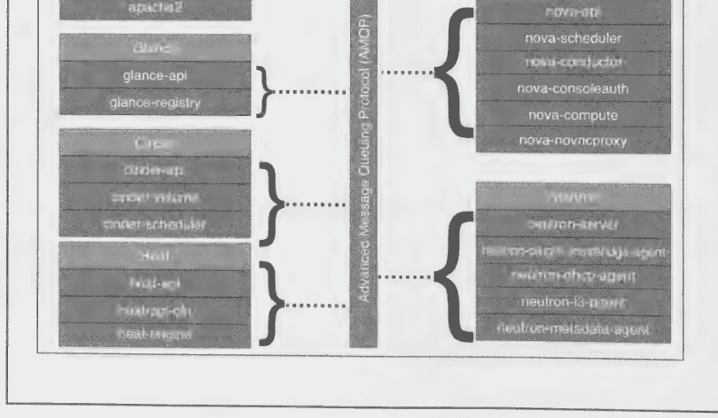
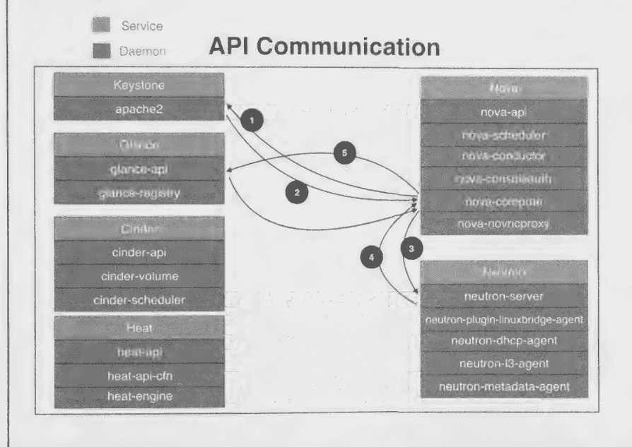
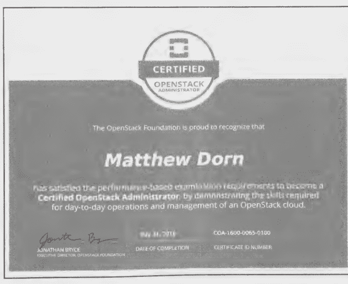
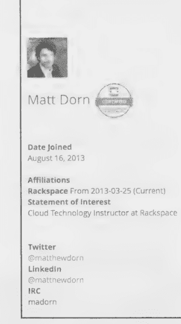
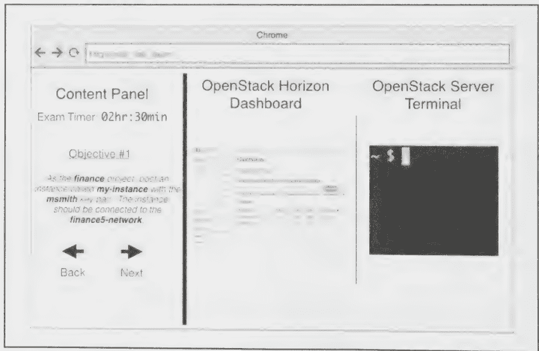

# 1 介绍 OpenStack 和认证 OpenStack 管理员考试

## 介绍 OpenStack 和认证 OpenStack 管理员考试

> 万维网

上面的片段来自一个网页。初看之下它似乎平平无奇。它不包含图形、声音、JavaScript 或 CSS。纯净的 stark 白色背景、一些简单文本和几个超链接。

该页面以单个 HTML 文件存在，托管在一台 25-MHz NeXTcube 工作站上。该机器配备 8 MB 内存和 17 英寸单色显示器。这个各边 1 英尺的金属立方体系统放在一间小办公室的地板上，五彩的 NeXT 标志固定在其金属电源按钮附近。

这台计算机并非托管在数据中心，而是在欧洲核子研究组织，即 CERN 的一间小办公室里。跨越法瑞边境，CERN 庞大的校园目前坐落着大型强子对撞机，世界上最大的粒子加速器。但在 1991 年，比对撞机大得多的东西潜伏在蒂姆·伯纳斯-李的 31 号楼办公室里。

这个网页是互联网的第一个 *你好世界*。现代通信的诞生地。而且尽管在 1991 年找到有互联网接入的人（更不用说能支持它的计算机）可能性不大，很难相信我们走到了多远。伯纳斯-李当时并不知道，人类通信的根本转变将在接下来的 25 年里迅速演变。

当今的商业环境比以往任何时候都发展更快。亚马逊、Netflix 和 Uber 等在线公司彻底改变了世界做生意的方式。为了保持竞争力，企业必须能够提供桌面和移动应用程序，直接向客户提供前沿、安全和自助服务功能。尽管我们需要熟练的软件开发者来提供这些应用程序，但在官僚主义的 IT 政策和过时软件的企业环境中保持敏捷极其困难。

OpenStack 是这种缺乏敏捷性的答案。它是一个开源云操作系统，彻底改变了计算并为开发者提供真正的力量。认证 OpenStack 管理员考试是您学习操作 OpenStack 云所需技能的机会，就像伯纳斯-李的第一个网站一样，激发变革——这种变革将促进当今最重要的应用程序的开发、部署和管理。

在本章中，我们将涵盖以下主题：

- 云的简史
- OpenStack 概述
- 认证 OpenStack 管理员考试
- 成为认证 OpenStack 管理员的七个步骤

在本章之后，您将准备好设置自己的 OpenStack 测试环境并开始处理后续章节中涵盖的目标。

## 云的简史

如今到处都能听到云计算。如果您目前从事技术领域工作，我相信您在与家人或朋友聚会时，某人最终会问您：“那么……云到底是什么？”即使对最精通技术的人来说，这也是一个难以回答的问题。“云”经常被用作流行语，描述可供许多用户从任何位置访问的计算或存储基础设施。为了提供正确的背景，让我们花点时间深入了解云的简史。如果您以前听过这个故事，请随意跳过！

## 软件开发者的困境

*应用程序。* 无论我们是在智能手机主屏幕上滑动五彩图标，还是登录笔记本电脑的操作系统，应用无处不在。事实上，这个术语被使用得如此频繁，以至于很难给 app 一个恰当的定义。

因此，与其试图定义应用是什么，我们可以肯定地定义它们的作用：解决问题。应用可以为我们最关键的业务难题提供解决方案，为组织（和个人）节省并创造资金。但更重要的是，它们经常向用户呈现未被实现的需要。想想有多少人认为智能手机上的 Twitter、Facebook 和 LinkedIn 是他们日常生活必需品。

我们通常称应用程序背后的大脑为 **软件开发者**。但 20 年前，软件开发者的生活并不那么容易。开发者会在家或办公室的桌面上敲代码，常常深夜还在完善和测试代码。当他们准备与世界分享作品时，他们需要一台具有 CPU、磁盘和内存的物理计算设备。该计算机可能需要互联网接入，以便覆盖更多人群。为了实现这一点，软件开发者通常需要依靠一群系统工程师联系硬件供应商，将这台机器运送到办公室或数据中心。

在经历了拆箱、机架安装、堆叠和布线的艰苦过程后，系统工程师还需要配置操作系统、安装必要的程序和框架，并确保软件开发者可以从其桌面连接到该机器。考虑一下当时的一些技术实践：高可用性和容错虽然被广泛讨论，但并不常见。


一旦服务器准备就绪，软件开发者就会分享他们的杰作，将其部署在提供的基础设施上。随着用户访问应用程序，一切都会很顺利……直到应用程序不再可访问。突然，软件开发者的电话会在半夜响起。系统工程师会努力修复硬件故障，从而导致应用程序宕机并面对众多愤怒的终端用户。这需要前往数据中心——而数据中心本身也需要灾难恢复计划，以防发生火灾、洪水或风暴。假如应用程序出现重大成功的高峰怎么办？如果大量用户涌向浏览器输入网址并访问网站，现有硬件上的资源可能会超载。系统工程师需要购买并安装额外的服务器、防火墙和负载均衡器，以为额外流量提供更多资源。所有这些潜在风险都可能成为所有相关人员的头痛问题——尤其是软件开发者，其关注点应保持在应用程序本身。

## 企业虚拟化的诞生

2003年11月10日：一群身着连衣裙、西装和运动夹克的 IT 高管围站在会议室里，观看屏幕上播放的《终结者2：审判日》的视频片段。“准备好了吗？”站在讲台上的一名男子说道。屏幕右下角，一个包含几个 Microsoft Windows 控制面板的小窗口显示着代表正在运行服务器的图标。

这些服务器是虚拟机，而房间里正在观看的视频片段是从其中一台虚拟机上的文件服务器播放的。突然，主持人点击了虚拟机上的几个上下文菜单，进度条出现了。视频继续播放，T-1000 高级原型从液态金属变形为人形，在一辆燃烧的警车中追赶约翰·康纳。房间里爆发出欢呼、呐喊和喝彩声——但这并不是因为终结者。这是名为 VMotion 的技术的演示，该技术将在未来几年彻底改变 IT 运维世界。

尽管虚拟化早在 1960 年代就已存在，但 VMware 绝对可以归功于在官方发布搭载 VMotion 的 VMware VirtualCenter 时将其带给大众。VMotion 允许系统工程师将现有的物理机转换为 hypervisor，从而运行虚拟机。它还通过在底层硬件出现问题时将虚拟机实时迁移到另一个 hypervisor 来保持这些虚拟机的运行。这是通过在网络上传输虚拟机的活动内存和执行状态来实现的。

软件开发者和系统工程师对这项技术都感到欣喜若狂，因为他们知道无论硬件出现什么问题，他们的应用程序都能平稳运行，而他们也能睡个好觉。软件开发者继续开发他们的精彩应用程序，但他们的开发方法论保持不变。他们仍然像在传统的物理机上一样开发应用程序！

Gartner，这家信息技术研究和顾问公司，将这种类型的环境命名为模式 1，也称为企业虚拟化。事实上，企业虚拟化至今仍然存在，并且是全球企业采用最多的云类型。参见图 1.1。

| 企业虚拟化（模式1） | 弹性云（模式2） |
|---|---|
| GUI 强调 | API 强调 |
| 昂贵硬件 | 标准硬件 |
| 垂直扩展 | 水平扩展 |
| 专有 | 开源 |
| 传统软件开发 | 云化开发 |

图 1.1：企业虚拟化（模式1）与弹性云（模式2）

以下是企业虚拟化云的一些常见特征：

- **GUI 强调**：在这个模型中，创建新的虚拟机时通常通过图形用户界面（GUI）进行。这可能是像 vSphere Web Client 或 Hyper-V Manager 之类的工具。命令行工具可能存在，但大多数操作人员使用较少。
- **昂贵硬件**：采用企业云的企业也会购买昂贵的刀片服务器、SAN、网络/结构交换机、组件冗余以及高成本的精品超微型计算机——价格昂贵的专用硬件。
- **垂直扩展**：如果你的应用程序开始获得更多流量，就需要扩展能力。在企业虚拟化世界中，这意味着为运行应用程序的虚拟机分配更多资源。当进行纵向或垂直扩展时，人们通过为单个虚拟机添加更多 CPU、RAM 或磁盘空间来实现。这与水平扩展的理念相反。
- **专有**：该模型中的基础设施代码是闭源的。这包括由 Microsoft Windows Server 驱动的 *VMware VCenter* 等软件。如果在使用软件时发现错误，必须向厂商提交。因为单一的单体组织控制着代码的访问权限，错误修复可能需要数周或数月才能修补。
- **传统软件开发**：在企业虚拟化云中，软件开发者继续以与在物理机上开发应用程序相同的方式开发应用程序。这有时被称为 *单体* 方法。尽管 Web 服务器或数据库可能位于不同的虚拟机上，但应用程序的功能仍被组合成来自单一平台的单个程序。这与下一节中解释的云化开发方法截然不同。

## Amazon —— 不仅仅是书店

2006 年 3 月，硅谷新闻博客 *TechCrunch* 的创始人 Michael Arrington 有一个令人兴奋的公告：

> *Amazon Web Services 今晚推出一项名为 S3 的新网络服务 —— 其全称为“简单存储服务”。它为开发者提供后端存储服务，提供“高度可扩展、可靠、低延迟的数据存储基础设施，成本极低……这具有改变游戏规则的意义。”*

Arrington 说得对。此时，Amazon Web Services 尚未发布我们今天所熟知的服务目录。**简单存储服务（S3）** 使用户能够创建账户，输入信用卡号码，并在几秒钟内获得向 AWS 主机基础设施上传文件的权限。所有好处中，最突出的一点是：无限存储空间。

当时，主机会提供 **虚拟专用服务器（VPS）**，允许用户租用服务器用于备份或文件存储。这些解决方案的问题在于特定服务器的空间限制，更不用说客户维护操作系统健康和安全方面的责任了。虽然 VPS 可能会向用户收取按月或按年的固定费用，但 S3 按使用量计费，就像家庭电费一样。软件开发者现在有能力避免购买额外的物理服务器和存储阵列。

2006 年，AWS 还有一个惊喜。2006 年 8 月 25 日，AWS 首席布道者 Jeff Barr 宣布推出 **弹性计算云（EC2）**：

> > “Amazon EC2 为您提供虚拟计算环境访问权限。您的应用程序运行在“虚拟 CPU”上，相当于 1.7 GHz Xeon 处理器、1.75 GB RAM、160 GB 本地磁盘和 250 Mb/秒的网络带宽。您只需支付每小时 10 美分（计入您的 Amazon Web Services 账户），并且可以根据需要获取任意数量的虚拟 CPU。”

这篇文章在 IT 运维界引起了轰动。软件开发者不仅可以通过 S3 获得无限存储空间，还可以创建任意数量的虚拟机。宿舍里的大学生现在可以访问大型企业的数据中心、带宽和计算能力。这正是他们需要的竞争优势。这真正赋予了开发者力量。他们在成功时期可以快速扩展应用程序（只需点击几下按钮），如果出现任何问题，也可以优雅地快速处理故障。

Gartner 将这种类型的云命名为模式 2，也称为 **弹性云**。参见图 1.1。

以下是弹性云的一些常见特征：

- **API 强调：** AWS S3 和 EC2 在推出时都提供了 **简单对象访问协议（SOAP）** 和 **表述性状态转移（REST）** API。API 的强大之处在于开发者能够轻松地将这些网络服务集成到其 Web 应用程序软件逻辑中。想象一个允许用户上传和分享照片的网站。创建 Web 应用程序的开发者可以在用户上传或下载照片时向 S3 发出 API 调用，从而确保所有用户上传的照片都存储在 AWS 的 S3 基础设施中。尽管 AWS 于 2015 年 12 月弃用了 SOAP API，但更优雅的 REST API 允许浏览器通过驱动网络的协议 HTTP 使用 GET、PUT、POST、HEAD 和 DELETE 方法轻松通信。
- **标准硬件：** Amazon 的副总裁兼 CTO Werner Vogels 曾说过 *一切都会随时失效*。硬件故障的不可避免性意味着冗余和高可用性将成为运行在底层硬件之上的应用程序的基础部分。如果硬件出现故障，不应成为问题，因为开发者已确保其应用程序遵循云化开发风格（参见最后一点）。
- **水平扩展：** 当需要更多计算能力时，人们很少费心调整现有实例的大小。他们反而通过创建更多虚拟机并并行工作来利用弹性云的无限特性。这也被称为水平扩展。


- **开源：** 虽然 AWS 的整体设计和基础设施被视为专有信息，但其核心服务的发布在科技初创企业世界中引发了革命。资金不多且拥有少数技术熟练人员的初创公司可以使用并部署开源工具，采用持续部署模式，并专注于向客户交付最小可行产品。

- **云端开发：** 与弹性云相比，也许最重要的区别就是云端开发。随着 AWS 在 2000 年代后期持续发布更多服务和功能，其用户开始为部署和持续集成开发新的方法。许多用户通过尽快将应用程序代码投入生产以提升客户体验，拥抱了“快速失败”的口号。这些开发者还开始拥抱一种新的云端方法论，从 *单体* 应用程序转向 *微服务*——利用消息队列避免紧密耦合的服务，并通过 Puppet 和 Chef 等工具拥抱云自动化和实例个性化。

## 亚马逊的抱怨

虽然亚马逊开始作为一种令人难以置信的部署应用程序的方式获得关注，但仍存在许多担忧：

- **安全：** 随着时间的推移，亚马逊已显著改善其安全服务，但在发布之时，亚马逊仅提供共享托管基础设施。托管您虚拟机的物理机器很可能同时服务于其他客户，包括竞争对手！对严格的安全合规要求有要求的公司认为这不可接受。

- **成本：** 毫无疑问，与自行购买、部署、管理和支持基础设施相比，亚马逊便宜得多。但随着时间的推移，所有这些 AWS 云支出怎么办？这是一个争论很多的话题。但在某些情况下，聘请公司管理您的云从长远来看可能更便宜。

- **厂商锁定：** 随着公司将越来越多的生产工作负载放在 AWS 上，这要求员工投入数小时和数天的时间学习独特的 AWS 生态系统的方方面面。这包括查阅官方 AWS 文档，以便学习如何为其 API 编程。作为负责提供所有方面的单一组织，AWS 完全可以随意更改其 API 语法，甚至提高资源使用价格。想象一下尝试将 AWS 上的工作负载迁移到另一个云提供商所涉及的麻烦。

## NASA 和 Rackspace 开源云！

2008 年，NASA 有兴趣利用 AWS EC2 进行科学计算，但对安全性存在一些担忧。因此，他们决定构建自己的开源云平台 Nebula。Nebula 是一个可扩展的计算资源配置引擎，其设计松散地基于 EC2 服务。

大约在同一时间，来自德克萨斯州圣安东尼奥的管理托管公司 Rackspace 正在开发一个名为 Swift 的开源项目。Swift（至今仍然如此）是一个类似于 AWS S3 的分布式对象存储系统，已成为 Rackspace Cloud Files 服务的一部分。

直到 2010 年 7 月，NASA 和 Rackspace 才正式宣布计划将 Nebula 和 Swift 项目积极合并，邀请世界各地的人开始为一个名为 OpenStack 的新开源云项目贡献代码。关于 OpenStack 方向的讨论立即开始，来自 25 多家公司的 100 多名架构师和开发人员前往奥斯汀参加首次 OpenStack 大会。同样迅速地，数百名开发人员、硬件制造商和 IT 软件公司开始贡献代码，受到 OpenStack 使命的启发：

> “打造无处不在的开源云计算平台，无论规模大小，都能满足公有云和私有云的需求，通过简单易用和大规模可扩展来实现。”

该使命宣言于 2010 年 5 月 24 日出现在 wiki 上，至今仍体现了 OpenStack 社区长期的目标。


OpenStack 并不是城里唯一的开源云——它与 Eucalyptus、OpenNebula 和 Apache CloudStack 展开了开源云竞争。虽然这些云在 2008 年至 2010 年间相当受欢迎，但它们无法与大量 IT 厂商（如 IBM、Ubuntu 和 Red Hat）正式宣布支持 OpenStack 的数量竞争。突然间，越来越多的人将宝贵的编码时间投入到 OpenStack，而其他云项目则逐渐被淘汰。

## 关于 OpenStack

现在我们对企业虚拟化、弹性云计算以及 OpenStack 的起源有了一些了解，让我们讨论一下 OpenStack 项目的一些细节。

## OpenStack 基金会

OpenStack 基金会于 2012 年成立，宗旨简单：保护、赋能和推广 OpenStack 软件及其周边社区。

自基金会成立以来，已举办了十五次以上的 OpenStack 峰会。OpenStack 峰会是来自世界各地的 5,000 多名软件开发人员、CIO、系统工程师和技术作家令人难以置信的聚会。基金会的会员资格免费且对任何人开放；从个人贡献者到大型企业都是会员，包括 AT&T、Red Hat、Rackspace、Ubuntu、SUSE、Google 和 IBM 等公司。

即使您尚未使用 OpenStack，也请加入 OpenStack 基金会！它快速、免费且有趣。https://www.openstack.org/join/

## 四个开放

OpenStack 基金会致力于确保 OpenStack 遵循“四个开放”：

- **开源**：OpenStack 源代码采用 Apache License Version 2.0（APL v2）许可。OpenStack 致力于创建真正可使用且可扩展的开源软件。

- **开放设计**：OpenStack 也致力于开放的设计流程。每六个月，开发社区都会举行项目团队聚会（PTG）来制定下一版本的路线图。这包括头脑风暴想法、收集需求以及为即将发布的版本编写蓝图。PTG 始终对公众开放。

- **开放开发**：OpenStack 在整个开发过程中保持其源代码公开可用（https://github.com/openstack）。一切都是开放的，包括代码审查、发布路线图和技术讨论。

- **开放社区**：所有流程都有文档记录、开放且透明。项目的技术治理是民主的，由贡献者社区选举技术负责人和技术委员会成员。项目会议在公共 IRC 频道举行，技术交流主要通过公共邮件列表进行。

## OpenStack 类型

在 OpenStack 峰会的展览区漫步对 OpenStack 新手来说可能极具挑战性。每个主要 IT 公司似乎都有某种 OpenStack 解决方案，而且通常很难分辨实际提供的是什么。解释这些各种 OpenStack 提供的最佳方式是将其分解为四种不同的类型。见图 1.2。

- **项目**：OpenStack 项目可以在 http://github.com/openstack 找到。它包含数千名开发人员全天积极提交的公开可用源代码。您可以免费下载并自行安装。

- **发行版/设备**：由于 OpenStack 包含众多组件，极其复杂，因此部署、管理和支持都很困难。为了降低复杂性，公司和社区都会创建 OpenStack 发行版或“设备”。这些是部署 OpenStack 的简便、即用型方法。它们通常通过使用流行的配置管理工具（如 Ansible、Puppet 或 Chef）提供有主见的部署方法。它们可能直接从 GitHub 上的项目源代码安装 OpenStack，或通过 Ubuntu 和 Red Hat 等流行操作系统社区开发的软件包安装。

- **托管私有云**：希望获得私有 OpenStack 云的安全性和可靠性而无需自行管理的客户应考虑托管私有云解决方案。这些解决方案通常使用现有的 OpenStack 发行版，并提供 24/7 客户支持，通过 SLA（服务等级协议）保证正常运行时间。

- **公有云**：基于 OpenStack 软件构建的公有云相当多。其中包括 Rackspace 和 OVH Public Cloud。与 Amazon Web Services、Azure 或 Google Cloud Platform 类似，OpenStack 公有云解决方案位于提供商的数据中心。提供商负责管理环境，该环境由多个客户在共享硬件上使用。




图 1.2：不同类型的 OpenStack

## OpenStack 职位

如图 1.3 所示，具备 OpenStack 技能的人才需求多年来一直在增长：


图 1.3：自 2012 年以来 OpenStack 职位发布量的增长

但精通 OpenStack 的人有哪些具体职位可供选择？让我们分解一下具备 OpenStack 技能的个人可能担任的几种不同角色。

### Application developer - developing on OpenStack
理解 OpenStack 的应用开发者使用它来创建虚拟资源，以便在 OpenStack 之上部署他们的应用程序。他们通常具有 Amazon Web Services、Azure 或 Google Cloud Platform 的背景，并将 OpenStack 视为 **基础设施即服务 (IaaS)** 平台。他们很可能是全栈开发者，精通 Web 应用的所有层。他们喜欢 OpenStack 的速度和敏捷性。它使他们能够在灵感迸发时立即部署应用程序，并快速高效地将应用程序交付给客户。

### OpenStack administrator/operator - administrating the cloud
OpenStack 管理员或运维人员是 OpenStack 认证管理员考试的目标受众。此人通常拥有数年的 Linux 系统管理员经验，并能自如地担任所有 OpenStack 相关问题的首选联系人。他们负责管理新用户、域和项目。他们还必须知道如何与 OpenStack 交互，以及如何培训他人使用环境中安装的服务创建虚拟资源。

### OpenStack engineer/infrastructure engineer - doing the DevOps thing
OpenStack 工程师可能会花费大量时间在数据中心使用 Puppet、Chef 和 Ansible 等自动化工具。当 OpenStack 需要更多容量时，OpenStack 工程师负责上架、堆叠和布线服务器，确保操作系统拥有最新的补丁，并确保所有适当的 OpenStack 组件获得正确的配置文件值、权限和设置。尽管 OpenStack 认证管理员考试不要求考生理解配置文件的具体值（或如何升级现有服务），但 OpenStack 工程师很可能对此了如指掌——经常发现自己在编写自动化脚本以减轻日常工作负担。

### OpenStack product developer - simplifying OpenStack deployment/management
OpenStack 产品开发者从事 OpenStack 发行版或设备的开发工作。他们了解构建云的难度；因此，他们创建有主见的发行版以简化 OpenStack 的部署和管理流程。示例包括 Red Hat OpenStack Platform Director、SUSE OpenStack Cloud 和 Rackspace Private Cloud。这些公司除了产品外，还可能提供专业服务或支持。

### Upstream OpenStack developer - making OpenStack better!
渴望为实际 OpenStack 项目做出贡献的人被称为 OpenStack 上游开发者。这些开发者为 OpenStack 开发——构建蓝图、在 IRC 上与其他 OpenStack 开发者聊天、参加 PTG 会议并贡献代码——他们致力于让 OpenStack 成为无处不在的云操作系统。上游开发者对 OpenStack 路线图产生影响，并且是加强企业采用的健康社区的一部分。

## OpenStack 服务概述
OpenStack 由多种服务组成，这些服务均用 Python 编程语言编写，并提供特定功能。OpenStack 的模块化特性促进了现代云应用设计理念，也允许轻松扩展；任何个人、社区或公司都可以开发一个 OpenStack 服务，使其能够轻松集成到其生态系统中。

OpenStack 基金会已成功确定了九项关键服务，它们被视为 OpenStack 核心的一部分，我们将对其进行详细探讨。

### Keystone - identity service
Keystone 处理身份验证。它充当 OpenStack 环境中所有核心服务的通用身份验证系统。人类用户和服务都必须先向 Keystone 进行身份验证以获取令牌，然后才能与环境中的其他服务交互。

想象一下使用用户名和密码登录网站的过程。当用户在 Horizon 控制面板上执行此操作时，他们会针对 Keystone 进行身份验证以成功登录并开始创建虚拟资源。Keystone 还存储服务目录、用户、域、项目、组、角色和配额——这些是考试目标概念，你将在第 3 章《Keystone Identity Service》中进行研究。

### Glance - image service
Glance 为磁盘镜像提供发现、注册和交付服务。

启动虚拟机（也称为实例）时，通常需要提供磁盘镜像。这些通常包含操作系统（如 Ubuntu 或 Red Hat Enterprise Linux），最好描述为磁盘内容的快照。磁盘镜像类型的示例包括 QCOW2、VMDK、VHDX、ISO 和 RAW。磁盘镜像通常由某人或脚本预先创建，该脚本已完成初始安装程序并安装了特定的配置文件以确保其具备云感知能力。Glance 可以将镜像存储在多种数据存储中，包括本地文件系统或 OpenStack Swift。

### Nova - compute service
受 Amazon EC2 启发，Nova 是计算服务，也是 OpenStack 云的核心。它旨在管理和自动化计算资源池，并且可以与广泛可用的虚拟化技术以及裸金属服务器一起工作。

需要注意的是，Nova 不是 hypervisor。它是一套位于 hypervisor 之上的服务系统，负责协调计算资源的可用性。hypervisor 的一些示例包括 Hyper-V、VMware ESXi、Xen 以及最流行的 KVM（基于内核的虚拟机）。Nova 还支持使用 LXC 和 Docker 等 Linux 容器技术的能力。

在 OpenStack 中，术语 booting 用于指代虚拟机的创建。用 Nova 启动的虚拟机通常称为实例。

### Neutron - networking service
Neutron 是一项服务，允许用户管理虚拟网络资源和 IP 地址。

如果要启动实例，通常需要提供一个虚拟网络来启动该实例，以便其具有网络连接。使用 Neutron，用户可以通过 Horizon 控制面板、CLI 或 API 查看自己的网络、子网、防火墙规则和路由器。创建和管理网络资源的能力取决于分配给用户的特定角色。

Neutron 还包含一个模块化框架，由多种插件、代理和驱动程序提供支持，包括 Linux bridge 和 Open vSwitch。

### Cinder - block storage service
受 Amazon 的 Elastic Block Storage (EBS) 服务启发，Cinder 允许用户创建可由 Nova 实例挂载为设备的卷。

Cinder 卷的行为就像原始未格式化的硬盘驱动器。一旦数据写入这些卷，即使终止实例或实例出现故障，数据也会保留。这是因为写入的数据存储在专用的 Cinder 存储服务器上，而不是实例所在的计算节点。Cinder 还支持快照，可捕获卷的当前状态。这些对于提供备份保护很有用，并且还可用于实例化包含快照中确切数据的新的卷。您还可以将镜像写入块存储设备，以便计算用作可启动的持久实例。

### Swift - object storage service
受 Amazon S3 启发，Swift 是一种冗余存储系统，为开发人员和 IT 团队提供安全、耐用且高度可扩展的云存储。用户创建容器并在其中存储静态文件，也称为对象。这些对象可以是图片或电影，也可以是电子表格和 HTML 文件。从最终用户角度来看，存储是无限的、廉价的，并且可通过 REST API 访问。功能也可以通过 Swift API 开启。其中包括托管静态网站、版本控制、设置特定对象过期，甚至设置访问控制列表 (ACL)，允许公开访问容器内的对象。


在 Swift 的后端，静态文件（也称为对象）被写入分布在数据中心各服务器上的多个磁盘驱动器。Swift 软件负责确保集群中数据的复制和完整性。如果服务器或硬盘驱动器发生故障，Swift 会从其他活动节点复制其内容到集群中的新位置。

## Heat - 编排服务

受 Amazon CloudFormation 服务启发，Heat 帮助操作员建模和设置 OpenStack 资源，使他们可以将更少的时间花在管理这些资源上，而将更多时间集中在运行在 OpenStack 上的应用程序上。

你从一个蓝图或 Heat 编排模板（HOT）开始，该模板描述了所有要配置的 OpenStack 资源。然后 Heat 负责配置和配置，无需担心依赖关系或执行顺序——模板描述了所有资源及其参数。堆栈创建完成后，你的资源即可运行。

模板非常方便，因为它们允许操作员将其提交到版本控制系统，以便轻松跟踪基础设施的更改。如果部署 Heat 模板后出现问题，你只需恢复到模板的先前版本即可。如果想要更改堆栈，可以通过提供带有新参数的修改后模板轻松更新它。

## OpenStack 服务实战

让我们从 Horizon 仪表板主页的角度，对这些 OpenStack 服务在实际环境中的情况进行高层次的了解。参见图 1.4。



图 1.4：Horizon 仪表板上的 OpenStack 服务

从顶部开始：

-   **实例**：**Nova** 实例部分是你可以管理虚拟机的地方。你可以启动、停止、暂停、锁定和挂起实例——以及创建快照、查看控制台日志，并通过交互式控制台登录到实例。有关本节的更多信息，请参阅第 5 章，Nova 计算服务。
-   **卷**：在此部分，你可以创建 **Cinder** 块卷、快照和备份。你还可以将卷附加到实例。有关本节的更多信息，请参阅 *第 7 章，Cinder 块存储服务*。
-   **镜像**：**Glance** 镜像部分是你可以看到当前可用镜像的地方，也可以上传镜像并编辑与镜像关联的元数据。有关本节的更多信息，请参阅 *第 4 章，Glance 镜像服务*。
-   **访问和安全**：本节混合了几个服务，包含四个主要部分：Neutron 安全组、Nova 密钥对、服务目录公共端点列表，以及下载预填充凭据文件的位置，用于使用命令行界面与当前登录用户交互 OpenStack。有关本节的更多信息，请参阅 *第 3 章，Keystone 标识服务，第 5 章，Nova 计算服务，和第 6 章，Neutron 网络服务*。
-   **网络**：在此部分，你可以通过创建租户网络、租户子网、路由器和浮动 IP 来使用 Neutron。有关本节的更多信息，请参阅 *第 6 章，Neutron 网络服务*。
-   **编排**：在此，你可以通过上传 Heat 编排模板或将其粘贴到仪表板中来创建 Heat 堆栈。你也可以在此区域列出和更新现有堆栈。有关本节的更多信息，请参阅 *第 9 章，Heat—编排服务*。
-   **对象存储**：创建 Swift 容器并上传静态对象，如照片、电影和 HTML 文件。有关本节的更多信息，请参阅 *第 8 章，Swift—对象存储服务*。
-   **管理**：此管理面板仅在登录用户具有管理员角色时出现。它提供对环境中所有域和项目中的所有虚拟资源的仅管理员视图。
-   **标识**：Keystone 域、项目、用户、角色和配额在此列出。如果拥有管理员角色，可以在此执行多种操作，包括创建新项目、向这些项目添加新用户、分配角色和修改配额。有关本节的更多信息，请参阅 *第 3 章，Keystone 标识服务*。

## 与 OpenStack 交互

OpenStack 的强大之处在于每个核心服务的 REST API。这些 API 可以公开暴露，因此可以从世界任何具有公共互联网访问的地方访问：智能手机、咖啡店 WiFi 网络上的笔记本电脑或远程办公室。

有多种方式可以从任何地方与 OpenStack 交互以创建虚拟资源。随着我们逐步了解这些各种方法，自动化程度会增加，使软件开发人员能够轻松创建虚拟资源并在这些资源之上部署应用程序，同时将用户交互降至最低。参见图 1.5。

-   **Horizon 仪表板（GUI）**：如果你是 OpenStack 新手，这是开始旅程的最佳位置。你只需通过 Web 浏览器导航到 Horizon URL，输入用户名和密码，验证已限定到正确的项目，然后继续——只需点击按钮即可创建实例、网络和卷。参见图 1.4，了解首次登录时服务的位置。由于并非所有 OpenStack 服务功能都可通过 Horizon 仪表板使用，你还需要通过命令行界面与 OpenStack 服务交互以利用额外功能。


大多数考试目标都可以通过 Horizon 仪表板完成。每章将分解通过命令行界面和 Horizon 仪表板（如果可用）完成目标的方法。

-   **命令行界面（CLI）**：OpenStack 命令行界面将解锁大多数 OpenStack 服务功能，并且可以轻松安装在 Windows、Mac 和 Linux 系统上。对于具有 Bash shell 经验的 Linux 专家来说，CLI 是首选工具。
-   **软件开发工具包（SDK）**：尽管 bash shell 和 OpenStack CLI 组合非常强大，但 SDK 提供了更强的表达能力。一个示例场景：开发人员在其热门应用程序托管在 OpenStack 虚拟基础设施上，以便在满足特定阈值时自动配置额外资源。或者，想象一个 Android 应用程序，允许组织的员工只需点击几下按钮即可创建 OpenStack 资源。简单来说，OpenStack SDK 允许你以自己喜欢的语言舒适地以编程方式与 OpenStack 服务交互。OpenStack SDK 目前可在以下语言中使用：C、C++、Closure、Erlang、Go、Java、JavaScript、.NET、Node.js、Perl、PHP、Python 和 Ruby。
-   **Heat 编排模板（HOT）：**你可以部署 Heat 模板（类似于 Amazon Web Service CloudFormation 蓝图），这些模板利用 OpenStack 服务 API——只需点击按钮即可创建 OpenStack 资源。用户通过在模板中描述 OpenStack 资源来定义其应用程序。Heat 模板为云用户提供最大程度的自动化，在无需手动创建单个资源或依赖关系的情况下部署整个应用程序。甚至可以将这些模板提交到 Git 等版本控制系统中，以便轻松跟踪基础设施的更改。



图 1.5：可以用来与 OpenStack 环境交互的各种方法

## OpenStack 客户端

尽管大多数 COA 考试都可以通过 Horizon 仪表板完成，但如果你想通过考试，了解如何使用 OpenStack CLI 至关重要！虽然对于经验不足的人来说它可能看起来有点令人不安，但随着时间的推移，你会发现 CLI 将揭示 OpenStack 的真正乐趣。

## 基于服务的客户端 - 传统客户端

每个核心 OpenStack 服务都有一个关联的命令行客户端。与 OpenStack 服务一样，命令行客户端是用 Python 编程语言编写的（可在 http://github.com/openstack 获取）。客户端还包含服务 API 绑定，用于开发可以直接与特定服务通信的 Python 代码，而无需冗长的 API 请求。多年来，OpenStack 管理员使用最广泛的客户端如下：

-   `python-keystoneclient`
-   `python-glanceclient`
-   `python-neutronclient`
-   `python-novaclient`
-   `python-cinderclient`
-   `python-swiftclient`
-   `python-heatclient`

## Python-openstackclient - 统一客户端

由于记住每个单独客户端的命令相当令人沮丧，OpenStack 社区在 2013 年创建了一个名为 OSC（OpenStack Client）的新 OpenStack 客户端。实际程序名为 python-openstackclient，可在 http://github.com/openstack/python-openstackclient 获取。

参见图 1.6。python-openstackclient 是 OpenStack 的 CLI 客户端，它将所有传统的基于服务的客户端集成到具有统一命令结构的单个 shell 中。它的所有命令都有一致且可预测的格式，格式如下：

```
openstack [<global-options>] <object-1> <action> [<object-2>] [<command-arguments>]
```

例如，如果你想创建一个全新的 Nova 虚拟机实例，只需运行：

```
$ openstack server create demo-instance1 --flavor m1.tiny --image cirros
MyFirstInstance
```




图 1.6：python-openstackclient 将传统的基于服务的客户端整合到一个具有统一命令结构的 shell 中

你也可以通过运行以下命令查看帮助命令：

```
$ openstack help
```


OpenStack 客户端将在后续章节中更详细地讨论。截至 2017 年 9 月，COA 考试基于 OpenStack 的 Newton 版本。考试将提供对 python-openstackclient 和所有基于服务的客户端的访问。大多数考试目标都可以使用 python-openstackclient 完成，除非本书另有说明。

## OpenStack 守护进程通信

现在我们已经讨论了 OpenStack 操作员通过 API 与 OpenStack 交互的各种方式，让我们讨论核心 OpenStack 服务之间的内部通信。在图 1.7 中，你可以看到左上角的颜色代码，它显示了服务和守护进程。服务只是 OpenStack 服务的名称，而守护进程代表实际运行以使服务生效的程序。

为避免紧密耦合，特定服务内守护进程之间的通信通过高级消息队列协议（AMQP）实现。在典型的 OpenStack 环境中，这可以是 RabbitMQ 或 Qpid 等软件。

回顾我们在本章历史部分讨论的云化开发方法。虽然 OpenStack 鼓励其软件开发人员在部署应用程序时遵循这种方法，但实际的 OpenStack 基础设施遵循完全相同的原则：高可用、可扩展且松耦合。

例如，当用户向 `nova-api` 发送启动服务器的请求时，`nova-api` 会将此消息发布到 AMQP 总线上。然后 `nova-scheduler` 会读取此消息。现在让我们设想一个经常收到数百个启动实例请求的 OpenStack 云。为了解决这个问题，你将在基础设施中部署更多服务器，安装更多 `nova-scheduler` 守护进程，并简单地将它们指向 OpenStack 环境的 AMQP 服务器。这就是水平扩展的实际应用！



图 1.7：特定服务内的 OpenStack 守护进程使用 AMQP 总线相互通信

## OpenStack API 通信

虽然 OpenStack 服务守护进程依赖 AMQP 在其特定服务内的守护进程之间进行通信，但 API 既被希望创建虚拟资源的 OpenStack 用户使用，也用于服务到服务的通信。



图 1.8：OpenStack 服务之间 API 通信的示例

设想用户向 nova-api 发送启动实例的请求。为了启动该服务器，需要进行相当多的内部 API 调用。让我们看一下启动虚拟机实例时将发生的 API 调用示例序列。

OpenStack 用户首先会向 `nova-api` 守护进程发送 POST API 调用，其中包含有关他们想要的虚拟机类型的详细信息。该消息将被放入 AMQP 消息总线并由 `nova-scheduler` 守护进程消费。`nova-scheduler` 守护进程然后将使用其调度算法为虚拟机选择最佳匹配。驻留在计算节点上的 `nova-compute` 守护进程会消费此消息。在服务器可以启动之前，必须发生以下情况（参见图 1.8）：

- (1)：`nova-compute` 守护进程向 Keystone 发送 API 请求以检索作用域令牌。
- (2)：`nova-compute` 收到 200 HTTP 响应以及作用域令牌。现在 `nova-compute` 拥有作用域令牌，可以自由地与其他 OpenStack 服务通信。
- (3)：`nova-compute` 现在向 `neutron-server` 发送请求，以验证用于启动实例的指定虚拟网络是否可用。
- (4)：`nova-compute` 收到网络可用且能够附加到实例的响应。
- (5)：`nova-compute` 然后必须向 `glance-api` 发送 API 调用以检索操作系统镜像。
- (6)：`glance-api` 返回将驻留在计算节点上的镜像。

现在我们的实例将被启动！这工作量很大！


别担心！你不需要理解 OpenStack 背后发生的所有魔术就能在考试中取得成功。这仅用于教育目的！

## 关于 Certified OpenStack Administrator 考试

现在你已经了解了一些关于 OpenStack 的知识，让我们来谈谈你真正在这里的原因：

通过 Certified OpenStack Administrator 考试！

## 通过考试的好处

问任何人关于如何在 IT 世界起步，他们可能会建议了解行业认可的技术认证。IT 认证衡量多个领域的胜任能力，是开启机会大门的绝佳方式。虽然它们绝对不应是招聘过程中的唯一决定因素，但获得它们可以衡量你的能力以及面对挑战的决心。

## 如果你通过...

一旦取得及格成绩，你将收到你的证书（参见图 1.9）。将其覆膜、装框或别在家庭办公室墙上或工作隔间——这是你已满足成为正式 OpenStack 管理员所有要求的证明。认证自通过之日起有效期为三年，因此不要忘记续期。



图 1.9：通过 Certified OpenStack Administrator 考试时收到的证书

除了认证之外，COA 徽章将出现在你的名字旁边，位于官方 OpenStack 社区目录中，可在 https://www.openstack.org/community/members/ 获取。



图 1.10：通过考试后，你还将在 OpenStack 基金会成员目录中在你的名字旁边获得官方 COA 徽章


OpenStack 基金会提供了一个很好的工具来帮助雇主验证 COA 认证的有效性。查看 Certified OpenStack Administrator 验证工具（https://www.openstack.org/coa/coa-verify/）。

## 成为 Certified OpenStack Administrator 的七个步骤

让我们开始逐步了解成为 Certified OpenStack 管理员的一些步骤。

## 第 1 步 - 学习！

练习。练习。练习。在你开始 Certified OpenStack Administrator 之旅时，使用本书和包含的 OpenStack 一体化虚拟设备作为资源。如果你仍然发现自己难以掌握本书中的概念和目标，你始终可以参考官方 OpenStack 文档——甚至可以参加 https://www.openstack.org/marketplace/training/ 的现场培训课程。

## 第 2 步 - 购买

一旦你觉得自己准备好征服考试，请前往 https://www.openstack.org/coa/ 并点击 Get Started。登录后，你将被引导至结账页面购买考试。OpenStack 基金会接受所有主要信用卡，截至 2017 年 9 月费用为 300.00 美元（可能变动，请留意网站）。如果你第一次未通过，也可以在原考试购买日期起 12 个月内免费重考一次。


为了鼓励学术界的学生接触 OpenStack 技术，OpenStack 基金会为持有有效学生证的学生提供考试优惠，价格为 150.00 美元（零售价的 50% 折扣）。请访问 https://www.openstack.org/coa/student/ 了解更多信息。

## 第 3 步 - COA 门户页面

一旦你的订单处理完毕，你将收到一封电子邮件，其中包含访问 COA 门户的权限。将门户视为你的个人 COA 网站，你可以在此下载考试收据并跟踪你的认证进展。考试后，你可以返回 COA 门户检查考试状态和分数，甚至可以下载证书和徽章用于你的网站或名片。

## 第 4 步 - 硬件兼容性检查

COA 考试可以在你的个人笔记本电脑或台式机上进行，但你必须确保你的系统满足考试的最低系统要求。COA 门户页面上的链接将为你提供兼容性检查工具，该工具将运行一系列测试以确保你满足要求。它还将帮助你下载用于参加考试的 Chrome 插件。目前，你必须使用 Chrome 或 Chromium 浏览器，并拥有可靠的互联网、网络摄像头和麦克风。


图 1.11 显示了当前最低要求列表。

| 组件 | 最低要求 |
|---|---|
| 操作系统 | - Windows XP, Vista, 7, 8<br>- Mac OS X 及以上<br>- Linux<br>- Chrome OS |
| 浏览器 | Google Chrome 或 Chromium 版本 32 及以上 |
| 浏览器设置 | 您的浏览器必须在考试期间仅接受第三方 Cookie。 |
| 摄像头/麦克风 | - 最低 VGA 640 x 480 分辨率<br>- 已启用内置或外接麦克风 |
| Google Chrome 扩展程序 | 安装 Innovative Exams Google Chrome 扩展程序 |
| 端口 | TCP：端口 80 和 443 |
| 带宽 | 最低 500kb/s 下载和 256kb/s 上传 |
| 硬件要求 | - 1GB RAM 和 2GHz 双核处理器<br>- 最低 1280 x 800 分辨率 |
| 测试环境 | - 房间必须安静、私密且光线充足。不允许在咖啡店、商店等公共场所进行。<br>- 桌面必须清除所有笔记和电子设备。<br>- 考生应位于摄像头画面的中央<br>- 考生背后不得有强光或窗户 |

图 1.11：COA 考试的最低要求列表

## 第 5 步 - 身份识别

您必须年满 18 岁并持有有效身份证明才能参加考试。以下任何一种身份证明均可接受：

- 护照
- 政府签发的驾驶执照或许可证
- 国家身份证
- 州或省签发的身份证

## 第 6 步 - 安排考试

我建议您提前几个月安排考试，以给自己一个现实的目标。在 COA 门户上点击 **Schedule Exam** 链接，即可被引导并自动登录到考试监考合作伙伴网站。登录网站后，在搜索框中输入 `OpenStack Foundation` 并选择 **COA exam**。然后您可以从可用日期和时间中选择。您可安排的最晚考试日期为当前日期起 30 天后。安排后，您可以在考试开始前最多 24 小时取消或重新安排。

## 第 7 步 - 参加考试！

时刻已到！您已使用本书并日夜练习以掌握所有涵盖的目标。是时候参加考试了！

决定考试成败的最重要因素之一是地点。您不能在拥挤的地方。这意味着不能在咖啡店、工作桌或足球比赛等地方。考试地点政策非常严格，因此请考虑在家或办公室的私人房间参加考试。

在预定考试时间前 15 分钟登录 COA 门户。您现在应该会看到 **Take Exam** 链接，该链接将连接到考试监考合作伙伴网站，以便您连接到测试环境。

进入考试环境后，会出现考试监考聊天窗口并协助您开始考试。您必须允许共享整个操作系统屏幕（包括所有应用程序）、摄像头和麦克风。开始后，您有两个半小时完成所有考试目标。您即将成为一名认证 OpenStack 管理员！

## 关于考试环境

考试要求考生熟练通过 Horizon 仪表板和命令行界面与 OpenStack 交互。图 1.12 是考试控制台的视觉表示，如 https://www.openstack.org/assets/coa/COA-Candidate-Handbook-V1.4.14.pdf 中所述：



图 1.12：COA 考试控制台的视觉表示

考试控制台嵌入在浏览器中。它由两个主要部分组成：

- **内容面板**
- **仪表板/终端面板**

内容面板是显示考试计时器和目标的部分。根据 COA 手册，考试目标只能线性导航。您可以使用下一个和上一个按钮在每个目标之间移动。

仪表板/终端面板可让您完全访问 OpenStack 环境。第 2 章《设置您的练习考试环境》将帮助您搭建练习 OpenStack 环境，以便您完成所有目标。

考试控制台终端嵌入在浏览器中，您无法从本地系统 SCP（安全复制）到它。在终端环境中，如果您认为这些会有帮助，您可以安装 screen、tmux 或 byobu 等多路复用器，但它们对于成功完成目标并非必要。

考试期间不允许浏览网站、电子邮件或笔记，但您可以自由访问 https://docs.openstack.org/。然而，这可能会浪费大量考试时间；在本书中完成考试目标后，这应该是不必要的。您还可以轻松地从目标窗口复制并粘贴到 Horizon 仪表板或终端中。

如果您对某个问题感到困难，请继续！点击下一个按钮并尝试下一个目标。您总可以在时间结束前回来处理它。

考试将在 24 小时内自动评分，您应在考试完成后 72 小时内通过电子邮件收到结果。届时，结果将在 COA 门户上提供。请务必在 OpenStack Foundation 认证手册上查看专业行为准则。

## 考试目标

现在让我们看看您在考试中需要负责执行的目标。截至 2017 年 6 月，这些是官方 COA 网站上发布的所有考试目标。这些目标将测试您在所列领域的能力和熟练程度。这些领域涵盖多个核心 OpenStack 服务以及通用 OpenStack 故障排除。合在一起，它们占考试的 100%。


由于官方 COA 要求列表中的许多目标重叠，本书采用了一种定制的便捷策略，以确保您可以在所有内容领域内完成所有目标。

### 了解 OpenStack（3%）- 第 1 章

- 了解构成云的组件
- 使用 OpenStack API/CLI

### Keystone：身份管理（12%）- 第 3 章

- 管理 Keystone 目录服务和端点
- 管理/创建域、组、项目、用户和角色
- 为环境创建角色
- 管理身份服务
- 验证身份服务的运行

### Glance：镜像管理（10%）- 第 4 章

- 向 OpenStack 实例部署新镜像
- 管理镜像类型和后端
- 管理镜像（例如：添加、更新或删除）
- 验证镜像服务的运行

### Nova：计算（15%）- 第 5 章

- 管理 flavor
- 管理计算实例操作（如启动、关闭或终止）
- 管理 Nova 用户密钥对
- 启动新实例
- 关闭实例
- 终止实例
- 为实例配置浮动 IP 地址
- 管理项目安全组规则
- 为实例分配安全组
- 为实例分配浮动 IP 地址
- 从实例分离浮动 IP 地址
- 管理 Nova 主机控制台（rdp、spice、tty）
- 使用密钥对访问实例
- 管理实例快照
- 管理 Nova 计算服务器
- 管理配额
- 获取 Nova 统计信息（主机、服务和租户）
- 验证计算服务的运行

### Neutron：网络（16%）- 第 6 章

- 管理网络资源（如路由器和子网）
- 创建外部网络
- 创建项目网络
- 创建项目路由器
- 管理虚拟环境的网络服务
- 管理项目安全组规则
- 管理配额
- 验证网络服务的运行
- 管理计算实例上的网络接口
- 排查租户网络的网络问题（进入命名空间、运行 tcpdump 等）

### Cinder：块存储（10%）- 第 7 章

- 管理卷
- 为块存储创建卷组
- 创建新的块存储卷并将其挂载到 Nova 实例
- 管理配额
- 管理卷配额
- 管理卷备份


- 备份和恢复卷
- 管理卷快照（如创建、列出和恢复）
- 验证块存储能否执行快照功能
- 快照卷
- 管理卷加密
- 设置存储池
- 监控块存储设备的预留容量
- 分析报告的卷大小差异

## Swift：对象存储（10%）- 第 8 章
- 管理对对象存储的访问
- 管理过期对象
- 管理存储策略
- 监控对象存储可用空间
- 验证对象存储的操作
- 管理对象存储中容器的权限

## Heat：编排（8%）- 第 9 章
- 使用 Heat/Orchestration 模板启动堆栈（例如，存储、网络和计算）
- 使用 Heat/Orchestration CLI 和仪表板
- 验证 Heat/Orchestration 堆栈是否正常工作
- 验证 Heat/Orchestration 的操作
- 创建与特定场景匹配的 Heat/Orchestration 模板
- 更新堆栈
- 获取有关堆栈的详细信息

## Horizon：仪表板（3%）- 第 3 章至第 9 章
- 验证仪表板的操作

## 故障排除（13%）- 第 10 章
- 分析日志文件
- 备份 OpenStack 实例使用的数据库
- 集中并分析日志（如 /var/log/COMPONENT_NAME、数据库服务器、消息服务器、Web 服务器和 syslog）
- 分析数据库服务器
- 分析主机/客户机操作系统和实例状态
- 分析消息服务器
- 分析元数据服务器
- 分析网络状态（物理和虚拟）
- 分析存储状态（本地、块和对象）
- 管理 OpenStack 服务
- 诊断服务事件
- 梳理 OpenStack 环境（Controller、Compute、Storage 和 Network 节点）
- 通过集中式日志系统直接记录文件
- 备份和恢复 OpenStack 实例
- 排除网络性能故障

## 摘要

OpenStack 是一个开源云软件，提供基础设施即服务环境，使用户能够通过创建虚拟服务器、网络和块存储卷等虚拟资源快速部署应用程序。IT 行业对具备 OpenStack 技能人员的需求持续增长，而证明你拥有这些技能的最佳方式之一就是参加 Certified OpenStack Administrator 考试。

在下一章中，我们将导入基于 OpenStack Newton 版本的 All-in-One 虚拟设备。该设备是一个不可思议的学习辅助工具，使我们能够随时随地与 OpenStack 交互，同时完成本书中解释的所有考试目标。准备好成为一名正式的 Certified OpenStack Administrator 吧！
