# 3 Keystone 标识服务

## Keystone 标识服务

让我们通过讨论 Keystone、OpenStack 标识服务，来开始准备 Certified OpenStack Administrator 考试目标。理解 Keystone 是通过 COA 考试的主要构建块之一。

在本章中，我们将涵盖以下主题：

- 身份验证和授权？
- Keystone 架构
- Keystone 概念
- 身份验证实践
- Horizon 仪表板和 CLI 上的项目范围
- 考试目标 - 管理配额
- 考试目标 - 管理用户、角色、组、项目和域
- 考试目标 - 管理服务目录 - 服务和端点

完成本章后，您应该对 Keystone 有扎实的理解，并具备成功完成考试中所有与 Keystone 相关的目标所需的技能。

## 关于 Keystone

所有用户和服务都依赖 Keystone。没有 Keystone，用户将无法正确进行身份验证并创建虚拟机、网络和其他资源。OpenStack 服务将无法正确进行身份验证以成功履行用户请求，或向其他 OpenStack 服务发出请求。

## 身份验证或授权？

在开始深入 Keystone 的细节之前，让我们花点时间思考 **身份验证** 和 **授权** 的概念。这两个词有时会被误用，因此让我们提供一个正确的定义。

**身份验证** 是确认特定用户身份的行为——换句话说，证明用户就是其声称的那个人。

**授权** 是确定该特定用户的访问权限的功能。

Keystone 有多种功能，但首先也是最重要的是，它提供 **身份验证**。所有 OpenStack 用户都必须通过 **Horizon 仪表板**、**命令行界面 (CLI)**、SDK 或直接通过 **API** 对 Keystone 进行身份验证。

一旦用户通过身份验证，Keystone 就不再参与确定用户的访问权限。访问权限包括诸如用户是否可以创建 Neutron 虚拟路由器或创建可公开访问的 Glance 镜像等事项。此 **授权** 由名为 `policy.json` 的文件处理，该文件位于每个已安装 OpenStack 服务的配置目录中。考试不要求您了解如何通过此文件修改授权，但在继续之前理解身份验证和授权之间的区别是基础。

## Keystone 架构

让我们简要了解一下 Keystone 架构。Keystone 是整个云的通用身份验证系统，接收的请求比任何其他 OpenStack 服务都多。自 OpenStack Liberty 版本以来，Keystone 开发团队改用 Apache 作为 Keystone 的 API 前端。见图 3.1。Apache 守护进程绑定到端口 5000，是通往 Keystone 的主要网关。所有用户和服务都依赖 Keystone 进行身份验证。OpenStack 环境的关系数据库管理系统（通常是 MariaDB，MySQL 的分支）包含一个 Keystone 数据库，用于存储所有各种 Keystone 资源的数据。

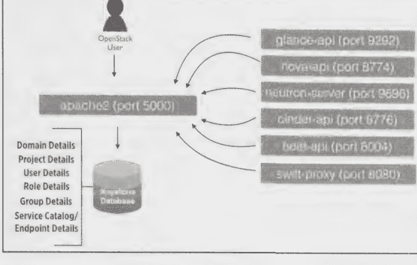

图 3.1：Keystone 是中央 OpenStack 身份验证服务，并使用 Apache Web 服务器作为其前端 Web 服务器。所有用户和 OpenStack 服务都必须对 Keystone 进行身份验证

## Keystone 概念

让我们看一些常见的 Keystone 术语。如果您对这些概念的介绍感到有点困惑，不用担心。随着我们完成特定的考试目标并在实验室环境中执行任务，我们将更详细地介绍它们。

- **域：** 域是用于用户、组和项目的高级逻辑容器。考虑一家新 IT 公司想要创建一个 OpenStack 公有云。如果这家公司真的想在 IT 世界产生影响，他们需要托管和支持多个客户为自己的 OpenStack 账户注册。该公司很可能会将每个新客户放在自己的域中。与 Amazon Web Services 或 Google Cloud Platform 等流行的公有云类似，每个客户都会创建与同一环境中其他客户隔离的资源。客户不仅能够创建自己的虚拟资源，例如虚拟机或网络，还能在该域内创建自己的用户、项目和组。

OpenStack 中的几乎每个资源或对象都会获得一个 **通用唯一标识符 (UUID)**。尽管我们可以为这些资源分配人类可读的名称，但 UUID 用于在日志、数据库和 OpenStack 基础设施的其他区域中唯一标识资源和对象。

- **项目：** 项目代表资源被创建的区域。考虑我们之前提到的运行 OpenStack 公有云的公司。他们为每个客户设置自己的域，并在该域内允许客户创建多个 **项目**。见图 3.2。这些项目很可能代表各种业务单元，以便他们可以轻松隔离资源。存在于其他项目中的用户将无法看到您项目中创建的资源，除非明确共享。会计、财务或人力资源是现实世界 OpenStack 项目中可能的项目的例子。用户当然可以属于一个或多个项目，但他们一次只能对一个项目进行身份验证。自己对单个项目进行身份验证的概念称为 **scope**。经过身份验证的用户创建的任何资源始终归用户当前作用域的项目所有。有一些例外，但我们将在本书后面讨论它们。

如果您听到 OpenStack 世界中的人使用 **tenant** 这个词，不要感到困惑。在 OpenStack 的早期版本中，“tenant”用于描述我们现在所知的项目。您甚至可能会听到有人将项目称为账户！**项目、租户和账户** 在 OpenStack 世界中含义相同。

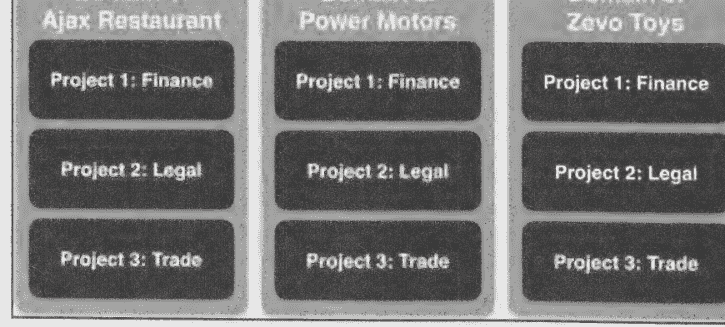

图 3.2：域是用于用户、组和项目的高级逻辑容器。项目存在于域内，并代表虚拟资源被创建的区域


-   **用户：** 用户是为组织中的个人创建的账户。用户通常驻留在 Keystone 数据库中，但也可能存在于 Active Directory 或 LDAP 服务器中。每个域可以包含任意数量的用户；由于每个资源都被分配了一个 UUID，存在于不同域中的两个用户账户可以具有完全相同的名称。需要记住的另一点是，你总会在 Keystone 内部看到并非人类用户的用户账户！还记得我们看到 Keystone 为整个 OpenStack 云提供了一个通用的身份验证系统吗？那么，不仅用户会针对 Keystone 进行身份验证，像 Glance、Neutron 和 Nova 这样的 OpenStack 服务也会进行身份验证。在任何 OpenStack 云中几乎总会有一个名为 **service** 的项目。service 项目将始终包含该特定 OpenStack 环境中安装的每个 OpenStack 服务（Glance、Neutron 等）的用户账户。当一个服务想要与另一个服务通信时，它必须通过驻留在 **service** 项目中的用户账户进行身份验证。Keystone 是你不会在 service 项目中看到的唯一用户账户，因为 Keystone 不需要对自身进行身份验证。

-   **角色：** 角色是直接应用于用户或组的标签。还记得我们讨论过 Keystone 与授权无关吗？角色只是一个与项目上的用户关联的标签。名为 `policy.json` 的文件通过确定具有特定角色的用户可以或不可以做什么来处理授权。参见图 3.3。当用户 lisad 对 Keystone 进行身份验证并限定到 **Trade** 项目时，她拥有 `_member_` 角色。如果 Lisa 想启动一台虚拟机，则在 **nova** 配置目录中找到的 `policy.json` 文件（`/etc/nova/policy.json`）将定义 `_member_` 角色是否可以启动实例（未经修改，具有 `_member_` 的用户应该能够启动实例）。我们还看到用户 frankd 在 **Legal** 项目上拥有 **read-only** 角色。如果 Frank 进行身份验证并限定到 Legal 项目，他可能想要创建一个 Neutron 网络，但不幸的是他无法这样做，因为 Neutron 的 `policy.json` 文件明确声明 read-only 角色只能列出网络。作为 OpenStack 管理员，你可能需要通过 `policy.json` 文件来定义这些角色，但你的客户永远不会。客户只能查看哪些角色存在并将它们应用于项目上的用户。

不要过于沉迷于编辑 `policy.json` 等配置文件。在当前官方 COA 目标要求中，没有关于配置文件修改的考试目标。

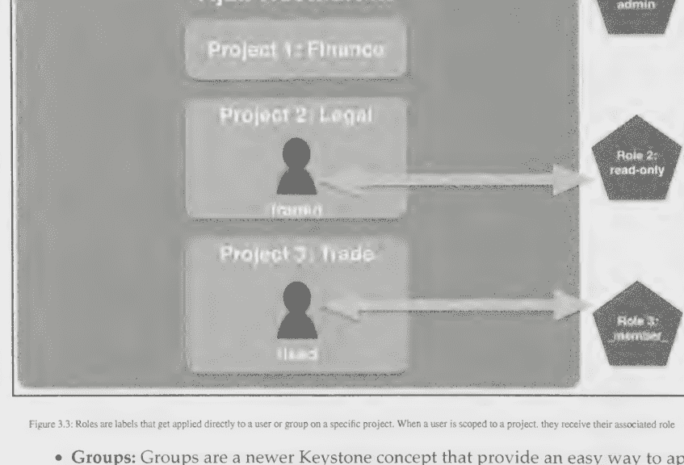

图 3.3：角色是直接应用于特定项目上的用户或组的标签。当用户限定到一个项目时，他们会获得其关联的角色

-   **组：** 组是 Keystone 的一个较新概念，提供了一种将现有角色轻松应用于多个用户的方式。它们是可选的，创建目的是消除一次只为一个用户应用角色的麻烦。参见图 3.4。用户 frankd 是 **Legal** 项目上 **Interns** 组的成员。因为 **read-only** 角色已分配给 **Legal** 项目上的 **Interns** 组，所以当 Frank 进行身份验证并限定到 **Legal** 项目时，他会自动获得 **read-only** 角色。用户 lisad 是 **Operators** 组的成员。Lisa 在她进行身份验证并限定到 Trade 项目时将获得 _member_ 角色。

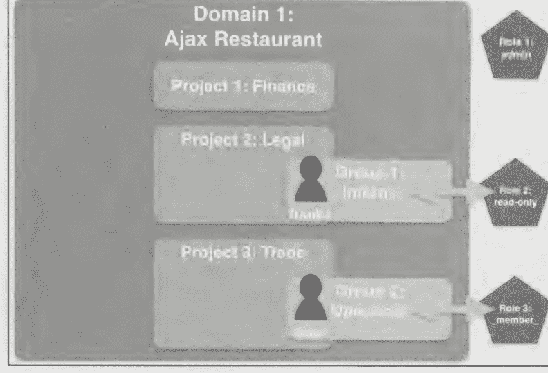

图 3.4：组是用户的可选容器。它们是同时将现有角色应用于多个用户的简便方式

-   **配额：** 配额决定了可在特定项目内创建的资源的数量或大小。它们充当护栏，防止用户超出容量。虽然每个 OpenStack 服务都会跟踪这些资源的使用情况，但调整配额可以在 Horizon 仪表板的 Keystone 面板中轻松完成（将在本章后面展示）。

-   **服务目录/端点：** 服务目录是存储在 Keystone 中的映射，其中包含服务和端点的列表。我喜欢把服务目录想象成 OpenStack 的电话簿。它为环境中安装的所有服务提供 API 端点的列表。目录中每个服务都提供了三个 URL：public、internal 和 admin；当我们讨论 Keystone 考试目标时，我们将更深入地讨论这个问题。

## 虚拟设备中的 Keystone

图 3.5 显示了本书提供的 COA 虚拟设备中的 Keystone 布局。如你所见，存在两个域：**Default** 和 **Heat**。当最初设置 OpenStack 环境时，默认域就是默认域！在我们的实验室环境中，我们将使用的各种项目都位于默认域内。

注意我们云中的用户拥有 _member_ 角色。虽然该角色并未在每个相应服务的 `policy.json` 文件中明确定义，但它只是赋予用户普通操作员权限的一种方式。拥有此角色的用户可以创建、读取、更新和删除资源，只要他们拥有该资源。注意 admin 用户被分配了 admin 角色并可以访问域中的所有项目。admin 角色在所有 `policy.json` 文件中都被定义为对所有域中的所有项目具有完全管理员访问权限。我知道这看起来有点不安全，但请记住，我们永远不会在每个域中都有客户的环境中将 admin 角色授予客户。为了解决这个问题，OpenStack 管理员会创建 **domain_admin** 角色。这超出了 COA 准备的范围，但有关此问题的更多信息，请访问 https://wiki.openstack.org/wiki/Horizon/DomainWorkFlow。

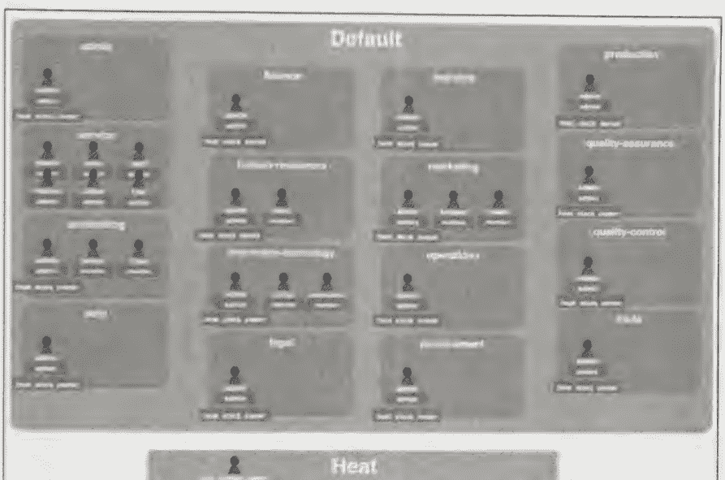

图 3.5：本书中包含的虚拟设备的 Keystone 布局

**heat_stack_owner** 角色是任何想要管理 Heat 堆栈的用户所必需的。你将在第 9 章 *Heat Orchestration Service* 中了解更多关于 Heat 的信息。

## 身份验证实战

现在你的 OpenStack 环境已经运行起来，打开你的网络浏览器并导航到 https://192.168.56.101/horizon 上的 Horizon 仪表板。登录屏幕是你提交由 OpenStack 管理员提供的用户名和密码的地方。OpenStack 管理员需要配置此账户，以及密码、电子邮件地址和一些其他选项。

你可以使用以下凭据登录提供的环境：

User Name: `admin`

Password: `admin`

恭喜！你已由 Keystone 正确身份验证，并获得了访问 Horizon 仪表板概览屏幕的权限。图 3.6 显示了点击 Connect 按钮如何自动发送包含你的域、用户名和密码的 API 请求到 Keystone API 端点。连接后，你将自动限定到你所属的项目。

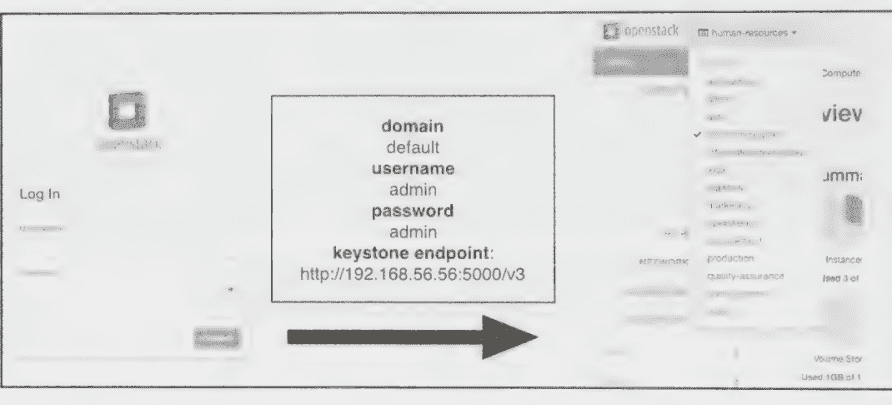

图 3.6：通过登录 Horizon 仪表板与 Keystone 交互


你可能已经注意到登录屏幕没有输入域名的字段。这是因为在 Horizon 仪表板中多域功能已关闭。如果你是高级用户并希望更改此设置，请前往 `/etc/openstack-dashboard/local_settings.py` 并将 `OPENSTACK_KEYSTONE_MULTIDOMAIN_SUPPORT` 设置为 True。确保通过运行 `sudo systemctl restart apache2` 重启 Apache。

## 通过仪表板进行项目范围限定

现在你已经登录，找到屏幕顶部的 Project 下拉菜单。你会注意到有各种项目：accounting、logistics、marketing、operations、trade 等等。这些项目代表我们域中的不同业务领域，也是资源被创建的区域。如你所见，你登录的 admin 用户属于多个项目。参见图 3.7。通过选择特定项目，用户将自己限定到该项目。一旦用户限定到项目，用户创建的任何资源（实例、卷、网络、路由器等）都将由该项目拥有。此规则有一些例外，但我们稍后会讨论。

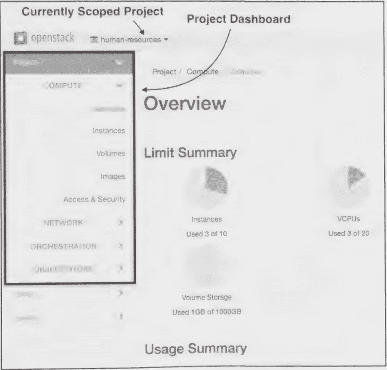


## 管理员生活

我们虚拟设备环境中的管理员用户在环境中的每个项目上都具有管理员角色。由于我们使用具有管理员角色的用户登录，Horizon 仪表板除了项目面板组外，还会显示一个管理面板组。没有管理员角色的用户将看不到管理面板组。参见图 3.8。

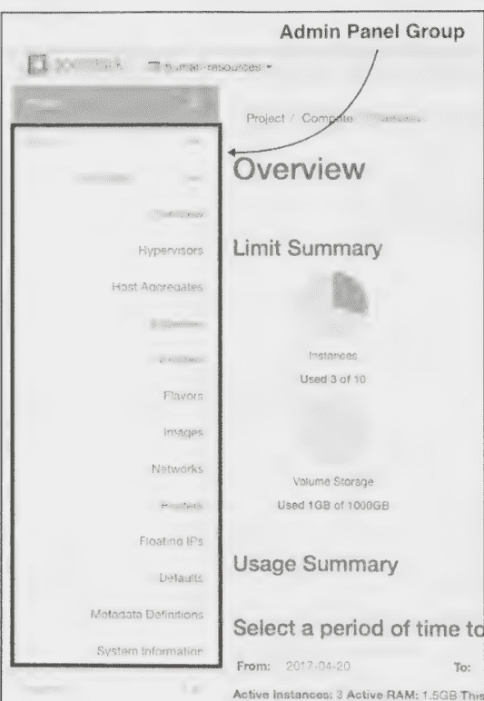

Figure 3.8: 默认情况下，只有具有管理员角色的用户才会看到 Horizon 仪表板管理面板组

管理面板组将允许已登录用户查看所有域中所有项目创建的所有资源。在执行考试目标时，务必不要忘记这一点。一些考试目标可能需要访问管理面板，我们将在后续章节中探讨这一点。

## 身份面板

身份面板会向所有用户展示，无论其角色如何。具有管理员角色的用户将拥有更多可见选项，包括在默认域内创建额外项目以及创建新用户、组和角色的能力。

选择“项目”会显示环境中所有域中的所有用户。

需要注意的是，在此环境中关闭了多域功能，您将无法创建新域或向默认域以外的任何域添加新资源。这正是 OpenStack CLI 灵活性发挥作用的地方。

## Keystone 与 OpenStack CLI

95% 的 COA 目标可以通过 Horizon 仪表板完成，但仍有一些任务需要使用 CLI。

让我们开始 CLI 工作。打开您的终端客户端并通过 SSH 连接到您的虚拟设备（有关如何执行此操作的说明，请参阅第 2 章《设置您的练习考试环境》）。

请记住，OpenStack 用户需要向其 OpenStack 管理员（就是您！）索取初始身份验证信息才能开始使用 OpenStack 和 CLI。那么用户为了向 OpenStack 进行身份验证所需的最少信息是什么？

- **Keystone 身份验证端点：** Keystone API 守护进程的 URL 位置。在生产 OpenStack 环境中，它通常是可解析的名称，如 `https://mycloud.example.com:5000/v3`，或外部 IP 地址。
- **域：** 您的用户所在的域。
- **项目：** 您想要作用域到的项目。
- **用户名：** 您的 Keystone 用户名。
- **密码：** 您的 Keystone 密码。

用户可以通过 CLI 向 OpenStack 提供身份验证信息主要有两种方式：

- 1. CLI 参数
- 2. Bash 变量

这是一个管理员用户使用 python-openstackclient 并通过 CLI 参数获取环境中所有用户列表的示例：

```
$ openstack --os-auth-url http://192.168.56.56:5000/v3 --os-user-domain-name default  --os-project-name marketing --os-username admin --os-password admin --os-identity-api-version 3 user list
```

您应该会得到以下输出：

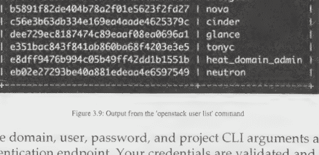

Figure 3.9: openstack user list 命令的输出

在此示例中，域、用户、密码和项目 CLI 参数被发送到 Keystone 身份验证端点。您的凭据经过验证，并且您的角色（管理员）会与 Keystone 的 policy.json 文件进行比较。请记住，管理员角色拥有完全访问权限，因此您看到的是环境中所有域中的所有用户列表。

您能想象每次想要与 OpenStack 交互时都需要将 CLI 参数放入命令中吗？这会非常烦人。这就是为什么许多人依赖另一种提供这些凭据的方式：Bash 变量。

在 OpenStack 用户主目录 (/home/openstack) 中，您应该会看到一个名为 openrc 的文件。该文件包含通过 CLI 与 OpenStack 交互所需的身份验证信息。我已为您提供此文件，因此您无需费心自行创建。

运行以下命令以在当前 Bash 会话中设置凭据：

```
$ source openrc
```

您可以通过运行以下命令来验证变量是否已设置，该命令显示所有变量并通过管道传递给 grep 以根据 OS 前缀进行过滤。

```
$ export | grep OS
```

在验证变量已设置后，您现在可以无需手动提供凭据即可运行命令：

```
$ openstack user list
```

您应该会看到与图 3.9 相同的输出。

再次说明，我们看到的是跨所有域的整个 OpenStack 环境中的用户。如果我们只想缩小特定项目内的用户范围，可以运行以下命令：

```
$ openstack user list --domain heat
```

您应该会看到类似于图 3.10 的输出：

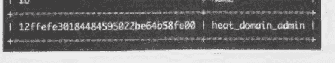

Figure 3.10: 'openstack user list --domain heat' 命令的输出

需要注意的是，这些变量是临时的，仅在 Bash 会话期间保持有效。如果您连接到真实的生产 OpenStack 环境，请注意不要将变量暴露给周围的人。您不希望任何人窃取您的密码！


CLI 参数始终优先于 Bash 变量。如果缺少 CLI 参数，python-openstackclient 将在 Bash 会话中查找变量的值。

## 通过 CLI 进行项目范围限定

对于需要 CLI 的目标，理解如何将自己限定到项目至关重要。在 CLI 上限定到项目的最简单方法是直接更改凭据文件中的项目或租户变量。

让我们尝试将项目范围从 admin 项目更改为 legal 项目。首先将原始的 openrc 文件复制到 openrc-legal：

```
$ cp openrc openrc-legal
```

现在我们已制作副本，让我们编辑 openrc-legal 文件并更新项目和租户名称变量以反映我们希望限定到 legal 项目的范围。如果您更习惯使用 vim、emacs 或其他编辑器，请在此处随意使用。

```
$ nano openrc-legal
```

将以下变量更改为 legal 并保存文件。要使用 nano 退出并保存更改，请按 Ctrl + X，然后按 Y 保存。

```
export OS_PROJECT_NAME=legal
export OS_TENANT_NAME=legal
```


我们更改 OS_TENANT_NAME 变量是因为一些较旧的基于服务的客户端可能依赖它。

现在我们为 legal 项目创建了新的凭据文件，让我们载入该文件：

```
$ source openrc-legal
```

验证变量是否已正确设置：

```
$ export | grep OS
```

使用 openstack token issue 命令，确认您可以正确地向 Keystone 进行身份验证并获取限定到 legal 项目的令牌。

```
$ openstack token issue
```

您应该会看到类似于图 3.11 的输出：

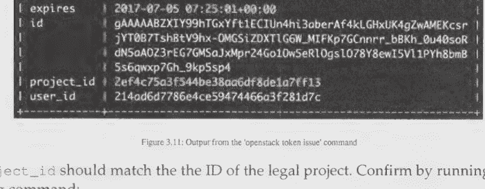

Figure 3.11: 'openstack token issue' 命令的输出

project_id 应与 legal 项目的 ID 匹配。通过运行以下命令进行确认：

```
$ openstack project list
```

## 基于服务的客户端与 OpenStack 客户端

OpenStack 新手最大的问题之一是是否使用 python-openstackclient 还是较旧的基于服务的客户端，例如 Neutron（python-neutronclient）、Nova（python-novaclient）或 Cinder（python-cinderclient）。只要我们与 Keystone v3 API 交互，就必须使用 python-openstackclient。所有无法在 Horizon 仪表板上执行的与 Keystone 相关的 COA 目标都将要求您使用 python-openstackclient。

## 考试目标

现在我们已经对如何通过 Horizon 仪表板和 CLI 使用 Keystone 对特定项目进行身份验证和范围限定有了很好的了解，让我们来看一下考试目标。

图 3.12 详细说明了来自官方目标列表的各种目标，该列表显示在 *第 1 章，介绍 OpenStack 和认证 OpenStack 管理员考试* 中，并且可在 `http://www.openstack.org/coa/requirements` 获取。如您所见，大多数任务可以通过 Horizon 仪表板完成，但仍有一些必须通过 CLI 完成。您会发现许多仪表板目标非常直观，而一些 CLI 目标需要进行更多研究。


Figure 3.12: 一些与 Keystone 相关的目标必须通过 CLI 完成


## 考试目标 - 调整配额

配额决定特定项目内资源的最大数量或大小。如图 3.13 所示，用户创建的任何资源都归其作用域所属的项目所有。

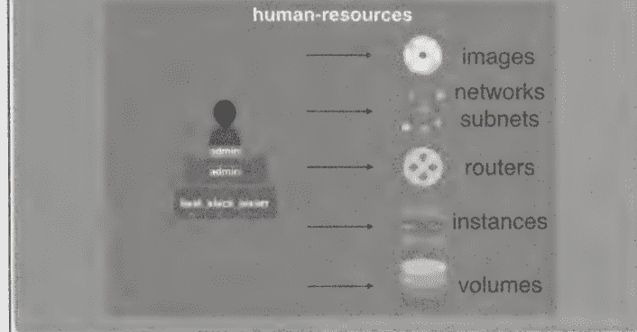

图 3.13：镜像、网络、路由器和实例归用户作用域所属的项目所有。在此示例中，管理员用户的作用域为 human-resources 项目，并具有 admin 和 heat_stack_owner 角色

配额是 OpenStack 的一项功能，作为项目的防护栏。必须设置配额以防止用户超出 OpenStack 基础设施工程师和/或 OpenStack 管理员设定的容量。在原生的开箱即用 OpenStack 环境中，您必须拥有管理员角色才能控制配额。参见图 3.14。

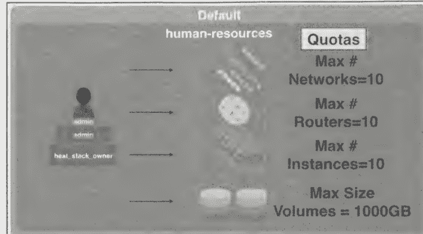

图 3.14：配额作为项目的防护栏，允许 OpenStack 管理员设置虚拟资源的具体数量或容量

### Horizon 仪表板

参见图 3.15。从 OpenStack 仪表板，您可以通过以下操作修改配额：

- 1. 选择 **身份** 面板。
- 2. 选择 **项目**。这会显示环境中所有域中的所有项目。
- 3. 选择生产项目旁边的下拉箭头并选择修改配额。

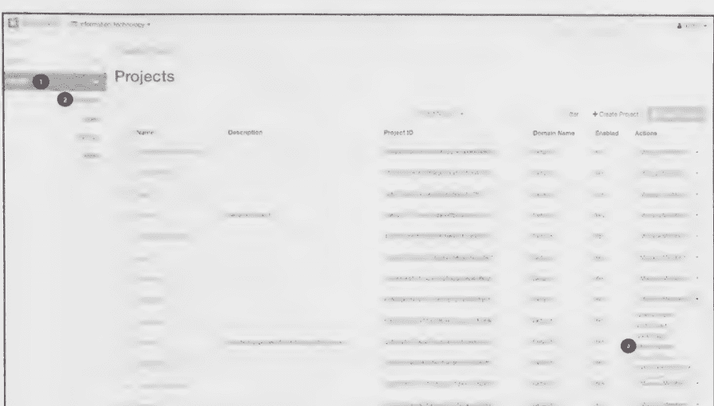

图 3.15：从项目下拉菜单修改配额

- 4. 参见图 3.16。将生产项目中可创建的实例数量增加到 20。
- 5. 选择保存。


图 3.16：可从 Horizon 仪表板轻松调整配额

恭喜！您刚刚成功允许在生产项目中启动总共 20 个虚拟机实例。请记住，这是生产项目内的实例总数，而不是每个用户。

### CLI

要获取特定项目的默认配额综合列表，请使用 python-openstackclient。首先确保已加载您的 openrc 文件：

```
$ source openrc
```

验证变量是否已设置：

```
$ export | grep OS
```

获取环境中所有项目的列表：

```
$ openstack project list
```

查找 Trade 项目 UUID。您环境中的 UUID 可能与此处显示的不同。使用 openstack quota show 命令查看 trade 项目的所有默认配额。

```
$ openstack quota show eb1a2580ea87490bbe206162ecf2fde5
```

您应该会看到类似于图 3.17 的输出：

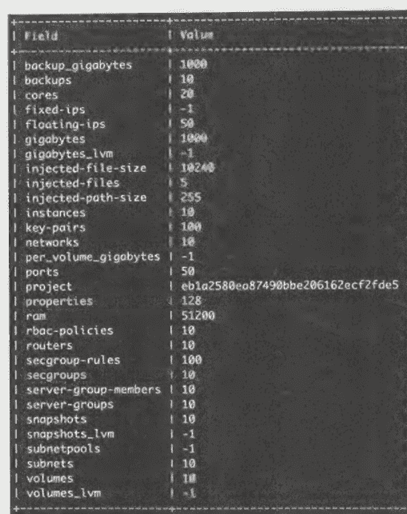

图 3.17：'openstack quota show' 命令的输出显示所有默认配额

这是一个配额的综合列表，并将显示仪表板配额视图中缺少的任何内容。要通过 CLI 修改配额，您有两个选项。让我们先看看第一个。

查看以下内容以了解可用的参数/参数：

```
$ openstack help quota set
```

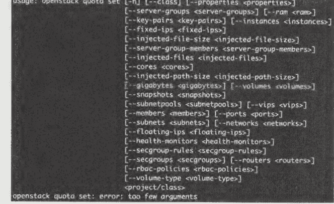

图 3.18：'openstack help quota set' 命令的输出

如果您想增加 trade 项目中最大实例数量的配额，可以执行以下操作：

```
$ openstack quota set --instances 20 eb1a2580ea87490bbe206162ecf2fde5
```

不会有任何输出。

再次运行 openstack quota show 命令以验证实例配额是否已增加到 20：

```
$ openstack quota show eb1a2580ea87490bbe206162ecf2fde5
```

您应该会看到类似于图 3.19 的输出：

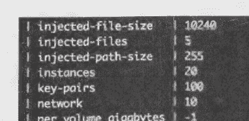

图 3.19：trade 项目的配额现在应反映可创建最多 20 个实例的能力


查看幕后进行的原始 API 调用的一种很好的方法是使用 `--debug` 选项。将它附加到任何 `python-openstackclient` 命令以查看对 OpenStack API 的调用！

为方便您，图 3.20 显示了所有可用配额的综合列表、其定义、默认值以及负责管理配额的服务。

| 配额名称 | 定义 | 数量/大小 | 服务 |
|---|---|---|---|
| 固定 IP | 项目内的固定 IP 地址的最大数量 | -1 | Neutron |
| 浮动 IP | 项目内的浮动 IP 地址的最大数量 | 50 | Neutron |
| 密钥对 | 项目内的 SSH 密钥对的最大数量 | 100 | Nova |
| 注入文件内容 | 可注入的最大文件大小（字节） | 10240 | Nova |
| 注入文件 | 可注入的最大文件数 | 5 | Nova |
| 注入路径大小 (KB) | 注入文件的最大大小（千字节） | 255 | Nova |
| 实例 | 可创建的虚拟机最大数量 | 10 | Nova |
| 元数据项 | 项目内的元数据键值对的最大数量 | 128 | Nova |
| 网络 | 项目内的网络最大数量。 | 10 | Neutron |
| 端口 | 项目内的端口最大数量。 | 50 | Neutron |
| 内存 | 分配给所有实例的 RAM 最大大小（MB） | 51200 | Nova |
| RBAC 策略 | 项目内的 RBAC 策略规则的最大数量 | 10 | Neutron |
| 路由器 | 项目内的路由器最大数量。 | 10 | Neutron |
| 安全组 | 项目内的安全组最大数量 | 10 | Neutron |
| 安全组规则 | 项目内的安全组规则最大数量 | 100 | Neutron |
| 服务器组 | 项目内的服务器组最大数量 | 10 | Nova |
| 服务器组成员 | 服务器组成员的最大数量 | 10 | Nova |
| 子网 | 项目内的子网最大数量。 | 10 | Neutron |
| 子网池 | 项目内的子网池最大数量 | -1 | Neutron |
| 卷和的总大小 | 所有卷和的最大大小（GB） | 1000 | Cinder |
| 虚拟 CPU | 分配给所有实例的核心最大数量 | 20 | Nova |
| 卷 | 可创建的卷最大数量 | 10 | Cinder |
| 卷大小 | 项目内每个卷的最大大小（GB） | -1 | Cinder |
| 卷备份 | 项目内的卷备份最大数量 | 10 | Cinder |
| 卷备份大小 | 所有卷备份的总大小（GB）最大 | 1000 | Cinder |
| 卷快照 | 项目内的卷快照最大数量 | 10 | Cinder |
| 卷 | 项目内的卷最大数量。 | 10 | Cinder |

图 3.20：所有可用配额的完整列表。-1 值表示“无限制”


Glance 在哪里？Glance 镜像不受配额控制。要对 Glance 镜像设置限制，高级用户可以在 `/etc/glance/glance-api.conf` 中查找 `image_member_quota` 值

## 考试目标 - 管理用户

管理 Keystone 用户非常简单直观。请记住，默认情况下，您必须拥有 **管理员** 角色才能管理用户帐户。

### Horizon 仪表板

参见图 3.21。从 OpenStack 仪表板，您可以通过以下操作创建新用户：

- 1. 点击 **身份** 面板。
- 2. 点击 **用户**。这会显示环境中所有域中的所有用户。您可以点击 **用户名** 字段将用户名按升序排列。此视图令人烦恼，因为它没有指定用户帐户所属的域或项目。要获取该信息，我们需要点击 **编辑** 按钮。
- 3. 点击 **创建用户**。

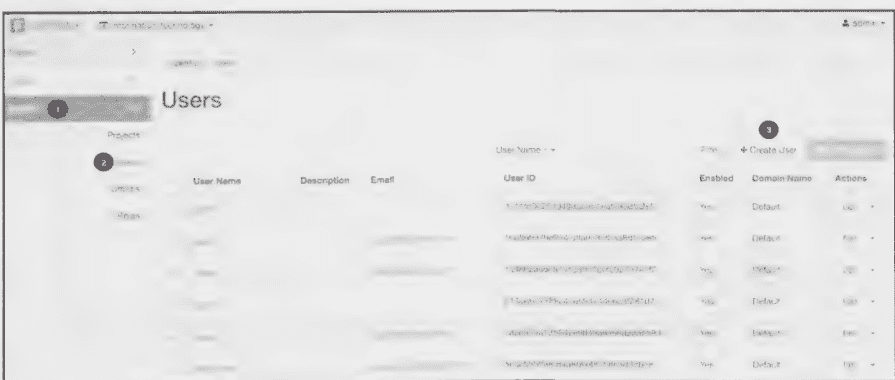

图 3.21：从 Horizon 仪表板创建新用户

- 4. **域 ID**：用户的域 UUID。由于多域被禁用，我们可以使用 CLI 在默认域以外的域中创建用户。
- 5. **域名称**：用户的域名。
- 6. **用户名（必填）**：用户的名称。我们将插入 `johnnyc-dashboard`。
- 7. **描述（可选）**：用户的描述。输入 `Developer`
- 8. **电子邮件（可选）**：用户的电子邮件地址。默认情况下，OpenStack 未安装任何电子邮件服务，因此这只是管理员的数据。输入 `johnnyc@example.com`。
- 9. **密码（必填）**：用户的密码。输入 `openstack`。
- 10. **确认密码（必填）**：通过再次输入来确认密码。
- 11. **主项目（可选）**：与用户关联的主要项目。请记住，用户可以属于零个或 5,000 个项目。主要项目是用户最初设置关联的第一个项目，对用户 Openstack 体验没有可见影响。选择 `trade`。
- 12. **角色（可选）**：用户在所选主要项目中应具有的角色。选择 `_member_`。
- 13. **已启用（必填）**：用户帐户是打开还是关闭。确保已启用。
- 14. 选择 **创建用户**。


## 创建用户

描述：
创建新用户并设置相关属性，包括主项目和角色

- 4 域 ID
- 5 域名称
- 6 用户名
- 7 描述
- 8 电子邮件
- 9 密码 *
- 10 确认密码 *
- 11 主项目
- 12 角色
- 13 已启用

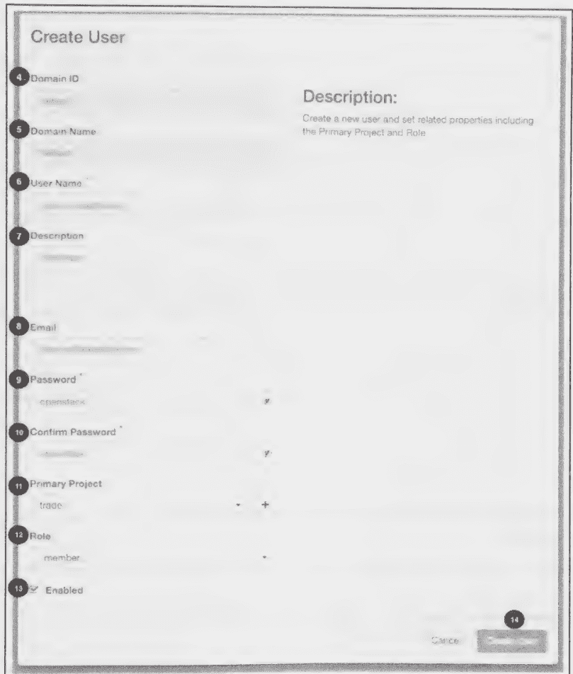

图 3.22：在 Horizon 仪表板上添加有关新 OpenStack 用户的详细信息

参见图 3.23。你现在应该在 Horizon 仪表板的用户列表中看到 johnnyc-dashboard。


图 3.23：新创建的用户将出现在用户列表中

你可以通过选择图 3.23 中显示的编辑按钮轻松更新用户的姓名、描述、电子邮件和项目。要删除或禁用帐户，请使用编辑按钮旁边的下拉菜单。

### 命令行界面

我们可以使用 python-openstackclient 通过 CLI 添加用户。确保已加载管理员用户凭据：

```
$ source openrc
```

我们将创建一个名为 johnnyc-cli 的新用户。

在运行命令之前，请探索 user create 命令的帮助：

```
$ openstack help user create
```

现在让我们通过 python-openstackclient 创建用户：

```
$ openstack user create --domain default --project trade \
--description "Developer" --email johnnyc@example.com \
--password openstack johnnyc-cli
```


由于用户默认已启用，因此无需使用 enable 标志。要在创建时禁用用户，请使用 --disable 标志。

确认用户已成功创建：

```
$ openstack user list
```

johnnyc-cli 用户在项目中拥有角色之前将无法创建资源。

运行以下命令。你不会收到任何输出。

```
$ openstack role add --user johnnyc-cli --project trade _member_
```

通过运行以下命令验证 _member_ 角色是否已分配给 trade 项目上的用户：

```
$ openstack role assignment list --names
```

## 考试目标 - 创建域、项目、组和角色

请记住，只要在禁用多域的情况下登录 Horizon 仪表板，我们就会登录到默认域。我们可以通过 Horizon 仪表板在默认域内轻松创建新的项目、组和角色，但除非使用 python-openstackclient，否则无法在默认域之外的域下创建它们。

让我们深入了解该过程。

### 命令行界面

我们将仅关注考试目标，而不涉及多域环境的复杂用例。

要通过 python-openstackclient 创建名为 acme-corp 的新域，请运行以下命令：

```
$ openstack domain create acme-corp
```

现在我们可以确认域已创建：

```
$ openstack domain list
```

让我们在这个域中创建一个名为 edgarp 的新用户：

```
$ openstack user create --domain acme-corp edgarp --password openstack
```

现在我们可以继续在 acme-corp 域内创建一个新项目。让我们创建一个名为 development 的项目：

```
$ openstack project create --domain acme-corp development
```

现在让我们在 acme-corp 域中创建一个名为 interns 的新组：

```
$ openstack group create --domain acme-corp interns
```

现在让我们将 edgarp 添加到该组：

```
$ openstack group add user --group-domain acme-corp interns edgarp
```

验证 edgarp 是否在 interns 组中：

```
$ openstack group contains user --group-domain acme-corp interns edgarp
```

为了让 edgarp 访问 acme-corp 域内的 development 项目，我们必须将角色应用于 development 项目上的 interns 组：

```
$ openstack role add --project-domain acme-corp --project development --group interns _member_
```

此命令不会产生任何输出。我们可以通过首先验证 interns 组在 acme-corp 域内的 development 项目上是否具有 _member_ 角色来确认它是否正常工作：

```
$ openstack role assignment list --group interns --names
```

图 3.24 显示了我们刚刚创建内容的视觉表示：


图 3.24：acme-corp 域内名为 development 的项目。edgarp 用户在 development 项目上具有 _member_ 角色


由于 Horizon 仪表板的多域已关闭，edgarp 需要依赖 CLI 进行 acme-corp 域的身份验证。

## 考试目标 - 管理服务目录 - 服务和端点

对于 OpenStack 新手来说，服务目录的概念令人困惑，因为大多数初级 OpenStack 用户和管理员通过仪表板或 CLI 间接与 OpenStack 服务 API 交互。

你可以将目录视为存储在 Keystone 中的 URL 列表。该列表显示了 OpenStack 环境中当前安装的所有服务的 API URL（也称为 *端点*）。虽然不是考试目标的一部分，但让我们从宏观角度看看直接与 API 交互的用户如何使用服务目录：

- 1. OpenStack 操作员/开发人员决定直接与 API 交互，因此他们直接从 OpenStack 管理员处接收 Keystone 身份验证 URL、用户名、密码、域和项目。他们使用工具（如 `curl` 或 `wget`）通过 API 请求将此信息发送到 Keystone。
- 2. Keystone 回复两件事：一个限定到特定项目的令牌和一个服务目录。
- 3. 用户浏览服务目录的方式类似于在最喜欢的餐厅浏览菜单，决定购买哪种餐点。在这种情况下，他们决定要使用哪种服务。服务目录显示 OpenStack 环境中所有服务 API 的位置。如果他们决定要创建一个新实例，他们会从 `http://developer.openstack.org` 提供的 Nova API 文档中查找如何进行 API 调用。
- 4. 然后 OpenStack 操作员/开发人员将他们在 **步骤 2** 中收到的令牌连同创建服务器的 API 请求一起直接发送到 Nova API 公共 URL 端点。
- 5. 如果用户的角色已被授予创建服务器的授权，Nova 服务将履行创建服务器的请求，并且用户将从 Nova API 收到 `HTTP 200 OK`——确认请求已成功完成。

某些服务使用目录查找如何向其他服务发送 API 调用。

直接通过 API 完成此操作很有趣。仪表板、CLI、SDK 和 Heat 的优点是它们不需要显式处理令牌、服务目录或直接 API 调用。

作为 OpenStack 管理员，您可能负责向环境用户宣传新安装的 OpenStack 服务。一旦 OpenStack 基础设施工程师安装了该服务，您需要将其添加到服务目录中，以便用户知道该服务可用。可以通过 python-openstackclient 轻松地将新服务和端点添加到目录中。

服务目录中每个服务有三个端点：

- **Public**：用户用于外部访问 API 的 URL。这通常是外部 IP 地址（或解析为外部 IP 地址的名称）。可以想象在咖啡店或 OpenStack 环境外部的某个地方。甚至智能手机应用程序也可以使用公共端点向服务发出 API 调用。
- **Internal**：服务通常用于内部通信的 URL。这通常是只能从 OpenStack 集群内部访问的内部 IP 地址。如果用户或服务位于 OpenStack 环境内部，则无需使用公共端点。已通过 SSH 登录 OpenStack 服务器的 OpenStack 管理员或基础设施工程师也可以使用此端点。
- **Admin**：该 URL 用于公开服务的特殊仅限管理员的功能，尽管它通常与内部 URL/端口相同。事实上，Keystone 是包含的虚拟设备中唯一为管理员 URL 广告不同端口的服务（端口 35357）。Keystone 的早期版本在此端口上解锁了特殊功能，但从 Newton 版本开始，如果使用 v3 Keystone API，则 5000 和 35357 之间没有功能差异。


## Horizon 仪表盘

需要注意的是，自 OpenStack Newton 版本起，只能通过 Horizon 仪表盘查看服务目录。你可以在 Horizon 中的两个区域查看服务目录：

- 1. 管理面板组 | 系统信息（见图 3.25）

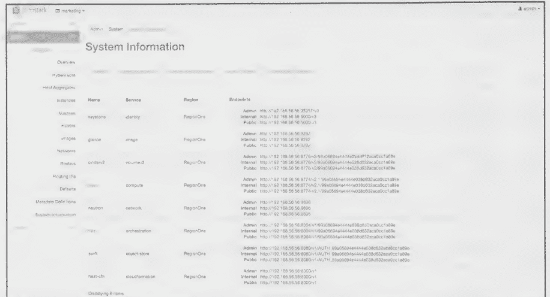

图 3.25：管理面板组的“系统信息”部分将显示服务目录中的所有端点

- 2. 访问与安全 | API 访问（见图 3.26）

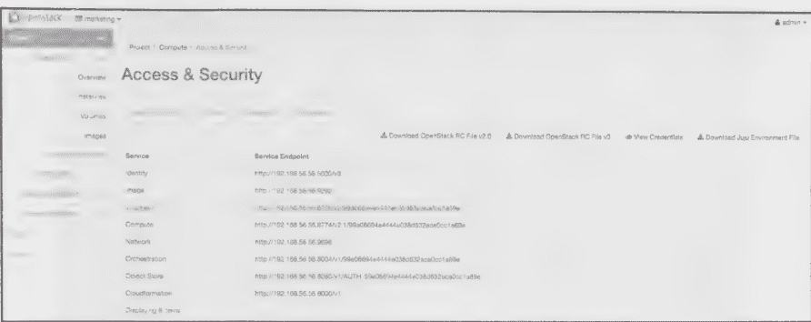

图 3.26：项目面板组的“访问与安全”部分列出了目录中的所有公共端点

## CLI

我们必须依赖 OpenStack CLI 来添加和删除服务目录中的条目。让我们考虑一个 OpenStack 管理员需要编辑目录的场景。想象一下，OpenStack 基础设施工程师刚刚在 OpenStack 环境中安装了一个全新的服务。该服务是 Trove，它允许 OpenStack 用户轻松创建关系型和 NoSQL 数据库。我们将如何让 OpenStack 用户知道他们现在有能力创建这些数据库？当然是通过在服务目录中进行宣传！

为了查看整个目录，请确保已 source 你的 openrc 文件并运行以下命令：

```
$ openstack catalog list
```

你应该会看到完整的服务目录，如图 3.27 所示。

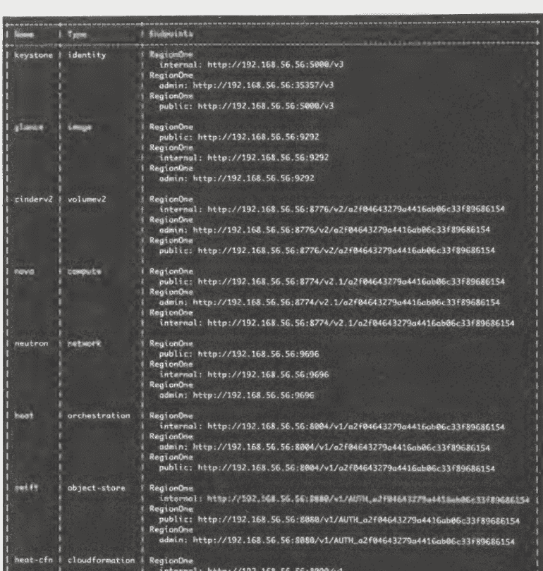

图 3.27：“openstack catalog list”命令显示整个服务目录

要查看目录中的所有单个服务，请运行以下命令：

```
$ openstack service list
```

要查看构成该列表的 URL 端点，请使用以下命令：

```
$ openstack endpoint list
```

现在让我们想象一下，我们的工程师提供了有关新安装的 Trove 服务在我们环境中监听 8779 端口的以下 API URL 信息：

- **RegionOne：公共端点：**
  http://192.168.56.56:8779/v1.0/$(tenant_id)s
- **RegionOne：内部端点：**
  http://192.168.56.56:8779/v1.0/$(tenant_id)s
- **RegionOne：管理端点：**
  http://192.168.56.56:8779/v1.0/$(tenant_id)s

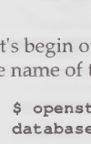

服务目录中的 Region 代表一个完整的 OpenStack 部署，包括其自己的公共、内部和管理 API 端点。不同的 Region 可以共享一套 Keystone 和 Horizon 服务，以提供访问控制和 Web 界面。我们环境中的所有服务都使用一个区域：RegionOne。

让我们通过为该服务创建列表来开始宣传 Trove。这将包括服务名称、描述和类型：

```
$ openstack service create --name trove --description "OpenStack Trove" database
```

现在让我们宣传提供的 URL，以便我们的 OpenStack 用户知道如何联系 Trove API。我们将宣传公共、内部和管理 API 端点：

```
$ openstack endpoint create --region RegionOne database public
http://192.168.56.56:8779/v1.0/
$ openstack endpoint create --region RegionOne database internal
http://192.168.56.56:8779/v1.0/
$ openstack endpoint create --region RegionOne database admin
http://192.168.56.56:8779/v1.0/
```

确认 Trove 服务和端点已添加到目录中：

```
$ openstack catalog list
```

你应该在服务目录输出中看到 Trove：

| 名称 | 类型 | 端点 |
|---|---|---|
| trove | database | RegionOne |
|  |  | Internal: http://192.168.56.56:8779/v1.0/ |
|  |  | RegionOne |
|  |  | admin: http://192.168.56.56:8779/v1.0/ |
|  |  | RegionOne |
|  |  | public: http://192.168.56.56:8779/v1.0/ |

图 3.28：服务目录现在应宣传新添加的 Trove 服务以及公共、内部和管理端点


如果你通过 CLI 添加新服务和公共端点，它在你使用用户名和密码注销并重新登录之前不会显示在 Horizon 仪表盘上。

## 摘要

你现在应该对 Keystone 以及 COA 考试所需的以 Keystone 为中心的 目标 有了扎实的理解。请记住通过 Horizon 仪表盘和 CLI 更改项目范围的重要性。我们需要在创建默认之外的任何新域并将项目、用户和组放置在这些域中时使用 python-openstackclient。我们在添加或删除服务目录中的条目时也需要 CLI。

在下一章中，我们将讨论 Glance 镜像服务，并通过 CLI 和 Horizon 仪表盘完成所有 Glance 考试目标。让我们开始吧！
