# 4 Glance 镜像服务

## Glance 镜像服务

在上一章中，我们讨论了 Keystone 标识服务以及针对 OpenStack 认证管理员考试的与 Keystone 相关的目标。现在我们将讨论 Glance。Glance 是 OpenStack 镜像服务，提供云镜像的注册、存储和交付。

在本章中，我们将涵盖以下主题：

- 云镜像
- 镜像文件格式
- Glance 架构
- Glance 镜像属性与 Glance 元数据定义
- 考试目标 - 创建 Glance 镜像
- 考试目标 - 下载 Glance 镜像
- 考试目标 - 与特定项目共享 Glance 镜像
- 考试目标 - 更新 Glance 元数据

读完本章后，你应该对 Glance 有扎实的理解，并具备成功完成考试中所有与 Glance 相关目标所需的技能。

## 什么是云镜像？

如果你刚接触弹性云世界，你可能对云镜像的概念感到有些困惑。想想创建虚拟机实例的过程（如果你还没有做过，你将在下一章中进行）。你通常会为实例提供名称以及内存大小、虚拟 CPU 数量、本地磁盘大小和镜像。虚拟机如果没有操作系统或可从本地磁盘读取的内容，无法启动。

过去，通常的做法是下载你喜欢的操作系统作为 ISO，即光盘的单个归档文件。在启动虚拟机后，你也许会在安装菜单中提供答案并通过安装向导。

重要的是要理解，在弹性云世界中，敏捷性是首要任务，我们很少浪费时间在安装程序上！在 OpenStack 环境中启动实例时，始终需要提供磁盘镜像（我们也可以另行提供现有卷或 Nova 快照，但稍后再详细介绍）。然后 Nova 会发送 API 请求从 Glance 获取镜像。镜像被放置在计算节点上，虚拟机被启动。

与典型的 ISO 不同，存在于 Glance 中的云镜像通常是磁盘内容的快照。这些镜像之前已由人员或脚本配置过，该人员或脚本已完成初始安装程序并安装了特定的程序和配置文件，以确保其具备云感知能力。

Glance 可以将这些镜像存储在各种称为 **数据存储** 的后端中。Glance 支持多种数据存储，包括本地文件系统、NFS 或 OpenStack Swift 容器。

## 构建云镜像

虽然超出了 COA 考试范围，但重要的是我们要理解构建这些云镜像的过程是在 OpenStack *之外* 完成的。让我们快速了解一下创建云镜像的几种流行方法：

- **OpenStack disk image builder project**：OpenStack disk image builder project 是一个用于自动构建用于云中定制的操作系统镜像的工具。它包括基于 Ubuntu、Red Hat、CentOS、SUSE 等构建镜像的支持（https://github.com/openstack/diskimage-builder）。
- **Hashicorp Packer**：Packer 自动化任何类型镜像的构建，并连接到现有的配置管理框架，如 Chef 和 Puppet（packer.io）。
- **Oracle VirtualBox**：虽然非常繁琐，但你可以使用 Oracle VirtualBox 通过将虚拟机设置到所需状态并将其上传到 Glance 来构建云镜像（virtualbox.org）。


## 镜像文件格式

磁盘镜像存储硬盘的所有内容，并采用多种文件格式。以下是一些最受欢迎的选项：

- **QCOW2（QEMU 复制时写入）**：与 QEMU 和 QEMU-KVM 超级管理器一起使用，其名称源于其磁盘存储优化策略，该策略会延迟存储分配，直到实际需要时为止。
- **VMDK（虚拟机磁盘）**：最初设计用于 VMware 系列超级管理器，但现在是一种开放格式，与 VirtualBox 等其他非 VMware 超级管理器兼容。
- **VHD 和 VHDX（虚拟硬盘）**：最初由 Connectix Corporation 为类型 2 超级管理器 Virtual PC 创建，2003 年被微软收购。它通常与 Microsoft 相关产品和服务一起使用，例如 Hyper-V 和 Azure。
- **VDI（虚拟磁盘映像）**：由 Oracle 的 VirtualBox 使用。
- **ISO（国际标准化组织，ISO9660）**：光盘的归档文件。它由光盘上每个已写入扇区的数据内容组成，包括光盘文件系统。
- **RAW**：未压缩的磁盘映像。Nova 会在启动虚拟机实例时解压缩任何压缩的云映像并将其置于原始格式。


虽然我们使用 Glance 来注册、存储和检索镜像，但它并不关心存储的数据类型。事实上，Glance 会存储您扔给它的 .txt、.doc 或任何其他文件类型。确保 Glance 镜像与环境中部署的超级管理器（或超级管理器）兼容是 OpenStack 管理员的责任。

## Glance 架构

参见图 4.1。Glance 由两个主要守护进程组成：

- **glance-api**：Glance 的主要网关。必须与 `glance-api` 交互才能存储和检索磁盘镜像。
- **glance-registry**：负责在关系数据库中存储与镜像关联的元数据。镜像元数据的示例包括镜像名称、镜像位置、UUID、镜像大小、所有者（项目 ID）、可用性状态和磁盘格式。

Glance 可以将镜像存储在多种数据存储中，包括 Swift、Amazon S3、`glance-api` 守护进程所在的本地文件系统，甚至是公开可访问的 Web 服务器。

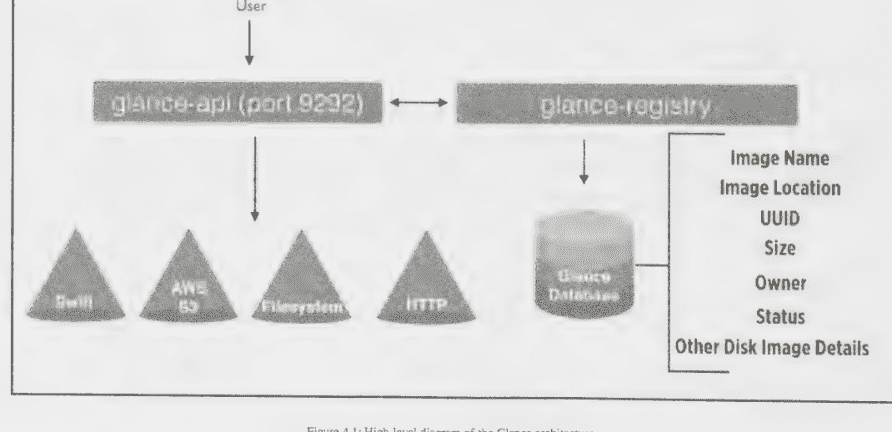

图 4.1：Glance 架构的高级图

本书提供的虚拟设备将 `glance-api` 配置为使用 Swift 数据存储。这是生产 OpenStack 环境中最常用的数据存储。

## Horizon 仪表板上的 Glance

Glance 出现在 Horizon 仪表板 **Project Panel Group** 的左侧。参见 *Figure 4.2*。在提供的虚拟设备中，您可以看到一个先前上传的云镜像，名为 **Cirros**。Cirros 是一种轻量级、最小化操作系统镜像，专为用作云的测试镜像而设计。您永远不会在 Cirros 上运行生产工作负载，但它非常适合云教育、开发和测试！这个特定的 Cirros 镜像由 admin 项目拥有。还请仔细注意 **visibility** 列。这个特定 Cirros 镜像的 **visibility** 设置为 *public*，因此使其可供所有域中的所有项目访问并可启动。**Visibility** 是理解 Glance 并通过 Glance 相关 COA 目标的基础。

让我们分解一下镜像的可能可见性状态：

- **Public**：公开的镜像可供 OpenStack 环境中所有域中的所有项目使用。根据默认 Glance `policy.json` 文件，只有具有管理员角色的用户才能将镜像设置为公开。公开镜像只有在您限定到拥有该镜像的项目时才可以修改或删除。
- **Private**：根据默认 Glance `policy.json` 文件，任何具有任何角色的用户都可以将镜像上传到 Glance。为了在 Glance 中创建/上传镜像，用户必须限定到一个项目。镜像成功创建/上传后，它将由用户当时限定到的项目拥有，并显示为 *Private*。该项目中的任何用户现在都可以修改镜像的属性或启动镜像。拥有私有镜像的项目之外的任何用户都无法看到该镜像，除非它已被明确与项目共享。
- **Shared with Project:** 如果用户具有管理员角色，他们可以将镜像与一个特定项目共享。如果用户明确将镜像与您的项目共享，它将显示为 *Shared with Project*。除非您限定到拥有该镜像的项目，否则您无法修改或删除与您的项目共享的镜像。

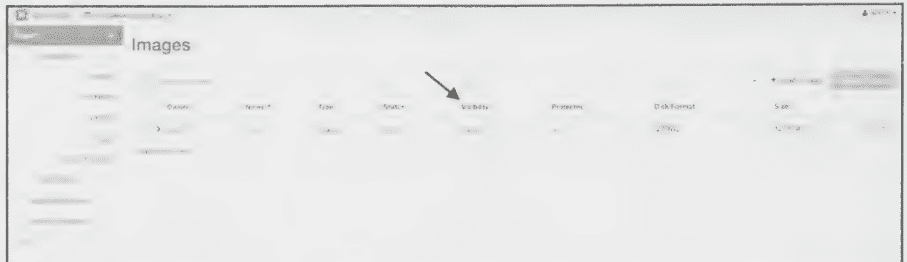

图 4.2：Horizon 仪表板上的可见性列决定 Glance 镜像是公开、私有还是与项目共享

## Glance 镜像属性与 Glance 元数据定义

当镜像上传到 Glance 时，只要用户限定到拥有该镜像的项目，用户就可以修改与镜像关联的元数据。由于 Horizon 仪表板上有两种修改 Glance 镜像属性的方法，因此最初可能会有点令人困惑。

参见图 4.3。从 Horizon 仪表板选择 Edit Image 选项允许用户编辑名称、描述、格式、最小磁盘/最小内存、公开和受保护属性。这些不是由 Glance 元数据定义服务设置的定义，而是 Glance 镜像固有的简单镜像属性。

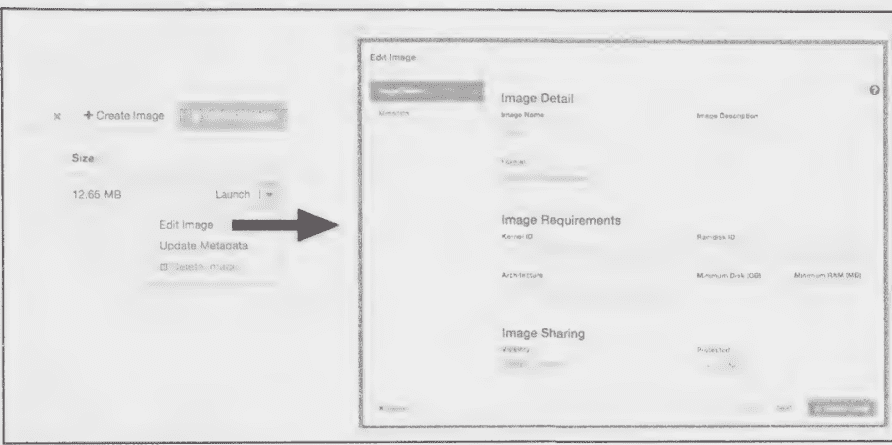

图 4.3：在 Horizon 仪表板上编辑 Glance 镜像属性

另一方面，Glance 元数据定义是可以设置在 OpenStack 资源上的属性。默认 Glance `policy.json` 文件只允许具有管理员角色的用户管理元数据定义，而所有其他具有其他角色的用户可以将这些定义应用于 OpenStack 中所有允许的资源。

图 4.4 显示了在 Admin-System 面板组中可用的元数据定义面板：

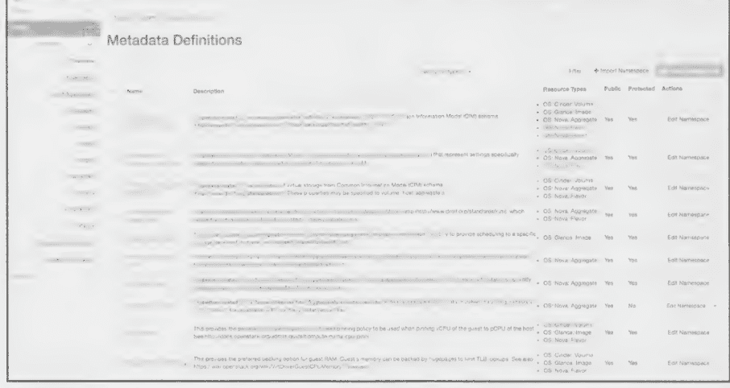

图 4.4：由 OpenStack 管理员加载的默认 Glance 元数据定义模板

正如您所见，OpenStack 管理员已加载默认模板。这些元数据定义模板可在 `github.com/openstack/glance/etc/metadefs.` 获取。

典型的 OpenStack 用户将能够将这些已加载的属性应用于他们在 OpenStack 中创建的资源。这里有一个例子：考虑一个由 KVM、Hyper-V 和 XEN 超级管理器组成的多个超级管理器的 OpenStack 环境。如果用户创建 Glance 镜像，他们可以在该镜像上设置元数据，以仅允许在与镜像文件格式兼容的超级管理器上启动它。

要将此元数据应用于镜像，用户上传其镜像，然后可以单击操作下拉菜单中的更新元数据。现在您可以从左侧的可用元数据窗格中选择 hypervisor_type 属性并将其添加到镜像中。

然后您可以选择适当的超级管理器值：

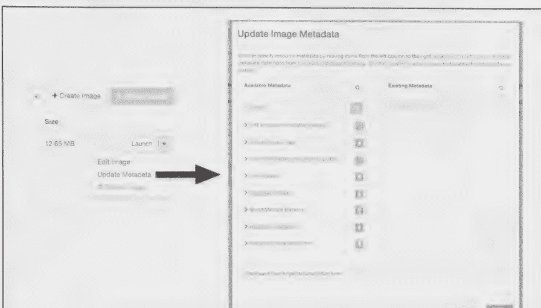

图 4.5：在 Horizon 仪表板上更新与 Glance 镜像关联的元数据定义

## 考试目标

在回顾了 Glance 镜像服务的一些基本细节后，我们可以看到它相当简单。与 Keystone 考试目标类似，并非所有 Glance 相关目标都可以在仪表板上执行。

下表根据第 1 章《介绍 OpenStack 和 Certified OpenStack Administrator 考试》中显示的官方目标列表中的各种目标进行了细分，可在 http://www.openstack.org/coa/requirements 获取：


图 4.6：Glance 考试目标

要在 Horizon 仪表板上将镜像上传到 Glance，镜像必须通过本地文件系统访问。

## 考试目标 - 创建 Glance 镜像

作为 OpenStack 管理员，您将负责创建（也称为上传）Glance 镜像，以便您的 OpenStack 用户可以使用它们来启动实例。

让我们看看如何通过 OpenStack 仪表板和 python-openstackclient 来完成此操作。

我们将使用 python-openstackclient 显示所有 Glance 目标，但您当然也可以使用 python-glanceclient。记住：考试不关心您如何完成目标，只要它们成功完成任务即可。


## Horizon 仪表盘

通过 Horizon 仪表盘创建镜像是一个相当简单的过程。让我们首先从官方网站下载 Cirros 云镜像到本地笔记本电脑或桌面。它可在 https://download.cirros-cloud.net/0.3.5/cirros-0.3.5-x86_64-disk.img 获取。

现在您已下载 Cirros，我们需要确保已限定到 procurement 项目。请参阅图 4.7。


图 4.7：在通过 Horizon 仪表盘将镜像上传到 Glance 之前，请确保您已限定到 procurement 项目

- 1. 从 OpenStack 概览页面，通过选择顶部下拉菜单将自己限定到 procurement 项目。
- 2. 从 **Project-Compute** 面板组中选择 **Images** 面板。如果查看当前 **Public** 镜像列表，您会注意到目前有一个云镜像，其可见性设置为 `public`。该镜像当前可供环境中所有域下的所有项目访问。我们将上传一个新镜像，该镜像将仅由 procurement 项目拥有。
- 3. 选择 **Create Image**。
- 4. 请参阅图 4.8。**Image Name**（必填）：镜像的显示名称。请记住 Glance 可以存储多个同名镜像，因为它还会生成镜像 UUID。我们将此镜像命名为 `cirros-dashboard`。
- 5. **Image Description**（可选）：提供您正在上传的镜像的描述。我们输入 `Cirros Cloud Image for COA Exam Prep`。
- 6. **File Browse**（必填）：这允许我们指定本节开头下载的文件。点击 **Browse** 并从本地系统选择已下载的 Cirros 镜像。
- 7. **Format**（必填）：指定您正在上传的镜像的磁盘格式。我们将指定 `QCOW2 -- QEMU Emulator`。
- 8. **Kernel**（可选）：此选项允许您为正在上传的云镜像指定单独的内核镜像。由于内核已存在于我们的 Cirros 镜像中，我们将保持为空。
- 9. **Ramdisk**（可选）：此选项允许您为正在上传的云镜像指定单独的 ramdisk 镜像。由于 ramdisk 已存在于我们的 Cirros 镜像中，我们将保持为空。
- 10. **Architecture**（可选）：Architecture 是用于 OpenStack 实例的元数据值，但我们将输入 `x64` 以向 OpenStack 用户表明该镜像与 `x64` 系列处理器兼容。
- 11. **Minimum Disk**（可选）：设置使用此镜像启动实例时允许的最小主磁盘。我们将其设置为 `1`。这将要求任何启动该镜像的人指定主磁盘大小至少为 1 GB 的 flavor。我们将在 `Chapter 5, Nova Compute Service` 中讨论 flavors。
- 12. **Minimum RAM**（可选）：将其设置为 512。这设置了使用此镜像启动实例时允许的最小 RAM。将此设置为 `512`。
- 13. **Visibility：** 选择 **Private**。创建后，此镜像将仅可供限定到 procurement 项目的用户访问。
- 14. **Protected：** 选择 **No**。我们将此镜像保持为未受保护。我们可以选择 Yes，这将防止用户意外删除镜像。要删除镜像，受保护标志必须由限定到镜像拥有者项目（在本例中为 procurement 项目）的任何用户移除。
- 15. 选择 **Create Image**。

### 创建镜像

### 镜像详情

指定要上传到镜像服务的镜像。

镜像名称

镜像描述

### 镜像来源

来源类型

文件

格式

### 镜像要求

内核

Ramdisk

架构

最小磁盘 (GB)

最小内存 (MB)

### 镜像共享

可见性

受保护

图 4.8：通过 Horizon 仪表盘创建 Glance 镜像

请参阅图 4.9。镜像现在可供 procurement 项目内的所有用户使用。如果镜像加载需要几秒钟以上，请在网页浏览器上点击刷新。


图 4.9：限定到 procurement 项目的所有用户现在都应能看到 cirros-dashboard 镜像

如果您以具有 admin 角色的用户登录，Newton 版本的 OpenStack 将显示所有项目中的所有镜像。请密切注意图 4.9 中的 owner 列。这是确定特定镜像属于哪个项目的最佳方法。

## 命令行界面

现在我们了解了如何在 Horizon 仪表盘上创建 Glance 镜像，让我们使用 python-openstackclient 创建一个。

通过 SSH 登录提供的虚拟设备。如果需要 SSH 指导，请参阅第 2 章，设置您的练习考试环境。

因为我们位于设备内部，而不是笔记本电脑或桌面的文件系统，让我们获取 Cirros 镜像并将其下载到设备的 Ubuntu 16.04 文件系统。我们使用 wget 命令行工具。如果您不熟悉 wget，它是访问网站和从互联网下载文件的快速便捷工具。

```bash
$ wget https://download.cirros-cloud.net/0.3.5/cirros-0.3.5-x86_64-disk.img
```

回顾一下，我们在上一节中将此镜像作为 procurement 项目上传。为了从 CLI 限定到 procurement，我们需要为 python-openstackclient 提供正确的身份验证凭据。对我们来说最简单、最方便的方法是创建一个具有正确 Bash 变量设置的另一个凭据文件。让我们将原始 openrc 文件复制到名为 openrc-procurement 的文件：

```bash
$ cp openrc openrc-procurement
```

现在我们已复制文件，让我们编辑 openrc-procurement 文件并更新项目和租户名称变量，以反映我们希望限定到 procurement 项目的范围。请随意使用您选择的编辑器。

```
$ nano openrc-procurement
```

将以下变量更改为 procurement 并保存文件。要使用 nano 退出并保存更改，请按 CTRL + X，然后按 Y 保存。

```
export OS_PROJECT_NAME=procurement
export OS_TENANT_NAME=procurement
```


我们正在更改 OS_TENANT_NAME 变量，因为一些较旧的基于服务的客户端依赖于此而不是 OS_PROJECT_NAME。

载入新创建的 openrc-procurement 文件：

```
$ source openrc-procurement
```

不要忘记始终验证我们的变量是否已正确设置为限定到 procurement 项目：

```
$ export | grep OS
```

现在我们已限定到 procurement 项目，运行 openstack image list 命令以验证是否可以看到任何可用镜像：

```
$ openstack image list
```

请参阅图 4.10。如果您正确遵循了上一节，您应该会看到公开可用的 cirros 镜像（由 admin 项目拥有）以及在上一节通过 Horizon 仪表盘创建的 cirros-dashboard 项目。

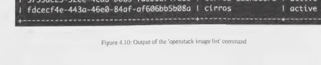

图 4.10：'openstack image list' 命令的输出


您可以通过在初始命令后、操作前放置 help 单词来获取任何 OpenStack 命令的帮助——例如：openstack help image create、openstack help image list 和 openstack help image save。

要获取特定镜像的更多详细信息，您可以使用 openstack image show 命令。让我们查看之前创建的 cirros-dashboard 镜像的详细信息：

```
$ openstack image show cirros-dashboard
```

如图 4.11 所示，在此特定镜像中，owner 字段显示了 procurement 项目的 UUID 以及我们在上一节中指定的其他一些详细信息。

在上传新镜像之前，我们可以使用 help 探索此命令的一些可用参数。

```
$ openstack help image create
```

使用这些信息，我们现在可以通过 CLI 创建一个新的 Glance 镜像。我们将使用 openstack image create 命令：

```
$ openstack image create --file cirros-0.3.5-x86_64-disk.img --disk-format qcow2 --min-disk 1 --min-ram 512 --property description='Cirros Cloud Image for COA Exam Prep' --property architecture='x64' cirros-cli
```


--container-format 是一个可选参数，如果镜像采用的文件格式也包含有关镜像的元数据，则会设置该参数。容器格式目前未被 Glance 或其他 OpenStack 组件使用，因此如果不确定，指定 bare 作为容器格式是安全的。


We should now see the output shown in Figure 4.11:

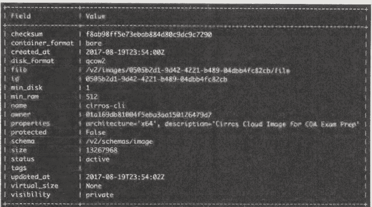

图 4.11：'openstack image create' 命令的输出

Use this to verify that the image was successfully created by using the openstack image list command:

```
$ openstack image list
```

You should see output similar to Figure 4.12 with all images set to active, verifying the image is available to be used:

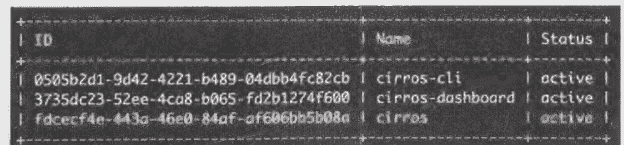

图 4.12：'openstack image list' 命令的输出

If we wanted to delete this image, we could easily use the simple openstack image delete command. See openstack help image delete for more information.

## 考试目标 - 下载镜像

Downloading images stored in Glance is not possible via the Horizon dashboard in the Newton version of OpenStack. We will rely on the python-openstackclient to accomplish this.

### CLI

Verify you are scoped to the procurement project by sourcing the openrc-procurement file created in the previous section:

```
$ source openrc-procurement
```

List all available images:

```
$ openstack image list
```

Download the cirros-cli image to the /tmp directory inside your virtual appliance. You can also use the image's UUID instead of the name.

```
$ openstack image save --file /tmp/mydownloadedimage.img cirros-cli
```

Verify the image successfully downloaded to the /tmp location:

```
$ ls /tmp
```

## 考试目标 - 与特定项目共享镜像

An OpenStack user with the admin role has the ability to share an image with a specific project. As of the Newton version of OpenStack, Horizon does not have the capability to share images with specific projects. We will do this via python-openstackclient.

### CLI

Ensure you are scoped to the procurement project:

```
$ source openrc-procurement
```

Get a list of all images we currently have access to:

```
$ openstack image list
```

Get a list of all the projects in our environment so you can lookup the UUID of the marketing project:

```
$ openstack project list
```

Share the cirros-cli image with the marketing project:

```
$ openstack image add project cirros-cli 99a06694e4444e038d632aca0cc1a89e
```

After sharing the image, you should see the output similar to Figure 4.13:

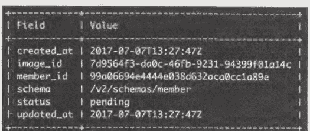

图 4.13：'openstack image add' 命令的输出


Although you'll see a pending status, anyone in the marketing project should now be able to see and launch the shared image. Accepting the image is not necessary with the Glance v2 API.

Any non-admin user in the marketing project will now be able to launch an instance or create a volume from the image but will not be able to delete the image or modify the properties/metadata associated with it.

## 考试目标 - 设置 Glance 镜像属性和元数据定义

It's extremely easy to set Glance image properties and metadata definitions on images that reside in Glance. Remember that you can only set metadata on images owned by the project to which you are currently scoped.

### Horizon 仪表盘

Recall earlier in this section, where we pointed out the two specific sections for setting Glance image properties and metadata definitions.

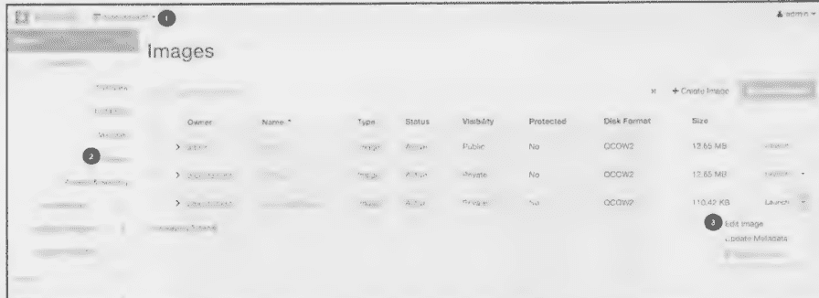

图 4.14：在 Horizon 仪表盘上编辑 Glance 镜像属性

See Figure 4.14. Let's first update the image properties associated with the `cirros-dashboard` image:

- 1. Verify you are scoped to the procurement project.
- 2. Select the **Images** panel from the **Project-Compute** panel group.
- 3. Click on the `cirros-dashboard` dropdown next to the **Launch** button and select **Edit Image**.
- 4. See Figure 4.15. Lower the minimum RAM value to 256.
- 5. Click on **Update Image**.

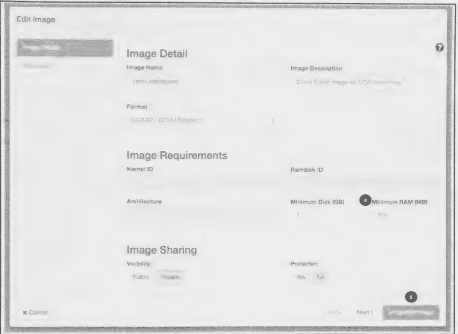

图 4.15：在 Horizon 仪表盘上编辑 Glance 镜像的最小内存

Let's now apply a Glance metadata definition key/value to the image. Let's use the existing *Common Operating Systems Properties-OS Distro* metadata definition property. This will be used to help identify the specific distribution contained in the image. See *Figure 4.16*.

- 1. Verify you are scoped to the procurement project.
- 2. Select the **Images** panel from the **Project-Compute** panel group.
- 3. Click on the `cirros-dashboard` dropdown next to the **Launch** button and select **Update Metadata**.

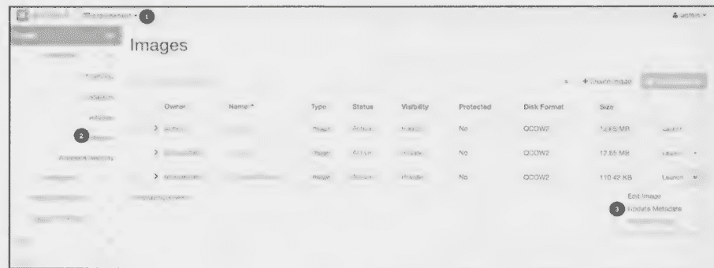

图 4.16：在 Horizon 仪表盘上更新 Glance 镜像元数据

- 4. See *Figure 4.17*. Select the plus sign on the left to open the **Common Operating System Properties** group. Select **OS Distro** definition. Fill in the value as `Cirros`. See *Figure 4.16*. Take note that the description we originally set on the image is a Glance metadata definition key/value pair.
- 5. Select **Save**.

### 更新镜像元数据

You can specify resource metadata by moving items from the left column to the right column. In the left column there are metadata definitions from the Glance Metadata Catalog. Use the 'Custom' option to add metadata with the key of your choice.

- **可用元数据**
- - Custom
- - CiM Processor Allocation Setting
- - Cinder Volume Type
- - Common Operating System Properties
- - OS Admin User
- - OS Version
- - CPU Pinning
- - Database Software
- - Guest Memory Backing

- **现有元数据**
- - description: Cirros Cloud Im...
- - os_distro: Cirros

### OS Distro (os_distro)

The common name of the operating system distribution in lowercase. Uses the same data vocabulary as the libosinfo project. Specify only a recognized value for this field. Deprecated values are listed to assist you in searching for the recognized value.

To verify your work, click on the blue hyperlink for the cirros-dashboard in the image list page. See Figure 4.18. You should see the newly updated Min. RAM value set to 256 MB and the os_distro value set to Cirros.

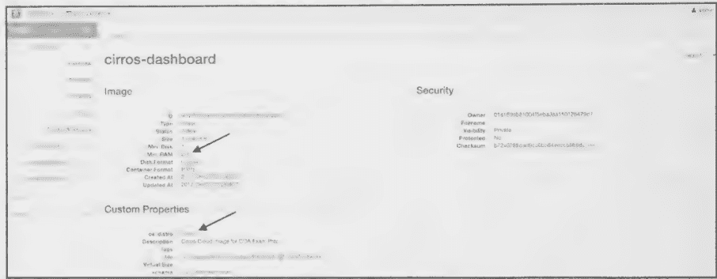

图 4.18：具有已更新 Min. RAM（镜像属性）和 os_distro（从元数据定义应用的元数据）的 Glance 镜像

### CLI

Ensure you have sourced credentials for the procurement project:

```
$ source openrc-procurement
```

Verify you can get a list of all available images:

```
$ openstack image list
```

Let's set the minimum RAM requirements on the cirros-cli image to 256 MB. You will not receive any confirmation output from this command:

```
$ openstack image set cirros-cli --min-ram 256
```

Let's now apply the Glance metadata definition os_distro key/value to the image:

```
$ openstack image set cirros-cli --property os_distro='Cirros'
```

We can now verify that the Glance property and metadata definitions were properly set to the image. We should see output similar to Figure 4.19.

```
$ openstack image show cirros-cli
```

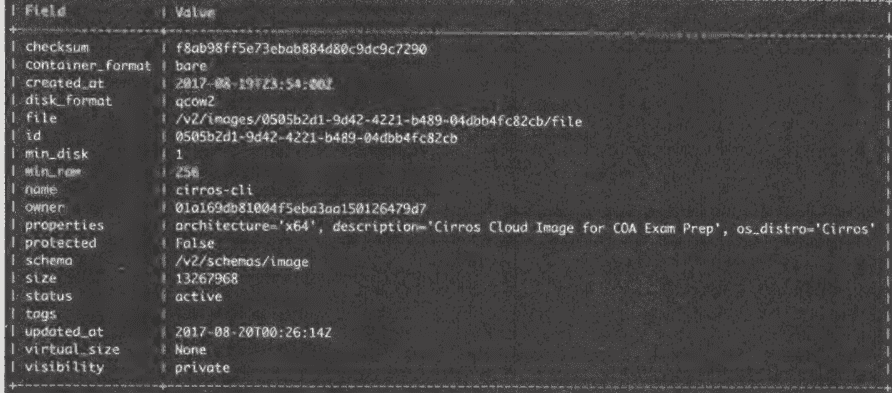

图 4.19：CLI 上具有已更新 Min. RAM 和 os_distro 属性的镜像

## 摘要

The Glance image service is one of the easier OpenStack services to understand and use. We've covered the basics of cloud images, image file types, Glance architecture as well as image properties and metadata definitions. It's important to remember that the only user that can make an image public (publicly accessible to all projects across all domains) must have the admin role. A user with the admin role can also share an image with a specific project. If a user does not have the admin role, they cannot modify or delete existing images unless that image was created by someone within the project to which they are currently scoped.

In the next chapter, we will discuss the first part of the Nova compute service and work through all objectives relating to key pairs, flavors, and the launching of virtual machines on the Horizon dashboard and python-openstackclient.


