# 5 Nova 计算服务
## Nova 计算服务

在上一章中，我们讨论了 Glance 镜像服务以及认证 OpenStack 管理员考试中与 Glance 相关的目标。但如果我们无法启动镜像，它有什么用呢？这就是 Nova 登场的地方！Nova 是 OpenStack 计算服务，是 OpenStack 云的核心。它旨在管理和自动化计算资源池，并与各种现有的虚拟化技术协同工作。

在本章中，我们将涵盖以下主题：

- Nova 架构
- Hypervisor 类型
- 考试目标 - 管理密钥对
- 考试目标 - 管理 flavor
- 考试目标 - 启动实例
- 考试目标 - 访问实例
- 考试目标 - 快照实例
- 考试目标 - 管理实例状态

在阅读本章后，您应对 Nova 有扎实的理解，并具备成功完成考试中所有与 Nova 相关目标所需的技能。

### Nova - 计算编排器

Nova 服务是 OpenStack 云的核心。它是一组守护进程，共同编排计算资源的可获得性，利用在 Linux 机器上运行多年的虚拟化功能！与其重新发明轮子，Nova 可与多种现有的 hypervisor 技术协同工作，包括 QEMU-KVM、QEMU、Hyper-V、VMware ESXi、Xen 和 XenServer。它还支持利用现有的 Linux 容器技术，如 LXC 和 Docker。当启动一个实例时，Nova 利用计算节点上的可用 CPU、内存和磁盘资源。在生产 OpenStack 环境中，客户可能拥有从 5 到 5,000 个托管虚拟机实例的计算节点。

### Nova 架构

图 5.1 显示了 Nova 架构的高级图。Nova 由六个守护进程组成：

- **nova-api**：通往 Nova 的主要网关。必须与 `nova-api` 交互以创建、列出、删除和管理实例。
- **nova-scheduler**：评估并过滤所有可用的计算主机，以确定启动实例的最佳计算节点。`nova-scheduler` 的行为可以根据特定特征进行修改，例如 CPU 架构或数据中心中的特定位置。
- **nova-conductor**：一个“数据库代理”，直接连接到 OpenStack 环境的关系数据库。由于计算节点（或 hypervisor）是多租户虚拟化环境中信任度最低的组件，所有数据库通信都通过 `nova-conductor` 进行。
- **nova-novncproxy**：通过 VNC 客户端或 Web 浏览器为 Nova 实例提供串行控制台访问。
- **nova-consoleauth**：接收来自 `nova-novncproxy` 的请求以授权用户的令牌，并映射实例 VNC 服务器的私有主机和端口。
- **nova-compute**：在 hypervisor 上管理虚拟机。

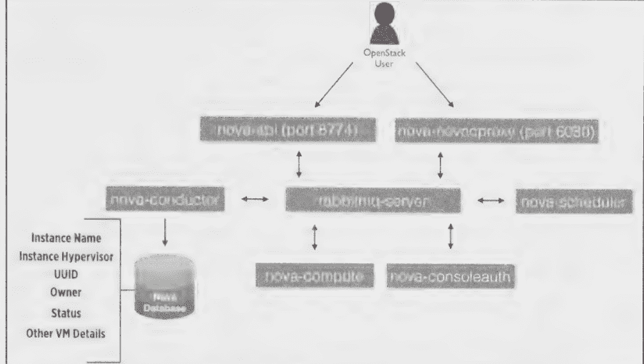

图 5.1：Nova 架构的高级图


在 OpenStack 中，术语 *启动* 用于指代虚拟机的创建。用 Nova 启动的虚拟机通常称为实例。要用 Nova 启动实例，通常需要提供所需的 Glance 镜像和 Nova flavor。Nova flavor 是预先配置的 CPU、内存和本地磁盘配置的配置文件，将在后续章节中更详细地讨论。

### Hypervisor 类型

Nova 与多种 hypervisor 类型兼容。让我们谈谈其中一些流行的类型：

- **QEMU (Quick Emulator)**：发布于 2003 年，QEMU 是一个开源 hypervisor，提供全系统仿真。它可以在没有 CPU 协助的情况下仿真一个或多个处理器，尽管它往往有点慢。
- **XEN**：发布于 2003 年，最初是剑桥大学的一个项目，Xen 是开源的，实现了称为 *准虚拟化*（PV）的技术。PV 不需要具有虚拟化扩展的处理器，而是依赖于 VM 客户机内部的驱动程序。Xen 已被许多流行的公共云服务使用，包括 Slice Host、Rackspace 和 Amazon Web Services。
- **QEMU-KVM (Quick Emulator-Kernel-based Virtual Machine)**：发布于 2006 年，QEMU-KVM 是 QEMU 的一个分支，继续使用 QEMU 来虚拟化客户机的外设，但也利用具有硬件虚拟化扩展的处理器。QEMU-KVM 速度很快，因为它能够以接近原生速度虚拟化客户机！这通常被称为硬件辅助虚拟化或 HVM。

Libvirt 是一个开源 API 守护进程，通常用于管理上述任何 hypervisor。在 OpenStack 环境中，`nova-compute` 将利用 Libvirt 守护进程 `libvirtd` 来管理虚拟机。参见图 5.2。

除了这些开源 hypervisor 之外，`nova-compute` 还与 Microsoft 的 Hyper-V hypervisor、VMware vCenter 和 XenServer（基于 Xen 构建的商业支持虚拟化产品）兼容。

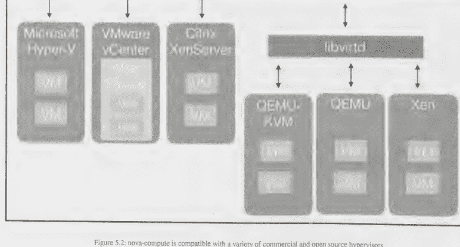

图 5.2：nova-compute 与多种商业和开源 hypervisor 兼容


本书随附的 OpenStack 虚拟设备配置为使用 QEMU hypervisor。如果您尝试启动较大的云镜像（例如 Ubuntu 或 Centos），它将运行缓慢。不幸的是，即使在笔记本电脑或桌面的 BIOS 中打开了虚拟化扩展，VirtualBox 也不会允许嵌套虚拟化。有关更多信息，请参阅 https://www.virtualbox.org/ticket/4032。

### 考试目标

让我们看一下 Nova 考试目标。

下表分解了您应为 COA 考试了解的各种 Nova 相关目标。正如您所见，所有这些任务都可以在 Horizon 仪表板和 CLI 上完成。请记住，考试时间至关重要——在许多情况下，在仪表板上处理任务可能更快。如果您对使用 CLI 有信心，并且不需要翻阅帮助来查找参数，请随意使用它！

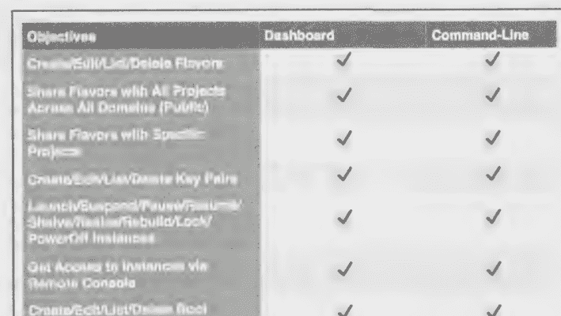

图 5.3：Nova 考试目标

### 考试目标 - 管理密钥对

密钥对是在通过 SSH 访问实例时对基于密码的身份验证的替代方案。密钥对由两个密钥组成：**public key** 和 **private key**。这些密钥必须一起使用才能访问实例。

就 SSH 密钥和 Nova 而言，OpenStack 用户有两个选项：

1. 向 Nova 发送请求为您生成全新的 SSH 公钥和私钥。在这种情况下，Nova 将公钥存储在其数据库中并将私钥交给您。一旦私钥传递给您，就无法再恢复。用户必须将私钥安全保存！
2. 如果您之前使用 `ssh-keygen`（或其他实用程序）生成了公钥和私钥对，您可以提供您的公钥供 Nova 存储在其数据库中。

一旦您的公钥在 Nova 中注册，您在启动实例时选择公钥的名称。这隐式地授予拥有匹配私钥的任何人访问权限。在通过 SSH 访问实例时，您将指定您的私钥和用户名。如果实例上存在匹配的公钥，您将被授予访问权限。


来自同一项目的多个用户无法看到彼此注册的公钥。与 OpenStack 中的其他资源不同，**public keys are not owned by the project**。它们归创建或注册它的用户所有。当您删除一个用户时，您也会从 Nova 中删除该用户的公钥。

### Horizon 仪表板

让我们看看如何从 Horizon 仪表板创建 SSH 密钥对。参见图 5.4。

1. 从 OpenStack 概览页面，通过选择顶部下拉菜单将自己限定为 **human-resources** 项目。
2. 从 **Project-Compute** 面板组中选择 **Access & Security** 面板。
3. 选择 **Key Pairs** 选项卡。
4. 选择 **Create Key Pair**。


图 5.4：在 Horizon 仪表盘上创建 SSH 密钥对

- 5. 将密钥对命名为 `my-new-keypair-dashboard` 并选择 **创建密钥对**。
- 6. Horizon 将自动向您展示私钥以供下载到本地系统。

Nova 不会保留私钥记录。一旦您离开下载私钥屏幕，就无法再检索它。请务必始终将私钥保存在安全的地方！

## CLI

在 `human-resources` 项目中使用 `python-openstackclient` 创建另一个 SSH 密钥对。

请记住，提供的 openrc 文件包含以变量形式提供的凭证，用于正确地向 Keystone 进行身份验证并设置项目范围。

让我们将原始的 openrc 文件复制到名为 `openrc-human-resources` 的新文件中。

```
$ cp openrc openrc-human-resources
```

复制完成后，让我们编辑 `openrc-human-resources` 文件，更新项目和租户名称变量以反映我们希望作用域到 `human-resources` 项目。如果您更习惯使用其他编辑器，这里也可以随意使用。

```
$ nano openrc-human-resources
```

将以下变量更改为 human-resources：

```
export OS_PROJECT_NAME=human-resources
export OS_TENANT_NAME=human-resources
```

> 我们正在更改 OS_TENANT_NAME 变量，因为一些较旧的基于服务的客户端依赖于它而不是 OS_PROJECT_NAME。

导入新创建的 openrc-human-resources 文件：

```
$ source openrc-human-resources
```

验证是否已正确设置变量：

```
$ export | grep OS
```

现在我们已正确设置作用域，让我们为管理员用户创建一个全新的密钥对。我们将提供 > 来将私钥输出重定向到名为 my-new-keypair-cli.pem 的文件。

```
$ openstack keypair create my-new-keypair-cli > my-new-keypair-cli.pem
```

我们使用 > 来避免在标准输出中打印私钥，并将其重定向到名为 my-new-keypair-cli.pem 的文件。

出于安全考虑，我们还应更改密钥的权限，仅允许我们（登录虚拟设备的 openstack 用户）读取该密钥。

```
$ chmod 400 my-new-keypair-cli.pem
```

我们可以通过运行以下命令来确认公钥已创建并存储在 Nova 中：

```
$ openstack keypair list
```

请参阅图 5.5。您应该会看到输出，确认管理员用户已创建两个独立的密钥对：一个来自 Horizon 仪表盘，一个通过 python-openstackclient 创建：


图 5.5：'openstack keypair list' 命令的输出

## 考试目标 - 管理规格

在 OpenStack 中，您始终需要为虚拟机实例指定所需的 RAM、本地磁盘驱动器大小和虚拟 CPU。为了控制使用情况，OpenStack 要求用户从称为 flavors 的预定义硬件配置集合中进行选择。请参阅图 5.6。

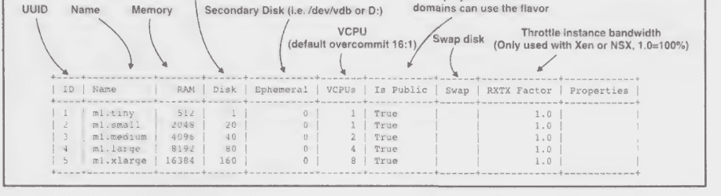

图 5.6：典型 OpenStack 环境中 Nova 规格的列表

- **ID：** 规格的 UUID。
- **Name：** 规格的名称。
- **RAM：** 以兆字节为单位使用的 RAM 数量。
- **Disk：** 以千兆字节为单位用于根分区的磁盘空间量。
- **VCPU：** 虚拟 CPU 的数量。默认情况下，Nova 使用 16:1 的 CPU 分配比例。这允许您在每个物理核心上启动十六个 1VCPU 实例。
- **Ephemeral：** 用于二级分区的磁盘空间量。
- **Swap：** 以千兆字节为单位用于交换的磁盘空间量。
- **RXTX Factor：** 这仅由基于 Xen 或 NSX 的系统使用，允许限制附加到实例的网络的入站/出站流量。
- **Properties：** 设置在规格上的任何元数据。

默认情况下，仅授予具有管理员角色的用户创建新规格的权限。作为管理员，从 Horizon 仪表盘或 `python-openstackclient` 创建和自定义新规格非常容易。

### Horizon 仪表盘

让我们从 Horizon 仪表盘创建一个新的规格。请参阅图 5.7。

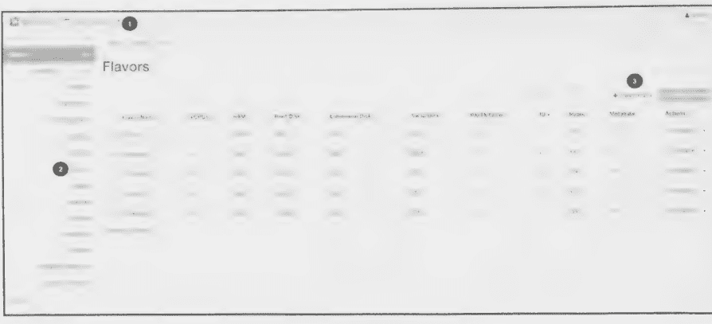

图 5.7：创建新规格的能力仅对具有管理员角色的用户可用（默认情况下）

- 1. 从 OpenStack 概览页面，通过选择顶部下拉菜单将自己作用域到 **human-resources** 项目。如前所述，**Admin** 面板组将对具有管理员角色的用户可用，无论作用域如何。我们在创建新规格时可以作用域到任何可用项目。
- 2. 从 **Admin-System** 面板组中选择 **Flavors** 面板。
- 3. 选择 **创建规格**。
- 4. **Name（必填）**：规格的名称。输入 `awesome-flavor-dashboard`
- 5. **ID（可选）**：规格的 UUID。输入 `100`。将 ID 保留为 `auto` 将自动分配 UUID。
- 6. **VCPU（必填）**：要使用的虚拟 CPU 数量。输入 `1`。超visor 上的默认超额分配比例为 16:1。这意味着大约 16 个 vCPU 对应一个逻辑处理器。
- 7. **RAM（MB）（必填）**：以兆字节为单位使用的 RAM 数量。输入 `512`。
- 8. **Root Disk（GB）（必填）**：以千兆字节为单位用于主磁盘的磁盘空间量。输入 `1`。
- 9. **Ephemeral Disk（GB）（可选）**：以千兆字节为单位用于次要磁盘的磁盘空间量。将此设置为 `0`。
- 10. **Swap Disk（MB）**（可选）：以兆字节为单位用于交换的磁盘空间量。将此设置为 0。
- 11. **RXTX Factor**（可选）：这仅由基于 Xen 或 NSX 的系统使用，允许限制附加到实例的网络的入站/出站流量。如果您使用其中一个超visor，您将在配置文件中设置基本网络速度，系数<|message|>值将乘以它。要完全使用，请输入 1。如果我们使用其中一个超visor 并希望限制为一半，我们可以输入 .5。
- 12. **Flavor Access**（可选）：允许您将规格与特定项目或项目组共享。如果您未指定任何项目，规格将为 **public** 并可供所有域中的所有项目访问。让我们保持此规格为公开。
- 13. 选择 **创建规格**。


图 5.8：Flavor Access 选项卡允许您将规格设置为公开可访问或仅与特定项目共享

### CLI

从虚拟设备内部，验证您是 root 用户并导入 openrc 文件：

```
$ source openrc
```

提示 输入 openstack help flavor create 将提供有关所有可用位置参数和可选参数的详细信息。

使用 python-openstackclient，创建一个 ID 为 200、RAM 为 512 MB、主磁盘为 1 GB、VCPU 为 1 的新规格。规格默认情况下为公开。将规格命名为 awesome-flavor-cli。

```
$ openstack flavor create --id 200 --vcpus 1 --ram 512 --disk 1 "awesome-flavor-cli"
```

您应该会看到与图 5.9 相似的输出：

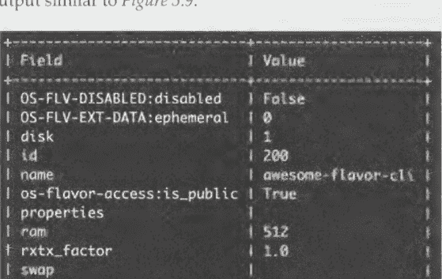

图 5.9：'openstack flavor create' 命令的输出

## 考试目标 - 启动实例

您终于到达了有趣的部分：启动 Nova 实例。启动实例可以在 Horizon 仪表盘和 python-openstackclient 上完成。让我们深入创建我们的第一个实例。

### Horizon 仪表盘

通过 Horizon 仪表盘创建实例非常容易。请参阅图 5.10。

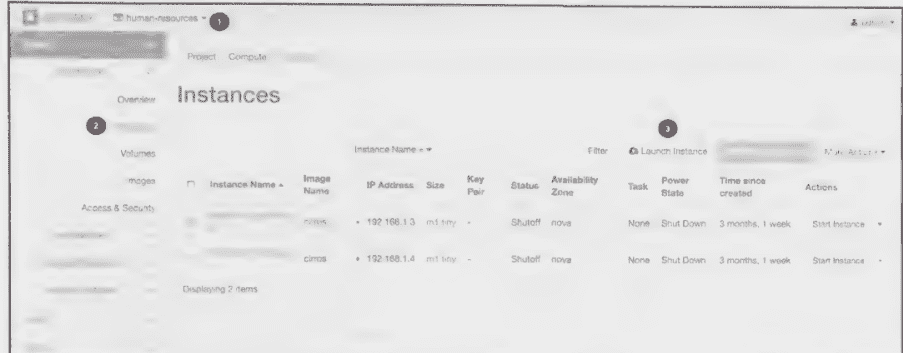

图 5.10：从 Horizon 仪表盘启动实例

- 1. 从 OpenStack 概览页面，通过选择顶部下拉菜单将自己作用域到 **human-resources** 项目。当我们创建实例时，它将由 **human-resources** 项目拥有。
- 2. 从 **Project-Compute** 面板组中选择 **Instances** 面板。您应该会看到两个处于 **Shutoff** 状态的实例。这两个实例由 **human-resources** 项目拥有。我们稍后会回到它们。
- 3. 选择 **启动实例**。
- 4. 详细信息：
  - **Instance Name（必填）**：实例的名称。您可以拥有多个具有相同名称的虚拟机，这要归功于自动分配给您创建的任何资源的 UUID。在此部分，插入 `instance3-dashboard`。
  - **可用性区域**：Nova 可用性区域用于划分您的 Nova 部署。这允许您将计算主机放入逻辑组中以提供物理隔离或硬件差异化。Nova 是开箱即用的默认可用性区域，包含环境中的所有计算节点。


-   **计数（必需）**：您希望启动的实例数量。指定多个实例会在虚拟机名称末尾添加 -#。例如，如果您启动三个名为 `myinstance` 的实例，它们将被命名为 `myinstance-1`、`myinstance-2` 和 `myinstance-3`。为实例计数插入 1。

5.  **源（必需）**：
-   **启动源**：有三种主要的启动源：
  -   **从镜像启动**：这是最常见的启动类型，允许用户选择特定的 Glance 镜像进行启动。选择 `cirros` 镜像。
  -   **从快照启动**：用户可以对正在运行的虚拟机进行快照以捕获磁盘内容。用户能够从 Glance 中现有的快照启动。
  -   **从卷启动**：当用户从云镜像或快照启动实例时，主要和/或次要驱动器始终位于计算节点的本地存储上。从 Cinder 卷启动允许我们将实例的主要或次要磁盘设置在计算节点之外的 Cinder 存储节点上。其优点是在出现超visor 故障或计划维护等紧急情况时数据持久性。这将在第 7 章 Cinder 块存储服务中更详细地讨论。

6.  **规格（必需）**：从任何可用规格中选择。选择 `m1.tiny`。

7.  **网络（必需）**：此部分允许您选择要启动实例的网络。如果您希望实例连接到多个网络，可以选择多个网络；网络的顺序决定了网络接口。选择预先创建的 `tenant-network1-dashboard` 网络。

8.  **网络端口（可选）**：此部分允许您选择要连接实例的端口。如果您希望实例连接到多个端口，可以选择多个端口。不幸的是，从此面板区域无法创建新端口。不应有任何可用的网络端口。

9.  **安全组（可选）**：我们将在 *第 6 章，Neutron 网络服务* 中更详细地讨论安全组，但现在重要的是您要理解安全组控制端口的进出网络流量。即使您不勾选此框，每个创建的实例都会自动获得默认安全组。如果您创建了额外的安全组，它们将显示在此处。一个实例可以关联多个安全组。验证 **默认** 安全组是否已选中。

10. **密钥对（可选）**：这将确保您请求的镜像中驻留的 `cloud-init` 程序获取此公钥并将其放入指定启动源镜像上默认用户的 `authorized_keys` 文件中。选择 `my-new-keypair-dashboard`。

11. **配置（可选）**：
-   **自定义脚本**：此部分允许您通过放置在实例启动后运行的脚本来自定义实例。这通常被称为用户数据，是一个庞大的主题。考试不需要您完成用户数据目标，但您可以在 `https://docs.openstack.org/pike/` 了解更多信息。
-   **磁盘分区**：如果您使用 QEMU 或 QEMU-KVM 作为超visor 类型，此选项将被完全忽略。自动磁盘分区会根据所需规格自动创建一个分区。换句话说，如果您选择一个具有 20 GB 主磁盘的规格，您将有一个可用的 20 GB 单个根分区（`/dev/vda1`）。如果您运行 QEMU 或 QEMU-KVM 并有兴趣修改此行为，请搜索 `growpart` cloud-init 模块。验证 **自动** 是否已选中。

-   **配置驱动**：勾选此框会在实例启动时自动附加特殊的 OpenStack 元数据 ConfigDrive。如果您已正确设置 neutron 元数据服务，则选择此项不应是必要的。验证此选项是否 **未选中**。

12. **Server Groups**（可选）：服务器组由 OpenStack 管理员创建，并基于 ServerGroup Nova 过滤器是否已启用。管理员必须设置服务器组以启用亲和/反亲和调度（请参阅下一项 **调度提示**）。
13. **Scheduler Hints**（可选）：调度提示允许用户影响虚拟机放置的位置。例如，用户可以使用提示确保多个虚拟机全部放置在同一计算节点或不同的节点上（亲和/反亲和）。在某些情况下，您可能希望两个实例位于不同的计算节点上以保持服务高度可用。服务器组和调度提示超出了考试范围。
14. **Metadata**（可选）：元数据允许用户将预定义的 Glance 元数据定义键/值对应用于虚拟机。
15. 选择 **启动实例**。


在 Horizon 仪表板上，除非有可访问的网络可用，否则您将无法启动实例。尽管您可以通过 CLI、SDK 或直接通过 API 在没有网络或端口的情况下启动实例，但实例将没有网络连接，也无法与其他实例或网络资源通信。


当前 Newton 版本 COA 考试的目标不需要您设置可用区。

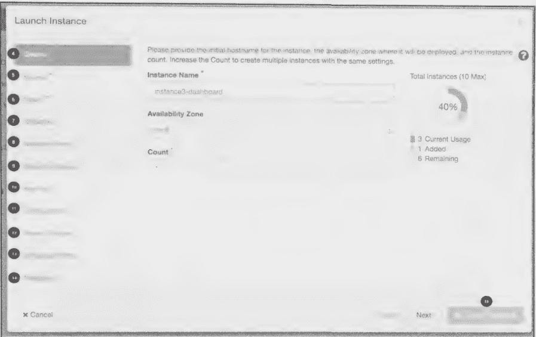

图 5.11：启动实例时有多种选项可用

请耐心等待！根据系统上可用的资源，这可能需要一点时间。如果一切顺利，您应该会看到您的新 instance3-dashboard。此时，human-resources 项目拥有三个实例：instance1-dashboard（状态：Shutoff）、instance2-dashboard（状态：Shutoff）和 instance3-dashboard（状态：Active）。


如果在尝试启动实例时出现错误，请验证您在其他项目中没有正在运行的实例。本书包含的虚拟设备需要至少分配 6GB RAM，但一次无法支持运行许多实例。如果您继续遇到启动实例的问题，请通过在终端运行 sudo reboot 重启虚拟设备，或在 VirtualBox 中手动关闭设备。如果您的笔记本电脑或台式机上有可用内存，请随意在 VirtualBox 中增加分配的 RAM。

## 命令行界面

源化新创建的 openrc-human-resources 文件。如果您尚未执行此操作，请参考前一个目标的 python-openstackclient 部分。

```
$ source openrc-human-resources
```

验证是否已设置正确的变量：

```
$ export | grep OS
```

现在我们已正确限定范围，让我们使用 Horizon 仪表板练习中提供的相同参数创建一个新的虚拟机。

```
$ openstack server create --image cirros --flavor m1.tiny --key-name my-new-keypair-cli \
instance3-cli
```

在实例构建时，您应该会看到与图 5.12 类似的输出。

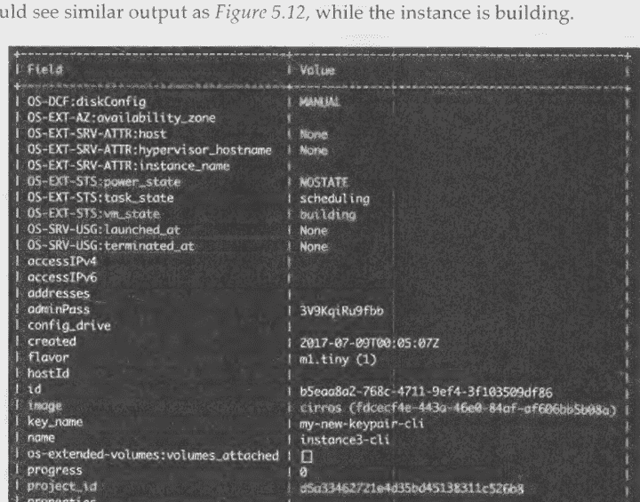

图 5.12：'openstack server create' 命令的输出

确认实例的状态变为 active。human-resources 项目现在应拥有四个实例。instance1-dashboard 和 instance2-dashboard 之前已在虚拟设备上创建。请确保暂时将它们保持在 SHUTOFF 状态。

```
$ openstack server list
```


图 5.13：'openstack server list' 命令的输出


在此示例中，我们不需要指定要启动实例的网络，因为 human-resources 项目只有一个网络可用。如果有多个网络可用，您将无法启动，除非使用 --nic 参数指定网络。

如果我们想查看实例的更多详细信息，可以运行以下命令：

```
$ openstack server show <instance-name-or-id>
```

## 考试目标 - 访问您的实例

现在您的虚拟机已启动并运行，让我们进入内部！有多种方法可以做到这一点。让我们讨论三种主要方式：

控制台：由于 nova-novncproxy 和 nova-consoleauth 守护进程，用户可以轻松地通过 Horizon 仪表板或 HTTP URL 访问虚拟机串行控制台。串行控制台提供对实例的访问，就像您直接与其交互一样。

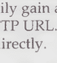

如果禁用了密码身份验证或镜像中未设置密码，您将无法通过控制台登录到实例。您必须传递用户数据来设置密码，或通过提供私钥通过 SSH 登录到实例。


**Floating IP：** 通过将浮动或外部 IP 地址与实例关联并从系统通过 SSH 连接是一种访问实例的替代方式。请注意，这不仅需要在 OpenStack 环境中配置提供商网络，还需要允许端口 `22` 上的入站流量。我们将在第 6 章中更详细地讨论这个问题。

**Network Namespace：** 如果您有权访问安装了 OpenStack 服务的实际底层服务器，则可以通过网络命名空间访问实例。网络命名空间是 Linux 内核的一项功能，允许隔离网络接口和路由表。每当 OpenStack 用户创建一个启用 DHCP 的 Neutron 网络时，就会创建一个网络命名空间。这超出了考试范围，但具有 OpenStack 基础设施访问权限的用户可以通过命名空间通过 SSH 进入实例来获得对 OpenStack 实例的访问权限。一个示例是 `ip netns exec <qdhcp-namespace_id> ssh <instance-fixed-ip-address>`。

## Horizon 仪表板

让我们继续查看我们的远程串行控制台。参见图 5.14。

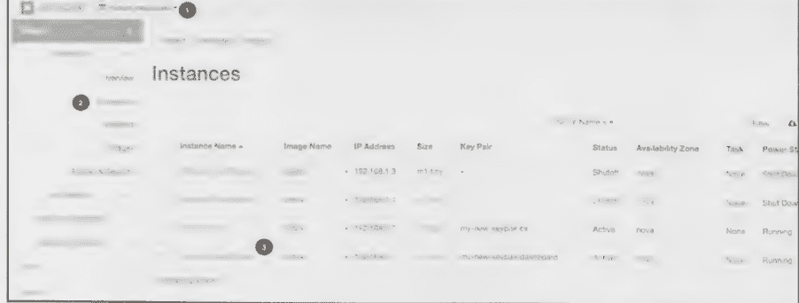

Figure 5.14. 从 Horizon Dashboard 访问实例控制台

- 1. 从 OpenStack 概览页面，通过选择顶部下拉菜单将自己限定到 human-resources 项目。
- 2. 从 **Project-Compute** 面板组中选择 **Instances** 面板。
- 3. 从实例列表中选择 **instance3-dashboard**。
- 4. 让我们先查看 Log 选项卡。Log 选项卡显示串行控制台的初始启动过程。点击 View Full Log。在这里我们可以看到实例的启动过程。我们可以看到它获取 IP 地址以及在启动时选择的公钥。如果我们启动实例时遇到问题，这是一个很好的故障排除位置。
- 5. 选择 Console 选项卡。

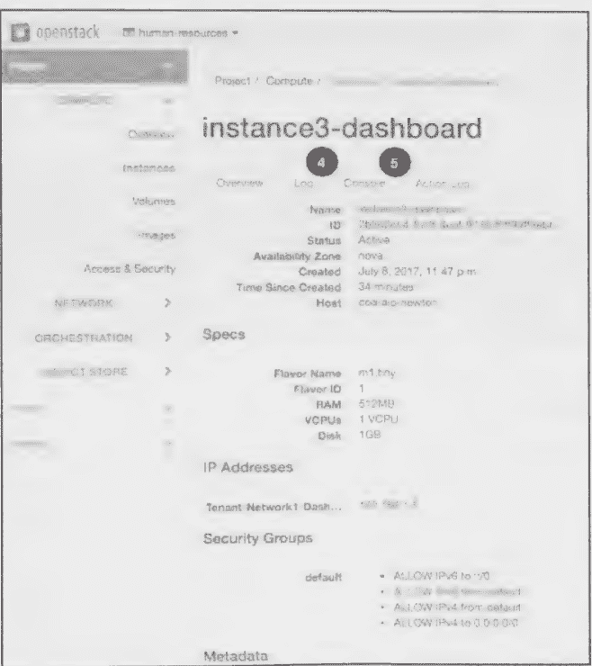

Figure 5.15: Horizon 仪表板上运行实例的日志和控制台选项卡

- 6. 选择 **Show Only Console**。如果您仍然看不到任何内容，请点击 **Enter**，这应该会唤醒控制台屏幕。

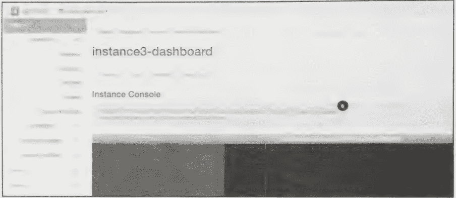

Figure 5.16: 选择“仅显示控制台”链接将允许您与实例控制台交互

我们现在可以登录到我们的实例：

- **Username:** `cirros`
- **Password:** `cubswin:)`

现在我们已登录，可以运行以下命令来显示实例主机名。

```
$ hostname
```

您应该会看到与图 5.17 相似的输出。

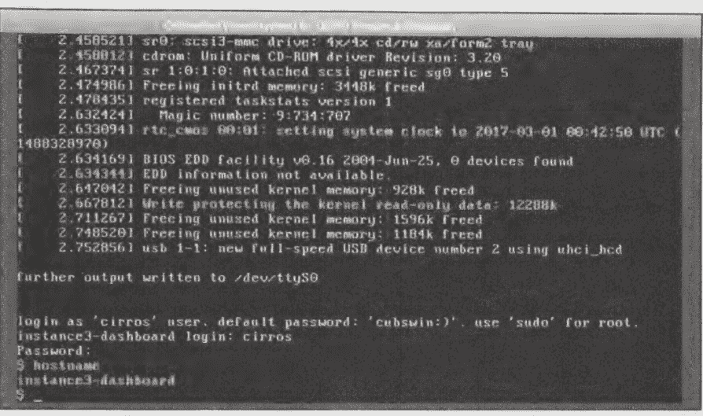

Figure 5.17: 在 instance3-dashboard 实例内运行 hostname 命令

## CLI

源化新创建的 openrc-human-resources 文件：

```
$ source openrc-human-resources
```

验证是否设置了正确的变量：

```
$ export | grep OS
```

查看所有正在运行的实例：

```
$ openstack server list
```

获取 instance3-cli 的控制台日志。您应该会看到实例启动日志。

```
$ openstack console log show instance3-cli
```

获取 instance3-cli 的控制台 URL：

```
$ openstack console url show instance3-cli
```

您应该会看到与图 5.18 相似的输出。

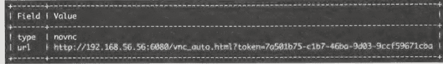

Figure 5.18: 'openstack console url show' 命令的输出

将 URL 复制并粘贴到您的 Web 浏览器中。

- **Username:** cirros
- **Password:** cubswin:)

现在我们已登录，可以运行以下命令来显示实例主机名。

```
$ hostname
```

## 考试目标 - 创建实例快照

Nova 允许用户创建实例快照。快照与镜像一样，是整个磁盘或磁盘内容的快照。考虑一个用户从镜像启动实例，然后对该运行中的实例进行更改和自定义。用户可以随后创建实例的快照并从此快照启动实例。所有更改和自定义都将保留。当创建快照时，它会作为可启动镜像放置在 Glance 中，并由用户所限定的项目拥有。

Nova 快照仅包含主磁盘的快照。它们不会快照实例可能关联的任何其他磁盘。这包括包含二级或“临时”存储的 flavor 以及附加的 Cinder 卷。

## Horizon 仪表板

- 1. 从 OpenStack 概览页面，通过选择顶部下拉菜单将自己限定到 **human-resources** 项目。
- 2. 从 Project-Compute 面板组中选择 **Instances** 面板。
- 3. 选择 **instance3-dashboard** 旁边的下拉菜单并选择 **Create Snapshot**。
- 4. 将快照命名为 **instance3-dashboard-snapshot**。参见图 5.19。

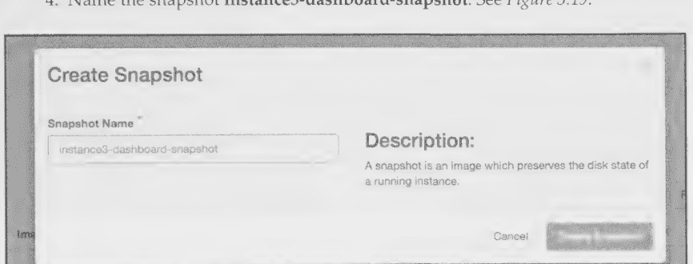

Figure 5.19: 在 Horizon 仪表板上创建实例快照

您的快照将被创建，现在应该在 **human-resources** 项目拥有的 Glance 镜像列表中可见。参见图 5.20。您可能需要在浏览器上点击 **Refresh**。

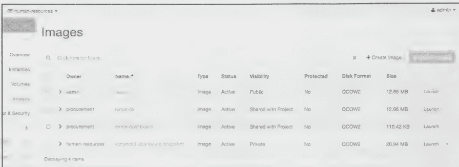

Figure 5.20: Nova 实例快照存储在 Glance 中

您现在可以通过点击 **Launch** 实例或在创建实例时将其选为启动源来轻松启动此快照。

## CLI

源化 `openrc-human-resources` 文件：

```
$ source openrc-human-resources
```

验证是否设置了正确的变量：

```
$ export | grep OS
```

首先，列出所有实例：

```
$ openstack server list
```

从 instance3-cli 创建名为 instance3-cli-snapshot 的快照。

```
$ openstack server image create --name instance3-cli-snapshot instance3-cli
```

您应该会看到与图 5.21 相似的输出。

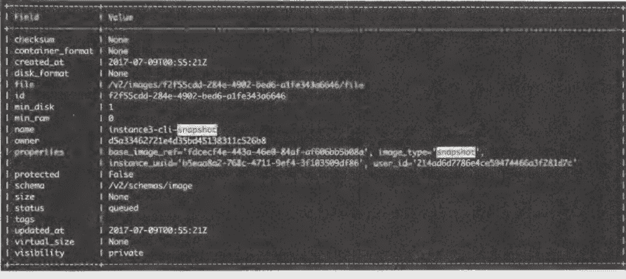

Figure 5.21: 'openstack server image create' 命令的输出

验证快照现在是否出现在 Glance 中：

```
$ openstack image list
```

我们可以通过检查镜像的详细信息来验证它是否由 human-resources 项目拥有：

```
$ openstack image show instance3-cli-snapshot
```


您可以使用 `openstack project list` 来查找所有项目的 UUID。

## 考试目标 - 管理实例操作

我们可以对现有实例执行多种操作。您可以通过点击 Project 面板实例部分中实例旁边的下拉菜单来查看这些操作。参见图 5.22。

您应该有两个处于 Shutoff 状态的实例：instance1 和 instance2。

现在这两个都已运行，让我们探索下拉菜单中的一些可用选项。参见图 5.22。

- **Associate Floating IP**: 允许我们将浮动 IP（外部 IP）映射到我们的实例，如果有可用。第 6 章 Neutron Networking Service 中有更多内容。
- **Attach Interface**: 将另一个（或相同的）网络附加到实例。这相当于向实例插入一个额外的虚拟 NIC（或端口）。
- **Detach Interface**: 移除虚拟 NIC 或端口。
- **Edit Instance**: 重命名实例或添加/移除安全组。如果您完全从实例的端口中移除所有安全组，所有入站和出站流量将被阻止。
- **Console**: 另一种获取控制台访问的方式。
- **View Log**: 另一种查看控制台日志的方式。
- **Pause Instance**: 将 VM 的状态存储在内存中。
- **Suspend**: 将 VM 的状态存储在计算节点硬盘上。
- **Shelve**: 实例将被停止并快照。然后它将从计算节点中移除，但仍会以 Shelved 状态出现在您的实例列表中。所有相关数据和资源都保留，尽管状态信息会丢失。然后可以将其 unshelve 并使用。
- **Resize**: 指定另一个 flavor 以调整实例大小。
- **Lock**: 在锁定状态下，非管理员用户无法修改或终止实例。
- **Unlock**: 解锁实例，允许项目内的用户修改或终止。
- **Soft Reboot**: 使用 ACPI 事件触发实例的优雅重启。
- **Hard Reboot**: 关闭实例电源然后重新打开。也称为冷重启。
- **Shut Off Instance**: 使用 ACPI 事件触发实例的优雅关机。
- **Rebuild Instance**: 从全新镜像重新创建实例，同时保持相同的固定和浮动 IP 地址，以及其他元数据。


- **终止实例**：完全删除实例。

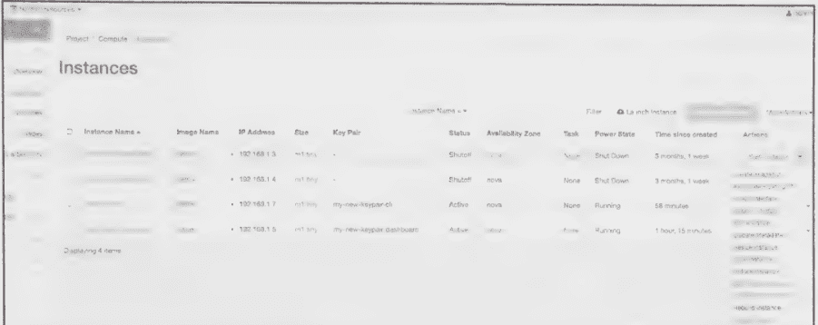

图 5.22：可在 Horizon 仪表盘上对虚拟机实例应用的各种操作

## Horizon 仪表盘

1. 从 OpenStack 概览页面，通过选择顶部下拉菜单将自己限定到 **human-resources** 项目。
2. 从 **Project-Compute** 面板组中选择 **Instances** 面板。
3. 在 **Instances** 部分，选择 **instance1-dashboard** 旁边的下拉菜单并选择 **Start**。实例将启动。

## 命令行界面

加载 openrc-human-resources 文件：

```
$ source openrc-human-resources
```

验证变量是否已设置为限定到 human-resources 项目：

```
$ export | grep OS
```

列出所有实例：

```
$ openstack server list
```

让我们启动 instance2-dashboard。

```
$ openstack server start instance2-dashboard
```

查看 instance2-dashboard 的状态。

```
$ openstack server show instance2-dashboard
```

状态现在应为 ACTIVE。参见图 5.23。

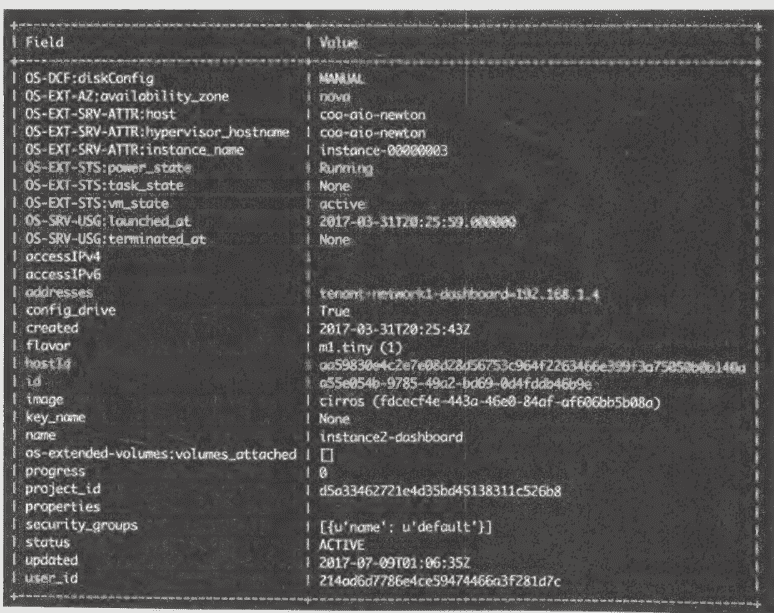

图 5.23：运行中的实例将显示状态为 ACTIVE

我们现在应该在虚拟设备中有总共四个正在运行的实例。

在进入下一章之前，让我们清理环境并停止 human-resources 项目中的所有正在运行的实例。

```
$ openstack server delete instance1-dashboard instance2-dashboard
instance3-dashboard instance3-cli
```

验证实例是否已不再在 human-resources 项目中运行：

```
$ openstack server list
```

## 摘要

您刚刚学习了考试中所有与 Nova 相关的目标。Nova 还有更多功能，但了解如何管理 flavors、密钥对、实例和虚拟实例操作，应能让您在进入考试时处于有利位置。请记住，所有与 Nova 相关的考试目标都可以通过 Horizon 仪表盘完成。如果您想使用 python-openstackclient，请确保熟悉任何位置参数或可选参数。如果您忘记了它们，请依赖 openstack help 命令。请记住，密钥对是 OpenStack 资源之一，由用户而不是项目拥有。当您删除用户时，其公钥也会被删除。Nova 仅存储公钥的副本。如果您丢失了私钥，必须生成新的密钥对。默认情况下，flavors 可供所有域中的所有项目中的所有用户访问。要使 flavor 成为公开，必须具有管理员角色。

在下一章中，我们将讨论 Neutron，即 OpenStack 网络服务，并完成考试中所有与 Neutron 相关的目标。
