# 6 Neutron 网络服务

## Neutron 网络服务

在上一章中，我们讨论了 Nova 计算服务和 Certified OpenStack Administrator 考试的 Nova 相关目标。现在我们将讨论 Neutron。Neutron 是一个网络服务，管理 OpenStack 环境的虚拟网络、子网、IP地址、路由器、防火墙规则等。由于 Neutron 约占 COA 目标的 17%，从管理员角度充分理解其工作原理对于通过考试至关重要。Neutron，尤其是 SDN（软件定义网络），是一个复杂的话题，涵盖许多领域。然而，需要记住的是，考试不需要您修改 Neutron 配置文件或在 OpenStack 环境之外配置网络。

在本章中，我们将涵盖以下主题：

- Neutron 架构
- Neutron 概念
- 考试目标 - 管理租户网络
- 考试目标 - 管理租户子网
- 考试目标 - 管理安全组和规则
- 考试目标 - 管理路由器（东西向流量）
- 考试目标 - 管理提供商网络
- 考试目标 - 管理提供商子网
- 考试目标 - 管理路由器（南北向流量）
- 考试目标 - 管理浮动 IP

在本章之后，您应该对 Neutron 有扎实的理解，并具备成功完成考试中所有与 Neutron 相关目标所需的技能。

## 关于 Neutron

在第 5 章中，我们讨论了在 OpenStack 环境中启动实例的最低要求：

- 一个启动源
- 一个 flavor
- 一个可用的 Neutron 网络

Neutron 允许用户创建必要的虚拟资源，不仅确保其实例获得内部 IP 地址（也称为 **固定 IP**），而且能够将外部 IP 地址（也称为 **浮动 IP**）映射到实例。这使得驻留在 OpenStack 实例中的应用程序可以从外部访问。通过 Neutron，用户可以通过 Horizon 仪表盘、命令行界面、OpenStack SDK 或直接通过 API 查看自己的网络、子网、防火墙规则、路由器和负载均衡器。Neutron 还包含一个由各种插件、代理和驱动程序驱动的模块化框架，包括 LinuxBridge 和 Open vSwitch。


本章对 Neutron 提供了简要说明。如需深入了解，请查阅 James Denton 所著的 *OpenStack Networking Essentials*，Packt，2016 年。

## Neutron 架构

Neutron 由五个守护进程组成，如图 6.1 所示。

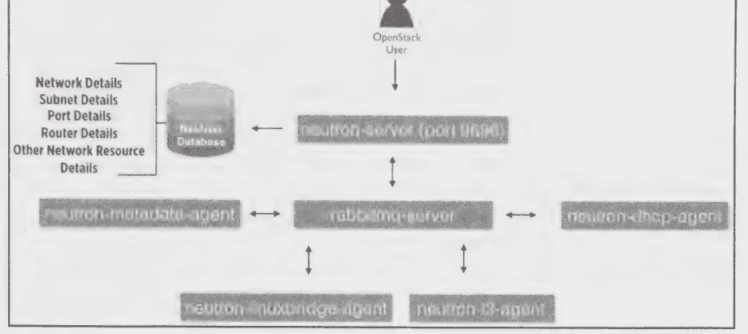

图 6.1：Neutron 架构的高级视图

- **neutron-server**：Neutron 的 API 和主要网关。必须与 neutron-server 交互以创建、列出、删除和管理网络及其他网络资源。
- **neutron-dhcp-agent**：为启用 DHCP 的 Neutron 子网提供 DHCP 服务。在幕后，`neutron-dhcp-agent` 实际上在网络命名空间中使用 `dnsmasq`，这是一种流行的轻量级 DHCP 服务器软件。网络命名空间是 Linux 内核的一项功能，可划分网络使用，允许在 IP 地址范围相似的情况下隔离网络资源。
- **neutron-l3-agent**：创建 Neutron 路由器。在幕后，Neutron 路由器是具有唯一路由表和 `iptables` 规则的网络命名空间。
- **neutron-metadata-agent**：为实例提供元数据服务。元数据服务由 Amazon Web Services 推广，是一种不可路由的 IP 地址（`169.254.169.254`），用户或脚本可以联系该地址以获取有关该实例的个人信息。
- **neutron-linuxbridge-agent**：在环境中的每个计算节点上运行。负责计算节点上所有网络相关功能的创建和管理——包括为新创建的实例创建虚拟网络接口，以及创建和连接 Linux 桥和 `iptables` 规则。

## LinuxBridge 插件

在本书提供的虚拟设备中，Neutron 配置为使用 LinuxBridge 插件。LinuxBridge 插件利用现有的 Linux 内核功能以及 Linux 程序来提供虚拟网络组件。考试不需要您理解这些关系，但了解幕后运作的原理很有趣。

| Neutron 功能 | 现有的 Linux 内核功能和/或程序 |
|---|---|
| neutron-dhcp-agent | 网络命名空间, dnsmasq |
| neutron-l3-agent | 网络命名空间, iptables（netfilter 内核模块）, conntrack（conntrack 内核模块） |
| neutron-plugin-agent | iptables（netfilter 内核模块）, iproute2（gre、vlan 和 vxlan 内核模块）, bridge-utils（bridge 内核模块） |

## Neutron 概念

让我们谈谈 Neutron 概念。参见图 6.2。

- **网络**：网络类似于物理网络的逻辑切片。Neutron 中主要有两种网络：**租户网络** 和 **提供商网络**：
  - **租户网络**：由希望在其专属虚拟二层广播域上启动实例的 OpenStack 用户创建。租户网络始终归用户在网络创建请求期间所限定到的项目所有。
  - **提供商网络**：通常由具有管理员级别角色的人员管理。提供商网络用于为 OpenStack 环境之外的资源提供网络访问。此资源可能是互联网，甚至是您数据中心中存在于特定 VLAN 或 VXLAN 上的裸机数据库服务器。
- **子网**：子网是与特定网络关联的 IPv4 或 IPv6 地址块。子网允许将 IP 地址分配给虚拟机实例或其他网络资源。必须将子网与网络关联才能在其上启动实例。在创建子网时，始终提供网络 CIDR。与租户网络关联的子网通常启用 DHCP。


- **端口**：端口类似于虚拟网络接口卡。它代表数据流量的入口和出口点。端口始终关联一个 MAC 地址和 UUID。当在网络上启动实例时，端口会自动创建，或者如果用户希望使用特定 IP 地址，也可以预留端口。
- **安全组和规则**：安全组控制进出端口的流量。默认情况下，实例的所有出站流量都被允许，而入站流量不被允许——除非是包含默认安全组的另一个实例。
- **路由器**：路由器是由 `neutron-l3-agent` 守护进程生成的设备，可将不同的广播域连接在一起。Neutron 路由器通常用于将不同租户网络之间的流量连接在一起（东西向流量），以及将租户网络连接到提供商网络，以便访问环境外部的资源，例如互联网（南北向流量）。

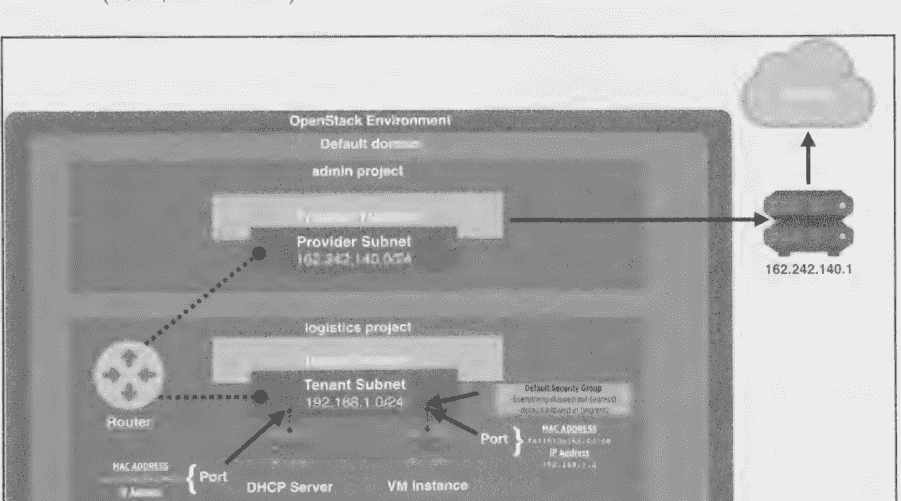

图 6.2：Neutron 概念图

## 考试目标

让我们来看看 Neutron 考试目标。

下图分解了你在 COA 考试中应了解的各种 Neutron 相关目标。如图 6.3 所示，所有这些任务都可以在 Horizon 控制台和 CLI 上完成。请记住：考试期间时间至关重要，在许多情况下，在控制台上处理任务会快得多。


图 6.3：Neutron 考试目标可以在 Horizon 控制台或 CLI 上完成

## 考试目标 - 管理租户网络

租户网络是 OpenStack 用户生活中必不可少的一部分。默认情况下，非管理员用户可以创建多个租户网络（最高达最大项目配额）并为其附加多个子网。相同的项目/所有者理念适用于网络和子网：任何新创建的网络和子网都将归用户在创建时所限定到的项目所有。只有项目内的用户才能管理新创建的网络和子网。尽管用户可以通过 RBAC 规则与特定项目共享网络，但这超出了 COA 复习的范围，也不是必需的目标。

## Horizon 控制台

让我们从 Horizon 控制台创建一个租户网络。见图 6.4。

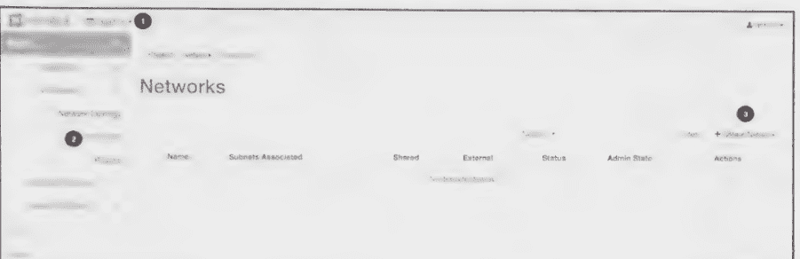

图 6.4：在 Horizon 控制台上创建租户网络

- 1. 从 OpenStack 概览页面，通过选择顶部下拉菜单将自己限定到 logistics 项目。
- 2. 从 Project-Network 面板组中选择 Networks 面板。
- 3. 选择创建网络。
- 4. 见图 6.5。网络名称（可选）：租户网络的名称。输入 `tenant-network1-dashboard`。
- 5. 管理状态（必填）：管理状态控制网络是关闭还是开启。如果将其设置为 DOWN 状态，与网络关联的任何子网在重新设置为 UP 之前将无法使用。请验证其设置为 UP。
- 6. 共享（必填）：这类似于公共选项。如果租户网络是共享的，所有项目（即使跨其他域）都能够创建子网——从而在此网络上启动实例。然而，他们将无法修改网络属性或删除它。我们将保持此项未选中，仅对 logistics 项目内的用户可访问。
- 7. 为了本次练习，让我们取消选中创建子网，以便仅创建网络。我们将在下一节中创建子网。

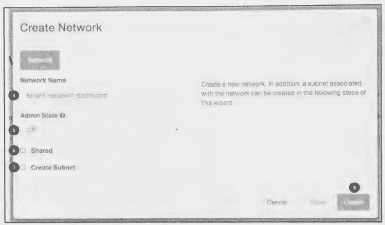

图 6.5：Horizon 控制台上的“创建网络”属性

- 8. 选择创建。

我们现在应该有一个由 logistics 项目拥有的租户网络。见图 6.6。需要注意的是，因为我们尚未为新网络关联子网，所以目前还无法在此网络上启动实例。

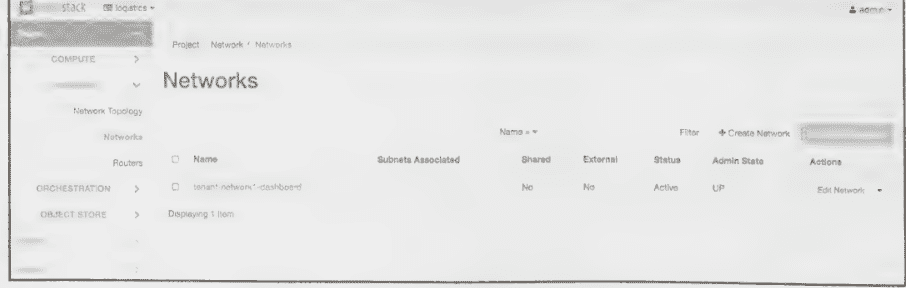

图 6.6：Horizon 控制台上由 logistics 项目拥有的租户网络

请记住，Admin-System 面板组提供了 OpenStack 环境中所有资源的视图。这包括所有域中的所有项目。如果我们查看 Admin-System 面板组的网络部分，我们应该能够看到上一章中 human-resources 项目的 tenant-network1-dashboard 网络。见图 6.7。

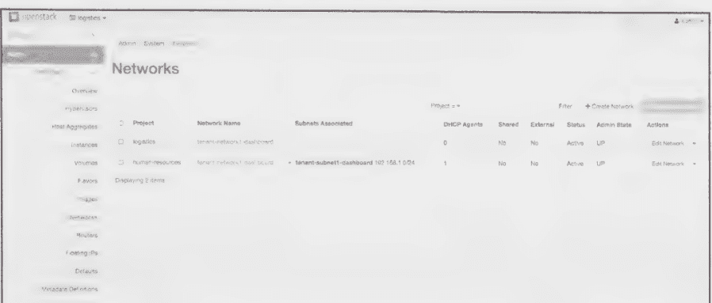

图 6.7：Admin-System 面板组的网络部分将显示环境中所有项目的所有网络

## CLI

请回忆，提供给你的 openrc 文件包含用于正确向 Keystone 进行身份验证并设置项目范围的变量形式凭据。

在本章中，我们将在 logistics 项目中完成所有 Neutron 相关任务。让我们将原始的 openrc 文件复制到名为 openrc-logistics 的新文件中。

```
$ cp openrc openrc-logistics
```

现在我们已经复制了文件，让我们编辑 openrc-logistics 文件，将项目和租户名称变量更新为反映我们希望限定到 logistics 项目的范围。如果你更习惯使用其他编辑器，这里也可以使用它。

```
$ nano openrc-logistics
```

将以下变量更改为 logistics：

```
export OS_PROJECT_NAME=logistics
export OS_TENANT_NAME=logistics
```


我们更改 OS_TENANT_NAME 变量，因为我们在后续章节中使用的一些旧服务型客户端依赖于此变量。

载入新创建的 openrc-logistics 文件：

```
$ source openrc-logistics
```

验证正确的变量是否已设置，并且我们正在 logistics 项目中工作：

```
$ export | grep OS
```

现在我们已正确限定范围，从现在开始创建的任何新网络都将归 logistics 项目所有。需要牢记的一件非常重要事情是，我们在考试中以管理员用户身份执行所有目标。由于我们在 logistics 项目上拥有管理员角色，我们可以看到默认域中所有项目的所有网络。这类似于从 Admin-System 面板组查看网络，如图 6.7 所示。例如，运行以下命令：

```
$ openstack network list
```

请注意，此命令显示的是 OpenStack 环境中的所有网络，而不仅仅是 logistics 项目中的网络。

作为管理员用户保持组织有序的一种方法是向命令添加 --long 参数。这将提供项目列，让我们知道特定网络位于哪个项目中。

```
$ openstack network list --long
```

你应该会看到类似于图 6.8 的输出：


图 6.8：所有网络（跨所有项目/域）的列表。此视图类似于图 6.7 中的控制台视图

注意项目列？它会告诉我们哪个项目拥有特定网络。要获取与项目关联的 UUID 列表，请运行 openstack project list。

让我们使用 python-openstackclient 在 logistics 项目中创建一个新的租户网络。语法很简单！

使用 openstack help network create 查看其他可用参数。

```
$ openstack network create tenant-network1-cli
```

验证网络是否已成功创建并且归 logistics 项目关联的 UUID 所有。见图 6.9。

```
$ openstack network list --long
```


图 6.9：'openstack network list --long' 命令的输出

我们现在应该有两个由 logistics 项目拥有的租户网络：tenant-network1-dashboard 和 tenant-network1-cli。

请注意，我们只需要提供网络的名称。与网络关联的其他属性（VXLAN 网络类型、段 ID 等）是默认值，已在 /etc/neutron/* 的 Neutron 配置文件中预先配置。

## 考试目标 - 管理租户子网

在 Neutron 中，子网是从中可为虚拟机实例和其他网络资源分配 IP 地址的 IPv4 或 IPv6 地址块。每个 Neutron 子网必须与租户网络关联。


创建子网时，用户可以指定多种参数：限制子网中哪些地址可用的分配池、自定义网关地址、DNS 服务器列表以及单个主机路由。我们将在下一节中更详细地讨论这一点。

多个子网可以关联到一个 Neutron 网络，但它们都必须具有唯一的 CIDR 范围。要创建具有完全相同 IP 地址范围的多个子网，请创建另一个网络。这被称为 **overlapping IPs**。

## Horizon 控制面板

让我们从 Horizon 控制面板创建租户子网。参见图 6.10。

1. 从 OpenStack 概览页面，通过选择顶部下拉菜单将自己限定到 **logistics** 项目。
2. 从 **Project-Network** 面板组中选择 **Networks** 面板。你应该会看到两个需要我们管理的租户网络：
    - **tenant-network1-dashboard**
    - **tenant-network1-cli**
3. 选择 **tenant-network1-dashboard** 旁边的下拉菜单并选择 **Add Subnet**。

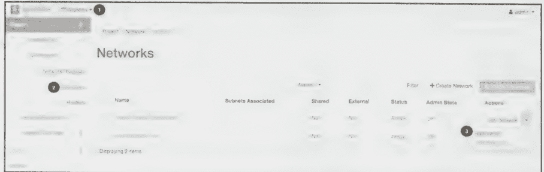

图 6.10：在 Horizon 控制面板中创建新的子网

4. 参见图 6.11。子网名称（可选）：`tenant-subnet1-dashboard`

5. 网络地址（必填）：`192.168.1.0/24`。这必须采用无类别域间路由（CIDR）表示法。CIDR 表示法是 IP 地址及其相关路由前缀的紧凑表示。

由于这是 Neutron 网络中较令人困惑的方面之一，让我们花点时间了解它与现实世界网络有何不同。

- 在现实世界网络中，`192.168.1.0/24` 的分解如下：
    - `192.168.1.0`：网络
    - `192.168.1.1` 至 `192.168.1.254`：网络上的主机
    - `192.168.1.255`：广播
- 在 Neutron 子网中，CIDR（如果所有默认子网选项均适用）将分解如下：
    - `192.168.1.0`：表示网络
    - `192.168.1.1`：保留给路由器（网关），即使当前不存在路由器
    - `192.168.1.2`：DHCP 服务器
    - `192.168.1.3` 至 `192.168.1.254`：实例或其他资源
    - `192.168.1.255`：广播


6. IP 版本（必填）：我们将其设置为 IPv4。

7. 网关 IP（可选）：留空，以便自动默认为 `192.168.1.1` 作为网关地址。

8. 禁用网关：应保持未选中。选中此选项将阻止连接到子网的任何实例从 DHCP 服务器接收默认路由公告。

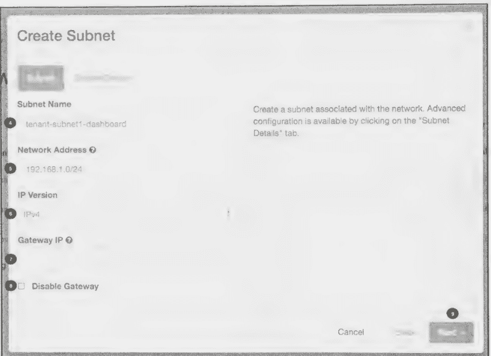

图 6.11：在 Horizon 控制面板上提供子网详细信息

9. 选择下一步。

10. 参见图 6.12。启用 DHCP：应选中以确保子网启用 DHCP。

11. 分配池（可选）：允许你指定 IP 地址的起始和结束。例如，输入分配池 192.168.1.100,192.168.1.105 将导致你的 DHCP 服务器获得 192.168.1.100，而连接到子网的第一台实例将为 192.168.1.101。如果我们留空，它将尝试使用 CIDR 范围的大部分，在我们的例子中为：192.168.1.2,192.168.1.254。我们将保持空白。

12. **DNS 名称服务器**（可选）：这是要通告给实例的 DNS 名称服务器的 IP 地址列表。不提供值将把 DHCP 服务器 IP 作为 DNS 服务器通告给连接到子网的所有实例。这可以自动提供 OpenStack 内实例主机名到其各自 IP 地址的解析。为了解析 OpenStack 外的名称，我已将内部 DNS 选项设置为使用 Google DNS 8.8.8.8。`/etc/neutron/dhcp_agent.ini` 中还有额外的 DNS 选项。我们将保持框 **空白**。
13. **主机路由**（可选）：通告给主机的任何额外路由。我们将保持此项 **空白**。
14. 选择 **创建**。

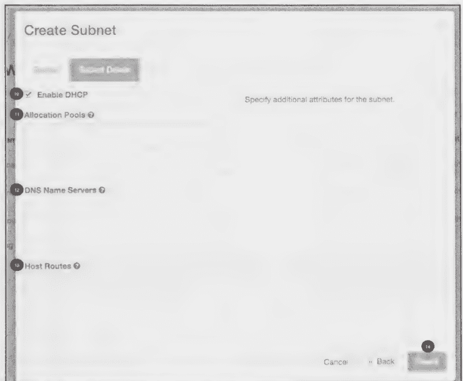

图 6.12：在 Horizon 控制面板上为子网提供 DHCP 选项

太好了！我们刚刚在 Horizon 控制面板上创建了一个全新的子网。请记住，你始终可以通过选择编辑子网从 Horizon 控制面板更新此子网。


图 6.13：在 Horizon 控制面板上编辑/更新子网

让我们继续将此子网的默认分配池从默认的 192.168.1.2,192.168.1.254 更改为 192.168.1.50-192.168.1.60。选择保存。参见图 6.14。


图 6.14：在 Horizon 控制面板上更改子网的分配池

尽管 DHCP 服务器已被分配到 ...，在此子网上启动的第一台实例将接收 IP 地址 ...

## 命令行界面

现在让我们学习如何创建子网...

源化 ... 文件。如果尚未执行此操作，请参考本章开头。

```
$ source openrc-logistics
```

验证是否已设置正确的变量：

```
$ export | grep OS
```

让我们创建一个新的子网并将其附加到上一节中创建的租户网络 tenant-network1-cli：

```
$ openstack subnet create --network tenant-network1-cli --subnet-range 192.168.1.0/24 tenant-subnet1-cli
```

现在让我们确认新的 tenant-subnet1-cli 是否出现在我们的列表中。与 openstack network list 命令类似，我们将添加 --long 标志以验证 logistics 项目是否拥有该子网。

```
$ openstack subnet list --long
```

你应该会看到与图 6.15 相似的输出。


## 考试目标 - 管理安全组和规则

现在我们已经创建了租户网络和子网，让我们谈谈安全组。安全组为控制端口进出流量的虚拟防火墙规则提供配置文件。该配置文件通常与实例的端口相关联。

每个项目都包含一个默认安全组，允许所有出站流量但拒绝所有入站流量。安全组经常用于打开用户可能需要访问以与 OpenStack 外部应用程序通信的端口，以及防止同一子网中不同应用程序之间不必要的东西向流量——从而增加额外的保护层。

安全组规则是有状态的，允许已建立的流量。一个例子是允许入站 TCP 端口 22 用于 SSH。该规则会自动允许已建立的返回流量。另一个例子是允许出站 ICMP 用于 ping。这将自动允许返回流量，以便用户可以看到 ping 的回复。

## Horizon 控制面板

1. 从 OpenStack 概览页面，通过选择顶部下拉菜单将自己限定到 logistics 项目。
2. 在 Project-Compute 面板组上选择 Access & Security 面板。你应该会自动设置为 Security Groups 选项卡。在这里你应该会看到一个当前的安全组，名为 default。默认情况下，每个项目有一个默认安全组。
3. 让我们检查默认安全组中的规则。选择管理规则。

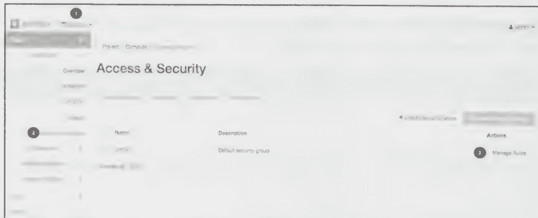

图 6.16：从 Horizon 控制面板管理安全组

4. 参见图 6.17。我们现在应该会看到属于默认安全组的所有规则的列表。所有 IPv4 和 IPv6 出站流量均被允许。所有 IPv4 和 IPv6 入站流量均被阻止，除来自具有默认安全组的端口的流量外。例如，这可能是同一项目中的另一个实例。让我们选择添加规则。

5. 参见图 6.18。规则（必填）：规则定义允许分配给安全组的实例的流量。我们将选择 ALL ICMP（ping）。

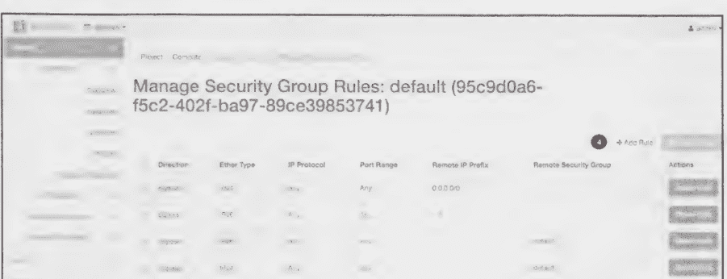

图 6.17：从 Horizon 控制面板管理安全组规则

6. 方向（必填）：Ingress（进入实例）或 Egress（从实例发出）。我们将选择 Ingress 以允许传入 ICMP（ping）。

7. 远程（必填）：你必须指定允许的流量的来源。这可以是 CIDR 形式中的 IP 地址块或安全组。选择安全组将允许应用该安全组的任何其他实例。

8. CIDR（必填）：要允许来自任何 IP 地址的传入 ping，我们可以选择远程 CIDR 0.0.0.0/0。让我们在这里输入。


- 9. 选择“添加”以添加规则。

你还可以从规则下拉菜单中选择预定义的协议，包括 HTTP（80）、HTTPS（443）和 SSH（22）。使用自定义 TCP 规则允许我们自行填写端口号。

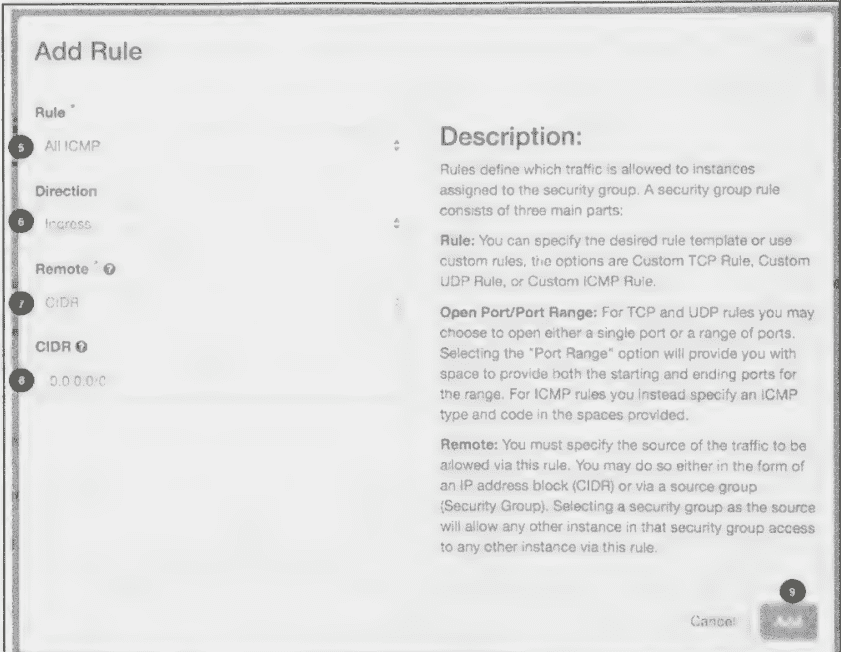

图 6.18：添加一条允许从任何源 IP 地址传入 ICMP 的新安全组规则

见图 6.19。新的 ICMP 现在应出现在 **logistics** 项目中的 **default** 安全组中。

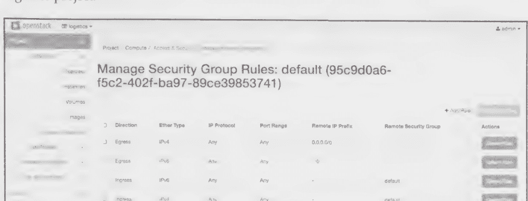

图 6.19：在 logistics 项目的 default 安全组中新建的 ICMP 安全组规则

现在我们已向 default 安全组添加了新规则，让我们创建一个全新的安全组并向其添加规则。许多 OpenStack 用户会为特定的实例角色创建全新的安全组。例如，创建名为 `database-sg` 的新安全组可能是合适的。该安全组可以包含一条规则，仅允许具有 `webserver-sg` 安全组的任何实例的 TCP 入站流量。

让我们在仪表板上创建一个全新的安全组，名为 `webserver-sg-dashboard`。该安全组将包含一条允许从任何地方传入 SSH 流量（端口 22）的规则！

- 1. 见图 6.20。从 OpenStack 概览页面，通过选择顶部下拉菜单将范围限定到 **logistics** 项目。
- 2. 在 **Project-Compute** 面板组中选择 **Access & Security** 面板。你应自动切换到 **Security Groups** 选项卡。这里你应该看到一个当前的安全组，名为 **default**。默认情况下，每个项目都有一个 **default security group**。

- 3. 选择 **Create Security Group**。

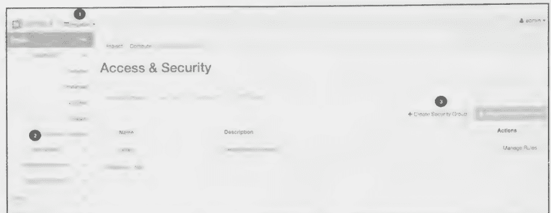

图 6.20：从 Horizon 仪表板创建新的安全组：

- 4. 见图 6.21。**Name**（必填）：安全组的名称。请记住，由于 UUID 的存在，我们可以拥有多个同名安全组。将组命名为 `webserver-sg-dashboard`。

- 5. **Description**（可选）：安全组的描述。输入 `A security group for web server instances`。

- 6. 选择 **Create Security Group**。

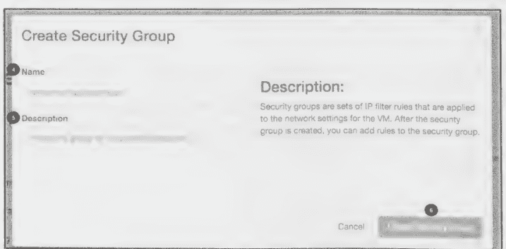

图 6.21：Horizon 仪表板上的新安全组选项

现在你应该有一个新创建的安全组。该组仅包含两条规则，允许 IPv4 和 IPv6 的所有出站流量。

让我们通过选择 Add Rule 创建一条新的安全组规则。该规则将允许从任何地方传入 SSH。它应具有以下内容：

- **Rule:** Custom TCP Rule
- **Direction:** Ingress
- **Open Port:** Port
- **Port:** 22
- **Remote:** CIDR
- **CIDR:** 0.0.0.0/0

见图 6.22。创建后，你应该会看到与 webserver-sg-dashboard 关联的新规则。

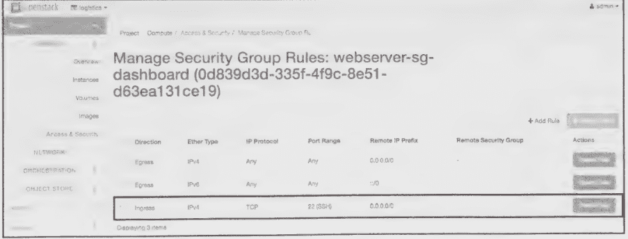

图 6.22：一条允许从任何源 IP 地址传入 SSH（TCP/端口 22）的安全组规则

## CLI

让我们继续学习如何通过 python-openstackclient 添加新的组和规则。

导入 openrc-logistics 文件：

```
$ source openrc-logistics
```

验证是否已设置正确的变量以允许你限定到 logistics 项目：

```
$ export | grep OS
```

让我们使用 python-openstackclient 列出环境中的所有安全组。你会注意到我们可以看到 OpenStack 环境中所有项目中的所有安全组（每个项目内一个默认组）。

```
$ openstack security group list
```


图 6.23：OpenStack 环境中所有安全组的列表。每个项目有一个默认安全组

如我们所见，logistics 项目目前有两个安全组：default 和我们新创建的 webserver-sg-dashboard。

让我们创建一个全新的安全组：

```
$ openstack security group create webserver-sg-cli
```

现在我们可以轻松添加一条允许从任何地方传入 SSH（端口 22）的新规则。

```
$ openstack security group rule create --protocol tcp --ingress --dst-port 22 --src-ip 0.0.0.0/0 webserver-sg-cli
```

你应该会看到与图 6.24 相似的输出。

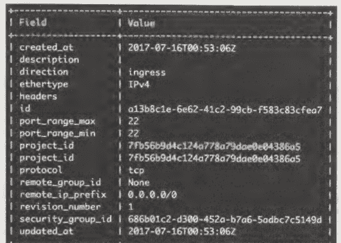

图 6.24：'openstack security group rule create' 命令的输出

现在让我们验证我们新创建的 webserver-sg-cli 安全组是否包含我们的入站 SSH 规则（除了允许 IPv4 和 IPv6 所有出站流量的两条规则之外）。见图 6.25。

```
$ openstack security group rule list webserver-sg-cli --long
```


图 6.25：'openstack security group rule list' 命令的输出

## Exam objective - managing routers - east/west traffic

在 OpenStack 世界中，路由器是提供子网之间三层连接的虚拟网络设备。路由器本质上为两种类型的场景提供路由：东西向和南北向流量。

在本节中，我们将重点了解和创建东西向流量场景。如果两个虚拟机实例位于两个不同的子网中，除非有路由器在它们之间转发流量，否则它们将无法相互通信。OpenStack 用户可以创建多个网络和子网并用路由器连接它们。

让我们通过创建类似于图 6.26 的东西向路由场景来实现此目标：


图 6.26：两个 Neutron 租户网络之间的东西向流量

### Horizon dashboard

在 Neutron 准备的这个阶段，我们应该在 logistics 项目中有一个仪表板租户网络：`tenant-network1-dashboard`。

为了设置图 6.26 中的场景，我们需要执行以下操作：

- 创建另一个名为 `tenant-network2-dashboard` 的仪表板租户网络并添加一个名为 `tenant-subnet2-dashboard` 的子网
- 启动两个虚拟机实例。一个虚拟机实例将附加到 **tenant-network1-dashboard**，另一个将附加到 **tenant-network2-dashboard**。
- 创建一个路由器
- 将 `tenant-subnet1-dashboard` 和 `tenant-subnet2-dashboard` 连接到路由器

让我们开始在仪表板上创建新的租户网络和子网。按以下详细信息创建网络和子网：

### Create Network (Figure 6.27)

验证你是否已限定到 logistics 项目。

**Network Name**: `tenant-network2-dashboard`

**Admin State**: UP

**Shared**: unchecked

**Create Subnet**: checked

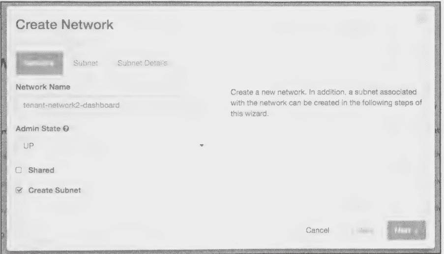

图 6.27：在 Horizon 仪表板上创建 tenant-network2-dashboard

### Create Subnet (Figure 6.28)

Subnet Name: tenant-subnet2-dashboard

Network Address: 192.168.2.0/24

IP Version: IPv4

Gateway IP: blank (it will automatically use 192.168.2.1)

Disable Gateway: unchecked

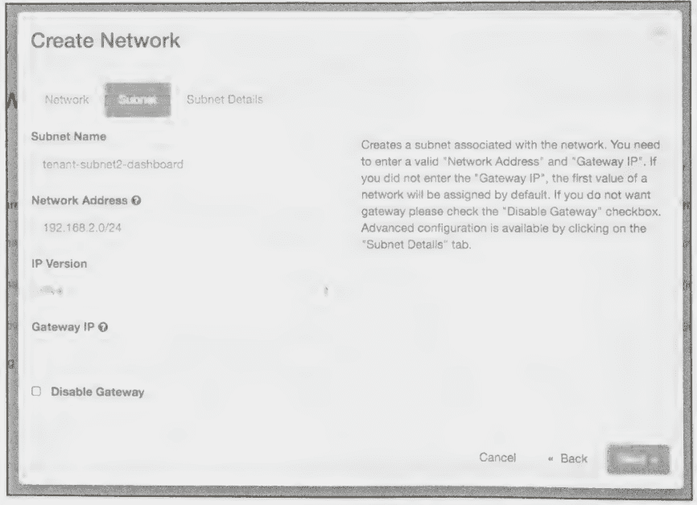

图 6.28：在 Horizon 仪表板上创建 tenant-subnet2-dashboard

### Subnet Details (Figure 6.29)

Enable DHCP: checked

Allocation Pools: blank

DNS Name Servers: blank

Host Routes: blank

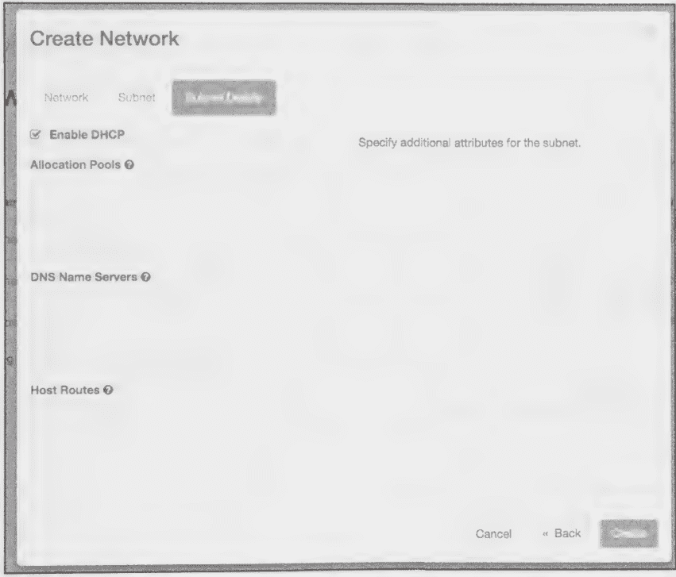

图 6.29：Horizon 仪表板上 tenant-subnet2-dashboard 的子网详细信息

现在我们应该在 logistics 项目中有两个租户网络。见图 6.30。

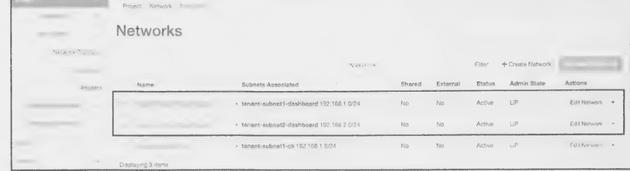

图 6.30：Horizon 仪表板上的两个租户网络（带子网）

现在让我们创建两个虚拟机实例：一个在 **tenant-network1-dashboard** 中，另一个在 **tenant-network2-dashboard** 中。再次确保你已限定到 **logistics** 项目！不要忘记 **耐心等待并给实例足够的时间启动！**


如果在尝试启动实例时遇到错误，请验证你是否没有在其他项目中运行实例。本书附带的虚拟设备至少需要分配 6GB RAM，但 **不能** 同时支持运行大量实例。如果继续遇到启动实例的问题，请通过在终端运行 `sudo reboot` 或在 VirtualBox 中手动关闭设备来重启虚拟设备。如果你的笔记本电脑或台式机上有可用内存，请随时将 VirtualBox 中虚拟设备的分配 RAM 增加到大于 6GB 的值。

以下是实例的详细信息：

### Instance1 (See Figure 6.31)

Instance Name: `instance1-dashboard`

Availability Zone: `nova`

Count: 1


源: cirros

规格: m1.tiny

网络: tenant-network1-dashboard

安全组: default

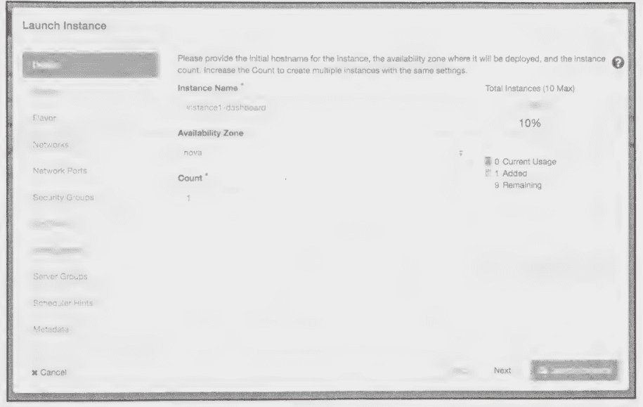

图 6.31：在 Horizon 控制台上启动新的虚拟机实例

## Instance2（参见图 6.32）

实例名称: instance2-dashboard

可用区: nova

数量: 1

源: cirros

规格: m1.tiny

网络: tenant-network2-dashboard

安全组: default

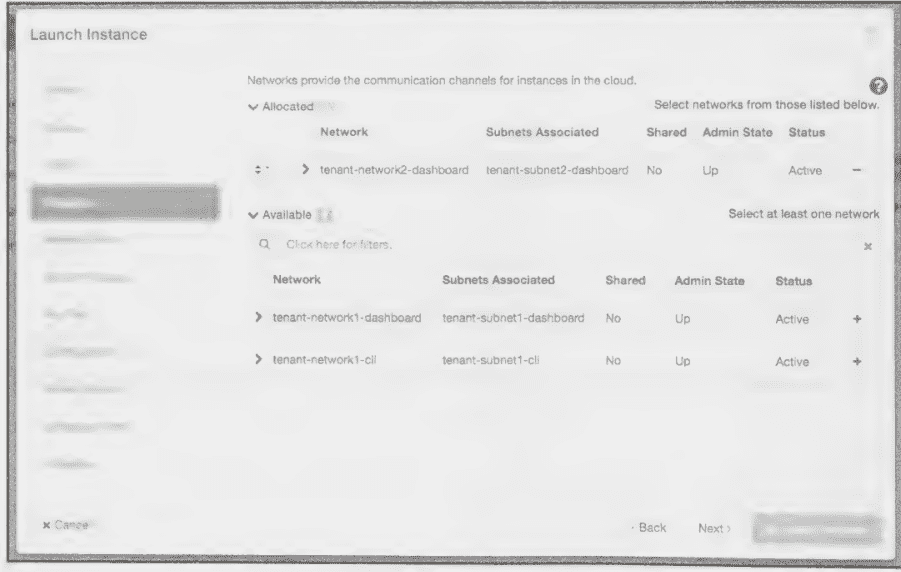

图 6.32：验证 instance2-dashboard 是否在 tenant-network2-dashboard 上启动

不要担心如果你的实例在启动时未获得 .3 IP 地址。我们无法保证仅将实例附加到网络时就能获得第一个可用的 IP 地址。如果您想保留或指定特定的 IP 地址，可以通过 Admin-System Networks 面板或通过 python-openstackclient 创建端口来实现。例如，在创建实例之前，您可以通过运行以下命令为 192.168.1.3 创建一个端口： `openstack port create --network <network-uuid> --fixed-ip subnet=<subnet-uuid>,ip-address=192.168.1.3 my-new-port`。创建端口后，在启动实例时指定端口（而不是网络）。有关更多详细信息，请检查 `openstack help port create`。

请参阅图 6.33。我们现在应该在 logistics 项目中拥有两个实例。


图 6.33：Horizon 控制台上 logistics 项目中的两个实例

在这一点上，这些网络上的两个子网彼此完全隔离。为了使 instance1-dashboard 能够与 instance2-dashboard 通信，我们需要创建一个路由器。

请参阅图 6.34。要创建路由器，请按照以下步骤操作：

- 1. 从 OpenStack 概览页面，通过选择顶部下拉菜单将自己限定到 **logistics** 项目。
- 2. 从 **Project-Network** 面板组中选择 **Routers** 面板。
- 3. 选择 **Create Router**。

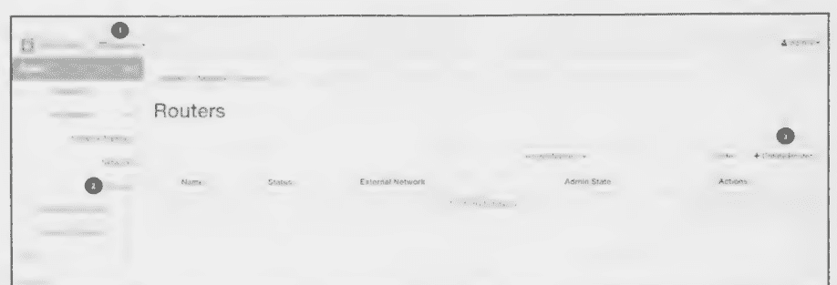

图 6.34：在 logistics 项目中创建路由器

- 4. 请参阅图 6.35。**Router Name**（必填）：路由器的名称。输入 `router-dashboard`。
- 5. **Admin State**（必填）：控制网络是关闭还是开启。如果将其设置为 DOWN 状态，它将不会路由任何流量。验证其是否设置为 **UP**。
- 6. **External Network**（可选）：选择路由器的网关。我们将在处理南北向流量时更详细地探讨这一点。现在，将其保持在 **Select Network**。

- 7. 选择 **Create Router**。

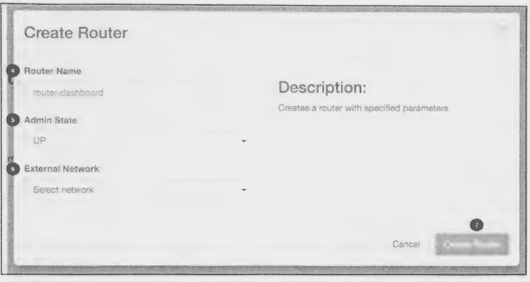

图 6.35：通过控制台添加路由器详细信息

太好了！我们现在有一个由 logistics 项目拥有的路由器。路由器本身不能做太多事情，因此我们需要将其连接到我们的两个网络。

- 1. 请参阅图 6.36。选择 **router-dashboard**。

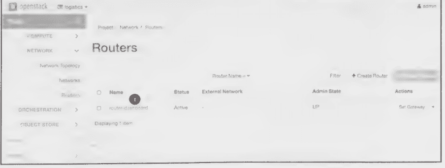

图 6.36：在 Horizon 控制台上选择路由器

- 2. 请参阅图 6.37。选择 **Interfaces** 选项卡。

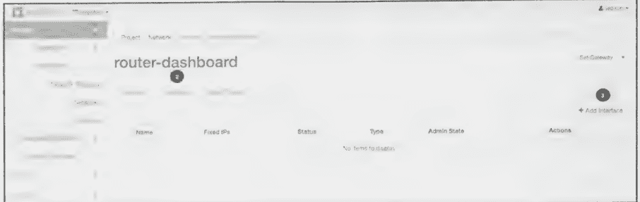

图 6.37：在 Horizon 控制台上向路由器添加接口

- 3. 选择 **Add Interface**。
- 4. 请参阅图 6.38。**Subnet**（必填）：选择要连接到路由器的子网名称。我们将选择 **tenant-network1-dashboard:192.168.1.0/24**。
- 5. **IP Address**（可选）：这允许我们为网关指定特定的 IP 地址。我们将将其留空，因为我们假设它将是默认的 `192.168.1.1`。
- 6. 选择 **Submit**。

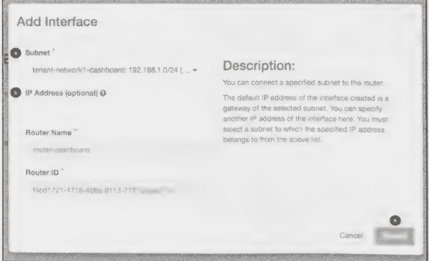

图 6.38：通过控制台添加接口详细信息

继续创建另一个路由器接口，执行相同的步骤序列，但添加 tenant-network2-dashboard:192.168.2.0/24。

结果应类似于图 6.39。由于我们没有费心手动创建端口，因此此处的 IP 地址可能不同。只需确保记下每个实例的 IP 地址即可。

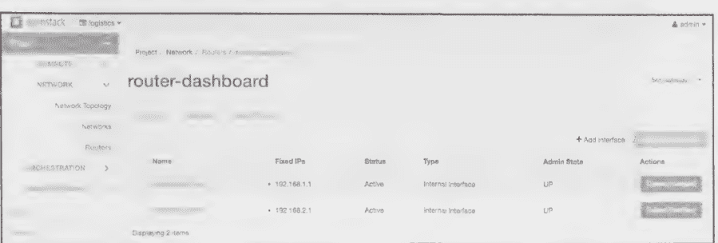

图 6.39：Horizon 控制台上连接到路由器的两个接口

让我们继续检查实例之间的连通性。通过按照第 5 章 Nova Compute Service 中概述的说明，通过控制台访问 instance1-dashboard 实例。

如果您忘记了，这里是 Cirros 登录凭据：

username: cirros

password: cubswin:)

现在我们已登录，让我们尝试 ping（3 次）instance2-dashboard，地址为 192.168.2.x。如果您记不起 instance2-dashboard 的 IP 地址，请返回控制台上的实例页面进行检查！

```
$ ping -c 3 192.168.2.x
```

我们应该会收到回复！并且会看到类似于图 6.40 的内容。

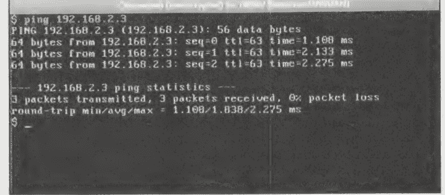

图 6.40：驻留在另一个租户网络上并响应 ping 的实例。这证实了东西向流量通信成功


如果您在不使用 -c 计数参数的情况下执行 ping，可以通过按 Ctrl + C 来取消它。

## CLI


如果您计划在 CLI 上尝试此练习，请确保删除您刚刚在控制台上创建的实例！虚拟设备很可能无法处理所有这些正在运行的虚拟机！如果您想继续在控制台上进行练习，请随时跳到下一节：Horizon 控制台上的管理提供商网络。

让我们使用 python-openstackclient 设置我们的东西向流量场景。

导入 openrc-logistics 文件：

```
$ source openrc-logistics
```

验证是否已设置正确的变量：

```
$ export | grep OS
```

让我们创建新的附加网络和子网：

```
$ openstack network create tenant-network2-cli
$ openstack subnet create --network tenant-network2-cli --subnet-range 192.168.2.0/24 tenant-subnet2-cli
```

让我们启动我们的实例：

```
$ openstack server create --image cirros --flavor m1.tiny --nic net-id=tenant-network1-cli instance1-cli
$ openstack server create --image cirros --flavor m1.tiny --nic net-id=tenant-network2-cli instance2-cli
```

确认实例是否成功创建：

```
$ openstack server list
```

让我们创建路由器：

```
$ openstack router create router-cli
```

我们应该会看到以下输出：

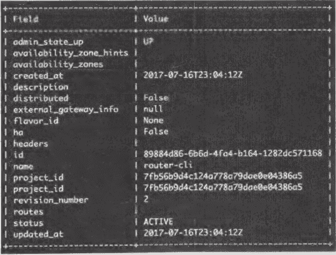

图 6.41：'openstack router create' 命令的输出

现在让我们将两个子网连接到路由器。在此之前，让我们列出可用的子网：

```
$ openstack router add subnet router-cli tenant-subnet1-cli
$ openstack router add subnet router-cli tenant-subnet2-cli
```

您不会看到这些命令的任何输出。为了验证我们的工作，我们可以使用 --router 标志运行 openstack port list 命令：

```
$ openstack port list --router router-cli
```

我们应该会看到以下输出：


图 6.42：'openstack port list --router' 命令的输出

我们现在可以确认实例应该能够成功相互 ping。

## 考试目标 - 管理提供商网络

现在我们了解了如何管理租户网络和子网，以及如何在两个不同的租户网络之间设置东西向流量，让我们创建一些提供商网络。提供商网络对于任何云环境都至关重要，因为它们使 OpenStack 实例能够访问 OpenStack 环境之外的外部资源。如果 Nova 实例只能与存在于 OpenStack 环境中的资源通信，那将非常无用！如果实例无法访问互联网来下载最新的操作系统软件包，有什么用？如果我们的客户无法从外部访问我们的 Web 应用程序，实例有什么用？提供商网络是提供对 OpenStack 之外事物网络访问的魔力。

## Horizon 控制台

在控制台上创建提供商网络之前，务必记住，默认情况下，只有具有管理员角色的用户才能创建提供商网络。


See Figure 6.43. Provider networks will only show up in the Admin-System panel group section of the Horizon dashboard.

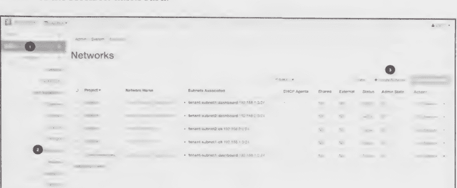

Figure 6.43: Creating a provider network from the Horizon dashboard

- 1. From the OpenStack overview page, select the **Admin** panel group.
- 2. Select the Networks Panel on the **Admin-System** panel group. Here you should see all current tenant networks owned by all projects in the environment. You can identify them as tenant networks because you can see that the **External** column is set to No.
- 3. Let’s create a brand new provider network. Select **Create Network**.

See Figure 6.44. The **Create Network** screen for provider networks is a bit different than the one for tenant networks previously reviewed in this chapter. Let’s explore the options:

- 1. **Network Name** (optional): The name for your tenant network. Enter `provider-network-dashboard`.
- 2. **Project** (required): The specific project we want to own this provider network. In our environment, regular users will not be modifying the provider network, so let’s place it in the **admin** project.
- 3. **Provider Network Type** (required): We can specify a tagging or encapsulation method for the provider network. This is useful if we want the provider network to link to a resource that resides on a specific VLAN, VXLAN, or GRE tunnel. We also have the ability to select FLAT to represent no encapsulation or tagging of the provider network traffic. Let's specify FLAT.
- 4. **Physical Network** (required): The name of the physical interface mapping we want associated with this provider network. This is not an interface name (such as eth0, eth1, or eth2) but rather a label defined in the file `/etc/neutron/plugins/ml2/linuxbridge_agent.ini`. I have previously created a mapping between the interface veth1 on the virtual appliance and the label `public-dashboard`. This network will provide your OpenStack environment access to the outside world, a.k.a. the internet (as long as you have internet access on your host machine). Type in `public-dashboard`.
- 5. **Segmentation ID** (optional): You only need to specify the segmentation ID if you specify a VLAN, VXLAN, or GRE Provider Network Type in Step 6. This could be a VLAN tag, VXLAN VNI, or GRE ID. We will leave this blank since we are using Provider Network Type FLAT (no encapsulation/tagging).
- 6. **Admin State** (required): The Admin State controls whether the provider network is off or on. If you set it in the DOWN state, any subnets you associate with the provider network will not be functional until turned back to UP. Verify it is set to UP.
- 7. **Shared** (optional): If a provider network is shared, all projects across all domains will be able to directly attach their instances to this provider network. We are only going to allow our users to set their router gateways to the provider network, so we will make sure we uncheck this option.
- 8. **External Network** (optional): This is the magic that allows our users to set their router's gateway to the network. This will allow us to get our virtual machine instances access to the resources that live outside OpenStack. Let's make sure it is checked.

- 9. Select **Submit** to create the network.

## Create Network

### Description:

Create a new network for any project as you need.

Provider specified network can be created. You can specify a physical network type (like Flat, VLAN, GRE, and VXLAN) and its segmentation_id or physical network name for a new virtual network.

In addition, you can create an external network or a shared network by checking the corresponding checkbox.

| Field | Value |
|---|---|
| Name | provider-network-dashboard |
| Project * | admin |
| Provider Network Type * | Flat |
| Physical Network * | public-dashboard |
| Segmentation ID * |  |
| Admin State * | UP |
| Shared |  |
| External Network |  |
| Cancel |  |
| Submit |  |

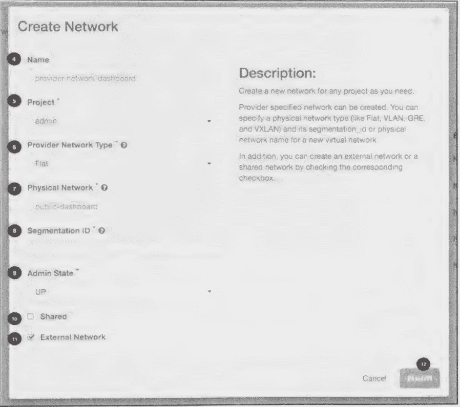

Figure 6.44: Entering provider network details on the Horizon dashboard

After you have created provider-network-dashboard, you should see it in the list of networks in the Networks panel in the Admin-System panel group. See Figure 6.44. Notice how the provider network shows Yes in the External column.

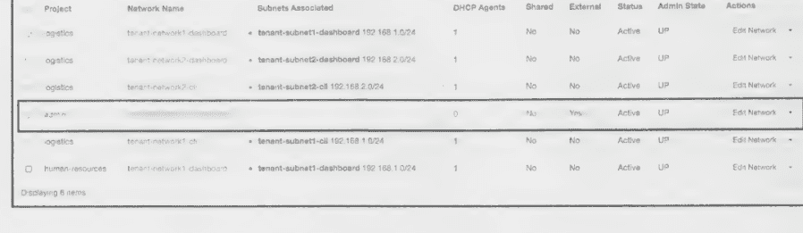

Figure 6.45: A newly created provider network on the Horizon dashboard

## CLI

It's time to jump on the command line again. This time, we will be creating a provider network. Remember: we want the provider network to exist inside the admin project so users in other projects can't modify it. In that case, we only need to source the openrc file.

```
$ source openrc
```

Verify that the proper variables are set and you are scoped to the admin project:

```
$ export | grep OS
```

Now let's create our new provider network. This time, we will specify the public-cli for the provider's physical network. This is a physical network mapping that I previously provisioned for the virtual appliance. Like the public-dashboard physical network we used in the previous exercise, this provides your OpenStack environment with access to your system's internet connection. Also take note of the --external flag. Without this flag, your users will not be able to set their router's gateway to the provider network.

```
$ openstack network create --provider-physical-network public-cli --provider-network-type flat provider-network-cli --external
```

You should see the following output:

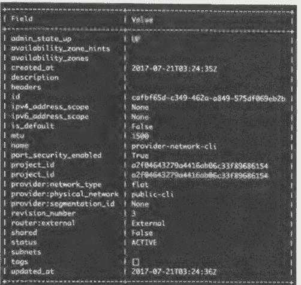

Figure 6.46: Output from the 'openstack network create' command

Confirm provider-network-cli was successfully created by running the following:

```
$ openstack network list --long
```

Congratulations! You've created a brand new provider network on the CLI.

## Exam objective - manage provider subnets

Managing provider subnets is identical to managing tenant subnets. We will follow a very similar process to the tenant subnet creation process outlined earlier in the beginning of this chapter. One slight difference is that our provider subnet will not have DHCP enabled. Remember: our users will not be attaching instances directly to the provider network and subnet. When we demonstrate north/south traffic in the next section, you will only set your router gateway to the provider network/subnet.

It's also important to note that the subnet CIDR defined in the provider subnet will become the available floating IP address pool. We will learn about floating IP addresses in the last section of this chapter.

## Horizon dashboard

- 1. See Figure 6.47. Select `provider-network-dashboard` from the Networks panel under the Admin-System panel group.
- 2. See Figure 6.48. Select the **Subnets** tab.
- 3. Select **Create Subnet**.
- 4. See Figure 6.49. **Subnet Name**: `provider-subnet-dashboard`

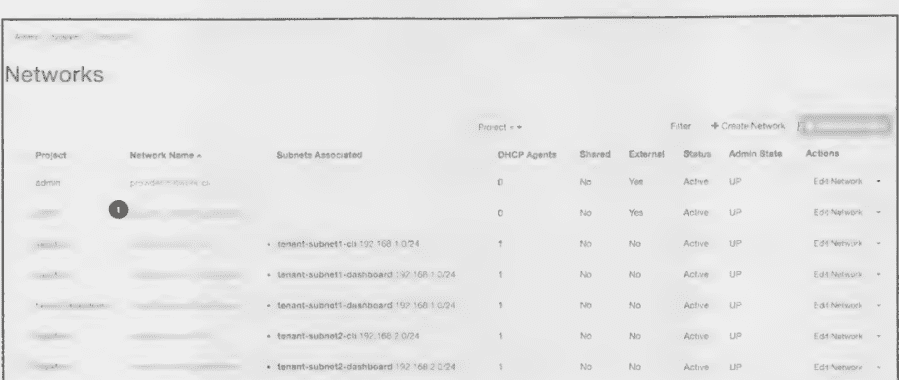

Figure 6.47: Creating a provider subnet on the Horizon dashboard

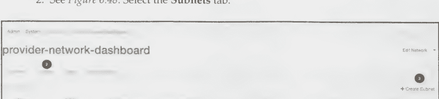

Figure 6.48: Creating a provider subnet on the Horizon dashboard


Figure 6.49: Filling in provider subnet details on the Horizon dashboard

- 5. Network Address: 172.16.0.0/24. Because you most likely only have access to one public IP address in your home, we will temporarily suspend our disbelief and select an internal IP address range to act as our external provider network IP address. We are using this private network range because the virtual appliance has a previously created gateway interface, which will allow the provider network to talk out to the internet connection on the host machine. In the real world, this could be an external IP address range provided by an Internet Service Provider.
- 6. IP Version: IPv4
- 7. Gateway IP: This is the previously created gateway interface on your virtual appliance. This will typically be the IP of your gateway device or router that lives outside OpenStack. For the sake of this exercise, we will enter 172.16.0.1. In your virtual appliance, this is an IP address assigned to a virtual interface that routes out to your VirtualBox NAT network and out the default gateway on your host system. You can see it by running `ip a show tap0` inside the virtual appliance.


- 8. **禁用网关**：未选中。
- 9. 参见图 6.50。**启用 DHCP**：用户不会在提供者网络上启动实例，因此请确保此项**未选中**。
- 10. **分配池**：这允许我们限制之前定义的网络地址 `172.16.0.0/24` 的范围。这将成为本章最后一节中将使用的**浮动 IP** 池。输入 `172.16.0.10,172.16.0.30`。
- 11. **DNS 名称服务器**：我们将留空，因为没有实例附加到此提供者子网。
- 12. **主机路由**：我们将留空，因为我们不会注入任何主机路由。
- 13. 选择 **创建**。

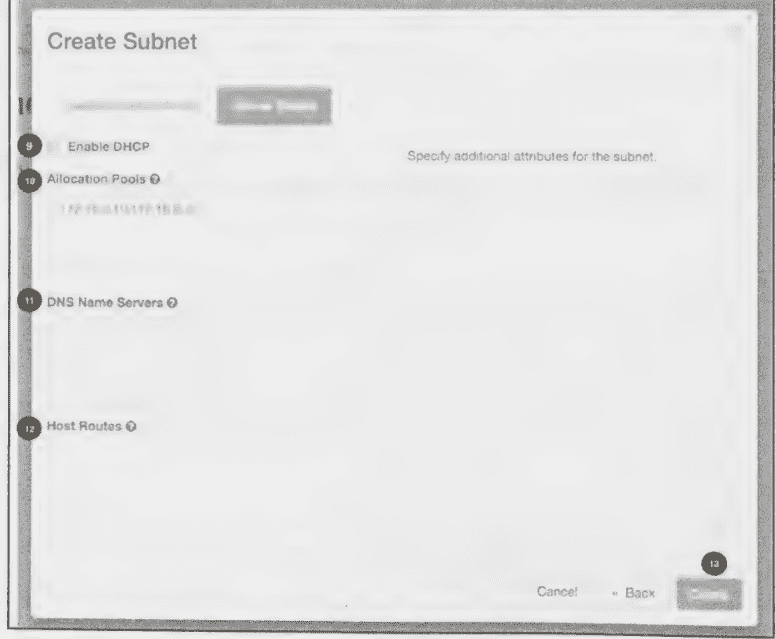

图 6.50：Horizon 仪表板上的提供者子网 DHCP 选项

参见图 6.51。我们现在应该有一个新创建的子网！

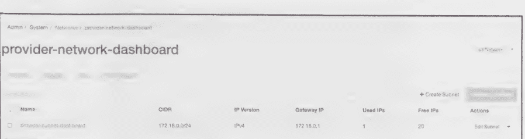

图 6.51：Horizon 仪表板上新配置的提供者子网

## 命令行界面

让我们在 CLI 上创建提供者子网。我们将首先 source openrc。

```
$ source openrc
```

验证正确变量是否已设置：

```
$ export | grep OS
```

因为我们为 CLI 示例使用不同的 provider-physical-network，所以我们将使用不同的子网、网关和分配池。

```
$ openstack subnet create --network provider-network-cli --subnet-range 172.16.1.0/24 --gateway 172.16.1.1 --no-dhcp provider-subnet-cli
```

您应该会看到以下输出：

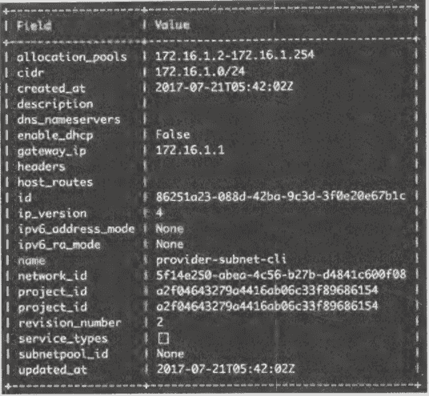

图 6.52：'openstack subnet create' 命令的输出

通过运行以下命令确认 provider-network-cli 是否成功创建：

```
$ openstack subnet list --long
```

恭喜！您已在 CLI 上创建了一个全新的提供者子网。

## 考试目标 - 管理路由器 - 北/南 流量

此时，我们的东/西路由器流量场景应与图 6.26 相似。这是一个很好的例子，说明 Neutron 路由器如何帮助您路由内部 Neutron 租户网络。现在我们已经创建了一些提供者网络，得益于我们的路由器，我们应该能够将实例的租户网络连接到它们。连接后，我们的实例将可以访问互联网！

在开始此练习之前，请验证运行虚拟设备的宿主机是否具有有线/无线互联网访问权限。请务必禁用任何 VPN 或代理。它们可能会干扰外部连接。

## Horizon 仪表板

是时候将我们的路由器网关连接到之前创建的提供者网络，以便 tenant-network1-dashboard 和 tenant-network2-dashboard 上的实例可以访问互联网：

- 1. 参见图 6.53。从 OpenStack 概览页面，通过选择顶部下拉菜单将范围限定到 logistics 项目。
- 2. 选择 Project-Network 面板组中的面板。这里您应该能看到我们之前创建的路由器：router-dashboard。
- 3. 在 router-dashboard 旁边选择 Set Gateway。

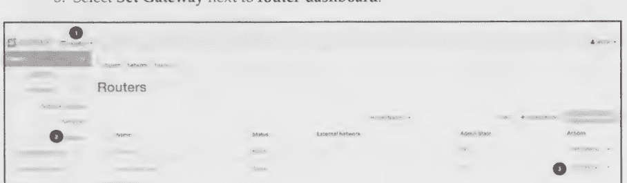

图 6.53：Horizon 仪表板上设置路由器网关

- 4. 参见图 6.54。**外部网络**（必填）：这里我们将选择之前创建的提供者网络：`provider-network-dashboard`
- 5. 选择 **提交**。

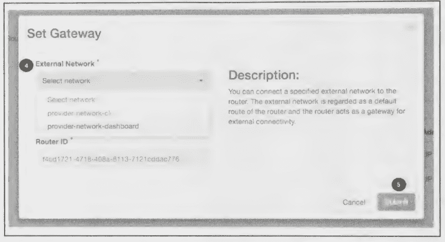

图 6.54：为路由器指定提供者网络网关

恭喜！您刚刚将实例连接到互联网！在我们继续测试连接之前，请参见图 6.55。这是我们当前网络拓扑的高级视图。路由器的默认网关设置为 `provider-network-dashboard`。所有未发往 `tenant-network-dashboard` 和 `tenant-network2-dashboard` 的流量都将流经此处。

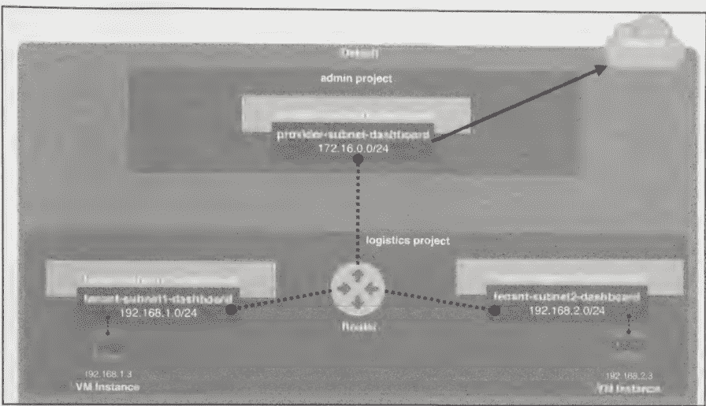

图 6.55：北/南 流量网络拓扑

要从 OpenStack 实例测试互联网连接，运行 VirtualBox 的个人笔记本电脑或台式机必须连接到互联网。

让我们现在访问 logistics 项目中的 `instance1-dashboard`，以确保它可以访问互联网：

从实例部分选择 `instance1-dashboard`。

选择 **Console** 选项卡。选择 **Show Only Console**。如果仍然看不到任何内容，请点击 **Enter**，这应该会唤醒控制台屏幕。

我们现在可以登录到实例：

username: cirros

password: cubswin:)

登录后，让我们尝试 ping（3 次）openstack.org。请耐心等待！可能需要几分钟才能看到 ping 回复。

```
$ ping -c 3 openstack.org
```

您应该会看到以下响应：

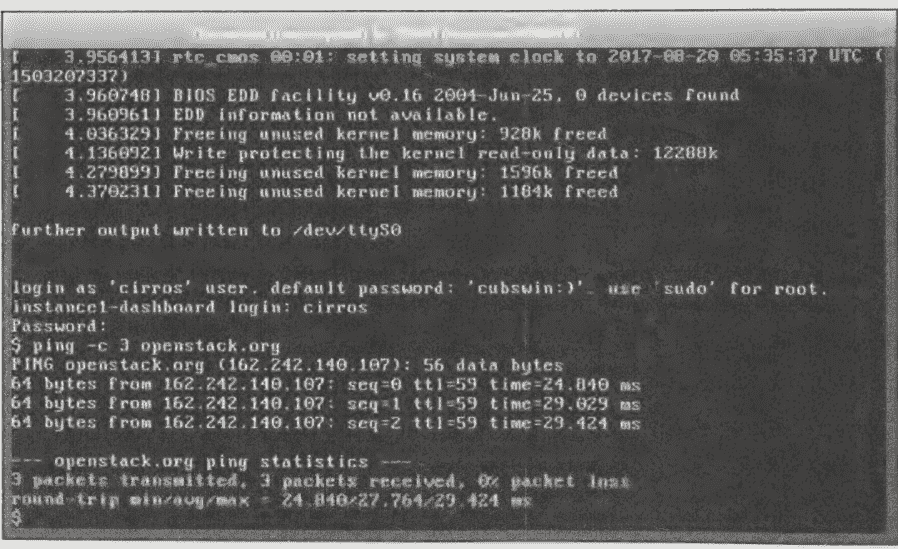

图 6.56：来自 openstack.org 的 ping 响应确认北/南 流量通信成功

如果您在不使用 -c 计数参数的情况下执行 ping，可以通过按 Ctrl + C 来取消它。

## 命令行界面

让我们通过 python-openstackclient 将 router-cli 设置为 provider-network-cli。这是一个相当简单的命令。

开始之前，请务必 source openrc-logistics 凭据文件，因为我们正在 logistics 项目中工作。

```
$ source openrc-logistics
```

验证正确变量是否已设置：

```
$ export | grep OS
```

列出所有可用的路由器：

```
$ openstack router list
```

列出所有可用的网络并验证 provider-network-cli 是否列出：

```
$ openstack network list --long
```

将 router-cli 的网关设置为 provider-network-cli。

对于此命令，我们需要使用基于服务的客户端 python-neutronclient。这是因为 python-openstackclient 版本 2.7.12 不支持设置路由器网关。

要使用 python-neutronclient 设置路由器网关，请运行以下命令：

```
$ neutron router-gateway-set router-cli provider-network-cli
```


截至本书撰写时，python-openstackclient 版本 3.6 支持使用以下命令设置路由器网关：openstack router set router-cli --external-gateway provider-network-cli。注意！考试可能只包含较旧版本的 python-openstackclient 且不支持此功能。

## 考试目标 - 管理浮动 IP

在之前的目标中，我们将路由器网关设置为提供者网络。这为连接到路由器的网络上的所有实例提供了互联网访问权限。但如果我们想从 *OpenStack 环境* 外部访问这些实例中的某个应用程序或资源怎么办？由于分配给我们实例的 IP 地址是内部的且不可公网路由，Neutron 允许用户将浮动 IP 与其实例关联。浮动 IP 类似于 Amazon Web Services 世界中的弹性 IP 概念。使用它们是一个两步过程：

- 1. **分配** 一个浮动 IP 给您的项目。
- 2. **分配** 浮动 IP 给实例。

如果您不再需要浮动 IP，可以轻松地将其从项目中取消分配并释放，发送回原始浮动 IP 地址池。记住：浮动 IP 地址池是在提供者网络子网中定义的。在现实世界中，这可能是由我们的互联网服务提供商提供的外部 IP 地址范围。

## Horizon 仪表板

让我们为 **logistics** 项目中的 **instance1-dashboard** 实例关联一个浮动 IP 地址。然后我们将尝试通过其浮动 IP 从虚拟设备 ping 该实例。由于我们拥有管理员角色，我们将了解如何通过 admin-system 面板组分配特定 IP 地址。让我们开始！

- 1. 参见图 6.57。从 OpenStack 概览页面，选择 **Admin-System** 面板组。
- 2. 选择 **Floating IPs** 面板。

3. 选择 **Allocate IP to Project**。


图 6.57：从 Horizon 仪表板分配浮动 IP 地址

4. 参见图 6.58。**Pool**（必填）：选择我们之前创建的提供者网络，`provider-network-dashboard`。

5. **Project**（必填）：选择将拥有浮动 IP 地址的项目。由于我们一直在 logistics 项目中进行 Neutron 工作，请选择 `logistics`。

6. **Floating IP Address**（可选）：我们可以在此处指定想要的浮动 IP 地址。在我们的练习中，让我们请求 `172.16.0.100`。如果我们不指定 IP 地址，我们将从在 **提供者子网** 练习中创建的提供者子网中定义的 `172.16.0.0/24` 池中分配一个随机的可用浮动 IP 地址。


7. 选择“分配浮动 IP”以将浮动 IP 地址分配给 logistics 项目。

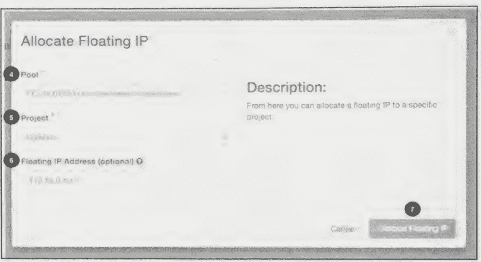

图 6.58：在 Horizon 仪表板上提供分配浮动 IP 地址的详细信息

8. 请参阅图 6.59。现在 logistics 项目拥有 172.16.0.100 地址，我们需要将其分配给 instance1-dashboard。首先，将自身范围限定到 logistics 项目。

9. 在 instance1-dashboard 虚拟机实例旁边的下拉菜单中选择“关联浮动 IP”。

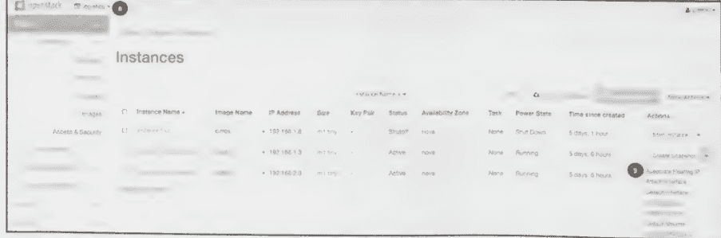

图 6.59：从 Horizon 仪表板关联实例的 IP 地址

10. 请参阅图 6.60。IP 地址：logistics 项目拥有的任何浮动 IP 地址都会显示在此处。选择我们之前分配的 172.16.0.100。
11. 要关联的端口：此处我们指定要与浮动 IP 地址关联的实例端口。我们需要确保 instance-1-dashboard 及其内部 IP 地址被选中。
12. 选择“关联”以继续映射。

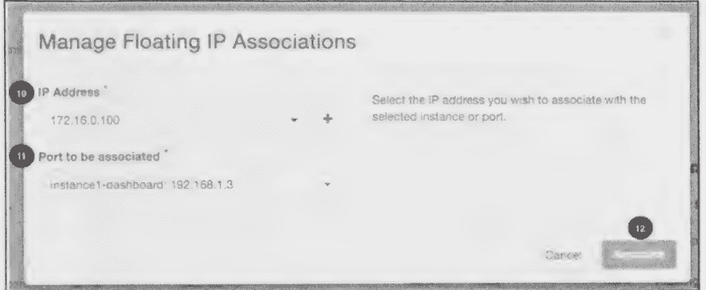

图 6.60：提供将 IP 地址与实例关联的详细信息

你做到了！如图 6.61 所示，instance1-dashboard 现在有两个 IP 地址：

固定/内部 IP: 192.168.1.3

浮动 IP/外部 IP: 172.16.0.100

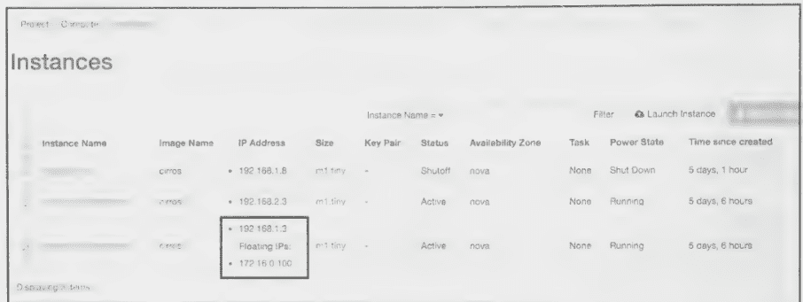

图 6.61：具有内部 IP 地址和浮动 IP 地址的实例

我们现在应该能够从虚拟设备内部 ping 172.16.0.100 IP 地址：

```
$ ping -c 3 172.16.0.100
```

我们应该能收到响应。请参阅图 6.62。

成功了！

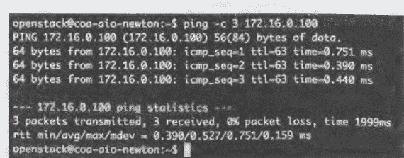

图 6.62：在虚拟设备内部通过其浮动 IP 地址成功 ping instance1-dashboard

那么现在我们知道浮动 IP 正在工作，SSH 呢？让我们尝试 SSH 到该实例。

```
$ ssh cirros@172.16.0.100
```

你会注意到它不会工作！我们可以通过使用 SSH -v 标志获取更多信息。

```
$ ssh cirros@172.16.0.100 -v
```

请参阅图 6.63。注意我们的 SSH 客户端未连接到实例。是什么阻挡了它？

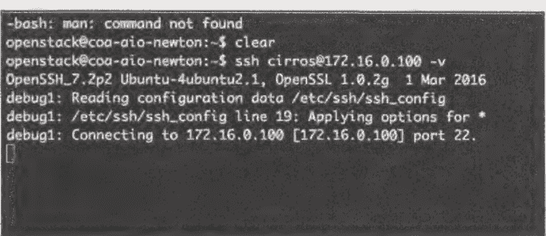

图 6.63：尝试从虚拟设备内部通过其浮动 IP SSH 到实例。某些东西阻挡了此通信！

一定是 **security groups**！

默认情况下，所有进入实例的入站流量都被阻止！

在本章开始时，我们创建了一个名为 **webserver-sg-dashboard** 的安全组。我们向该组添加了一条安全组规则，允许入站 SSH（TCP/端口 22）。让我们将此组应用到 **instance1-dashboard**。请参阅图 6.64。

1. 验证你已限定到 **logistics** 项目。
2. 从 **Project-Compute** 面板中选择 **Instances**。

3. 从 instance1-dashboard 下拉菜单中选择“编辑安全组”。


图 6.64：在 Horizon 仪表板上编辑与实例关联的安全组

4. 请参阅图 6.65。将 webserver-sg-dashboard 安全组添加到实例。

5. 选择“保存”。


图 6.65：在 Horizon 仪表板上将安全组应用于实例

现在让我们再试一次。

```
$ ssh cirros@172.16.0.100 -v
```

成功！


如果向实例应用了多个安全组，则最宽松的安全组规则将优先。

## Bonus exercise

如何在无需输入密码的情况下 SSH 到此实例？当然是使用 SSH 密钥！

作为额外练习，删除 instance1-dashboard 并使用我们在第 5 章 Nova Compute Service 中创建的 my-new-keypair-cli 重新创建它。在为实例关联浮动 IP 后，我们就可以尝试通过其浮动 IP 地址并使用我们的私钥 SSH 到实例！它应该看起来像这样：

```
$ ssh -i my-new-keypair-cli.pem cirros@172.16.0.100
```

太棒了！无需输入密码！


如果你收到警告，你可能需要通过运行 ssh-keygen -f "/home/openstack/.ssh/known_hosts" -R 172.16.0.100 删除旧的 known_hosts 密钥

## CLI

通过 python-openstackclient 将浮动 IP 地址分配给实例的方法与 Horizon 仪表板相同：

1. 为你的项目分配浮动 IP 地址。
2. 将浮动 IP 分配给实例。

加载 openrc-logistics 文件：

```
$ source openrc-logistics
```

验证是否已设置正确的变量：

```
$ export | grep OS
```

让我们使用 python-openstackclient 首先为 logistics 项目分配所需的浮动 IP 地址：

```
$ openstack floating ip create --floating-ip-address 172.16.1.100 provider-network-cli
```

现在 logistics 项目拥有 172.16.1.100 地址，我们可以通过运行以下命令轻松将其分配给 instance1-cli：

```
$ openstack server add floating ip instance1-cli 172.16.1.100
```

虽然此命令不会产生任何输出，请参阅图 6.65。你可以通过使用 openstack server show 命令并观察 addresses 字段来验证浮动 IP 是否已正确关联。


图 6.66：'openstack server show' 命令的 addresses 字段显示实例的固定 IP 地址和浮动 IP 地址

如果你想将安全组与此实例关联，可以轻松运行以下命令：

```
$ openstack server add security group instance1-cli webserver-sg-cli
```

## Before proceeding...

在进入下一章之前，请确保删除所有正在运行的实例以释放可用资源。你可以运行以下命令：

```
$ openstack server list --all-projects
$ openstack server delete <server-uuid>
```

## Summary

理解如何作为 OpenStack 终端用户和管理员与 Neutron 交互对于通过 COA 考试至关重要。Neutron 是一个复杂的话题，但请记住，你只需负责作为 OpenStack 终端用户或管理员处理 OpenStack 网络，而不是负责底层网络配置的人员。这意味着你无需担心 Neutron 配置文件的细节或配置网络基础设施。通过本章详细说明的目标，你将获得成功完成所有与 Neutron 相关目标所需的信心。

在下一章中，我们将讨论 Cinder 块存储和所有与 Cinder 相关的目标。
