# 7 Cinder Block-Storage Service

## Cinder Block-Storage Service

在上一章中，我们讨论了 Neutron 网络服务以及 Certified OpenStack Administrator 考试上的 Neutron 相关目标。现在我们将讨论 Cinder。Cinder 是 OpenStack 块存储服务，它允许用户创建 **persistent** 卷，这些卷可以由 Nova 虚拟机实例挂载为设备。

在本章中，我们将涵盖以下主题：

- About Cinder
- Exam objective - managing Cinder volumes
- Exam objective - attaching/detaching Cinder volumes from instances
- Exam objective - managing Cinder snapshots
- Exam objective - managing Cinder backups

完成本章后，你应该对 Cinder 有扎实的理解，并具备成功完成考试上所有与 Cinder 相关目标所需的技能。

### About Cinder

当 Amazon Web Services EC2 于 2006 年推出时，其外观与我们今天所知的截然不同。主要区别之一是 AWS 如何处理虚拟机存储。当时，AWS 仅为虚拟机实例提供 **ephemeral** 存储。考虑一个用户使用提供 20 GB 主磁盘和 50 GB 次要磁盘的实例类型（或 flavor）启动 EC2 实例。写入这些本地磁盘的任何数据（即操作系统内部的 `/dev/xvda` 或 `/dev/xvdb`）都将驻留在托管该实例的计算节点上。请参阅图 7.1。

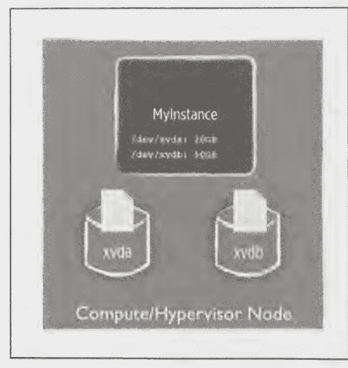

图 7.1：Amazon EC2 虚拟机临时存储

不久后，许多用户遇到了问题：

- 复制到磁盘的数据无法轻松转移到其他虚拟机。
- 停止或终止实例意味着完全数据丢失（重新启动后，虚拟机将在另一个计算节点上启动，并使用新配置的磁盘）。
- 如果实例失败，你的数据将无法访问且无法轻松恢复。


如果用户希望持久化其数据，则鼓励他们使用 S3 对象存储服务。

2008 年 4 月，AWS 做出了一项改变这一切的巨大公告。“我们即将推出的持久存储功能将使您能够为 EC2 创建可靠的持久存储卷”公告博文称。“这些卷可以被视为原始的未格式化驱动器，可以进行格式化后按需使用（如果您愿意，甚至可以作为原始存储使用）。”

这是 IT 历史上的一个令人难以置信的时刻：弹性云持久块存储的引入！

类似于便携式 USB 驱动器，用户可以创建指定为千兆字节的块卷。一旦附加到虚拟机实例，卷在操作系统内部就会显示为原始未格式化的硬盘。格式化驱动器后，它可以像传统硬盘一样挂载并使用。写入磁盘的所有数据实际上都驻留在 AWS 数据中心内的专用服务器上，而不是实例所在的计算节点。参见图 7.2。

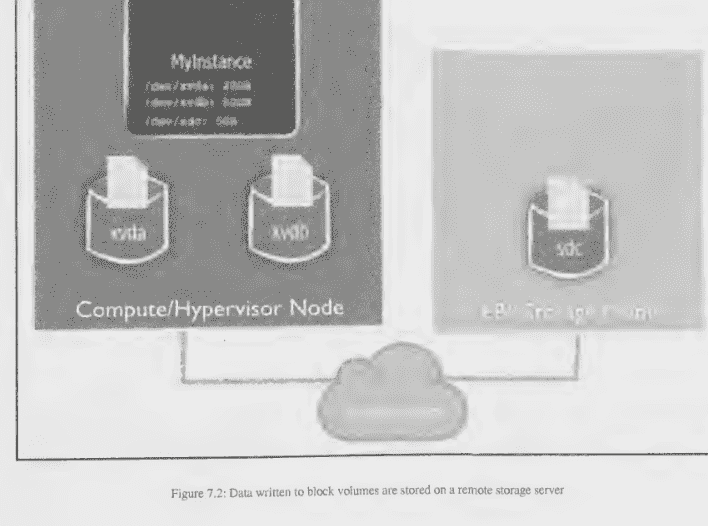

现在，用户还可以使用其主驱动器（即 `/dev/xvda`）作为 EBS 卷。参见图 7.3。这在实例故障时为基础操作系统提供完整的数据持久性；它被称为“EBS-backed”实例。

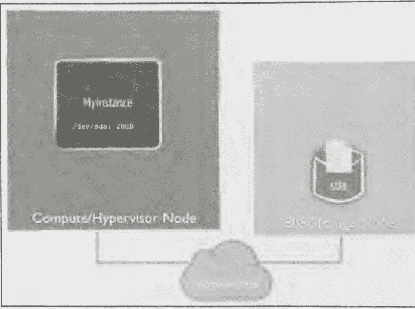

图 7.3：主硬盘也可以由块卷支持

受 AWS 弹性块存储启发，OpenStack 在 2011 年 Bexar 版本中于 Nova 项目中引入了块卷的概念。2012 年，OpenStack Folsom 版本将块存储作为其自己的项目引入，名为 Cinder。

## Cinder 架构

Cinder 由四个守护进程组成，如图 7.4 所示：

- **cinder-api**：Cinder 的 API 和主要网关。必须与 `cinder-api` 交互以创建、列出、删除和管理块卷、快照和备份。
- **cinder-scheduler**：评估并过滤所有可用的存储节点，以确定为要创建的块卷选择最佳存储节点。`cinder-scheduler` 的行为可以根据容量或存储能力等特定特征进行修改。
- **cinder-volume**：驻留在 Cinder 存储节点上，负责块卷的创建和删除。
- **cinder-backup**：协助将块卷备份到 OpenStack Swift 或其他第三方存储目标。

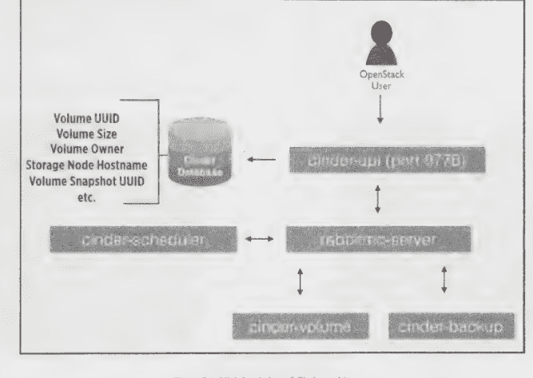

图 7.4：Cinder 架构的高级视图

## Cinder 背后

默认情况下，Cinder 由两种特定技术提供支持：

- 1. **LVM (Logical Volume Manager)**：LVM 工具集在 1990 年代后期开发，允许用户在不中断服务的情况下添加和更换硬盘。这是通过创建整个硬盘的单个逻辑卷来实现的，从而允许动态调整大小。
- 2. **iSCSI (Internet Small Computer Systems Interface)**：iSCSI 是一种基于 IP 的存储标准，用于在网络上提供对存储设备的块级访问。

考虑一个用户创建 Cinder 块卷的情况。用户通过 Horizon 仪表板或 CLI 向 cinder-api 发送 API 请求。一旦 cinder-api 收到请求，它就会使用有关卷的详细信息更新 Cinder 数据库并将其放置在消息总线上。cinder-scheduler 确定为请求的卷配置最佳的 Cinder 存储节点。一旦选定，cinder-volume 负责生成 LVM 命令以从预定义的卷组创建逻辑卷。然后用户向 nova-api 发送 API 调用以将卷附加到其选择的实例。此连接过程实际上是实例的计算节点（发起方）与 Cinder 存储节点（目标）之间的 iSCSI 连接。参见图 7.5。用户然后可以继续在实例的操作系统内格式化块设备并写入数据。写入 Cinder 的所有数据都存储在 Cinder 存储中。用户然后可以从实例分离卷并将其重新附加到另一个实例，从而重新建立到不同计算节点的 iSCSI 连接。

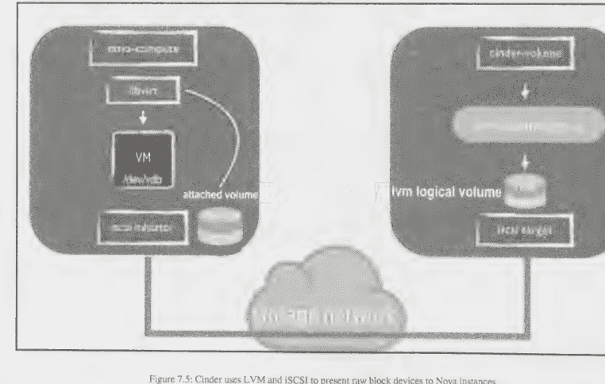

图 7.5：Cinder 使用 LVM 和 iSCSI 向 Nova 实例呈现原始块设备

## Cinder 后端软件和硬件驱动程序

Cinder 支持多种软件和硬件驱动程序用于存储后端。在硬件驱动程序的情况下，这允许用户将现有的硬件存储设备（如 SAN 或 NAS）用作 Cinder 存储节点。

| 软件驱动程序 | 硬件驱动程序 |
|---|---|
| LVM | NetApp |
| NFS | Dell EqualLogic |
| GlusterFS | EMC V-MAX |
| Ceph | SolidFire |

## Cinder 概念

- **Volume**：可附加到 Nova 虚拟机实例的原始未格式化块设备。然后实例的操作系统可以像传统硬盘一样使用它。
- **Snapshot**：卷内容的只读、时间点副本。可以从当前使用中或可用状态的卷创建快照。然后快照可用于创建新卷。
- **Backup**：存储在 Swift 对象存储容器中或 Google Cloud Platform 等其他第三方提供商中的卷内容的压缩归档文件。

## 考试目标

让我们看看 Cinder 考试目标。

以下图表分解了您在 COA 考试中应负责了解的各种 Cinder 相关目标。如您所见，所有这些任务都可以在 Horizon 仪表板和 CLI 上完成。记住：考试期间时间就是一切，在许多情况下，在仪表板上处理任务会快得多。

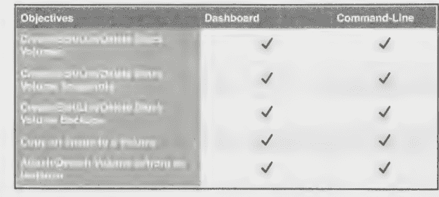

图 7.6：Cinder 考试目标可以在 Horizon 仪表板或 CLI 上完成

## 考试目标 - 管理 Cinder 卷

创建 Cinder 卷非常简单，应该是在考试中轻松得分的方式。让我们看看！

## Horizon 仪表板

让我们在 Horizon 仪表板上创建一个卷。参见图 7.7。

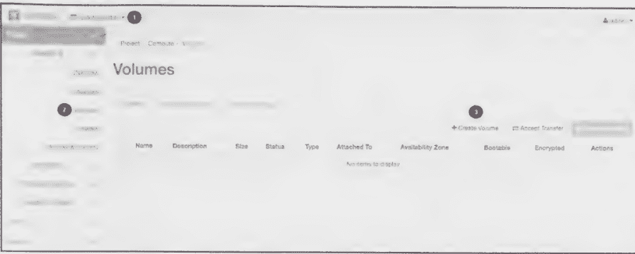

图 7.7：从 Horizon 仪表板创建块卷

- 1. 从 OpenStack 概览页面，通过选择顶部下拉菜单将自己限定为 **quality-control** 项目。
- 2. 从 **Project-Compute** 面板组中选择 **Volumes** 面板。
- 3. 选择 **Create Volume**。
- 4. 参见图 7.8。**Volume Name (optional)**：卷的名称。输入 `volume-dashboard`。
- 5. **Description (optional)**：卷的描述。输入 `COA exam prep dashboard volume`。
- 6. **Volume Source (optional)**：默认情况下，您创建的任何卷都是全新的且为空。卷源是您希望复制到卷中的现有数据源。以下是卷源的示例：
  - 1. **No Source, Empty Volume**：一个空卷。卷必须由虚拟机实例的操作系统格式化和挂载。我们将选择此项。
  - 2. **Image**：这会将现有 Glance 镜像的内容复制到您的块卷。您必须确保卷的大小等于或大于指定镜像的大小。这将自动使您的镜像 **bootable**，以便在启动实例时将其指定为主要磁盘（启动源）。这是一个强大的功能，将导致您的 `/dev/vda` 文件夹驻留在 Cinder 存储节点上，类似于 AWS EBS-backed 实例。
  - 3. **Volume**：这会将现有卷的内容复制到您的块卷。您必须确保卷的大小等于或大于指定卷的大小。
- 7. **Type (optional)**：允许用户指定由 OpenStack 基础设施工程师先前配置和定义的特定卷后端。一个例子是只有 SSD 驱动器的 Cinder 存储服务器/节点组。另一个例子可以是具有传统 SATA 驱动器的 Cinder 存储节点组。这赋予了您的 OpenStack 用户选择的权力。
- 8. **Size (required)**：卷的大小（以千兆字节为单位）。输入 1。
- 9. **Availability Zone (optional)**：类似于 Nova 可用区，Cinder 可用区在安装期间定义，并为您提供分隔 cinder 存储节点的通用方法。默认情况下，所有 Cinder 存储节点都属于 Nova 可用区。
- 10. 选择 **Create Volume**。

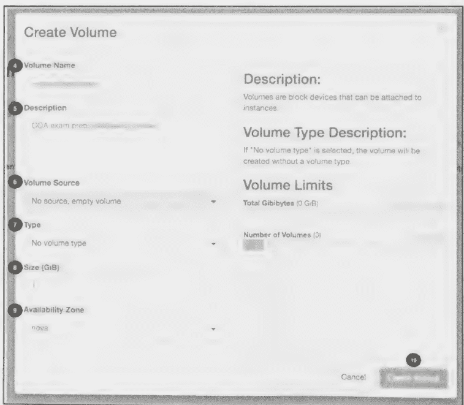

图 7.8：在 Horizon 仪表板上提供块卷详细信息


我们现在应该已经拥有一个由 quality-control 项目拥有的新创建的卷。此时，quality-control 项目中的所有用户都应该有权修改该卷，但它在附加到实例之前无法真正使用。

我们一次只能将块卷附加到一个实例；需要注意的是，我们无法将此卷对所有项目公开。我们可以做的是，使用卷面板中的 Create Transfer 选项将卷的所有权转移到另一个项目。这将生成一个特殊的 ID 和授权密钥，我们将其提供给另一个项目中的用户。另一个项目中的用户然后输入 Accept Transfer，输入 ID 和 auth key，然后获得对该卷的完全控制权和所有权。卷转移到另一个项目后，除非原始所有者接受回传，否则将无法再访问。


我们也有将卷设为可启动的选项。可启动卷是可以作为 Nova 启动源选择的卷。为了成为合适的启动源，卷必须包含引导加载程序或虚拟机实例 BIOS 可以读取的指令。选择 Edit Instance 并勾选 Bootable 框即可使卷可启动。

## CLI

请回忆提供的 openrc 文件包含用于正确向 Keystone 进行身份验证并设置项目范围的变量形式凭据。

在本章中，我们将在 quality-control 项目中执行所有 Cinder 相关任务。让我们将原始 openrc 文件复制到名为 openrc-quality-control 的新文件中。

```
$ cp openrc openrc-quality-control
```

现在我们已经制作了副本，让我们编辑 openrc-quality-control 文件并更新项目和租户名称变量，以反映我们希望对 logistics 项目的范围。如果您更习惯使用其他编辑器，请在此处随意使用：

```
$ nano openrc-quality-control
```

将以下变量更改为 quality-control：

```
export OS_PROJECT_NAME=quality-control
export OS_TENANT_NAME=quality-control
```


我们更改 OS_TENANT_NAME 变量，因为一些较旧的基于服务的客户端可能仍依赖于旧变量 OS_TENANT_NAME。

载入新创建的 openrc-quality-control 文件：

```
$ source openrc-quality-control
```

验证是否已正确设置变量：

```
$ export | grep OS
```

现在我们已正确限定范围，从现在开始创建的任何新卷都将由 quality-control 项目拥有。与 python-openstackclient 的其他一些 list 命令不同，openstack volume list 仅显示我们当前限定范围的项目内的卷。在考试期间务必牢记这一点。运行以下命令：

```
$ openstack volume list --long
```

我们应该会看到在上一练习中创建的 volume-dashboard 卷。作为管理员，我们应该能够查看和列出环境中所有项目的所有卷。运行以下命令：

```
$ openstack volume list --all-projects --long
```

您现在应该会看到一个之前在虚拟设备上创建的额外卷。

让我们继续使用 CLI 创建一个全新的 1 GB 卷。我们将它命名为 volume-cli，描述为 COA exam prep cli volume：

```
$ openstack volume create --size 1 volume-cli --description "COA exam prep cli volume"
```

我们应该会看到与图 7.9 相似的输出。

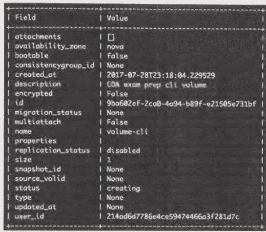

图 7.9：openstack volume create 命令的输出

让我们确认卷是否已成功创建：

```
$ openstack volume list --long
```

我们应该会看到与图 7.10 相似的内容。

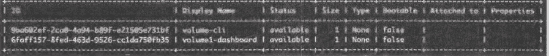

图 7.10：'openstack volume list --long' 命令的输出

请记住，此命令仅显示您所限定范围的项目内的卷！要查看 OpenStack 环境中所有项目的所有卷，请使用 --all-projects 标志。

## Horizon 仪表盘

在之前的 Horizon 仪表盘练习中，我们创建了一个 1 GB 的 Cinder 块卷。为了使用该卷，我们必须将其附加到虚拟机实例。在进行此练习之前，请确保您没有来自之前章节练习的当前正在运行的实例。

我们需要启动一个 Nova 实例。然后我们将 Cinder 卷附加到此实例并写入一些文件。如果您忘记了如何创建租户网络、子网和虚拟机实例，请参阅第 5 章和第 6 章中的说明。

以下是详细信息。对未指定的任何内容假设使用默认值：

### Network/subnet

- **Project**: `quality-control`
- **Network Name**: `tenant-network-dashboard`
- **Subnet Name**: `tenant-subnet-dashboard`
- **Network Address**: `192.168.1.0/24`

### Instance

- **Project**: `quality-control`
- **Instance Name**: `instance-dashboard`
- **Source**: `cirros`
- **Flavor**: `m1.tiny`
- **Networks**: `tenant-network-dashboard`

现在我们已经在 **quality-control** 项目的 **tenant-network-dashboard** 网络上拥有了 **instance-dashboard**，让我们将一个卷附加到它。见图 7.11。

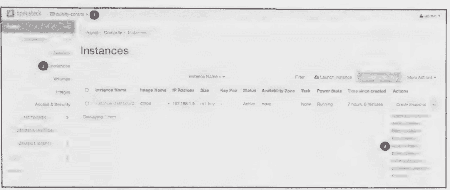

图 7.11：从 Horizon 仪表盘将卷附加到实例

1. 从 OpenStack 概览页面，通过选择顶部下拉菜单将自己限定到 **quality-control** 项目。
2. 从 **Project-Compute** 面板组中选择 **Instances** 面板。
3. 在 **instance-dashboard** 旁边的 **Actions** 下拉菜单中选择 **Attach Volume**。
4. 见图 7.12。**Volume ID (required)**：这是您想要附加到实例的卷。选择 `volume-dashboard`。
5. 选择 **Attach Volume**。
6. 如果我们想分离卷，可以轻松地从 **Actions** 下拉菜单中选择 **Detach Volume** 并再次选择该卷。

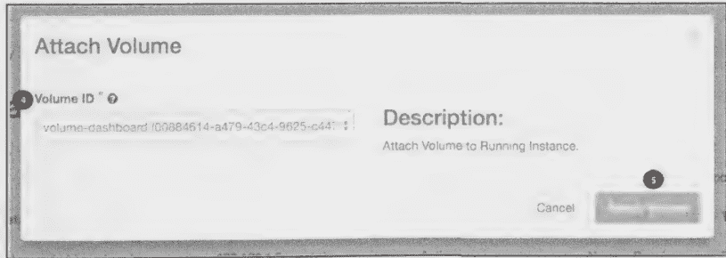

图 7.12：在 Horizon 仪表盘上指定要附加到实例的卷

我们可以通过转到仪表盘上的 **Volumes** 面板组并观察 **Attached To** 列来验证卷是否已成功附加到实例。见图 7.13。卷已作为 `/dev/vdb` 挂载到实例。让我们现在进入实例，看看如何使用该卷。

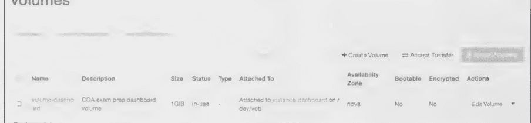

图 7.13：Cinder 卷成功附加到 Nova 实例

如第 5 章 Nova Compute Service 中所述，访问 **instance-dashboard** 虚拟机实例的 Nova 控制台。

使用以下默认 Cirros 用户名/密码登录实例：

- **Username:** cirros
- **Password:** cubswin:)

现在我们已登录，可以使用流行的 fdisk 实用程序列出任何已识别的块设备：

```
$ sudo fdisk -l
```

您应该会看到与图 7.14 相似的输出。

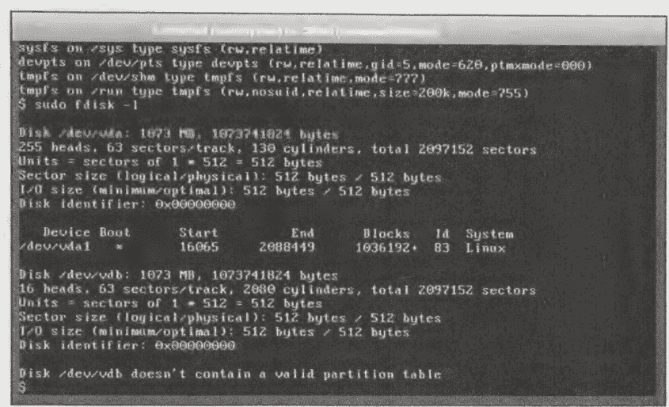

图 7.14：/dev/vdb 是新附加的 Cinder 块卷

然后我们可以用 ext3 文件系统格式化此原始块设备：

```
$ sudo mkfs.ext3 /dev/vdb
```

尽管我们的磁盘已格式化，但仍需要将其挂载才能使用：

```
$ sudo mount /dev/vdb /mnt
```

现在文件已挂载，我们应该能够在卷上创建文件。让我们使用 touch 实用程序在卷上创建一个名为 helloworld.txt 的文件：

```
$ sudo touch /mnt/helloworld.txt
```


请记住，我们的 OpenStack 虚拟设备只是一台虚拟机，因此它充当超visor 和 Cinder 存储节点。在真实的 OpenStack 环境中，我们的 Cinder 卷将驻留在专用的 Cinder 存储服务器上。

让我们将卷从 /mnt 文件夹卸载：

```
$ sudo umount /dev/vdb /mnt
```

现在我们可以轻松地将此卷从 instance-dashboard 分离并将其附加到另一个已启动的实例。写入此卷的任何数据都可供可以附加它的任何实例访问。


在我们的练习中，我们手动挂载并格式化了驱动器。某些操作系统在识别到新附加磁盘时可能会自动执行此过程。

请务必在本次练习结束时分离卷。您可以通过在虚拟机实例旁边的 Actions 下拉菜单中选择 Detach Volume 来执行此操作。

## CLI

让我们通过 python-openstackclient 创建一个新实例并附加一个新卷。

载入新创建的 openrc-quality-control 文件：

```
$ source openrc-quality-control
```

验证是否已正确设置变量：

```
$ export | grep OS
```

在 quality-control 项目中启动一个新实例：

```
$ openstack server create --image cirros --flavor m1.tiny instance-cli
```

instance-cli 启动后且其状态为 ACTIVE，将 volume-cli 卷附加到它：

```
$ openstack server add volume instance-cli volume-cli
```

您可以通过运行以下命令确认卷已附加到实例：

```
$ openstack volume list --long
```


请参阅图 7.15。观察状态列。这显示卷是否可用或正在使用。请记住：OpenStack 的 Newton 版本一次只允许将卷附加到一个实例。

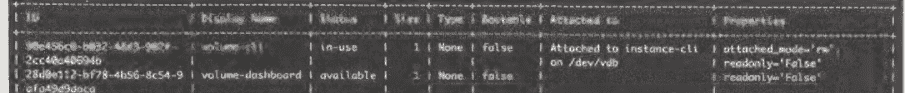

图 7.15：'Attached to' 列显示卷所附加到的实例

您可以通过运行以下命令获取 instance-cli 控制台 URL：

```
$ openstack console url show instance-cli
```

您可以随意通过虚拟机实例控制台格式化并挂载该卷，如上一节所示。

要分离卷，请运行以下命令：

```
$ openstack server remove volume instance-cli volume-cli
```

## 考试目标 - 管理 Cinder 快照

Cinder 支持捕获卷当前状态的卷快照。这些对于提供备份保护很有用，也可用于实例化包含快照确切数据的新的卷。在幕后，Cinder 快照是 LVM 快照，将驻留在与原始逻辑卷相同的 LVM 卷组中。需要注意的是，快照不是备份。与 Cinder 快照不同，Cinder 备份存储在异地。我们将在下一节介绍它们。让我们在仪表板中逐步创建和恢复快照。

### Horizon 仪表板

请参阅图 7.16。让我们从 Horizon 仪表板创建卷快照。

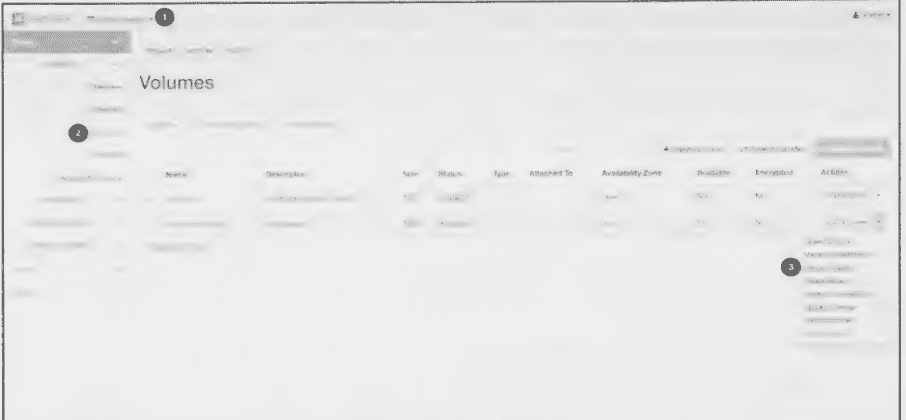

图 7.16：从 Horizon 仪表板创建快照

- 1. 从 OpenStack 概览页面，通过选择顶部下拉菜单将自己限定到 **quality-control** 项目。
- 2. 从 **Project-Compute** 面板组中选择 **Volumes** 面板。
- 3. 在 **volume-dashboard** 下拉菜单旁边选择 **Create Snapshot**。
- 4. 见图 7.17。 **Snapshot Name (required)**：快照的名称。输入 `volume-snapshot-dashboard`。
- 5. **Description (optional)**：卷快照的描述。输入 `COA exam prep dashboard volume snapshot`。

- 6. 选择 **Create Volume Snapshot**。

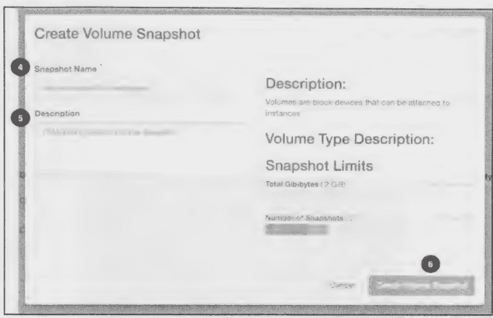

图 7.17：在 Horizon 仪表板上为快照提供源卷的名称

您现在应该能在 **Snapshots** 选项卡下看到新创建的卷快照。该快照归 `quality-control` 项目所有。您可以通过选择 **Create Volume** 按钮轻松从中创建卷。

TIP
从现有快照创建新卷时，卷的大小必须等于或大于快照的大小。为了删除具有关联快照的卷，您必须先删除快照。

### CLI

让我们通过 `python-openstackclient` 创建一个新的 Cinder 快照。

载入新创建的 `openrc-quality-control` 文件：

```
$ source openrc-quality-control
```

验证是否设置了正确的变量：

```
$ export | grep OS
```

查看当前所有 Cinder 卷：

```
$ openstack volume list
```

对 volume-cli 卷进行快照。快照名称为 volume-snapshot-cli。

```
$ openstack snapshot create --name volume-snapshot-cli volume-cli
```

您应该会看到与图 7.18 相似的输出。

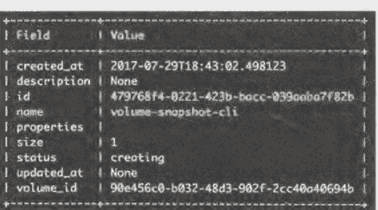

图 7.18：'openstack snapshot create' 命令的输出

您可以通过运行以下命令确认快照已创建：

```
$ openstack snapshot list --long
```

如果您想从此快照创建卷，可以运行以下命令：

```
$ openstack volume create --snapshot volume-snapshot-cli --size 1 restored-snapshot-volume-cli
```

## 考试目标 - 管理 Cinder 备份

与 Cinder 快照类似，Cinder 备份包含源卷中的所有数据。与 Cinder 快照不同，Cinder 备份是压缩的 bz2 或 zlib 归档文件，存储在 Cinder 存储节点之外。目标备份位置可以根据使用的驱动程序存在于多种位置。驱动程序包括 OpenStack Swift、Google Cloud Platform、GlusterFS，甚至 NFS 共享（仅举几例）。您的虚拟设备目前配置为使用安装在设备上的 OpenStack Swift 部署。我们将在第 8 章《Swift 对象存储服务》中更深入地讨论 Swift。让我们在仪表板中逐步创建和恢复快照。

### Horizon 仪表板

让我们从 Horizon 仪表板创建 Cinder 备份。请参阅图 7.19。

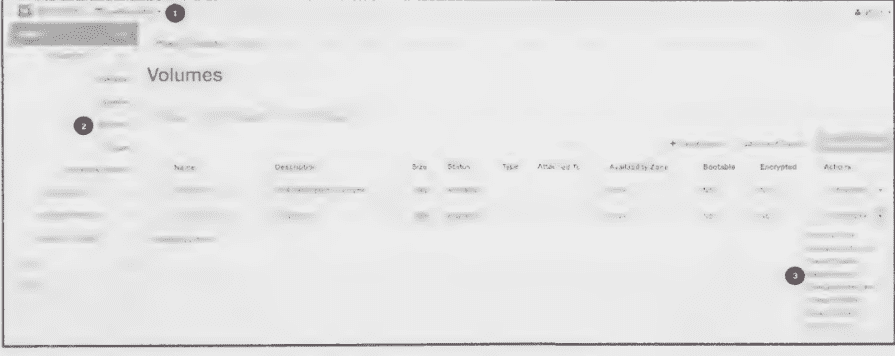

图 7.19：在 Horizon 仪表板上创建备份

- 1. 从 OpenStack 概览页面，通过选择顶部下拉菜单将自己限定到 **quality-control** 项目。
- 2. 从 **Project-Compute** 面板组中选择 **Volumes** 面板。
- 3. 在 **volume-dashboard** 下拉菜单旁边选择 **Create Backup**。
- 4. 见图 7.20。 **Backup Name (required)**：备份的名称。输入 `volume-backup-dashboard`。
- 5. **Description (optional)**：卷快照的描述。输入 `COA exam prep dashboard volume backup`
- 6. **Container Name (optional)**：备份的 Swift 对象容器目标名称。输入 `volume-backup-container-dashboard`

- 7. 选择 Create Volume Backup。

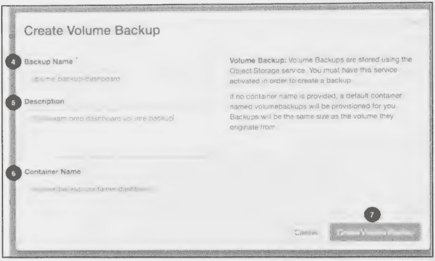

图 7.20：在 Horizon 仪表板上为 Cinder 备份设置目标容器名称

一旦备份创建完成，我们应该会有一个新的 Swift 对象容器，其中包含压缩并归档的卷内容。

我们将在第 8 章更详细地讨论 Swift。现在，请确保您已限定到 **quality-control** 项目，并在 **Project-Object Store** 面板组中选择 **Containers** 面板。请参阅图 7.21。

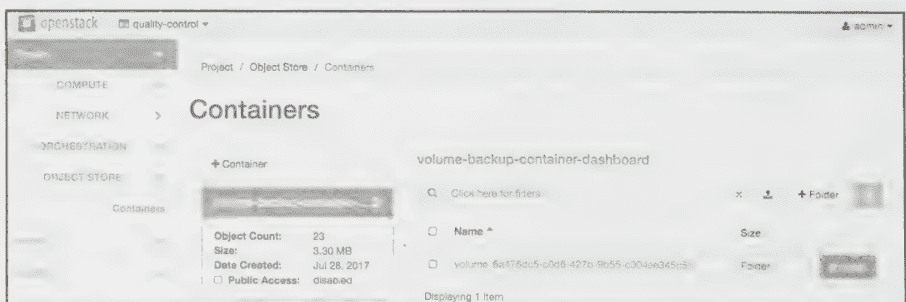

图 7.21：'openstack volume backup list' 命令的输出

要恢复此备份，我们可以在 **Volume Backups** 选项卡中使用 **Restore Backup** 按钮。

### CLI

让我们通过 `python-openstackclient` 创建一个新的 Cinder 备份。

载入新创建的 `openrc-quality-control` 文件：

```
$ source openrc-quality-control
```

验证是否设置了正确的变量：

```
$ export | grep OS
```

创建备份：

```
$ openstack volume backup create --name volume-backup-cli --description "COA exam prep dashboard volume backup" --container volume-backup-container-cli volume-cli
```

备份完成后，您应该能够确认备份已成功创建：

```
$ openstack volume backup list
```

您应该会看到与图 7.22 相似的输出。

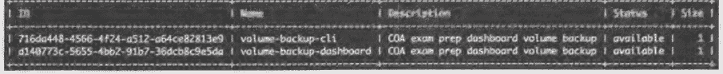

图 7.22：'openstack volume backup list' 命令的输出

如果您想在 CLI 上恢复备份，您必须先手动创建一个空卷，然后运行以下命令：

```
$ openstack volume backup restore volume-backup-cli <target-volume>
```

## 注意

在继续下一章之前，请务必删除所有正在运行的实例以释放可用资源。您可以运行以下命令：

```
$ openstack server list --all-projects
$ openstack server delete <server-uuid>
```

## 总结

您刚刚学习了考试中所有与 Cinder 相关的目标。如您所见，所有与 Cinder 相关的目标都可以在 Horizon 仪表板上完成。您可以通过使用要附加卷的实例旁边的下拉菜单轻松地将卷附加到实例。请记住，在 OpenStack 的 Newton 版本中，一次只能将卷附加到一个实例。在下一章中，我们将讨论 Swift，即 OpenStack 对象存储服务，并完成考试中所有与 Swift 相关的目标。
