# 8 Swift 对象存储服务

## Swift 对象存储服务

在上一章中，我们讨论了 Cinder 块存储服务以及 Certified OpenStack Administrator 考试中的 Cinder 相关目标。现在我们将讨论 Swift。Swift 是 OpenStack 对象存储服务，为用户提供通过 RESTful API 访问的冗余云存储。

在本章中，我们将涵盖以下主题：

- Swift 架构
- Swift 概念
- 考试目标 - 管理容器和对象
- 考试目标 - 在容器上设置 ACL
- 考试目标 - 设置对象过期

在本章之后，您应该对 Swift 有扎实的理解，并具备成功完成考试中所有与 Swift 相关目标所需的技能。

### 关于 Swift

如果您想在 90 年代末或 2000 年代初注册网站托管服务提供商，您通常会使用一个提供商为您提供服务器访问权限的服务。该服务器会为您分配特定量的存储空间供您使用和存储文件。每月支付固定费用。您可以通过 Secure SSH 或 FTP 客户端上传网站的 HTML 页面、照片和其他静态文件。如果您需要额外的存储空间，您将提交请求，托管服务提供商会扩展您的容量。


2006年，AWS 推出了其首批服务之一：Amazon Simple Storage Service，简称 S3。Amazon 将 S3 宣传为“高度可扩展、可靠且低延迟的数据存储基础设施，成本极低。” 但这意味着什么？嗯，让我们分解几点，说明当时 S3 为何如此受追捧：

- 与当时流行的托管服务提供商不同，用户可以根据实际使用量按需付费（前提是已存档信用卡）。这很像电费或公用事业账单。
- 用户可通过 Web API 存储文件，从而将其编程上传和下载集成到 Web 应用代码中（想想相册 Web 应用：超级强大！）。
- 价格非常便宜！用户每月只需几美元即可存储数千个对象。
- 所有对象都写入三个不同的故障域，因此即使 AWS 数据中心发生服务器故障也能得到保障。

现在，世界上一些最受欢迎的应用都在使用 S3。Dropbox 是一个使用 S3 存储用户文件的前端，而 Pinterest 和 Tumblr 使用 S3 来托管图像！

2009 年 8 月，Rackspace 受 Amazon S3 启发，开始着手开发自己的对象存储服务 Cloud Files（至今仍可用）。该项目演变成我们所知的 OpenStack Swift，这是一个具有 RESTful API 的开源可扩展冗余存储系统。与 S3 类似，Swift 为用户提供一种使存储看起来无限的对象存储服务。它还提供许多很酷的额外功能，例如静态网站托管、对象版本控制、访问控制列表（ACL）和对象过期。

在幕后，OpenStack Swift 将对象写入数据中心服务器中分布的多个磁盘驱动器。Swift 的软件（像其他 OpenStack 服务一样用 Python 编写）负责确保集群中数据的复制和完整性。如果服务器或硬盘发生故障，Swift 会从其他活动节点复制其内容到集群中的新位置。存储集群只需添加新服务器即可水平扩展。由于 OpenStack 使用软件逻辑确保数据在不同设备间的复制和分布，因此可以使用廉价的通用硬盘和服务器。

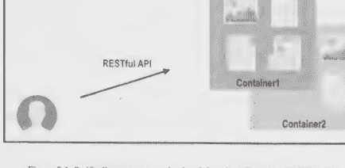

图 8.1：Swift 允许用户通过 RESTful API 上传和下载文件

## Swift 架构

Swift 由十四项主要守护进程组成，如图 8.2 所示：

- **swift-proxy-server**：Swift 的 API 和主要网关，负责将 Swift 架构的其余部分连接起来。必须与 swift-proxy-server 交互才能创建容器、向这些容器上传对象、设置 ACL 以及启用特殊功能，例如对象版本控制或启用静态网站。对于每个请求，它都会在环中查找账户、容器或对象的位置并相应地路由请求。
- **swift-object-server**：负责检索和删除存储在 Swift 集群本地驱动器上的对象。对象以文件系统上的二进制文件形式存储，元数据存储在文件的扩展属性（xattrs）中。这要求对象服务器所选的底层文件系统支持文件上的 xattrs。每个对象都使用基于对象名称哈希和操作时间戳派生的路径进行存储。
- **swift-object-auditor**：遍历本地对象系统检查对象的完整性。如果发现损坏，文件将被隔离，复制将从另一个副本替换损坏的文件。
- **swift-object-expirer**：提供对象的计划删除。
- **swift-object-reconstructor**：擦除编码对象的重建守护进程。
- **swift-object-replicator**：在网络中断或驱动器故障等临时错误条件下保持系统处于一致状态。复制过程比较本地数据与每个远程副本，以确保它们都包含最新版本。对象复制使用哈希列表快速比较每个分区的子部分。
- **swift-container-server**：处理特定容器内对象的列出。列表以 SQLite 数据库文件形式存储，并在集群中进行复制（类似于对象）。
- **swift-container-auditor**：遍历本地容器系统，检查 SQLite 数据库文件的完整性。如果发现损坏，文件将被隔离，复制将从另一个副本替换损坏的文件。
- **swift-container-replicator**：类似于 swift-object-replicator，只是针对容器 SQLite 数据库文件。
- **swift-container-updater**：更新账户数据库中的容器信息。它会遍历系统中的容器路径，查找容器 SQLite 文件，并在需要时向账户服务器发送更新。
- **swift-container-sync**：负责允许通过后台同步将一个容器的内容镜像到另一个容器。
- **swift-account-server**：处理特定账户内容器的列出。列表以 sqlite 数据库文件形式存储，并在集群中进行复制（类似于对象）。
- **swift-account-auditor**：与 swift-container-auditor 相同，只是针对账户 sqlite 数据库文件。
- **swift-account-replicator**：类似于 swift-container-replicator，只是针对账户 sqlite 数据库文件。
- **swift-account-reaper**：删除已被 OpenStack 管理员标记为删除的账户。

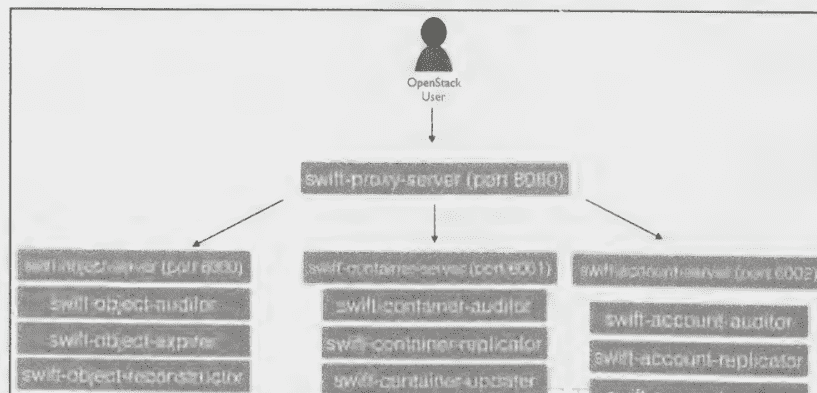

图 8.2：Swift 架构的高级视图

## Swift 概念

- **Account**：Swift 使用术语“account”来指代 OpenStack 项目。
  记住：在 OpenStack 世界中，accounts、tenants 和 projects 含义相同！
- **Container**：用于静态文件（也称为 **objects**）的“存储桶”。用户必须创建一个容器才能将对象上传到 Swift 账户。所有容器都由用户创建时所作用域的账户（或项目）拥有。默认情况下，容器中上传的所有对象都是私有的。
- **Objects**：对象是用户上传到容器中的文件。这些通常是静态文件，例如图片、电影、文档或日志。
- **Object expiration**：可以设置对象在特定时间过期。一旦对象过期，它将无法再访问并从 Swift 集群中删除。对象过期的一个很好的用例是临时注册码或密钥，其有效期很短。
- **ACL (access control list)**：默认情况下，Swift 容器是私有的，其他用户或项目无法访问。默认情况下，具有 admin 或 swiftoperator 角色的用户可以在容器级别设置 ACL 并支持读取和写入访问列表。
- **Static website hosting**：而不是使用传统的 Web 服务器如 Apache 或 Nginx 来托管网站，Swift 可以托管静态网站文件，例如 HTML、CSS 和客户端 JavaScript。通过将容器的 web-index 头设置为容器的公共 URL，它将导航到指定的文件，例如 `index.html`。然后可以更新 DNS 以指向可公开访问的 Swift 容器的 URL。
- **Object versioning**：版本控制允许用户上传特定文件的多个版本。用户只需创建一个用于存储版本的备用容器。当用户向 Swift 容器上传同名文件时，旧版本会被发布到备用容器。可以轻松检索并恢复到以前的版本。如果向对象发送 `DELETE` 请求，最新版本将被删除，并恢复之前的版本。

## 考试目标

让我们看看 Swift 的考试目标。记住，Certified OpenStack Administrator 考试期望你从管理员的角度理解如何使用 OpenStack，而不是基础设施或 DevOps 工程师。你不需要过于关注后端 Swift 配置。这是一个复杂的话题，你可以在 Packt Publishing 出版的《OpenStack Object Storage (Swift) Essentials》一书中了解更多。

下图分解了你在 COA 考试中应负责了解的各种 Swift 相关目标。如你所见，其中只有一些任务可以在 Horizon 仪表板和 CLI 上完成。当涉及到 ACL 和对象过期时，你需要掌握本章中所示的 CLI 命令。

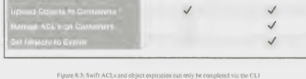

图 8.3：Swift ACL 和对象过期只能通过 CLI 完成

要在 Horizon 仪表板上向 Swift 上传对象，文件必须可通过本地文件系统访问。如果你想上传大于 5 GB 的文件，必须使用 CLI。

### 考试目标 - 管理容器和对象

容器在 Amazon S3 世界中类似于存储桶。容器由项目拥有（在 Swift 世界中也称为账户）。就权限而言，Swift 容器与传统的 OpenStack 资源略有不同。默认情况下，用户必须具有 admin 或 swiftoperator 角色才能创建、删除和修改容器。我们将在下一节学习如何设置 ACL。


## Horizon 仪表盘

请参阅图 8.4。让我们在 Horizon 仪表盘上创建一个新的容器。

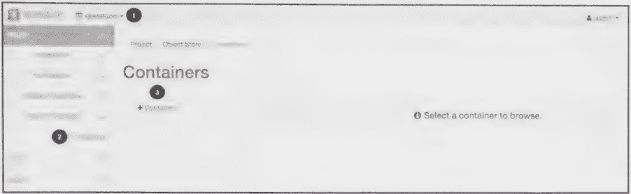

图 8.4：在 Horizon 仪表盘上创建 Swift 容器

- 1. 从 OpenStack 概览页面，通过选择顶部下拉菜单将自己限定到 **operations** 项目。
- 2. 从 **项目-对象存储** 面板组中选择 **容器** 面板。
- 3. 选择 **容器**。
- 4. 请参阅图 8.5。**容器名称（必填）**：为您的容器命名。输入 `container-dashboard`。
- 5. **容器公开访问（必填）**：使此容器的内容对公众可访问。这意味着世界上的任何人都可以浏览容器内的任何对象（前提是 swift API 端点是公开可访问的）。让我们保持此项 **未选中**，从而使容器保持私有。默认情况下，私有容器的对象仅可供具有 **admin** 或 **swiftoperator** 角色的用户访问。我们将在下一节中了解更多关于 ACL 的内容。
- 6. 选择 **创建**。

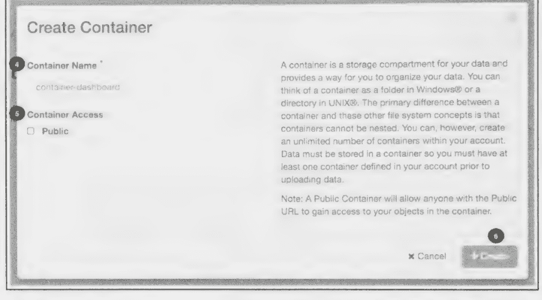

图 8.5：在 Horizon 仪表盘上设置容器名称和访问权限

创建容器后，我们现在将向其上传一个对象。

在本地系统上创建一个名为 `object-dashboard.txt` 的文本文件。在文本文件中，只需写入 `object-dashboard` 并保存文件。

选择 `object-dashboard.txt` 文件并选择 **上传文件** 图标。如果文件成功上传，您应该会看到类似于图 8.6 的内容。图 8.7 显示了我们的对象在其容器、项目和域上下文中的可视化表示。


如果您想上传大于 5 GB 的文件，必须使用 `python-swiftclient`。

如果我们想下载此文件，可以通过选择 **下载** 轻松完成：

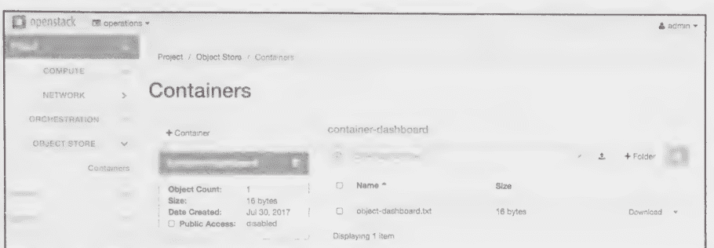

图 8.6：Horizon 仪表盘上包含一个对象的私有 Swift 容器

小心！Swift 会自动覆盖您上传的任何文件名和文件扩展名完全相同的文件。我们可以通过启用对象版本控制来更改此行为。这超出了 COA 考试准备的范围，但您可以在 https://docs.openstack.org/swift 了解更多信息。

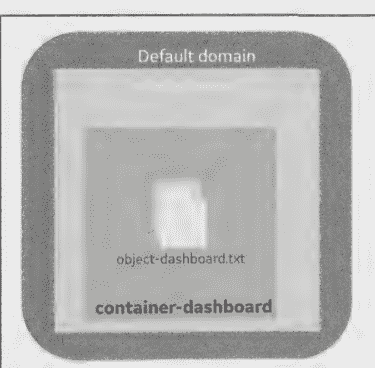

图 8.7：在项目和域上下文中位于容器内的 Swift 对象

## CLI

令人惊讶的是，python-openstackclient 目前没有设置容器 ACL 所需的功能，尽管这将在未来版本中提供。为了保持一致并简化操作，我将向您展示如何使用 python-swiftclient，它包含在 python-openstackclient 中。请记住，提供的 openrc 文件包含以变量形式提供的凭据，用于正确地向 Keystone 进行身份验证并设置项目范围。在本章中，我们将在 operations 项目中执行所有与 Swift 相关的任务。让我们将原始的 openrc 文件复制到一个名为 openrc-operations 的新文件中：

```
$ cp openrc openrc-operations
```

现在我们已经制作了副本，让我们编辑 openrc-operations 文件并更新项目和租户名称变量，以反映我们希望限定到 logistics 项目的范围。如果您更习惯使用其他编辑器，请在此处随意使用。

```
$ nano openrc-operations
```

将以下变量更改为 operations：

```
export OS_PROJECT_NAME=operations
export OS_TENANT_NAME=operations
```

我们更改 OS_TENANT_NAME 变量，因为某些较旧的基于服务的客户端可能依赖于它。


导入新创建的 openrc-operations 文件：

```
$ source openrc-operations
```

验证是否已正确设置变量：

```
$ export | grep OS
```

现在我们可以继续列出 operations 项目拥有的容器：

```
$ swift list
```

我们应该会看到 container-dashboard 容器。如果我们想列出此容器内的所有对象，可以运行以下命令：

```
$ swift list container-dashboard
```

我们应该会看到上一个练习中的 object-dashboard.txt 文件。要将文件下载到当前工作目录，可以运行以下命令：

```
$ swift download container-dashboard object-dashboard.txt
```

现在让我们创建一个新的容器：

```
$ swift post container-cli
```

创建一个名为 object-cli.txt 的新对象：

```
$ touch object-cli.txt
```

让我们在文件中添加文件名：

```
$ echo "object-cli" > object-cli.txt
```

现在我们可以将对象上传到容器：

```
$ swift upload container-cli object-cli.txt
```

我们可以通过运行以下命令来确认容器和文件是否已成功上传：

```
$ swift list container-cli
```

让我们创建并上传另一个对象：

```
$ touch object-deleteme.txt
```

让我们将此文件上传到我们的容器：

```
$ swift upload container-cli object-deleteme.txt
```

确认文件是否已成功上传：

```
$ swift list container-cli
```

现在让我们删除此文件：

```
$ swift delete container-cli object-deleteme.txt
```

创建容器、向这些容器上传对象以及删除对象就是这么简单！非常容易！

## 考试目标：管理容器 ACL

请记住，默认情况下，容器的内容只能由具有 admin 或 swiftoperator 角色的人访问。如果某人拥有其中任一角色，他们就有权限设置 ACL。ACL 在容器级别工作，并适用于容器内的所有对象。

- Read ACL 控制谁可以读取/下载容器内的文件。您还可以将读取/下载访问权限限制为特定项目内的所有用户或一个特定用户。
- Write ACL 允许您为容器设置上传权限。例如，您可能希望允许特定用户或项目内的所有用户向容器上传文件。您甚至可以将容器设置为匿名写入，从而允许任何人，无论项目如何，都可以向容器上传对象。


只能使用原始 API 或通过 python-swiftclient 设置 ACL。唯一可以通过 Horizon 仪表盘设置的 ACL 是通过图 8.6 中的 Public 复选框允许匿名访问容器。

## CLI


小心！python-swiftclient 帮助（swift post --help）关于 ACL 语法的信息不正确！错误修复已经提交，但在考试期间不要依赖它！请确保遵循此处或官方社区文档 https://docs.openstack.org/ocata/ 中的 ACL 语法！

让我们导入我们的 openrc-operations 文件：

```
$ source openrc-operations
```

验证是否已正确设置变量并且您已限定到 operations 项目：

```
$ export | grep OS
```

让我们首先列出我们当前的容器。我们应该能够看到我们在上一节中创建的 container-cli 容器：

```
$ swift list
```

要查看此容器的 ACL，请运行以下命令：

```
$ swift stat container-cli
```

我们应该会看到类似于图 8.8 的输出。

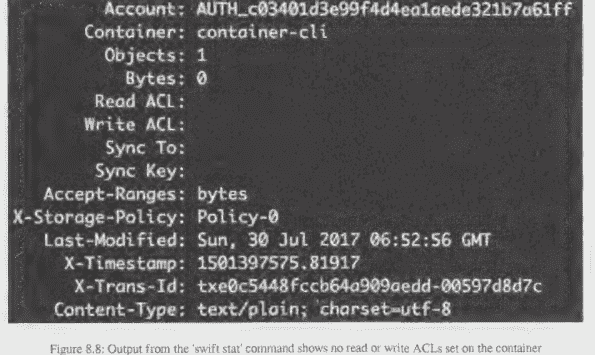

图 8.8：'swift stat' 命令的输出显示容器上未设置读取或写入 ACL

如您所见，Read ACL 和 Write ACL 为空。这意味着容器当前为私有，仅可供具有 admin 或 swiftoperator 角色的人访问。

让我们开始使容器公开可访问，以便互联网上的任何人都可以从中下载文件。让我们分解 Read ACL 的语法。

看看以下语法：

```
$ swift post container-cli --read-acl ".r:*,.r:listings"
```

.r 指的是 referrer 头。referrer 头是链接到所请求资源的网页的地址。换句话说，如果有人在 https://www.openstack.org/ 上链接到此容器中的对象，则向 Swift 请求该对象的请求将包含 referrer 头中的 openstack.org。通配符星号 (*) 表示 referrer 头可以包含任何值，因此可以来自 Swift 链接可能发布的任何网站。语法中的 .r:listings 使容器能够列出容器中的所有对象。现在让我们运行此命令！

设置 ACL 时您不会得到任何确认输出，因此我们可以运行以下命令来验证 read ACL 是否已应用：

```
$ swift stat container-cli
```

我们应该会看到类似于图 8.9 的输出。

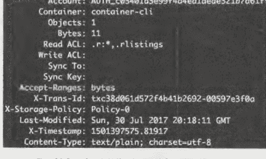

图 8.9：设置公共读取 ACL 后 'swift stat' 命令的输出

为了验证容器是否公开，我们需要从服务目录中获取公共 URL。

运行以下命令：

```
$ openstack catalog list
```

找到 Swift 公共端点并将其复制并粘贴到浏览器中。确保在末尾附加容器名称，使其看起来类似于这样：

```
http://192.168.56.56:8080/v1/AUTH_c03401d3e99f4d4ea1aede321b7a61ff/container-cli
```


通过导航到此公共 Swift URL 并附加容器名称，您应该会看到容器中对象的列表。请参阅图 8.10。

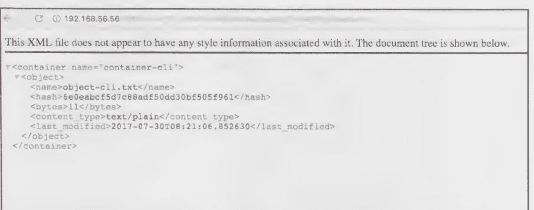

图 8.10：通过 Web 浏览器查看 Swift 容器内的对象列表

如果我们然后通过输入完整路径名直接导航到文件，http://192.168.56.56:8080/v1/AUTH_c03401d3e99f4d4ea1aede321b7a61ff/container-cli/object-cli.txt，我们应该会看到其内容。请参阅图 8.11。

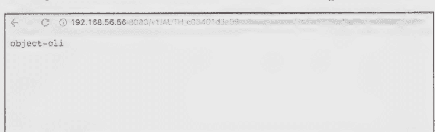

图 8.11：通过 Web 浏览器直接导航到对象

图 8.12 是在启用了读取 ACL 的情况下公共用户访问我们容器内容的示意图：

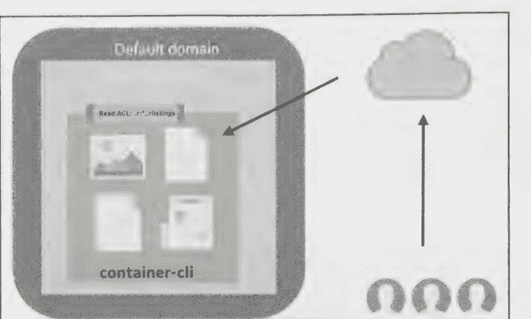

图 8.12：如果 Swift 代理服务器（API）URL 在外部可访问，任何用户都应能够列出并获取具有公共读取 ACL 的容器的内容

如果我们想将容器访问限制为位于特定项目中的 OpenStack 环境内的用户怎么办？

我们可以使用以下语法：--read-acl <project-uuid:user-uuid>

重要的是我们使用 UUID。在多域环境中，这是系统识别我们所引用的特定项目和用户的唯一方式。

让我们只允许 accounting 项目中的 lisaw 读取/下载 container-cli 容器中的文件。


回顾第 3 章，我们可以通过运行 openstack user list 获取所有用户列表，并通过运行 openstack project list 获取所有项目。

运行以下命令。您的 UUID 可能与此处显示的不同：

```
$ swift post container-cli --read-acl \
"fe8787fda267442bbea280391e8500d6:2a0c974a13b042e9849a9366a2e5b589"
```

然后我们可以通过运行以下命令来验证 ACL 是否已正确设置：

```
$ swift stat container-cli
```

如果我们想允许 accounting 项目中的多个特定用户，我们可以使用逗号分隔它们，如 --read-acl <project_id>:user1,id,user2,id,

要允许 accounting 项目中的所有用户，我们可以使用通配符：--read-acl <project_id>:*.

要设置写入 ACL，我们使用 --write-acl 标志。

让我们添加一个写入 ACL，允许 accounting 项目内的任何用户向容器写入对象：

```
$ swift post container-cli --write-acl "fe8787fda267442bbea280391e8500d6:*"
```

验证写入 ACL 是否已正确设置：

```
$ swift stat container-cli
```

您应该会看到与图 8.13 类似的输出：

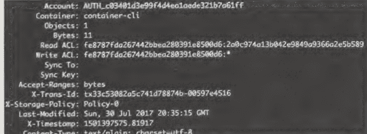

图 8.13 Swift 容器上的读取和写入 ACL

## 考试目标：设置对象过期

可以通过设置 X-Delete-At 或 X-Delete-After 对象头来设置对象在特定时间过期。一旦对象过期，它将无法访问并最终从 Swift 集群中删除。

要在特定时间使对象过期，时间和日期必须采用 Unix Epoch 格式。


要在系统上以 Unix Epoch 格式获取当前时间，可以运行 date +%s。

### 命令行界面

让我们将 object-cli.txt 对象设置为在 2018 年 9 月 1 日星期六上午 9:09:14，GMT 删除。这将转换为 UNIX Epoch 格式的 1535792954。

```
$ swift post container-cli object-cli.txt -H "X-Delete-At:1535792954"
```

我们可以通过运行以下命令来验证是否已设置过期：

```
$ swift stat container-cli object-cli.txt
```

您应该会看到与图 8.14 类似的输出。

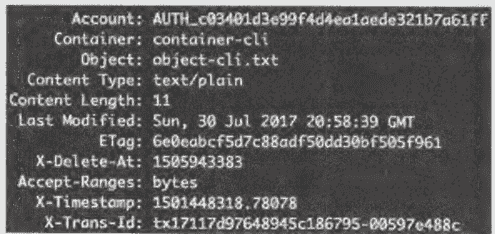

图 8.14：在 Unix Epoch 格式的特定日期和时间设置要过期的对象

一旦达到指定日期，文件将被删除。

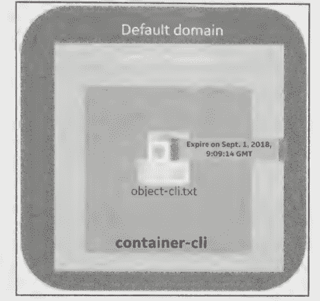

图 8.15：Swift 容器中对象在未来特定时间过期的可视化

我们还可以设置对象在经过一定时间后删除。

让我们使用 X-Delete-After 头将对象设置为 60 秒后删除。这将覆盖之前的命令，并将过期时间设置为从系统当前时间/日期起 60 秒。

```
$ swift post container-cli object-cli.txt -H "X-Delete-After:60"
```

验证是否已设置过期：

```
$ swift stat container-cli object-cli.txt
```

60 秒后，您将无法再检查对象的状态，因为它将被删除。您将看到错误，表明对象不再可用。请参阅图 8.16。


图 8.16：对象过期并从集群中删除后，您将收到 404 'Not Found'


您仍可能在运行 `swift list container-cli` 时看到已删除的对象。虽然对象肯定已从集群中删除，但 SQLite 数据库列表尚未更新。请耐心等待，它最终会从列表中删除！

如果您想删除过期头，可以通过使用空值的 `X-Remove-Delete-At` 头轻松完成。例如：

```
$ swift post container-cli object-cli.txt -H "X-Remove-Delete-At: "
```

## 总结

在本章中，我们回顾了 Swift 架构和诸如帐户、容器、对象之类的概念。重要的是要记住，大多数 Swift 功能在 Horizon 仪表板上未启用，必须直接通过 API 或通过 `python-swiftclient` 设置。不要忘记：容器默认是私有的，只能由具有 admin 或 swiftoperator 角色的用户管理。要授予公共或单个 OpenStack 用户访问容器的权限，必须设置读取和/或写入 ACL。

记住 ACL 语法绝对至关重要！一些较旧版本的 `python-swiftclient` 在帮助输出中报告了错误的信息！本章中描述的 ACL 语法并且工作正常。有关 Swift 的更多信息，请查看官方文档 https://docs.openstack.org/swift。
