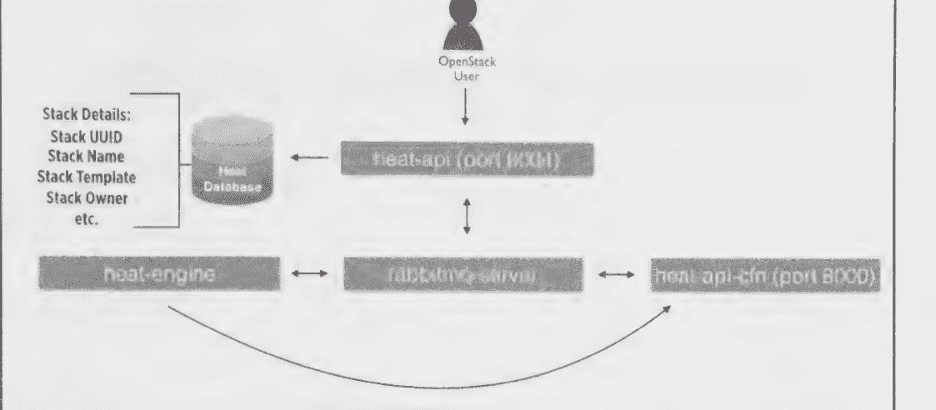
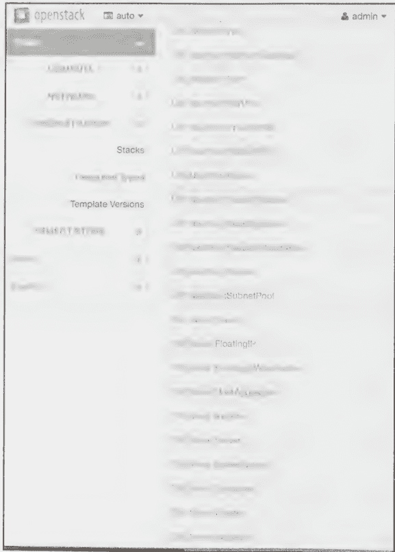
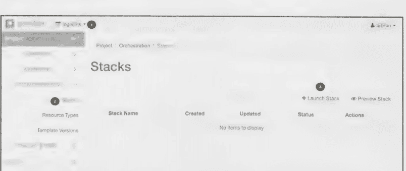
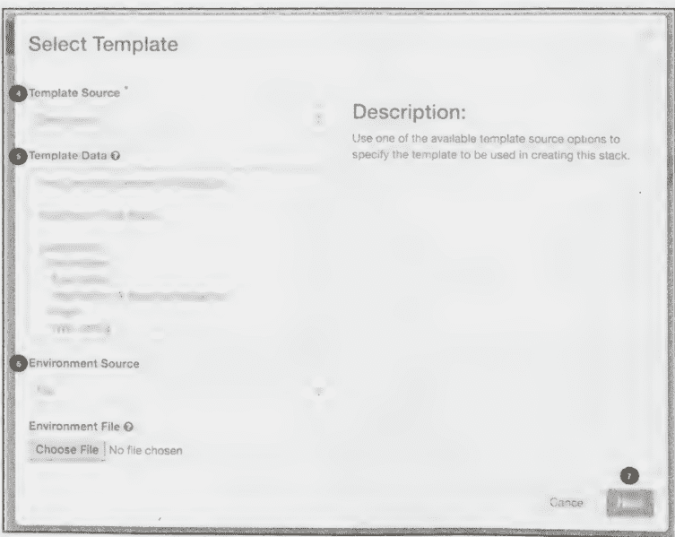
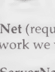
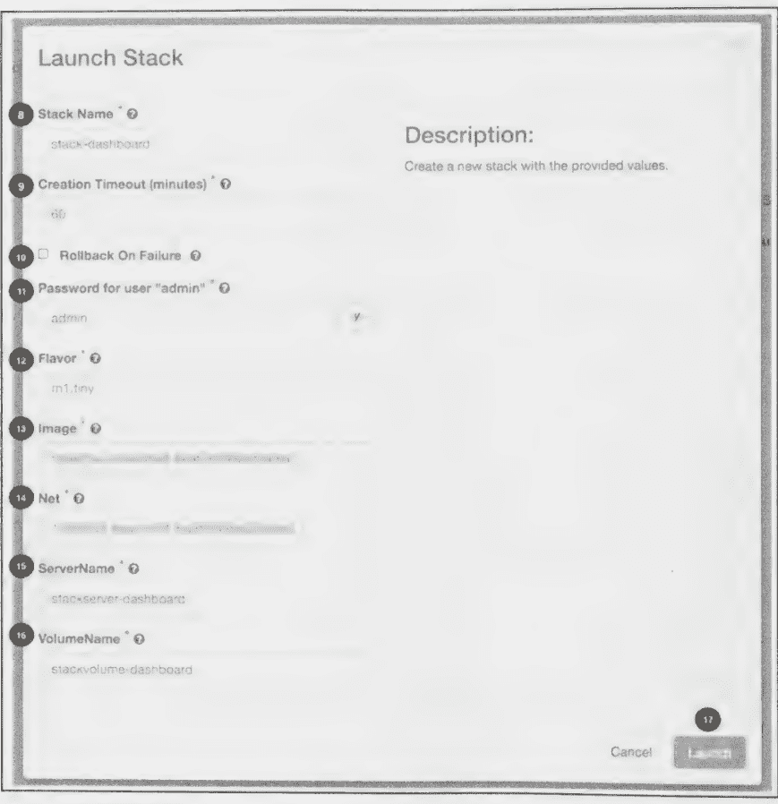
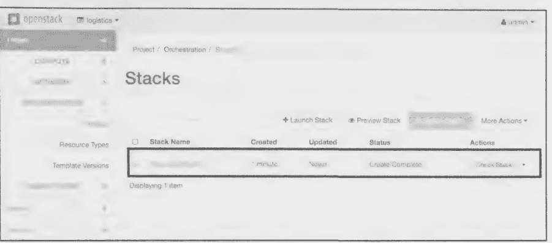
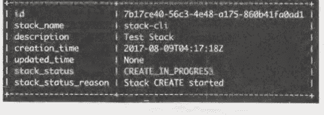
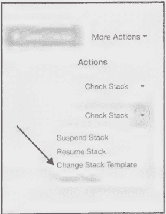
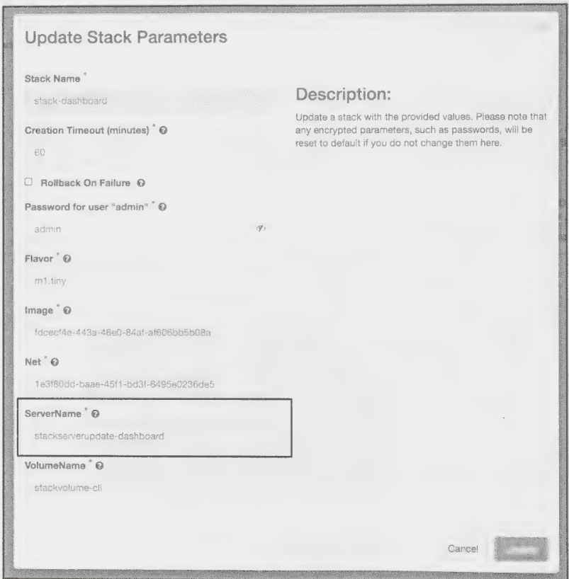

# 9 Heat 编排服务

## Heat 编排服务

在上一章中，我们讨论了 Swift 对象存储服务以及 COA 考试中的所有 Swift 相关目标。现在我们将讨论 Heat。Heat 是 OpenStack 编排服务，其目标是帮助 OpenStack 用户建模、设置和自动化 OpenStack 资源的创建和管理。由于考试中 Heat 内容很少，本章将简明扼要。我们将涵盖以下主题：

- 关于 Heat
- Heat 架构
- Heat 模板
- 考试目标 - 管理堆栈
- 考试目标 - 更新堆栈

在本章之后，您应该对 Heat 有扎实的理解，并具备成功完成考试中所有 Heat 相关目标所需的技能。

### 关于 Heat

在第 1 章中，我们讨论了 OpenStack 用户可以使用 OpenStack 创建资源的各种方式。直到我们 COA 考试准备之旅的这一点，我们一直使用 Horizon 仪表板和 CLI。虽然使用它们很有趣，但使用它们部署 OpenStack 资源可能相当繁琐。事实上，在 2007 年至 2010 年间，Amazon 用户主要依赖 AWS 控制台、CLI 或 SDK 为其应用程序配置虚拟资源。许多用户开始使用 CLI 创建 bash 脚本来自动化为其应用程序创建整个环境。

这在一段时间里效果很好，但如果用户不小心再次运行脚本、想要删除资源或只添加一个额外更改时，用户开始遇到问题。然后用户必须在 bash 脚本中构建逻辑以使其幂等，并添加额外的脚本来协助删除环境。这是一项大量工作。

然后在 2011 年 2 月，AWS CloudFormation 发布了！有了 CloudFormation，用户可以在 JSON 模板文件中描述其期望的 AWS 架构。然后他们可以启动此模板并部署其“堆栈”，同时 AWS 会在适当顺序下处理所有操作，并在创建过程中记录所有事件。在用户完成堆栈环境后，他们可以轻松地向其添加额外资源或通过删除它来销毁整个环境。

Heat 于 2013 年 4 月随 OpenStack Grizzly 版本引入。与 CloudFormation 类似，Heat 以蓝图或 Heat 编排模板开始，该模板描述了要配置的 OpenStack 资源。Heat 会处理配置和配置，无需担心依赖关系或执行顺序。

您可以同样轻松地删除堆栈，这会删除与堆栈关联的所有资源。如果您想对堆栈进行更改，甚至可以通过提供带有新参数的修改模板轻松更新它。

### Heat 架构

Heat 由三个守护进程组成：

- **heat-api**：Heat 的 API 和主要网关。必须与 `heat-api` 交互以创建、列出、删除和管理堆栈。
- **heat-api-cfn**：这提供了一个 AWS 风格的查询 API，允许服务或人工用户利用类似 CloudFormation 的功能，例如等待条件和触发自动缩放。
- **heat-engine**：负责启动堆栈并管理模板中指定的所有资源。




Figure 9.1: Heat 架构的高级视图

## Heat 模板

Heat 模板（heat orchestration templates 或 HOT，简写）是 heat-api 可以消费的模板，用于在 OpenStack 环境中创建虚拟资源。它们描述了所有期望的资源及其相关参数。堆栈创建后，OpenStack 资源即可运行。模板非常方便，因为它们允许你将它们提交到 GitHub 等版本控制系统中，以便轻松跟踪更改并与团队协作。如果部署 Heat 模板后出现问题，只需恢复到模板的先前版本即可。

Figure 9.2 拆解了 Heat 模板的结构。

## Heat 模板结构

```yaml
heat_template_version: 2013-05-23
description: Test Stack

parameters:
  ServerName:
    type: string
    description: A name for the server
  Image:
    type: string
    description: Image ID used to boot the server
  Flavor:
    type: string
    description: Flavor of server
  Net:
    type: string
    description: Network ID for the server
  Volume:
    type: string
    description: A volume ID to attach to the server

resources:
  server1:
    type: OS::Nova::Server
    properties:
      name: { get_param: ServerName }
      image: { get_param: Image }
      flavor: { get_param: Flavor }
      networks:
        - network: { get_param: Net }

  volumeattach:
    type: OS::Cinder::VolumeAttachment
    properties:
      volume_id: { get_param: Volume }
      instance_uuid: { get_resource: server1 }

outputs:
  myinstance_ip:
    description: IP address of the first instance
    value: { get_attr: [server1, first_address] }
```

### 模板头

- version（对应 OpenStack 版本）
  - 2013-05-23 = Grizzly、Havana 和 Icehouse
- description（可选）

### 参数

- 指定任何输入参数（可选）

### 资源

- 你正在创建的 OpenStack 资源（必填）

### 输出

- 堆栈创建后提供给用户的信息，即 IP 地址、URL、UUID、密码等。

Figure 9.2: Heat 模板的结构

1. **模板头：** 模板版本是必填项，描述是可选的。OpenStack 的每个新版本都会发布额外的功能和能力。这意味着用户创建的新模板可能引用旧版本中不存在的功能，因此使模板与旧环境不兼容。以下是 Heat 模板版本及其兼容的 OpenStack 版本列表：

| Heat 模板版本 | OpenStack 版本 |
|---|---|
| 2013-05-23 | Grizzly、Havana、Icehouse 及更高版本 |
| 2014-10-16 | Juno 及更高版本 |
| 2015-04-30 | Kilo 及更高版本 |
| 2015-10-15 | Liberty 及更高版本 |
| 2016-04-08 | Mitaka 及更高版本 |
| 2016-10-14 | Newton 及更高版本 |

2. **参数：** 这些是可选的，可以是任何你希望用户能够插入的特定值。这些值在部署或“创建”堆栈时由用户传入。

3. **资源：** 这些是必填项，表示你想要创建的任何 OpenStack 资源。

4. **输出：** 堆栈创建后提供给用户的信息。这可以是 IP 地址到特殊注册代码或密码的任何内容。

## Heat 资源

资源是必填项，是你想要创建的任何 OpenStack 资源的引用。OpenStack 资源可以是 Nova 虚拟机实例到 Neutron 安全组等任何内容。参见图 9.3。你可以在 Horizon 仪表板上通过从 Project-Orchestration 面板组导航到 Resource Types 面板来获取兼容资源的完整列表。



Figure 9.3: Horizon 仪表板上可用的 Heat 资源列表

## 与 AWS 的向后兼容性

你可能已经注意到一些 Heat 资源具有 AWS:: 前缀。这些资源用于使 CloudFormation 模板与 OpenStack Heat 兼容。正如你所知，AWS 和 OpenStack 具有许多不同的功能，因此我不建议尝试使用为 AWS 环境设计的模板创建堆栈。你最好重构你的 CloudFormation 模板以使用 Heat 资源。但对于好奇的人，这里有一些 AWS Heat 资源及其作用：

| AWS Heat 资源 | 操作 |
|---|---|
| AWS::EC2::Instance | OS::Nova::Server（创建 Nova 实例） |
| AWS::EC2::SecurityGroup | OS::Neutron::SecurityGroup（创建 Neutron 安全组） |
| AWS::EC2::VPC | OS::Neutron::Network（创建 Neutron 租户网络） |
| AWS::EC2::Volume | OS::Cinder::Volume（创建 Cinder 卷） |
| AWS::IAM::AccessKey | OS::Nova::KeyPair（为指定用户生成公钥/私钥） |
| AWS::S3::Bucket | 类似于 OS::Swift::Container（创建 Swift 容器） |

## 考试目标

让我们看看 Heat 考试目标。

Figure 9.4 拆解了你在 COA 考试中应负责了解的各种与 Heat 相关的目标。如你所见，所有这些任务都可以在 Horizon 仪表板和 CLI 上完成。请记住考试期间时间至关重要，在许多情况下，在仪表板上处理任务会快得多。


Figure 9.4: Heat 考试目标可以在 Horizon 仪表板或 CLI 上执行

## 考试目标 - 管理堆栈

当你创建 heat 模板时，你正在创建堆栈。堆栈归用户在创建时所作用域的项目所有。在 Horizon 仪表板和 CLI 上创建堆栈相当简单。我们先尝试仪表板。

本章假设你已完成第 6 章中的考试目标练习。如果尚未完成第 6 章，*Neutron 网络服务*，请返回并确保你已创建 **tenant-network1-dashboard** 和 **tenant-network1-cli**。用户必须具有 `heat_stack_owner` 角色才能管理堆栈。随附虚拟设备提供的管理员用户应已具有此角色。

### Horizon 仪表板

- 1. 从 OpenStack 概览页面，通过选择顶部下拉菜单将作用域限定为 **logistics**。
- 2. 从 **Project-Orchestration** 面板组中选择 **Stacks** 面板。
- 3. 选择 **Launch Stack**。



Figure 9.5: 从 Horizon 仪表板启动堆栈

4. 参见图 9.6。Template Resource（必填）：你可以指定希望提供将要使用的模板的方式。

- **File**：允许你选择本地文件系统上的模板。
- **Direct Input**：将模板复制并粘贴到文本字段中。
- **URL**：提供指向托管在网站或 GitHub 上的公开可访问模板的 URL。

5. 粘贴以下模板。此模板使用我们指定的 flavor 和 image 创建一个全新的实例，将其连接到现有的租户网络，然后附加一个全新的 1 GB 块卷。粘贴到 Horizon 仪表板时请注意间距。模板的副本可在虚拟设备和官方书籍 GitHub 仓库中找到。


YAML（YAML Ain't Markup Language）是 JSON 的超集，使人类设置值更容易。YAML 中不允许使用 Tab，因此务必始终使用空格。所有属性和列表必须缩进 1 个或多个空格。如果模板让你感到困难，请在线查找示例 Heat 模板或在 http://yaml-online-parser.appspot.com/ 上使用在线 YAML 解析器进行尝试。

```yaml
heat_template_version: 2013-05-23
description: Test Stack

parameters:
  ServerName:
    type: string
    description: A name for the server
  Image:
    type: string
    description: Image ID used to boot the server
  Flavor:
    type: string
    description: Flavor of server
  Net:
    type: string
    description: Network ID for the server
  VolumeName:
    type: string
    description: A name for the volume

resources:
  server1:
    type: OS::Nova::Server
    properties:
      name: { get_param: ServerName }
```

```
image: { get_param: Image }
flavor: { get_param: Flavor }
networks:
  - network: { get_param: Net }
volume1:
  type: OS::Cinder::Volume
  properties:
    name: { get_param: VolumeName }
    size: 1

volumeattach1:
  type: OS::Cinder::VolumeAttachment
  properties:
    volume_id: { get_resource: volume1 }
    instance_uuid: { get_resource: server1 }
```

6. Environment Resource (optional): This allows you to specify an environment file that fills in input parameters for the selected template. We will ignore this for now.
6. 环境资源 (可选)：这允许您指定一个环境文件，用于填充所选模板的输入参数。我们现在将忽略它。

7. Select Next.
7. 选择下一步。



Figure 9.6: Providing a heat template for a stack on the Horizon dashboard
图 9.6：在 Horizon 控制面板上为堆栈提供热模板

8. **Stack Name** (required): Name of the stack to be created. Let's name this `stack-dashboard`.
8. **堆栈名称** (必需)：要创建的堆栈的名称。我们将其命名为 `stack-dashboard`。

9. **Creation Timeout** (required): Minutes to wait before canceling the stack. This will automatically cancel the stack creation process if the stack does not complete. Leave this as the default.
9. **创建超时** (必需)：在取消堆栈前等待的分钟数。如果堆栈未完成，这将自动取消堆栈创建过程。将其保留为默认值。

10. **Rollback On Failure** (optional): If checked, this will undo the stack creation process, cleaning up any created resources. We will leave this unchecked.
10. **失败时回滚** (可选)：如果选中，这将撤销堆栈创建过程，清理已创建的资源。我们将保持未选中状态。

11. **Password for user "admin"** (required): This is the password for the current user logged into the dashboard, in our case, `admin`. We provide this for security purposes (although it can be disabled in the Horizon dashboard with the `enable_user_pass` value in the dashboard config file at `/etc/openstack-dashboard/local_settings.py`). Enter `admin`.
11. **用户 "admin" 的密码** (必需)：这是当前登录到控制面板的用户的密码，在我们的例子中是 `admin`。我们出于安全目的提供此密码（尽管可以在 Horizon 控制面板中通过仪表板配置文件 `/etc/openstack-dashboard/local_settings.py` 中的 `enable_user_pass` 值禁用它）。输入 `admin`。

12. **Flavor** (required): The input parameter specified in our Heat template. The flavor we want to use for our instance. Let's use `m1.tiny`.
12. **规格** (必需)：我们在 Heat 模板中指定的输入参数。我们希望为实例使用的规格。让我们使用 `m1.tiny`。

13. **Image** (required): The input parameter specified in our Heat template. The image we want to use for our instance. Let's use `cirros`.
13. **镜像** (必需)：我们在 Heat 模板中指定的输入参数。我们希望为实例使用的镜像。让我们使用 `cirros`。



> When providing parameters of existing OpenStack resources to Heat, it's sometimes safer to provide their specific UUIDs rather than the names. This helps in avoiding conflicts when you may have multiple resources with the same name.
> 当向 Heat 提供现有 OpenStack 资源的输入参数时，有时提供其特定的 UUID 而不是名称会更安全。这有助于避免在您可能有多个同名资源时发生冲突。

14. **Net** (required): The input parameter specified in our Heat template that refers to the network we want our instance to attach to. Let's use `tenant1-dashboard`.
14. **网络** (必需)：我们在 Heat 模板中指定的输入参数，指的是我们希望实例连接到的网络。让我们使用 `tenant1-dashboard`。

15. **ServerName** (required): The input parameter specified in our Heat template. The name we want for our server.
15. **服务器名称** (必需)：我们在 Heat 模板中指定的输入参数。我们希望服务器的名称。

16. **VolumeName** (required): The input parameter specified in our Heat template. The name of the volume we want our stack to create and attach to the instance.
16. **卷名称** (必需)：我们在 Heat 模板中指定的输入参数。我们希望堆栈创建并附加到实例的卷的名称。

17. Select Launch.
17. 选择启动。



Figure 9.7: Providing parameters for a stack on the Horizon dashboard
图 9.7：在 Horizon 控制面板上为堆栈提供参数

Your stack status should be in Create in Progress. Be patient, it may take a few minutes to complete. Once complete, you will see the status change to Create Complete. Take a look at Figure 9.8 for the finished product.
您的堆栈状态应为创建进行中。请耐心等待，完成可能需要几分钟。一旦完成，您将看到状态更改为创建完成。请参阅图 9.8 查看最终产品。



Figure 9.8: Once completed, the stack status should show 'create complete'
图 9.8：完成后，堆栈状态应显示“create complete”

We should now be able to see our newly created virtual machine and attached volume.
我们现在应该能够看到我们新创建的虚拟机和附加的卷。

## CLI
## 命令行界面

Remember that in Chapter 6, we created the openrc-logistics file. We are going to use that file here. If you skipped Chapter 6, feel free to flip back to see how we created a new credential file that allowed us to scope to the logistics project.
请记住，在第 6 章中，我们创建了 openrc-logistics 文件。我们将在此处使用该文件。如果您跳过了第 6 章，请随意翻回去查看我们如何创建新的凭证文件以允许我们限定到 logistics 项目。

Source the openrc-logistics file:
为 openrc-logistics 文件设置来源：

```
$ source openrc-logistics
```

Verify that the proper variables are set and we are scoped to logistics:
验证是否已设置正确的变量并且我们已限定到 logistics：

```
$ export | grep OS
```

Now that we are properly scoped, let's begin by listing any current stacks in the logistics project. We should have one stack from the previous Horizon dashboard exercise:
现在我们已正确限定范围，让我们先列出 logistics 项目中的任何当前堆栈。我们应该有一个来自之前 Horizon 控制面板练习的堆栈：

```
$ openstack stack list
```

You should see output similar to Figure 9.9:
您应该会看到与图 9.9 类似的输出：


Figure 9.9: Output from the 'openstack stack list' command
图 9.9：'openstack stack list' 命令的输出

Let's create a file called test-stack.yaml using the Heat template from the previous section. If you are using the virtual appliance, you may already see the test-stack.yaml residing in the /home/openstack directory.
让我们使用上一节的 Heat 模板创建一个名为 test-stack.yaml 的文件。如果您使用的是虚拟设备，您可能已经看到 test-stack.yaml 位于 /home/openstack 目录中。


To find the UUIDs of the resources, use the openstack image list and openstack network list --long commands.
要查找资源的 UUID，请使用 openstack image list 和 openstack network list --long 命令。

```
$ openstack stack create -t test-stack.yaml --parameter Flavor=m1.tiny --parameter Image=<image-uuid> --parameter Net=<network-uuid> --parameter ServerName=stackserver-cli --parameter VolumeName=stackvolume-cli stack-cli
```

You should see output similar to Figure 9.10.
您应该会看到与图 9.10 类似的输出。



Figure 9.10: Output from the 'openstack stack create' command
图 9.10：'openstack stack create' 命令的输出

Run the openstack stack list command to check the status of the stack:
运行 openstack stack list 命令以检查堆栈的状态：

```
$ openstack stack list
```

If your stack status changes to `CREATE_FAILED`, use the `openstack stack show` command on the stack to see the specific error. If it's due to `No Valid Host`, ensure that there are no other instances running outside the **logistics** project. If all else fails, reboot the virtual appliance, delete the stack using the `openstack stack delete` command, and retry creating the stack.
如果您的堆栈状态更改为 `CREATE_FAILED`，请在堆栈上使用 `openstack stack show` 命令查看具体错误。如果是由于 `No Valid Host` 引起，请确保 **logistics** 项目之外没有运行的其他实例。如果其他方法都失败，请重新启动虚拟设备，使用 `openstack stack delete` 命令删除堆栈，然后重试创建堆栈。

## Exam objective - updating stacks
## 考试目标 - 更新堆栈

After creating a stack, you may want to modify an aspect of it, including adding, removing, or modifying a resource. This can be easily done via the dashboard or CLI. Note that doing this on the dashboard is a bit of a hassle as we need to provide all original parameters.
创建堆栈后，您可能想要修改其某个方面，包括添加、删除或修改资源。这可以通过控制面板或 CLI 轻松完成。请注意，在控制面板上执行此操作有点麻烦，因为我们需要提供所有原始参数。

## Horizon dashboard
## Horizon 控制面板

- 1. From the OpenStack overview page, scope yourself to the **logistics** by selecting the top dropdown.
- 2. Select the **Stacks** panel from the **Project-Orchestration** panel group.
- 3. See Figure 9.11. Select the dropdown next to **stack-dashboard** and select **Change Stack Template**.
- 1. 从 OpenStack 概览页面，通过选择顶部下拉菜单将自己限定到 **logistics**。
- 2. 从 **Project-Orchestration** 面板组中选择 **Stacks** 面板。
- 3. 请参阅图 9.11。选择 **stack-dashboard** 旁边的下拉菜单并选择 **Change Stack Template**。



Figure 9.11: Updating a stack on the Horizon dashboard
图 9.11：在 Horizon 控制面板上更新堆栈

See Figure 9.12. Follow the exact same instructions shown in the previous Horizon dashboard "Create Stack" section only this time, we will modify the name of our Server. Let's change it to `stackserverupdate-dashboard`.
请参阅图 9.12。按照之前 Horizon 控制面板“创建堆栈”部分所示的完全相同的说明进行操作，只是这次我们将修改服务器的名称。让我们将其更改为 `stackserverupdate-dashboard`。



Figure 9.12: Provide the same parameters as the previous exercise, but change the ServerName
图 9.12：提供与上一个练习相同的参数，但更改 ServerName

Once complete, the status of the stack should read **Update Complete**. Our stack has remained the same with the exception of the one parameter we've modified.
完成后，堆栈的状态应显示为 **Update Complete**。我们的堆栈保持不变，除了我们修改的那个参数。

## CLI
## 命令行界面

Source the `openrc-logistics` file:
为 `openrc-logistics` 文件设置来源：

```
$ source openrc-logistics
```

Verify that the proper variables are set and we are scoped to the logistics project:
验证是否已设置正确的变量并且我们已限定到 logistics 项目：

```
$ export | grep OS
```

Let's update our stack by modifying the `ServerName` parameter. Thanks to the `--existing` flag, we do not need to re-enter all the original parameters:
让我们通过修改 `ServerName` 参数来更新我们的堆栈。由于 `--existing` 标志，我们无需重新输入所有原始参数：

```
$ openstack stack update --existing --parameter
ServerName=stackserverupdate-cli stack-cli
```


Be sure to enter all parameter keys as they exactly appear in the Heat template! In the example above, we must type `ServerName`. It is case sensitive!
确保以 Heat 模板中完全相同的形式输入所有参数键！在上面的示例中，我们必须键入 `ServerName`。它区分大小写！

Run the following to check the stack status:
运行以下命令以检查堆栈状态：

```
$ openstack stack list
```

You should see output similar to Figure 9.13, showing that the stack has been properly updated.
您应该会看到与图 9.13 类似的输出，显示堆栈已正确更新。


Figure 9.13: A successfully updated stack on the CLI
图 9.13：在 CLI 上成功更新的堆栈

After you are done playing with Heat, be sure to delete your stacks by running the following:
在您玩完 Heat 后，请务必通过运行以下命令删除您的堆栈：

```
$ openstack stack delete <stack-name-or-uuid>
```

## Summary
## 总结

Great! We just completed the Heat exam objective section of our COA prep. Remember that you can complete Horizon objectives on both the dashboard and CLI, but updating an existing stack is much easier on the CLI thanks to the `--existing` flag. Don't forget to always try to use UUIDs of virtual resources for Heat parameters. There may be multiple resources with the same name and UUIDS allow us to be specific. Do not be overly concerned with building Heat templates from scratch or overly complex Heat template scenarios. If you can kick a stack and provide the appropriate parameters, you'll be good to go! Now that we have completed all service-related objectives in the exam, let's move on to the final section: troubleshooting!
太好了！我们刚刚完成了 COA 准备中 Heat 考试目标部分。请记住，您可以在控制面板和 CLI 上完成 Horizon 目标，但由于 `--existing` 标志，通过 CLI 更新现有堆栈要容易得多。不要忘记始终尝试为 Heat 参数使用虚拟资源的 UUID。可能存在多个同名资源，而 UUID 允许我们具体指定。不要过于担心从头构建 Heat 模板或过于复杂的 Heat 模板场景。如果您可以启动堆栈并提供适当的参数，您就万事俱备了！现在我们已完成考试中的所有服务相关目标，让我们继续进入最后一部分：故障排除！


