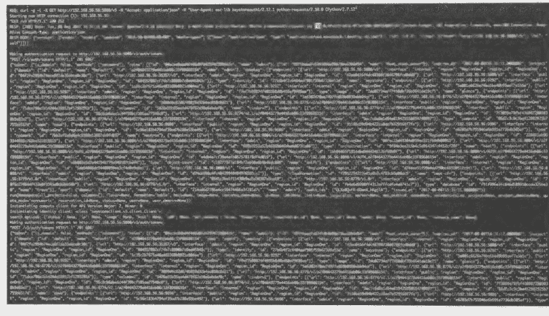
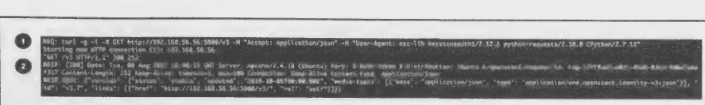
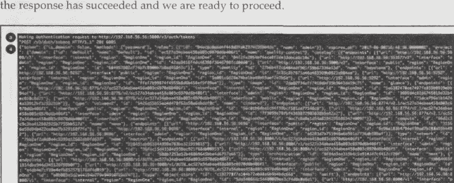
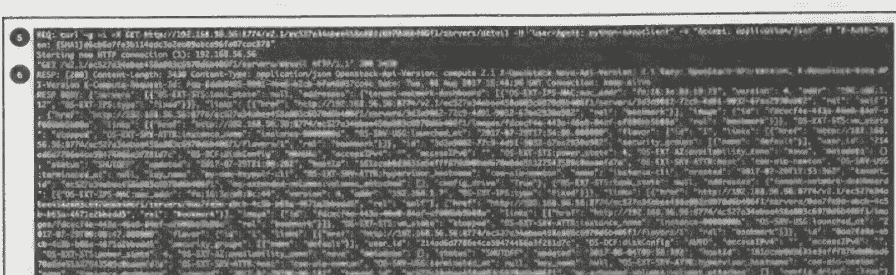
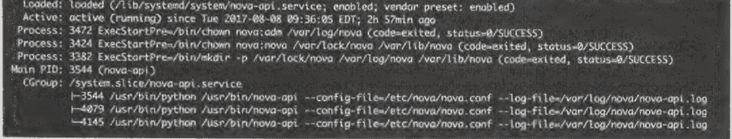
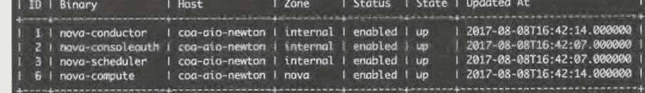
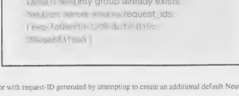
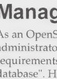
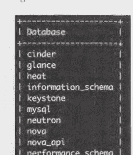

# 10 故障排除

恭喜！我们已经涵盖了 COA 考试中所有与 OpenStack 服务相关的考试目标。了解这些目标将使你在考试中处于良好状态，但请记住，你还需要带来一些基本的 OpenStack 故障排除技能。在本章中，我们将涵盖以下内容：

- Debugging the CLI
- Managing OpenStack daemons
- Using the API to check component/agent status
- Exam objective - important OpenStack service directories
- Exam objective - analyzing log files
- Exam objective - managing MySQL

完成本章后，你应该对在 COA 考试中成功满足所有与故障排除相关的目标有扎实的理解。

### Debugging the CLI

当你使用 `python-openstackclient` 或传统的基于服务的客户端（即 `python-novaclient`、`python-neutronclient` 或 `python-swiftclient`）时，后台有很多操作！要查看正在进行的 API 调用，我们可以使用 `--debug` 标志实时查看请求和响应。让我们尝试使用以下命令。确保在运行之前先 source `openrc` 文件。

虽然理解 --debug 标志不是通过考试的必要条件，但它是一个非常宝贵的工具，可以帮助你在真实的 OpenStack 环境中缩小问题范围。

```
$ openstack server list --debug
```

我们应该会看到类似于图 10-1 的输出。哇，这么多文本！



图 10.1：使用 CLI 上的 --debug 标志的输出

我们如何解读它？正如你从本书第一章已知的那样，我们通过 HTTP 协议与 RESTful API 通信。为了理解调试，我们可以查找发往 Keystone 和 Nova API 的请求和响应。



图 10.2：发往 Keystone API 的初始请求/响应

1. python-openstackclient 首先向 `openrc` 文件中指定的 Keystone 身份验证端点发出 GET 调用。这只是为了确保身份验证端点处于活动状态并有响应。

2. 我们可以看到 Keystone API 以 `HTTP 200 OK` 作出响应。这意味着响应已成功，我们可以继续进行。



图 10.3：从 Keystone API 获取作用域令牌的请求/响应

3. 尽管调试输出会隐藏请求的主体，这里，`python-openstackclient` 将用户名、密码、域和项目名称发送到身份验证端点以请求作用域令牌。

4. 此请求的响应包含作用域令牌（在调试输出中不可见）以及整个 OpenStack 环境服务目录。`python-openstackclient` 可以使用目录查找 nova/compute API 端点 URL。



图 10.4：从 Nova API 获取所有正在运行服务器列表的请求/响应

5. `python-openstackclient` 然后向步骤 4 中发现的 nova/compute API 端点 URL 发送请求。如你所见，请求中有一个 X-Auth-Token 头部，其中包含令牌。调试输出显示令牌的 SHA1 哈希以隐藏实际令牌内容。

6. 最后，我们看到来自 nova-api 的响应：项目中任何正在运行实例的列表（以 JSON 格式）。多亏了 `python-openstackclient`，此 JSON 将被转换为格式良好的表格。

虽然理解 `--debug` 标志不是通过考试的必要条件，但它是一个非常宝贵的工具，可以帮助你在真实的 OpenStack 环境中缩小问题范围。

### Managing OpenStack daemons

如果我们使用的是具有 `systemd` 初始化系统的操作系统，我们可以轻松使用 `systemctl` 命令启动、停止或检查特定服务器上运行的任何 OpenStack 守护进程的状态。

例如，要检查 nova-api 服务的状态，我们可以运行以下命令：

```
$ sudo systemctl status nova-api
```

我们应该会看到类似于图 10.5 的输出。



图 10.5：systemctl status 命令的输出

这表明 nova-api 服务当前正在运行，并在重启时启动（已启用）。如果服务已停止，我们可以通过运行以下命令轻松重新启动它：

```
$ sudo systemctl start nova-api
```

如果我们想重启服务，可以运行以下命令：

```
$ sudo systemctl restart nova-api
```


考试不需要你编辑任何特定的 OpenStack 配置文件——但对于生产 OpenStack 环境的一个良好经验法则是，记住只要你希望配置文件的新更改生效，就重启服务。

### Using the APIs to check the component status

一些 OpenStack 服务 API 具有允许用户在不直接在物理机上与守护进程交互的情况下检查服务组件状态的功能。这些通常仅限管理员角色的功能，是验证 OpenStack 组件健康状况的便捷方式。让我们尝试使用 openstack compute service list 命令检查 nova 组件的状态：

```
$ openstack compute service list
```

我们应该会得到类似于图 10.6 的输出。



图 10.6：Output from the 'openstack compute service list' command

此命令的输出显示 nova-conductor、nova-consoleauth、nova-scheduler 和 nova-compute 服务都已启动并运行。在真实的 OpenStack 基础设施中，我们会为环境中的每个 hypervisor 看到多个 nova-compute 服务。

以下是一些具有组件状态命令的其他服务：

- Neutron
- Cinder
- Heat

```
$ openstack network agent list
```

```
$ openstack volume service list
```

```
$ openstack orchestration service list
```

### Important OpenStack service directories

当 OpenStack 基础设施工程师在 OpenStack 环境中安装全新服务时，该 OpenStack 服务的包很可能默认使用以下目录：

- Configuration files

```
/etc/<service-name>/*
```

在此位置，我们可以找到相应服务的配置文件，通常使用 `.conf` 文件扩展名。这些文件控制 API 的行为以及可能安装在机器上的任何相关组件。这也是 `policy.json` 授权文件所在的目录。

- Data files

```
/var/lib/<service-name>/*
```

数据文件是 OpenStack 服务存储任何相关数据的位置。例如，在 `/var/lib/glance` 中，Glance 会在此目录存储镜像。在 `/var/lib/nova` 中，Nova 会存储写入实例临时磁盘的实际数据以及所有相关的虚拟机配置信息。

- Log files

```
/var/log/<service-name>/*
```

大多数 OpenStack 服务会将日志文件写入此目录。我们将在下一节更详细地讨论日志。

### Exam objective - analyzing log files

如上一节所述，OpenStack 服务将日志文件写入 `/var/log/<service-name>/*`。OpenStack 服务操作系统包会自动设置 `logrotate` 程序以打包并压缩旧的 OpenStack 日志文件，从而避免过度的存储消耗。默认日志目录的例外是 Keystone 和 Swift。Keystone 使用 Apache，因此将日志文件写入 `/var/log/apache2/*`。Swift 将日志文件写入 `/var/log/syslog`。

每当用户向 OpenStack 服务的 API 发出请求时，都会生成一个请求 UUID。你有时会在尝试通过 Horizon 仪表板或 CLI 与服务交互时看到这些请求 ID。要获取有关服务错误的更多信息，你可以轻松浏览日志文件以查找有关特定请求 ID 的线索。


例如，当尝试在 Horizon 仪表板上创建一个名为 `default` 的新 Neutron 安全组时，你会收到一个类似图 10.7 的错误。



Figure 10.7: 尝试创建额外的默认 Neutron 安全组时生成的带 request-ID 的错误

然后我们可以在 `neutron-server` 日志文件中 `grep` 该特定请求 ID，以查看请求的具体时间：

```
$ sudo grep -nar "req-017786ad-5b66-4b06-9dc5-ed35a9dff22c"
/var/log/neutron/neutron-server.log
```

我们应该会看到类似图 10.8 的输出：


Figure 10.8: 尝试创建额外的 'default' Neutron 安全组时 neutron-server 日志中的错误



你需要使用 `sudo` 或切换为 root (`sudo su -`) 来分析虚拟设备环境中的日志文件。`openstack` 用户没有这些目录的权限。

## 管理 MySQL

作为 OpenStack 管理员，你很可能依赖经验丰富的数据库管理员来处理所有与 OpenStack 相关的数据库维护工作。官方 OpenStack 考试要求中包含一个广泛的目标，即“分析数据库服务器并备份数据库”。以下是使用 MySQL/MariaDB 的一些基础知识，这应该能让你为考试做好准备。

我们可以使用 mysql 命令行工具来探索虚拟设备上的 MySQL。

运行以下命令：

```
$ sudo mysql -h localhost
```

连接后，我们可以运行以下命令查看所有 OpenStack 服务数据库：

```
MariaDB [(none)]> show databases;
```

你应该会看到类似图 10.9 的输出



Figure 10.9: 'show databases' SQL 语句的输出

要使用特定数据库，我们可以运行以下命令：

```
MariaDB [(none)]> use nova;
```

要查看 Nova 数据库中的所有表，可以运行以下命令：

```
MariaDB [(none)]> show tables;
```

如果我们想查看有关虚拟机实例的所有数据，可以运行以下命令：

```
MariaDB [(none)]> select * from instances;
```

要退出 MySQL/MariaDB 提示符，运行以下命令：

```
MariaDB [(none)]> exit;
```

如果我们想对特定数据库执行 SQL 转储，可以运行以下命令：

```
$ sudo mysqldump -h localhost --databases nova > nova.sql
```

要恢复 SQL 转储，运行以下命令：

```
$ sudo mysql -h localhost < nova.sql
```

## 总结

所以就这样！在本节中，我们涵盖了一些通用的 OpenStack 故障排除技能，这些技能将为你准备 COA 考试。记住，故障排除领域仅占考试的约 13%，因此不要期望在这方面有很多问题。虽然这不是考试目标，但你应该了解如何使用 --debug 标志在 CLI 上排除 OpenStack 问题时提供线索。我还向你展示了一些 OpenStack 服务 API 如何让你检查其组件/代理的状态。本节中最重要的考试目标是记住 OpenStack 服务日志文件的位置，以及在识别特定消息时如何 grep 它们。最后，我们以一些非常基础的 MySQL/MariaDB 技能结束了本章，包括显示特定数据库的表、备份和恢复数据库。
