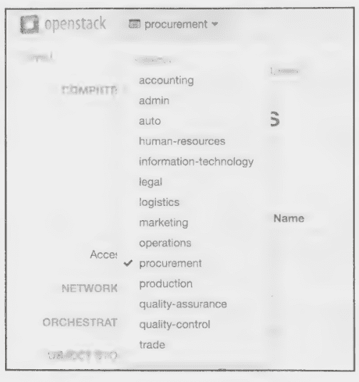
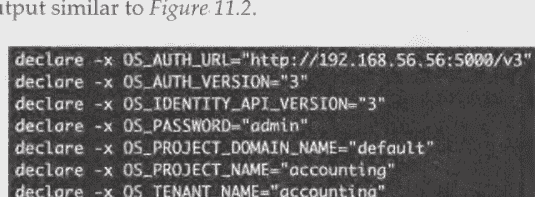
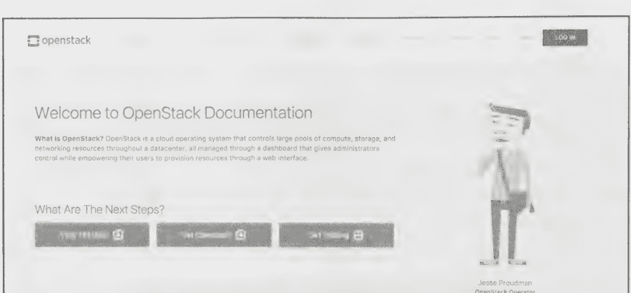

# 11 最后的技巧和窍门

恭喜！到目前为止，我希望你对参加 COA 考试感到信心十足。以下是进入考试前需要牢记的一些实用技巧和窍门。

在本章中，我们将涵盖以下主题：

- 项目范围
- 时间管理
- CLI 帮助
- 外部监视器
- 考试期间的问题
- 深入 OpenStack

在回顾这些技巧后，你应该准备好参加考试。务必在参加正式考试前查看第 12 章中的模拟考试！

## 项目范围

项目范围是任何 OpenStack 环境中最基本的方面。如果你在 Horizon 仪表板上尝试某个目标，请不要忘记始终从顶部下拉菜单中将自己限定到正确的项目。参考图 11.1。

如果由于任何原因你在顶部下拉菜单中看不到项目，你应该切换到 CLI。



Figure 11.1: 在 Horizon 仪表板上限定项目

如果你在 CLI 上，将自己限定到新项目最简单的方法是使用本书前几章介绍的方法：

```
$ cp openrc openrc-<project-name>
```

复制原始 openrc 文件后，使用你选择的编辑器填写项目和租户的正确变量：

```
$ nano openrc-<project-name>
```

确保同时设置 OS_PROJECT_NAME 和 OS_TENANT_NAME 变量：

```
export OS_PROJECT_NAME=<project-name>
export OS_TENANT_NAME=<project-name>
```


尽管 python-openstackclient 只需要 OS_PROJECT_NAME 变量，但一些旧客户端可能依赖于旧的 OS_TENANT_NAME 变量。我们在这里设置它以保持一致性。

保存带有新设置变量的文件后，source 该文件以在当前 Bash 会话中设置变量：

```
$ source openrc-<project-name>
```

在运行任何命令之前，验证变量是否已正确设置！

```
$ export | grep OS
```

你应该会看到类似图 11.2 的输出。



Figure 11.2: 继续的 Bash 会话变量设置为正确的项目范围

## 时间管理

要通过 COA，你必须合理管理时间！始终注意考试控制台中剩余的时间。如第 1 章《介绍 OpenStack 和 OpenStack 认证管理员考试》中所述，你可以自由使用官方上游 OpenStack 文档 https://docs.openstack.org/ocata/。然而，我不建议在考试期间依赖它！在网站上搜索答案会浪费你宝贵的时间！如果一个问题似乎花费超过 4–5 分钟才能完成，你应该点击前进按钮并继续！如果还有时间，稍后再回来处理！

如果任务可以在 Horizon 仪表板上完成，通常比 CLI 快得多。如果你是 CLI 高手并且不想挖掘 --help 命令，CLI 可能对你来说更快。



Figure 11.3: 尽管你在考试期间可以自由浏览 docs.openstack.org，但这是在浪费时间！

## CLI 帮助

如果你忘记了某个特定 CLI 命令的工作方式，你始终可以依赖帮助！以下是使用 `python-openstackclient` 帮助的一些示例。

```
dns quota list List quotas
dns quota reset Delete blacklist
dns quota set Set blacklist properties
dns service list List service statuses
dns service show Show service status details
domain create Create new domain
domain delete Delete domain(s)
domain list List domains
domain set Set domain properties
domain show Display domain details
ec2 credentials create Create EC2 credentials
ec2 credentials delete Delete EC2 credentials
ec2 credentials list List EC2 credentials
ec2 credentials show Display EC2 credentials details
endpoint create Create new endpoint
endpoint delete Delete endpoint(s)
endpoint list List endpoints
endpoint set Set endpoint properties
endpoint show Display endpoint details
extension list List API extensions
federation domain list List accessible domains
federation project list List accessible projects
federation protocol create Create new federation protocol
federation protocol delete Delete federation protocol(s)
federation protocol list List federation protocols
federation protocol set Set federation protocol properties
federation protocol show Display federation protocol details
flavor create Create new flavor
flavor delete Delete flavor(s)
flavor list List flavors
flavor set Set flavor properties
flavor show Display flavor details
flavor unset Unset flavor properties
floating ip create Create floating IP
floating ip delete Delete floating IP(s)
floating ip list List floating IP(s)
floating ip pool list List pools of floating IP addresses
floating ip show Display floating IP details
group add user Add user to group
group contains user Check user membership in group
group create Create new group
group delete Delete group(s)
group list List groups
group remove user Remove user from group
group set Set group properties
group show Display group details
help print detailed help for another command
host list List hosts
host set Set host properties
host show Display host details
hypervisor list List hypervisors
hypervisor show Display hypervisor details
hypervisor stats show Display hypervisor stats details
```

Figure 11.4: 'openstack help' 命令的输出

使用帮助是一个 **两步过程**。

第 1 步：使用 `openstack help` 确定如何执行特定操作。


你可以使用 grep 过滤特定的操作。以下是一些示例：

```
$ openstack help | grep domain
$ openstack help | grep project
$ openstack help | grep image
$ openstack help | grep server
$ openstack help | grep network
$ openstack help | grep volume
```

第 2 步：在确定要执行的操作后，您可以提供 --help 来探索所有可用的位置参数和标志。以下是一些示例：

```
$ openstack domain create --help
$ openstack project create --help
$ openstack image add project --help
$ openstack server create --help
$ openstack network list --help
$ openstack router create --help
```

如第 8 章《Swift 对象存储服务》所述，Swift 要求您使用 python-swiftclient。

注意！某些旧版本的 python-swiftclient 显示有关如何在容器上设置 ACL 的错误信息。

请参阅第 8 章《Swift 对象存储服务》了解如何在容器上正确设置 ACL，或参阅位于 https://docs.openstack.org/swift/ 的官方上游 Swift 文档。

## 外部显示器

如果您计划在个人笔记本电脑上参加考试，这完全没问题！请记住，在考试期间您可以将一台或多台外部显示器连接到笔记本电脑。在某些情况下，使用外部显示器可以容纳 Horizon 仪表板上更多的细节以及终端的更多输出。如果您有外部显示器可用（28 英寸或更大），您可能希望使用它而不是依赖小型笔记本电脑屏幕。


图 11.5：使用外部显示器可以帮助您在一屏中容纳更多仪表板和终端细节

## 考试期间的问题

如果在考试期间遇到任何网络连接问题，请保持冷静并等待考试重新连接。如果您有任何问题或遇到任何技术困难，监考聊天窗口应该可用。如果您在考试结束时有任何疑虑，请确保在结束考试前通过聊天窗口联系监考员。

## 深入 OpenStack

本书的内容确实能让您为 COA 考试做好准备，但它只涵盖了 OpenStack 知识的冰山一角！OpenStack 上还有一个完整的世界等待探索，包括高可用性、在 OpenStack 上构建云感知应用以及 OpenStack 网络等主题。如果您想深入了解，我建议您阅读以下书籍：《OpenStack 云计算食谱》第三版，作者 Kevin Jackson、Cody Bunch 和 Egle Sigler，《OpenStack 故障排除》，作者 Tony Campbell，以及《OpenStack 网络精要》，作者 James Denton。

## 摘要

这些技巧和窍门将使您在进入考试时处于有利地位。我们回顾了 Horizon 仪表板和 CLI 上项目范围的重要性。请记住：如果一个目标可以在 Horizon 仪表板上完成，就去做吧！除非您是命令行高手，否则它通常比使用 CLI 更快！时间非常重要，您完成每个目标只有大约 4 到 5 分钟。话虽如此，不要在考试期间浪费时间在 `http://docs.openstack.org` 上。在忘记某些 CLI 参数时，浏览 `python-openstackclient` 中的帮助非常有用。请不要忘记，旧版本的 `python-swiftclient` 提供了有关 Swift ACL 的错误信息，因此请使用本书中提供的语法或 `http://docs.openstack.org/swift`。最后，务必查看市场上目前的其他 OpenStack 书籍！如果这是您第一本 OpenStack 书籍，云学习才刚刚开始！
