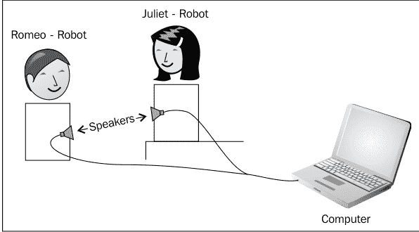
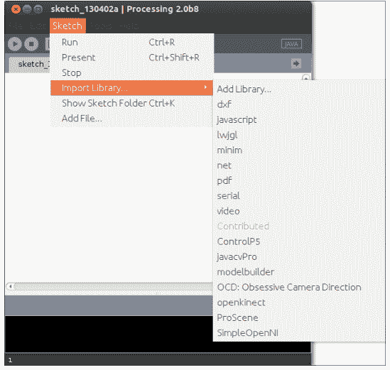
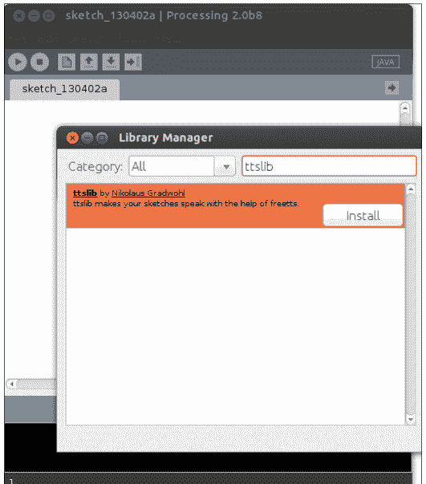
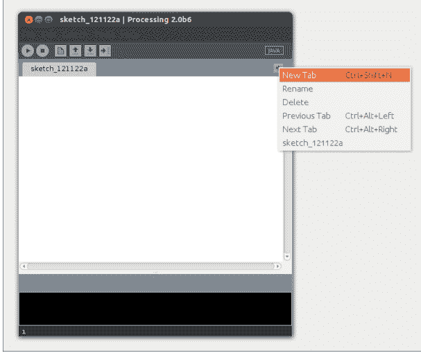
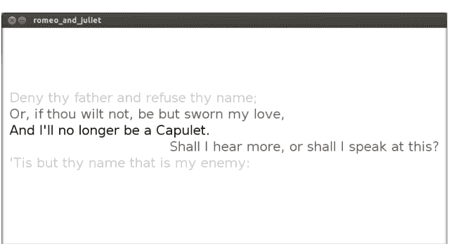
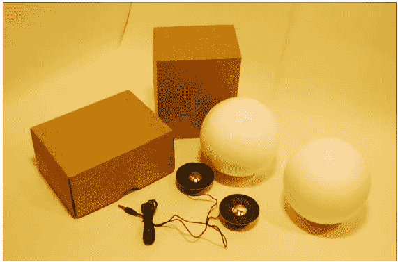
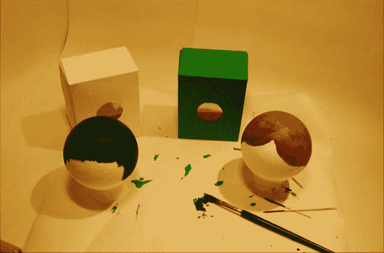
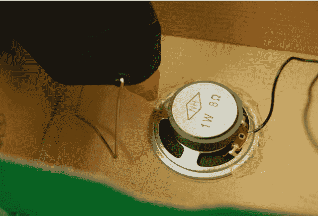
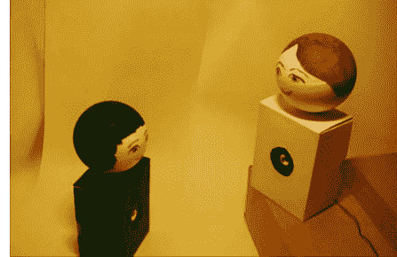

# 项目 1

## 罗密欧与朱丽叶

机器人与表演艺术有着悠久的历史。事实上，“Robot”一词最早于 1920 年由捷克作家 _Karel Čapek_ 的戏剧《Rossum's Universal Robots》中创造。该剧中有六个机器人，但由于当时无人能制造会说话的机器人，因此只能由人类来扮演。时代已大大改变，我们不再需要人类伪装成机器人。对于这个项目，我们将采用相反的方式，制作一些扮演人类的机器人。不幸的是，《Rossum's Universal Robots》需要九名人类和六个机器人，因此我选择了一个更简单的场景来表演。我们将构建一对机器人，在《罗密欧与朱丽叶》中著名的阳台场景中扮演人类。

## 任务简报

要为此项目创建 Processing 草图，我们需要安装 Processing 库 ttslib。该库是围绕 FreeTTS Java 库的封装库，可帮助我们编写能够朗读文本的草图。我们将学习如何更改 FreeTTS 包中 `kevin16` 声音的语音参数，以使我们机器人的声音彼此可区分。我们还将创建一个解析器，它能够读取莎士比亚剧本，并生成文本行对象，从而使我们的脚本知道哪个机器人读哪一行。

将使用 Drama 线程来控制文本转语音对象，而我们草图的 `draw()` 方法将在机器人表演时将剧本打印到屏幕上，以防其中一台机器人忘记台词。最后，我们将使用一些纸板箱和一对廉价扬声器来创建机器人及其舞台。下图展示了机器人的工作原理：



## 为什么这很棒？

自 18 世纪以来，发明家们就一直在尝试制造会说话的机器（成效不一）。会说话的玩具在 20 世纪 80 年代和 90 年代充斥市场。在每一部像样的科幻小说中，计算机和机器人都能说话。那么，制造会说话的机器人怎么可能不酷呢？还有什么比上演莎士比亚戏剧更适合测试这些说话能力呢？所以，如你所见，制造演员机器人是官方认证的酷，以防你的非极客家人提出疑问。

## 你的炫酷目标

我们将把这个项目分为四个任务，指导你从头到尾生成机器人。以下是我们将要做的事项的简要概述：

- 让 Processing 会说话
- 阅读莎士比亚作品
- 添加更多演员
- 构建机器人

## 让 Processing 会说话

由于 Processing 本身不具备说话功能，我们的第一个任务是使用新的 Processing 库管理器添加外部库。我们将使用 ttslib 包，它是围绕 FreeTTS 库的封装库。

我们还将创建一个简短的会说话的 Processing 草图来检查安装情况。

## 启动推进器

1. Processing 可以通过贡献的库进行扩展。这些额外的库中的大多数可以通过导航到“草图 | 导入库... | 添加库...”来安装，如以下屏幕截图所示：



2. 在“库管理器”对话框中，在搜索字段中输入 ttslib 以过滤库列表。

3. 单击 **ttslib** 条目，然后单击 **安装** 按钮，如以下屏幕截图所示，以下载并安装该库：



4. 要使用新库，我们需要将其导入到草图中。我们可以通过单击“草图”菜单并选择“导入库...”，然后选择 ttslib 来完成此操作。

5. 我们现在将向草图添加 `setup()` 和 `draw()` 方法。目前我们将保持 `draw()` 方法为空，并在 `setup()` 方法中实例化一个 TTS 对象。你的草图应类似于以下代码片段：

```
import guru.ttslib.*;

TTS tts;
void setup() {
  tts = new TTS();
}

void draw() {
}
```


下载示例代码
您可以从 http://www.packtpub.com 上的帐户下载购买的所有 Packt 图书的示例代码文件。如果您在其他地方购买了此书，可以访问 http://www.packtpub.com/support 并注册，以便将文件直接发送到您的电子邮件。

- 6. 现在我们将向草图添加一个 `mousePressed()` 方法，当有人单击我们的草图窗口时将调用该方法。在此方法中，我们正在调用在 `setup()` 方法中创建的 TTS 对象的 `speak()` 方法。

```
void mousePressed() {
    tts.speak("Hello, I am a Computer");
}
```

- 7. 单击“运行”按钮启动 Processing 草图。应该会出现一个小灰窗口。

- 8. 打开扬声器或戴上耳机，然后单击灰色窗口。如果一切正常，现在名为 kevin16 的友好男性计算机语音应该会向您问好。

## 目标完成 - 小结简报

在步骤 1 到 3 中，我们向 Processing 安装了一个额外的库。ttslib 是围绕 FreeTTS 文本转语音引擎的封装库。

然后我们创建了一个简单的 Processing 草图，它导入已安装的库并创建 `TTS` 类的一个实例。`TTS` 对象与我们在草图中需要的扬声器相匹配。在此例中，我们只创建了一个扬声器，并添加了一个 `mousePressed()` 方法，该方法调用我们的 `tts` 对象的 `speak()` 方法。

## 阅读莎士比亚

在项目的这部分中，我们将创建一个 `Drama` 线程，并教会 Processing 如何阅读莎士比亚剧本。该线程在后台运行并控制表演。在这个任务中，我们专注于阅读和执行剧本，并在下一个任务中添加扬声器。

## 发射准备

我们的草图需要知道哪台机器人读取剧本中的哪一行。因此，我们需要将莎士比亚剧本转换为更易于机器读取的格式。对于每一行文本，我们需要知道哪个扬声器应该读取该行。因此，我们取剧本，并在我们的朱丽叶机器人应该说的每一行前面添加字母 J 和一个在脚本中其他任何地方都不使用的分隔字符，并为我们的罗密欧机器人应该说的每一行添加字母 R 和分隔字母。经过所有这些步骤后，我们的文本文件如下所示：

```
R# Lady, by yonder blessed moon I vow,
R# That tips with silver all these fruit-tree tops --

J# O, swear not by the moon, the inconstant moon,
J# That monthly changes in her circled orb,
J# Lest that thy love prove likewise variable.

R# What shall I swear by?

J# Do not swear at all.
J# Or if thou wilt, swear by thy gracious self,
J# Which is the god of my idolatry,
J# And I'll believe thee.
```

我已经将该剧本的剧本转换为这种格式，可以从图书支持页面 http://www.packtpub.com/support 下载。

## 启动推进器

让我们编写解析器：

- 1. 通过导航到 **文件 | 新建** 启动一个新草图。
- 2. 添加 `setup()` 和 `draw()` 方法。
- 3. 现在通过导航到 **草图 | 添加文件** 并选择刚才下载的文件，将准备好的脚本添加到 Processing 草图中。
- 4. 将以下行添加到 `setup()` 方法中：

```
void setup() {
  String[] rawLines = loadStrings
  ("romeo_and_juliet.txt" );
}
```

- 5. 如果您重命名了文本文件，请相应地更改文件名。
- 6. 单击右侧的小箭头图标并选择 **新建选项卡** 来创建新选项卡。



- 7. 将类命名为 Line。此类将保存我们的文本行和扬声器。

- 8. 将以下代码添加到刚创建的选项卡中：

```
public class Line {
String speaker;
String text;

public Line( String speaker, String text ) {
this.speaker = speaker;
this.text = text;
}
}
```

- 9. 切换回主选项卡，并将以下高亮代码行添加到 setup() 方法中：

```
void setup() {
String[] rawLines = loadStrings
( "romeo_and_juliet.txt" );

ArrayList lines = new ArrayList();
for ( int i=0; i<rawLines.length; i++ ) {
if ( !"".equals(rawLines[i]) ) {
String[] tmp = rawLines[i].split("#");
lines.add( new Line( tmp[0], tmp[1].trim() ) );
}
}
}
```

- 10. 我们已读取文本行并将其解析到 `lines` 列表中，但仍需要一个类来处理我们的文本行。因此，单击箭头图标并从菜单中选择 **新建选项卡** 来创建另一个选项卡；将其命名为 **Drama**。

- 11. 我们的 `Drama` 类将是一个在后台运行并告诉每个扬声器对象读取一行文本的线程。将以下代码行添加到 `Drama` 类中：

```
public class Drama extends Thread {
int current;
ArrayList lines;
boolean running;

public Drama( ArrayList lines ) {
this.lines = lines;
current = 0;
running = false;
}

public int getCurrent() {
return current;
}

public Line getLine( int num ) {
if ( num >=0 && num < lines.size() ) {
return (Line)lines.get( num );
} else {
return null;
}
}

public boolean isRunning() {
return running;
}
}
```

- 12. 现在我们添加一个 run() 方法，如果启动线程，该方法将在后台执行。由于我们还没有扬声器对象，我们将把行打印到控制台，并在每行后面加入短暂的暂停。

```
public void run() {
    running = true;

    for ( int i =0; i < lines.size(); i++ ) {
        current = i;
        Line l = (Line)lines.get(i);
        System.out.println( l.text );
        delay( 1 );
    }
    running = false;
}
```

- 13. 切换回主草图选项卡，并将高亮代码添加到 setup() 方法中以创建 drama 线程对象，然后向其提供解析后的文本行。

```
Drama drama;
```

```
void setup() {
    String[] rawLines = loadStrings
        ( "romeo_and_juliet.txt" );
    ArrayList lines = new ArrayList();
    for ( int i=0; i<rawLines.length; i++ ) {
        if ( !"".equals(rawLines[i]) ) {
            String[] tmp = rawLines[i].split("#");
            lines.add( new Line( tmp[0], tmp[1].trim() ) );
        }
    }
    drama = new Drama( lines );
}
```

- 14. 到目前为止，我们的草图解析文本行并创建一个 Drama 线程对象。接下来我们需要一个方法来启动它。因此，添加一个 mousePressed() 方法来启动 drama 线程。

```
void mousePressed() {
    if ( !drama.isRunning() ) {
        drama.start();
    }
}
```

- 15. 现在向 `draw()` 方法添加一些文本来告诉用户该做什么。将以下代码添加到 `draw()` 方法中：

```
void draw() {
  background(255);
  textAlign(CENTER);
  fill(0);

  text( "Click here for Drama", width/2, height/2 );
}
```

- 16. 目前，我们的草图窗口太小，无法容纳文本，我们还想使用更大的字体。要更改窗口大小，只需将以下行添加到 `setup()` 方法中：

```
void setup() {
  size( 800, 400 );

  String[] rawLines = loadStrings
  ( "romeo_and_juliet.txt" );
  ArrayList lines = new ArrayList();
  for(int i=0; i<rawLines.length; i++) {
    if ("".equals(rawLines[i])) {
      String[] tmp = rawLines[i].split("#");
      lines.add( new Line( tmp[0], tmp[1].trim() ) );
    }
  }

  drama = new Drama( lines );
}
```

- 17. 要更改所用字体，我们需要告诉 Processing 使用哪种字体。找出计算机上当前安装的字体名称的最简单方法是创建一个新草图，输入以下行并运行草图：

```
println(PFont.list());
```

- 18. 复制您喜欢的字体名称之一，并将以下行添加到罗密欧与朱丽叶草图中：

```
void setup() {
  size( 800, 400 );
  textFont( createFont( "Georgia", 24 ) );

  ...
}
```

- 19. 将代码行中的字体名称替换为计算机上的字体之一。

## 目标完成 - 小结简报

在本节中，我们编写了解析文本文件并生成 `Line` 对象列表的代码。这些对象随后由 `Drama` 线程使用，该线程在任何人单击草图窗口时在后台运行。目前，`Drama` 线程在控制台上打印文本行。

在步骤 6 到 8 中，我们创建了 `Line` 类。这个类非常简单，所谓的 **普通旧 Java 对象（POJO）**，用于保存我们的文本行，但不添加任何功能。

控制我们戏剧表演的代码是在步骤 10 到 12 中创建的。我们创建了一个能够在后台运行的线程，因为在下一步中，我们希望能够同时使用 `draw()` 方法和一些 `TTS` 对象。

步骤 12 中的代码块定义了一个名为 `running` 的布尔变量，我们在 `mousePressed()` 方法中使用它来检查草图是否已经运行或应该启动。

## 机密情报

在步骤 17 中，我们使用了 `PFont` 类的 `list()` 方法来获取已安装字体的列表。这是 Processing 中非常常见的模式。您可以使用相同的方法来获取已安装的 midi 接口、网络摄像头、串行端口等列表。

## 添加更多演员

在这个任务中，我们将结合之前两个任务中所做的内容，并向 `Drama` 线程添加一些 `TTS` 对象。在这个场景中，我们需要两个机器人演员，它们使用不同的声音说话，并且由于我们想要构建每个都包含扬声器的机器人，我们需要一个 `TTS` 对象在左扬声器上说话，另一个在右扬声器上说话。

不幸的是，FreeTTS 只附带一个男声，因此我们必须提高朱丽叶机器人的声音音调。

## 启动推进器

- 1. 首先，我们打开上一个任务中的草图，并首先为每个机器人演员创建两个 `TTS` 对象。两者都使用名为 `kevin16` 的默认语音，但我们会更改朱丽叶机器人的音调。

```
void setup() {
  size( 800, 400 );
  textFont( createFont( "Georgia", 24 ) );
}
```


String[] rawLines = loadStrings("romeo_and_juliet.txt");
ArrayList lines = new ArrayList();
for (int i = 0; i < rawLines.length; i++) {
  if (!"".equals(rawLines[i])) {
    String[] tmp = rawLines[i].split("#");
    lines.add(new Line(tmp[0], tmp[1].trim()));
  }
}

TTS romeo = new TTS();
TTS juliet = new TTS();
juliet.setPitchShift(2.4);
drama = new Drama(lines, romeo, juliet);

- 2. 切换到 Drama 线程，并为我们的角色添加两个变量。

```
public class Drama extends Thread {
TTS romeo;
TTS juliet;

int current;
ArrayList lines;
boolean running;
...
}
```

- 3. 我们还需要扩展 Drama 类的构造函数，以便添加角色。

```
public Drama(ArrayList lines, TTS romeo, TTS juliet) {
this.lines = lines;
this.romeo = romeo;
this.juliet = juliet;
current = 0;
running = false;
}
```

- 4. 在 run() 方法中，我们获取当前行，并根据添加到每行中的 actor 变量选择角色对象。我们也不再需要 delay() 和 println() 方法。

```
public void run() {
running = true;

for (int i = 0; i < lines.size(); i++) {
  current = i;
  Line l = (Line) lines.get(i);

  if ("J".equals(l.speaker)) {
    juliet.speak(l.text);
  }
  if ("R".equals(l.speaker)) {
    romeo.speak(l.text);
  }
}
running = false;
}
```

- 5. 由于我们的每个机器人都有自己的扬声器，我们不想在两个扬声器上都听到文本。我们希望一个机器人使用右声道，另一个机器人使用左声道。幸运的是，ttslib 提供了 speakLeft() 和 speakRight() 方法，正好满足我们的需求。因此，将两个 speak() 方法更改为如下所示：

```
...
if ("J".equals(l.speaker)) {
  juliet.speakLeft(l.text);
}
if ("R".equals(l.speaker)) {
  romeo.speakRight(l.text);
}
...
```

- 6. 目前，我们的 draw() 方法有些乏味，而且如果 drama 线程已经在运行，也有些误导。因此，我们将更改它以显示当前正在读取的脚本的五行。向 draw() 方法添加一个 if 语句，以检查我们之前添加到 Drama 线程的 running 变量的状态。

```
void draw() {
  background(255);
  textAlign(CENTER);
  fill(0);

  if (!drama.isRunning()) {
    text("Click here for Drama", width/2, height/2);
  } else {
  }
}
```

- 7. 现在我们添加一个 `for` 循环，在草图窗口中显示前两行、当前正在读取的行以及接下来的两行文本。我们现在将更改文本对齐方式，以便与机器人角色的扬声器匹配。如果我们的机器人使用 `speakRight()`，文本将右对齐；如果使用 `speakLeft()`，文本将左对齐。

```
void draw() {
  background(255);
  textAlign(CENTER);
  fill(0);

  if (!drama.isRunning()) {
    text("Click here for Drama", width/2, height/2);
  } else {
    int current = drama.getCurrent();
    for (int i = -2; i < 3; i++) {
      Line l = drama.getLine(i + current);
      if (l != null) {
        if ("J".equals(l.speaker)) {
          textAlign(LEFT);
          text(l.text, 10, height/2 + i * 30);
        } else {
          textAlign(RIGHT);
          text(l.text, width - 10, height/2 + i * 30);
        }
      }
    }
  }
}
```

- 8. 为了更突出地显示当前行，我们将更改文本颜色。我们将当前行的颜色设置为黑色，所有其他行设置为较浅的灰色，方法是在 for 循环中添加一个 `fill()` 语句。

```
for (int i = -2; i < 3; i++) {
  fill(abs(i) * 100);
  Line l = drama.getLine(i + current);
  if (l != null) {
    if ("J".equals(l.speaker)) {
      textAlign(LEFT);
      text(l.text, 10, height/2 + i * 30);
    } else {
      textAlign(RIGHT);
      text(l.text, width - 10, height/2 + i * 30);
    }
  }
}
```

- 9. 现在运行你的代码，单击草图窗口以启动 drama 线程。

## 任务完成 - 简要汇报

在我们当前任务的这一步骤中，我们添加了两个 TTS 对象并更改了声音参数，使它们听起来不同（在步骤 1 中）。然后我们扩展了 Drama 线程，并为机器人角色的声音添加了 TTS 对象。在步骤 4 和 5 中，我们修改了 run 方法，以使用我们刚刚创建的声音，而不仅仅是打印文本行。

在步骤 6 到 9 中，我们对 draw() 方法进行了更改，使其显示五行文本。当前正在播放的行是黑色的，前后两行则淡化为浅灰色。

fill() 方法不仅用于更改对象的填充颜色，还用于更改文本颜色。因为我们的 for 循环索引从 -2 到 2，我们可以简单地取其绝对值并乘以 100 来获取灰度级别。以下是运行中的草图的截图：



## 机密情报

FreeTTS 和 ttslib 还允许你使用名为 MBROLA 的二进制 TTS 引擎。不幸的是，它只以二进制形式分发，并且在撰写本文时，它只适用于 Linux。所以，如果你正在使用 Linux 并想尝试一下，可以对我们的 Romeo and Juliet 草图做出以下更改：

- 1. 在浏览器中打开 http://ctts.fpms.ac.be/synthesis/mbrola.html 并点击 Download。下载适用于你平台的 MBROLA 二进制文件。
- 2. 从 MBROLA 网站下载 female_us1 音色。
- 3. 为 MBROLA 二进制文件创建一个文件夹，并解压你刚刚下载的两个包。确保 MBROLA 二进制文件的路径中不含空格，因为 FreeTTS 无法处理空格。
- 4. 将 MBROLA 二进制文件重命名为 mbrola。
- 5. 现在回到你的 Romeo and Juliet 草图，并在 setup() 方法中添加以下突出显示的行：

```
void setup() {
  System.setProperty("mbrola.base", "/path/to/mbrola/");

  size(800, 400);
  textFont(createFont("Georgia", 24));

  String[] rawLines = loadStrings("romeo_and_juliet.txt");
  ArrayList lines = new ArrayList();
  for (int i = 0; i < rawLines.length; i++) {
    if (!"".equals(rawLines[i])) {
      String[] tmp = rawLines[i].split("#");
      lines.add(new Line(tmp[0], tmp[1].trim()));
    }
  }

  drama = new Drama(lines);
  TTS romeo = new TTS();
  TTS juliet = new TTS();
  juliet.setPitchShift(2.4);
  drama = new Drama(lines, romeo, juliet);
}
```

- 6. 将系统属性的路径指向包含你的 mbrola 二进制文件和 us1 音色的文件夹。
- 7. 现在你可以将 Juliet TTS 对象更改为以下内容：`TTS juliet = new TTS("mbrola_us1");`
- 8. 你还需要更改声音的音调，因为 mbrola_us1 已经是女性声音，我们不再需要模拟它了。

MBROLA 是在比利时蒙斯理工学院开发的文本转语音引擎。作者要求每篇提及其作品的出版物都必须提及他们的书籍，《文本转语音合成导论》，Thierry Dutoit，Kluwer Academic Publishers，多德雷希特，精装，ISBN 1-4020-0369-2，1997 年 4 月，312 页。

## 构建机器人

现在我们准备好进行 Romeo and Juliet 项目的最后一项任务了。我们将拿一些纸箱、泡沫塑料球和一对廉价扬声器或耳机，将它们变成我们的机器人演员。

本节中描述的机器人只是我的版本。如果你喜欢，可以按照自己的想法构建完全不同的机器人，可以复杂也可以简单。

## 为起飞做准备

要构建我们的机器人，我们需要一些材料和工具，这些材料和工具不应该太难找到。我为我的机器人演员使用了以下材料：

- 两个用于机身的纸箱
- 两个用于头部的泡沫塑料球
- 一对廉价扬声器或耳机
- 活动眼珠
- 丙烯酸颜料
- 记号笔
- 针
- 热熔胶枪

以下图片显示了我用于机器人的主要材料：



## 启动推进器

让我们来构建一些机器人：

- 1. 拆解你的扬声器，尝试去掉外壳。我们只需要扬声器，但请确保不要移除或破坏电缆。
- 2. 在纸箱上剪一个扬声器应安装的位置的孔。让孔稍微比扬声器小一点，如下图所示，因为我们稍后需要将它们粘到盒子上：


- 3. 给你的纸箱上色。我做了一个白色，另一个绿色。
- 4. 在纸箱晾干期间，如下图所示在头部上涂一些头发。我给 Romeo-Robot 的头发涂成了黑色，给 Juliet-Robot 的头发涂成了棕色。



- 5. 油漆干了之后，像下图所示用热胶将扬声器固定在纸箱上。确保不要将任何胶水沾到扬声器的膜片上。



- 6. 现在使用记号笔为机器人画一张脸。你可以在下图中看到我机器人的脸：


- 7. 使用针将头部固定到机器人的身体上。
- 8. 现在将你的机器人演员连接到声卡，并把 Juliet 放在一个阳台上（例如一个空鞋盒），让它们表演。

## 任务完成 - 简要汇报

在此任务中，我们通过为机器人演员构建身体来完成它们。我们使用了一些纸箱，给它们上色，并通过将一对廉价扬声器粘进箱子中来添加它们。每个机器人都得到了一个涂了漆的发泡聚苯球制成的头。

如我之前在本任务介绍中所说，构建机器人没有对错之分。你可以随意构建大小。加上一些头发，给它们做个鼻子，给 Juliet 缝一件连衣裙，给 Romeo 画个小胡子，等等。

## 任务完成

在此任务中，我们通过安装 ttslib 库为 Processing 添加了语音功能。我们学习了如何通过改变音调或在 Linux 上安装额外的 TTS 引擎来模拟多个扬声器。

我们还为莎士比亚剧本定义了一种说话文本格式，以便更容易地解析，并创建了一个 `Drama` 线程来管理我们的文本行并控制我们的机器人。

我们完成了机器人演员，它们正迫不及待地等待在观众面前表演。所以，召集你的朋友和家人，为你的机器人搭建一个舞台。他们会喜欢的，相信我。好吧，至少你的机器人会喜欢，如下图所示：



## 准备好大干一场了吗？高手挑战

既然你已经完成了机器人演员的构建，为什么不尝试将它们提升到下一个水平呢？

- 让它们表演不同的戏剧。外面有很多著名的对话可以由你的机器人演员表演。
- 目前你的机器人演员是固定不动的。尝试添加一些舵机，并使用 Arduino 让它们移动头部。
- 将一些网络摄像头连接到你的电脑，并使用 Processing 从不同角度录制表演视频。
- 让你的机器人演员与一位真实演员一起表演一出戏。
- 让你的机器人从网络读取实时输入，例如 Twitter 源或新闻。
- 你的机器人不必长得像人类；让它们看起来像僵尸、外星人、动物等等。
