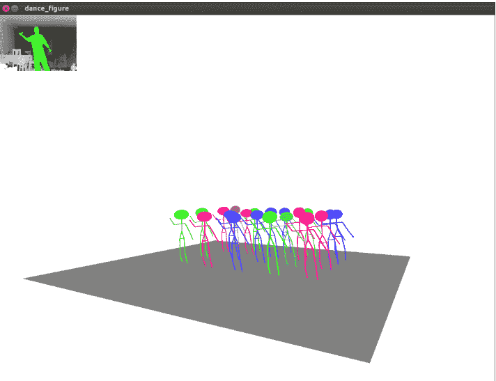
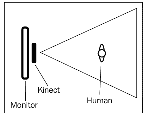
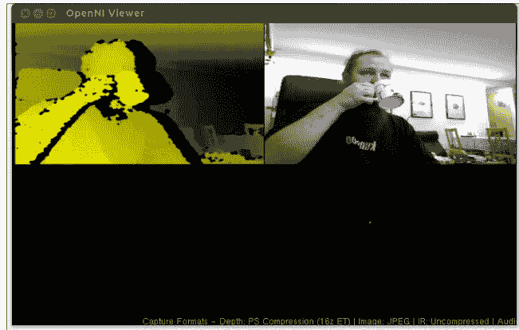
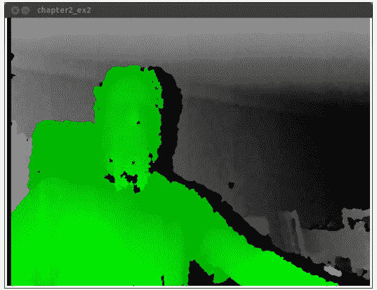
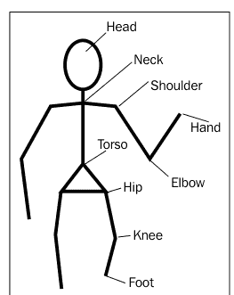
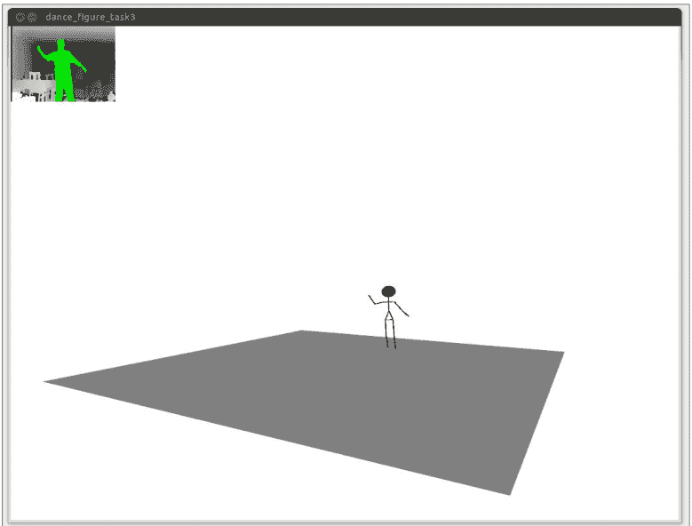
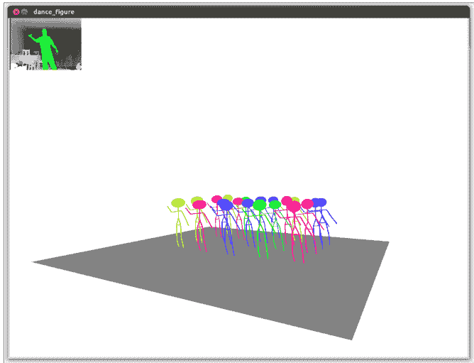

# 项目 2

火柴人舞蹈团

在项目 1《罗密欧与朱丽叶》中，我们学习了如何让 Processing 说话。在此项目中，我们将学习如何让它看和跳舞。我们将使用 Microsoft 的 Kinect 来实现视觉部分，并用一个跳舞的人来教一群火柴人如何跳舞。除非你找到其他人愿意带领你的火柴人，否则你自己得起来跳舞。

计算机视觉和 3D 扫描长期以来一直是非常专业且昂贵的硬件和软件的领域。随着 CPU 和显卡计算能力的不断提升，以及像 Kinect 这样的新型硬件控制器，计算机视觉项目已通过各种游戏控制器进入客厅，并对你我这样的日常程序员变得可及。

## 任务简报

在此项目中，我们将学习如何将 Microsoft 的 Kinect 连接到电脑，并使用 Processing 中的深度成像和用户跟踪。我们将在第一个任务中快速安装 OpenNI 框架，因为这个库被 Processing 库 SimpleOpenNI 使用。然后，我们将学习如何使用 Kinect 红外摄像头的深度图像功能以及 Processing 中的玩家跟踪功能。

接着，我们将使用所谓的骨骼跟踪器，不仅用于定位摄像头前面的用户，还包括头部、颈部和肘部。这些 3D 坐标将允许我们控制一个火柴人。

在当前任务的最后一个任务中，我们将添加一群额外的舞者，他们也将由玩家肢体的 3D 坐标控制。

你可以在这里看到最终草图的屏幕截图：



## 为什么很酷？

Kinect 为与计算机交互带来了许多全新的可能性。它使玩家只需在计算机前移动即可控制计算机。这有多酷？而且作为一个不错的副作用，它让计算机用户动起来——这是计算机用户通常不擅长的事情。

> **免责声明**
> 
> 如果你强行将肢体放入已被其他时空聚集体占据的地方，作者不承担由此产生的伤害和事故责任。所以，请确保在跳舞时你周围有足够的空间。

除了跟踪用户身体部位的位置外，Kinect 还为我们提供了周围玩家的深度图，以及一个位图，允许我们确定图像中哪些像素属于玩家，哪些不属于。

## 你的目标

这个 Hotshot 项目分为以下四个任务：

- 连接 Kinect
- 让 Processing 看见
- 制作舞者
- 跳舞！跳舞！跳舞！

## 任务清单

要完成此任务，你需要一台 Kinect 来连接到你的电脑。Kinect 通过 USB 端口连接，但它需要的电量比标准 USB 端口能提供的更多。因此，Kinect 配备了一个非标准的 USB 连接器和一个单独的电源连接器。如果你是随 Xbox 360 一起购买的 Kinect，你可能需要为它购买一个 USB 电源适配器；较新版本的 Xbox 360 提供了一个专用端口来直接连接 Kinect。你可以在电子产品商店或网上购买适配器。

由于这个项目是关于跳舞的，你还需要一些音乐来跳舞。我们要创建的火柴人对音乐类型非常包容，所以请随意选择你喜欢的任何音乐——Donna Summer、Zillertaler Schürzenjäger、Bobby Brown、Skrillex。如果你喜欢，你的火柴人也会喜欢。

## 连接 Kinect

在此第一个任务中，我将指导你安装 OpenNI 框架和一个来自 PrimeSense（开发适用于 Microsoft 的 Kinect 的公司）的库。我们将使用 OpenNI 示例程序来测试我们的安装。

## 启动推进器

- 1. 在撰写本文时，OpenNI 框架的最新版本是 2.1 Beta，但我们将用于下一个任务的 Processing 框架需要 OpenNI 框架的 1.5.4 版本。在浏览器中打开网站 `http://www.openni.org/openni-sdk/openni-sdk-history-2/`，如下图所示，并选择适用于你平台的下载包：


- 2. 如果你运行的是 Linux 或 Mac OS X，打开一个终端窗口，进入下载文件的目录，并使用 `tar` 命令解包；确保以 root 身份运行 `install.sh` 脚本进行解包：

```
tar xvjf openni-bin-dev-linux-x86-v1.5.4.0.tar.bz2
cd OpenNI-Bin-Dev-Linux-x86-v1.5.4.0
sudo ./install.sh
```

- 3. 在 Windows 上，直接运行你下载的 MSI 文件。
- 4. 对 NiTE v1.5.2.21 文件重复上述步骤，下载包并使用以下命令安装：

```
tar xvfj nite-bin-Linux-x86-v1.5.2.21.tar.bz2
cd NITE-Bin-Dev-Linux-x86-v1.5.2.21/
sudo ./install.sh
```

- 5. 现在访问 https://github.com/avin2/SensorKinect/tree/unstable/Bin 并下载 Kinect 的传感器包。你不需要从 http://openni.org 获取的传感器包；那是用于另一个传感器条的，无法与 Kinect 配合使用。
- 6. 解包传感器包，并在 Linux 或 Mac OS X 上通过运行以下命令安装：

```
tar xvfj SensorKinect093-Bin-Linux-x86-v5.1.2.1.tar.bz2
cd Sensor-Bin-Linux-x86-v5.1.2.1/
sudo ./install.sh
```

- 7. 在 Windows 上，通过双击 MSI 文件来安装传感器包文件。
- 8. 现在将 Kinect 连接到电源适配器，然后连接到空闲的 USB 插槽，并将其放置在显示器前。确保你的房间里有足够的空间站在传感器条前面，如下图所示：



- 9. 进入开发包，从 OpenNI-Bin-Dev-Linux-x86-v1.5.4.0/Samples/Bin/ 下的 x86-Release 文件夹运行 NiViewer 示例程序：

```
cd ../OpenNI-Bin-Dev-Linux-x86-v1.5.4.0
cd Samples/Bin/x86-Release/
./NiViewer
```


- 10. 在Kinect传感器前放置一个人，并让他/她移动。在下面的截图中，你可以看到作者移动他的咖啡杯：



## 目标完成 - 简要总结

我们刚刚下载并安装了OpenNI开源驱动程序，以访问Kinect传感器板。这些驱动程序允许我们从Kinect控制器访问红外和RGB图像。Kinect还使用红外摄像头进行深度扫描，并能够跟踪用户。

安装开发工具包、中间件驱动程序和Kinect控制器的传感器板后，我们使用开发工具包中的一个示例程序来测试安装。

## 机密情报

除了Kinect之外，还有其他使用PrimeSense技术并受OpenNI包支持的传感器条。要使用这些设备，你需要从 http://www.openni.org 安装传感器包，我们在启动推进器部分跳过了此步骤。

我使用Kinect运行并测试了本项目中的程序，但你也可以尝试使用其他传感器条，例如PrimeSense传感器或ASUS Xtion。

## 让Processing看见

我们的下一个任务是安装SimpleOpenNI库。该库使我们能够在Processing中使用OpenNI API。首先，我们将学习如何访问和显示Kinect控制器的深度图像。然后，我们将使用SimpleOpenNI框架的用户跟踪功能，并定义一些回调函数，以便在检测到用户或跟踪的用户消失时收到通知。最后，我们将为深度图像中属于用户的所有像素着色，以便用户能够看到正在跟踪的内容。

## 启动推进器

让我们教会Processing如何看见：

- 1. 在撰写本文时，SimpleOpenNI框架无法使用新的库管理器进行安装。要手动安装，请从 http://code.google.com/p/simple-openni/downloads/list 下载适用于您操作系统的SimpleOpenNI包。

- 2. 将其解压缩到`sketchbook`文件夹中名为`library`的文件夹。你可以在**首选项**对话框中找到该文件夹的路径。

- 3. 如果Processing当前正在运行，请重启它，以确保你的安装能找到该库。

- 4. 现在，创建一个新的草图，并在**草图**菜单下点击**导入库 ...** 以包含SimpleOpenNI库。

- 5. 向你的草图添加`setup()`和`draw()`方法。

```
import SimpleOpenNI.*;

void setup() {
}

void draw() {
}
```

- 6. 在`setup()`方法中，将草图窗口大小调整为640 x 480像素，并定义一个OpenNI上下文对象。我们使用`enableDepth()`方法开始捕获深度图像，并使用`setMirror()`激活镜像功能。

```
import SimpleOpenNI.*;
SimpleOpenNI context;
void setup() {
size( 640, 480 );
context = new SimpleOpenNI( this );
context.setMirror( true );
context.enableDepth();
}
```

- 7. 现在将以下行添加到你的 draw() 方法中，以便SimpleOpenNI加载下一帧并计算深度图像。然后，使用 context.depthImage() 以 PImage 对象的形式获取数据，并使用 image() 将其绘制到你的草图窗口中。

```
void draw() {
context.update();
image( context.depthImage(), 0, 0 );
}
```

- 8. 运行你的草图并对着摄像头挥手。你应该能看到你自己和周围环境的深度图像。

- 9. 在 setup 方法中通过添加以下行来启用用户检测：

```
void setup() {
size( 640,480 );
context = new SimpleOpenNI( this );
context.setMirror( true );
context.enableDepth();
context.enableUser( SimpleOpenNI.SKEL_PROFILE_ALL );
}
```

- 10. 你还需要一个变量来存储SimpleOpenNI框架检测到的第一个用户的 userId，因此在草图开头添加一个 player 变量并将其初始化为 -1。

```
int player = -1;
```

- 11. 为了在SimpleOpenNI检测到用户时收到通知，我们向草图添加以下两个回调方法：

```
void onNewUser( int userId ) {
println( "new user " + userId );
player = userId;
}
```

```
void onLostUser( int userId ) {
println( "lost user " + userId );
if ( userId == player ) {
player = -1;
}
}
```

- 12. 要查看Kinect在哪里发现了用户，你需要让图像中属于用户的所有像素都显示为绿色。你可以通过将以下代码添加到我们的 draw() 方法中来实现这一点：

```
void draw() {
 context.update();
 image( context.depthImage(), 0, 0 );

 loadPixels();
 if ( player != -1 ) {
 int[] userPixels = context.getUsersPixels( player );

 for( int p = 0; p < width * height; p++) {
 if ( userPixels[p] != 0 ) {
 pixels[p] = color( 0, green( pixels[p] ), 0 );
 }
 }
 }
 updatePixels();
}
```

- 13. 如果你现在运行代码，检测到的用户的像素应该变成绿色，如下面的截图所示：



## 目标完成 - 简要总结

我们刚刚学习了如何使用Processing访问Kinect提供的深度图像。从步骤 9 开始，我们使用了SimpleOpenNI框架的跟踪功能。我们添加了一个名为 onNewUser() 的回调函数，每次检测到用户时库都会调用它，还添加了一个名为 onLostUser() 的第二个函数，以便在用户不再在跟踪范围内时收到通知。

在我们的 draw() 方法中，我们使用了从 getUsersPixels() 方法获得的像素映射，如果深度图像中的像素属于用户则将其着色为绿色，否则保持不变。函数 getUsersPixels() 返回的数组中，每个非用户像素的值为 0，我们要着色的像素值为 1。对于属于用户像素的每个 1，我们获取深度图像的当前灰度值，并将其替换为相同强度的绿色值。

## 机密情报

除了红外和RGB摄像头外，Kinect还配备了电机控制，以允许调整摄像头倾斜度。不幸的是，OpenNI框架不支持控制电机。有一个名为 libfreenect 的第二个开源框架，可用于访问Kinect。它缺乏OpenNI的用户跟踪功能，但支持电机控制。因此，如果你需要调整Kinect的倾斜度，因为它臭名昭著地会切断玩家的头部或脚部，你可以安装 libfreenect 库和演示应用程序，并使用它们来调整你的Kinect。

## 制作舞者

在上一节中，我们使用OpenNI框架的用户跟踪功能来定位Kinect红外摄像头提供的深度图像中的用户。现在我们将进一步定位玩家的身体部位。我们将在本任务中使用的功能称为骨骼跟踪。OpenNI骨骼追踪器定位人体的某些关键点，我们将使用这些关键点来构建我们的火柴人。对于每个玩家，Kinect可以看到并获取头部、颈部、躯干、肩膀、手肘、手部、臀部、膝盖和脚部的位置。

我们还将上一节中使用的红外摄像头图像和用户像素作为一个小型抬头显示（HUD）显示，以便玩家能够看到Kinect正在跟踪的内容。

### 启动推进器

- 1. 我们需要创建一个新的Processing草图并导入SimpleOpenNI库。然后我们需要添加 setup() 和 draw() 方法。

```
import SimpleOpenNI.*;

void setup() {
}

void draw() {
}
```

- 2. 我们创建三个方法，由我们的 draw() 方法调用，用于绘制 HUD、舞者和舞池。

```
void drawHUD() {
}

void drawDancer() {
}

void drawFloor() {
}
```

- 3. 在我们的 draw() 方法中，我们需要添加对刚才创建的三个方法的调用。由于Kinect返回的坐标使用与Processing使用的不同的坐标系统（它默认会这样做），我们需要在调用 drawDancer() 和 drawFloor() 方法之前旋转并缩放我们的视角。

```
void draw() {
    background( 255 );
    context.update();

    drawHUD();

    translate( width/2, height/2, 0 );
    rotateX( PI );

    scale(0.5);
    translate(0, -100, -400);
    rotateY( radians( 30 ) );

    drawDancer();
    drawFloor();
}
```


- 4. 现在我们需要将 SimpleOpenNI 上下文添加到脚本中，并在 setup() 方法中对其进行初始化。我们还需要将绘图窗口大小设置为 1024 × 768 像素。

```
SimpleOpenNI context;
int player = -1;
boolean calibrated = false;
void setup() {
size( 1024, 768, P3D);
context = new SimpleOpenNI( this );
context.enableDepth();

context.enableUser( SimpleOpenNI.SKEL_PROFILE_ALL);
}
```

- 5. 要创建 HUD，我们需要添加 onNewUser() 和 onUserLost() 回调方法，就像我们在上一节中所做的那样。由于我们也想使用骨骼追踪器，我们在 onNewUser() 函数中启动骨骼校准。

```
void onNewUser(int userId) {
println("onNewUser - userId: " + userId);
println(" start pose detection");
if ( player == -1 ) {
player = userId;
calibrated = false;
context.requestCalibrationSkeleton(userId, true);
}
}
```

```
void onLostUser( int userID ) {
if ( player == userID ) {
println( "lost user" );
player = -1;
calibrated = false;
}
}
```

- 6. 我们还添加了一个 onEndCalibration() 回调函数，当校准完成时会调用该函数。如果校准不成功，我们可以通过启动姿态检测来第二次尝试查找用户。

```
void onEndCalibration(int userId, boolean successful) {
println("onEndCalibration - userId: " + userId + ", successful: " + successful);
if ( player == userId ) {
if (successful) {
println(" User calibrated !!!");
context.startTrackingSkeleton(userId);
}
}
calibrated = true;
} else {
    println(" Failed to calibrate user !!!");
    println(" Start pose detection");
    context.startPoseDetection("Psi", userId);
}
}
```

- 7. 如果 SimpleOpenNI 检测到请求的姿态，将调用 onStartPose() 函数。因此，让我们将此函数添加到我们的绘图中，以便在姿态检测成功时重新启动校准。

```
void onStartPose(String pose, int userId) {
    println("onStartPose - userId: " + userId + ", pose: " + pose);
    println(" stop pose detection");
    if ( player == userId ) {
        context.stopPoseDetection(userID);
        context.requestCalibrationSkeleton(userId, true);
    }
}
```

- 8. 现在我们显示红外摄像头的图像，并对从 getUsersPixel() 方法获取的像素进行着色。这次，我们希望红外摄像头的图像仅显示在左上角，而不是整个绘图窗口。我们还需要调整之前绘图中使用的像素着色代码。我们仅获取每隔四行中的每个第四个像素来缩小图像。将以下代码添加到 drawHUD() 方法中：

```
void drawHUD() {
    image( context.depthImage(), 0, 0, 160, 120 );

    loadPixels();
    if ( player != -1 ) {
        int[] up = context.getUsersPixels( player );
        for ( int y = 0; y < 480; y += 4 ) {
            for ( int x = 0; x < 640; x += 4 ) {
                if ( up[ y * 640 + x ] != 0 ) {
                    float g = green( pixels[ y * 1024 / 4 + x / 4 ]);

                    if ( calibrated ) {
                        pixels[ (y/4) * 1024 + x/4 ] = color( 0, g, 0 );
                    } else {
                        pixels[ (y/4) * 1024 + x/4 ] = color( g, g, 0 );
                    }
                }
            }
        }
    }
}
   }
    }
   }
updatePixels ();
}
```

- 9. 我们接下来要实现的方法是 drawDancer() 方法。由于我们已激活用户骨骼追踪器，现在可以开始使用肢体和关节的坐标，并在它们之间绘制线条。对于头部，我们将使用一个沿 x 轴和 z 轴缩小的球体，将其变成椭球体，如下图所示：



- 10. 我们需要将以下代码添加到绘图中，以绘制头部和躯干：

```
void drawDancer() {
if ( player != -1 && context.isTrackingSkeleton( player ) ) {
pushMatrix();
scale( .1 );
stroke( 0 );
strokeWeight( 2 );
fill( 0 );
PVector v1 = new PVector();
PVector v2 = new PVector();
context.getJointPositionSkeleton( player,
SimpleOpenNI.SKEL_HEAD, v1 );
context.getJointPositionSkeleton( player,
SimpleOpenNI.SKEL_NECK, v2 );
pushMatrix();
translate( v1.x, v1.y, v1.z );
scale( .5, .5, 1 );

sphere( v1.dist( v2 ) );
popMatrix();
line( v1.x, v1.y, v1.z, v2.x, v2.y, v2.z );

context.getJointPositionSkeleton( player,
    SimpleOpenNI.SKEL_NECK, v1 );
context.getJointPositionSkeleton( player,
    SimpleOpenNI.SKEL_LEFT_SHOULDER, v2 );
line( v1.x, v1.y, v1.z, v2.x, v2.y, v2.z );

context.getJointPositionSkeleton( player,
    SimpleOpenNI.SKEL_NECK, v1 );
context.getJointPositionSkeleton( player,
    SimpleOpenNI.SKEL_RIGHT_SHOULDER, v2 );
line( v1.x, v1.y, v1.z, v2.x, v2.y, v2.z );

context.getJointPositionSkeleton( player,
    SimpleOpenNI.SKEL_NECK, v1 );
context.getJointPositionSkeleton( player,
    SimpleOpenNI.SKEL_TORSO, v2 );
line( v1.x, v1.y, v1.z, v2.x, v2.y, v2.z );
```

- 11. 然后我们添加以下代码来绘制手臂：

```
context.getJointPositionSkeleton( player,
    SimpleOpenNI.SKEL_LEFT_SHOULDER, v1 );
context.getJointPositionSkeleton( player,
    SimpleOpenNI.SKEL_LEFT_ELBOW, v2 );
line( v1.x, v1.y, v1.z, v2.x, v2.y, v2.z );

context.getJointPositionSkeleton( player,
    SimpleOpenNI.SKEL_LEFT_ELBOW, v1 );
context.getJointPositionSkeleton( player,
    SimpleOpenNI.SKEL_LEFT_HAND, v2 );
line( v1.x, v1.y, v1.z, v2.x, v2.y, v2.z );

context.getJointPositionSkeleton( player,
    SimpleOpenNI.SKEL_RIGHT_SHOULDER, v1 );
context.getJointPositionSkeleton( player,
    SimpleOpenNI.SKEL_RIGHT_ELBOW, v2 );
line( v1.x, v1.y, v1.z, v2.x, v2.y, v2.z );

context.getJointPositionSkeleton( player,
    SimpleOpenNI.SKEL_RIGHT_ELBOW, v1 );
context.getJointPositionSkeleton( player,
    SimpleOpenNI.SKEL_RIGHT_HAND, v2 );
line( v1.x, v1.y, v1.z, v2.x, v2.y, v2.z );
```

- 12. 最后，我们添加以下代码来绘制臀部和腿部：

```
context.getJointPositionSkeleton( player,
SimpleOpenNI.SKEL_TORSO, v1 );
context.getJointPositionSkeleton( player,
SimpleOpenNI.SKEL_LEFT_HIP, v2 );
line( v1.x, v1.y, v1.z, v2.x, v2.y, v2.z );

context.getJointPositionSkeleton( player,
SimpleOpenNI.SKEL_TORSO, v1 );
context.getJointPositionSkeleton( player,
SimpleOpenNI.SKEL_RIGHT_HIP, v2 );
line( v1.x, v1.y, v1.z, v2.x, v2.y, v2.z );

context.getJointPositionSkeleton( player,
SimpleOpenNI.SKEL_LEFT_HIP, v1 );
context.getJointPositionSkeleton( player,
SimpleOpenNI.SKEL_RIGHT_HIP, v2 );
line( v1.x, v1.y, v1.z, v2.x, v2.y, v2.z );

context.getJointPositionSkeleton( player,
SimpleOpenNI.SKEL_LEFT_HIP, v1 );
context.getJointPositionSkeleton( player,
SimpleOpenNI.SKEL_LEFT_KNEE, v2 );
line( v1.x, v1.y, v1.z, v2.x, v2.y, v2.z );

context.getJointPositionSkeleton( player,
SimpleOpenNI.SKEL_LEFT_KNEE, v1 );
context.getJointPositionSkeleton( player,
SimpleOpenNI.SKEL_LEFT_FOOT, v2 );
line( v1.x, v1.y, v1.z, v2.x, v2.y, v2.z );

context.getJointPositionSkeleton( player,
SimpleOpenNI.SKEL_RIGHT_HIP, v1 );
context.getJointPositionSkeleton( player,
SimpleOpenNI.SKEL_RIGHT_KNEE, v2 );
line( v1.x, v1.y, v1.z, v2.x, v2.y, v2.z );

context.getJointPositionSkeleton( player,
SimpleOpenNI.SKEL_RIGHT_KNEE, v1 );
context.getJointPositionSkeleton( player,
SimpleOpenNI.SKEL_RIGHT_FOOT, v2 );
line( v1.x, v1.y, v1.z, v2.x, v2.y, v2.z );
popMatrix();
}
}
```

- 13. 到目前为止，我们的舞者正在被追踪和绘制，但如果你现在运行代码，它会漂浮在虚空中。要改变这一点，请将以下代码添加到 drawDancefloor() 方法中，为我们的舞者提供一个可以跳舞的地方：

```
void drawFloor() {
  noStroke();
  fill( 128 );

  beginShape(QUADS);
  vertex( -400, -100, -400 );
  vertex( -400, -100, 400 );
  vertex( 400, -100, 400 );
  vertex( 400, -100, -400 );
  endShape();
}
```

- 14. 现在我们需要运行绘图。我们的火柴人将跟随我们的舞蹈动作，如下图所示：



## 任务完成 - 小结

我们刚刚学习了如何使用 Kinect 的骨骼追踪功能。为了获取肢体和关节的坐标，我们添加了两个新的回调函数；一个用于在 Kinect 开始校准时收到通知，另一个用于在检测到用户姿态时收到通知。

为了让绘图的用户能够看到识别和校准的当前状态，我们在第 5 步中添加了一个小型 HUD 显示。我们的 HUD 显示与我们在上一任务中创建的绘图非常相似，但由于我们不想使用整个窗口来显示深度图和用户像素，因此需要转换像素坐标和像素数组的索引。

在第 8 步中，我们在 drawDancer() 方法中使用骨骼追踪器的坐标来绘制火柴人。SimpleOpenNI 上下文的 jointPositionSkeleton() 方法用于将关节位置加载到 PVector 变量中，然后我们使用 line() 方法来绘制肢体。

最后，在第 9 步中，我们通过绘制一个灰色矩形为我们的火柴人制作了一个简单的舞池。我们使用 beginShape() 和 endShape() 来定义形状，并使用 vertex() 方法添加角点的坐标。

## 机密情报

SimpleOpenNI 上下文不仅提供关节的位置，还提供一个方向向量。由于本项目中我们仅绘制火柴人以保持简单，因此没有使用此方向向量。但是，如果你计划控制一个更复杂的形象（例如从 Blender 等 3D 建模程序导出的装配好的 3D 模型），则可以使用此信息来计算模型顶点的旋转和扭曲。

如果你需要测试物体在哪个位置被击中以及它会向哪个方向飞出，也可能需要此信息。

## 跳舞！跳舞！跳舞！

在火柴人舞蹈团项目的最后一项任务中，我们终于要进入“舞团”部分了。到目前为止，我们创建了一个孤独的火柴人舞者，它在自己的小型虚拟世界中移动。而这已经过时了。我们现在将通过克隆已创建的舞者来添加更多舞者；为了防止我们的舞者难以区分，我们将在此处和那里添加一些变化。

为了使我们的代码更具可读性，我们将创建一个新类来存储火柴人数据，并负责绘制单个形象的身体。此类还用于存储每个舞者的颜色和大小。


我们将舞者放在 draw() 方法中，并使用 translate() 方法在舞池的另一个位置绘制每个舞者。

## 启动推进器

让我们添加更多舞者：

- 1. 打开你在 *制作舞者* 任务中创建的草图，点击右侧的小箭头图标并从菜单中选择 **新建标签页** 来添加一个新类。新类名为 *人物*，因此请将标签页命名为 *人物* 并添加以下代码：
```
public class Figure {

}
```

- 2. 现在向你的类添加一个 `PVector` 对象数组（它将存储从 Kinect 获取的坐标）以及一个相同大小的数组，其中包含标识每个关节的 OpenNI 常量名称。
```
public class Figure {
PVector[] joints;
int[] ni_names = new int[] {
SimpleOpenNI.SKEL_HEAD,
SimpleOpenNI.SKEL_NECK,
SimpleOpenNI.SKEL_TORSO,
SimpleOpenNI.SKEL_LEFT_SHOULDER,
SimpleOpenNI.SKEL_LEFT_ELBOW,
SimpleOpenNI.SKEL_LEFT_HAND,
SimpleOpenNI.SKEL_RIGHT_SHOULDER,
SimpleOpenNI.SKEL_RIGHT_ELBOW,
SimpleOpenNI.SKEL_RIGHT_HAND,
SimpleOpenNI.SKEL_LEFT_HIP,
SimpleOpenNI.SKEL_LEFT_KNEE,
SimpleOpenNI.SKEL_LEFT_FOOT,
SimpleOpenNI.SKEL_RIGHT_HIP,
SimpleOpenNI.SKEL_RIGHT_KNEE,
SimpleOpenNI.SKEL_RIGHT_FOOT
};
}
```

- 3. 要初始化 `joints` 数组，你需要为你的 `Figure` 类添加一个构造函数，其形式如下：
```
public Figure() {
joints = new PVector[15];
for( int i=0; i<joints.length; i++ ) {
joints[i] = new PVector();
}
}
```

- 4. 你还需要向类中添加一些常量，以便在不必知道数组中数值索引的情况下，能够识别坐标数组中的条目。

```
public class Figure {
    static final int HEAD=0;
    static final int NECK=1;
    static final int TORSO=2;
    static final int L_SHOULDER=3;
    static final int L_ELBOW=4;
    static final int L_HAND=5;
    static final int R_SHOULDER=6;
    static final int R_ELBOW=7;
    static final int R_HAND=8;
    static final int L_HIP=9;
    static final int L_KNEE=10;
    static final int L_FOOT=11;
    static final int R_HIP=12;
    static final int R_KNEE=13;
    static final int R_FOOT=14;
}
```

- 5. 对于每一帧，Kinect 都会提供一组更新后的坐标；因此你需要添加一个 update() 方法，该方法获取 SimpleOpenNI 上下文和 userId 的引用。由于你已将坐标名称添加到数组中，可以简单地使用 for 循环将它们复制到你的 PVector 数组。

```
public void update( SimpleOpenNI context, int userId ) {
    for ( int i=0; i<joints.length; i++) {
    context.getJointPositionSkeleton( userId, ni_names[i], joints[i] );
    }
}
```

- 6. 你不希望每个人物都长得一模一样，因此需要对每个人物进行略微缩放。向类中添加以下变量：

```
float sx = 1;
float sy = 1;
float sz = 1;
color c = 0;
```

- 7. 现在添加一个名为 randomize() 的函数，它用于初始化缩放值并选择一种颜色。

```java
public void randomize() {
  sx = random( 0.9, 1.1 );
  sy = random( 0.9, 1.1 );
  sz = random( 0.9, 1.1 );

  colorMode( HSB );
  c = color( random( 255 ), 255, 255 );
  colorMode( RGB );
}
```

- 8. 你已初始化随机化值并更新了坐标；现在需要绘制你的火柴人。为了简化绘图，你需要添加一个名为 drawLimb() 的新方法，它获取你希望绘制线条的第一个和第二个坐标的索引。

```java
public void drawLimb(int idx1, int idx2) {
  line( joints[idx1].x, joints[idx1].y, joints[idx1].z,
        joints[idx2].x, joints[idx2].y, joints[idx2].z );
}
```

- 9. 要实现火柴人的实际绘制，你需要在 Figure 类中创建一个 draw() 方法。首先，你需要将绘图颜色设置为在 randomize() 方法中为人物生成的随机颜色，然后将缩放设置为你的 sx、sy 和 sz 值。

```java
public void draw() {
  strokeWeight( 2 );
  stroke( c );
  fill( c );
  pushMatrix();
  scale( sx, sy, sz );
}
```

- 10. 现在你需要添加代码来绘制头部和身体的线条。

```java
pushMatrix();
translate( joints[HEAD].x, joints[HEAD].y, joints[HEAD].z );
scale( .5, .5, 1);
sphere( joints[HEAD].dist( joints[NECK] ) );
popMatrix();
drawLimb( NECK, HEAD );

drawLimb( NECK, L_SHOULDER );
drawLimb( L_SHOULDER, L_ELBOW );
drawLimb( L_ELBOW, L_HAND );

drawLimb( NECK, R_SHOULDER );
drawLimb( R_SHOULDER, R_ELBOW );
drawLimb( R_ELBOW, R_HAND );

drawLimb( NECK, TORSO );
drawLimb( TORSO, L_HIP );
drawLimb( TORSO, R_HIP );
drawLimb( L_HIP, R_HIP );

drawLimb( L_HIP, L_KNEE );
drawLimb( L_KNEE, L_FOOT );

drawLimb( R_HIP, R_KNEE );
drawLimb( R_KNEE, R_FOOT );
popMatrix();
}
```

- 11. 切换回草图的主标签页，并将你在上一个任务中定义的 figure 变量更改为 Figure 对象的二维数组。

```
Figure figures[][] = new Figure[5][4];
```

- 12. 现在在 setup() 方法中添加以下代码行来初始化数组。为了让每个小舞者看起来略有不同，请调用你添加到 Figure 类中的 randomize() 方法：

```
void setup() {
size( 1024, 768, P3D);
context = new SimpleOpenNI( this );
context.enableDepth();

context.enableUser( SimpleOpenNI.SKEL_PROFILE_ALL );

smooth();
lights();

for ( int i = 0; i<5; i++ ) {
for ( int j=0; j<4; j++ ) {
figures[i][j] = new Figure();
figures[i][j].randomize();
}
}
}
```

- 13. 在 drawDancer() 方法中，你需要调用你创建的每个 figure 对象的 update() 函数。我们需要使用 translate() 函数将每个人物移动到不同的位置，以确保它们不会互相重叠绘制。

```
void drawDancer() {
if ( player != -1 && context.isTrackingSkeleton( player ) ) {
for ( int j=-2; j< 3; j++ ) {
for ( int k = 0; k < 4; k++ ) {
figures[j+2][k].update( context, player );
pushMatrix();
translate( 100*j, 0, -100*k );
scale( .1 );
figures[j+2][k].draw();
popMatrix();
}
}
}
}
```

- 14. 现在开始播放音乐，站在 Kinect 前面，开始跳舞吧。你的小火柴人将毫不疲倦地模仿你所有的精彩舞步。你可以在这个截图中看到我的舞蹈团：



## 任务完成 - 小型总结

在这个任务中，我们为火柴人定义了一个类。我们将访问 3D 坐标和绘制舞者的代码移动到我们的类中，以简化主草图中的 `drawDancer()` 方法。新类还使我们能够绘制多个舞者。

为了防止我们的舞蹈团看起来像克隆人大军，我们添加了 `randomize()` 方法，它会稍微缩放火柴人，并为每个人物选择一种随机颜色。

## 任务圆满完成

在这个项目中，我们通过连接 Kinect 并安装 OpenNI 框架，教会了 Processing 如何“看见”。

我们使用 SimpleOpenNI 框架提供的深度图像，并利用 OpenNI 的跟踪功能在图像中定位用户。对于每个被跟踪的用户，框架都会为我们提供一个位图，定义哪些像素属于被跟踪的用户，哪些不属于。在最后两个任务中，我们将第二个任务中创建的带有彩色像素的深度图像用作 HUD 显示，以便玩家可以看到当前正在跟踪的内容。

从第三个任务开始，我们使用骨骼跟踪器来访问玩家四肢和关节的 3D 坐标，并利用这些信息绘制出跟随玩家动作的火柴人。

在我们的最终任务中，我们将火柴人的绘图代码重构为一个类，并使用这个类来绘制多个舞者，这样我们的火柴人在跳舞时就有伙伴陪伴了。

## 准备好大干一场了吗？一项火热挑战

在这个项目中，我们只是初步探索了 Kinect 提供的可能性。在一个项目中不可能描述所有内容；你可以为此写一整本书。因此，尝试扩展你在本项目中获得的知识，尝试以下其中一项：

- 使用 RGB 摄像头的图像来显示玩家，而不是使用火柴人之一。
- 为你的舞者使用比火柴人更复杂的 3D 模型。
- 记录玩家的动作，并在短暂延迟后重放。
- 目前，我们的草图只支持一名玩家。OpenNI 框架也可以跟踪多个用户，因此尝试添加多人游戏支持。


