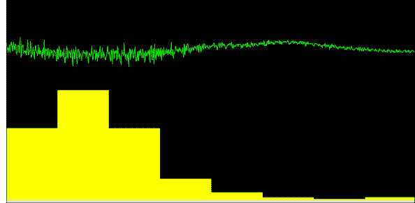
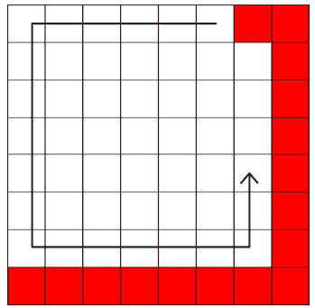
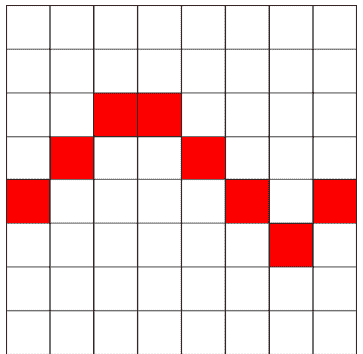
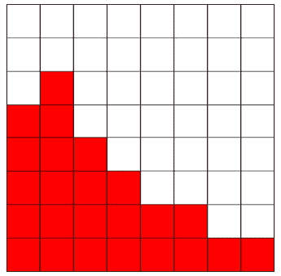
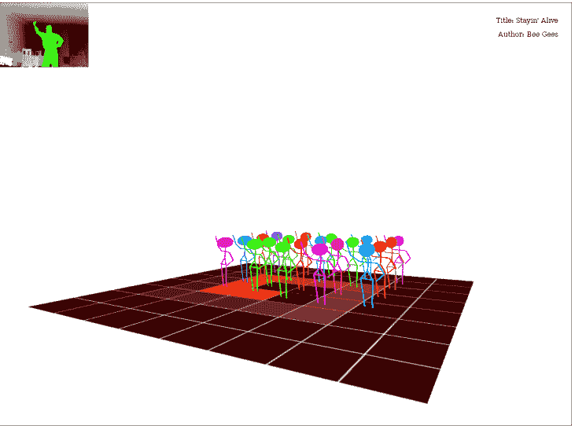

# 项目 3

## 迪斯科舞池

在上一个项目中，我们教会了Processing如何“看”，更重要的是如何“跳舞”。我们的火柴人舞蹈团目前正在一个非常无聊的灰色舞池上跳舞。这很快就会改变，因为在这个项目中，我们将为我们的舞蹈团创建一个真正的迪斯科舞池。

照明的迪斯科舞池在70年代末由约翰·特拉沃尔塔主演的电影《周六夜狂热》而流行起来，我们将模拟一个由64块从下方灯光照亮的玻璃地砖组成的舞池。

## 任务简报

在这个项目中，我们将使用Processing配合Minim框架（由Damien Di Fede开发）来播放和分析音乐。我们还将使用它来实时访问音乐数据并实现一些音频可视化。Minim已随Processing捆绑提供，因此我们不需要为此任务安装库。

我们将创建多种音乐和定时器控制的可视化模式，并在音乐播放时让我们的草图在它们之间切换。然后我们将通过将正在创建的图形转换为3D对象的纹理，把它们变成迪斯科舞池。最后，我们将把纹理添加到我们在上一个项目中为火柴人舞蹈团创建的那个有些无聊的舞池上。

## 为什么它很棒？

说到音乐可视化，Processing是一个非常明智的选择。Minim库简化了对诸如节拍检测和快速傅里叶变换等功能的访问，而Processing提供了对最出色的3D和2D图形效果的访问。

默认的iTunes音乐可视化程序最初是一个名为"Magnetosphere"的Processing脚本，由艺术家Robert Hodgin（又名Flight404）编写。

## 你的挑战目标

我们的项目包含四个任务，即：

- 你能听见我吗？
- 随音乐闪烁
- 制作你的迪斯科舞池
- 舞者们来了

## 任务检查清单

此任务关乎为音乐创建出色的视觉效果，因此我们显然需要一些音乐曲目和一张声卡。这些先决条件不应该太难找到。如果你想完成此任务的最终任务，你还需要我们上一个任务的最终草图和一个Kinect，但前三个任务可以独立于我们的上一个任务进行。

撰写本文时，Processing 2.0 Beta不开箱即用支持Linux音频框架PulseAudio。如果你使用的是使用PulseAudio的Linux发行版（例如Ubuntu），你需要将Java PulseAudio库添加到Processing中。你可以在Processing问题跟踪系统中找到安装必要库的详细说明，网址为 http://code.google.com/p/processing/issues/detail?id=930。

## 你能听见我吗？

在这个任务中，我们将编写一个Processing草图来播放MP3文件，并使用Minim库访问播放的音频样本。我们将使用这些数据来编写一个类似示波器的曲线。然后我们将使用Minim的`fft`类来计算当前播放声音的频谱，并生成一个柱状图来可视化它。

## 启动推进器

让我们给Processing装上"耳朵"：

- 1. 创建一个新的Processing草图，并添加`setup()`和`draw()`方法。

  ```java
  void setup() {
  }

  void draw() {
  }
  ```

- 2. 通过导航到"草图 | 导入库 ... | `minim`"来添加Minim库的`import`语句。

- 3. 现在我们需要通过导航到"草图 | 添加文件 ..."或直接将其拖放到草图窗口来向我们的草图添加一个MP3文件。

- 4. 向你的草图添加一个AudioPlayer对象，并在setup()方法中初始化它。

  ```java
  import ddf.minim.spi.*;
  import ddf.minim.signals.*;
  import ddf.minim.*;
  import ddf.minim.analysis.*;
  import ddf.minim.ugens.*;
  import ddf.minim.effects.*;

  Minim minim;
  AudioPlayer player;

  void setup() {
    size(600, 300);
    minim = new Minim(this);
    player = minim.loadFile("loop.mp3", 1024);
  }

  void draw() {
  }
  ```

  如果你不使用示例代码提供的MP3文件，请务必将"loop.mp3"替换为你想要使用的MP3文件的文件名。

- 5. 要启动我们的播放器，我们添加一个mousePressed()方法，如果播放器当前没有在运行则调用loop()方法，否则调用pause()。

  ```java
  void mousePressed() {
    if (player.isPlaying()) {
      player.pause();
    } else {
      player.loop();
    }
  }
  ```

- 6. 现在我们通过将以下代码添加到我们的draw()方法中来创建一个示波器显示：

  ```java
  void draw() {
    background(0);
    stroke(0, 255, 0);

    for (int i = 0; i < player.bufferSize() - 1; i++) {
      float x1 = map(i, 0, player.bufferSize(), 0, width);
      float x2 = map(i + 1, 0, player.bufferSize(), 0, width);
      line(x1, 75 + player.mix.get(i) * 75, x2, 75 + player.mix.get(i + 1) * 75);
    }
  }
  ```

- 7. 到目前为止，我们已经访问了音频数据的样本数据来生成可视化。另一个非常有用的分析和可视化音频数据的工具是所谓的快速傅里叶变换——简称fft——它在给定时间计算我们声音的频谱。我们使用logAverages()方法来减少我们获得的频段数量。我们向草图添加一个新变量并在setup()方法中初始化它。

  ```java
  Minim minim;
  AudioPlayer player;
  FFT fft;

  void setup() {
    size(600, 300);
    minim = new Minim(this);

    player = minim.loadFile("loop.mp3", 1024);

    fft = new FFT(player.bufferSize(), player.sampleRate());
    fft.logAverages(11, 1);
  }
  ```

- 8. 在我们的draw()方法中，我们更新频谱并遍历fft对象为我们计算的频段，方法是添加以下代码：

  ```java
  void draw() {
    background(0);
    stroke(0, 255, 0);

    for (int i = 0; i < player.bufferSize() - 1; i++) {
      float x1 = map(i, 0, player.bufferSize(), 0, width);
      float x2 = map(i + 1, 0, player.bufferSize(), 0, width);
      line(x1, 75 + player.mix.get(i) * 75, x2, 75 + player.mix.get(i + 1) * 75);
    }

    noStroke();
    fill(255, 255, 0);
    fft.forward(player.mix);
    float step = width / 8;
    for (int i = 0; i < 8; i++) {
      float value = fft.getAvg(i) * 3;
      rect(step * i, height - value, step, value);
    }
  }
  ```

- 9. 现在运行草图并在草图窗口内单击以启动音乐。可视化效果应该如下一个截图所示：

  

## 任务完成 - 小结简报

在这个任务中，我们将Minim库导入了我们的草图并添加了一个MP3循环。我们使用声音播放器对象来访问和管理音乐的启动和停止，并使用混音器来访问样本并将其可视化为类似示波器的线条。

在步骤7中，我们添加了一个fft对象来访问当前播放样本的频谱。在这个草图中，我们使用频率数据来生成频谱的柱状图。使用fft对象可以访问的频段数量取决于我们AudioPlayer的缓冲区大小。如果你增加缓冲区，你会在频域中获得更高的精度，但你也需要更多的样本来计算缓冲区，因此你的可视化效果将不那么灵敏。如果你增加频段数量，你也需要更多的CPU功率来计算频谱。我们为下一个任务创建的可视化效果只需要八个频段，因此我们告诉Minim在多个频段上计算平均值。

## 机密情报

Minim是一个非常灵活和模块化的声音库。我们用来分析声音样本或频率的方法与声音播放器独立。如果你想可视化通过声卡线路输入麦克风录制的声音，你可以像这样用输入线替换AudioPlayer对象：

```java
AudioInput in;
in = minim.getLineIn();
```

## 随音乐闪烁

我们当前任务的第二个任务是创建可视化器，根据定时器或从Minim获得的音频信息生成一个8 x 8的地砖数组。地砖数组将由我们的draw()方法用于生成舞池的俯视图。

要在不同的可视化器之间切换，我们将编写一个在后台运行并每隔n秒选择一个新可视化器的线程。

### 启动推进器

让我们随音乐闪烁：

- 1. 让我们从一个新的草图开始并导入Minim库。在我们的`setup()`方法中，我们定义一个Minim上下文和一个`AudioPlayer`对象，就像在上一个任务中所做的那样。这次，我们直接在`setup()`方法中启动播放器的循环，因此草图一运行循环就会开始。

  ```java
  import ddf.minim.spi.*;
  import ddf.minim.signals.*;
  import ddf.minim.*;
  import ddf.minim.analysis.*;
  import ddf.minim.ugens.*;
  import ddf.minim.effects.*;

  Minim minim;
  AudioPlayer player;

  void setup() {
    size(300, 300);

    minim = new Minim(this);
    player = minim.loadFile("loop.mp3", 1024);
    player.loop();
  }
  ```


- 2. 我们添加一个新选项卡并将其命名为 Visualizer。接口类似于没有方法实现的类定义。此接口定义了所有可视化器类都必须实现的方法。

```java
interface Visualizer {
public int[][] tiles = new int[8][8];
public void init();
public void tick();
public void setActive( boolean active );
}
```

- 3. 我们将要实现的第一个可视化器在每次调用 `tick()` 方法时，会每隔 8×8 瓦片网格中的第二个瓦片切换一次开关状态。添加一个新选项卡，将其命名为 Alternate，并添加以下代码：

```java
public class Alternate implements Visualizer {
int p = 1;
int count = 0;

public Alternate() {
init();
}

public void tick() {
count++;
if ( count < 4 ) return;

count = 0;
if ( p == 1 ) { p = 0; } else { p = 1; }
for ( int x = 0; x < 8; x++ ) {
for ( int y = 0; y < 8; y++ ) {
tiles[x][y] = 255 * ( (x+y+p) % 2 ) ;
}
}
}

public void init() {
for ( int x = 0; x < 8; x++ ) {
for ( int y = 0; y < 8; y++ ) {
tiles[x][y] = 0;
}
}
}

public void setActive( boolean active ) {
}
}
```

- 4. 现在切换回主草图选项卡，为当前可视化器添加一个变量，然后在 `setup()` 方法中初始化它。

```java
Visualizer viz;
Minim minim;
AudioPlayer player;

void setup() {
  size(300,300);

  minim = new Minim( this );
  player = minim.loadFile( "loop.mp3", 1024 );

  viz = new Alternate();
  viz.setActive( true );

  player.loop();
}
```

- 5. 为了让 `tick` 方法每 125 毫秒被调用一次，我们需要添加一个计时器。将以下线程添加到 `setup()` 方法中：

```java
Visualizer viz;
Minim minim;
AudioPlayer player;

void setup() {
  size(300,300);

  minim = new Minim( this );
  player = minim.loadFile( "loop.mp3", 1024 );

  viz = new Alternate();
  viz.setActive( true );
  Thread t = new Thread() {
    public void run() {
      for(;;) {
        viz.tick();
        delay(125);
      }
    }
  };
  t.start();

  player.loop();
}
```

- 6. 我们的可视化器已初始化并每隔 n 毫秒更改一次瓦片图案，但瓦片尚未绘制。我们通过将以下代码添加到 `draw()` 方法中来更改这一点：

```java
void draw() {
  background(0);
  float w = 300/8;
  for ( int x = 0; x < 8; x++ ) {
    for ( int y = 0; y < 8; y++ ) {
      stroke( 255 ) ;
      fill( viz.tiles[ x ][ y ],0,0 ) ;
      if ( viz.tiles[ x ][ y ] > 32 ) {
        viz.tiles[ x ][ y ] -= (viz.tiles[ x ][ y ]-32)/25 ;
      }
      rect( w * x, w*y, w, w ) ;
    }
  }
}
```

以下屏幕截图显示了图案的样式：


- 7. 如果我们现在启动草图，瓦片会疯狂闪烁，但老实说，过一段时间后会变得有点无聊。所以让我们添加另一个选项卡并实现一个新的可视化器。我们将类命名为 BarHorizontal 并添加以下代码：

```java
public class BarHorizontal implements Visualizer {
  int px = 0;
  int count = 0;

  public BarHorizontal() {
    init();
  }

  public void tick() {
    count++;
    if (count < 4) return;

    count = 0;
    for ( int i = 0; i < 8; i++ ) {
      tiles[min(7, px)][i] = 255;
    }

    if ( px >= 8 && tiles[7][7] != 0 ) {
      init();
    } else {
      px += 1;
    }
  }

  public void init() {
    px = 0;
    for ( int x = 0; x < 8; x++ ) {
      for ( int y = 0; y < 8; y++ ) {
        tiles[x][y] = 0;
      }
    }
  }

  public void setActive( boolean active ) {
  }
}
```

- 8. 切换回主选项卡，为我们的可视化器类添加一个数组。我们还添加了一个类似于第一个的新计时器，但这次我们将延迟设得更长，并且不是调用 `tick()` 方法，而是从我们的数组中选择一个新的可视化器。

```java
Visualizer viz;
Visualizer[] visualizers;

Minim minim;
AudioPlayer player;
```

```java
void setup() {
    size(300,300);

    minim = new Minim( this );
    player = minim.loadFile( "loop.mp3", 1024 );

    visualizers = new Visualizer[] {
        new BarHorizontal(),
        new Alternate()
    };

    viz = visualizers[0];
    viz.setActive( true );
    Thread t = new Thread() {
        public void run() {
            for(;;) {
                viz.tick();
                delay(125);
            }
        }
    };
    t.start();

    Thread t2 = new Thread() {
        public void run() {
            for(;;) {
                viz.setActive( false );
                viz = visualizers[ int(random(visualizers.length)) ];
                viz.init();
                viz.setActive( true );
                delay(8000);
            }
        }
    };
    t2.start();
    player.loop();
}
```

- 9. 现在我们将添加一个新的可视化器，以螺旋方式点亮面板。我们创建一个新选项卡，将其命名为 `SpiralIn`，并添加以下代码：

```java
public class SpiralIn implements Visualizer {
    PVector p = new PVector(0, 0);
    PVector d = new PVector(1, 0);

    public SpiralIn() {
        init();
    }

    public void tick() {
        tiles[int(p.x)][int(p.y)] = 255;
        if ( d.x == 1 && ( p.x == 7 ||
                tiles[int(p.x+1)][int(p.y)] != 0 ) ) {
            d = new PVector( 0, 1 );
        } else if ( d.x == -1 && ( p.x == 0 ||
                tiles[int(p.x-1)][int(p.y)] != 0 ) ) {
            d = new PVector( 0, -1 );
        } else if ( d.y == 1 && ( p.y == 7 ||
                tiles[int(p.x)][int(p.y+1)] != 0 ) ) {
            d = new PVector( -1, 0 );
        } else if ( d.y == -1 && ( p.y == 0 ||
                tiles[int(p.x)][int(p.y-1)] != 0 ) ) {
            d = new PVector( 1, 0 );
        }

        if ( p.x == 3 && p.y == 3 && tiles[3][4] != 0 ) {
            init();
        } else {
            p.add( d );
        }
    }

    public void init() {
        p = new PVector( 0, 0 );
        d = new PVector( 1, 0 );
        for ( int x = 0; x < 8; x++ ) {
            for ( int y = 0; y < 8; y++ ) {
                tiles[x][y] = 0;
            }
        }
    }

    public void setActive( boolean active ) {
    }
}
```

- 10. 为了在我们的草图中提供新的可视化器，我们切换到主草图并将 `SpiralIn` 类添加到 `visualizers` 数组中：

```java
visualizers = new Visualizer[] {
    new SpiralIn(),
    new BarHorizontal(),
    new Alternate()
}
```

SpiralIn 可视化器生成的图案如以下屏幕截图所示：



- 11. 现在我们添加一个可视化器，它不由我们的 `tick()` 方法控制，而是由 `AudioPlayer` 对象的样本控制。我们的类实现 `Visualizer` 接口，以及来自 Minim 的 `AudioListener` 接口。此可视化器中的 `tick()` 方法保持为空，因为我们在 `samples()` 方法中计算瓦片。我们添加一个新选项卡，将其命名为 BeatVisualizer，并添加以下代码：

```java
public class BeatVisualizer implements Visualizer, AudioListener {
	boolean active = false;
	public BeatVisualizer() {
		init();
	}

	public void tick() {
	}

	public void init() {
		for ( int x = 0; x < 8; x++ ) {
			for ( int y = 0; y < 8; y++ ) {
				tiles[x][y] = 0;
			}
		}
	}

	void samples(float[] samp) {
		samples( samp, samp );
	}

	void samples(float[] sampL, float[] sampR) {
		if ( active ) {
			for ( int x = 0; x < 8; x++ ) {
				float val = 0;
				for ( int i = 0; i < 5; i++ ) {
					val = sampL[x*5+i] * 8;
				}

				for ( int y = -4; y < 4; y++ ) {
					if ( val > y && val < y+1 ) {
						tiles[x][4+y] = 255;
					} else {
						tiles[x][4+y] -= tiles[x][4+y] / 4;
					}
				}
			}
		}
	}

	public void setActive( boolean active ) {
	  this.active = active;
	}
}
```

- 12. 切换回主选项卡，并将 `BeatVisualizer` 类添加到 `visualizers` 数组中。这一次，我们还需要将可视化器注册为 `AudioPlayer` 对象的回调函数。

```java
void setup() {
  size(300,300);

  minim = new Minim( this );
  player = minim.loadFile( "loop.mp3", 1024 );

  BeatVisualizer bv = new BeatVisualizer();
  player.addListener( bv );

  visualizers = new Visualizer[] {
    new SpiralIn(),
    new BarHorizontal(),
    new Alternate(),
    bv
  };
}
```

以下屏幕截图显示了我们 `BeatVisualizer` 类生成的图案：




- 13. 我们即将添加的最后一个可视化器使用 `fft` 对象在我们的瓷砖上绘制一个8频段频谱。添加一个新选项卡，将其命名为 `FFTVisualizer`，并添加以下代码：

```
public class FFTVisualizer implements Visualizer, AudioListener {
boolean active = false;
FFT fft;
public FFTVisualizer( AudioPlayer player ) {
init();
fft = new FFT( player.bufferSize(), player.sampleRate() );
fft.logAverages(11, 1);
}
public void tick() {
}
public void init() {
for ( int x = 0; x < 8; x++ ) {
for ( int y = 0; y < 8; y++ ) {
tiles[x][y] = 0;
}
}
}
void samples(float[] samp) {
samples( samp, samp );
}
void samples(float[] sampL, float[] sampR) {
if ( active ) {
fft.forward( sampL );
for ( int x = 0; x < 8; x++ ) {
float val = fft.getAvg(x)/20;
for ( int y = 0; y < 8; y++ ) {
if (val > y) {
tiles[x][7-y] = 255;
} else {
tiles[x][7-y] -= tiles[x][7-y]/4;
}
}
}
}
}
}
```

```
}

public void setActive( boolean active ) {
    this.active = active;
}
}
```

- 14. 现在将新可视化器添加到主选项卡中的 visualizers 数组，并将其注册为回调。

```
void setup() {
    size(300,300);

    minim = new Minim( this );
    player = minim.loadFile( "loop.mp3", 1024 );

    BeatVisualizer bv = new BeatVisualizer();
    player.addListener( bv );

    FFTVisualizer fv = new FFTVisualizer( player );
    player.addListener( fv );

    visualizers = new Visualizer[] {
        new SpiralIn(),
        new BarHorizontal(),
        new Alternate(),
        bv,
        fv
    };
```

以下屏幕截图显示了 FFTVisualizer 类生成的图案：



## 目标完成 - 小结

在此任务中，我们创建了三个基于时间的可视化器和两个对声音有反应的可视化器，用于控制我们舞池的 8 x 8 瓷砖图案。我们创建了两个定时器线程，一个每隔 125 毫秒调用一次我们可视化器的 `tick()` 方法，另一个用于更改活动的可视化器。

我们创建的基于时间的可视化器由 `tick()` 方法驱动，我们在其中更新瓷砖图案。这些可视化器被添加到可用可视化器的数组中，我们的第二个线程会从中随机选择一个新的可视化器。

`BeatVisualizer` 和 `FFTVisualizer` 类根本不使用 `tick()` 方法。它们在 `samples` 方法中更改可视化图案。我们将这两个可视化器注册为 `AudioPlayer` 对象的监听器，播放器每次加载新缓冲区时都会调用 `samples()` 方法。

我们在可视化器中创建的瓷砖图案由我们的 `draw()` 方法使用。我们还为瓷砖实现了一个小小的余晖效果，即在瓷砖点亮后，每一帧都降低颜色强度，而不是简单地将其关闭。

## 制作你的迪斯科舞池

在此任务中，我们将使用上一个任务中生成的草图，并将其转换为 3D 对象的纹理。我们将使用 Processing 形状创建一个矩形，并用我们的可视化器为其贴图。

我们还将为 MP3 文件实现 `playlist` 功能，并定义一种文件格式，允许我们控制音乐和可视化器的顺序。

## 为起飞做准备

在此任务中，我们将创建一个文本文件，用于控制我们的播放列表以及显示可视化器的顺序。每个播放列表条目有两行。第一行仅包含 MP3 文件的文件名，第二行包含可视化器 ID 及其持续时间（秒）。条目之间使用 "." 分隔。以下是播放列表文本文件的示例：

```
song1.mp3
0:4-1:2-3:2
song2.mp3
0:1-1:1:0:1-2-1
```

在此示例中，`song2.mp3` 文件将被播放，且 ID 为 0、1、0 和 2 的可视化器将各显示一秒。

因此，将一些 MP3 文件添加到 data 文件夹，并为你的歌曲创建一个播放列表文件。按之前描述的格式添加你喜欢的可视化器序列，并通过将播放列表文件拖放到草图窗口上，或导航到 Sketch | 添加文件... 将其放入 data 文件夹。

## 启动推进器

- 1. 为了实现播放列表功能，我们将添加一个名为 PlaylistItem 的新类。让我们添加一个新选项卡来定义我们的类。

```
public class PlaylistItem {
}
```

- 2. PlaylistItem 类需要保存歌曲名称、可视化器 ID 数组以及定义每个可视化器显示时长的数组。我们还实现了一个名为 current 的变量和一个 next() 方法，允许我们切换到下一个可视化器。

```
String songname;
int[] visualizers;
int[] delays;
int current;
public PlaylistItem( String songname, int[] visualizers, int[] delays ) {
this.songname = songname;
this.current = 0;
this.visualizers = visualizers;
this.delays = delays;
}

public void next() {
current += 1;
if ( current >= visualizers.length ) { current = 0; }
}

public int getVisualizer() {
return visualizers[current];
}

public int getDelay() {
return delays[current];
}
```

- 3. 要使用我们的播放列表，我们需要对 setup 方法进行一些更改。我们添加一个指向当前歌曲的变量，并使用 `PlaylistItem` 数组中的 `songname` 属性为播放器加载歌曲。

```
Visualizer viz;
Visualizer[] visualizers;
PlaylistItem[] playlist;
int currentSong = 0;
Minim minim;
AudioPlayer player;

void setup() {
  size(640,480, P3D);

  minim = new Minim( this );

  playlist = loadPlaylist( "playlist.txt" );
  player = minim.loadFile( playlist[currentSong].songname, 1024);

  BeatVisualizer bv = new BeatVisualizer();
  player.addListener( bv );

  ...
```

- 4. 我们需要实现 `loadPlaylists()` 函数，它解析我们的播放列表文本文件并生成一个 `PlaylistItem` 数组。将以下方法添加到你的草图中：

```
PlaylistItem[] loadPlaylists( String name ) {
  String[] str = loadStrings( name );

  PlaylistItem[] playlist = new PlaylistItem[ int( str.length / 2 ) ];

  for( int i=0; i < str.length; i+= 2 ) {
    String songname = str[i];
    String[] raw = str[i+1].split( "-" );

    int[] v = new int[raw.length];
    int[] d = new int[raw.length];

    for( int j=0; j<raw.length; j++ ) {
      String[] visdel = raw[j].split( ":" );
      v[j] = int(visdel[0]);
      d[j] = int(visdel[1]);
    }
```

```
}
playlist[ i/2 ] = new PlaylistItem( songname, v, d );
}
return playlist;
}
```

- 5. 现在我们需要更改控制可视化切换的线程，并将播放器启动命令从 `loop()` 改为 `play()`，因为我们不想循环播放第一首歌曲，而是要播放整个播放列表。

```
Thread t2 = new Thread() {
public void run() {
for(;;) {
viz.setActive( false );
viz = visualizers
[ playlist[currentSong].getVisualizer() ];
viz.init();
viz.setActive( true );

int rest = player.length() - player.position();
if ( rest > playlist[currentSong].getDelay() * 1000
)
{
delay( playlist[currentSong].getDelay() * 1000 );
} else {
delay( rest );
}
playlist[currentSong].next();
}
}
};
t2.start();
player.play();
}
```

- 6. 如果你现在运行草图，第一首歌曲开始播放，可视化器会变为我们定义的图案，但第一首歌曲结束后，音乐就会停止。因此，我们需要一个方法来检查歌曲是否已完成，然后开始下一首。将以下方法添加到我们的草图中：

```
void checkSongEnd() {
if (player.position() == player.length()) {
currentSong += 1;
if (currentSong >= playlist.length)
{ currentSong = 0; }
```

```
player = minim.loadFile( playlist[currentSong].songname, 1024 );
  player.play();
}
}
```

- 7. 我们刚刚创建的方法由 draw() 方法调用。添加以下行，以便我们的草图在每一帧都检查歌曲是否结束：

```
void draw() {
background(0);
float w = 300/8;
for (int x = 0; x < 8; x++) {
for (int y = 0; y < 8; y++) {
stroke( 255 );
fill( viz.tiles[x][y],0,0 );
if ( viz.tiles[x][y] > 32 )
{ viz.tiles[x][y] -= ( viz.tiles[x][y] -32)/25; }
rect( w * x, w*y, w, w );
}
}
checkSongEnd();
}
```

- 8. 接下来我们要做的是将 draw() 方法中生成的图形更改为 3D 对象的纹理。为了获得更多空间并启用 Processing 的 3D 模式，我们更改了 setup() 方法中草图的大小。

```
void setup() {
size(640,480, P3D);
...
```

- 9. 现在我们将创建一个 PGraphics 对象，不再从主窗口调用绘图命令，而是使用新图形对象提供的命令。我们刚刚创建的图形对象在缓冲区中包含我们可视化器的当前帧，我们可以将其用作纹理。因此，我们现在将添加一个 3D 正方形并为其贴图。

```
void draw() {
PGraphics g = createGraphics( 320, 320 );
g.beginDraw();
g.background(0);
float w = 320/8;
for (int x = 0; x < 8; x++) {
```


```
for( int y = 0; y < 8; y++ ) {
    g.stroke( 255 );
    g.fill( viz.tiles[x][y],0,0 );
    if ( viz.tiles[x][y] > 32 )
    {
        viz.tiles[x][y] -= ( viz.tiles[x][y] -32)/25; }
    g.rect( w * x, w*y, w, w );
}
}
g.endDraw();

background(0);

translate( width/2, height/2 );
rotateY( frameCount / 300.0 );
beginShape( QUADS );
texture( g );
vertex( -200, 100, -200, 0, 0 );
vertex( -200, 100, 200, 0, 320 );
vertex( 200, 100, 200, 320, 320 );
vertex( 200, 100, -200, 320, 0 );
endShape();

checkSongEnd();
}
```

## 目标完成 - 小型简报

在本任务中，我们将上一任务中的可视化器转换为 3D 图形的纹理。在我们的示例中，使用了一个简单的平面，它将在最终任务中充当舞池。

我们还为迪斯科实现了一个播放列表。当前播放的歌曲由一个文本文件控制，我们在 `checkSongEnd()` 方法中从列表中选择下一首歌曲。该方法检查当前歌曲是否播放完毕，如果是，则切换到下一个 `PlaylistItem`。

播放列表文本文件不仅包含我们想要播放的歌曲列表，还允许我们控制可视化器的顺序和时序。每个播放列表项包含两个名为 `id` 和 `delay` 的整数数组。第一个数组存储可视化器的顺序，第二个数组存储在我们的时序线程（步骤 6）中切换到下一个可视化器前需要等待的时间。

## 舞者登场

本次任务的最终目标是将我们刚刚创建的迪斯科舞池添加到来自项目 2（火柴人舞蹈公司）的草图中。我们将用在本次任务中创建的精彩可视化器，替换舞者目前使用的那片沉闷的灰色舞池。

我们将使用从 Minim 播放器获取的 metaData 对象来显示当前播放 MP3 文件的标题。

### 启动推进器

让我们添加舞者：

- 1. 本任务需要做的第一件事是将之前草图中的所有可视化器类复制到我们之前项目中的火柴人舞蹈公司草图。因此，我们同时打开之前任务中的 "visualizers" 草图和之前项目的最终草图。

- 2. 我们通过“文件 | 另存为”将火柴人舞蹈公司草图保存为不同的名称。

- 3. 现在我们切换到 "visualizer" 草图，并通过“草图 | 显示草图文件夹”打开草图文件夹。

- 4. 选择文件夹中的所有文件，但 visualizers.pde 文件除外，将它们拖放到火柴人舞蹈草图的草图窗口中。Processing 会为每个拖入的文件添加一个新选项卡。

- 5. 将 loadPlaylist() 函数复制到火柴人舞蹈草图。

```
PlaylistItem[] loadPlaylist( String name ) {
  String[] str = loadStrings( name );

  PlaylistItem[] playlist = new PlaylistItem
  [ int( str.length / 2 ) ];

  for( int i = 0; i < str.length; i += 2 ) {
    String songname = str[i];
    String[] raw = str[i+1].split("-");

    int[] v = new int[raw.length];
    int[] d = new int[raw.length];

    for( int j = 0; j < raw.length; j++ ) {
      String[] visdel = raw[j].split(":");
      v[j] = int(visdel[0]);
      d[j] = int(visdel[1]);
    }
    playlist[ i/2 ] = new PlaylistItem( songname, v, d );
  }
  return playlist;
}
```

- 6. 将以下更改复制到我们的 setup() 方法中，以初始化播放列表和用于切换可视化器的线程。我们还必须将 AudioPlayer 变量重命名为 aplayer，因为 player 在火柴人舞蹈公司草图中已经被使用了：

```
SimpleOpenNI context;
int player = -1;
boolean calibrated = false;

Figure figures[][] = new Figure[5][4];

Visualizer viz;
Visualizer[] visualizers;
PlaylistItem[] playlist;
int currentSong = 0;
Minim minim;
AudioPlayer aplayer;

void setup() {
    size( 1024, 768, P3D);
    context = new SimpleOpenNI( this );
    context.enableDepth();
    context.setMirror( true );

    context.enableUser( SimpleOpenNI.SKEL_PROFILE_ALL );

    smooth();
    lights();

    for ( int i = 0; i<5; i++) {
        for ( int j=0; j<4; j++) {
            figures[i][j] = new Figure();
            figures[i][j].randomize();
        }
    }
    minim = new Minim( this );

    playlist = loadPlaylist( "playlist.txt" );
    aplayer = minim.loadFile( playlist
    [currentSong].songname, 1024);

    BeatVisualizer bv = new BeatVisualizer();
    aplayer.addListener( bv );

    FFTVisualizer fv = new FFTVisualizer( aplayer );
    aplayer.addListener( fv );

    visualizers = new Visualizer[] {
    new SpiralIn(),
    new BarHorizontal(),
    new Alternate(),
    bv,
    fv
    };

    viz = bv;
    viz.setActive( true );
    Thread t = new Thread() {
    public void run() {
    for(;;) {
    viz.tick();
    viz.delay(125);
    }
    }
    };
    t.start();

    Thread t2 = new Thread() {
    public void run() {
    for(;;) {
    viz.setActive( false );
    viz = visualizers
    [ playlist[currentSong].getVisualizer() ];
    viz.init();
    viz.setActive( true );

    int rest = aplayer.length() - aplayer.position();
    if ( rest > playlist[currentSong].getDelay() *
    1000 ) {
    delay( playlist[currentSong].getDelay() * 1000 );
    } else {
    delay( rest );
    }
    playlist[currentSong].next();
    }
    }
    };
    t2.start();
    aplayer.play();
}
```

- 7. 我们现在将可视化器的绘图代码添加到 drawFloor() 方法中，以便可以将它们作为纹理用于地板正方形。

```
void drawFloor() {
PGraphics g = createGraphics( 320, 320 );
g.beginDraw();
g.background(0);
float w = 320/8;
for( int x = 0; x < 8; x++ ) {
for( int y = 0; y < 8; y++ ) {
g.stroke( 255 );
g.fill( viz.tiles[x][y],0,0 );
if ( viz.tiles[x][y] > 32 )
{ viz.tiles[x][y] -= ( viz.tiles[x][y] -32)/25; }
g.rect( w * x, w*y, w, w );
}
}
g.endDraw();

noStroke();
fill( 128 );

beginShape(QUADS);
texture( g );
vertex( -400, -100, -400, 0, 0 );
vertex( -400, -100, 400, 0, 320 );
vertex( 400, -100, 400, 320, 320 );
vertex( 400, -100, -400, 320, 0 );
endShape();
}
```

- 8. 现在我们需要复制 `checkSongEnd()` 方法来检查当前歌曲是否播放完毕。

```
void checkSongEnd() {
  if (aplayer.position() == aplayer.length()) {
    currentSong += 1;
    if (currentSong >= playlist.length) { currentSong = 0; }

    aplayer = minim.loadFile( playlist[currentSong].songname,
    1024);

    aplayer.play();
  }
}
```

- 9. 为了确保我们的 `checkSongEnd()` 方法在每一帧后都被调用，我们将其添加到 `draw()` 方法中。

```
void draw() {
  background( 255 );
  checkSongEnd();

  context.update();
  ...
```

- 10. 本任务列表中的最后一项是显示当前播放歌曲的标题和艺术家。幸运的是，Minim 提供了一个 `MetaData` 类，可以从 `AudioPlayer` 对象中提取这些数据。在主草图的 `setup()` 方法正上方定义一个名为 `meta` 的变量。

`AudioMetaData meta;`

- 11. 将以下行添加到 `setup()` 方法中：

```
...
playlist = loadPlaylist( "playlist.txt" );
aplayer = minim.loadFile
( playlist[currentSong].songname, 1024);
meta = aplayer.getMetaData();
textFont(createFont("Serif", 12));
...
```

- 12. 然后我们还需要在 `checkSongEnd()` 方法中更新元数据，因为当当前歌曲播放完毕时，我们需要更新 `metaData` 对象，以便开始下一首歌曲。

```
void checkSongEnd() {
  if (aplayer.position() == aplayer.length()) {
    currentSong += 1;
    if (currentSong >= playlist.length)
    { currentSong = 0; }

    aplayer = minim.loadFile
    ( playlist[currentSong].songname, 1024 );
    meta = aplayer.getMetaData();
    aplayer.play();
  }
}
```

- 13. 添加一个 drawMeta() 方法，它使用 Minim MetaData 对象获取歌曲的标题和艺术家，并使用 text() 函数显示它们。

```
void drawMeta() {
textAlign( RIGHT );
fill( 0 );
text( "Title: "+meta.title(), 1000, 40 );
text( "Author: "+meta.author(), 1000, 65 );
}
```

- 14. 现在我们从 draw() 方法中调用 drawMeta() 方法。

```
void draw() {
background( 255 );
checkSongEnd();
context.update();

drawHUD();
drawMeta();
translate( width/2, height/2, 0 );
...}
```

- 15. 将一些 MP3 文件添加到我们的草图中，并调整播放列表文本文件。运行你的草图，开始起舞吧。

## 目标完成 - 小型简报

在本任务中，我们将上一任务中的可视化器添加到了火柴人舞蹈公司草图。我们在 drawFloor() 方法中使用了纹理，用我们的可视化器替换了灰色的正方形。我们还添加了播放列表功能和可视化器排序，以完成我们的迪斯科。

在步骤 8 中，我们添加了一个用于绘制歌曲标题和艺术家的新函数。这些数据是使用 Minim metaData 对象收集的。


## 任务完成

在本项目中，我们学习了如何使用 Minim 框架播放 MP3 文件以及如何访问采样数据。我们使用采样数据为当前播放的声音生成可视化效果。我们使用 Minim 框架的 fft 类生成均衡器可视化效果。

在第二个任务中，我们编写了五个类来更改由 8 x 8 方块网格组成的图案。我们使用了一个定时器线程来触发其中三个类的变化。我们还添加了一个可视化器，它使用采样数据和 fft 类来生成该图案。

在第三个任务中，我们更改了 draw() 方法，并使用第二个任务中生成的视觉效果作为纹理。我们还添加了播放列表功能。播放列表控制歌曲播放顺序，也控制我们的可视化器显示顺序及其显示时长。

在本次任务的最终任务中，我们将可视化器纹理和播放列表类合并到来自项目 2《火柴人舞蹈公司》(The Stick Figure Dance Company) 的火柴人舞蹈公司中。我们还向 draw() 方法添加了一个新功能，以显示从 MP3 元数据中检索到的歌曲标题和艺术家。



## 你准备好全力以赴了吗？热血挑战

在这次任务中，我们创建了一些非常酷的声音可视化效果，并用一个极佳的闪烁迪斯科舞池取代了上次任务中乏味的灰色舞池。但即使是非常棒的迪斯科舞池也可以变得更好！你不妨尝试实现以下其中一个想法，将其提升到新的水平：

- 添加一些灯光效果、迪斯科球或频闪灯
- 使用粒子添加一些烟花效果
- 将红色方块更改为变色方块
- 连接一些受 DMX 控制的灯光，并使虚拟舞池也能控制你的真实舞池
- 为播放列表添加交叉淡入淡出
